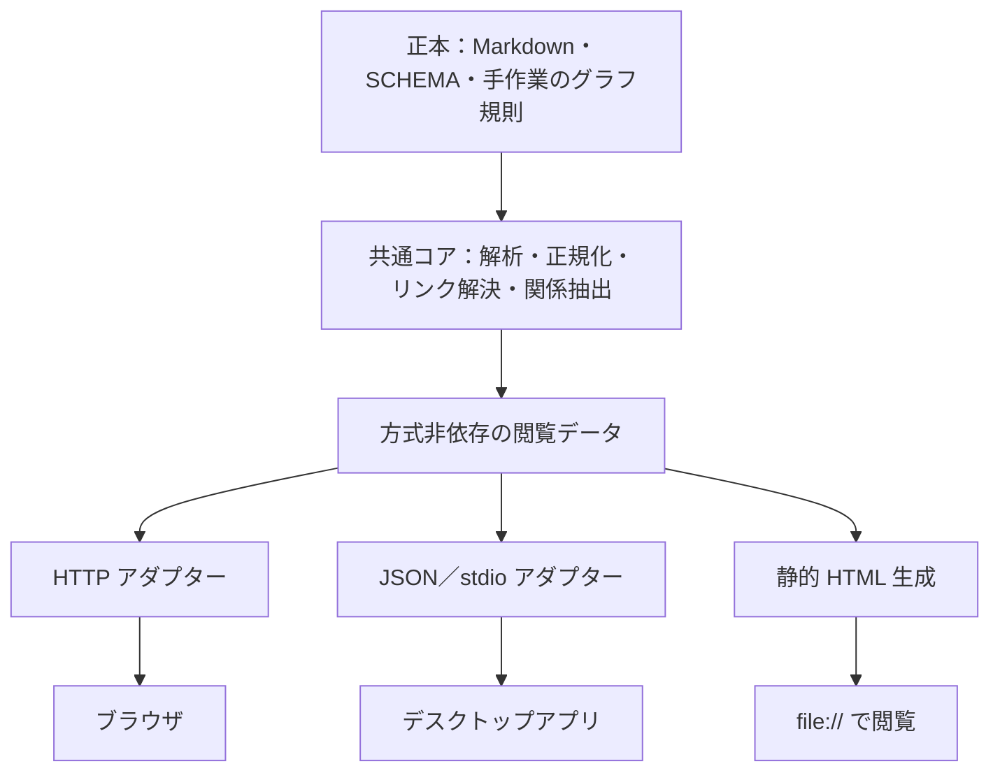

先ほどのタスクに、あなたを含む 4 体のエージェントが独立して取り組みました。
あなた以外の 3 体の成果を渡します。エージェントは「エージェント A」のように記号で呼び、モデル名は明かしません。
あなたの最終メッセージだけがレビューとして保存されます。

## タスク（再掲）

ブラウズの手段について、以下の三案のどれかを採用するが、どれを採用しても大丈夫な設計にしてほしい

* ローカル HTTP サーバー
* Obsidian のようなビューワ（アプリケーション）を実装
   * 実装言語はデスクトップアプリが作成できるプログラミング言語で
   * 移植性も考慮
* 静的 HTML

## レビューへの作者の指示

敵対的レビューを行うこと


## 他のエージェントの成果

### エージェント B

## 結論

**三案のどれを採っても壊れない設計の核は、「wiki を解釈するコンパイラを 1 つだけ持ち、三案はその出力を表示するアダプタにする」ことである。** コンパイラは Python でプラグインの中に置き、既存の `resolve_link()`、`canonical_meta()`、`collect_pages()`、被リンク、`graph.sqlite` の問い合わせを再利用して、**版番号つきの「ブラウズ・バンドル」**（JSON のマニフェスト＋ページごとの HTML 断片＋共通の CSS/JS）を出す。ローカル HTTP サーバー、静的 HTML、デスクトップアプリは、このバンドルを配る・書き出す・ウィンドウに載せるだけで、Markdown の変換やリンクの解決を二重に実装しない。

契約は、三案のうちもっとも制約が強い **「`file://` で開いても動く」** に合わせて決める。これを満たせば、サーバーとデスクトップアプリは自動的に満たす。具体的には次の 6 つを設計規則にする。

| # | 規則 | 理由 |
| --- | --- | --- |
| 1 | ページは 1 枚ずつ自立した HTML にし、リンクは相対パスだけで書く（`../concepts/foo.html`）。`/w/<wiki-id>/...` のような絶対の URL 接頭辞を本文に埋めない | `file://` では絶対パスが使えない。相対パスなら、サーバーがどの接頭辞（トークンや wiki の識別子）の下に載せても壊れない |
| 2 | 被リンク、未解決リンクの一覧、ページごとの型付き関係、ナビゲーション（`index.md` と `indexes/`）、見出し一覧は、閲覧時に計算せず、すべてバンドルに事前計算して入れる | `file://` では `fetch()` が使えない。事前計算すれば三案で同じ画面になり、決定行列で A が劣るとされた「グラフと被リンク」の差も消える |
| 3 | 検索だけは「ホストの能力」として段階を宣言する。`live`（`wiki_search.py --json` をその場で呼ぶ）、`embedded`（静的用の軽い索引を `<script>` で同梱）、`none` | 三案で唯一そろえられない機能なので、そろえない代わりに段階を契約に書く |
| 4 | バンドルに `wiki/assets/` の許可リストを持ち、mermaid のフェンスは `<pre class="mermaid">` としてエスケープして出す | ADR-0005 が記録した「サーバーがページ一覧のパスしか返さないので svg が配信されない」を、三案共通の仕組みで解決する。mermaid.js の同梱は三案共通のテンプレートの判断になる |
| 5 | コンパイラは wiki を一切書き換えず、書き出し先は `<WIKI_ROOT>/.wiki-cache/browse/` か利用者が指定したディレクトリに限る | F-G06 と ADR-0002 の「閲覧専用」を、ホストではなくコンパイラの契約として守る |
| 6 | wiki の本文は閲覧手段に依存しない（Obsidian 固有の記法、ビューワ固有の frontmatter、JavaScript がないと読めない要素を使わない） | 「どのビューワでも大丈夫」のもう半分は、コンテンツ側の規律で担保する |

デスクトップアプリの言語は今決めなくてよい。契約（バンドルの版と形式）を固定すれば、Rust（Tauri）、JavaScript（Electron）、Python（pywebview）のどれでも「WebView にバンドルの HTML を載せ、Python のコンパイラ（またはローカルサーバー）を子プロセスとして呼ぶ殻」として作れる。無理に 1 つを選ぶなら、移植性と配布物の小ささから Tauri 2 を推し、最初の試作は Python のまま作れる pywebview で済ませる。

この設計は ADR-0002（構成 B のローカルサーバー）を否定しない。サーバーは第 1 のアダプタとして最初に作る。ただし ADR-0002 の 2 行（「既定ではファイルに書き出さず、ページを開いたときに変換する」「複数 Wiki は URL に識別子を含めて切り替える」）は、本設計と両立させるために改訂の ADR が要る（「前提と不確実性」を参照）。

## 根拠

**1. ブラウズの実装はまだなく、設計はコードに縛られていない。** `info-hive-wiki/commands/` には evolve、graph、help、ingest、init、learn、lint、query、stats、upgrade の 10 本だけで、browse.md はない。`info-hive-wiki/docs/commands.md` の一覧も 10 本である。決めるべきは、ADR-0002 で選んだ構成 B の中の層の切り方である。

**2. 「コンパイラ」に要る部品は、すでにスクリプトの中に関数として存在する。** 閲覧画面に要る解釈はすべて既存関数で足り、新規に書くのは HTML への変換とバンドルの組み立てだけである。

| 必要な解釈 | 既存の関数（`info-hive-wiki/skills/info-hive/scripts/`） |
| --- | --- |
| ページの走査、slug、rel_path、frontmatter、本文、リンク、セクション、SHA-256 のキャッシュ | `wiki_search.py` の `collect_pages()`（L279〜）。`SCHEMA.md`、`index.md`、`log.md`、`indexes/`、`graph/`、`raw/`、`.wiki-cache`、`.evolution` を除外する |
| wikilink の解決（NFC、大文字小文字の区別、`dir/slug` は制約、`#見出し`、`|別名`、`.md`） | `wiki_lint.py` の `clean_link_target()`（L71）と `resolve_link()`（L84）。`wiki_search.py` L235〜274 に同じ関数がある |
| 日本語の別名キーと `type`・`kind` の値の正規化 | `wiki_text.py` の `canonical_meta()`（L103）、`normalize_tags()`（L134） |
| 被リンク | `wiki_search.py` の `cmd_backlinks()`（L1083）の照合ロジック（`link_key()` で比較） |
| ページごとの型付き関係 | `wiki_graph_query.py` の `edges_from()`（L60）、`edges_to()`（L70）。`graph/nodes.jsonl`、`edges.jsonl` はそのまま全体グラフの JSON になる |
| 検索の結果の形 | `wiki_search.py` の `json_result()`（L813）。`slug`、`rel_path`、`type`、`title`、`heading_path`、`score`、`snippet` など英語キー |

選択肢レポート §1 の 2 と §7.2 の手順 1 も、`resolve_link()` を共通モジュールに切り出すことを最初の作業にしている。本設計はその延長で、「切り出した共通部品の利用者をコンパイラ 1 つに限る」と言い換えたものである。

**3. `file://` の制約が三案の共通分母である。** 選択肢レポート §4 と §5 は、Docsify（36）、ブラウザ側の描画（40）、Pagefind（71）、JSON 索引（74）、`wiki_search.py`（75）が「ブラウザが別のファイルを取得する」ため `file://` では動かないと整理している。したがって、静的 HTML でも動く形にするには、取得が要る情報を事前計算してページに埋めるか、`<script src>` で読み込む形にするしかない（ブラウザが `file://` で `<script src>` を許し `fetch()` を拒む、という挙動は私の知識にもとづく推測で、本調査では未確認）。この形はサーバーでもデスクトップでもそのまま動くので、三案の交差点になる。

**4. 事前計算の費用は小さい。** 決定行列 §4.1 の実測（検証環境、合成 wiki）では、1 ページの HTML 変換が 1.3 ミリ秒、1,000 ページの全変換が 1.26 秒、静的 HTML の起動から全変換までが約 2.3 秒である。`collect_pages()` は SHA-256 で解析キャッシュを持つので、差分だけ作り直せる。サーバーは同じコンパイラを「要求のたびに更新時刻を確かめて 1 ページだけ変換する」モードで呼び、静的は「全ページを書き出す」モードで呼ぶ。入口が 2 つで、コードの経路は 1 つになる。

**5. ナビゲーションを各ページに埋め込むと静的出力が肥大するので、共有スクリプトにする。** `index.md` の 1 項目は「`- [[slug]]: 1 行の要約`」で、日本語の要約を含めて 1 項目約 100 バイトと見積もる（推定）。1,000 項目なら約 100 KB で、これを 1,000 ページすべてに埋めると 100 KB × 1,000 = 約 100 MB になる。ナビは `nav.js` のような共有ファイルに 1 つだけ置き、各ページは `<script src="../nav.js">` で読み、`<noscript>` には `index.html` へのリンクを残す。これなら本文の HTML は約 10〜20 KB × 1,000 = 10〜20 MB（推定）に収まる。

**6. 決定行列の論理に照らすと、本設計は「安い保険」である。** 決定行列 §5.3 によれば、B が A を上回る 1.24 点のうち 1.09 点（約 88%）が拡張性に由来する。§5.1 の拡張性の内訳は 4 方向（日本語の全文検索、グラフと被リンク、RAG 統合、複数 Wiki）の平均で、A は 4.0、B は 8.75 だった。被リンクとグラフをバンドルに事前計算すると、「グラフと被リンク」は三案で同じになる。残る差は、その場の検索、RAG の検索結果からの誘導、複数 wiki の切り替えの 3 つで、どれもサーバーまたはデスクトップが持つ「能力」として契約に書ける。B を選び直す話ではなく、B の中でコンパイラの境界を正しく引けば A と C が付いてくる、という話である。

**7. 検索の段階を契約に書く理由。** 選択肢レポート §1 の 4 は、全文検索を `wiki_search.py` 経由にする理由として、`/wiki:query` と同じ BM25 と埋め込み、日本語の bigram 分割をそのまま使えることを挙げている。静的 HTML でこれを JavaScript に移植すると、`tokenize()`（`wiki_search.py` L139）の規則が二重になり、lint と画面の食い違いと同じ種類の問題を検索に持ち込む。そこで、`embedded` の段階は「`index.md` の題名と要約、タグの照合」に限り、本文の全文検索は `live` の段階でだけ提供すると割り切る。postings を Python 側で作って JS は照合だけ、という中間案もあるが、クエリ側の分割は JS に要るので同じ問題が残る。

**8. RAG と複数 wiki はホストの能力である。** rag の MCP は `search(wiki_root, query, limit)`（`info-hive-rag/scripts/rag_server.py` L152）を持ち、結果は `chunk_id`、`doc_id`、`page`、`section`、`title`、`text`、`score`（`rag_index.py` L320〜349）である。原本への参照は `books:日本語資料.pdf` のような名前付き参照（rag の README）で、`file://` へのリンクはブラウザが開かない（選択肢レポート §6.8）。したがって RAG の結果は「表示して、パスと頁をコピーできる」までが三案共通の UI 部品になり、呼び出しそのものはサーバーとデスクトップだけが持つ。複数 wiki は ADR-0008 のとおり作業領域ごとに `wiki/` が 1 つなので、「wiki ルートごとに 1 バンドル。ホストが複数を載せる」で足り、URL の規約を契約にしなくてよい。別の wiki への相対リンクは、選択肢レポート §6.9 と同じく「外部の参照」として示す。

**9. サーバー固有の対策は、相対リンクの規則と両立する。** 選択肢レポート §6.8 の起動ごとのトークンは、`/t/<token>/concepts/foo.html` のようにパスの接頭辞に置けば、本文の相対リンクがそのまま接頭辞を引き継ぐので、HTML 断片を一切変えずに済む。Host ヘッダーの確認、CSP、127.0.0.1 への固定はハンドラ側の処理で、バンドルには影響しない。

**10. デスクトップアプリの言語を「後で決められる」ようにする契約。** アプリがやることは、(a) wiki ルートの一覧を持つ、(b) `uv run --script wiki_render.py <WIKI_ROOT> --out <dir>` を子プロセスで呼ぶか、ローカルサーバーを起動してその URL を開く、(c) WebView にバンドルを載せる、(d) ファイルの変更を監視して再コンパイルを頼む、の 4 つである。Markdown と wikilink の規則はアプリの言語に持ち込まない。Python と uv はプラグインの前提（`info-hive-wiki/README.md` の「前提として必要なのは `uv` だけ」）なので、アプリがそれに依存しても新しい前提は増えない。

| 候補 | 言語 | 描画エンジン | 長所 | 注意 |
| --- | --- | --- | --- | --- |
| Tauri 2 | Rust（UI は HTML/JS） | OS の WebView（Windows は WebView2、macOS は WKWebView、Linux は WebKitGTK） | 配布物が小さい。Windows・macOS・Linux に対応 | OS ごとにエンジンが違い、日本語のフォントと禁則の見え方が揃わない（`text-autospace` の対応差など、選択肢レポート §6.7 の方針で吸収する） |
| Electron | JavaScript | 同梱の Chromium | 描画が OS によらず同じ。Obsidian 自身がこの方式 | 配布物が大きい。Node.js の開発環境が要る |
| pywebview | Python | OS の WebView | 新しい言語が要らず、プラグインと同じスタックで試作できる | 配布には PyInstaller などが要る。Tauri と同じく OS でエンジンが違う |

いずれも「殻」なので、バンドルの版に固定（pin）して動く。デスクトップアプリは Claude Code のプラグインではないので、置き場所（別リポジトリ）と公開の周期は作者の判断になる。デスクトップと静的の 2 案は、研究で記録されたサーバー固有の悩み 2 つ、「Claude Code が終了時にバックグラウンドの処理を止める」（選択肢レポート §6.9）と「トークンと Host ヘッダーの対策」（§6.8）を回避できる。

**11. 「どれを採っても大丈夫」を証明する受け入れテスト。** `info-hive-wiki/eval/retrieval/ja/corpus/wiki/`（決定行列 §4.2 によれば 28 ページ）でバンドルを作り、次を確かめる。(a) 未解決リンクの一覧が `wiki_lint.py` の結果と一致する（選択肢レポート §7.2 の合格の目安と同じ）。(b) 各ページの HTML 断片が、サーバーが返すもの、静的に書き出したもの、デスクトップの殻が読み込むもので、バイト単位で同一である。(c) 静的出力を `file://` で開いて、コンソールにエラーがなく、リンクで移動できる。(d) サーバーは 127.0.0.1 以外への通信が 0 件。(b) が成り立てば、三案は構成上入れ替え可能である。

**12. バンドルの中身（キーは英語、本文は日本語）。** `bundle_version`、`wiki_root`、`generated_at`、`capabilities`（`search: live|embedded|none`、`rag: true|false`、`graph: true|false`）、`pages[]`（`slug`、`rel_path`、`title`、`type`、`kind`、`tags`、`created`、`updated`、`sources`、`headings[]`、`outlinks_resolved[]`、`outlinks_unresolved[]`、`backlinks[]`、`relations[]`、`sha256`、`html`）、`nav`（`index.md` と `indexes/<type>.md` を解釈した木。`collect_pages()` はこれらを除外するので、コンパイラが別に読む）、`assets[]`（`wiki/assets/` の許可リスト）、`graph`（`nodes.jsonl` と `edges.jsonl` の写し）、`search_index`（`embedded` のときだけ）。見出し ID は選択肢レポート §6.7 のとおり NFC のまま日本語で付け、`[[slug#見出し]]` の解決と一致させる。

## 検討した代替案

| 案 | 採らなかった理由 |
| --- | --- |
| 三案それぞれに Markdown 変換とリンク解決を持たせる（サーバーは Python、デスクトップはアプリの言語、静的は生成器） | 規則が 3 か所に分かれ、lint と画面の食い違い（ADR-0002 の「理由」）が 3 倍になる。決定行列 §4.2 の Obsidian の食い違い（大文字小文字、NFD、クリックでページが増える）は、まさに別実装の規則が招いた例である |
| サーバーを唯一の経路にし、デスクトップアプリはサーバーの URL を開くだけ、静的は作らない | 「どれを採っても」という依頼に反する。また、Claude Code のセッション終了でサーバーが止まる（選択肢レポート §6.9）ので、デスクトップアプリが自前でプロセスを管理する必要があり、結局コンパイラの CLI 契約が要る |
| 静的 HTML を主にし、サーバーは静的出力を配るだけにする | その場の検索と RAG を失う。決定行列 §5.3 のとおり、B の優位は拡張性にある。本設計では静的出力は同じコンパイラの別の入口なので、主従を決めなくてよい |
| 既製の静的サイト生成器（Quartz、MkDocs、Zensical、Docsify）を静的の経路に使う | 決定行列 §5.2 で 8 案中 5〜8 位。日本語の別名キーと型付きグラフを解釈せず、wikilink の規則も食い違う（ADR-0002「検討した選択肢」）。本設計の規則 6（コンテンツは閲覧手段に依存しない）とも相性が悪い |
| デスクトップアプリで Markdown をネイティブに描く（WebView を使わない） | HTML/CSS を共有できず、日本語の禁則と折り返しの CSS 方針（選択肢レポート §6.7）をアプリの言語で作り直すことになる |
| 静的 HTML に本文の全文検索を JavaScript で同梱する | `tokenize()` の規則の二重化。段階 `embedded` を題名・要約・タグに限り、全文は `live` に残す方が、規則の一元化と矛盾しない。需要が出たら、Python 側で postings を作る中間案を検討する |
| 多 wiki を URL の規約（`/w/<wiki-id>/<rel_path>`）で契約にする | `file://` で成り立たない。「wiki ルートごとに 1 バンドル」なら三案で同じ扱いになる |

## 前提と不確実性

- **サブモジュールの読み方。** このワークツリーではサブモジュールが空だったので、スクリプトと文書は主の作業コピー `C:/Works/info-hive-dev/info-hive-wiki/`（HEAD `3028923`）から読んだ。ワークツリーの gitlink（`302892390250…`）と一致することを `git submodule status` で確かめた。引用した行番号はこの版のものである。
- **ブラウザの `file://` の挙動。** 「`fetch()` は使えず、`<script src>` は読める」は私の知識にもとづく推測で、本調査で一次資料を確かめていない。選択肢レポート §8 も Docsify と Pagefind について「公式の記述は未確認」としている。設計規則 1〜3 はこの前提に立つ。
- **デスクトップの WebView のエンジンと対応 OS。** Tauri、Electron、pywebview の特徴は私の知識で、版と対応状況は未確認である。日本語の描画の差は、選択肢レポート §6.7 の CSS 方針で吸収できると見込んでいるが、Linux の WebKitGTK での実機確認が要る。
- **規模の見積もり。** ナビ 1 項目 100 バイト、本文 HTML 1 ページ 10〜20 KB は推定で、実際の wiki（1 ページ 4,000 字まで）で測り直す必要がある。決定行列 §4.1 の実測も合成ページによるものである。
- **ADR-0002 の改訂（作者の判断）。** 次の 2 行は、本設計と両立させるために置き換えの ADR が要る。(1)「既定ではファイルに書き出さず、ページを開いたときに変換する。静的 HTML の書き出しは副機能」→ 静的の書き出しはコンパイラの第一級の入口にし、サーバーの既定（その場で変換）は変えない。(2)「複数 Wiki は URL に識別子を含めて切り替える」（選択肢レポート §6.9）→ 相対リンクと「wiki ルートごとに 1 バンドル」に改める。あわせて §6.8 の「ページの一覧にある rel_path だけを返す」に `wiki/assets/` の許可リストを足す（ADR-0005 の「見直す条件」と整合する）。
- **作る順序（作者の判断）。** ADR-0002 は「第 1 段階で読む画面、次に日本語の全文検索」とする。本設計では、共通部品の切り出し → コンパイラと静的書き出し → サーバー（`live` の検索）→ デスクトップの殻、の順が最も安い。静的の書き出しはポートを開かずにテストでき、受け入れテスト (a)(b) をサーバーの前に通せる。読む画面を最初に届けるという ADR の意図は保てるが、順序の変更は作者が決める。
- **デスクトップアプリの置き場所と配布。** プラグインではないので、`info-hive-dev` のサブモジュールにするか、別の製品にするか、Python と uv を前提にしてよいかは未決である。本設計はバンドルの版で結び付けるだけなので、どちらでも成り立つ。
- **検索の `embedded` の範囲。** 題名・要約・タグに限る案は私の提案で、利用者が静的出力で本文検索を求めるかは分からない。
- **mermaid.js の同梱。** ADR-0005 は第一段階に含めないとしている。本設計は「出す形」（`<pre class="mermaid">`）だけを決め、同梱の時期は ADR-0005 の「見直す条件」に従う。

## 参照

- `docs/adr/README.md`、`docs/adr/0001-local-only-server-is-not-hosted-wiki.md`、`docs/adr/0002-wiki-browse-uses-on-demand-local-server.md`（決定、理由、検討した選択肢、見直す条件）、`docs/adr/0005-wiki-figures-use-mermaid-and-svg.md`（背景の制約、browse での表示、見直す条件）、`docs/adr/0007-rag-uses-mcp-core-and-persistent-jobs.md`、`docs/adr/0008-numbered-workspace-layout.md`（各ディレクトリの役割、設定と作業領域の見つけ方）、`docs/adr/0009-graph-layer-stays-in-wiki.md`
- `docs/research/llm-wiki-browse-options.md` §1、§2.2〜2.5、§3.1、§4（候補 1〜22、36、40、71、74、75）、§5、§6.5〜6.9、§7.1〜7.2、§8
- `docs/research/llm-wiki-browse-decision-matrix.md` §1、§2.3、§4.1、§4.2、§5.1〜5.3、§6、§7、§8
- `llm-wiki-product-concept-and-requirements-ja.md` D-03、F-G06、AC-D02、O-11（`grep` で該当行を確認）
- `docs/porting-plan.html` 方針 B、方針 G、Q4（本文を抽出して確認）
- `info-hive-wiki/.claude-plugin/plugin.json`、`README.md`（前提は uv のみ、10 本のコマンド）、`docs/commands.md`、`commands/graph.md`、`commands/query.md`、`commands/lint.md`、`skills/info-hive/SKILL.md`、`skills/info-hive/assets/`（テンプレート一覧）
- `info-hive-wiki/skills/info-hive/scripts/wiki_search.py`（`collect_pages` L279、`tokenize` L139、`resolve_link` L257、`json_result` L813、`cmd_backlinks` L1083）、`wiki_lint.py`（`clean_link_target` L71、`resolve_link` L84、除外一覧 L108〜109）、`wiki_text.py`（`canonical_meta` L103、`normalize_tags` L134）、`wiki_graph_query.py`（`edges_from` L60、`edges_to` L70、`--json` L221）、`init_wiki.py`（`.wiki-cache/.gitignore` L232）、`test_link_resolution.py`（モジュールの import の仕方）
- `info-hive-wiki/eval/check_encoding.py`（新しいスクリプトが従う encoding の検査）
- `info-hive-rag/.claude-plugin/plugin.json`、`.mcp.json`、`README.md`（MCP ツール一覧）、`scripts/rag_server.py`（`search` L152）、`scripts/rag_index.py`（検索結果の列 L320〜349）
- `~/info-hive/W0_Wiki/index.md`、`SCHEMA.md`（実際の wiki の索引の形と規約）

```text
使用した MCP サーバー: なし
使用した Agent Skills: なし
```

### エージェント C

共通化する範囲は、ページの解釈、リンク解決、被リンク・関係の抽出、検索結果の形式です。HTTP、デスクトップの IPC、静的 HTML の埋め込みデータは、その外側に置く構成を提案します。静的版の更新時点や RAG の利用可否は、方式間の違いとして明示する必要があります。## 結論

**Markdown を読む共通コアと、表示方式ごとのアダプターを分ける設計を採用する。** ローカル HTTP サーバー、デスクトップアプリ、静的 HTML のどれを選んでも、Wiki の解釈やリンク解決を作り直さずに済む構成にする。

三方式すべての実装を先に作る必要はない。先に共通のデータ契約と合格条件を定め、採用した方式のアダプターから実装する。

設計上、次の四点を固定する。

1. **正本と意味を共通化する。** Markdown、frontmatter、リンク、被リンク、型付き関係の解釈は共通コアが担う。
2. **HTTP を共通コアの呼び出し条件にしない。** HTTP、プロセス間通信、静的ファイル生成を、それぞれ独立した出口にする。
3. **全方式の基本機能と、方式ごとの追加機能を区別する。** ページ閲覧・リンク移動・被リンク・関係表は共通の基本機能とする。更新の即時反映、既存検索処理の実行、稼働中の RAG との統合は、利用可能な能力として明示する。
4. **デスクトップ版の候補は Rust＋Tauri とする。** HTML の画面を共有し、既存の Python コアは JSON のプロセス間通信で利用できる。言語とフレームワークの最終決定は、デスクトップ版を採用するときに行う。

現行の ADR-0002 は HTTP サーバーを採用済みである。今回の要望を反映する際は、**方式に依存しない要件と、HTTP 版にだけ適用する実装判断を分けて記録し直す**必要がある。本回答はその設計提案であり、ファイルは変更していない。

## 根拠

**1. 既存の要件の中心は、表示方式よりも Wiki の解釈と正本の保全にある。**

要件定義書の F-G06 は、ページ、被リンク、ページごとの型付き関係の閲覧、lint と一致するリンク解決、閲覧によって Wiki を変更しないことを求めている。Markdown などを正本、検索索引やグラフ DB を再生成可能な派生データとする原則もある。これらは三方式に共通して適用できる。［参照1：L115、L250–263］

一方、Python の HTTP サーバー、ポート、無操作での終了、検索のサーバー経由呼び出しは、ADR-0002 が選んだ実装方法である。共通要件の内部にこれらを組み込むと、デスクトップ版と静的版への切り替えで、その実装方法まで引き継ぐことになる。［参照2：L24–33］

したがって、責務を次のように分ける。



これは提案する依存関係であり、現在この構成が実装済みという意味ではない。

**2. リンクと日本語の解釈を各表示方式に任せると、すでに確認されている不一致を再発させる。**

指定コミットの実装には、次の規則がある。

- `wiki_text.py` は、パスやリンク先を NFC、タグを NFKC に正規化する。日本語の frontmatter キーも共通の対応表で英語に直し、キーが衝突した場合は衝突情報を返す。
- `wiki_lint.py` の `resolve_link()` は大文字小文字を区別する。パス付きリンクは、そのパスに一致した場合だけ解決し、別ディレクトリの同じ slug に読み替えない。
- `wiki_lint.py` と `wiki_search.py` には、それぞれリンク解決処理が存在する。ADR-0002 も、この共通化を予定している。［参照2：L27–28、参照5］

このため、以下を共通コアの責務とする。

| 責務 | 共通化する内容 |
|---|---|
| ページの収集 | 知識ページと管理用ページを区別し、raw・索引・キャッシュを知識ページに混ぜない |
| メタデータ | 日本語の別名、英語キーとの衝突、タイトルの補完 |
| リンク | NFC、大小文字、パス制約、`.md`、表示名、解決失敗の扱い |
| 被リンク | 共通のリンク解決結果から作る |
| 型付き関係 | 本文のリンクと区別し、述語と証拠を保持する |
| 診断 | 読み取り失敗、名前の衝突、未解決リンクなどを表示側へ返す |

`index.md` と `indexes/` はナビゲーション用に扱う。現在の lint はこれらを知識ページの収集対象から外しているため、単に lint のページ一覧を画面に渡すだけでは、既存案の「index からのナビゲーション」を満たせない。［参照3：L547、参照5：`wiki_lint.py` L110–111、L140–168］

また、**ページへのリンク解決と、ページ内の見出しの存在確認は別の契約にする。** 現在の `resolve_link()` は `#` 以降を除いてページを解決する。これだけで、見出しまで有効だとは判断できない。見出し ID の生成、重複見出し、存在しない見出しの扱いを、描画側の共通規則として追加する必要がある。［参照5：`wiki_lint.py` L71–107、参照3：L498］

**3. 共通契約には、URL や OS の絶対パスをページの識別子として入れない。**

次の最小契約を提案する。名称は設計案である。

| 契約 | 主な内容 |
|---|---|
| `PageRef` | `wiki_id`、NFC の Wiki 相対パス、必要なら見出し ID |
| `PageView` | ページ参照、正規化済みメタデータ、本文、見出し一覧、解決済みリンク、診断 |
| `Relation` | 起点・終点、本文リンク／型付き関係の区別、述語、証拠 |
| `SearchResult` | ページ参照、見出し、抜粋、検索方式、検索対象の世代 |
| `SnapshotInfo` | 閲覧契約版、生成器版、スナップショット ID、生成日時、対象 Wiki |
| `Capabilities` | 利用できる検索方式、更新追従、RAG 接続など |

リンク先は共通コアで `PageRef` まで解決し、実際のアドレスは出口で生成する。

- HTTP 版：ローカルサーバー内の URL。
- デスクトップ版：アプリ内のページ移動。
- 静的版：出力先の相対 HTML リンク。

HTML を共有する場合も、描画処理にリンク先アドレスを生成する関数を渡す。生成後の HTML を正規表現で書き換える方式は避ける。

`wiki_id` は設定で管理し、Wiki のルートパスと対応付ける。ページの改名後まで参照を維持する仕組みは別途必要であり、この段階で正本に UUID を一括追加する必要はない。グラフの `node_id` も、全ページの識別子と同一とは仮定しない。既存実装では明示指定または型と slug からノード ID を作っている。［参照5：`wiki_graph_extract.py` L240–275］

ルートの決め打ちも避ける。手元の Wiki は `SCHEMA.md` で `W0_Wiki/` と `W1_Raw/` を指定しており、ADR-0008 の既定例である `wiki/`・`raw/` と異なる。表示方式は、設定から解決済みのルートを受け取る。［参照8、参照9］

**4. 静的 HTML は基本機能を備えられる。ただし、データの取得方法を変える必要がある。**

現行 ADR-0002 の「静的 HTML では検索と RAG 統合ができない」という評価は、二つに分けて扱うべきである。

- `file://` から別ファイルを `fetch()` する設計は、移植性のある前提にできない。Mozilla の文書も、ローカルファイルの origin は通常 opaque とされ、同じディレクトリでも CORS エラーになり得ると説明している。[Mozilla：Same-origin policy](https://developer.mozilla.org/en-US/docs/Web/Security/Defenses/Same-origin_policy#file_origins)
- 検索データを HTML に埋め込めば、外部ファイル取得を必要としない検索を設計できる。既存の選択肢レポート自体も、静的版には検索索引を HTML に埋め込む案を記載している。HTML の非実行データブロックも標準の仕組みである。［参照3：L396–407］[Mozilla：script のデータブロック](https://developer.mozilla.org/en-US/docs/Web/HTML/Reference/Elements/script/type#any_other_value)

静的版は、次の構成を基本にする。

- 本文はページごとの HTML に生成し、通常の相対リンクで移動できるようにする。
- 被リンクと関係表は生成時に計算し、各ページへ出力する。
- 検索用 HTML に、日本語検索用のデータと検索処理を埋め込む。単一ファイルへ Wiki 全体を詰め込むことは必須にしない。
- 全体グラフを追加する場合も、グラフ用 HTML に必要なデータを埋め込む。
- CSS、JavaScript、図の表示資材は同梱し、CDN を要求しない。
- 任意のエクスポート先へコピーしても成立するよう、正本の絶対パスをページ間リンクに使わない。

簡易検索は共通フロントエンドの検索方式として三方式で共有できる。既存 Python の BM25・埋め込み検索は追加の検索方式として接続する。**両者の順位や精度が同じとは表示しない。**

一方、純粋な静的版が新しい質問に対して既存の Python RAG 処理を実行するには、追加の実行環境が要る。RAG の検索結果を事前生成して表示する機能と、稼働中の RAG を問い合わせる機能は、別の能力として定義する。

**5. 三方式の違いは、能力とデータの時点として公開する。**

| 項目 | ローカル HTTP | デスクトップアプリ | 静的 HTML |
|---|---|---|---|
| ページ・リンク・被リンク・関係表 | 共通契約から表示 | 共通契約から表示 | 共通契約から生成 |
| 簡易な日本語全文検索 | 共通の検索処理を利用可能 | 同左 | 同梱データで実行 |
| 既存 Python 検索 | プロセス内などで接続 | IPC などで接続 | 閲覧時には実行しない |
| 稼働中の RAG 検索 | 追加プロバイダーで接続 | 追加プロバイダーで接続 | 基本構成では利用不可 |
| 正本の更新反映 | 再読込・監視など | 再読込・監視など | 再生成 |
| 閲覧時の実行環境 | Python コアとサーバー | アプリ、必要なら Python コア | ブラウザ |
| データの時点 | 採用したスナップショット | 採用したスナップショット | 書き出したスナップショット |

これは提案する機能分担であり、動作を実測した表ではない。

利用不可と障害も区別する。たとえば、RAG 非対応の静的版、RAG に接続できないアプリ、古い検索索引は、いずれも「検索結果 0 件」と異なる状態である。

RAG の依存関係は維持する。現在は `rag` が `wiki` に依存しているため、Wiki の閲覧コアから RAG を必須で読み込ませない。検索プロバイダーの接続口を用意し、RAG がなくても閲覧できる構成とする。RAG 本体を共通 Python コアに置く判断は ADR-0007 とも整合する。［参照7］

**6. デスクトップアプリは、既存の Wiki 処理を再実装せずに独立したアプリとして作れる。**

Rust＋Tauri を候補とする理由は、Rust のアプリ本体と HTML の画面を組み合わせられ、Windows・macOS・Linux を対象にできるためである。フロントエンドから Rust のコマンドへ構造化データを渡す仕組みもある。[Tauri Architecture](https://v2.tauri.app/concept/architecture/)、[Calling Rust from the Frontend](https://v2.tauri.app/develop/calling-rust/)

提案する接続は次のとおり。

- Rust：ウィンドウ、起動と終了、設定、許可されたコア処理の呼び出し。
- Python：既存の Wiki 解釈と検索。
- HTML/CSS/JavaScript：HTTP 版・静的版と共有する表示部品。
- Rust と Python の間：版付きの JSON／stdio 契約。標準出力は応答、標準エラーは診断に分け、UTF-8 を明示する。

これならデスクトップ版のためにローカル HTTP サーバーを必須にする必要はない。アプリの寿命も Claude Code セッションに結び付けず、アプリ自身が管理できる。

ただし、**ソースの移植性と配布物の移植性は別である。** Python の実行環境を既存導入環境から利用するか、アプリに同梱するかで作業量が変わる。Tauri の外部バイナリ同梱もターゲットごとの準備が必要であり、単一のバイナリで全 OS に配れるわけではない。[Embedding External Binaries](https://v2.tauri.app/develop/sidecar/)

**7. 更新と安全性も、共通規則と方式別規則に分ける。**

共通規則として、以下を設ける。

- 同じ画面に使う本文、被リンク、関係、検索データには、対応するスナップショット ID を持たせる。
- 再生成は作業中の領域で完了させてから公開し、途中の生成物を表示しない。
- キャッシュと出力先は正本から分ける。削除しても正本から作り直せるものとする。
- 生の Markdown HTML、リンクの URL スキーム、埋め込みデータを安全に扱う。JSON の HTML 埋め込みでは、`</script>` などによってデータ領域から抜けない出力処理が必要である。
- 読み取れるファイルを、登録済みのページ・許可されたアセットに限定する。任意の絶対パスやディレクトリ探索を UI から実行させない。
- 正本への書き込み操作を閲覧契約に持たせない。

HTTP 版には、ループバック限定、起動ごとの認証、Host の確認を追加する。デスクトップ版には IPC の操作制限を追加する。静的版には、出力対象の範囲と機密情報の複製範囲を明示する。HTTP 固有のトークンやポートを静的版の契約に持ち込まない。［参照3：L504–516、参照6：L20–24、参照1：L444–458］

図については、既存の ADR-0005 が Mermaid と SVG を定めている。初期段階で描画を実装しなくても、共通データから図と参照を落とさず、コードと説明文で読める状態を保つ。将来の描画には方式別の表示能力を追加する。［参照10：L26–34］

**8. 実装前に共通の合格条件を決めれば、方式を選び直すときの判断材料が残る。**

次の確認を実装計画に含めることを提案する。今回は実行していない。

1. 同じコーパスで、三方式のリンク解決結果、メタデータ、被リンク、関係表が一致する。
2. NFC/NFD、大小文字、パス付きリンク、日本語の別名、未解決リンクで、意図しない別ページへ移動しない。
3. ページ解決について lint と一致する。見出し解決は追加規則として別に検証する。
4. 閲覧操作の前後で、正本と原資料の内容・ファイル構成が変化しない。
5. 静的版を別のディレクトリへコピーし、ネットワークを使わず `file://` で本文・リンク・検索を利用できる。
6. 検索や RAG が利用できなくても、本文の閲覧を継続できる。
7. Windows・macOS・Linux で、日本語パス、表示、起動・終了を確認する。

現行資料の起動時間は、方式横断の性能保証には使えない。記載値から計算すると、1,000 ページの HTTP 版は

`0.38 + 0.18 + 0.49 + 0.0013 = 1.0513 秒`

静的版の生成処理は

`0.38 + 0.18 + 0.49 + 1.26 = 2.31 秒`

となる。ただし前者にはブラウザ起動、後者にはファイル書き込みが含まれていない。共通コアの処理時間、静的生成時間、閲覧開始時間、検索開始時間を分けて評価する必要がある。［参照4：L111–136］

## 検討した代替案

| 案 | 今回採らない理由 |
|---|---|
| HTTP API を全方式の共通基盤にする | デスクトップ版と静的版にもサーバーを要求する構成になり、方式選択の自由を狭める |
| 三方式が Markdown を独自に解析する | 日本語の別名、NFC、大小文字、パス制約の解釈を三重に保守する必要がある |
| 共通コアを今すぐ Rust などへ全面移植する | 既存 Python 実装を置き換える費用が先に発生する。JSON 契約で利用できるため、現時点で必要性が示されていない |
| 静的版のために Wiki 全体を単一 HTML に埋め込む | 容量と初期読み込みを大きくしやすい。ページ HTML と検索 HTML を分けても、サーバー不要の閲覧は成立する |
| 静的版を既存の Python 検索・RAG と完全同等にする | 閲覧時の処理実行を追加する必要がある。まず基本機能と追加能力の契約を分ける |
| Obsidian の導入結果を、そのまま自作アプリの評価に使う | 既存調査の対象は Obsidian という完成品である。確認されたリンク規則の不一致は、自作アプリでも避けられない制約ではない |

既存の決定行列は、静的 HTML、HTTP サーバー、既製の Obsidian などを比較している。**今回の「自作するデスクトップアプリ」は、その採点対象に含まれていない。** 過去の順位だけで今回の三案を決めることはできない。［参照4：L41–52、L138–160］

## 前提と不確実性

- **仮定：三方式で共通化したいのは、Wiki の意味と基本的な閲覧機能である。** 更新の即時性や稼働中の RAG まで全方式で同等にする要求とは解釈していない。後者が必須なら、純粋な静的 HTML の範囲を定義し直す必要がある。
- **仮定：デスクトップアプリに WebView を使ってよい。** OS 標準のウィジェットだけで構成する要求がある場合は、C++／Qt などを含めて再比較する。提案したデータ契約は維持できるが、表示部品の共有範囲は変わる。
- **仮定：閲覧操作に編集や PDF 登録を含めない。** 現行の閲覧専用要件に従った。アプリから編集する場合は、保存・競合・復旧の契約を別に設計する必要がある。
- 静的版の容量、日本語検索の品質、アプリの配布サイズ、Python 同梱の方法は未検証である。対象ページ数、本文量、アセット量が不明なため、数値で優劣を断定していない。
- `PageRef` を相対パスで識別する提案は、改名後の恒久参照を保証しない。恒久的なブックマークが必要かは作者の判断事項である。
- 現行資料には、Project Wiki の ASCII 命名案と、日本語 slug を認める移植方針の両方がある。閲覧側で独自に制限を追加せず、各 Wiki の規約と共通コアに従う設計とした。［参照1：L125–145、参照11：L518–520］
- 作業用ワークツリーの `info-hive-wiki/` は空だったため、親チェックアウトのローカル Git オブジェクトを読んだ。ワークツリーが指定するコミットと親チェックアウトの HEAD は、どちらも `302892390250d7262360e9e9dde20d61a6d8d6ff` だった。
- ファイル変更、ビルド、アプリ起動、テストは実施していない。指定された他エージェントの成果物ディレクトリも読んでいない。

## 参照

以下のリポジトリ内パスは、特記がなければ指定ワークツリーを基準とする。行番号は今回読み取った版のもの。

1. `llm-wiki-product-concept-and-requirements-ja.md`  
   L63–119：役割、配置、正本と派生データ。L121–164：命名・横断リンク。L250–263：閲覧・グラフ要件。L440–458：情報境界。

2. `docs/adr/0002-wiki-browse-uses-on-demand-local-server.md`  
   L18–33：採用済みの構成。L43–53：従来の代替案。L64–80：保守、安全性、合格条件、見直し条件。

3. `docs/research/llm-wiki-browse-options.md`  
   L392–407：検索方式と静的版の索引埋め込み。L488–526：日本語、リンク、セキュリティ、更新。L544–563：実装段階と合格条件。

4. `docs/research/llm-wiki-browse-decision-matrix.md`  
   L41–52：比較対象。L111–136：性能計測と除外条件。L138–160：既製 Obsidian の確認結果。L306–313：調査の限界。

5. `info-hive-wiki` のコミット `302892390250d7262360e9e9dde20d61a6d8d6ff`。ローカル Git オブジェクトから参照。  
   - `skills/info-hive/scripts/wiki_text.py` L77–138：正規化、frontmatter の別名と衝突。  
   - `skills/info-hive/scripts/wiki_lint.py` L62–111、L140–176：リンク解決、除外対象、ページ収集。  
   - `skills/info-hive/scripts/wiki_search.py` L139–158、L235–276、L835–858：日本語トークン化、リンク解決、検索結果。  
   - `skills/info-hive/scripts/wiki_graph_extract.py` L114–138、L240–275、L334–378：グラフ参照、ノード ID、型付き関係と本文リンク。

6. `docs/adr/0001-local-only-server-is-not-hosted-wiki.md`  
   L20–26、L44–47：ローカルサーバーを認める条件。

7. `docs/adr/0007-rag-uses-mcp-core-and-persistent-jobs.md` L20–39：RAG の共通 Python コア、窓口、閲覧と登録の区別。  
   `docs/adr/0009-graph-layer-stays-in-wiki.md` L14–20、L28–36、L54–59：グラフの位置付け、正本、共通規則。

8. `docs/adr/0008-numbered-workspace-layout.md`  
   L23–25、L79–90、L104：作業領域、設定、ディレクトリ名。

9. `D:/Users/toshiki/info-hive/W0_Wiki/index.md`：全体索引。該当するブラウズ設計の項目はなく、`indexes/` は存在しなかった。  
   `D:/Users/toshiki/info-hive/W0_Wiki/SCHEMA.md` L7–11、L46–51、L73–98：実際のルート、命名、日本語の別名。

10. `docs/adr/0005-wiki-figures-use-mermaid-and-svg.md`  
    L26–34、L58–64：図の形式と browse の段階。

11. `docs/porting-plan.html`  
    L493–526：別名、slug、日本語検索。L545–556：ホスト型 Wiki の範囲。L583–625：移植の段階。  
    `AGENTS.md`：応答言語、配置、正本保全、使用ツールの報告。`.gitmodules`：プラグインの所在。

12. 外部の公式・実装者向け文書  
    - [Mozilla：Same-origin policy — File origins](https://developer.mozilla.org/en-US/docs/Web/Security/Defenses/Same-origin_policy#file_origins)  
    - [Mozilla：script type — データブロック](https://developer.mozilla.org/en-US/docs/Web/HTML/Reference/Elements/script/type#any_other_value)  
    - [Tauri Architecture](https://v2.tauri.app/concept/architecture/)  
    - [Calling Rust from the Frontend](https://v2.tauri.app/develop/calling-rust/)  
    - [Embedding External Binaries](https://v2.tauri.app/develop/sidecar/)

使用した MCP サーバー: なし  
使用した Agent Skills: なし

### エージェント D

## 結論

**三案を交換可能にするには、Wiki の解釈・参照解決・閲覧用データの生成を共通化し、HTTP サーバー、デスクトップアプリ、静的 HTML をその利用側に分ける。** HTTP API を共通基盤にしてしまうと、アプリと静的版までサーバーに依存するため、共通契約は通信方式に依存しないデータ形式と操作として定義する。

「どれを採用しても大丈夫」は、**正本とリンクの意味を変えずに表示手段を変更できること**と解釈する。静的版にもライブ更新や RAG 実行まで必須にする、という意味にはしない。

**提案する責務分担**

| 層 | 責務 | 依存させないもの |
|---|---|---|
| Wiki 読み取り・解釈 | 対象ファイルの列挙、frontmatter の正規化、リンク解決、見出し、被リンク、型付き関係 | HTTP、ウィンドウ、ブラウザ、出力先 |
| 閲覧用データ | ページ識別子、メタデータ、本文、解決済み参照、診断、データの世代 | ポート番号、絶対ファイルパス、特定アプリの URL |
| HTML 描画 | 本文とメタデータの描画、日本語表示、リンク・画像の安全な出力 | HTTP の起動、ファイル監視、OS 操作 |
| 表示手段別の実装 | HTTP 配信／アプリへの受け渡し／静的ファイル生成 | Wiki の解釈規則の独自実装 |
| 任意の検索機能 | 語彙検索、意味検索、RAG への接続 | 基本的なページ閲覧の成立条件 |

最初は既存の Python 部品を共通化する。デスクトップ版を採る場合の有力候補は **Rust＋Tauri、表示は共通 HTML/CSS、Wiki 処理は共通 Python 部品**である。ただし言語・フレームワークは今回の共通契約に含めず、後から選べるようにする。

実装時に先に固定すべき契約は、次の五つである。

1. **正本は変更しない。** Markdown、スキーマ、手作業のグラフ定義を維持する。閲覧用キャッシュ、アプリ設定、静的出力は正本の外に置き、再生成可能にする。
2. **参照を URL から分離する。** 参照は概念上 `{wiki_id, page_id, anchor_id}` として持つ。HTTP URL、アプリ内移動、相対 HTML リンクへの変換は表示手段別に行う。
3. **同じ入力は同じ意味になる。** 日本語の別名キー、NFC、大小文字、曖昧なリンク、重複見出しの扱いを共通化する。未解決リンクをクリックしてもページを作らない。
4. **データの世代と利用可能な機能を明示する。** `schema_version`、`revision`、`generated_at`、`capabilities` を用意する。検索非対応を「検索結果 0 件」、古いグラフを「関係なし」として返さない。
5. **同じ試験用 Wiki で互換性を確認する。** 三案でページ、リンク先、被リンク、関係、診断が一致することを合格条件にする。画面の見た目まで同一には要求しない。

既存 ADR-0002 は HTTP 採用を承認済みなので、実装前に後続 ADR で「共通仕様」と「採用する表示手段」を分離する必要がある。本回答はその設計提案であり、ファイル変更・ビルドは行っていない。

## 根拠

**1. 既存要件が要求している中心は、ブラウザそのものより Wiki の意味と非破壊性である。**

要件定義書の F-G06 は、ページ・被リンク・ページごとの型付き関係の閲覧、`wiki_lint.py` と同じリンク解決、閲覧によるファイル変更の禁止を求めている。AC-D02 も整形表示と非破壊性を確認項目としている。一方、D-03 と §3.1 は表示先をブラウザ、構成をローカルサーバーに固定している。今回の依頼に合わせるなら、前者を共通要件として維持し、後者を表示手段別の決定へ移すのが自然である。  
根拠：`llm-wiki-product-concept-and-requirements-ja.md` L29、L73、L261、L551。

正本と派生データの区別も既存方針である。同書 L115 は、検索索引・ベクトル・グラフ DB を再生成可能な派生データとする。閲覧用データと静的 HTML も同じ扱いにできる。これは新たな保存形式への移行を伴わない。

**2. 共通化すべき規則は、すでに文書で特定されている。**

`docs/research/llm-wiki-browse-options.md` L125–129、L497–500 は、次を規定している。

- frontmatter は `canonical_meta()` で日本語の別名を正規化する。
- wikilink は NFC にそろえ、大文字小文字を区別する。
- パス付き、見出し付き、表示名付き、`.md` 付きのリンクを扱う。
- ページ一覧によって解決し、OS のファイルシステムの大小文字判定に任せない。
- 被リンクと型付き関係を既存処理から取得する。

したがって、三案で Markdown 解析器とリンク解決を別々に実装する構成は避けるべきである。HTTP でもアプリでも静的生成でも、同じ解決結果を受け取る構成にする。

**識別子についての提案：** 当初は Wiki 内の正規化済み相対パスをページ識別の基礎にし、実ファイルのパスとの対応を共通処理が保持する。題名や HTTP URL は識別子にしない。NFC 正規化後の衝突は診断し、勝手に一方を選ばない。移動・改名後も同じ ID を保証する必要が出た場合は、別途 ID 台帳を設計する。

静的出力のファイル名は、元の日本語パスをそのまま写す必要はない。ASCII の出力 ID と対応表を使えば、生成物を別 OS にコピーした際の名前の衝突を避けやすい。これは設計上の推論であり、実装検証はしていない。

**3. 静的 HTML の制約は「検索不能」ではなく「実行時に利用できる資源が違う」である。**

ADR-0002 の「検討した選択肢」には、`file://` では別ファイルを取得できず検索できない、という説明がある。しかし、厳密にはローカルファイルのオリジンと CORS の制約であり、ページ内に持っているデータの検索まで禁止するものではない。MDN はローカルファイルのオリジンが通常 opaque として扱われることを説明し、HTML 標準は `script` 要素によるデータブロックを定義している。  
出典：[MDN：Same-origin policy](https://developer.mozilla.org/en-US/docs/Web/Security/Defenses/Same-origin_policy)、[HTML Standard：script 要素](https://html.spec.whatwg.org/multipage/scripting.html#the-script-element)。

この二つから、**生成時に検索索引を HTML 内へ埋め込み、同梱 JavaScript で検索する構成は可能**と判断する。ただし、規模と速度は未測定である。

| 機能 | ローカル HTTP | 自作デスクトップアプリ | 静的 HTML |
|---|---|---|---|
| 本文・メタデータ・リンク | 共通処理の結果を表示 | 同左 | 生成時点の結果を表示 |
| 被リンク・型付き関係 | 更新された結果を取得可能 | 同左 | 生成時点の一覧を収録可能 |
| 日本語の語彙検索 | 共通検索処理を呼ぶ | 共通検索処理を呼ぶ | 索引同梱と検索処理の実装で対応可能 |
| 意味検索・RAG | 任意の実行サービスに接続 | 同左 | 純粋な静的版の必須範囲から外す |
| 原本変更の反映 | 再読込・再解析 | 再読込・再解析 | 再生成 |
| 複数 Wiki | 許可された対象を扱う | 同左 | 選択した Wiki 群を同じ出力へ収録可能 |

静的版は複数 HTML の通常リンクで閲覧できる形を基本とし、検索ページに索引を埋め込む方法がある。閲覧時の `fetch()`、ローカルサーバー、外部 CDN を必須にしない。

検索の順位まで一致させる場合は、トークン化・採点・同点順位も共通仕様にする必要がある。静的版で部分一致だけを提供するなら、「全文検索」という同じ名前で同等性を暗黙に約束せず、検索方式を明示する。

**4. アプリを作る案と、既存 Obsidian を使う案は別の選択肢である。**

既存の決定行列で評価した E は「Wiki のフォルダを Obsidian の保管庫として開く」である。自作デスクトップアプリは評価対象に含まれていない。したがって、Obsidian のリンク解決の相違やページ自動作成を理由に、今回の自作アプリ案を退けることはできない。  
根拠：`docs/research/llm-wiki-browse-decision-matrix.md` L41–52、L140–160。

Tauri は Rust と WebView を組み合わせ、Windows・macOS・Linux でアプリを構成できる。Python 処理を外部実行ファイルとして同梱する方式も公式に案内されている。このため、既存 Python の解釈規則を Rust に書き直さず、共通画面を再利用する候補になる。  
出典：[Tauri Architecture](https://v2.tauri.app/concept/architecture/)、[Embedding External Binaries](https://v2.tauri.app/develop/sidecar/)。

ただし、対応 OS ごとに WebView が異なり、同梱する実行ファイルも対象 OS・CPU に対応させる必要がある。「移植可能」は「一度のビルドで全 OS に配布可能」という意味ではない。  
出典：[Tauri Process Model](https://v2.tauri.app/concept/process-model/)、[Embedding External Binaries](https://v2.tauri.app/develop/sidecar/)。

アプリ内の接続は、例えばバージョン付き JSON を用いた標準入出力とする。UI に任意のシェルコマンドを渡す窓口は設けず、ページ取得などの限定された操作を提供する。HTTP の待受けは必須にしない。

**5. 共通契約には、表示データだけでなく欠落・鮮度・安全性も含める必要がある。**

推奨する最小契約は次のとおりである。名前は提案である。

| 契約 | 必要な内容 |
|---|---|
| `Catalog` | 形式の版、データ世代、生成日時、対象 Wiki、利用可能な機能 |
| `Page` | ページ参照、題名、正規化済みメタデータ、本文、見出し、リンク、診断 |
| `Link` | 表示名、参照先、`resolved / missing / ambiguous / external` |
| `Relations` | 被リンクと型付き関係を区別し、述語・根拠・対象世代を保持 |
| `SearchResult` | 検索方式、ページ・節への参照、抜粋、対象世代 |
| エラー | `not_found / unsupported / stale / invalid_source` など、空の結果と区別できる状態 |

JSON はプロセス間・生成物の境界で使い、同一 Python プロセス内まで JSON 通信にする必要はない。本文用の HTML 描画は共通部品とし、リンク先を表示手段に応じて生成する。初期段階から汎用の文書 AST や独立したプラグイン基盤まで作る必要もない。

グラフは任意の索引であるため、未導入・生成途中・旧版の場合にも本文閲覧を継続できる構成にする。既存 ADR は、グラフ再生成時に既存 DB を先に削除する問題を挙げている。閲覧側が更新途中の生成物を直接読む設計は避け、完成した世代へ切り替える。  
根拠：`docs/adr/0009-graph-layer-stays-in-wiki.md` L28–30、L54–59。

RAG は別の共通コアと永続ジョブの責任を持ち、PDF 閲覧を登録の起点にはしない。したがって、RAG 不在でも browse は動き、ページ表示が取り込みを起動しない境界を保つ。  
根拠：`docs/adr/0007-rag-uses-mcp-core-and-persistent-jobs.md`「決定」、L23–29。

安全性は三案共通の内容処理と、表示手段固有の対策に分ける。

- 共通：生 HTML を無効化し、メタデータ・URL・埋め込みデータを文脈に応じてエスケープする。原資料や任意パスを自動公開しない。
- HTTP：ループバック限定、起動ごとの認証、Host 検証、許可されたページ・資産だけを配信する。
- アプリ：同じ読み取り範囲を IPC に適用し、任意ファイル操作・任意コマンド実行を公開しない。
- 静的：出力へ含めるファイルを限定する。絶対パスや認証情報を混入させず、正本の変更・削除が古い出力へ自動反映されないことを明示する。

根拠：ADR-0001 L20–24、L45、閲覧手段レポート L504–516。markdown-it-py は既定では生 HTML を許すため、明示的な設定が必要である。[markdown-it-py：Security](https://markdown-it-py.readthedocs.io/en/latest/security.html)。

**6. 実装順序と受け入れ条件も表示手段から分離できる。**

推奨順序は、共通規則の抽出、閲覧用データ契約、採用した一方式、別方式への最小変換確認、任意機能の追加である。三方式を最初から製品として完成させる必要はない。

検証用 Wiki には、日本語・NFC/NFD・大小文字・同名候補・重複見出し・壊れたリンク・日本語 frontmatter・対象外パスを含める。確認すべきことは以下である。

- lint と閲覧側のリンク解決が一致する。
- HTTP URL を含まない閲覧データから静的版も生成できる。
- 未解決リンク操作の前後で、正本のファイル一覧と内容ハッシュが変わらない。
- グラフ・RAG がなくても本文を閲覧できる。
- 静的出力を別の場所へ移しても内部リンクが成立する。
- 動的版では本文と関係の世代が混ざらず、静的版では生成時点が分かる。

これらは提案する受け入れ条件であり、今回は実施していない。

## 検討した代替案

| 案 | 採らない理由 |
|---|---|
| HTTP API を唯一の共通基盤にする | アプリも HTTP サーバーの起動・認証・終了に依存し、純粋な静的版が独立しない |
| 三案でそれぞれ Markdown と wikilink を解析する | NFC、大小文字、日本語の別名、曖昧な参照の扱いがずれ、F-G06 を維持しにくい |
| 全案を静的 HTML の機能だけに制限する | 動的検索や RAG など、既存方針が重視する拡張性を不要に失う |
| 静的版にもライブ検索・RAG・更新監視を必須にする | 実行サービスへの依存を持ち込み、静的版としての独立性を失う |
| 既存 Obsidian を標準の閲覧実装にする | 既存調査ではリンクの意味と非破壊性に差がある。自作アプリ案とは区別すべき |
| 最初に Python 処理をすべて Rust 等へ移植する | 表示手段の選択と意味論の再実装を同時に行うことになり、互換性確認の負担が増える |
| 専用 DB や HTML を新しい正本にする | 既存の Markdown 正本・派生データ再生成の方針に反する |

## 前提と不確実性

- **仮定：対象は閲覧であり、編集アプリの新設ではない。** 「Obsidian のような」は、独立したウィンドウ、ナビゲーション、検索などの閲覧体験を指すと解釈した。編集を含める場合は、書き込み・競合・復旧を別設計にする必要がある。
- **仮定：静的 HTML は `file://` で開けることを含む。** HTTP 配信限定にすれば制約は減るが、今回の三案を独立に成立させるため、より厳しい条件を採った。
- **既存実装は直接確認できていない。** この作業ツリーの `info-hive-wiki/` は空だった。`resolve_link()` 等の存在・役割は設計文書に基づく。実装時には関数の副作用、依存、実際の戻り値を確認する必要がある。
- **既存の性能値は今回の保証には使えない。** 決定行列 §4.1 の値は合成 Wiki による処理時間で、ブラウザ起動を含まず、静的版ではファイル書き込みも含まない。同書 L313 によると試験用 Wiki とスクリプトも保存されていない。三案の起動時間・容量・検索速度を比較する際は、生成時間と閲覧開始時間を分けて再測定する必要がある。
- **保存先は設定から解決する。** 現在のユーザー指示は `~/info-hive/W0_Wiki/` だが、過去の ADR・仕様には `wiki/` 等の記載がある。共通コアにディレクトリ名を固定しない。
- **作者の判断が要る事項：** 最初に実装する表示手段、静的検索に求める順位の同等性、デスクトップ版の配布方式、対応 OS・CPU、ページ改名後の ID 維持の必要性。いずれも共通契約を先に整えることを妨げない。
- 本回答ではファイルの変更、Wiki への追記、ビルド、実機検証をしていない。指定された他エージェントの成果物ディレクトリも読んでいない。

## 参照

ローカル文書の相対パスは、作業ツリー `C:/Works/info-hive-dev/.claude/worktrees/wiki-browse-spec-4a9ad7/` を基準とする。記載箇所を中心に参照した。

- `AGENTS.md`：「リポジトリの役割」「日本語と機械が読む文字列」「使用した MCP サーバーと Agent Skills の報告」。
- `llm-wiki-product-concept-and-requirements-ja.md`：D-03、§3.1–3.3、§4.2、F-G06、§7、§9、AC-D02、O-11。
- `docs/porting-plan.html`：方針 B・G、P1、L664–668、L940。
- `docs/adr/0001-local-only-server-is-not-hosted-wiki.md`：「決定」「影響」。
- `docs/adr/0002-wiki-browse-uses-on-demand-local-server.md`：「決定」「検討した選択肢」「影響」「見直す条件」。
- `docs/adr/0005-wiki-figures-use-mermaid-and-svg.md`：L24–34、L58–64。図の形式と、browse 初期段階からの除外。
- `docs/adr/0007-rag-uses-mcp-core-and-persistent-jobs.md`：「決定」、L23–29。
- `docs/adr/0008-numbered-workspace-layout.md`：冒頭の改訂記録、L19–26。
- `docs/adr/0009-graph-layer-stays-in-wiki.md`：L20、L24–38、L50–64。
- `docs/research/llm-wiki-browse-options.md`：§3.1–3.2、§6.7–6.9、§7.2。
- `docs/research/llm-wiki-browse-decision-matrix.md`：§2.3、§4.1–4.2、§8。
- `D:/Users/toshiki/info-hive/W0_Wiki/index.md`：全体。今回の設計に該当する蓄積知識はなく、`indexes/` の索引ファイルもなかった。
- `D:/Users/toshiki/info-hive/W0_Wiki/SCHEMA.md`：命名、frontmatter の別名、Retrieval、Graph layer。
- 外部公式資料：本文中にリンクした MDN、HTML Standard、Tauri、markdown-it-py。併せて [Python：http.server](https://docs.python.org/3/library/http.server.html)、[Qt：Supported Platforms](https://doc.qt.io/qt-6/supported-platforms.html) を確認した。

使用した MCP サーバー: なし  
使用した Agent Skills: なし


## 規則

- 各成果について、長所と短所の両方を書く。自分の案を守るためではなく、相手が優れている点を認めるレビューが役に立つ。
- 短所は、誤った前提、見落とし、リスク、隠れた費用、未検証の主張として具体的に書く。
- リポジトリを読めば確かめられる主張は確かめ、結果（一致、食い違い、確かめられず）を書く。
- `docs\agent-runs\2026-11-05-wiki-browse-viewer-agnostic-design` の配下は読まない。
- 日本語で書き、結論を先に書く。

## 最終メッセージの形式

1. `## エージェント X のレビュー`（3 体ぶん）。各節に `### 長所`、`### 短所`、`### 検証した事実` を置く
2. `## 自分の結論の見直し`：他の成果を読んで結論を改めるか。改めるなら何をどう、改めないならなぜ
3. `## 順位と確信度`：自分を含む 4 案の順位、1 位の理由、確信度（高・中・低）
