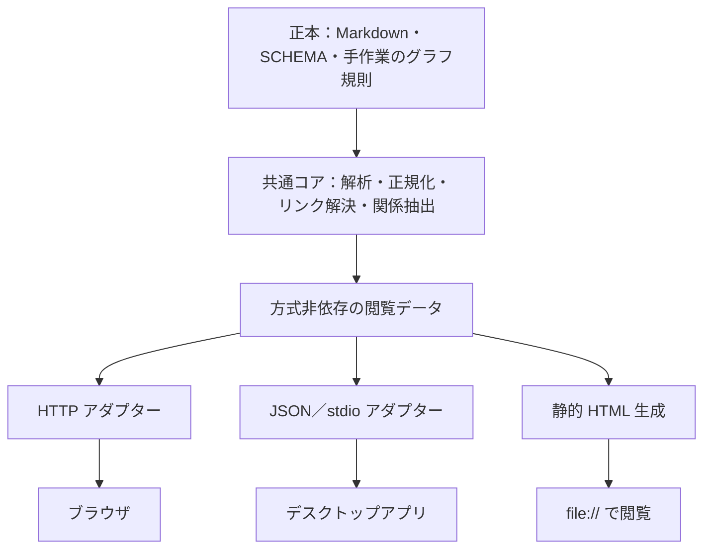

先ほどのタスクに、あなたを含む 4 体のエージェントが独立して取り組みました。
あなた以外の 3 体の成果を渡します。エージェントは「エージェント A」のように記号で呼び、モデル名は明かしません。
あなたの最終メッセージだけがレビューとして保存されます。

## タスク（再掲）

ブラウズの手段について、以下の三案のどれかを採用するが、どれを採用しても大丈夫な設計にしてほしい

* ローカル HTTP サーバー
* Obsidian のようなビューワ（アプリケーション）を実装
   * 実装言語はデスクトップアプリが作成できるプログラミング言語で
   * 移植性も考慮
* 静的 HTML

## レビューへの作者の指示

敵対的レビューを行うこと


## 他のエージェントの成果

### エージェント A

## 結論

三案のどれを採っても作り直しにならないように、閲覧機能を「中核」「共通の画面」「配信アダプタ」の 3 層に分けます。三案の違いは、いちばん薄い配信アダプタの中に閉じ込めます。具体的には、次の 7 つの不変条件を設計の契約にします。

1. **wiki の規則は Python の中核 1 か所にだけ置き、プロセスの境界越しに使う。** リンクの解決、frontmatter の日本語の別名キーの正規化、見出し ID、NFC、Markdown から HTML への変換と生の HTML の無効化は、wiki プラグインに新しく置く中核（仮称 `wiki_site.py` と、切り出した共通モジュール仮称 `wiki_links.py`）だけが行います。表示側は Markdown を自分で解釈しません。中核が出す「サイトモデル」（JSON）と「ページの HTML」だけを使います。デスクトップアプリを Python 以外で書く場合も、Rust などでリンクの規則を書き直さず、中核を子プロセスとして呼びます。
2. **ページの URL 空間は相対リンクだけで閉じる。** ページの識別子は「NFC にそろえた POSIX の rel_path から `.md` を除いたもの」とし、出力するファイル名と URL の名前は中核の 1 つの関数（仮称 `export_name()`）で決めます。この関数は、大文字小文字だけが違う名前の衝突と長すぎるパスに、決定的な接尾辞を付けて対処します。ページ間のリンクはすべて相対の href で書きます。こうすると、`file://`（静的 HTML）でも、`http://127.0.0.1:<port>/<token>/…`（サーバー）でも、アプリの独自スキームでも、同じ HTML がそのまま動きます。サーバーのトークンは URL のパスの先頭に置き、相対リンクで自然に引き継がせます。
3. **読む機能（第 1 段階の範囲）はすべて事前に描ける HTML にし、JavaScript は機能を足すだけにする。** ページの表示、ナビゲーション、メタ欄、被リンク、ページごとの関係表、未解決リンクは、中核が描く完成した HTML に含めます。JavaScript を切っても読めるようにします。
4. **動的な機能は「データ源」の窓口越しに使い、方式ごとの能力を宣言する。** 画面の JavaScript は `search`、`graph`、`rag` を小さな窓口越しに呼びます。実装は「HTTP」「アプリの IPC」「埋め込みデータ」の 3 つです。サイトモデルの `capabilities` に、検索の方式（`hybrid`、`static-bigram`、`none`）、`rag`、`multi_wiki`、`live_reload` を書き、使えない機能は画面に出しません。検索の結果は、既存の `wiki_search.py --json` と同じ形にそろえます。
5. **画面の部品は `file://` で動く範囲だけで書く。** classic な `<script src>` だけを使い、ES モジュール、`fetch`、Web Worker を前提にしません。静的版の検索索引とグラフのデータは、`fetch` で取得するファイルではなく、`<script src="data/….js">` で読み込む JS ファイルとして書き出します。外部への通信はしません。CDN を使わず、mermaid.js と cytoscape.js は同梱します。
6. **閲覧専用を、全方式で同じテストで確かめる。** 書き込みの API を持たず、未解決リンクをクリックしてもファイルは作りません。静的版の書き出し先は WIKI_ROOT の外にします。CSP で外部からの読み込みを禁じます。ADR-0001 の 3 条件と AC-D02 を、3 方式に共通の適合テストで確かめます。
7. **RAG は「枠だけ用意する任意の機能」とする。** 今の rag の検索は、MCP の接続中だけ動くワーカーを経由する経路しかありません。どの案を採っても、rag 側に MCP を介さない検索の入口（CLI）が要ります。

作る順序もどの案でも同じにでき、どの案に決まっても無駄になりません。

1. `resolve_link()` などを共通モジュールに切り出す
2. 中核とページの HTML のテンプレート、日本語の CSS を作る
3. 第 1 段階を静的に描ける形で完成させる
4. 選んだ案の配信アダプタを作る
5. 検索、グラフ、RAG のデータ源を足す

三案の条件の中でいちばん厳しいのは静的 HTML です。静的に描ける形で第 1 段階を作れば、サーバーとアプリはそれを包むだけになります。

デスクトップアプリを選ぶ場合の条件は、埋め込みの Web エンジンを持ち、Windows、macOS、Linux で動き、`uv run --script` を子プロセスとして起動できることです。この条件で Tauri 2（Rust）か Electron（TypeScript）を推します。Qt、Flutter、Avalonia のように画面をネイティブに描く方式は、共通の画面を使えず、画面が二重になるので採りません。

どの案に決めても、ADR-0002 を置き換える新しい ADR を書くのがよいと考えます。仮題は「browse は中核と配信を分け、配信の方式に依存しない」です。

## 根拠

### 1. 中核をプロセスの境界越しに使う理由

- **rag と wiki は同じ Python のプロセスに読み込めない。** rag の MCP サーバーは `requires-python = ">=3.12,<3.13"` で、torch と lancedb に依存します（`info-hive-rag/scripts/rag_server.py:1-14`）。wiki の検索は `>=3.10` で fastembed と sqlite-vec に依存します（`info-hive-wiki/skills/info-hive/scripts/wiki_search.py:1-8`）。RAG を統合するだけで、すでにプロセスの境界が要ります。
- **アプリは一般に Python で書かない。** タスクの条件は「デスクトップアプリが作成できるプログラミング言語」です。中核をライブラリとして import する設計にすると、Python 以外の言語では規則を書き直すことになります。
- **規則を書き直すと食い違う。** Python の中でさえ、すでに食い違いが始まっています。`clean_link_target()` は 2 か所にあり、`wiki_lint.py:70-79` は区切る前に `nfc()` をかけ、`wiki_search.py:235-243` は区切った後にかけます。今は結果が同じですが、別々に直されると食い違います。
- **規則が食い違うと実害が出る。** Obsidian では、大文字小文字だけが違うリンクが解決され、NFD で書いたリンクをクリックすると空のページが作られました（`docs/research/llm-wiki-browse-decision-matrix.md` §4.2、L147-150）。ADR-0002 も共通モジュールへの切り出しを決めています（`docs/adr/0002-…md` の決定表「リンクの解決」）。
- **同じ形は rag ですでに採っている。** 処理本体を共通のコアに置き、MCP、CLI、ワーカーから同じ処理を使う構成です（`docs/adr/0007-…md` の決定表）。閲覧機能で同じ形を採っても、構成の方針は増えません。

### 2. 相対リンクと `export_name()` が三案すべてで成り立つ理由

- **`file://` の制約。** `file://` で開いたページは、別のローカルファイルを取得できません（`docs/research/llm-wiki-browse-options.md` L324）。一方で `<script>` の読み込みは `file://` でも動く、と決定行列は推定しています（`decision-matrix.md` L184）。そこで、データは「`fetch` で取得するファイル」ではなく「`<script src>` で読み込む JS」として書き出します。
- **大文字小文字とファイル名の衝突。** wiki は大文字小文字を区別し、NTFS は区別しません。サーバーでは「経路の解決をページの一覧で行い、ファイルシステムに問い合わせない」ことで、この差を避ける方針です（`options.md` L499）。しかし静的な書き出しはファイルを作るので、名前が衝突します。既存の調査はこの点に触れていません。名前を決める関数を中核に置き、3 方式で同じ名前を使えば、ある方式でだけ別のページが開くことはなくなります。
- **トークンをパスの先頭に置く理由。** 選択肢レポートの第6.8節は、トークンを URL に含めるとしています（L509）。相対リンクで回遊するには、`?t=` のクエリより、パスの先頭（`/<token>/w/<wiki-id>/…`）に置くほうがよいと考えます。相対リンクがトークンを自動で引き継ぎ、ページの HTML を方式ごとに変えずに済むからです。Cookie を使うと、同じホストの別のポートにも送られるので採りません（推測にもとづく設計判断）。
- **アプリの独自スキーム。** Tauri の独自スキームの URL の形は OS で違うと理解しています（Windows は `http://<scheme>.localhost/`、macOS と Linux は `<scheme>://localhost/`）。このセッションでは確かめていません。相対リンクだけで閉じていれば、この違いはページに影響しません。

### 3. 第 1 段階は静的に描ける

ADR-0002 の第 1 段階は、ページの表示、`index.md` からのナビゲーション、メタ欄、被リンク、関係表、未解決リンク、日本語の CSS です（`options.md` L547）。どれも全ページを読めば事前に計算できます。実測では、1,000 ページの全変換が 1.26 秒、全体の処理で約 2.3 秒でした（`decision-matrix.md` L121-134）。

サーバーは「開いたときに 1 ページだけ描く」、静的版は「全部描く」というように、同じ `render_page(page_id)` の呼び方が違うだけになります。動的な処理が要るのは、検索、全体のグラフ、RAG、ファイル変更の反映だけです。

### 4. 方式ごとの機能の対応

| 機能 | ローカル HTTP サーバー | 静的 HTML | デスクトップアプリ | 中核の出力 |
| --- | --- | --- | --- | --- |
| ページ、ナビゲーション、メタ欄 | 同一 | 同一 | 同一 | ページの HTML |
| 被リンク、未解決リンク | 同一 | 同一（書き出した時点のもの） | 同一 | サイトモデルの `links` |
| ページごとの型付き関係 | 同一 | 同一 | 同一 | `graph/edges.jsonl` のキー（`subject`、`predicate`、`object`、`source`、`evidence`、`confidence`、`status`。`wiki_graph_extract.py:289-300`） |
| 全体のグラフ | cytoscape.js で描く | `data/graph.js` を同梱して描く | サーバーと同じ | ノードのキー（`id`、`slug`、`title`、`page_type`、`node_type`、`kind`、`path`。同 L258-271） |
| 日本語の全文検索 | `wiki_search.py --json` を呼ぶ（BM25 と埋め込み） | 事前に作る bigram の索引だけ（縮小） | 子プロセスで同じ CLI を呼ぶ | 結果の形は `json_result()` と `emit_json()`（`wiki_search.py:813-862`）に合わせる |
| RAG の検索 | rag に CLI の入口ができれば可能 | 不可 | rag に CLI の入口ができれば可能 | 任意の能力 |
| 複数 Wiki | `/w/<wiki-id>/` で切り替える | Wiki ごとに書き出すか、まとめて書き出す | サーバーと同じ | サイトモデルの `wikis` |
| mermaid、`wiki/assets/` の svg | 同梱の mermaid.js、`` で表示 | 同じ（相対パス） | 同じ | 資産の一覧（一覧にあるものだけを返す） |
| 変更の反映 | 要求のたびに更新時刻を見る | 書き出し直す | サーバーと同じ | — |
| Claude Code のセッションとの関係 | セッションの間だけ動く（`options.md` L522） | 関係しない | 関係しない | — |

### 5. RAG を任意の機能とする理由

- 検索の MCP ツールは、`search_requests` 表に要求を入れ、ワーカーが処理するのを最大 600 秒待ちます（`rag_server.py:151-166`、`rag_jobs.py:107-138`）。
- そのワーカーは「MCP の接続中だけ動く」と明記されています（`rag_worker.py:1`）。
- `Engine.search` は `rag_index.py:302` にありますが、`argparse` も `__main__` もありません。CLI としては呼べません。

したがって、Claude Code の外で動く閲覧画面（静的 HTML、アプリ、セッションの外のサーバー）は、今のままでは RAG を呼べません。どの案でも、rag 側に「検索だけを行う CLI」（仮称 `rag_search.py --json`）を足すことが前提になります。

### 6. 安全性を共通の条件にできる理由

ADR-0001 の 3 条件（ループバックだけで待ち受ける、内容を外に送らない、書き込みの API を持たない）と AC-D02（`llm-wiki-product-concept-and-requirements-ja.md` L551）は、方式に依存しない性質です。方式ごとの差は次のとおりです。

- **サーバー**：127.0.0.1 への固定、トークン、Host ヘッダーの確認、CSP、自前のハンドラ（`options.md` L504-517）
- **アプリ**：ポートを開かない stdio の IPC を既定にします。外部の URL はアプリの中で開かず、確認してから OS のブラウザに渡します（S-07、L450）
- **静的 HTML**：`<meta>` の CSP を付け、書き出し先は OS のユーザーキャッシュを既定にします（`options.md` L422、No.81）

検査の内容は共通です。「閲覧の操作の前後で WIKI_ROOT のハッシュが変わらない」「127.0.0.1 以外への要求が 0 件」です。

### 7. 日本語の表示を方式によらずそろえる方法

- CSS（`lang="ja"`、`line-break: strict`、`overflow-wrap: anywhere`、OS 標準の日本語フォントを並べる指定）は、共通の画面に 1 つだけ持ちます（`options.md` L488-502）。
- 方式で差が出るのは描画エンジンです。サーバーと静的版は利用者のブラウザで描かれます。アプリは、Tauri なら WebView2、WKWebView、WebKitGTK の 3 つで描かれ、Electron なら Chromium だけで描かれます。
- `text-autospace` は Safari 18.4 から対応していると調査にあります（L495）。Linux の WebKitGTK でどう描かれるかは確かめていません。
- 合格の目安（`options.md` L556-563）は、3 方式で同じものを使います。

### 8. 作る量の見積もり（推定）

ADR-0002 が見積もった Python 1,000〜1,500 行と、JavaScript・CSS 300〜500 行（ADR-0002「影響」）の大部分は、中核と共通の画面に入ります。アダプタの量は次のとおり推定します（どれも推定）。

- 静的版：100〜300 行
- サーバー：安全対策を含めて 300〜500 行
- アプリの殻：Rust か TypeScript で 300〜600 行。ほかに、署名と、3 OS 向けのビルドとリリースの仕組みが要ります

方式の選択が後の作業を大きく変えるのはアプリの場合だけで、その費用の大半はコードではなく配布にかかります。

## 検討した代替案

| 代替案 | 採らなかった理由 |
| --- | --- |
| 画面を SPA（ハッシュでルーティングし、データはすべて JSON）にする | `file://` では JSON を取得できないので、静的版だけ別の作りになります。JavaScript を切ると読めず、印刷や受け渡しにも向きません。事前に描いた HTML に JavaScript で機能を足す形なら、3 方式で同じ HTML を使えます |
| 中核を Python のライブラリとして各方式から import する | Python ではないアプリから使えません。rag（Python 3.12 系）とも同じプロセスに載りません |
| アプリの言語でリンクの解決などを書き直し、共通の試験データで一致を確かめる | アプリが Python を起動できない場合の最後の手段として残します。規則を 2 つの言語で保守することになり、食い違いの危険が増えます（Obsidian の例、`decision-matrix.md` §4.2） |
| 画面をネイティブに描く GUI（Qt、Flutter、Avalonia、Compose）でアプリを作る | ページの本文は結局 HTML なので Web エンジンが要ります。共通の画面を使えず、日本語の CSS とナビゲーションが二重になります。Qt の QtWebEngine は大きく、ライセンス（LGPL）の確認も要ります（推定） |
| アプリを pywebview（Python）で作る | 言語が中核と同じなのは利点です。ただし、Windows では pythonnet と .NET、Linux では Qt か GTK を利用者が入れる必要があり、配布物と依存が増えます（`options.md` L327、No.16 は 140 点）。Tauri や Electron と並ぶ候補として残しますが、第一候補にはしません |
| アプリをサーバーの殻（ローカルの HTTP サーバーを専用の窓で開くだけ）にする | 実装はいちばん少なく済みます。ただしポートを開くので、ADR-0001 の対策がアプリにも要ります。stdio の IPC を既定にし、HTTP は予備として選べるようにします |
| 静的版の検索も `wiki_search.py` と同じにする | `file://` からはプロセスを呼べません。bigram の簡易検索に縮小し、能力の宣言で利用者に示します。JavaScript 側の分かち書きは Python の `tokenize()` と同じ試験データで一致を確かめます。規則の二重化はここ 1 か所に限られます |
| ADR-0002 をそのまま進め、静的版とアプリは後で考える | サーバーを前提に絶対 URL、トークンのクエリ、`fetch` に頼る画面を作ると、後で静的版とアプリに移すときに作り直しになります。今回の依頼の趣旨に反します |

## 前提と不確実性

- **仮定：デスクトップアプリは Python と uv を使える環境で動く。** 中核を `uv run --script` で起動する前提です。uv の導入をアプリの導入手順に含めるか、uv の実行ファイルを同梱するかは作者の判断です。初回は依存の取得に通信が要ります。wiki の内容は外に出ないので、ローカル完結とは矛盾しないと解釈しました。
- **仮定：アプリはプラグインと別のリポジトリに置く。** アプリは Claude Code のプラグインではないので、AGENTS.md の「プラグインを足すとき」の手順は当てはまりません。新しいリポジトリ（仮称 `to884/info-hive-viewer`）をサブモジュールにし、AGENTS.md に節を足し、中核と画面の版をアプリの側で固定する、という形を想定しました。中核の場所は、Claude Code のプラグインのキャッシュの中のパスに頼らない方針です。中核をアプリに同梱し、サイトモデルの `protocol_version` で互換性を確かめます。この配置は作者の判断です。
- **確かめていないこと：**
  - `file://` で ES モジュール、`fetch`、Web Worker が使えないこと（Chromium の一般的な挙動として書きました）
  - Tauri 2 の独自スキームの URL の形と sidecar の機能
  - WebKitGTK での日本語の CSS の描画
  - Tauri と Electron の現在の版
  
  このセッションでは Web を調べていません。実装の前に一次資料と PoC で確かめる必要があります。
- **アプリの言語の選び方。** 配布物の大きさと OS 標準の Web エンジンを重く見るなら Tauri 2、3 OS で描画をそろえたいなら Electron です。日本語の表示を重く見るこのプロジェクトでは、Linux の WebKitGTK での描画の確認が判断の分かれ目になります。どちらを選ぶかは作者の判断です。
- **rag の依存。** RAG の統合は、rag に CLI の検索の入口を足すことが前提です。これは rag の設計の変更なので、ADR-0007 との整合を確かめる必要があります。
- **静的版のファイル名。** 読める名前（rel_path）を基本にし、衝突や長すぎる名前のときだけハッシュの接尾辞を付ける案にしました。すべてハッシュの名前にすれば単純になりますが、読めなくなります。どちらにするかは作者の判断です。lint に「大文字小文字だけが違うページ」の検査を足すかも、あわせて決める必要があります。
- **ADR の扱い。** ADR-0002 の「見直す条件」は発生していません。ただし、静的版を副機能から並列の方式に格上げし、作る順序を変えるので、ADR-0002 を置き換えるか補う新しい ADR を書くことを勧めます。ADR-0002 の決定表のうち、「作る順序」（共通モジュールと静的に描ける第 1 段階を先にする）と「書き出し」（副機能から並列の方式へ）が変わります。
- **確信度。** 「規則を 1 か所に置き、プロセス越しに使う」と「`file://` の制約を画面の最低条件にする」の 2 点は、リポジトリの事実で裏付けており、確信度は高いです。アプリの言語の推奨とアダプタの行数は推定で、確信度は中程度です。

## 参照

リポジトリの文書（`C:\Works\info-hive-dev\.claude\worktrees\wiki-browse-spec-4a9ad7\`）：
- `AGENTS.md`：リポジトリの役割、プラグインを足す手順、日本語と UTF-8 の規則
- `docs/adr/README.md`、`0001-local-only-server-is-not-hosted-wiki.md`（3 条件）、`0002-wiki-browse-uses-on-demand-local-server.md`（決定表、影響、見直す条件）、`0005-wiki-figures-use-mermaid-and-svg.md`（mermaid と svg、生の HTML を出さない方針）、`0007-rag-uses-mcp-core-and-persistent-jobs.md`（共通コアの構成）、`0008-numbered-workspace-layout.md`（作業領域と複数 Wiki）、`0009-graph-layer-stays-in-wiki.md`
- `docs/research/llm-wiki-browse-options.md`：L23-34、L46-72、L120-130、L306-333（表示経路の採点、`file://` の制約 L324、pywebview L327）、L409-422、L456-487、L488-502（日本語）、L504-517（安全性）、L519-527（起動）、L544-570（PoC と合格の目安）
- `docs/research/llm-wiki-browse-decision-matrix.md`：L13-21、L41-52、L111-136（実測）、L138-162（Obsidian での確認）、L168-212（拡張性の内訳と決定行列、`<script>` の推定 L184）
- `llm-wiki-product-concept-and-requirements-ja.md`：D-03（L29）、F-G06（L261）、S-07（L450）、AC-D02（L551）、O-11（L607）

サブモジュール（`C:\Works\info-hive-dev\` の本体のチェックアウトで読んだもの。worktree ではサブモジュールが空だったため）：
- `info-hive-wiki/.claude-plugin/plugin.json`（0.2.0）、`info-hive-wiki/commands/`（browse はまだない）
- `info-hive-wiki/skills/info-hive/scripts/wiki_lint.py:60-104`（`WIKILINK_RE`、`clean_link_target`、`resolve_link`）、L140
- `info-hive-wiki/skills/info-hive/scripts/wiki_search.py:1-60`（依存と CLI）、L235-277（`clean_link_target` の 2 つ目の実装と `resolve_link`）、L813-862（`json_result`、`emit_json`）、L1121-1133
- `info-hive-wiki/skills/info-hive/scripts/wiki_graph_extract.py:258-271`（ノードのキー）、L289-300（エッジのキー）
- `info-hive-rag/.claude-plugin/plugin.json`、`info-hive-rag/.mcp.json`、`info-hive-rag/scripts/rag_server.py:1-30, 145-176`、`rag_jobs.py:35, 98-138`、`rag_worker.py:1, 172`、`rag_index.py:302`

指示に従い、`docs/agent-runs/2026-11-05-wiki-browse-viewer-agnostic-design/` は読んでいません。リポジトリのファイルも変えていません。

```text
使用した MCP サーバー: なし
使用した Agent Skills: なし
```

### エージェント C

共通化する範囲は、ページの解釈、リンク解決、被リンク・関係の抽出、検索結果の形式です。HTTP、デスクトップの IPC、静的 HTML の埋め込みデータは、その外側に置く構成を提案します。静的版の更新時点や RAG の利用可否は、方式間の違いとして明示する必要があります。## 結論

**Markdown を読む共通コアと、表示方式ごとのアダプターを分ける設計を採用する。** ローカル HTTP サーバー、デスクトップアプリ、静的 HTML のどれを選んでも、Wiki の解釈やリンク解決を作り直さずに済む構成にする。

三方式すべての実装を先に作る必要はない。先に共通のデータ契約と合格条件を定め、採用した方式のアダプターから実装する。

設計上、次の四点を固定する。

1. **正本と意味を共通化する。** Markdown、frontmatter、リンク、被リンク、型付き関係の解釈は共通コアが担う。
2. **HTTP を共通コアの呼び出し条件にしない。** HTTP、プロセス間通信、静的ファイル生成を、それぞれ独立した出口にする。
3. **全方式の基本機能と、方式ごとの追加機能を区別する。** ページ閲覧・リンク移動・被リンク・関係表は共通の基本機能とする。更新の即時反映、既存検索処理の実行、稼働中の RAG との統合は、利用可能な能力として明示する。
4. **デスクトップ版の候補は Rust＋Tauri とする。** HTML の画面を共有し、既存の Python コアは JSON のプロセス間通信で利用できる。言語とフレームワークの最終決定は、デスクトップ版を採用するときに行う。

現行の ADR-0002 は HTTP サーバーを採用済みである。今回の要望を反映する際は、**方式に依存しない要件と、HTTP 版にだけ適用する実装判断を分けて記録し直す**必要がある。本回答はその設計提案であり、ファイルは変更していない。

## 根拠

**1. 既存の要件の中心は、表示方式よりも Wiki の解釈と正本の保全にある。**

要件定義書の F-G06 は、ページ、被リンク、ページごとの型付き関係の閲覧、lint と一致するリンク解決、閲覧によって Wiki を変更しないことを求めている。Markdown などを正本、検索索引やグラフ DB を再生成可能な派生データとする原則もある。これらは三方式に共通して適用できる。［参照1：L115、L250–263］

一方、Python の HTTP サーバー、ポート、無操作での終了、検索のサーバー経由呼び出しは、ADR-0002 が選んだ実装方法である。共通要件の内部にこれらを組み込むと、デスクトップ版と静的版への切り替えで、その実装方法まで引き継ぐことになる。［参照2：L24–33］

したがって、責務を次のように分ける。



これは提案する依存関係であり、現在この構成が実装済みという意味ではない。

**2. リンクと日本語の解釈を各表示方式に任せると、すでに確認されている不一致を再発させる。**

指定コミットの実装には、次の規則がある。

- `wiki_text.py` は、パスやリンク先を NFC、タグを NFKC に正規化する。日本語の frontmatter キーも共通の対応表で英語に直し、キーが衝突した場合は衝突情報を返す。
- `wiki_lint.py` の `resolve_link()` は大文字小文字を区別する。パス付きリンクは、そのパスに一致した場合だけ解決し、別ディレクトリの同じ slug に読み替えない。
- `wiki_lint.py` と `wiki_search.py` には、それぞれリンク解決処理が存在する。ADR-0002 も、この共通化を予定している。［参照2：L27–28、参照5］

このため、以下を共通コアの責務とする。

| 責務 | 共通化する内容 |
|---|---|
| ページの収集 | 知識ページと管理用ページを区別し、raw・索引・キャッシュを知識ページに混ぜない |
| メタデータ | 日本語の別名、英語キーとの衝突、タイトルの補完 |
| リンク | NFC、大小文字、パス制約、`.md`、表示名、解決失敗の扱い |
| 被リンク | 共通のリンク解決結果から作る |
| 型付き関係 | 本文のリンクと区別し、述語と証拠を保持する |
| 診断 | 読み取り失敗、名前の衝突、未解決リンクなどを表示側へ返す |

`index.md` と `indexes/` はナビゲーション用に扱う。現在の lint はこれらを知識ページの収集対象から外しているため、単に lint のページ一覧を画面に渡すだけでは、既存案の「index からのナビゲーション」を満たせない。［参照3：L547、参照5：`wiki_lint.py` L110–111、L140–168］

また、**ページへのリンク解決と、ページ内の見出しの存在確認は別の契約にする。** 現在の `resolve_link()` は `#` 以降を除いてページを解決する。これだけで、見出しまで有効だとは判断できない。見出し ID の生成、重複見出し、存在しない見出しの扱いを、描画側の共通規則として追加する必要がある。［参照5：`wiki_lint.py` L71–107、参照3：L498］

**3. 共通契約には、URL や OS の絶対パスをページの識別子として入れない。**

次の最小契約を提案する。名称は設計案である。

| 契約 | 主な内容 |
|---|---|
| `PageRef` | `wiki_id`、NFC の Wiki 相対パス、必要なら見出し ID |
| `PageView` | ページ参照、正規化済みメタデータ、本文、見出し一覧、解決済みリンク、診断 |
| `Relation` | 起点・終点、本文リンク／型付き関係の区別、述語、証拠 |
| `SearchResult` | ページ参照、見出し、抜粋、検索方式、検索対象の世代 |
| `SnapshotInfo` | 閲覧契約版、生成器版、スナップショット ID、生成日時、対象 Wiki |
| `Capabilities` | 利用できる検索方式、更新追従、RAG 接続など |

リンク先は共通コアで `PageRef` まで解決し、実際のアドレスは出口で生成する。

- HTTP 版：ローカルサーバー内の URL。
- デスクトップ版：アプリ内のページ移動。
- 静的版：出力先の相対 HTML リンク。

HTML を共有する場合も、描画処理にリンク先アドレスを生成する関数を渡す。生成後の HTML を正規表現で書き換える方式は避ける。

`wiki_id` は設定で管理し、Wiki のルートパスと対応付ける。ページの改名後まで参照を維持する仕組みは別途必要であり、この段階で正本に UUID を一括追加する必要はない。グラフの `node_id` も、全ページの識別子と同一とは仮定しない。既存実装では明示指定または型と slug からノード ID を作っている。［参照5：`wiki_graph_extract.py` L240–275］

ルートの決め打ちも避ける。手元の Wiki は `SCHEMA.md` で `W0_Wiki/` と `W1_Raw/` を指定しており、ADR-0008 の既定例である `wiki/`・`raw/` と異なる。表示方式は、設定から解決済みのルートを受け取る。［参照8、参照9］

**4. 静的 HTML は基本機能を備えられる。ただし、データの取得方法を変える必要がある。**

現行 ADR-0002 の「静的 HTML では検索と RAG 統合ができない」という評価は、二つに分けて扱うべきである。

- `file://` から別ファイルを `fetch()` する設計は、移植性のある前提にできない。Mozilla の文書も、ローカルファイルの origin は通常 opaque とされ、同じディレクトリでも CORS エラーになり得ると説明している。[Mozilla：Same-origin policy](https://developer.mozilla.org/en-US/docs/Web/Security/Defenses/Same-origin_policy#file_origins)
- 検索データを HTML に埋め込めば、外部ファイル取得を必要としない検索を設計できる。既存の選択肢レポート自体も、静的版には検索索引を HTML に埋め込む案を記載している。HTML の非実行データブロックも標準の仕組みである。［参照3：L396–407］[Mozilla：script のデータブロック](https://developer.mozilla.org/en-US/docs/Web/HTML/Reference/Elements/script/type#any_other_value)

静的版は、次の構成を基本にする。

- 本文はページごとの HTML に生成し、通常の相対リンクで移動できるようにする。
- 被リンクと関係表は生成時に計算し、各ページへ出力する。
- 検索用 HTML に、日本語検索用のデータと検索処理を埋め込む。単一ファイルへ Wiki 全体を詰め込むことは必須にしない。
- 全体グラフを追加する場合も、グラフ用 HTML に必要なデータを埋め込む。
- CSS、JavaScript、図の表示資材は同梱し、CDN を要求しない。
- 任意のエクスポート先へコピーしても成立するよう、正本の絶対パスをページ間リンクに使わない。

簡易検索は共通フロントエンドの検索方式として三方式で共有できる。既存 Python の BM25・埋め込み検索は追加の検索方式として接続する。**両者の順位や精度が同じとは表示しない。**

一方、純粋な静的版が新しい質問に対して既存の Python RAG 処理を実行するには、追加の実行環境が要る。RAG の検索結果を事前生成して表示する機能と、稼働中の RAG を問い合わせる機能は、別の能力として定義する。

**5. 三方式の違いは、能力とデータの時点として公開する。**

| 項目 | ローカル HTTP | デスクトップアプリ | 静的 HTML |
|---|---|---|---|
| ページ・リンク・被リンク・関係表 | 共通契約から表示 | 共通契約から表示 | 共通契約から生成 |
| 簡易な日本語全文検索 | 共通の検索処理を利用可能 | 同左 | 同梱データで実行 |
| 既存 Python 検索 | プロセス内などで接続 | IPC などで接続 | 閲覧時には実行しない |
| 稼働中の RAG 検索 | 追加プロバイダーで接続 | 追加プロバイダーで接続 | 基本構成では利用不可 |
| 正本の更新反映 | 再読込・監視など | 再読込・監視など | 再生成 |
| 閲覧時の実行環境 | Python コアとサーバー | アプリ、必要なら Python コア | ブラウザ |
| データの時点 | 採用したスナップショット | 採用したスナップショット | 書き出したスナップショット |

これは提案する機能分担であり、動作を実測した表ではない。

利用不可と障害も区別する。たとえば、RAG 非対応の静的版、RAG に接続できないアプリ、古い検索索引は、いずれも「検索結果 0 件」と異なる状態である。

RAG の依存関係は維持する。現在は `rag` が `wiki` に依存しているため、Wiki の閲覧コアから RAG を必須で読み込ませない。検索プロバイダーの接続口を用意し、RAG がなくても閲覧できる構成とする。RAG 本体を共通 Python コアに置く判断は ADR-0007 とも整合する。［参照7］

**6. デスクトップアプリは、既存の Wiki 処理を再実装せずに独立したアプリとして作れる。**

Rust＋Tauri を候補とする理由は、Rust のアプリ本体と HTML の画面を組み合わせられ、Windows・macOS・Linux を対象にできるためである。フロントエンドから Rust のコマンドへ構造化データを渡す仕組みもある。[Tauri Architecture](https://v2.tauri.app/concept/architecture/)、[Calling Rust from the Frontend](https://v2.tauri.app/develop/calling-rust/)

提案する接続は次のとおり。

- Rust：ウィンドウ、起動と終了、設定、許可されたコア処理の呼び出し。
- Python：既存の Wiki 解釈と検索。
- HTML/CSS/JavaScript：HTTP 版・静的版と共有する表示部品。
- Rust と Python の間：版付きの JSON／stdio 契約。標準出力は応答、標準エラーは診断に分け、UTF-8 を明示する。

これならデスクトップ版のためにローカル HTTP サーバーを必須にする必要はない。アプリの寿命も Claude Code セッションに結び付けず、アプリ自身が管理できる。

ただし、**ソースの移植性と配布物の移植性は別である。** Python の実行環境を既存導入環境から利用するか、アプリに同梱するかで作業量が変わる。Tauri の外部バイナリ同梱もターゲットごとの準備が必要であり、単一のバイナリで全 OS に配れるわけではない。[Embedding External Binaries](https://v2.tauri.app/develop/sidecar/)

**7. 更新と安全性も、共通規則と方式別規則に分ける。**

共通規則として、以下を設ける。

- 同じ画面に使う本文、被リンク、関係、検索データには、対応するスナップショット ID を持たせる。
- 再生成は作業中の領域で完了させてから公開し、途中の生成物を表示しない。
- キャッシュと出力先は正本から分ける。削除しても正本から作り直せるものとする。
- 生の Markdown HTML、リンクの URL スキーム、埋め込みデータを安全に扱う。JSON の HTML 埋め込みでは、`</script>` などによってデータ領域から抜けない出力処理が必要である。
- 読み取れるファイルを、登録済みのページ・許可されたアセットに限定する。任意の絶対パスやディレクトリ探索を UI から実行させない。
- 正本への書き込み操作を閲覧契約に持たせない。

HTTP 版には、ループバック限定、起動ごとの認証、Host の確認を追加する。デスクトップ版には IPC の操作制限を追加する。静的版には、出力対象の範囲と機密情報の複製範囲を明示する。HTTP 固有のトークンやポートを静的版の契約に持ち込まない。［参照3：L504–516、参照6：L20–24、参照1：L444–458］

図については、既存の ADR-0005 が Mermaid と SVG を定めている。初期段階で描画を実装しなくても、共通データから図と参照を落とさず、コードと説明文で読める状態を保つ。将来の描画には方式別の表示能力を追加する。［参照10：L26–34］

**8. 実装前に共通の合格条件を決めれば、方式を選び直すときの判断材料が残る。**

次の確認を実装計画に含めることを提案する。今回は実行していない。

1. 同じコーパスで、三方式のリンク解決結果、メタデータ、被リンク、関係表が一致する。
2. NFC/NFD、大小文字、パス付きリンク、日本語の別名、未解決リンクで、意図しない別ページへ移動しない。
3. ページ解決について lint と一致する。見出し解決は追加規則として別に検証する。
4. 閲覧操作の前後で、正本と原資料の内容・ファイル構成が変化しない。
5. 静的版を別のディレクトリへコピーし、ネットワークを使わず `file://` で本文・リンク・検索を利用できる。
6. 検索や RAG が利用できなくても、本文の閲覧を継続できる。
7. Windows・macOS・Linux で、日本語パス、表示、起動・終了を確認する。

現行資料の起動時間は、方式横断の性能保証には使えない。記載値から計算すると、1,000 ページの HTTP 版は

`0.38 + 0.18 + 0.49 + 0.0013 = 1.0513 秒`

静的版の生成処理は

`0.38 + 0.18 + 0.49 + 1.26 = 2.31 秒`

となる。ただし前者にはブラウザ起動、後者にはファイル書き込みが含まれていない。共通コアの処理時間、静的生成時間、閲覧開始時間、検索開始時間を分けて評価する必要がある。［参照4：L111–136］

## 検討した代替案

| 案 | 今回採らない理由 |
|---|---|
| HTTP API を全方式の共通基盤にする | デスクトップ版と静的版にもサーバーを要求する構成になり、方式選択の自由を狭める |
| 三方式が Markdown を独自に解析する | 日本語の別名、NFC、大小文字、パス制約の解釈を三重に保守する必要がある |
| 共通コアを今すぐ Rust などへ全面移植する | 既存 Python 実装を置き換える費用が先に発生する。JSON 契約で利用できるため、現時点で必要性が示されていない |
| 静的版のために Wiki 全体を単一 HTML に埋め込む | 容量と初期読み込みを大きくしやすい。ページ HTML と検索 HTML を分けても、サーバー不要の閲覧は成立する |
| 静的版を既存の Python 検索・RAG と完全同等にする | 閲覧時の処理実行を追加する必要がある。まず基本機能と追加能力の契約を分ける |
| Obsidian の導入結果を、そのまま自作アプリの評価に使う | 既存調査の対象は Obsidian という完成品である。確認されたリンク規則の不一致は、自作アプリでも避けられない制約ではない |

既存の決定行列は、静的 HTML、HTTP サーバー、既製の Obsidian などを比較している。**今回の「自作するデスクトップアプリ」は、その採点対象に含まれていない。** 過去の順位だけで今回の三案を決めることはできない。［参照4：L41–52、L138–160］

## 前提と不確実性

- **仮定：三方式で共通化したいのは、Wiki の意味と基本的な閲覧機能である。** 更新の即時性や稼働中の RAG まで全方式で同等にする要求とは解釈していない。後者が必須なら、純粋な静的 HTML の範囲を定義し直す必要がある。
- **仮定：デスクトップアプリに WebView を使ってよい。** OS 標準のウィジェットだけで構成する要求がある場合は、C++／Qt などを含めて再比較する。提案したデータ契約は維持できるが、表示部品の共有範囲は変わる。
- **仮定：閲覧操作に編集や PDF 登録を含めない。** 現行の閲覧専用要件に従った。アプリから編集する場合は、保存・競合・復旧の契約を別に設計する必要がある。
- 静的版の容量、日本語検索の品質、アプリの配布サイズ、Python 同梱の方法は未検証である。対象ページ数、本文量、アセット量が不明なため、数値で優劣を断定していない。
- `PageRef` を相対パスで識別する提案は、改名後の恒久参照を保証しない。恒久的なブックマークが必要かは作者の判断事項である。
- 現行資料には、Project Wiki の ASCII 命名案と、日本語 slug を認める移植方針の両方がある。閲覧側で独自に制限を追加せず、各 Wiki の規約と共通コアに従う設計とした。［参照1：L125–145、参照11：L518–520］
- 作業用ワークツリーの `info-hive-wiki/` は空だったため、親チェックアウトのローカル Git オブジェクトを読んだ。ワークツリーが指定するコミットと親チェックアウトの HEAD は、どちらも `302892390250d7262360e9e9dde20d61a6d8d6ff` だった。
- ファイル変更、ビルド、アプリ起動、テストは実施していない。指定された他エージェントの成果物ディレクトリも読んでいない。

## 参照

以下のリポジトリ内パスは、特記がなければ指定ワークツリーを基準とする。行番号は今回読み取った版のもの。

1. `llm-wiki-product-concept-and-requirements-ja.md`  
   L63–119：役割、配置、正本と派生データ。L121–164：命名・横断リンク。L250–263：閲覧・グラフ要件。L440–458：情報境界。

2. `docs/adr/0002-wiki-browse-uses-on-demand-local-server.md`  
   L18–33：採用済みの構成。L43–53：従来の代替案。L64–80：保守、安全性、合格条件、見直し条件。

3. `docs/research/llm-wiki-browse-options.md`  
   L392–407：検索方式と静的版の索引埋め込み。L488–526：日本語、リンク、セキュリティ、更新。L544–563：実装段階と合格条件。

4. `docs/research/llm-wiki-browse-decision-matrix.md`  
   L41–52：比較対象。L111–136：性能計測と除外条件。L138–160：既製 Obsidian の確認結果。L306–313：調査の限界。

5. `info-hive-wiki` のコミット `302892390250d7262360e9e9dde20d61a6d8d6ff`。ローカル Git オブジェクトから参照。  
   - `skills/info-hive/scripts/wiki_text.py` L77–138：正規化、frontmatter の別名と衝突。  
   - `skills/info-hive/scripts/wiki_lint.py` L62–111、L140–176：リンク解決、除外対象、ページ収集。  
   - `skills/info-hive/scripts/wiki_search.py` L139–158、L235–276、L835–858：日本語トークン化、リンク解決、検索結果。  
   - `skills/info-hive/scripts/wiki_graph_extract.py` L114–138、L240–275、L334–378：グラフ参照、ノード ID、型付き関係と本文リンク。

6. `docs/adr/0001-local-only-server-is-not-hosted-wiki.md`  
   L20–26、L44–47：ローカルサーバーを認める条件。

7. `docs/adr/0007-rag-uses-mcp-core-and-persistent-jobs.md` L20–39：RAG の共通 Python コア、窓口、閲覧と登録の区別。  
   `docs/adr/0009-graph-layer-stays-in-wiki.md` L14–20、L28–36、L54–59：グラフの位置付け、正本、共通規則。

8. `docs/adr/0008-numbered-workspace-layout.md`  
   L23–25、L79–90、L104：作業領域、設定、ディレクトリ名。

9. `D:/Users/toshiki/info-hive/W0_Wiki/index.md`：全体索引。該当するブラウズ設計の項目はなく、`indexes/` は存在しなかった。  
   `D:/Users/toshiki/info-hive/W0_Wiki/SCHEMA.md` L7–11、L46–51、L73–98：実際のルート、命名、日本語の別名。

10. `docs/adr/0005-wiki-figures-use-mermaid-and-svg.md`  
    L26–34、L58–64：図の形式と browse の段階。

11. `docs/porting-plan.html`  
    L493–526：別名、slug、日本語検索。L545–556：ホスト型 Wiki の範囲。L583–625：移植の段階。  
    `AGENTS.md`：応答言語、配置、正本保全、使用ツールの報告。`.gitmodules`：プラグインの所在。

12. 外部の公式・実装者向け文書  
    - [Mozilla：Same-origin policy — File origins](https://developer.mozilla.org/en-US/docs/Web/Security/Defenses/Same-origin_policy#file_origins)  
    - [Mozilla：script type — データブロック](https://developer.mozilla.org/en-US/docs/Web/HTML/Reference/Elements/script/type#any_other_value)  
    - [Tauri Architecture](https://v2.tauri.app/concept/architecture/)  
    - [Calling Rust from the Frontend](https://v2.tauri.app/develop/calling-rust/)  
    - [Embedding External Binaries](https://v2.tauri.app/develop/sidecar/)

使用した MCP サーバー: なし  
使用した Agent Skills: なし

### エージェント D

## 結論

**三案を交換可能にするには、Wiki の解釈・参照解決・閲覧用データの生成を共通化し、HTTP サーバー、デスクトップアプリ、静的 HTML をその利用側に分ける。** HTTP API を共通基盤にしてしまうと、アプリと静的版までサーバーに依存するため、共通契約は通信方式に依存しないデータ形式と操作として定義する。

「どれを採用しても大丈夫」は、**正本とリンクの意味を変えずに表示手段を変更できること**と解釈する。静的版にもライブ更新や RAG 実行まで必須にする、という意味にはしない。

**提案する責務分担**

| 層 | 責務 | 依存させないもの |
|---|---|---|
| Wiki 読み取り・解釈 | 対象ファイルの列挙、frontmatter の正規化、リンク解決、見出し、被リンク、型付き関係 | HTTP、ウィンドウ、ブラウザ、出力先 |
| 閲覧用データ | ページ識別子、メタデータ、本文、解決済み参照、診断、データの世代 | ポート番号、絶対ファイルパス、特定アプリの URL |
| HTML 描画 | 本文とメタデータの描画、日本語表示、リンク・画像の安全な出力 | HTTP の起動、ファイル監視、OS 操作 |
| 表示手段別の実装 | HTTP 配信／アプリへの受け渡し／静的ファイル生成 | Wiki の解釈規則の独自実装 |
| 任意の検索機能 | 語彙検索、意味検索、RAG への接続 | 基本的なページ閲覧の成立条件 |

最初は既存の Python 部品を共通化する。デスクトップ版を採る場合の有力候補は **Rust＋Tauri、表示は共通 HTML/CSS、Wiki 処理は共通 Python 部品**である。ただし言語・フレームワークは今回の共通契約に含めず、後から選べるようにする。

実装時に先に固定すべき契約は、次の五つである。

1. **正本は変更しない。** Markdown、スキーマ、手作業のグラフ定義を維持する。閲覧用キャッシュ、アプリ設定、静的出力は正本の外に置き、再生成可能にする。
2. **参照を URL から分離する。** 参照は概念上 `{wiki_id, page_id, anchor_id}` として持つ。HTTP URL、アプリ内移動、相対 HTML リンクへの変換は表示手段別に行う。
3. **同じ入力は同じ意味になる。** 日本語の別名キー、NFC、大小文字、曖昧なリンク、重複見出しの扱いを共通化する。未解決リンクをクリックしてもページを作らない。
4. **データの世代と利用可能な機能を明示する。** `schema_version`、`revision`、`generated_at`、`capabilities` を用意する。検索非対応を「検索結果 0 件」、古いグラフを「関係なし」として返さない。
5. **同じ試験用 Wiki で互換性を確認する。** 三案でページ、リンク先、被リンク、関係、診断が一致することを合格条件にする。画面の見た目まで同一には要求しない。

既存 ADR-0002 は HTTP 採用を承認済みなので、実装前に後続 ADR で「共通仕様」と「採用する表示手段」を分離する必要がある。本回答はその設計提案であり、ファイル変更・ビルドは行っていない。

## 根拠

**1. 既存要件が要求している中心は、ブラウザそのものより Wiki の意味と非破壊性である。**

要件定義書の F-G06 は、ページ・被リンク・ページごとの型付き関係の閲覧、`wiki_lint.py` と同じリンク解決、閲覧によるファイル変更の禁止を求めている。AC-D02 も整形表示と非破壊性を確認項目としている。一方、D-03 と §3.1 は表示先をブラウザ、構成をローカルサーバーに固定している。今回の依頼に合わせるなら、前者を共通要件として維持し、後者を表示手段別の決定へ移すのが自然である。  
根拠：`llm-wiki-product-concept-and-requirements-ja.md` L29、L73、L261、L551。

正本と派生データの区別も既存方針である。同書 L115 は、検索索引・ベクトル・グラフ DB を再生成可能な派生データとする。閲覧用データと静的 HTML も同じ扱いにできる。これは新たな保存形式への移行を伴わない。

**2. 共通化すべき規則は、すでに文書で特定されている。**

`docs/research/llm-wiki-browse-options.md` L125–129、L497–500 は、次を規定している。

- frontmatter は `canonical_meta()` で日本語の別名を正規化する。
- wikilink は NFC にそろえ、大文字小文字を区別する。
- パス付き、見出し付き、表示名付き、`.md` 付きのリンクを扱う。
- ページ一覧によって解決し、OS のファイルシステムの大小文字判定に任せない。
- 被リンクと型付き関係を既存処理から取得する。

したがって、三案で Markdown 解析器とリンク解決を別々に実装する構成は避けるべきである。HTTP でもアプリでも静的生成でも、同じ解決結果を受け取る構成にする。

**識別子についての提案：** 当初は Wiki 内の正規化済み相対パスをページ識別の基礎にし、実ファイルのパスとの対応を共通処理が保持する。題名や HTTP URL は識別子にしない。NFC 正規化後の衝突は診断し、勝手に一方を選ばない。移動・改名後も同じ ID を保証する必要が出た場合は、別途 ID 台帳を設計する。

静的出力のファイル名は、元の日本語パスをそのまま写す必要はない。ASCII の出力 ID と対応表を使えば、生成物を別 OS にコピーした際の名前の衝突を避けやすい。これは設計上の推論であり、実装検証はしていない。

**3. 静的 HTML の制約は「検索不能」ではなく「実行時に利用できる資源が違う」である。**

ADR-0002 の「検討した選択肢」には、`file://` では別ファイルを取得できず検索できない、という説明がある。しかし、厳密にはローカルファイルのオリジンと CORS の制約であり、ページ内に持っているデータの検索まで禁止するものではない。MDN はローカルファイルのオリジンが通常 opaque として扱われることを説明し、HTML 標準は `script` 要素によるデータブロックを定義している。  
出典：[MDN：Same-origin policy](https://developer.mozilla.org/en-US/docs/Web/Security/Defenses/Same-origin_policy)、[HTML Standard：script 要素](https://html.spec.whatwg.org/multipage/scripting.html#the-script-element)。

この二つから、**生成時に検索索引を HTML 内へ埋め込み、同梱 JavaScript で検索する構成は可能**と判断する。ただし、規模と速度は未測定である。

| 機能 | ローカル HTTP | 自作デスクトップアプリ | 静的 HTML |
|---|---|---|---|
| 本文・メタデータ・リンク | 共通処理の結果を表示 | 同左 | 生成時点の結果を表示 |
| 被リンク・型付き関係 | 更新された結果を取得可能 | 同左 | 生成時点の一覧を収録可能 |
| 日本語の語彙検索 | 共通検索処理を呼ぶ | 共通検索処理を呼ぶ | 索引同梱と検索処理の実装で対応可能 |
| 意味検索・RAG | 任意の実行サービスに接続 | 同左 | 純粋な静的版の必須範囲から外す |
| 原本変更の反映 | 再読込・再解析 | 再読込・再解析 | 再生成 |
| 複数 Wiki | 許可された対象を扱う | 同左 | 選択した Wiki 群を同じ出力へ収録可能 |

静的版は複数 HTML の通常リンクで閲覧できる形を基本とし、検索ページに索引を埋め込む方法がある。閲覧時の `fetch()`、ローカルサーバー、外部 CDN を必須にしない。

検索の順位まで一致させる場合は、トークン化・採点・同点順位も共通仕様にする必要がある。静的版で部分一致だけを提供するなら、「全文検索」という同じ名前で同等性を暗黙に約束せず、検索方式を明示する。

**4. アプリを作る案と、既存 Obsidian を使う案は別の選択肢である。**

既存の決定行列で評価した E は「Wiki のフォルダを Obsidian の保管庫として開く」である。自作デスクトップアプリは評価対象に含まれていない。したがって、Obsidian のリンク解決の相違やページ自動作成を理由に、今回の自作アプリ案を退けることはできない。  
根拠：`docs/research/llm-wiki-browse-decision-matrix.md` L41–52、L140–160。

Tauri は Rust と WebView を組み合わせ、Windows・macOS・Linux でアプリを構成できる。Python 処理を外部実行ファイルとして同梱する方式も公式に案内されている。このため、既存 Python の解釈規則を Rust に書き直さず、共通画面を再利用する候補になる。  
出典：[Tauri Architecture](https://v2.tauri.app/concept/architecture/)、[Embedding External Binaries](https://v2.tauri.app/develop/sidecar/)。

ただし、対応 OS ごとに WebView が異なり、同梱する実行ファイルも対象 OS・CPU に対応させる必要がある。「移植可能」は「一度のビルドで全 OS に配布可能」という意味ではない。  
出典：[Tauri Process Model](https://v2.tauri.app/concept/process-model/)、[Embedding External Binaries](https://v2.tauri.app/develop/sidecar/)。

アプリ内の接続は、例えばバージョン付き JSON を用いた標準入出力とする。UI に任意のシェルコマンドを渡す窓口は設けず、ページ取得などの限定された操作を提供する。HTTP の待受けは必須にしない。

**5. 共通契約には、表示データだけでなく欠落・鮮度・安全性も含める必要がある。**

推奨する最小契約は次のとおりである。名前は提案である。

| 契約 | 必要な内容 |
|---|---|
| `Catalog` | 形式の版、データ世代、生成日時、対象 Wiki、利用可能な機能 |
| `Page` | ページ参照、題名、正規化済みメタデータ、本文、見出し、リンク、診断 |
| `Link` | 表示名、参照先、`resolved / missing / ambiguous / external` |
| `Relations` | 被リンクと型付き関係を区別し、述語・根拠・対象世代を保持 |
| `SearchResult` | 検索方式、ページ・節への参照、抜粋、対象世代 |
| エラー | `not_found / unsupported / stale / invalid_source` など、空の結果と区別できる状態 |

JSON はプロセス間・生成物の境界で使い、同一 Python プロセス内まで JSON 通信にする必要はない。本文用の HTML 描画は共通部品とし、リンク先を表示手段に応じて生成する。初期段階から汎用の文書 AST や独立したプラグイン基盤まで作る必要もない。

グラフは任意の索引であるため、未導入・生成途中・旧版の場合にも本文閲覧を継続できる構成にする。既存 ADR は、グラフ再生成時に既存 DB を先に削除する問題を挙げている。閲覧側が更新途中の生成物を直接読む設計は避け、完成した世代へ切り替える。  
根拠：`docs/adr/0009-graph-layer-stays-in-wiki.md` L28–30、L54–59。

RAG は別の共通コアと永続ジョブの責任を持ち、PDF 閲覧を登録の起点にはしない。したがって、RAG 不在でも browse は動き、ページ表示が取り込みを起動しない境界を保つ。  
根拠：`docs/adr/0007-rag-uses-mcp-core-and-persistent-jobs.md`「決定」、L23–29。

安全性は三案共通の内容処理と、表示手段固有の対策に分ける。

- 共通：生 HTML を無効化し、メタデータ・URL・埋め込みデータを文脈に応じてエスケープする。原資料や任意パスを自動公開しない。
- HTTP：ループバック限定、起動ごとの認証、Host 検証、許可されたページ・資産だけを配信する。
- アプリ：同じ読み取り範囲を IPC に適用し、任意ファイル操作・任意コマンド実行を公開しない。
- 静的：出力へ含めるファイルを限定する。絶対パスや認証情報を混入させず、正本の変更・削除が古い出力へ自動反映されないことを明示する。

根拠：ADR-0001 L20–24、L45、閲覧手段レポート L504–516。markdown-it-py は既定では生 HTML を許すため、明示的な設定が必要である。[markdown-it-py：Security](https://markdown-it-py.readthedocs.io/en/latest/security.html)。

**6. 実装順序と受け入れ条件も表示手段から分離できる。**

推奨順序は、共通規則の抽出、閲覧用データ契約、採用した一方式、別方式への最小変換確認、任意機能の追加である。三方式を最初から製品として完成させる必要はない。

検証用 Wiki には、日本語・NFC/NFD・大小文字・同名候補・重複見出し・壊れたリンク・日本語 frontmatter・対象外パスを含める。確認すべきことは以下である。

- lint と閲覧側のリンク解決が一致する。
- HTTP URL を含まない閲覧データから静的版も生成できる。
- 未解決リンク操作の前後で、正本のファイル一覧と内容ハッシュが変わらない。
- グラフ・RAG がなくても本文を閲覧できる。
- 静的出力を別の場所へ移しても内部リンクが成立する。
- 動的版では本文と関係の世代が混ざらず、静的版では生成時点が分かる。

これらは提案する受け入れ条件であり、今回は実施していない。

## 検討した代替案

| 案 | 採らない理由 |
|---|---|
| HTTP API を唯一の共通基盤にする | アプリも HTTP サーバーの起動・認証・終了に依存し、純粋な静的版が独立しない |
| 三案でそれぞれ Markdown と wikilink を解析する | NFC、大小文字、日本語の別名、曖昧な参照の扱いがずれ、F-G06 を維持しにくい |
| 全案を静的 HTML の機能だけに制限する | 動的検索や RAG など、既存方針が重視する拡張性を不要に失う |
| 静的版にもライブ検索・RAG・更新監視を必須にする | 実行サービスへの依存を持ち込み、静的版としての独立性を失う |
| 既存 Obsidian を標準の閲覧実装にする | 既存調査ではリンクの意味と非破壊性に差がある。自作アプリ案とは区別すべき |
| 最初に Python 処理をすべて Rust 等へ移植する | 表示手段の選択と意味論の再実装を同時に行うことになり、互換性確認の負担が増える |
| 専用 DB や HTML を新しい正本にする | 既存の Markdown 正本・派生データ再生成の方針に反する |

## 前提と不確実性

- **仮定：対象は閲覧であり、編集アプリの新設ではない。** 「Obsidian のような」は、独立したウィンドウ、ナビゲーション、検索などの閲覧体験を指すと解釈した。編集を含める場合は、書き込み・競合・復旧を別設計にする必要がある。
- **仮定：静的 HTML は `file://` で開けることを含む。** HTTP 配信限定にすれば制約は減るが、今回の三案を独立に成立させるため、より厳しい条件を採った。
- **既存実装は直接確認できていない。** この作業ツリーの `info-hive-wiki/` は空だった。`resolve_link()` 等の存在・役割は設計文書に基づく。実装時には関数の副作用、依存、実際の戻り値を確認する必要がある。
- **既存の性能値は今回の保証には使えない。** 決定行列 §4.1 の値は合成 Wiki による処理時間で、ブラウザ起動を含まず、静的版ではファイル書き込みも含まない。同書 L313 によると試験用 Wiki とスクリプトも保存されていない。三案の起動時間・容量・検索速度を比較する際は、生成時間と閲覧開始時間を分けて再測定する必要がある。
- **保存先は設定から解決する。** 現在のユーザー指示は `~/info-hive/W0_Wiki/` だが、過去の ADR・仕様には `wiki/` 等の記載がある。共通コアにディレクトリ名を固定しない。
- **作者の判断が要る事項：** 最初に実装する表示手段、静的検索に求める順位の同等性、デスクトップ版の配布方式、対応 OS・CPU、ページ改名後の ID 維持の必要性。いずれも共通契約を先に整えることを妨げない。
- 本回答ではファイルの変更、Wiki への追記、ビルド、実機検証をしていない。指定された他エージェントの成果物ディレクトリも読んでいない。

## 参照

ローカル文書の相対パスは、作業ツリー `C:/Works/info-hive-dev/.claude/worktrees/wiki-browse-spec-4a9ad7/` を基準とする。記載箇所を中心に参照した。

- `AGENTS.md`：「リポジトリの役割」「日本語と機械が読む文字列」「使用した MCP サーバーと Agent Skills の報告」。
- `llm-wiki-product-concept-and-requirements-ja.md`：D-03、§3.1–3.3、§4.2、F-G06、§7、§9、AC-D02、O-11。
- `docs/porting-plan.html`：方針 B・G、P1、L664–668、L940。
- `docs/adr/0001-local-only-server-is-not-hosted-wiki.md`：「決定」「影響」。
- `docs/adr/0002-wiki-browse-uses-on-demand-local-server.md`：「決定」「検討した選択肢」「影響」「見直す条件」。
- `docs/adr/0005-wiki-figures-use-mermaid-and-svg.md`：L24–34、L58–64。図の形式と、browse 初期段階からの除外。
- `docs/adr/0007-rag-uses-mcp-core-and-persistent-jobs.md`：「決定」、L23–29。
- `docs/adr/0008-numbered-workspace-layout.md`：冒頭の改訂記録、L19–26。
- `docs/adr/0009-graph-layer-stays-in-wiki.md`：L20、L24–38、L50–64。
- `docs/research/llm-wiki-browse-options.md`：§3.1–3.2、§6.7–6.9、§7.2。
- `docs/research/llm-wiki-browse-decision-matrix.md`：§2.3、§4.1–4.2、§8。
- `D:/Users/toshiki/info-hive/W0_Wiki/index.md`：全体。今回の設計に該当する蓄積知識はなく、`indexes/` の索引ファイルもなかった。
- `D:/Users/toshiki/info-hive/W0_Wiki/SCHEMA.md`：命名、frontmatter の別名、Retrieval、Graph layer。
- 外部公式資料：本文中にリンクした MDN、HTML Standard、Tauri、markdown-it-py。併せて [Python：http.server](https://docs.python.org/3/library/http.server.html)、[Qt：Supported Platforms](https://doc.qt.io/qt-6/supported-platforms.html) を確認した。

使用した MCP サーバー: なし  
使用した Agent Skills: なし


## 規則

- 各成果について、長所と短所の両方を書く。自分の案を守るためではなく、相手が優れている点を認めるレビューが役に立つ。
- 短所は、誤った前提、見落とし、リスク、隠れた費用、未検証の主張として具体的に書く。
- リポジトリを読めば確かめられる主張は確かめ、結果（一致、食い違い、確かめられず）を書く。
- `docs\agent-runs\2026-11-05-wiki-browse-viewer-agnostic-design` の配下は読まない。
- 日本語で書き、結論を先に書く。

## 最終メッセージの形式

1. `## エージェント X のレビュー`（3 体ぶん）。各節に `### 長所`、`### 短所`、`### 検証した事実` を置く
2. `## 自分の結論の見直し`：他の成果を読んで結論を改めるか。改めるなら何をどう、改めないならなぜ
3. `## 順位と確信度`：自分を含む 4 案の順位、1 位の理由、確信度（高・中・低）
