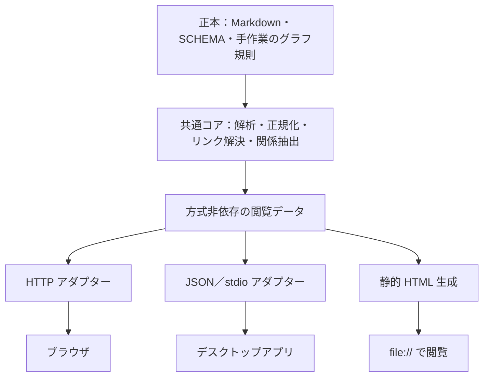

あなたは総括の書き手です。
同じタスクに 4 体のエージェントが独立して取り組み、その後、各エージェントが自分以外の成果をレビューしました。
成果とレビューを読み、作者（このリポジトリの所有者）が判断できる総括を 1 本書いてください。
あなたの最終メッセージだけが `summary.md` として保存されます。
エージェントは記号で呼びます（エージェント A、エージェント B、エージェント C、エージェント D）。記号とモデルの対応は末尾に表として付けるので、本文ではモデル名で優劣を語らないでください。

## タスク

ブラウズの手段について、以下の三案のどれかを採用するが、どれを採用しても大丈夫な設計にしてほしい

* ローカル HTTP サーバー
* Obsidian のようなビューワ（アプリケーション）を実装
   * 実装言語はデスクトップアプリが作成できるプログラミング言語で
   * 移植性も考慮
* 静的 HTML

## レビューへの作者の指示

敵対的レビューを行うこと


## 成果

### エージェント A

## 結論

三案のどれを採っても作り直しにならないように、閲覧機能を「中核」「共通の画面」「配信アダプタ」の 3 層に分けます。三案の違いは、いちばん薄い配信アダプタの中に閉じ込めます。具体的には、次の 7 つの不変条件を設計の契約にします。

1. **wiki の規則は Python の中核 1 か所にだけ置き、プロセスの境界越しに使う。** リンクの解決、frontmatter の日本語の別名キーの正規化、見出し ID、NFC、Markdown から HTML への変換と生の HTML の無効化は、wiki プラグインに新しく置く中核（仮称 `wiki_site.py` と、切り出した共通モジュール仮称 `wiki_links.py`）だけが行います。表示側は Markdown を自分で解釈しません。中核が出す「サイトモデル」（JSON）と「ページの HTML」だけを使います。デスクトップアプリを Python 以外で書く場合も、Rust などでリンクの規則を書き直さず、中核を子プロセスとして呼びます。
2. **ページの URL 空間は相対リンクだけで閉じる。** ページの識別子は「NFC にそろえた POSIX の rel_path から `.md` を除いたもの」とし、出力するファイル名と URL の名前は中核の 1 つの関数（仮称 `export_name()`）で決めます。この関数は、大文字小文字だけが違う名前の衝突と長すぎるパスに、決定的な接尾辞を付けて対処します。ページ間のリンクはすべて相対の href で書きます。こうすると、`file://`（静的 HTML）でも、`http://127.0.0.1:<port>/<token>/…`（サーバー）でも、アプリの独自スキームでも、同じ HTML がそのまま動きます。サーバーのトークンは URL のパスの先頭に置き、相対リンクで自然に引き継がせます。
3. **読む機能（第 1 段階の範囲）はすべて事前に描ける HTML にし、JavaScript は機能を足すだけにする。** ページの表示、ナビゲーション、メタ欄、被リンク、ページごとの関係表、未解決リンクは、中核が描く完成した HTML に含めます。JavaScript を切っても読めるようにします。
4. **動的な機能は「データ源」の窓口越しに使い、方式ごとの能力を宣言する。** 画面の JavaScript は `search`、`graph`、`rag` を小さな窓口越しに呼びます。実装は「HTTP」「アプリの IPC」「埋め込みデータ」の 3 つです。サイトモデルの `capabilities` に、検索の方式（`hybrid`、`static-bigram`、`none`）、`rag`、`multi_wiki`、`live_reload` を書き、使えない機能は画面に出しません。検索の結果は、既存の `wiki_search.py --json` と同じ形にそろえます。
5. **画面の部品は `file://` で動く範囲だけで書く。** classic な `<script src>` だけを使い、ES モジュール、`fetch`、Web Worker を前提にしません。静的版の検索索引とグラフのデータは、`fetch` で取得するファイルではなく、`<script src="data/….js">` で読み込む JS ファイルとして書き出します。外部への通信はしません。CDN を使わず、mermaid.js と cytoscape.js は同梱します。
6. **閲覧専用を、全方式で同じテストで確かめる。** 書き込みの API を持たず、未解決リンクをクリックしてもファイルは作りません。静的版の書き出し先は WIKI_ROOT の外にします。CSP で外部からの読み込みを禁じます。ADR-0001 の 3 条件と AC-D02 を、3 方式に共通の適合テストで確かめます。
7. **RAG は「枠だけ用意する任意の機能」とする。** 今の rag の検索は、MCP の接続中だけ動くワーカーを経由する経路しかありません。どの案を採っても、rag 側に MCP を介さない検索の入口（CLI）が要ります。

作る順序もどの案でも同じにでき、どの案に決まっても無駄になりません。

1. `resolve_link()` などを共通モジュールに切り出す
2. 中核とページの HTML のテンプレート、日本語の CSS を作る
3. 第 1 段階を静的に描ける形で完成させる
4. 選んだ案の配信アダプタを作る
5. 検索、グラフ、RAG のデータ源を足す

三案の条件の中でいちばん厳しいのは静的 HTML です。静的に描ける形で第 1 段階を作れば、サーバーとアプリはそれを包むだけになります。

デスクトップアプリを選ぶ場合の条件は、埋め込みの Web エンジンを持ち、Windows、macOS、Linux で動き、`uv run --script` を子プロセスとして起動できることです。この条件で Tauri 2（Rust）か Electron（TypeScript）を推します。Qt、Flutter、Avalonia のように画面をネイティブに描く方式は、共通の画面を使えず、画面が二重になるので採りません。

どの案に決めても、ADR-0002 を置き換える新しい ADR を書くのがよいと考えます。仮題は「browse は中核と配信を分け、配信の方式に依存しない」です。

## 根拠

### 1. 中核をプロセスの境界越しに使う理由

- **rag と wiki は同じ Python のプロセスに読み込めない。** rag の MCP サーバーは `requires-python = ">=3.12,<3.13"` で、torch と lancedb に依存します（`info-hive-rag/scripts/rag_server.py:1-14`）。wiki の検索は `>=3.10` で fastembed と sqlite-vec に依存します（`info-hive-wiki/skills/info-hive/scripts/wiki_search.py:1-8`）。RAG を統合するだけで、すでにプロセスの境界が要ります。
- **アプリは一般に Python で書かない。** タスクの条件は「デスクトップアプリが作成できるプログラミング言語」です。中核をライブラリとして import する設計にすると、Python 以外の言語では規則を書き直すことになります。
- **規則を書き直すと食い違う。** Python の中でさえ、すでに食い違いが始まっています。`clean_link_target()` は 2 か所にあり、`wiki_lint.py:70-79` は区切る前に `nfc()` をかけ、`wiki_search.py:235-243` は区切った後にかけます。今は結果が同じですが、別々に直されると食い違います。
- **規則が食い違うと実害が出る。** Obsidian では、大文字小文字だけが違うリンクが解決され、NFD で書いたリンクをクリックすると空のページが作られました（`docs/research/llm-wiki-browse-decision-matrix.md` §4.2、L147-150）。ADR-0002 も共通モジュールへの切り出しを決めています（`docs/adr/0002-…md` の決定表「リンクの解決」）。
- **同じ形は rag ですでに採っている。** 処理本体を共通のコアに置き、MCP、CLI、ワーカーから同じ処理を使う構成です（`docs/adr/0007-…md` の決定表）。閲覧機能で同じ形を採っても、構成の方針は増えません。

### 2. 相対リンクと `export_name()` が三案すべてで成り立つ理由

- **`file://` の制約。** `file://` で開いたページは、別のローカルファイルを取得できません（`docs/research/llm-wiki-browse-options.md` L324）。一方で `<script>` の読み込みは `file://` でも動く、と決定行列は推定しています（`decision-matrix.md` L184）。そこで、データは「`fetch` で取得するファイル」ではなく「`<script src>` で読み込む JS」として書き出します。
- **大文字小文字とファイル名の衝突。** wiki は大文字小文字を区別し、NTFS は区別しません。サーバーでは「経路の解決をページの一覧で行い、ファイルシステムに問い合わせない」ことで、この差を避ける方針です（`options.md` L499）。しかし静的な書き出しはファイルを作るので、名前が衝突します。既存の調査はこの点に触れていません。名前を決める関数を中核に置き、3 方式で同じ名前を使えば、ある方式でだけ別のページが開くことはなくなります。
- **トークンをパスの先頭に置く理由。** 選択肢レポートの第6.8節は、トークンを URL に含めるとしています（L509）。相対リンクで回遊するには、`?t=` のクエリより、パスの先頭（`/<token>/w/<wiki-id>/…`）に置くほうがよいと考えます。相対リンクがトークンを自動で引き継ぎ、ページの HTML を方式ごとに変えずに済むからです。Cookie を使うと、同じホストの別のポートにも送られるので採りません（推測にもとづく設計判断）。
- **アプリの独自スキーム。** Tauri の独自スキームの URL の形は OS で違うと理解しています（Windows は `http://<scheme>.localhost/`、macOS と Linux は `<scheme>://localhost/`）。このセッションでは確かめていません。相対リンクだけで閉じていれば、この違いはページに影響しません。

### 3. 第 1 段階は静的に描ける

ADR-0002 の第 1 段階は、ページの表示、`index.md` からのナビゲーション、メタ欄、被リンク、関係表、未解決リンク、日本語の CSS です（`options.md` L547）。どれも全ページを読めば事前に計算できます。実測では、1,000 ページの全変換が 1.26 秒、全体の処理で約 2.3 秒でした（`decision-matrix.md` L121-134）。

サーバーは「開いたときに 1 ページだけ描く」、静的版は「全部描く」というように、同じ `render_page(page_id)` の呼び方が違うだけになります。動的な処理が要るのは、検索、全体のグラフ、RAG、ファイル変更の反映だけです。

### 4. 方式ごとの機能の対応

| 機能 | ローカル HTTP サーバー | 静的 HTML | デスクトップアプリ | 中核の出力 |
| --- | --- | --- | --- | --- |
| ページ、ナビゲーション、メタ欄 | 同一 | 同一 | 同一 | ページの HTML |
| 被リンク、未解決リンク | 同一 | 同一（書き出した時点のもの） | 同一 | サイトモデルの `links` |
| ページごとの型付き関係 | 同一 | 同一 | 同一 | `graph/edges.jsonl` のキー（`subject`、`predicate`、`object`、`source`、`evidence`、`confidence`、`status`。`wiki_graph_extract.py:289-300`） |
| 全体のグラフ | cytoscape.js で描く | `data/graph.js` を同梱して描く | サーバーと同じ | ノードのキー（`id`、`slug`、`title`、`page_type`、`node_type`、`kind`、`path`。同 L258-271） |
| 日本語の全文検索 | `wiki_search.py --json` を呼ぶ（BM25 と埋め込み） | 事前に作る bigram の索引だけ（縮小） | 子プロセスで同じ CLI を呼ぶ | 結果の形は `json_result()` と `emit_json()`（`wiki_search.py:813-862`）に合わせる |
| RAG の検索 | rag に CLI の入口ができれば可能 | 不可 | rag に CLI の入口ができれば可能 | 任意の能力 |
| 複数 Wiki | `/w/<wiki-id>/` で切り替える | Wiki ごとに書き出すか、まとめて書き出す | サーバーと同じ | サイトモデルの `wikis` |
| mermaid、`wiki/assets/` の svg | 同梱の mermaid.js、`` で表示 | 同じ（相対パス） | 同じ | 資産の一覧（一覧にあるものだけを返す） |
| 変更の反映 | 要求のたびに更新時刻を見る | 書き出し直す | サーバーと同じ | — |
| Claude Code のセッションとの関係 | セッションの間だけ動く（`options.md` L522） | 関係しない | 関係しない | — |

### 5. RAG を任意の機能とする理由

- 検索の MCP ツールは、`search_requests` 表に要求を入れ、ワーカーが処理するのを最大 600 秒待ちます（`rag_server.py:151-166`、`rag_jobs.py:107-138`）。
- そのワーカーは「MCP の接続中だけ動く」と明記されています（`rag_worker.py:1`）。
- `Engine.search` は `rag_index.py:302` にありますが、`argparse` も `__main__` もありません。CLI としては呼べません。

したがって、Claude Code の外で動く閲覧画面（静的 HTML、アプリ、セッションの外のサーバー）は、今のままでは RAG を呼べません。どの案でも、rag 側に「検索だけを行う CLI」（仮称 `rag_search.py --json`）を足すことが前提になります。

### 6. 安全性を共通の条件にできる理由

ADR-0001 の 3 条件（ループバックだけで待ち受ける、内容を外に送らない、書き込みの API を持たない）と AC-D02（`llm-wiki-product-concept-and-requirements-ja.md` L551）は、方式に依存しない性質です。方式ごとの差は次のとおりです。

- **サーバー**：127.0.0.1 への固定、トークン、Host ヘッダーの確認、CSP、自前のハンドラ（`options.md` L504-517）
- **アプリ**：ポートを開かない stdio の IPC を既定にします。外部の URL はアプリの中で開かず、確認してから OS のブラウザに渡します（S-07、L450）
- **静的 HTML**：`<meta>` の CSP を付け、書き出し先は OS のユーザーキャッシュを既定にします（`options.md` L422、No.81）

検査の内容は共通です。「閲覧の操作の前後で WIKI_ROOT のハッシュが変わらない」「127.0.0.1 以外への要求が 0 件」です。

### 7. 日本語の表示を方式によらずそろえる方法

- CSS（`lang="ja"`、`line-break: strict`、`overflow-wrap: anywhere`、OS 標準の日本語フォントを並べる指定）は、共通の画面に 1 つだけ持ちます（`options.md` L488-502）。
- 方式で差が出るのは描画エンジンです。サーバーと静的版は利用者のブラウザで描かれます。アプリは、Tauri なら WebView2、WKWebView、WebKitGTK の 3 つで描かれ、Electron なら Chromium だけで描かれます。
- `text-autospace` は Safari 18.4 から対応していると調査にあります（L495）。Linux の WebKitGTK でどう描かれるかは確かめていません。
- 合格の目安（`options.md` L556-563）は、3 方式で同じものを使います。

### 8. 作る量の見積もり（推定）

ADR-0002 が見積もった Python 1,000〜1,500 行と、JavaScript・CSS 300〜500 行（ADR-0002「影響」）の大部分は、中核と共通の画面に入ります。アダプタの量は次のとおり推定します（どれも推定）。

- 静的版：100〜300 行
- サーバー：安全対策を含めて 300〜500 行
- アプリの殻：Rust か TypeScript で 300〜600 行。ほかに、署名と、3 OS 向けのビルドとリリースの仕組みが要ります

方式の選択が後の作業を大きく変えるのはアプリの場合だけで、その費用の大半はコードではなく配布にかかります。

## 検討した代替案

| 代替案 | 採らなかった理由 |
| --- | --- |
| 画面を SPA（ハッシュでルーティングし、データはすべて JSON）にする | `file://` では JSON を取得できないので、静的版だけ別の作りになります。JavaScript を切ると読めず、印刷や受け渡しにも向きません。事前に描いた HTML に JavaScript で機能を足す形なら、3 方式で同じ HTML を使えます |
| 中核を Python のライブラリとして各方式から import する | Python ではないアプリから使えません。rag（Python 3.12 系）とも同じプロセスに載りません |
| アプリの言語でリンクの解決などを書き直し、共通の試験データで一致を確かめる | アプリが Python を起動できない場合の最後の手段として残します。規則を 2 つの言語で保守することになり、食い違いの危険が増えます（Obsidian の例、`decision-matrix.md` §4.2） |
| 画面をネイティブに描く GUI（Qt、Flutter、Avalonia、Compose）でアプリを作る | ページの本文は結局 HTML なので Web エンジンが要ります。共通の画面を使えず、日本語の CSS とナビゲーションが二重になります。Qt の QtWebEngine は大きく、ライセンス（LGPL）の確認も要ります（推定） |
| アプリを pywebview（Python）で作る | 言語が中核と同じなのは利点です。ただし、Windows では pythonnet と .NET、Linux では Qt か GTK を利用者が入れる必要があり、配布物と依存が増えます（`options.md` L327、No.16 は 140 点）。Tauri や Electron と並ぶ候補として残しますが、第一候補にはしません |
| アプリをサーバーの殻（ローカルの HTTP サーバーを専用の窓で開くだけ）にする | 実装はいちばん少なく済みます。ただしポートを開くので、ADR-0001 の対策がアプリにも要ります。stdio の IPC を既定にし、HTTP は予備として選べるようにします |
| 静的版の検索も `wiki_search.py` と同じにする | `file://` からはプロセスを呼べません。bigram の簡易検索に縮小し、能力の宣言で利用者に示します。JavaScript 側の分かち書きは Python の `tokenize()` と同じ試験データで一致を確かめます。規則の二重化はここ 1 か所に限られます |
| ADR-0002 をそのまま進め、静的版とアプリは後で考える | サーバーを前提に絶対 URL、トークンのクエリ、`fetch` に頼る画面を作ると、後で静的版とアプリに移すときに作り直しになります。今回の依頼の趣旨に反します |

## 前提と不確実性

- **仮定：デスクトップアプリは Python と uv を使える環境で動く。** 中核を `uv run --script` で起動する前提です。uv の導入をアプリの導入手順に含めるか、uv の実行ファイルを同梱するかは作者の判断です。初回は依存の取得に通信が要ります。wiki の内容は外に出ないので、ローカル完結とは矛盾しないと解釈しました。
- **仮定：アプリはプラグインと別のリポジトリに置く。** アプリは Claude Code のプラグインではないので、AGENTS.md の「プラグインを足すとき」の手順は当てはまりません。新しいリポジトリ（仮称 `to884/info-hive-viewer`）をサブモジュールにし、AGENTS.md に節を足し、中核と画面の版をアプリの側で固定する、という形を想定しました。中核の場所は、Claude Code のプラグインのキャッシュの中のパスに頼らない方針です。中核をアプリに同梱し、サイトモデルの `protocol_version` で互換性を確かめます。この配置は作者の判断です。
- **確かめていないこと：**
  - `file://` で ES モジュール、`fetch`、Web Worker が使えないこと（Chromium の一般的な挙動として書きました）
  - Tauri 2 の独自スキームの URL の形と sidecar の機能
  - WebKitGTK での日本語の CSS の描画
  - Tauri と Electron の現在の版
  
  このセッションでは Web を調べていません。実装の前に一次資料と PoC で確かめる必要があります。
- **アプリの言語の選び方。** 配布物の大きさと OS 標準の Web エンジンを重く見るなら Tauri 2、3 OS で描画をそろえたいなら Electron です。日本語の表示を重く見るこのプロジェクトでは、Linux の WebKitGTK での描画の確認が判断の分かれ目になります。どちらを選ぶかは作者の判断です。
- **rag の依存。** RAG の統合は、rag に CLI の検索の入口を足すことが前提です。これは rag の設計の変更なので、ADR-0007 との整合を確かめる必要があります。
- **静的版のファイル名。** 読める名前（rel_path）を基本にし、衝突や長すぎる名前のときだけハッシュの接尾辞を付ける案にしました。すべてハッシュの名前にすれば単純になりますが、読めなくなります。どちらにするかは作者の判断です。lint に「大文字小文字だけが違うページ」の検査を足すかも、あわせて決める必要があります。
- **ADR の扱い。** ADR-0002 の「見直す条件」は発生していません。ただし、静的版を副機能から並列の方式に格上げし、作る順序を変えるので、ADR-0002 を置き換えるか補う新しい ADR を書くことを勧めます。ADR-0002 の決定表のうち、「作る順序」（共通モジュールと静的に描ける第 1 段階を先にする）と「書き出し」（副機能から並列の方式へ）が変わります。
- **確信度。** 「規則を 1 か所に置き、プロセス越しに使う」と「`file://` の制約を画面の最低条件にする」の 2 点は、リポジトリの事実で裏付けており、確信度は高いです。アプリの言語の推奨とアダプタの行数は推定で、確信度は中程度です。

## 参照

リポジトリの文書（`C:\Works\info-hive-dev\.claude\worktrees\wiki-browse-spec-4a9ad7\`）：
- `AGENTS.md`：リポジトリの役割、プラグインを足す手順、日本語と UTF-8 の規則
- `docs/adr/README.md`、`0001-local-only-server-is-not-hosted-wiki.md`（3 条件）、`0002-wiki-browse-uses-on-demand-local-server.md`（決定表、影響、見直す条件）、`0005-wiki-figures-use-mermaid-and-svg.md`（mermaid と svg、生の HTML を出さない方針）、`0007-rag-uses-mcp-core-and-persistent-jobs.md`（共通コアの構成）、`0008-numbered-workspace-layout.md`（作業領域と複数 Wiki）、`0009-graph-layer-stays-in-wiki.md`
- `docs/research/llm-wiki-browse-options.md`：L23-34、L46-72、L120-130、L306-333（表示経路の採点、`file://` の制約 L324、pywebview L327）、L409-422、L456-487、L488-502（日本語）、L504-517（安全性）、L519-527（起動）、L544-570（PoC と合格の目安）
- `docs/research/llm-wiki-browse-decision-matrix.md`：L13-21、L41-52、L111-136（実測）、L138-162（Obsidian での確認）、L168-212（拡張性の内訳と決定行列、`<script>` の推定 L184）
- `llm-wiki-product-concept-and-requirements-ja.md`：D-03（L29）、F-G06（L261）、S-07（L450）、AC-D02（L551）、O-11（L607）

サブモジュール（`C:\Works\info-hive-dev\` の本体のチェックアウトで読んだもの。worktree ではサブモジュールが空だったため）：
- `info-hive-wiki/.claude-plugin/plugin.json`（0.2.0）、`info-hive-wiki/commands/`（browse はまだない）
- `info-hive-wiki/skills/info-hive/scripts/wiki_lint.py:60-104`（`WIKILINK_RE`、`clean_link_target`、`resolve_link`）、L140
- `info-hive-wiki/skills/info-hive/scripts/wiki_search.py:1-60`（依存と CLI）、L235-277（`clean_link_target` の 2 つ目の実装と `resolve_link`）、L813-862（`json_result`、`emit_json`）、L1121-1133
- `info-hive-wiki/skills/info-hive/scripts/wiki_graph_extract.py:258-271`（ノードのキー）、L289-300（エッジのキー）
- `info-hive-rag/.claude-plugin/plugin.json`、`info-hive-rag/.mcp.json`、`info-hive-rag/scripts/rag_server.py:1-30, 145-176`、`rag_jobs.py:35, 98-138`、`rag_worker.py:1, 172`、`rag_index.py:302`

指示に従い、`docs/agent-runs/2026-11-05-wiki-browse-viewer-agnostic-design/` は読んでいません。リポジトリのファイルも変えていません。

```text
使用した MCP サーバー: なし
使用した Agent Skills: なし
```

### エージェント B

## 結論

**三案のどれを採っても壊れない設計の核は、「wiki を解釈するコンパイラを 1 つだけ持ち、三案はその出力を表示するアダプタにする」ことである。** コンパイラは Python でプラグインの中に置き、既存の `resolve_link()`、`canonical_meta()`、`collect_pages()`、被リンク、`graph.sqlite` の問い合わせを再利用して、**版番号つきの「ブラウズ・バンドル」**（JSON のマニフェスト＋ページごとの HTML 断片＋共通の CSS/JS）を出す。ローカル HTTP サーバー、静的 HTML、デスクトップアプリは、このバンドルを配る・書き出す・ウィンドウに載せるだけで、Markdown の変換やリンクの解決を二重に実装しない。

契約は、三案のうちもっとも制約が強い **「`file://` で開いても動く」** に合わせて決める。これを満たせば、サーバーとデスクトップアプリは自動的に満たす。具体的には次の 6 つを設計規則にする。

| # | 規則 | 理由 |
| --- | --- | --- |
| 1 | ページは 1 枚ずつ自立した HTML にし、リンクは相対パスだけで書く（`../concepts/foo.html`）。`/w/<wiki-id>/...` のような絶対の URL 接頭辞を本文に埋めない | `file://` では絶対パスが使えない。相対パスなら、サーバーがどの接頭辞（トークンや wiki の識別子）の下に載せても壊れない |
| 2 | 被リンク、未解決リンクの一覧、ページごとの型付き関係、ナビゲーション（`index.md` と `indexes/`）、見出し一覧は、閲覧時に計算せず、すべてバンドルに事前計算して入れる | `file://` では `fetch()` が使えない。事前計算すれば三案で同じ画面になり、決定行列で A が劣るとされた「グラフと被リンク」の差も消える |
| 3 | 検索だけは「ホストの能力」として段階を宣言する。`live`（`wiki_search.py --json` をその場で呼ぶ）、`embedded`（静的用の軽い索引を `<script>` で同梱）、`none` | 三案で唯一そろえられない機能なので、そろえない代わりに段階を契約に書く |
| 4 | バンドルに `wiki/assets/` の許可リストを持ち、mermaid のフェンスは `<pre class="mermaid">` としてエスケープして出す | ADR-0005 が記録した「サーバーがページ一覧のパスしか返さないので svg が配信されない」を、三案共通の仕組みで解決する。mermaid.js の同梱は三案共通のテンプレートの判断になる |
| 5 | コンパイラは wiki を一切書き換えず、書き出し先は `<WIKI_ROOT>/.wiki-cache/browse/` か利用者が指定したディレクトリに限る | F-G06 と ADR-0002 の「閲覧専用」を、ホストではなくコンパイラの契約として守る |
| 6 | wiki の本文は閲覧手段に依存しない（Obsidian 固有の記法、ビューワ固有の frontmatter、JavaScript がないと読めない要素を使わない） | 「どのビューワでも大丈夫」のもう半分は、コンテンツ側の規律で担保する |

デスクトップアプリの言語は今決めなくてよい。契約（バンドルの版と形式）を固定すれば、Rust（Tauri）、JavaScript（Electron）、Python（pywebview）のどれでも「WebView にバンドルの HTML を載せ、Python のコンパイラ（またはローカルサーバー）を子プロセスとして呼ぶ殻」として作れる。無理に 1 つを選ぶなら、移植性と配布物の小ささから Tauri 2 を推し、最初の試作は Python のまま作れる pywebview で済ませる。

この設計は ADR-0002（構成 B のローカルサーバー）を否定しない。サーバーは第 1 のアダプタとして最初に作る。ただし ADR-0002 の 2 行（「既定ではファイルに書き出さず、ページを開いたときに変換する」「複数 Wiki は URL に識別子を含めて切り替える」）は、本設計と両立させるために改訂の ADR が要る（「前提と不確実性」を参照）。

## 根拠

**1. ブラウズの実装はまだなく、設計はコードに縛られていない。** `info-hive-wiki/commands/` には evolve、graph、help、ingest、init、learn、lint、query、stats、upgrade の 10 本だけで、browse.md はない。`info-hive-wiki/docs/commands.md` の一覧も 10 本である。決めるべきは、ADR-0002 で選んだ構成 B の中の層の切り方である。

**2. 「コンパイラ」に要る部品は、すでにスクリプトの中に関数として存在する。** 閲覧画面に要る解釈はすべて既存関数で足り、新規に書くのは HTML への変換とバンドルの組み立てだけである。

| 必要な解釈 | 既存の関数（`info-hive-wiki/skills/info-hive/scripts/`） |
| --- | --- |
| ページの走査、slug、rel_path、frontmatter、本文、リンク、セクション、SHA-256 のキャッシュ | `wiki_search.py` の `collect_pages()`（L279〜）。`SCHEMA.md`、`index.md`、`log.md`、`indexes/`、`graph/`、`raw/`、`.wiki-cache`、`.evolution` を除外する |
| wikilink の解決（NFC、大文字小文字の区別、`dir/slug` は制約、`#見出し`、`|別名`、`.md`） | `wiki_lint.py` の `clean_link_target()`（L71）と `resolve_link()`（L84）。`wiki_search.py` L235〜274 に同じ関数がある |
| 日本語の別名キーと `type`・`kind` の値の正規化 | `wiki_text.py` の `canonical_meta()`（L103）、`normalize_tags()`（L134） |
| 被リンク | `wiki_search.py` の `cmd_backlinks()`（L1083）の照合ロジック（`link_key()` で比較） |
| ページごとの型付き関係 | `wiki_graph_query.py` の `edges_from()`（L60）、`edges_to()`（L70）。`graph/nodes.jsonl`、`edges.jsonl` はそのまま全体グラフの JSON になる |
| 検索の結果の形 | `wiki_search.py` の `json_result()`（L813）。`slug`、`rel_path`、`type`、`title`、`heading_path`、`score`、`snippet` など英語キー |

選択肢レポート §1 の 2 と §7.2 の手順 1 も、`resolve_link()` を共通モジュールに切り出すことを最初の作業にしている。本設計はその延長で、「切り出した共通部品の利用者をコンパイラ 1 つに限る」と言い換えたものである。

**3. `file://` の制約が三案の共通分母である。** 選択肢レポート §4 と §5 は、Docsify（36）、ブラウザ側の描画（40）、Pagefind（71）、JSON 索引（74）、`wiki_search.py`（75）が「ブラウザが別のファイルを取得する」ため `file://` では動かないと整理している。したがって、静的 HTML でも動く形にするには、取得が要る情報を事前計算してページに埋めるか、`<script src>` で読み込む形にするしかない（ブラウザが `file://` で `<script src>` を許し `fetch()` を拒む、という挙動は私の知識にもとづく推測で、本調査では未確認）。この形はサーバーでもデスクトップでもそのまま動くので、三案の交差点になる。

**4. 事前計算の費用は小さい。** 決定行列 §4.1 の実測（検証環境、合成 wiki）では、1 ページの HTML 変換が 1.3 ミリ秒、1,000 ページの全変換が 1.26 秒、静的 HTML の起動から全変換までが約 2.3 秒である。`collect_pages()` は SHA-256 で解析キャッシュを持つので、差分だけ作り直せる。サーバーは同じコンパイラを「要求のたびに更新時刻を確かめて 1 ページだけ変換する」モードで呼び、静的は「全ページを書き出す」モードで呼ぶ。入口が 2 つで、コードの経路は 1 つになる。

**5. ナビゲーションを各ページに埋め込むと静的出力が肥大するので、共有スクリプトにする。** `index.md` の 1 項目は「`- [[slug]]: 1 行の要約`」で、日本語の要約を含めて 1 項目約 100 バイトと見積もる（推定）。1,000 項目なら約 100 KB で、これを 1,000 ページすべてに埋めると 100 KB × 1,000 = 約 100 MB になる。ナビは `nav.js` のような共有ファイルに 1 つだけ置き、各ページは `<script src="../nav.js">` で読み、`<noscript>` には `index.html` へのリンクを残す。これなら本文の HTML は約 10〜20 KB × 1,000 = 10〜20 MB（推定）に収まる。

**6. 決定行列の論理に照らすと、本設計は「安い保険」である。** 決定行列 §5.3 によれば、B が A を上回る 1.24 点のうち 1.09 点（約 88%）が拡張性に由来する。§5.1 の拡張性の内訳は 4 方向（日本語の全文検索、グラフと被リンク、RAG 統合、複数 Wiki）の平均で、A は 4.0、B は 8.75 だった。被リンクとグラフをバンドルに事前計算すると、「グラフと被リンク」は三案で同じになる。残る差は、その場の検索、RAG の検索結果からの誘導、複数 wiki の切り替えの 3 つで、どれもサーバーまたはデスクトップが持つ「能力」として契約に書ける。B を選び直す話ではなく、B の中でコンパイラの境界を正しく引けば A と C が付いてくる、という話である。

**7. 検索の段階を契約に書く理由。** 選択肢レポート §1 の 4 は、全文検索を `wiki_search.py` 経由にする理由として、`/wiki:query` と同じ BM25 と埋め込み、日本語の bigram 分割をそのまま使えることを挙げている。静的 HTML でこれを JavaScript に移植すると、`tokenize()`（`wiki_search.py` L139）の規則が二重になり、lint と画面の食い違いと同じ種類の問題を検索に持ち込む。そこで、`embedded` の段階は「`index.md` の題名と要約、タグの照合」に限り、本文の全文検索は `live` の段階でだけ提供すると割り切る。postings を Python 側で作って JS は照合だけ、という中間案もあるが、クエリ側の分割は JS に要るので同じ問題が残る。

**8. RAG と複数 wiki はホストの能力である。** rag の MCP は `search(wiki_root, query, limit)`（`info-hive-rag/scripts/rag_server.py` L152）を持ち、結果は `chunk_id`、`doc_id`、`page`、`section`、`title`、`text`、`score`（`rag_index.py` L320〜349）である。原本への参照は `books:日本語資料.pdf` のような名前付き参照（rag の README）で、`file://` へのリンクはブラウザが開かない（選択肢レポート §6.8）。したがって RAG の結果は「表示して、パスと頁をコピーできる」までが三案共通の UI 部品になり、呼び出しそのものはサーバーとデスクトップだけが持つ。複数 wiki は ADR-0008 のとおり作業領域ごとに `wiki/` が 1 つなので、「wiki ルートごとに 1 バンドル。ホストが複数を載せる」で足り、URL の規約を契約にしなくてよい。別の wiki への相対リンクは、選択肢レポート §6.9 と同じく「外部の参照」として示す。

**9. サーバー固有の対策は、相対リンクの規則と両立する。** 選択肢レポート §6.8 の起動ごとのトークンは、`/t/<token>/concepts/foo.html` のようにパスの接頭辞に置けば、本文の相対リンクがそのまま接頭辞を引き継ぐので、HTML 断片を一切変えずに済む。Host ヘッダーの確認、CSP、127.0.0.1 への固定はハンドラ側の処理で、バンドルには影響しない。

**10. デスクトップアプリの言語を「後で決められる」ようにする契約。** アプリがやることは、(a) wiki ルートの一覧を持つ、(b) `uv run --script wiki_render.py <WIKI_ROOT> --out <dir>` を子プロセスで呼ぶか、ローカルサーバーを起動してその URL を開く、(c) WebView にバンドルを載せる、(d) ファイルの変更を監視して再コンパイルを頼む、の 4 つである。Markdown と wikilink の規則はアプリの言語に持ち込まない。Python と uv はプラグインの前提（`info-hive-wiki/README.md` の「前提として必要なのは `uv` だけ」）なので、アプリがそれに依存しても新しい前提は増えない。

| 候補 | 言語 | 描画エンジン | 長所 | 注意 |
| --- | --- | --- | --- | --- |
| Tauri 2 | Rust（UI は HTML/JS） | OS の WebView（Windows は WebView2、macOS は WKWebView、Linux は WebKitGTK） | 配布物が小さい。Windows・macOS・Linux に対応 | OS ごとにエンジンが違い、日本語のフォントと禁則の見え方が揃わない（`text-autospace` の対応差など、選択肢レポート §6.7 の方針で吸収する） |
| Electron | JavaScript | 同梱の Chromium | 描画が OS によらず同じ。Obsidian 自身がこの方式 | 配布物が大きい。Node.js の開発環境が要る |
| pywebview | Python | OS の WebView | 新しい言語が要らず、プラグインと同じスタックで試作できる | 配布には PyInstaller などが要る。Tauri と同じく OS でエンジンが違う |

いずれも「殻」なので、バンドルの版に固定（pin）して動く。デスクトップアプリは Claude Code のプラグインではないので、置き場所（別リポジトリ）と公開の周期は作者の判断になる。デスクトップと静的の 2 案は、研究で記録されたサーバー固有の悩み 2 つ、「Claude Code が終了時にバックグラウンドの処理を止める」（選択肢レポート §6.9）と「トークンと Host ヘッダーの対策」（§6.8）を回避できる。

**11. 「どれを採っても大丈夫」を証明する受け入れテスト。** `info-hive-wiki/eval/retrieval/ja/corpus/wiki/`（決定行列 §4.2 によれば 28 ページ）でバンドルを作り、次を確かめる。(a) 未解決リンクの一覧が `wiki_lint.py` の結果と一致する（選択肢レポート §7.2 の合格の目安と同じ）。(b) 各ページの HTML 断片が、サーバーが返すもの、静的に書き出したもの、デスクトップの殻が読み込むもので、バイト単位で同一である。(c) 静的出力を `file://` で開いて、コンソールにエラーがなく、リンクで移動できる。(d) サーバーは 127.0.0.1 以外への通信が 0 件。(b) が成り立てば、三案は構成上入れ替え可能である。

**12. バンドルの中身（キーは英語、本文は日本語）。** `bundle_version`、`wiki_root`、`generated_at`、`capabilities`（`search: live|embedded|none`、`rag: true|false`、`graph: true|false`）、`pages[]`（`slug`、`rel_path`、`title`、`type`、`kind`、`tags`、`created`、`updated`、`sources`、`headings[]`、`outlinks_resolved[]`、`outlinks_unresolved[]`、`backlinks[]`、`relations[]`、`sha256`、`html`）、`nav`（`index.md` と `indexes/<type>.md` を解釈した木。`collect_pages()` はこれらを除外するので、コンパイラが別に読む）、`assets[]`（`wiki/assets/` の許可リスト）、`graph`（`nodes.jsonl` と `edges.jsonl` の写し）、`search_index`（`embedded` のときだけ）。見出し ID は選択肢レポート §6.7 のとおり NFC のまま日本語で付け、`[[slug#見出し]]` の解決と一致させる。

## 検討した代替案

| 案 | 採らなかった理由 |
| --- | --- |
| 三案それぞれに Markdown 変換とリンク解決を持たせる（サーバーは Python、デスクトップはアプリの言語、静的は生成器） | 規則が 3 か所に分かれ、lint と画面の食い違い（ADR-0002 の「理由」）が 3 倍になる。決定行列 §4.2 の Obsidian の食い違い（大文字小文字、NFD、クリックでページが増える）は、まさに別実装の規則が招いた例である |
| サーバーを唯一の経路にし、デスクトップアプリはサーバーの URL を開くだけ、静的は作らない | 「どれを採っても」という依頼に反する。また、Claude Code のセッション終了でサーバーが止まる（選択肢レポート §6.9）ので、デスクトップアプリが自前でプロセスを管理する必要があり、結局コンパイラの CLI 契約が要る |
| 静的 HTML を主にし、サーバーは静的出力を配るだけにする | その場の検索と RAG を失う。決定行列 §5.3 のとおり、B の優位は拡張性にある。本設計では静的出力は同じコンパイラの別の入口なので、主従を決めなくてよい |
| 既製の静的サイト生成器（Quartz、MkDocs、Zensical、Docsify）を静的の経路に使う | 決定行列 §5.2 で 8 案中 5〜8 位。日本語の別名キーと型付きグラフを解釈せず、wikilink の規則も食い違う（ADR-0002「検討した選択肢」）。本設計の規則 6（コンテンツは閲覧手段に依存しない）とも相性が悪い |
| デスクトップアプリで Markdown をネイティブに描く（WebView を使わない） | HTML/CSS を共有できず、日本語の禁則と折り返しの CSS 方針（選択肢レポート §6.7）をアプリの言語で作り直すことになる |
| 静的 HTML に本文の全文検索を JavaScript で同梱する | `tokenize()` の規則の二重化。段階 `embedded` を題名・要約・タグに限り、全文は `live` に残す方が、規則の一元化と矛盾しない。需要が出たら、Python 側で postings を作る中間案を検討する |
| 多 wiki を URL の規約（`/w/<wiki-id>/<rel_path>`）で契約にする | `file://` で成り立たない。「wiki ルートごとに 1 バンドル」なら三案で同じ扱いになる |

## 前提と不確実性

- **サブモジュールの読み方。** このワークツリーではサブモジュールが空だったので、スクリプトと文書は主の作業コピー `C:/Works/info-hive-dev/info-hive-wiki/`（HEAD `3028923`）から読んだ。ワークツリーの gitlink（`302892390250…`）と一致することを `git submodule status` で確かめた。引用した行番号はこの版のものである。
- **ブラウザの `file://` の挙動。** 「`fetch()` は使えず、`<script src>` は読める」は私の知識にもとづく推測で、本調査で一次資料を確かめていない。選択肢レポート §8 も Docsify と Pagefind について「公式の記述は未確認」としている。設計規則 1〜3 はこの前提に立つ。
- **デスクトップの WebView のエンジンと対応 OS。** Tauri、Electron、pywebview の特徴は私の知識で、版と対応状況は未確認である。日本語の描画の差は、選択肢レポート §6.7 の CSS 方針で吸収できると見込んでいるが、Linux の WebKitGTK での実機確認が要る。
- **規模の見積もり。** ナビ 1 項目 100 バイト、本文 HTML 1 ページ 10〜20 KB は推定で、実際の wiki（1 ページ 4,000 字まで）で測り直す必要がある。決定行列 §4.1 の実測も合成ページによるものである。
- **ADR-0002 の改訂（作者の判断）。** 次の 2 行は、本設計と両立させるために置き換えの ADR が要る。(1)「既定ではファイルに書き出さず、ページを開いたときに変換する。静的 HTML の書き出しは副機能」→ 静的の書き出しはコンパイラの第一級の入口にし、サーバーの既定（その場で変換）は変えない。(2)「複数 Wiki は URL に識別子を含めて切り替える」（選択肢レポート §6.9）→ 相対リンクと「wiki ルートごとに 1 バンドル」に改める。あわせて §6.8 の「ページの一覧にある rel_path だけを返す」に `wiki/assets/` の許可リストを足す（ADR-0005 の「見直す条件」と整合する）。
- **作る順序（作者の判断）。** ADR-0002 は「第 1 段階で読む画面、次に日本語の全文検索」とする。本設計では、共通部品の切り出し → コンパイラと静的書き出し → サーバー（`live` の検索）→ デスクトップの殻、の順が最も安い。静的の書き出しはポートを開かずにテストでき、受け入れテスト (a)(b) をサーバーの前に通せる。読む画面を最初に届けるという ADR の意図は保てるが、順序の変更は作者が決める。
- **デスクトップアプリの置き場所と配布。** プラグインではないので、`info-hive-dev` のサブモジュールにするか、別の製品にするか、Python と uv を前提にしてよいかは未決である。本設計はバンドルの版で結び付けるだけなので、どちらでも成り立つ。
- **検索の `embedded` の範囲。** 題名・要約・タグに限る案は私の提案で、利用者が静的出力で本文検索を求めるかは分からない。
- **mermaid.js の同梱。** ADR-0005 は第一段階に含めないとしている。本設計は「出す形」（`<pre class="mermaid">`）だけを決め、同梱の時期は ADR-0005 の「見直す条件」に従う。

## 参照

- `docs/adr/README.md`、`docs/adr/0001-local-only-server-is-not-hosted-wiki.md`、`docs/adr/0002-wiki-browse-uses-on-demand-local-server.md`（決定、理由、検討した選択肢、見直す条件）、`docs/adr/0005-wiki-figures-use-mermaid-and-svg.md`（背景の制約、browse での表示、見直す条件）、`docs/adr/0007-rag-uses-mcp-core-and-persistent-jobs.md`、`docs/adr/0008-numbered-workspace-layout.md`（各ディレクトリの役割、設定と作業領域の見つけ方）、`docs/adr/0009-graph-layer-stays-in-wiki.md`
- `docs/research/llm-wiki-browse-options.md` §1、§2.2〜2.5、§3.1、§4（候補 1〜22、36、40、71、74、75）、§5、§6.5〜6.9、§7.1〜7.2、§8
- `docs/research/llm-wiki-browse-decision-matrix.md` §1、§2.3、§4.1、§4.2、§5.1〜5.3、§6、§7、§8
- `llm-wiki-product-concept-and-requirements-ja.md` D-03、F-G06、AC-D02、O-11（`grep` で該当行を確認）
- `docs/porting-plan.html` 方針 B、方針 G、Q4（本文を抽出して確認）
- `info-hive-wiki/.claude-plugin/plugin.json`、`README.md`（前提は uv のみ、10 本のコマンド）、`docs/commands.md`、`commands/graph.md`、`commands/query.md`、`commands/lint.md`、`skills/info-hive/SKILL.md`、`skills/info-hive/assets/`（テンプレート一覧）
- `info-hive-wiki/skills/info-hive/scripts/wiki_search.py`（`collect_pages` L279、`tokenize` L139、`resolve_link` L257、`json_result` L813、`cmd_backlinks` L1083）、`wiki_lint.py`（`clean_link_target` L71、`resolve_link` L84、除外一覧 L108〜109）、`wiki_text.py`（`canonical_meta` L103、`normalize_tags` L134）、`wiki_graph_query.py`（`edges_from` L60、`edges_to` L70、`--json` L221）、`init_wiki.py`（`.wiki-cache/.gitignore` L232）、`test_link_resolution.py`（モジュールの import の仕方）
- `info-hive-wiki/eval/check_encoding.py`（新しいスクリプトが従う encoding の検査）
- `info-hive-rag/.claude-plugin/plugin.json`、`.mcp.json`、`README.md`（MCP ツール一覧）、`scripts/rag_server.py`（`search` L152）、`scripts/rag_index.py`（検索結果の列 L320〜349）
- `~/info-hive/W0_Wiki/index.md`、`SCHEMA.md`（実際の wiki の索引の形と規約）

```text
使用した MCP サーバー: なし
使用した Agent Skills: なし
```

### エージェント C

共通化する範囲は、ページの解釈、リンク解決、被リンク・関係の抽出、検索結果の形式です。HTTP、デスクトップの IPC、静的 HTML の埋め込みデータは、その外側に置く構成を提案します。静的版の更新時点や RAG の利用可否は、方式間の違いとして明示する必要があります。## 結論

**Markdown を読む共通コアと、表示方式ごとのアダプターを分ける設計を採用する。** ローカル HTTP サーバー、デスクトップアプリ、静的 HTML のどれを選んでも、Wiki の解釈やリンク解決を作り直さずに済む構成にする。

三方式すべての実装を先に作る必要はない。先に共通のデータ契約と合格条件を定め、採用した方式のアダプターから実装する。

設計上、次の四点を固定する。

1. **正本と意味を共通化する。** Markdown、frontmatter、リンク、被リンク、型付き関係の解釈は共通コアが担う。
2. **HTTP を共通コアの呼び出し条件にしない。** HTTP、プロセス間通信、静的ファイル生成を、それぞれ独立した出口にする。
3. **全方式の基本機能と、方式ごとの追加機能を区別する。** ページ閲覧・リンク移動・被リンク・関係表は共通の基本機能とする。更新の即時反映、既存検索処理の実行、稼働中の RAG との統合は、利用可能な能力として明示する。
4. **デスクトップ版の候補は Rust＋Tauri とする。** HTML の画面を共有し、既存の Python コアは JSON のプロセス間通信で利用できる。言語とフレームワークの最終決定は、デスクトップ版を採用するときに行う。

現行の ADR-0002 は HTTP サーバーを採用済みである。今回の要望を反映する際は、**方式に依存しない要件と、HTTP 版にだけ適用する実装判断を分けて記録し直す**必要がある。本回答はその設計提案であり、ファイルは変更していない。

## 根拠

**1. 既存の要件の中心は、表示方式よりも Wiki の解釈と正本の保全にある。**

要件定義書の F-G06 は、ページ、被リンク、ページごとの型付き関係の閲覧、lint と一致するリンク解決、閲覧によって Wiki を変更しないことを求めている。Markdown などを正本、検索索引やグラフ DB を再生成可能な派生データとする原則もある。これらは三方式に共通して適用できる。［参照1：L115、L250–263］

一方、Python の HTTP サーバー、ポート、無操作での終了、検索のサーバー経由呼び出しは、ADR-0002 が選んだ実装方法である。共通要件の内部にこれらを組み込むと、デスクトップ版と静的版への切り替えで、その実装方法まで引き継ぐことになる。［参照2：L24–33］

したがって、責務を次のように分ける。



これは提案する依存関係であり、現在この構成が実装済みという意味ではない。

**2. リンクと日本語の解釈を各表示方式に任せると、すでに確認されている不一致を再発させる。**

指定コミットの実装には、次の規則がある。

- `wiki_text.py` は、パスやリンク先を NFC、タグを NFKC に正規化する。日本語の frontmatter キーも共通の対応表で英語に直し、キーが衝突した場合は衝突情報を返す。
- `wiki_lint.py` の `resolve_link()` は大文字小文字を区別する。パス付きリンクは、そのパスに一致した場合だけ解決し、別ディレクトリの同じ slug に読み替えない。
- `wiki_lint.py` と `wiki_search.py` には、それぞれリンク解決処理が存在する。ADR-0002 も、この共通化を予定している。［参照2：L27–28、参照5］

このため、以下を共通コアの責務とする。

| 責務 | 共通化する内容 |
|---|---|
| ページの収集 | 知識ページと管理用ページを区別し、raw・索引・キャッシュを知識ページに混ぜない |
| メタデータ | 日本語の別名、英語キーとの衝突、タイトルの補完 |
| リンク | NFC、大小文字、パス制約、`.md`、表示名、解決失敗の扱い |
| 被リンク | 共通のリンク解決結果から作る |
| 型付き関係 | 本文のリンクと区別し、述語と証拠を保持する |
| 診断 | 読み取り失敗、名前の衝突、未解決リンクなどを表示側へ返す |

`index.md` と `indexes/` はナビゲーション用に扱う。現在の lint はこれらを知識ページの収集対象から外しているため、単に lint のページ一覧を画面に渡すだけでは、既存案の「index からのナビゲーション」を満たせない。［参照3：L547、参照5：`wiki_lint.py` L110–111、L140–168］

また、**ページへのリンク解決と、ページ内の見出しの存在確認は別の契約にする。** 現在の `resolve_link()` は `#` 以降を除いてページを解決する。これだけで、見出しまで有効だとは判断できない。見出し ID の生成、重複見出し、存在しない見出しの扱いを、描画側の共通規則として追加する必要がある。［参照5：`wiki_lint.py` L71–107、参照3：L498］

**3. 共通契約には、URL や OS の絶対パスをページの識別子として入れない。**

次の最小契約を提案する。名称は設計案である。

| 契約 | 主な内容 |
|---|---|
| `PageRef` | `wiki_id`、NFC の Wiki 相対パス、必要なら見出し ID |
| `PageView` | ページ参照、正規化済みメタデータ、本文、見出し一覧、解決済みリンク、診断 |
| `Relation` | 起点・終点、本文リンク／型付き関係の区別、述語、証拠 |
| `SearchResult` | ページ参照、見出し、抜粋、検索方式、検索対象の世代 |
| `SnapshotInfo` | 閲覧契約版、生成器版、スナップショット ID、生成日時、対象 Wiki |
| `Capabilities` | 利用できる検索方式、更新追従、RAG 接続など |

リンク先は共通コアで `PageRef` まで解決し、実際のアドレスは出口で生成する。

- HTTP 版：ローカルサーバー内の URL。
- デスクトップ版：アプリ内のページ移動。
- 静的版：出力先の相対 HTML リンク。

HTML を共有する場合も、描画処理にリンク先アドレスを生成する関数を渡す。生成後の HTML を正規表現で書き換える方式は避ける。

`wiki_id` は設定で管理し、Wiki のルートパスと対応付ける。ページの改名後まで参照を維持する仕組みは別途必要であり、この段階で正本に UUID を一括追加する必要はない。グラフの `node_id` も、全ページの識別子と同一とは仮定しない。既存実装では明示指定または型と slug からノード ID を作っている。［参照5：`wiki_graph_extract.py` L240–275］

ルートの決め打ちも避ける。手元の Wiki は `SCHEMA.md` で `W0_Wiki/` と `W1_Raw/` を指定しており、ADR-0008 の既定例である `wiki/`・`raw/` と異なる。表示方式は、設定から解決済みのルートを受け取る。［参照8、参照9］

**4. 静的 HTML は基本機能を備えられる。ただし、データの取得方法を変える必要がある。**

現行 ADR-0002 の「静的 HTML では検索と RAG 統合ができない」という評価は、二つに分けて扱うべきである。

- `file://` から別ファイルを `fetch()` する設計は、移植性のある前提にできない。Mozilla の文書も、ローカルファイルの origin は通常 opaque とされ、同じディレクトリでも CORS エラーになり得ると説明している。[Mozilla：Same-origin policy](https://developer.mozilla.org/en-US/docs/Web/Security/Defenses/Same-origin_policy#file_origins)
- 検索データを HTML に埋め込めば、外部ファイル取得を必要としない検索を設計できる。既存の選択肢レポート自体も、静的版には検索索引を HTML に埋め込む案を記載している。HTML の非実行データブロックも標準の仕組みである。［参照3：L396–407］[Mozilla：script のデータブロック](https://developer.mozilla.org/en-US/docs/Web/HTML/Reference/Elements/script/type#any_other_value)

静的版は、次の構成を基本にする。

- 本文はページごとの HTML に生成し、通常の相対リンクで移動できるようにする。
- 被リンクと関係表は生成時に計算し、各ページへ出力する。
- 検索用 HTML に、日本語検索用のデータと検索処理を埋め込む。単一ファイルへ Wiki 全体を詰め込むことは必須にしない。
- 全体グラフを追加する場合も、グラフ用 HTML に必要なデータを埋め込む。
- CSS、JavaScript、図の表示資材は同梱し、CDN を要求しない。
- 任意のエクスポート先へコピーしても成立するよう、正本の絶対パスをページ間リンクに使わない。

簡易検索は共通フロントエンドの検索方式として三方式で共有できる。既存 Python の BM25・埋め込み検索は追加の検索方式として接続する。**両者の順位や精度が同じとは表示しない。**

一方、純粋な静的版が新しい質問に対して既存の Python RAG 処理を実行するには、追加の実行環境が要る。RAG の検索結果を事前生成して表示する機能と、稼働中の RAG を問い合わせる機能は、別の能力として定義する。

**5. 三方式の違いは、能力とデータの時点として公開する。**

| 項目 | ローカル HTTP | デスクトップアプリ | 静的 HTML |
|---|---|---|---|
| ページ・リンク・被リンク・関係表 | 共通契約から表示 | 共通契約から表示 | 共通契約から生成 |
| 簡易な日本語全文検索 | 共通の検索処理を利用可能 | 同左 | 同梱データで実行 |
| 既存 Python 検索 | プロセス内などで接続 | IPC などで接続 | 閲覧時には実行しない |
| 稼働中の RAG 検索 | 追加プロバイダーで接続 | 追加プロバイダーで接続 | 基本構成では利用不可 |
| 正本の更新反映 | 再読込・監視など | 再読込・監視など | 再生成 |
| 閲覧時の実行環境 | Python コアとサーバー | アプリ、必要なら Python コア | ブラウザ |
| データの時点 | 採用したスナップショット | 採用したスナップショット | 書き出したスナップショット |

これは提案する機能分担であり、動作を実測した表ではない。

利用不可と障害も区別する。たとえば、RAG 非対応の静的版、RAG に接続できないアプリ、古い検索索引は、いずれも「検索結果 0 件」と異なる状態である。

RAG の依存関係は維持する。現在は `rag` が `wiki` に依存しているため、Wiki の閲覧コアから RAG を必須で読み込ませない。検索プロバイダーの接続口を用意し、RAG がなくても閲覧できる構成とする。RAG 本体を共通 Python コアに置く判断は ADR-0007 とも整合する。［参照7］

**6. デスクトップアプリは、既存の Wiki 処理を再実装せずに独立したアプリとして作れる。**

Rust＋Tauri を候補とする理由は、Rust のアプリ本体と HTML の画面を組み合わせられ、Windows・macOS・Linux を対象にできるためである。フロントエンドから Rust のコマンドへ構造化データを渡す仕組みもある。[Tauri Architecture](https://v2.tauri.app/concept/architecture/)、[Calling Rust from the Frontend](https://v2.tauri.app/develop/calling-rust/)

提案する接続は次のとおり。

- Rust：ウィンドウ、起動と終了、設定、許可されたコア処理の呼び出し。
- Python：既存の Wiki 解釈と検索。
- HTML/CSS/JavaScript：HTTP 版・静的版と共有する表示部品。
- Rust と Python の間：版付きの JSON／stdio 契約。標準出力は応答、標準エラーは診断に分け、UTF-8 を明示する。

これならデスクトップ版のためにローカル HTTP サーバーを必須にする必要はない。アプリの寿命も Claude Code セッションに結び付けず、アプリ自身が管理できる。

ただし、**ソースの移植性と配布物の移植性は別である。** Python の実行環境を既存導入環境から利用するか、アプリに同梱するかで作業量が変わる。Tauri の外部バイナリ同梱もターゲットごとの準備が必要であり、単一のバイナリで全 OS に配れるわけではない。[Embedding External Binaries](https://v2.tauri.app/develop/sidecar/)

**7. 更新と安全性も、共通規則と方式別規則に分ける。**

共通規則として、以下を設ける。

- 同じ画面に使う本文、被リンク、関係、検索データには、対応するスナップショット ID を持たせる。
- 再生成は作業中の領域で完了させてから公開し、途中の生成物を表示しない。
- キャッシュと出力先は正本から分ける。削除しても正本から作り直せるものとする。
- 生の Markdown HTML、リンクの URL スキーム、埋め込みデータを安全に扱う。JSON の HTML 埋め込みでは、`</script>` などによってデータ領域から抜けない出力処理が必要である。
- 読み取れるファイルを、登録済みのページ・許可されたアセットに限定する。任意の絶対パスやディレクトリ探索を UI から実行させない。
- 正本への書き込み操作を閲覧契約に持たせない。

HTTP 版には、ループバック限定、起動ごとの認証、Host の確認を追加する。デスクトップ版には IPC の操作制限を追加する。静的版には、出力対象の範囲と機密情報の複製範囲を明示する。HTTP 固有のトークンやポートを静的版の契約に持ち込まない。［参照3：L504–516、参照6：L20–24、参照1：L444–458］

図については、既存の ADR-0005 が Mermaid と SVG を定めている。初期段階で描画を実装しなくても、共通データから図と参照を落とさず、コードと説明文で読める状態を保つ。将来の描画には方式別の表示能力を追加する。［参照10：L26–34］

**8. 実装前に共通の合格条件を決めれば、方式を選び直すときの判断材料が残る。**

次の確認を実装計画に含めることを提案する。今回は実行していない。

1. 同じコーパスで、三方式のリンク解決結果、メタデータ、被リンク、関係表が一致する。
2. NFC/NFD、大小文字、パス付きリンク、日本語の別名、未解決リンクで、意図しない別ページへ移動しない。
3. ページ解決について lint と一致する。見出し解決は追加規則として別に検証する。
4. 閲覧操作の前後で、正本と原資料の内容・ファイル構成が変化しない。
5. 静的版を別のディレクトリへコピーし、ネットワークを使わず `file://` で本文・リンク・検索を利用できる。
6. 検索や RAG が利用できなくても、本文の閲覧を継続できる。
7. Windows・macOS・Linux で、日本語パス、表示、起動・終了を確認する。

現行資料の起動時間は、方式横断の性能保証には使えない。記載値から計算すると、1,000 ページの HTTP 版は

`0.38 + 0.18 + 0.49 + 0.0013 = 1.0513 秒`

静的版の生成処理は

`0.38 + 0.18 + 0.49 + 1.26 = 2.31 秒`

となる。ただし前者にはブラウザ起動、後者にはファイル書き込みが含まれていない。共通コアの処理時間、静的生成時間、閲覧開始時間、検索開始時間を分けて評価する必要がある。［参照4：L111–136］

## 検討した代替案

| 案 | 今回採らない理由 |
|---|---|
| HTTP API を全方式の共通基盤にする | デスクトップ版と静的版にもサーバーを要求する構成になり、方式選択の自由を狭める |
| 三方式が Markdown を独自に解析する | 日本語の別名、NFC、大小文字、パス制約の解釈を三重に保守する必要がある |
| 共通コアを今すぐ Rust などへ全面移植する | 既存 Python 実装を置き換える費用が先に発生する。JSON 契約で利用できるため、現時点で必要性が示されていない |
| 静的版のために Wiki 全体を単一 HTML に埋め込む | 容量と初期読み込みを大きくしやすい。ページ HTML と検索 HTML を分けても、サーバー不要の閲覧は成立する |
| 静的版を既存の Python 検索・RAG と完全同等にする | 閲覧時の処理実行を追加する必要がある。まず基本機能と追加能力の契約を分ける |
| Obsidian の導入結果を、そのまま自作アプリの評価に使う | 既存調査の対象は Obsidian という完成品である。確認されたリンク規則の不一致は、自作アプリでも避けられない制約ではない |

既存の決定行列は、静的 HTML、HTTP サーバー、既製の Obsidian などを比較している。**今回の「自作するデスクトップアプリ」は、その採点対象に含まれていない。** 過去の順位だけで今回の三案を決めることはできない。［参照4：L41–52、L138–160］

## 前提と不確実性

- **仮定：三方式で共通化したいのは、Wiki の意味と基本的な閲覧機能である。** 更新の即時性や稼働中の RAG まで全方式で同等にする要求とは解釈していない。後者が必須なら、純粋な静的 HTML の範囲を定義し直す必要がある。
- **仮定：デスクトップアプリに WebView を使ってよい。** OS 標準のウィジェットだけで構成する要求がある場合は、C++／Qt などを含めて再比較する。提案したデータ契約は維持できるが、表示部品の共有範囲は変わる。
- **仮定：閲覧操作に編集や PDF 登録を含めない。** 現行の閲覧専用要件に従った。アプリから編集する場合は、保存・競合・復旧の契約を別に設計する必要がある。
- 静的版の容量、日本語検索の品質、アプリの配布サイズ、Python 同梱の方法は未検証である。対象ページ数、本文量、アセット量が不明なため、数値で優劣を断定していない。
- `PageRef` を相対パスで識別する提案は、改名後の恒久参照を保証しない。恒久的なブックマークが必要かは作者の判断事項である。
- 現行資料には、Project Wiki の ASCII 命名案と、日本語 slug を認める移植方針の両方がある。閲覧側で独自に制限を追加せず、各 Wiki の規約と共通コアに従う設計とした。［参照1：L125–145、参照11：L518–520］
- 作業用ワークツリーの `info-hive-wiki/` は空だったため、親チェックアウトのローカル Git オブジェクトを読んだ。ワークツリーが指定するコミットと親チェックアウトの HEAD は、どちらも `302892390250d7262360e9e9dde20d61a6d8d6ff` だった。
- ファイル変更、ビルド、アプリ起動、テストは実施していない。指定された他エージェントの成果物ディレクトリも読んでいない。

## 参照

以下のリポジトリ内パスは、特記がなければ指定ワークツリーを基準とする。行番号は今回読み取った版のもの。

1. `llm-wiki-product-concept-and-requirements-ja.md`  
   L63–119：役割、配置、正本と派生データ。L121–164：命名・横断リンク。L250–263：閲覧・グラフ要件。L440–458：情報境界。

2. `docs/adr/0002-wiki-browse-uses-on-demand-local-server.md`  
   L18–33：採用済みの構成。L43–53：従来の代替案。L64–80：保守、安全性、合格条件、見直し条件。

3. `docs/research/llm-wiki-browse-options.md`  
   L392–407：検索方式と静的版の索引埋め込み。L488–526：日本語、リンク、セキュリティ、更新。L544–563：実装段階と合格条件。

4. `docs/research/llm-wiki-browse-decision-matrix.md`  
   L41–52：比較対象。L111–136：性能計測と除外条件。L138–160：既製 Obsidian の確認結果。L306–313：調査の限界。

5. `info-hive-wiki` のコミット `302892390250d7262360e9e9dde20d61a6d8d6ff`。ローカル Git オブジェクトから参照。  
   - `skills/info-hive/scripts/wiki_text.py` L77–138：正規化、frontmatter の別名と衝突。  
   - `skills/info-hive/scripts/wiki_lint.py` L62–111、L140–176：リンク解決、除外対象、ページ収集。  
   - `skills/info-hive/scripts/wiki_search.py` L139–158、L235–276、L835–858：日本語トークン化、リンク解決、検索結果。  
   - `skills/info-hive/scripts/wiki_graph_extract.py` L114–138、L240–275、L334–378：グラフ参照、ノード ID、型付き関係と本文リンク。

6. `docs/adr/0001-local-only-server-is-not-hosted-wiki.md`  
   L20–26、L44–47：ローカルサーバーを認める条件。

7. `docs/adr/0007-rag-uses-mcp-core-and-persistent-jobs.md` L20–39：RAG の共通 Python コア、窓口、閲覧と登録の区別。  
   `docs/adr/0009-graph-layer-stays-in-wiki.md` L14–20、L28–36、L54–59：グラフの位置付け、正本、共通規則。

8. `docs/adr/0008-numbered-workspace-layout.md`  
   L23–25、L79–90、L104：作業領域、設定、ディレクトリ名。

9. `D:/Users/toshiki/info-hive/W0_Wiki/index.md`：全体索引。該当するブラウズ設計の項目はなく、`indexes/` は存在しなかった。  
   `D:/Users/toshiki/info-hive/W0_Wiki/SCHEMA.md` L7–11、L46–51、L73–98：実際のルート、命名、日本語の別名。

10. `docs/adr/0005-wiki-figures-use-mermaid-and-svg.md`  
    L26–34、L58–64：図の形式と browse の段階。

11. `docs/porting-plan.html`  
    L493–526：別名、slug、日本語検索。L545–556：ホスト型 Wiki の範囲。L583–625：移植の段階。  
    `AGENTS.md`：応答言語、配置、正本保全、使用ツールの報告。`.gitmodules`：プラグインの所在。

12. 外部の公式・実装者向け文書  
    - [Mozilla：Same-origin policy — File origins](https://developer.mozilla.org/en-US/docs/Web/Security/Defenses/Same-origin_policy#file_origins)  
    - [Mozilla：script type — データブロック](https://developer.mozilla.org/en-US/docs/Web/HTML/Reference/Elements/script/type#any_other_value)  
    - [Tauri Architecture](https://v2.tauri.app/concept/architecture/)  
    - [Calling Rust from the Frontend](https://v2.tauri.app/develop/calling-rust/)  
    - [Embedding External Binaries](https://v2.tauri.app/develop/sidecar/)

使用した MCP サーバー: なし  
使用した Agent Skills: なし

### エージェント D

## 結論

**三案を交換可能にするには、Wiki の解釈・参照解決・閲覧用データの生成を共通化し、HTTP サーバー、デスクトップアプリ、静的 HTML をその利用側に分ける。** HTTP API を共通基盤にしてしまうと、アプリと静的版までサーバーに依存するため、共通契約は通信方式に依存しないデータ形式と操作として定義する。

「どれを採用しても大丈夫」は、**正本とリンクの意味を変えずに表示手段を変更できること**と解釈する。静的版にもライブ更新や RAG 実行まで必須にする、という意味にはしない。

**提案する責務分担**

| 層 | 責務 | 依存させないもの |
|---|---|---|
| Wiki 読み取り・解釈 | 対象ファイルの列挙、frontmatter の正規化、リンク解決、見出し、被リンク、型付き関係 | HTTP、ウィンドウ、ブラウザ、出力先 |
| 閲覧用データ | ページ識別子、メタデータ、本文、解決済み参照、診断、データの世代 | ポート番号、絶対ファイルパス、特定アプリの URL |
| HTML 描画 | 本文とメタデータの描画、日本語表示、リンク・画像の安全な出力 | HTTP の起動、ファイル監視、OS 操作 |
| 表示手段別の実装 | HTTP 配信／アプリへの受け渡し／静的ファイル生成 | Wiki の解釈規則の独自実装 |
| 任意の検索機能 | 語彙検索、意味検索、RAG への接続 | 基本的なページ閲覧の成立条件 |

最初は既存の Python 部品を共通化する。デスクトップ版を採る場合の有力候補は **Rust＋Tauri、表示は共通 HTML/CSS、Wiki 処理は共通 Python 部品**である。ただし言語・フレームワークは今回の共通契約に含めず、後から選べるようにする。

実装時に先に固定すべき契約は、次の五つである。

1. **正本は変更しない。** Markdown、スキーマ、手作業のグラフ定義を維持する。閲覧用キャッシュ、アプリ設定、静的出力は正本の外に置き、再生成可能にする。
2. **参照を URL から分離する。** 参照は概念上 `{wiki_id, page_id, anchor_id}` として持つ。HTTP URL、アプリ内移動、相対 HTML リンクへの変換は表示手段別に行う。
3. **同じ入力は同じ意味になる。** 日本語の別名キー、NFC、大小文字、曖昧なリンク、重複見出しの扱いを共通化する。未解決リンクをクリックしてもページを作らない。
4. **データの世代と利用可能な機能を明示する。** `schema_version`、`revision`、`generated_at`、`capabilities` を用意する。検索非対応を「検索結果 0 件」、古いグラフを「関係なし」として返さない。
5. **同じ試験用 Wiki で互換性を確認する。** 三案でページ、リンク先、被リンク、関係、診断が一致することを合格条件にする。画面の見た目まで同一には要求しない。

既存 ADR-0002 は HTTP 採用を承認済みなので、実装前に後続 ADR で「共通仕様」と「採用する表示手段」を分離する必要がある。本回答はその設計提案であり、ファイル変更・ビルドは行っていない。

## 根拠

**1. 既存要件が要求している中心は、ブラウザそのものより Wiki の意味と非破壊性である。**

要件定義書の F-G06 は、ページ・被リンク・ページごとの型付き関係の閲覧、`wiki_lint.py` と同じリンク解決、閲覧によるファイル変更の禁止を求めている。AC-D02 も整形表示と非破壊性を確認項目としている。一方、D-03 と §3.1 は表示先をブラウザ、構成をローカルサーバーに固定している。今回の依頼に合わせるなら、前者を共通要件として維持し、後者を表示手段別の決定へ移すのが自然である。  
根拠：`llm-wiki-product-concept-and-requirements-ja.md` L29、L73、L261、L551。

正本と派生データの区別も既存方針である。同書 L115 は、検索索引・ベクトル・グラフ DB を再生成可能な派生データとする。閲覧用データと静的 HTML も同じ扱いにできる。これは新たな保存形式への移行を伴わない。

**2. 共通化すべき規則は、すでに文書で特定されている。**

`docs/research/llm-wiki-browse-options.md` L125–129、L497–500 は、次を規定している。

- frontmatter は `canonical_meta()` で日本語の別名を正規化する。
- wikilink は NFC にそろえ、大文字小文字を区別する。
- パス付き、見出し付き、表示名付き、`.md` 付きのリンクを扱う。
- ページ一覧によって解決し、OS のファイルシステムの大小文字判定に任せない。
- 被リンクと型付き関係を既存処理から取得する。

したがって、三案で Markdown 解析器とリンク解決を別々に実装する構成は避けるべきである。HTTP でもアプリでも静的生成でも、同じ解決結果を受け取る構成にする。

**識別子についての提案：** 当初は Wiki 内の正規化済み相対パスをページ識別の基礎にし、実ファイルのパスとの対応を共通処理が保持する。題名や HTTP URL は識別子にしない。NFC 正規化後の衝突は診断し、勝手に一方を選ばない。移動・改名後も同じ ID を保証する必要が出た場合は、別途 ID 台帳を設計する。

静的出力のファイル名は、元の日本語パスをそのまま写す必要はない。ASCII の出力 ID と対応表を使えば、生成物を別 OS にコピーした際の名前の衝突を避けやすい。これは設計上の推論であり、実装検証はしていない。

**3. 静的 HTML の制約は「検索不能」ではなく「実行時に利用できる資源が違う」である。**

ADR-0002 の「検討した選択肢」には、`file://` では別ファイルを取得できず検索できない、という説明がある。しかし、厳密にはローカルファイルのオリジンと CORS の制約であり、ページ内に持っているデータの検索まで禁止するものではない。MDN はローカルファイルのオリジンが通常 opaque として扱われることを説明し、HTML 標準は `script` 要素によるデータブロックを定義している。  
出典：[MDN：Same-origin policy](https://developer.mozilla.org/en-US/docs/Web/Security/Defenses/Same-origin_policy)、[HTML Standard：script 要素](https://html.spec.whatwg.org/multipage/scripting.html#the-script-element)。

この二つから、**生成時に検索索引を HTML 内へ埋め込み、同梱 JavaScript で検索する構成は可能**と判断する。ただし、規模と速度は未測定である。

| 機能 | ローカル HTTP | 自作デスクトップアプリ | 静的 HTML |
|---|---|---|---|
| 本文・メタデータ・リンク | 共通処理の結果を表示 | 同左 | 生成時点の結果を表示 |
| 被リンク・型付き関係 | 更新された結果を取得可能 | 同左 | 生成時点の一覧を収録可能 |
| 日本語の語彙検索 | 共通検索処理を呼ぶ | 共通検索処理を呼ぶ | 索引同梱と検索処理の実装で対応可能 |
| 意味検索・RAG | 任意の実行サービスに接続 | 同左 | 純粋な静的版の必須範囲から外す |
| 原本変更の反映 | 再読込・再解析 | 再読込・再解析 | 再生成 |
| 複数 Wiki | 許可された対象を扱う | 同左 | 選択した Wiki 群を同じ出力へ収録可能 |

静的版は複数 HTML の通常リンクで閲覧できる形を基本とし、検索ページに索引を埋め込む方法がある。閲覧時の `fetch()`、ローカルサーバー、外部 CDN を必須にしない。

検索の順位まで一致させる場合は、トークン化・採点・同点順位も共通仕様にする必要がある。静的版で部分一致だけを提供するなら、「全文検索」という同じ名前で同等性を暗黙に約束せず、検索方式を明示する。

**4. アプリを作る案と、既存 Obsidian を使う案は別の選択肢である。**

既存の決定行列で評価した E は「Wiki のフォルダを Obsidian の保管庫として開く」である。自作デスクトップアプリは評価対象に含まれていない。したがって、Obsidian のリンク解決の相違やページ自動作成を理由に、今回の自作アプリ案を退けることはできない。  
根拠：`docs/research/llm-wiki-browse-decision-matrix.md` L41–52、L140–160。

Tauri は Rust と WebView を組み合わせ、Windows・macOS・Linux でアプリを構成できる。Python 処理を外部実行ファイルとして同梱する方式も公式に案内されている。このため、既存 Python の解釈規則を Rust に書き直さず、共通画面を再利用する候補になる。  
出典：[Tauri Architecture](https://v2.tauri.app/concept/architecture/)、[Embedding External Binaries](https://v2.tauri.app/develop/sidecar/)。

ただし、対応 OS ごとに WebView が異なり、同梱する実行ファイルも対象 OS・CPU に対応させる必要がある。「移植可能」は「一度のビルドで全 OS に配布可能」という意味ではない。  
出典：[Tauri Process Model](https://v2.tauri.app/concept/process-model/)、[Embedding External Binaries](https://v2.tauri.app/develop/sidecar/)。

アプリ内の接続は、例えばバージョン付き JSON を用いた標準入出力とする。UI に任意のシェルコマンドを渡す窓口は設けず、ページ取得などの限定された操作を提供する。HTTP の待受けは必須にしない。

**5. 共通契約には、表示データだけでなく欠落・鮮度・安全性も含める必要がある。**

推奨する最小契約は次のとおりである。名前は提案である。

| 契約 | 必要な内容 |
|---|---|
| `Catalog` | 形式の版、データ世代、生成日時、対象 Wiki、利用可能な機能 |
| `Page` | ページ参照、題名、正規化済みメタデータ、本文、見出し、リンク、診断 |
| `Link` | 表示名、参照先、`resolved / missing / ambiguous / external` |
| `Relations` | 被リンクと型付き関係を区別し、述語・根拠・対象世代を保持 |
| `SearchResult` | 検索方式、ページ・節への参照、抜粋、対象世代 |
| エラー | `not_found / unsupported / stale / invalid_source` など、空の結果と区別できる状態 |

JSON はプロセス間・生成物の境界で使い、同一 Python プロセス内まで JSON 通信にする必要はない。本文用の HTML 描画は共通部品とし、リンク先を表示手段に応じて生成する。初期段階から汎用の文書 AST や独立したプラグイン基盤まで作る必要もない。

グラフは任意の索引であるため、未導入・生成途中・旧版の場合にも本文閲覧を継続できる構成にする。既存 ADR は、グラフ再生成時に既存 DB を先に削除する問題を挙げている。閲覧側が更新途中の生成物を直接読む設計は避け、完成した世代へ切り替える。  
根拠：`docs/adr/0009-graph-layer-stays-in-wiki.md` L28–30、L54–59。

RAG は別の共通コアと永続ジョブの責任を持ち、PDF 閲覧を登録の起点にはしない。したがって、RAG 不在でも browse は動き、ページ表示が取り込みを起動しない境界を保つ。  
根拠：`docs/adr/0007-rag-uses-mcp-core-and-persistent-jobs.md`「決定」、L23–29。

安全性は三案共通の内容処理と、表示手段固有の対策に分ける。

- 共通：生 HTML を無効化し、メタデータ・URL・埋め込みデータを文脈に応じてエスケープする。原資料や任意パスを自動公開しない。
- HTTP：ループバック限定、起動ごとの認証、Host 検証、許可されたページ・資産だけを配信する。
- アプリ：同じ読み取り範囲を IPC に適用し、任意ファイル操作・任意コマンド実行を公開しない。
- 静的：出力へ含めるファイルを限定する。絶対パスや認証情報を混入させず、正本の変更・削除が古い出力へ自動反映されないことを明示する。

根拠：ADR-0001 L20–24、L45、閲覧手段レポート L504–516。markdown-it-py は既定では生 HTML を許すため、明示的な設定が必要である。[markdown-it-py：Security](https://markdown-it-py.readthedocs.io/en/latest/security.html)。

**6. 実装順序と受け入れ条件も表示手段から分離できる。**

推奨順序は、共通規則の抽出、閲覧用データ契約、採用した一方式、別方式への最小変換確認、任意機能の追加である。三方式を最初から製品として完成させる必要はない。

検証用 Wiki には、日本語・NFC/NFD・大小文字・同名候補・重複見出し・壊れたリンク・日本語 frontmatter・対象外パスを含める。確認すべきことは以下である。

- lint と閲覧側のリンク解決が一致する。
- HTTP URL を含まない閲覧データから静的版も生成できる。
- 未解決リンク操作の前後で、正本のファイル一覧と内容ハッシュが変わらない。
- グラフ・RAG がなくても本文を閲覧できる。
- 静的出力を別の場所へ移しても内部リンクが成立する。
- 動的版では本文と関係の世代が混ざらず、静的版では生成時点が分かる。

これらは提案する受け入れ条件であり、今回は実施していない。

## 検討した代替案

| 案 | 採らない理由 |
|---|---|
| HTTP API を唯一の共通基盤にする | アプリも HTTP サーバーの起動・認証・終了に依存し、純粋な静的版が独立しない |
| 三案でそれぞれ Markdown と wikilink を解析する | NFC、大小文字、日本語の別名、曖昧な参照の扱いがずれ、F-G06 を維持しにくい |
| 全案を静的 HTML の機能だけに制限する | 動的検索や RAG など、既存方針が重視する拡張性を不要に失う |
| 静的版にもライブ検索・RAG・更新監視を必須にする | 実行サービスへの依存を持ち込み、静的版としての独立性を失う |
| 既存 Obsidian を標準の閲覧実装にする | 既存調査ではリンクの意味と非破壊性に差がある。自作アプリ案とは区別すべき |
| 最初に Python 処理をすべて Rust 等へ移植する | 表示手段の選択と意味論の再実装を同時に行うことになり、互換性確認の負担が増える |
| 専用 DB や HTML を新しい正本にする | 既存の Markdown 正本・派生データ再生成の方針に反する |

## 前提と不確実性

- **仮定：対象は閲覧であり、編集アプリの新設ではない。** 「Obsidian のような」は、独立したウィンドウ、ナビゲーション、検索などの閲覧体験を指すと解釈した。編集を含める場合は、書き込み・競合・復旧を別設計にする必要がある。
- **仮定：静的 HTML は `file://` で開けることを含む。** HTTP 配信限定にすれば制約は減るが、今回の三案を独立に成立させるため、より厳しい条件を採った。
- **既存実装は直接確認できていない。** この作業ツリーの `info-hive-wiki/` は空だった。`resolve_link()` 等の存在・役割は設計文書に基づく。実装時には関数の副作用、依存、実際の戻り値を確認する必要がある。
- **既存の性能値は今回の保証には使えない。** 決定行列 §4.1 の値は合成 Wiki による処理時間で、ブラウザ起動を含まず、静的版ではファイル書き込みも含まない。同書 L313 によると試験用 Wiki とスクリプトも保存されていない。三案の起動時間・容量・検索速度を比較する際は、生成時間と閲覧開始時間を分けて再測定する必要がある。
- **保存先は設定から解決する。** 現在のユーザー指示は `~/info-hive/W0_Wiki/` だが、過去の ADR・仕様には `wiki/` 等の記載がある。共通コアにディレクトリ名を固定しない。
- **作者の判断が要る事項：** 最初に実装する表示手段、静的検索に求める順位の同等性、デスクトップ版の配布方式、対応 OS・CPU、ページ改名後の ID 維持の必要性。いずれも共通契約を先に整えることを妨げない。
- 本回答ではファイルの変更、Wiki への追記、ビルド、実機検証をしていない。指定された他エージェントの成果物ディレクトリも読んでいない。

## 参照

ローカル文書の相対パスは、作業ツリー `C:/Works/info-hive-dev/.claude/worktrees/wiki-browse-spec-4a9ad7/` を基準とする。記載箇所を中心に参照した。

- `AGENTS.md`：「リポジトリの役割」「日本語と機械が読む文字列」「使用した MCP サーバーと Agent Skills の報告」。
- `llm-wiki-product-concept-and-requirements-ja.md`：D-03、§3.1–3.3、§4.2、F-G06、§7、§9、AC-D02、O-11。
- `docs/porting-plan.html`：方針 B・G、P1、L664–668、L940。
- `docs/adr/0001-local-only-server-is-not-hosted-wiki.md`：「決定」「影響」。
- `docs/adr/0002-wiki-browse-uses-on-demand-local-server.md`：「決定」「検討した選択肢」「影響」「見直す条件」。
- `docs/adr/0005-wiki-figures-use-mermaid-and-svg.md`：L24–34、L58–64。図の形式と、browse 初期段階からの除外。
- `docs/adr/0007-rag-uses-mcp-core-and-persistent-jobs.md`：「決定」、L23–29。
- `docs/adr/0008-numbered-workspace-layout.md`：冒頭の改訂記録、L19–26。
- `docs/adr/0009-graph-layer-stays-in-wiki.md`：L20、L24–38、L50–64。
- `docs/research/llm-wiki-browse-options.md`：§3.1–3.2、§6.7–6.9、§7.2。
- `docs/research/llm-wiki-browse-decision-matrix.md`：§2.3、§4.1–4.2、§8。
- `D:/Users/toshiki/info-hive/W0_Wiki/index.md`：全体。今回の設計に該当する蓄積知識はなく、`indexes/` の索引ファイルもなかった。
- `D:/Users/toshiki/info-hive/W0_Wiki/SCHEMA.md`：命名、frontmatter の別名、Retrieval、Graph layer。
- 外部公式資料：本文中にリンクした MDN、HTML Standard、Tauri、markdown-it-py。併せて [Python：http.server](https://docs.python.org/3/library/http.server.html)、[Qt：Supported Platforms](https://doc.qt.io/qt-6/supported-platforms.html) を確認した。

使用した MCP サーバー: なし  
使用した Agent Skills: なし


## 相互レビュー

### エージェント A

## エージェント B のレビュー

B の案は 4 案の中で最も具体的で、コードを確かめた記述も正確です。ただし、RAG を呼べる前提、書き出し先、複数 Wiki の扱いの 3 点に、三案の交換可能性に関わる誤りや見落としがあります。

### 長所

- **ナビゲーションの大きさを試算し、共有の `nav.js` に出す設計にした。** 1 項目を約 100 バイトとすると、1,000 項目のナビゲーションは約 100 KB になります。これを 1,000 ページすべてに埋め込むと約 100 MB です（100 KB × 1,000 で、計算は正しい）。私の案は「読む機能はすべて事前に描いた HTML に入れる」としたので、この肥大を見落としていました。`<noscript>` で `index.html` へのリンクを残す点も、JavaScript なしでも読めるという私の方針と両立します。
- **三案で入れ替えられることを、試験で確かめられる形にした。** 「各ページの HTML 断片が三方式でバイト単位まで同じ」という受け入れ条件です。三案の中で最も強く、自動で試験しやすい合格基準です。
- **規則を 6 に置いた。** 「wiki の本文は閲覧手段に依存しない」は、ほかの 3 体にない視点です。三案の交換可能性をコンテンツの側からも守ります。
- **トークンを URL のパスの先頭に置く。** 相対リンクとトークンを両立させる方法で、私の案と独立に同じ結論に達しています。
- **検索を `live`、`embedded`、`none` の段階として契約に書いた。** 静的版でできないことを、隠さずに明示しています。

### 短所

- **RAG を呼べる前提が誤っている。** B は「呼び出しそのものはサーバーとデスクトップだけが持つ」と書いています。しかし今の rag の検索の入口は MCP だけです。`commands/search.md` も MCP の `search` を呼ぶと書いており、処理するワーカーは「MCP の接続中だけ動く」（`rag_worker.py:1`）ものです。Claude Code の外で動くデスクトップアプリや、セッションの外のサーバーからは呼べません。rag に MCP を介さない入口を作ることが前提条件ですが、B はそれを書いていません。
- **書き出し先を WIKI_ROOT の中にした。** 書き出し先が `<WIKI_ROOT>/.wiki-cache/browse/` です。選択肢レポートは、Wiki が OneDrive などの同期フォルダにあると生成物まで同期されることを理由に、OS のユーザーキャッシュ（No.81）を選んでいます（`options.md` L419-422）。`.wiki-cache` は `init_wiki.py:232` で `.gitignore` が置かれるので Git には混ざりません。それでも、同期と容量の点で既存の判断と食い違います。
- **「`/w/<wiki-id>/…` は `file://` で成り立たない」は言い過ぎ。** 本文に絶対の接頭辞を埋めず、相対リンク（`../../w/other/…`）で書けば、複数の Wiki を 1 つの出力にまとめても `file://` で動きます。B はこの主張を根拠に ADR-0002 の改訂を求めていますが、改訂は要りません。
- **大文字小文字だけが違うページの衝突を扱っていない。** 静的に書き出すと、大文字小文字を区別しないファイルシステム（NTFS など）で名前が衝突します。この対策がありません。
- **同じスラッグが複数あるときの扱いを決めていない。** `wiki_lint.py` は重複したスラッグを `duplicate_slugs` として報告します（L210、L243）。一方 `resolve_link()` は、パスのないリンクを「スラッグの文字列」で返すので（L107）、どのページに移動するかが決まりません。
- **データの世代を扱っていない。** グラフを作り直す途中で古いデータが見える問題（ADR-0009）にも触れていません。
- **静的版の検索が弱い。** `embedded` の検索を題名、要約、タグに限るので、本文を検索できません。規則が二重になるのを避けるためとしていますが、Python の `tokenize()` と JavaScript の分かち書きを共通の試験データで照合する方法もあり、そちらを検討していません。
- **アプリが中核の Python をどこから呼ぶかが未解決。** `uv run --script wiki_render.py` と書くだけで、プラグインがキャッシュのどこにあるかをアプリがどう知るか、版がずれたときどうするかを決めていません。
- **実際の Wiki のルートとの食い違いを指摘していない。** B は `~/info-hive/W0_Wiki/SCHEMA.md` を読んでいるのに、そのルートが `W0_Wiki/` で、ADR-0008 の `wiki/` と違うことに触れていません。

### 検証した事実

| B の主張 | 結果 |
| --- | --- |
| `commands/` は 10 本で、`browse.md` はない | 一致 |
| `wiki_lint.py` の `clean_link_target` は L71、`resolve_link` は L84 | 一致 |
| `wiki_search.py` の `tokenize` は L139、`collect_pages` は L279、`json_result` は L813、`cmd_backlinks` は L1083 | 一致 |
| `wiki_text.py` の `canonical_meta` は L103、`normalize_tags` は L134 | 一致 |
| `wiki_graph_query.py` の `edges_from` は L60、`edges_to` は L70、`--json` は L220 | 一致（`--json` は L220 で、B の L221 は 1 行ずれ） |
| `init_wiki.py:232` に `.wiki-cache/.gitignore` がある | 一致 |
| `info-hive-wiki/README.md` に「前提として必要なのは `uv` だけ」とある | 一致（L35） |
| rag の README に `books:日本語資料.pdf` がある | 一致（L37） |
| rag の検索結果の列は `chunk_id`、`doc_id`、`page`、`section`、`title`、`text` | 一致（`rag_index.py` L320 付近） |
| RAG はサーバーとデスクトップから呼べる | 食い違い。MCP 以外の入口がない（`info-hive-rag/commands/search.md`、`rag_worker.py:1`） |

## エージェント C のレビュー

C の案は、データの世代、見出しの検証、状態の区別といった実運用の欠けを最も多く拾っています。一方で、リンクとファイル名の決め方、RAG の不足、作る順序が具体性に欠けます。

### 長所

- **ページへのリンクの解決と、見出しが存在するかの確認を別の契約に分けた。** `resolve_link()` は `#` 以降を捨ててページを解決します（`wiki_lint.py` L71-79）。見出しが本当にあるかは確かめられません。私の案は見出し ID の付け方だけを決め、見出しが存在しないときの扱いを決めていませんでした。
- **スナップショット ID と、作業領域で作ってから切り替える方式を入れた。** 本文、被リンク、検索のデータの世代が混ざるのを防げます。動的版にとって重要な不変条件です。
- **「使えない」「障害」「0 件」を区別した。** 能力として宣言するだけでは足りないことを示しています。
- **実際の Wiki のルートとの食い違いを見つけた。** 実際の Wiki のルートが `W0_Wiki/` と `W1_Raw/` で、ADR-0008 の既定（`wiki/` と `raw/`）と違います。私はこれを見落としていました。
- **データを HTML に埋め込むときのエスケープを指摘した。** JSON に `</script>` が含まれると、データの領域から抜け出せます。具体的な安全上の論点です。
- **決定行列の対象外であることを指摘した。** 決定行列は「自作のデスクトップアプリ」を採点していないので、過去の Obsidian の点を当てはめられません。この指摘は正しく、私の案はこの区別が曖昧でした。
- **MDN と Tauri の一次資料を引いた。** 確かめていない部分を減らしています。
- **起動時間の計算を式で示した。** 1.0513 秒と 2.31 秒はどちらも正しく計算されています。

### 短所

- **形式が指定と違う。** `## 結論` の前に前置きの段落があります。
- **リンクとファイル名の決め方が具体的でない。** 「描画処理にリンク先のアドレスを作る関数を渡す」にとどまっています。三方式で同じ HTML を使えるのか、方式ごとに描き直すのかが決まっていません。描き直すなら、B の「バイト単位で同じ」という試験は成り立ちません。
- **大文字小文字だけが違う名前の衝突と、重複したスラッグを扱っていない。**
- **RAG の不足がぼやけている。** 「稼働中の RAG」と書いていますが、MCP の接続が要ることと、CLI の入口がないことを特定していません。そのため、HTTP 版とアプリ版で RAG が使えるかの評価（「追加プロバイダーで接続」）が楽観的です。
- **静的版の検索の規則が二重になる問題に対処していない。** 「簡易検索は三方式で共有できる」としていますが、JavaScript と Python の `tokenize()` が一致することをどう保証するかを書いていません。
- **アプリの置き場所と、中核の版をどう合わせるかを決めていない。** 作る順序も「採用した方式から」としか書いておらず、どの案にも共通する作業（第 1 段階を静的に描ける形で作る）を特定していません。
- **「単一ファイルへの埋め込みは必須にしない」はよいが、ナビゲーションの大きさを試算していない。**

### 検証した事実

| C の主張 | 結果 |
| --- | --- |
| `wiki_lint.py` L110-111 で `index.md` と `indexes/` を除外している | 一致 |
| `resolve_link()` は `#` 以降を捨てる | 一致（L71-79） |
| 実際の Wiki の `SCHEMA.md` L7-11 がルートを `W0_Wiki/`、raw を `W1_Raw/` と書いている | 一致。`~/info-hive/` の下に `W0_Wiki`、`W1_Raw`、`We_Raw_en` がある |
| `indexes/` は存在しない | 一致（`W0_Wiki` にない） |
| 要件定義書 L115 が正本と派生データを分けている | 一致 |
| 決定行列 L41-52 の選択肢に自作のアプリはない | 一致 |
| 起動時間の計算（1.0513 秒、2.31 秒） | 計算は正しい |

## エージェント D のレビュー

D の案は、リンクの曖昧さとデータの世代という重要な論点を押さえています。ただし実装を読まずに書いたため、どこまで実際に作れるかの裏付けが最も弱い案です。

### 長所

- **リンクの状態に `ambiguous`（曖昧）を入れた。** 私が確かめたところ、`wiki_lint.py` は重複したスラッグを報告します（L210、L243）。一方 `resolve_link()` は、パスのないリンクを集合の照合だけで解決し、スラッグの文字列を返します（L107）。重複したスラッグがあると、どのページに移動するかが決まりません。4 案の中で、この実在する穴を指摘したのは D だけです。
- **データの世代を完成してから切り替える方式を、ADR-0009 の問題に結び付けた。** ADR-0009 には「extract は既存の `graph.sqlite` を先に削除してから作り直す」と書かれています。根拠が明確です。
- **静的版のファイル名を ASCII の出力 ID と対応表にした。** 大文字小文字の衝突と、OS をまたぐコピーへの対策になります。
- **`stale`、`unsupported`、`invalid_source` を空の結果と区別した。**
- **要件定義書の `/wiki:browse` の行（L73）が構成 B に固定されていることを指摘した。** そのうえで、方式によらない要件と、方式ごとの決定に分ける必要を示しました。

### 短所

- **既存の実装を読んでいない。** 「既存実装は直接確認できていない」と自分で書いています。親のチェックアウトにサブモジュールの中身はあり、B と C と私は読めました。`resolve_link()` の返り値や、JavaScript と Python で規則が二重になる危険を、コードの事実で裏付けていません。
- **ASCII の出力 ID にすると、URL とファイル名が読めなくなる。** 書き出したものを人に渡す、パスで場所を知る、といった使い方が弱くなります。衝突したときだけ接尾辞を付ける案と比べていません。
- **RAG の不足を特定していない。** 「任意の実行サービスに接続」とするだけで、MCP の接続中にしか動かない今の制約に触れていません。
- **リンクの作り方が具体的でない。** 「リンク先を表示手段に応じて生成する」とあるだけです。相対リンクで三方式の HTML を同じにする設計か、方式ごとに描くのかが分かりません。トークンの置き場所、ナビゲーションの大きさ、`file://` で使えない JavaScript の部品（ES モジュール、`fetch`）も扱っていません。
- **参照に Qt のサポート状況の文書を挙げているが、本文で使っていない。**
- **作る順序が抽象的。** 「採用した一方式、別方式への最小変換確認」だけで、どの案でも先に作れる作業を特定していません。

### 検証した事実

| D の主張 | 結果 |
| --- | --- |
| 要件定義書 L73 が構成 B を記している | 一致 |
| 決定行列 L313 に「合成 Wiki とスクリプトはリポジトリに残していない」とある | 一致 |
| ADR-0009 にグラフの DB を先に削除する問題がある | 一致 |
| `resolve_link()` は wiki の文書にもとづく（実装は確かめていない） | 実装は D の記述どおりだった。ただし、重複したスラッグを区別しない点は D も実装からは確かめていない |
| 実際の Wiki が `~/info-hive/W0_Wiki/` にある | 一致 |

## 自分の結論の見直し

骨格は改めません。骨格とは次の 4 点です。

- 中核を Python の 1 か所に置き、プロセスの境界越しに使う
- 相対リンクで閉じた URL 空間にする
- `file://` の制約を画面の最低条件にする
- RAG は rag に CLI の入口ができることを前提にした任意の機能とする

4 体とも独立に同じ骨格に達しており、B、C、D のどれも反証を示していません。RAG の入口の不足と、大文字小文字の衝突は、再確認しても私の案にしかない（D は ASCII の ID で衝突に対処）指摘として残ります。RAG については、`info-hive-rag/commands/search.md` も MCP だけを経路にしていることを確かめました。

一方で、他の案から次の 8 点を取り入れて改めます。

1. **ナビゲーションは共有のスクリプトにする**（B）。各ページの HTML にナビゲーションを埋め込まず、`nav.js` を `<script src>` で読み込み、`<noscript>` で `index.html` へのリンクを残します。私の「すべて事前に描いた HTML に入れる」は、1,000 ページで約 100 MB になる危険がありました。
2. **データの世代を契約に入れる**（C、D）。サイトモデルに `revision` と `generated_at` を持たせ、新しい世代を作り終えてから切り替えます。私は更新時刻によるキャッシュしか書いていませんでした。
3. **見出しの存在の確認を、ページの解決とは別の規則にする**（C）。
4. **リンクの状態に `ambiguous` を加える**（D）。重複したスラッグへのパスのないリンクで、勝手に一方のページへ移動しないようにします。lint の `duplicate_slugs` と同じ判定を使います。
5. **「使えない」「古い」「0 件」を区別した応答にする**（C、D）。
6. **Wiki のルートは設定から解決する**（C、D）。実際の Wiki が `W0_Wiki/` にあることを前提条件に加えます。
7. **埋め込むデータのエスケープを安全対策に加える**（C）。`</script>` と U+2028 などです。
8. **自作のデスクトップアプリは、決定行列の採点の対象外だと明記する**（C、D）。決定行列の点や順位を、自作のアプリに当てはめません。

次の点は改めません。

- **B の「複数 Wiki は URL の規約にしない」は採らない。** 相対リンクなら `file://` でも成り立つためです。
- **D の「出力名をすべて ASCII にする」は採らない。** 読めるパスを基本にし、衝突したときだけ決定的な接尾辞を付けるほうが、受け渡しに向くためです。
- **B の「書き出し先を `.wiki-cache` にする」は採らない。** 選択肢レポートの No.81 に従い、OS のユーザーキャッシュを既定にします。

## 順位と確信度

| 順位 | 案 | 理由 |
| --- | --- | --- |
| 1 | 自分の案 | 三案すべてで成り立たせるのに欠かせない「詰まりどころ」を、実装の事実から特定している。RAG に MCP 以外の入口がないこと、大文字小文字の衝突、`file://` で使えない JavaScript の部品、どの案でも先に作れる作業の順序である。ただし、ナビゲーションの大きさ、データの世代、見出し、曖昧なリンク、実際のルートを見落とした |
| 2 | B | 最も具体的で、コードの参照は正確。「バイト単位で同じ」という試験と、ナビゲーションの試算は最良の貢献。一方で、RAG を呼べる前提の誤り、書き出し先、複数 Wiki についての言い過ぎがあり、三案の交換可能性の一部を誤って見積もっている |
| 3 | C | データの世代、見出しの検証、状態の区別、実際のルート、エスケープと、実運用の欠けを最も多く拾った。リンクとファイル名の決め方、RAG の不足、作る順序の具体性が足りない |
| 4 | D | 曖昧なリンクとデータの世代の論点は重要だが、実装を読まずに書いており、設計が実際に作れるかの裏付けが最も弱い |

1 位の理由は、自分の案が「どれを採っても大丈夫」という依頼に対して、そうならない箇所を最も多く具体的に示し、その対策を作る順序まで落としていることです。とくに RAG の入口の不足は、三案のどれを選んでも RAG の統合が止まる問題で、ほかの 3 体は誰も特定していません。

確信度は中です。自分を 1 位にしたことには自分への偏りがありえます。また、B との差は小さく、B の試験の方法とナビゲーションの試算は自分の案より優れています。1 位と 2 位が入れ替わる可能性は十分にあります。3 位と 4 位の確信度は高めです。

```text
使用した MCP サーバー: なし
使用した Agent Skills: なし
```

### エージェント B

## エージェント A のレビュー

### 長所

- **4 案の中でもっとも多くの主張をリポジトリの事実で裏づけている。** rag の MCP サーバーが `requires-python = ">=3.12,<3.13"` で torch と lancedb に依存すること、検索が `search_requests` 表を介してワーカーに渡り最大 600 秒待つこと、ワーカーが「MCP の接続中だけ動く」こと、`rag_index.py` に CLI の入口がないことは、すべて一致した（下の「検証した事実」）。この発見から導いた「どの案でも rag 側に検索 CLI が要る」は、私を含む他の 3 案が見落とした隠れた前提である。
- **静的書き出しのファイル名の衝突に気づいている。** サーバーは「経路の解決をページの一覧で行い、ファイルシステムに問い合わせない」（選択肢レポート L499）で大文字小文字の差を避けるが、静的 HTML はファイルを作るので NTFS と APFS で衝突する。これを中核の `export_name()` に閉じ込める案は具体的で、私の案に欠けていた。
- **`clean_link_target()` が 2 か所にあり NFC をかける順序が違う**という指摘は正しく、「Python の中でさえ規則の分岐が始まっている」という論拠として説得力がある。
- 7 つの不変条件、トークンをパスの先頭に置く理由（Cookie はポートで分離されない）、`<script src>` だけを使う画面の制約、作る順序を方式に依存させない点は、私の案と同じ結論を独立に導いており、相互の裏づけになる。

### 短所

- **ナビゲーションを各ページの完成した HTML に含めると、静的出力が肥大する。** 不変条件 3 は「ナビゲーションは中核が描く完成した HTML に含める」としている。`index.md` は 1 項目約 100 バイト（推定）で、1,000 項目なら約 100 KB。これを 1,000 ページに埋めると 100 KB × 1,000 = 約 100 MB になる。ナビを共有の `nav.js` に 1 つだけ置く形にしないと、「JavaScript を切っても読める」と「静的版の容量」が両立しない。A はこの費用を計算していない。
- **rag の検索 CLI は、ADR-0007 の設計と衝突しうる。** rag は「同じ保存先を使う複数の接続では、索引化を進めるワーカーを一つにします」（`info-hive-rag/README.md`）とし、検索を `search_requests` 表で 1 つのワーカーに直列化している。別プロセスの CLI が同じ LanceDB の索引を開くと、ワーカーが索引を公開中の世代と競合する可能性がある。また ADR-0007 は「CLI のみ」の案を「検索ごとのモデル読み込み」を理由に退けており、CLI 検索は呼ぶたびに Ruri v3 と torch を読み込む。A は「rag 側に CLI を足す」と書くだけで、この費用と ADR-0007 との整合を扱っていない。
- **stdio の IPC を既定にすると、設計の量が増える。** デスクトップの殻が「`uv run --script` を子プロセスとして呼ぶ」場合、要求ごとに起動すると uv の起動とライブラリの読み込みだけで 0.38 秒かかる（決定行列 §4.1）。常駐させるなら要求と応答の枠組み（フレーミング、タイムアウト、再起動）を自前で決めることになり、「ポートを開かない」利点と引き換えに HTTP が無料でくれる契約を作り直す。A はこの費用を見積もりに入れていない（アダプタ 300〜600 行の内訳が不明）。
- **静的版の bigram 検索を JavaScript で持つと、`tokenize()` の規則が二重になる。** A 自身が「規則の二重化はここ 1 か所に限られる」と認めているが、それは「規則を 1 か所に置く」という不変条件 1 の例外であり、同じ試験データで一致を確かめる費用が恒久的に残る。題名・要約・タグだけの照合に縮める選択肢を検討していない。
- 「既存の調査はこの点（大文字小文字の衝突）に触れていません」は、閲覧の研究 2 本については正しいが、要件定義書 L135〜136 は Project Wiki の命名で「大小文字だけが異なる重複を確認する」ことを提案している。lint に検査を足すかの判断は、この提案と合わせて扱うべきだった。

### 検証した事実

| 主張 | 結果 |
| --- | --- |
| `rag_server.py` L1〜14：`requires-python = ">=3.12,<3.13"`、torch 2.8.0、lancedb | 一致 |
| `search` ツールが 600 秒待つ（`rag_server.py`）、`search_requests` 表（`rag_jobs.py` L35、L113〜143） | 一致 |
| `rag_worker.py` L1「MCP の接続中だけ動くワーカー」 | 一致 |
| `rag_index.py` に `argparse` と `__main__` がない | 一致（grep で該当なし） |
| `wiki_lint.py` の `clean_link_target()` は `nfc()` を先に、`wiki_search.py` L235〜243 は最後にかける | 一致。現状の結果は同じ |
| `wiki_graph_extract.py` のノードのキー（`id`、`slug`、`title`、`page_type`、`node_type`、`kind`、`path`）とエッジのキー | 一致 |
| 決定行列 L184 で `<script>` の `file://` での動作を「推定」としている | 一致 |
| 選択肢レポート L324（`file://` の制約）、L327（pywebview の依存）、L422（No.81 を既定の書き出し先）、L499、L509、L547 | すべて一致 |
| Cookie が同じホストの別のポートにも送られる | リポジトリでは確かめられず。私の知識とは一致する |

## エージェント C のレビュー

### 長所

- **ページへのリンク解決と、見出しの存在確認を別の契約に分けた点は、4 案で C だけが指摘した。** `resolve_link()` は `#` 以降を捨ててページを解決するので（`wiki_lint.py` L71〜107）、`[[slug#見出し]]` が有効かは別の規則が要る。選択肢レポート §6.7 の見出し ID の方針と合わせて、描画側の共通規則にすべきという指摘は正しい。
- **wiki のルートを決め打ちしない**という指摘は実際の wiki で裏づけられている。手元の `~/info-hive/W0_Wiki/SCHEMA.md` は「Wiki のルート: `W0_Wiki/`、raw ソース: `W1_Raw/`」で、ADR-0008 の既定例（`wiki/`、`raw/`）と異なる。コマンドは `<WIKI_ROOT>` を引数・指示から解決するので、browse も同じ経路に乗せる必要がある。
- `index.md` と `indexes/` が lint の収集対象から外れているため、lint のページ一覧をそのまま渡してもナビゲーションにならない、という観察は正しい（`wiki_lint.py` L110〜111）。
- 「利用不可」と「検索結果 0 件」と「古い索引」を区別する、スナップショット ID を持つ、生成途中の生成物を表示しない、という運用上の契約は、D と並んで私の案より丁寧である。
- 決定行列の E は既製の Obsidian であり、自作アプリは採点されていない、という指摘は公平で正しい。
- 外部の一次資料（MDN の file origins、Tauri の sidecar）を引いており、`file://` の前提を推測で済ませていない。

### 短所

- **形式の逸脱。** `## 結論` の前に 1 段落の本文が置かれている。保存される成果物としては読み手を混乱させる。
- **決めるべきところを「関数を渡す」で止めている。** リンク先のアドレス生成を出口に委ねるのは正しいが、相対リンクにするのか、ナビをどこに持つのか、静的出力の容量はいくらか、といった判断を下していない。A と私が出した「相対リンクだけで閉じる」「ナビは共有スクリプト」のような、三案を同じ HTML で動かすための具体的な規則がない。
- **RAG の接続費用を隠している。** 「追加プロバイダーで接続」と書くが、A が確かめたとおり、rag の検索は MCP の接続中だけ動くワーカーを経由する経路しかない。「RAG 本体を共通 Python コアに置く判断は ADR-0007 とも整合する」は正しいが、browse から呼べる入口が存在しないことに触れていない。
- **簡易検索を「三方式で共有できる」としているが、JavaScript でのトークン化は Python の `tokenize()` と別実装になる。** A と同じ二重化の問題を抱えながら、A と違ってその危険を書いていない。
- 性能の計算（1.0513 秒、2.31 秒）は決定行列の値を足し直しただけで、新しい情報はない。
- 設計の多くが「提案」「未検証」で終わり、受け入れ条件も「今回は実行していない」。これは誠実だが、4 案の中で判断材料の密度はもっとも薄い。

### 検証した事実

| 主張 | 結果 |
| --- | --- |
| `SCHEMA.md` が `W0_Wiki/` と `W1_Raw/` を指定し、ADR-0008 の既定例と異なる | 一致 |
| `wiki_lint.py` L110〜111 の除外集合に `index.md` と `indexes` が含まれる | 一致（私の前回の引用 L108〜109 は 2 行ずれていた） |
| `resolve_link()` が `#` 以降を捨てる | 一致（`clean_link_target()` L74） |
| ADR-0002「検討した選択肢」が「`file://` では別のファイルを取得できず、検索と RAG 統合ができない」としている | 一致 |
| 選択肢レポート L396〜407 に、静的版へ索引を HTML に埋め込む案（No.74） | 一致 |
| 要件定義書 L125〜145 に Project Wiki の ASCII 命名案と大小文字の重複検査の提案 | 一致 |
| 決定行列の E は既製の Obsidian で、自作アプリは採点対象外 | 一致（§2.3） |

## エージェント D のレビュー

### 長所

- 層の責務と「依存させないもの」を並べた表は、4 案の中でもっとも読みやすく、設計の境界を一目で示している。
- **`graph.sqlite` を先に削除してから作り直す問題**（ADR-0009「影響」）を引いて、閲覧側が生成途中の生成物を読まず完成した世代に切り替える、とした点は具体的で正しい。
- markdown-it-py が既定で生の HTML を許すこと（選択肢レポート §6.8 と一致）、エラー状態（`not_found / unsupported / stale / invalid_source`）を空の結果と区別すること、JSON を HTML に埋め込むときの `</script>` の扱いなど、安全性と運用の契約が丁寧である。
- 「同一 Python プロセス内まで JSON 通信にする必要はない」「最初から汎用の文書 AST や独立したプラグイン基盤までは作らない」という過剰設計への歯止めは、他の 3 案にない視点である。
- 「移植可能」は「一度のビルドで全 OS に配布可能」ではない、という Tauri の sidecar についての注意は、作者の期待を正しく調整する。
- 性能値が方式横断の保証に使えない理由（合成 wiki、ブラウザ起動を含まず、試験データが残っていない）を正確に書いている。

### 短所

- **既存のスクリプトを一切読んでいない。** D 自身が「この作業ツリーの `info-hive-wiki/` は空だった。`resolve_link()` 等の存在・役割は設計文書に基づく」と書いている。主の作業コピー（`C:/Works/info-hive-dev/info-hive-wiki/`、HEAD はワークツリーの gitlink と一致）は A、C、私が読めた。その結果、`clean_link_target()` の二重実装、lint と search で除外集合が違うこと、`collect_pages()` のキャッシュ構造といった、設計に効く事実が根拠に入っていない。
- **静的出力を ASCII の出力 ID と対応表にする案は、隠れた費用が大きい。** URL とファイル名が読めなくなり、ブックマークが不透明になり、サーバーも同じ ID を使わないと「同じ HTML が三方式で動く」が崩れる。NFC にそろえて UTF-8 でパーセントエンコードすれば OS 間のコピーは成り立ち、大小文字だけの衝突は要件定義書 L135〜136 の検査で防げる。D は「設計上の推論であり、実装検証はしていない」と断っているが、採る理由が弱い。
- **RAG の到達性を扱っていない。** 「任意の実行サービスに接続」と書くが、現状の rag には MCP 以外の入口がない（A の検証）。
- **数値がない。** 静的出力の容量、ナビの扱い、検索索引の大きさについて見積もりがなく、「未検証」で終わっている。三案の差を測る材料としては弱い。
- デスクトップは「HTTP の待受けは必須にしない」とし、JSON と標準入出力を例に挙げるが、A と同じく常駐プロセスの枠組みの費用を見積もっていない。
- `porting-plan.html` の L664〜668、L940 への参照は、HTML の行番号で内容の特定が難しく、私は確かめられなかった。

### 検証した事実

| 主張 | 結果 |
| --- | --- |
| 要件定義書 L29（D-03）、L73（`/wiki:browse` の表）、L261（F-G06）、L551（AC-D02） | 一致 |
| 要件定義書 L115「検索索引、ベクトル、グラフ DB を再生成可能な派生データとする」 | 一致 |
| ADR-0009 が extract の `graph.sqlite` 先行削除を問題として挙げている | 一致（「影響」の節） |
| markdown-it-py が引数なしだと生の HTML を出力する | 選択肢レポート §6.8 の記述と一致。公式文書は未確認 |
| 決定行列が試験用 wiki とスクリプトを残していない | 一致（§8） |
| ワークツリーの gitlink と主の作業コピーの HEAD が `302892390250…` | 一致 |
| `porting-plan.html` L664〜668、L940 | 確かめられず |

## 自分の結論の見直し

結論の骨格（コンパイラを 1 つにし、三案をアダプタにし、`file://` を契約の最低条件にする）は、4 案が独立に同じ形に収束したので改めない。ただし、他の成果と今回の検証で、次の 5 点を改める。

1. **静的書き出しのファイル名の衝突を契約に加える（A から）。** 大小文字だけが違うページは NTFS と APFS で同じファイルになる。出力名を決める関数を中核に置き、衝突には決定的な接尾辞を付け、lint にも「大小文字だけが違うページ」の検査を足す（要件定義書 L135〜136 の提案と整合させる）。私の案はこれを見落としていた。
2. **RAG の統合は「rag 側の変更が前提」と明記する（A から）。** 私は「サーバーとデスクトップは rag の `search` を呼べる」と書いたが、その入口は MCP の接続中に動くワーカーだけで、browse のサーバーから呼ぶ経路はない。A の「検索 CLI を足す」案は、ワーカーとの索引の競合とモデルの読み込みの費用があるので、代わりに「browse のサーバーが rag の MCP のクライアントになる」案と並べて ADR-0007 の見直しとして扱う。どちらも作者の判断が要る。
3. **見出しへのリンクの規則を契約に足す（C から）。** `resolve_link()` はページまでしか解決しないので、見出し ID の生成（NFC、重複時の連番）と存在確認を、コンパイラの共通規則にする。
4. **wiki のルートと世代を契約に入れる（C と D から）。** ルートは `<WIKI_ROOT>` の解決順序（引数、プロジェクトの指示、グローバルの指示）から受け取り、`wiki/` を決め打ちしない。バンドルに `generated_at` だけでなくスナップショット ID を持たせ、`graph.sqlite` の作り直し中は前の世代を使う。「検索は使えない」を「0 件」と区別する状態をバンドルの `capabilities` に加える。
5. **ページ集合の規則を 1 つに決める必要がある（今回の検証で新たに見つけた点）。** `wiki_lint.py` は最上位の `README.md` を除外するが（L110）、`wiki_search.py` の `collect_pages()` は `SCHEMA.md`、`index.md`、`log.md` とドットで始まる名前しか除外せず、`README.md` を索引に入れる（L286）。逆に search は `.wiki-cache` を除外し、lint は `.evolution` だけを除外する。どちらを閲覧の「ページ」とするかを、コンパイラの契約として先に決める必要がある。F-G06 が lint との一致を求めているので、lint の集合を正とし、search 側をそろえる案を推す。4 案のどれもこの食い違いに気づいていなかった。

改めない点は 2 つある。**ナビは共有スクリプトに 1 つだけ置く**（A の「完成した HTML に含める」は 1,000 ページで約 100 MB になる）。**静的版の検索は題名・要約・タグの照合に限り、本文の bigram 検索を JavaScript に移植しない**（A、C、D は移植を容認するが、`tokenize()` の規則が二重になる費用は恒久的で、需要が確かめられてから Python 側で postings を作る中間案を検討すればよい）。また、前回の引用で `wiki_lint.py` の除外集合を L108〜109 と書いたのは誤りで、正しくは L110〜111 である。

## 順位と確信度

| 順位 | 案 | 理由 |
| --- | --- | --- |
| 1 | エージェント A | 主張の裏づけがもっとも厚く、他の 3 案が見落とした 2 つの隠れた前提（rag に browse から呼べる入口がないこと、静的書き出しのファイル名の衝突）を見つけた。ナビの容量と rag の CLI の費用を見積もっていない短所はあるが、設計の完成度と検証の密度で上回る |
| 2 | 自分 | A と同じ骨格に加え、ナビの容量の計算、HTML 断片のバイト同一性による受け入れテスト、検索の二重化を避ける割り切りを持つ。一方で、ファイル名の衝突、RAG の到達性、見出しの解決、ページ集合の食い違いを見落とした |
| 3 | エージェント C | 見出しの解決と wiki ルートの決め打ち回避という独自の発見があり、運用の契約も丁寧だが、三案を同じ HTML で動かす具体的な規則と数値がなく、形式の逸脱もある |
| 4 | エージェント D | 層の整理と運用の契約は良いが、スクリプトを読んでおらず、ASCII 出力 ID の案は費用が大きく、数値がない |

1 位を A とする理由は、「どれを採用しても大丈夫」を壊す要因のうち、文書を読むだけでは見えず、コードを読んで初めて分かるもの（rag の入口、ファイル名の衝突、NFC の順序）を A がもっとも多く掘り当てたからである。設計の骨格は 4 案で同じなので、差は骨格ではなく、骨格を壊す事実をどれだけ先に見つけたかで付く。

確信度は **中** である。順位の根拠はリポジトリで確かめた事実にもとづくが、A と私の差は小さく、A のナビの容量と stdio の費用を実装で測れば順位が入れ替わる可能性がある。C と D の運用の契約（世代、エラー状態）は、実装が進むほど価値が上がるので、順位は設計段階での評価である。

```text
使用した MCP サーバー: なし
使用した Agent Skills: なし
```

### エージェント C

## エージェント A のレビュー

**三案の共通化という方向は妥当ですが、「共通化する理由」と「必須にする実装条件」に誤りがあります。修正を条件に採用できる案です。**

### 長所

- Wiki の解釈、共通画面、配信アダプタを分け、既存のリンク解決規則を一元化する方針は適切です。静的 HTML の制約を早期に確認する実装順序も、後戻りを減らします。
- 静的出力でのファイル名衝突と、RAG の現在の呼び出し経路まで確認しています。画面の共通化だけでは解決しない問題を拾えている点は優れています。
- 検索などの機能差を `capabilities` で表すため、静的版に動的版と同等の機能があると誤認させにくい設計です。

### 短所

1. **「Python の版が違うため同じプロセスに載せられない」は、根拠から導けません。**  
   wiki の `>=3.10` と rag の `>=3.12,<3.13` は、Python 3.12 で重なります。依存パッケージ全体の競合も示されていません。プロセス分離は依存の隔離やライフサイクルの管理を理由に選べますが、「技術的に必須」という説明は撤回すべきです。同一言語のサーバー内まで、常にプロセス境界を強制する必要もありません。

2. **Qt の除外理由が誤っています。**  
   Qt は QtWebEngine で共通 HTML/CSS/JavaScript を表示できます。「Qt を選ぶと画面が二重になる」という一般化は成立しません。配布容量やライセンスを評価して除外することはできますが、それは別の判断です。[Qt 公式資料](https://doc.qt.io/qt-6.8/qtwebengine-overview.html)

3. **ファイル名への接尾辞だけでは、ページ識別の問題を解決できません。**  
   NFC 正規化で同一になる二つの入力を、同じ `page_id` にしてから出力名で分けても、参照先は一意になりません。また、衝突するページを追加したとき、既存ページの出力名も変わるのかが未定義です。入力の衝突検出、参照の一意性、出力名の安定性を別々に規定する必要があります。

4. **「RAG には CLI が必須」は選択肢を狭めすぎています。**  
   現状のまま任意の閲覧画面から簡単に利用できない、という指摘は正しいです。ただし、MCP クライアントとして接続する経路や、限定した検索サービスも設計できます。さらに検索 CLI を追加するだけでは、モデルの保持、索引更新との排他、キャンセル、終了処理は解決しません。ADR-0007 自体も検索ごとのモデル読み込みを懸念しています。

5. **「静的版で成立すればアプリは包むだけ」は保証しすぎです。**  
   WebView の資産読み込み、IPC 権限、外部リンク、CSP、プロセス管理には別の適合確認が必要です。アダプタの行数見積もりに、これらの費用を十分反映した根拠はありません。

### 検証した事実

- **一致：** `clean_link_target()` は lint と検索に別々に存在し、NFC を適用する位置も説明どおりでした。共通化の必要性を裏付けます。
- **食い違い：** Python の要求範囲は重なっていました。「同一プロセスに読み込めない」という結論は成立しません。
- **一致：** RAG の公開検索は要求を台帳に入れ、最大 600 秒待つ実装です。`Engine.search()` はありますが、確認した `rag_index.py` に CLI の入口はありません。
- **確かめられず：** 三方式で同じ HTML・CSP・データ読み込みが動くこと。実機検証は提示されておらず、今回も実施していません。

コードは、作業ツリーの gitlink と一致する本体チェックアウトの wiki `3028923`、rag `3541ec4` で照合しました。

## エージェント B のレビュー

**バンドルという境界は具体的ですが、非破壊性と既存処理の再利用について重大な見落としがあります。現状のまま実装仕様にすることには反対です。**

### 長所

- バージョン付きバンドルにまとめる案は、表示側から Python の内部実装を切り離しやすく、静的生成物の検査や配布にも向いています。
- ナビゲーションの重複容量を考慮し、JavaScript 無効時にも索引ページへ移動できる代替経路を用意しています。
- 静的検索の範囲を題名・要約・タグに限定する案は、検索品質の同等性を安易に約束しない判断として妥当です。

### 短所

1. **非破壊性の契約と出力先が矛盾しています。**  
   「wiki を一切書き換えない」としながら、既定候補に `<WIKI_ROOT>/.wiki-cache/browse/` を置いています。これは Wiki 内へのファイル作成です。派生キャッシュを例外として認めるなら、F-G06・AC-D02 の文言との関係を明示し、検査対象も定義する必要があります。依頼に沿うなら、出力とキャッシュを正本の外へ置く方が明確です。

2. **「必要な解釈はすべて既存関数で足りる」は誤りです。**  
   現在の `resolve_link()` はアンカーを取り除き、ページの slug を返します。見出し ID の決定や重複見出しの識別を提供しません。また、lint と検索ではページの走査対象も異なります。関数をそのまま組み合わせても、閲覧と lint の一致は保証されません。

3. **キャッシュの再利用に副作用があります。**  
   `collect_pages()` はキャッシュを指定すると書き込みます。さらに SHA-256 の解析キャッシュだけでは、あるページの変更によって影響する被リンク、ナビゲーション、関係表の再生成範囲は分かりません。「差分だけ作り直せる」には依存関係と無効化規則が必要です。

4. **HTML のバイト一致は、交換可能性の証明になりません。**  
   同じ断片でも、基準 URL、CSP、読み込める資産、IPC、ブラウザの違いで動作は変わります。一方、ホスト別の安全設定によってバイト列が異なっても、意味と操作は一致できます。必要なのは実際のリンク遷移や機能の適合試験です。

5. **複数 Wiki と相対リンクを不必要に対立させています。**  
   `/w/<wiki-id>/` 配下に、内部リンクが相対パスのバンドルを載せることは可能です。静的版でも Wiki ごとのディレクトリを作れます。「URL に Wiki 識別子を含める方針を変更しないと両立しない」という主張は成立しません。

6. **性能値を実際の生成時間として扱えません。**  
   約 2.3 秒にはファイル書き込みもブラウザ起動も含まれません。各ページにメタ情報や関係を付ける本案の処理全体も測定していないため、「事前計算の費用は小さい」と確定するには不足しています。

### 検証した事実

- **一致：** `collect_pages()` は `index.md` と `indexes/` を除外します。ナビゲーションの別処理が必要です。
- **食い違い：** lint はトップレベルの `README.md` を除外しますが、検索の `collect_pages()` は除外しません。走査対象が既に異なります。
- **一致：** `collect_pages()` はキャッシュ指定時に `write_parse_cache()` を呼びます。[該当コード](C:/Works/info-hive-dev/info-hive-wiki/skills/info-hive/scripts/wiki_search.py:339)
- **食い違い：** ADR-0002 の決定表に「複数 Wiki は URL に識別子を含める」という行はありません。選択肢レポートの記述と ADR 本体の決定を混同しています。
- **一致：** 性能資料には、静的版の推定値がファイル書き込みを含まないと明記されています。[測定の範囲](C:/Works/info-hive-dev/.claude/worktrees/wiki-browse-spec-4a9ad7/docs/research/llm-wiki-browse-decision-matrix.md:129)

## エージェント D のレビュー

**三案の中では最も採用に近い案です。ただし、契約の項目はそろっていても、その項目が保証する動作には未定義部分が残っています。**

### 長所

- 「交換可能」を、正本と参照の意味を維持できることとして定義しています。三方式の全機能や HTML の完全一致まで要求せず、共通化の目的を適切に絞っています。
- ページ参照と URL を分離し、欠落・未対応・古いデータ・空の結果を区別しています。A・B よりも、失敗時の誤表示を防ぐ契約になっています。
- グラフの世代と更新途中の読み取りに着目しています。本文が新しく関係だけ古い状態を、正常な結果として出す危険を捉えています。
- 既製 Obsidian の評価と自作アプリを区別し、既存の決定行列をそのまま流用していません。性能測定の限界の説明も正確です。

### 短所

1. **`revision` を付けるだけでは世代整合性を保証できません。**  
   走査中に Markdown が変更された場合、どの時点の状態を一世代と認めるのかが未定義です。再検査してやり直す、整合しない索引を `stale` として出すなど、公開判定が必要です。「完成した世代へ切り替える」という方針に加え、失敗時に前世代を保つ規則が要ります。

2. **新しい参照モデルと既存 resolver の橋渡しが未設計です。**  
   `{wiki_id, page_id, anchor_id}` は適切ですが、既存 resolver は slug を返し、アンカーを捨てます。D が扱おうとする曖昧性や正規化衝突を、既存 lint の結果とどう整合させるのかが必要です。安全性を改善するつもりで、閲覧側だけ解決規則を変える危険があります。

3. **資産と IPC の読み取り範囲が抽象的です。**  
   許可リストだけでなく、シンボリックリンクや Windows のジャンクションでルート外へ出る参照、URL の復号・正規化の順序を規定する必要があります。HTTP とアプリで別々に実装すると、この部分で同じファイルが読めたり読めなかったりします。

4. **デスクトップの移植性は候補提示の段階です。**  
   対応 OS・CPU、Python の同梱、更新時の版整合、子プロセスの終了処理は未決です。Tauri の sidecar は有効な手段ですが、対象ごとの実行ファイルが必要であり、共通 Python コードがそのまま配布可能という意味ではありません。[Tauri 公式資料](https://v2.tauri.app/develop/sidecar/)

### 検証した事実

- **一致：** F-G06 は lint と同じリンク解決、および閲覧による Wiki ファイル変更の禁止を要求しています。[要件](C:/Works/info-hive-dev/.claude/worktrees/wiki-browse-spec-4a9ad7/llm-wiki-product-concept-and-requirements-ja.md:261)
- **一致：** ADR-0009 はグラフを任意の索引とし、既存 DB を先に削除して再生成する問題を記録しています。[再生成の問題](C:/Works/info-hive-dev/.claude/worktrees/wiki-browse-spec-4a9ad7/docs/adr/0009-graph-layer-stays-in-wiki.md:56)
- **一致：** ADR-0007 は共通コアを MCP・CLI・ワーカーから使い、PDF の一般的な閲覧を取り込みの起点にしないと定めています。
- **一致：** `file://` のオリジンは実装依存です。「別ファイルを一切読めない」と断言せず、必要な情報を埋め込む設計として扱った説明は適切です。[URL 標準](https://url.spec.whatwg.org/#origin)
- **確かめられず：** 三 OS での表示、静的検索の速度、世代切り替えの動作。D 自身も未検証と明示しており、達成済みとは扱えません。

## 自分の結論の見直し

**現在の結論は、D の契約分離を土台に、A・B の静的出力の具体策を取り込むことです。** ただし、今回参照できる会話には自分の先行回答本文がないため、以前の主張との差分を正確には示せません。

採用する設計では、次を明確にします。

- 共通化するのは、走査・正規化・参照解決・見出し・診断の意味です。同一 Python プロセスでは直接利用でき、必要な境界で版付きデータを受け渡します。
- HTML/CSS は共有し、URL の生成とホストの権限設定は分離します。三方式のバイト一致は要求しません。
- 静的版は移動可能な相対リンクで成立させます。動的検索や RAG は任意機能とし、未対応・失敗・古い結果を区別します。
- 出力とキャッシュは正本の外へ置きます。入力衝突、更新中断、旧出力に残る削除済みページも検証対象にします。
- 一方式を実装した後、別方式でも同じ試験用 Wiki の参照と操作が成立することを確認します。「アダプタに分けた」という構造だけで交換可能とは判定しません。

指定された成果物ディレクトリは読んでいません。ファイル変更・実機試験も行っていません。

## 順位と確信度

| 順位 | 案 | 評価 |
| --- | --- | --- |
| 1 | エージェント D | 意味・参照・世代・失敗状態を共通契約にし、表示方式への過剰な依存が最も少ない |
| 2 | エージェント A | 実装方針が具体的。Python の制約、Qt の除外、CLI 必須という説明の修正が必要 |
| 3 | エージェント B | バンドルは有用だが、非破壊性の矛盾と既存関数の能力の過大評価が大きい |
| 保留 | 自分の先行案 | 本文を参照できないため、四案の厳密な順位は確定できない |

**1 位を D とする確信度は「中」です。** 機能差や障害を隠さず、三方式の交換可能性を最も適切に定義しています。ただし、世代整合性と既存 resolver からの移行は、実装前に詰める必要があります。

使用した MCP サーバー: GitHub  
使用した Agent Skills: なし

### エージェント D

公式資料では、C の `file://` に関する慎重な説明と、Tauri の外部実行ファイルを対象環境ごとに用意する必要性を確認できました。一方、ローカルの読み取りコマンドは単純な現在位置の取得も応答していません。リポジトリ由来の主張は「確認済み」とせず、提示文内の矛盾と区別して記録します。
結論は、**エージェント C を設計の土台にし、A の出力ファイル名の衝突対策と、B の版付きバンドルを取り込む**のが妥当です。ただし、三案とも、そのまま実装仕様として承認できる完成度には達していません。

検証上の制約があります。ローカルファイルの読み取りを試みましたが、実行ツールが応答せず、リポジトリとの照合は完了できませんでした。以下では、提示文から確認できる問題、公式資料で確認した事実、リポジトリで未確認の主張を区別します。指定された成果物ディレクトリは読んでいません。

## エージェント A のレビュー

### 長所

- **静的出力で起きるファイル名の衝突を具体的に扱っている。** 大小文字やパス長の問題を認識し、論理的なページ識別子と出力名の対応を中核に置いた点は、B・C より踏み込んでいます。
- 本文、被リンク、関係表を事前生成し、JavaScript がなくても読める方針は明確です。
- RAG の現行実行経路とアプリの独立稼働との間に問題があることを指摘しています。単に「検索 API を呼ぶ」と済ませなかった点は有用です。

### 短所

1. **【重大】プロセス分離の根拠が成立していません。**  
   提示された `>=3.12,<3.13` と `>=3.10` には、Python 3.12 という共通範囲があります。torch・lancedb と fastembed・sqlite-vec を使っているというだけでも、同居不能とは証明できません。依存解決の失敗や実行時衝突の証拠が必要です。分離は合理的な選択になり得ますが、「技術的に必須」とする論拠は撤回すべきです。

2. **【重大】RAG の CLI 新設を唯一の解決策にしています。**  
   アプリが MCP クライアントとして接続を管理する案や、専用プロセスから既存コアを呼ぶ案もあります。ワーカーが MCP 接続中だけ動くとしても、「CLI が必須」は導けません。CLI を選ぶなら、既存ワーカーとの同時アクセス、起動費用、終了処理まで比較が必要です。

3. **【重大】`export_name()` は対策の名前であり、まだ仕様ではありません。**  
   長すぎる名前に接尾辞を付けるだけでは短くなりません。切り詰め規則、衝突時の再判定、ページ追加による既存 URL の変更有無が未定です。また、NFC 正規化後に同じ識別子になる入力を、拒否するのか区別するのかも必要です。

4. **共通化の範囲を広げすぎています。**  
   意味の共通化から「すべて同じ HTML」「全呼び出しをプロセス境界越し」に進む必然性はありません。生成器の再利用、Python 内のライブラリ呼び出し、外部向け CLI は両立します。アダプタを薄くするために起動や配布を複雑にしていないか、再検討が必要です。

5. **安全性試験と工数見積もりが弱いです。**  
   Wiki のハッシュ不変と外向き通信ゼロだけでは、ルート外ファイルの読み取りや不正な IPC 呼び出しを検出できません。アプリの数百行という見積もりにも、障害復旧や更新互換性の裏付けがありません。

### 検証した事実

- **食い違い〔提示文内〕**：Python の指定範囲は重なっています。「同じプロセスに読み込めない」という結論を、この条件は支えません。
- **一致〔公式資料〕**：Tauri は Python CLI などを外部実行ファイルとして同梱できます。ただし対象アーキテクチャごとの実行ファイルが必要です。A の配布上の留保は妥当です。[Tauri の sidecar 文書](https://v2.tauri.app/develop/sidecar/)
- **確かめられず〔リポジトリ〕**：リンク処理の重複、RAG ワーカーの寿命、検索 CLI の不存在、引用された実測値。

## エージェント B のレビュー

### 長所

- **版付きバンドルという成果物の境界が明確です。** 生成器と表示側を別々に更新できる設計に向いています。
- ナビゲーションを全ページへ複製する容量問題を取り上げています。共通化によって生じる隠れた費用を考慮しています。
- `collect_pages()` が管理用ページを除外するため、ナビゲーションは別に構築する必要があるという指摘は、実装時に重要です。

### 短所

1. **【重大】「HTML のバイト一致なら入れ替え可能」は誤りです。**  
   同一 HTML でも、相対 URL の基準、CSP、WebView の権限、IPC の可否によって動作は変わります。バイト一致は生成結果の検査には使えますが、三方式の適合性の証明にはなりません。実際のリンク移動・検索・拒否動作を各環境で検証すべきです。

2. **【重大】差分更新の依存関係を見落としています。**  
   ページ A が B へのリンクを削除すると、B 本文の SHA-256 が変わらなくても、B の被リンク表示は変わります。解析キャッシュがあるだけでは、生成済みページの差分更新は成立しません。ナビゲーション、被リンク、関係表への依存を追跡するか、同じ世代の出力をまとめて再生成する必要があります。

3. **【重大】閲覧専用の定義が曖昧です。**  
   「wiki を一切書き換えない」としながら、出力先を `<WIKI_ROOT>/.wiki-cache/browse/` にしています。正本の本文だけを保護する契約なら両立しますが、ルート全体の不変を求める契約なら矛盾します。任意指定の出力先についても、正本を上書きできない制約がありません。

4. **機能の縮小を設計上の必然として扱っています。**  
   静的版の検索を題名・要約・タグに限定するのは製品判断です。トークン化の二重化は費用ですが、本文検索を不可能にする条件ではありません。また、当初「検索だけ」が能力差だと述べた後で、RAG や更新追従にも差を認めており、契約の整理が不十分です。

5. **代替案の棄却に飛躍があります。**  
   静的ファイルを配るサーバーでも、検索や RAG 用の API は追加できます。「静的出力を配るだけにすると、その場の検索を失う」という説明は、両者を併用する構成を落としています。

6. **バンドルとホストの情報が混ざっています。**  
   配布可能なバンドルに絶対パスの `wiki_root` を入れる必要性が不明です。また、`search: live` はファイル自体ではなく、それを開くホストの能力です。同じバンドルをコピーしたときに誤った能力を宣言しないよう、生成物の情報と実行時の能力を分ける必要があります。

### 検証した事実

- **食い違い〔提示文内〕**：「検索だけが共通化できない」という説明は、後段の RAG・更新追従の説明と一致しません。
- **食い違い〔公式資料との照合〕**：「`file://` では `fetch()` が使えない」は断定が強すぎます。ローカルファイルの origin は実装依存であり、移植性のある前提にできない、という説明が適切です。[MDN の File origins](https://developer.mozilla.org/en-US/docs/Web/Security/Defenses/Same-origin_policy#file_origins)
- **確かめられず〔リポジトリ〕**：`collect_pages()` の除外対象とキャッシュ仕様、被リンク計算の実装、参照コミットの一致、性能測定値。したがって、それらから導く「新規実装は変換と組み立てだけ」という見積もりも未確認です。

## エージェント C のレビュー

### 長所

- **ページの意味と表示先アドレスを分離しています。** `PageRef` を解決してから出口で URL を生成する設計は、三方式の違いを最も適切な境界に置いています。
- ページ解決と見出し解決を区別しています。既存関数を再利用すればすべて解決する、という誤解を避けています。
- 機能非対応、接続障害、古い索引、検索結果ゼロを分けています。能力のフラグだけでは足りない点を認識しています。
- スナップショット、途中生成物の非公開、配布物の移植性まで扱っており、A・B より運用時の破綻を考慮しています。

### 短所

1. **【重大】論理識別子から出力ファイルへの対応が未定です。**  
   `PageRef` を定義しても、静的版のファイル名衝突は解決しません。大小文字、正規化後の衝突、長いパス、URL のエスケープを扱う出力名の契約が必要です。ここは A の問題設定を取り込むべきです。

2. **【重大】スナップショット ID を付けるだけでは整合性を保証できません。**  
   走査中に Markdown が更新されれば、生成開始時と終了時の状態が混ざる可能性があります。作業領域で生成してから公開する方法が防ぐのは、途中の生成物の露出です。入力の整合性については、読み取り後の再検証、再試行、索引世代との照合などを別に定義する必要があります。

3. **JSON／stdio の契約が実装可能な粒度に達していません。**  
   版番号と UTF-8 だけでは、応答の区切り、要求 ID、並行実行、タイムアウト、キャンセル、子プロセス終了時の扱いが決まりません。本文を読む軽い処理と、時間のかかる検索が互いを妨げない仕様も必要です。

4. **安全性と互換性の合格条件が、まだ宣言にとどまっています。**  
   許可アセットがルート外へのリンクだった場合や、未対応の契約版を受け取った場合の扱いがありません。正常系だけでなく、これらを拒否する試験が必要です。

5. **検索とアプリ候補の選定根拠は未完成です。**  
   「簡易な日本語全文検索」は対象項目、順位、正規化、容量上限が未定です。Tauri も妥当な候補ですが、配布サイズだけでなく Python と検索依存を含めた導入・更新費用で判断する必要があります。

### 検証した事実

- **一致〔公式資料〕**：`file://` の別ファイル取得を移植性のある前提にできない、という慎重な説明は MDN と一致します。[MDN の File origins](https://developer.mozilla.org/en-US/docs/Web/Security/Defenses/Same-origin_policy#file_origins)
- **一致〔公式資料〕**：Tauri の sidecar は対象アーキテクチャ別に用意する必要があります。「ソースの移植性と配布物の移植性は別」という指摘は妥当です。[Tauri の sidecar 文書](https://v2.tauri.app/develop/sidecar/)
- **一致〔提示値の算術〕**：`1.0513 秒` と `2.31 秒` の計算は正しいです。ただし元の測定条件と測定値は未確認です。
- **確かめられず〔リポジトリ〕**：見出し部分を除去するリンク実装、グラフ ID の生成規則、実際の Wiki 配置、ADR との整合性。

## 自分の結論の見直し

この会話で参照できる範囲には、私自身の先ほどの成果本文がありません。そのため、以前の結論を維持した、あるいは変更したとは断定できません。

今回のレビュー後の結論は、**共通化する中心を「同じ HTML」から「同じ意味と検証可能な契約」へ置く**ことです。HTML/CSS の共有は推奨しますが、全方式でのバイト一致を要件にはしません。

実装前に最低限、次を確定させるべきです。

- C の `PageRef` と、A の出力名変換を組み合わせ、衝突と URL の安定性を定義する。
- B の版付きバンドルを採用し、ホストの能力・ローカル絶対パスは別管理にする。
- 入力、本文、被リンク、検索索引の世代と、更新時の無効化規則を定義する。
- 正本の保護範囲、出力先の制限、IPC の許可操作を明文化する。
- 三方式で意味と操作結果を比較する。静的版は移動後の `file://`、アプリは対応 OS、HTTP 版は接頭辞付き URL で実証する。

三方式の完成品を同時に作る必要はありません。ただし、最も危うい境界を試作せずに「後から薄いアダプタを足せばよい」と結論づけるのは早計です。

## 順位と確信度

| 順位 | 案 | 判断 |
|---|---|---|
| 1 | エージェント C | 意味・表示・実行環境の分離が最も明確。状態と更新整合性も扱っている |
| 2 | エージェント A | 静的出力とファイル名問題が具体的。ただしプロセス分離と RAG CLI 必須の論証に誤りがある |
| 3 | エージェント B | バンドルは有用だが、互換性の証明、差分更新、能力の境界に重大な穴がある |
| 判定保留 | 自分 | 元の成果本文が参照できず、同じ条件で採点できない |

**1 位の理由**は、C が方式間の差を消したことにせず、その差を契約として扱っているためです。三方式への切り替えに耐える設計では、この姿勢が重要です。

**確信度は中**です。提示文の論理比較には根拠がありますが、リポジトリ照合と実機検証が未完了です。四案の厳密な順位は、自分の元成果がないため確定できません。

使用した MCP サーバー: なし  
使用した Agent Skills: なし


## 規則

- 票数ではなく根拠の質で優劣を付ける。複数が同じ結論でも、同じ資料を写しただけなら独立に同じ結論へ至ったとは言えない。
- レビューで確かめられた事実（一致、食い違い）を、レビュー前の主張より優先する。
- 正面から割れた論点は根拠で決める。決められないなら、決めるために何が要るかを書く。
- 作者の判断が要ることは、選択肢とそれぞれの帰結を並べる。
- 日本語で書き、結論を先に書く。

## 最終メッセージの形式

```markdown
# <タスクの主題> の総括

## 推奨
（決定を 1〜2 文で）

## 批評で動いたこと
- （他の成果を読んで結論を改めたエージェントと、その内容）
- （最も鋭い反論と、それが決定的だったか）

## 推奨案が残る理由
- （レビューで確かめられた根拠）

## エージェントごとの要約
（エージェント A、エージェント B、エージェント C、エージェント D の結論を 1 段落ずつ。レビューで受けた指摘のうち当たっていたものを添える）

## 残るリスクと未確定事項
- （作者の判断が要ること。選択肢と帰結）

## 記号とモデルの対応
| 記号 | モデル |
| --- | --- |
| A | Claude Opus 5.5（`claude-opus-5-5`） |
| B | Claude Fable 5.1（`claude-fable-5-1`） |
| C | GPT-6.1 Sol（`gpt-6.1-sol`） |
| D | GPT-6 Astra（`gpt-6-astra`） |
```
