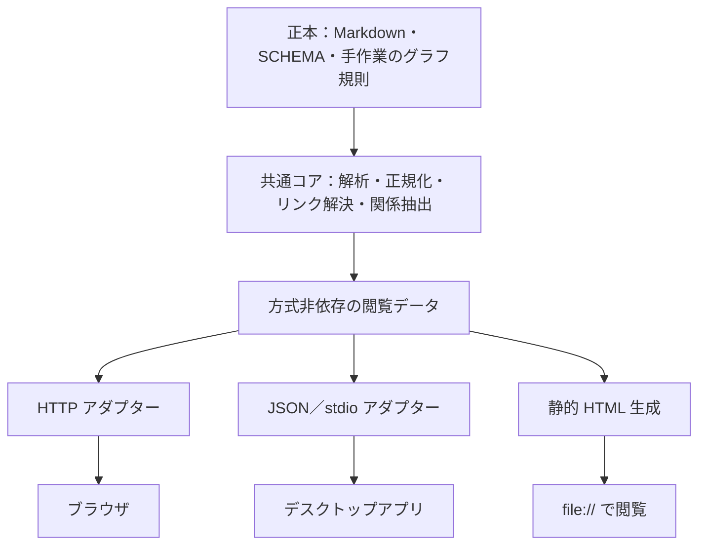

共通化する範囲は、ページの解釈、リンク解決、被リンク・関係の抽出、検索結果の形式です。HTTP、デスクトップの IPC、静的 HTML の埋め込みデータは、その外側に置く構成を提案します。静的版の更新時点や RAG の利用可否は、方式間の違いとして明示する必要があります。## 結論

**Markdown を読む共通コアと、表示方式ごとのアダプターを分ける設計を採用する。** ローカル HTTP サーバー、デスクトップアプリ、静的 HTML のどれを選んでも、Wiki の解釈やリンク解決を作り直さずに済む構成にする。

三方式すべての実装を先に作る必要はない。先に共通のデータ契約と合格条件を定め、採用した方式のアダプターから実装する。

設計上、次の四点を固定する。

1. **正本と意味を共通化する。** Markdown、frontmatter、リンク、被リンク、型付き関係の解釈は共通コアが担う。
2. **HTTP を共通コアの呼び出し条件にしない。** HTTP、プロセス間通信、静的ファイル生成を、それぞれ独立した出口にする。
3. **全方式の基本機能と、方式ごとの追加機能を区別する。** ページ閲覧・リンク移動・被リンク・関係表は共通の基本機能とする。更新の即時反映、既存検索処理の実行、稼働中の RAG との統合は、利用可能な能力として明示する。
4. **デスクトップ版の候補は Rust＋Tauri とする。** HTML の画面を共有し、既存の Python コアは JSON のプロセス間通信で利用できる。言語とフレームワークの最終決定は、デスクトップ版を採用するときに行う。

現行の ADR-0002 は HTTP サーバーを採用済みである。今回の要望を反映する際は、**方式に依存しない要件と、HTTP 版にだけ適用する実装判断を分けて記録し直す**必要がある。本回答はその設計提案であり、ファイルは変更していない。

## 根拠

**1. 既存の要件の中心は、表示方式よりも Wiki の解釈と正本の保全にある。**

要件定義書の F-G06 は、ページ、被リンク、ページごとの型付き関係の閲覧、lint と一致するリンク解決、閲覧によって Wiki を変更しないことを求めている。Markdown などを正本、検索索引やグラフ DB を再生成可能な派生データとする原則もある。これらは三方式に共通して適用できる。［参照1：L115、L250–263］

一方、Python の HTTP サーバー、ポート、無操作での終了、検索のサーバー経由呼び出しは、ADR-0002 が選んだ実装方法である。共通要件の内部にこれらを組み込むと、デスクトップ版と静的版への切り替えで、その実装方法まで引き継ぐことになる。［参照2：L24–33］

したがって、責務を次のように分ける。

これは提案する依存関係であり、現在この構成が実装済みという意味ではない。

**2. リンクと日本語の解釈を各表示方式に任せると、すでに確認されている不一致を再発させる。**

指定コミットの実装には、次の規則がある。

- `wiki_text.py` は、パスやリンク先を NFC、タグを NFKC に正規化する。日本語の frontmatter キーも共通の対応表で英語に直し、キーが衝突した場合は衝突情報を返す。
- `wiki_lint.py` の `resolve_link()` は大文字小文字を区別する。パス付きリンクは、そのパスに一致した場合だけ解決し、別ディレクトリの同じ slug に読み替えない。
- `wiki_lint.py` と `wiki_search.py` には、それぞれリンク解決処理が存在する。ADR-0002 も、この共通化を予定している。［参照2：L27–28、参照5］

このため、以下を共通コアの責務とする。

| 責務 | 共通化する内容 |
|---|---|
| ページの収集 | 知識ページと管理用ページを区別し、raw・索引・キャッシュを知識ページに混ぜない |
| メタデータ | 日本語の別名、英語キーとの衝突、タイトルの補完 |
| リンク | NFC、大小文字、パス制約、`.md`、表示名、解決失敗の扱い |
| 被リンク | 共通のリンク解決結果から作る |
| 型付き関係 | 本文のリンクと区別し、述語と証拠を保持する |
| 診断 | 読み取り失敗、名前の衝突、未解決リンクなどを表示側へ返す |

`index.md` と `indexes/` はナビゲーション用に扱う。現在の lint はこれらを知識ページの収集対象から外しているため、単に lint のページ一覧を画面に渡すだけでは、既存案の「index からのナビゲーション」を満たせない。［参照3：L547、参照5：`wiki_lint.py` L110–111、L140–168］

また、**ページへのリンク解決と、ページ内の見出しの存在確認は別の契約にする。** 現在の `resolve_link()` は `#` 以降を除いてページを解決する。これだけで、見出しまで有効だとは判断できない。見出し ID の生成、重複見出し、存在しない見出しの扱いを、描画側の共通規則として追加する必要がある。［参照5：`wiki_lint.py` L71–107、参照3：L498］

**3. 共通契約には、URL や OS の絶対パスをページの識別子として入れない。**

次の最小契約を提案する。名称は設計案である。

| 契約 | 主な内容 |
|---|---|
| `PageRef` | `wiki_id`、NFC の Wiki 相対パス、必要なら見出し ID |
| `PageView` | ページ参照、正規化済みメタデータ、本文、見出し一覧、解決済みリンク、診断 |
| `Relation` | 起点・終点、本文リンク／型付き関係の区別、述語、証拠 |
| `SearchResult` | ページ参照、見出し、抜粋、検索方式、検索対象の世代 |
| `SnapshotInfo` | 閲覧契約版、生成器版、スナップショット ID、生成日時、対象 Wiki |
| `Capabilities` | 利用できる検索方式、更新追従、RAG 接続など |

リンク先は共通コアで `PageRef` まで解決し、実際のアドレスは出口で生成する。

- HTTP 版：ローカルサーバー内の URL。
- デスクトップ版：アプリ内のページ移動。
- 静的版：出力先の相対 HTML リンク。

HTML を共有する場合も、描画処理にリンク先アドレスを生成する関数を渡す。生成後の HTML を正規表現で書き換える方式は避ける。

`wiki_id` は設定で管理し、Wiki のルートパスと対応付ける。ページの改名後まで参照を維持する仕組みは別途必要であり、この段階で正本に UUID を一括追加する必要はない。グラフの `node_id` も、全ページの識別子と同一とは仮定しない。既存実装では明示指定または型と slug からノード ID を作っている。［参照5：`wiki_graph_extract.py` L240–275］

ルートの決め打ちも避ける。手元の Wiki は `SCHEMA.md` で `W0_Wiki/` と `W1_Raw/` を指定しており、ADR-0008 の既定例である `wiki/`・`raw/` と異なる。表示方式は、設定から解決済みのルートを受け取る。［参照8、参照9］

**4. 静的 HTML は基本機能を備えられる。ただし、データの取得方法を変える必要がある。**

現行 ADR-0002 の「静的 HTML では検索と RAG 統合ができない」という評価は、二つに分けて扱うべきである。

- `file://` から別ファイルを `fetch()` する設計は、移植性のある前提にできない。Mozilla の文書も、ローカルファイルの origin は通常 opaque とされ、同じディレクトリでも CORS エラーになり得ると説明している。[Mozilla：Same-origin policy](https://developer.mozilla.org/en-US/docs/Web/Security/Defenses/Same-origin_policy#file_origins)
- 検索データを HTML に埋め込めば、外部ファイル取得を必要としない検索を設計できる。既存の選択肢レポート自体も、静的版には検索索引を HTML に埋め込む案を記載している。HTML の非実行データブロックも標準の仕組みである。［参照3：L396–407］[Mozilla：script のデータブロック](https://developer.mozilla.org/en-US/docs/Web/HTML/Reference/Elements/script/type#any_other_value)

静的版は、次の構成を基本にする。

- 本文はページごとの HTML に生成し、通常の相対リンクで移動できるようにする。
- 被リンクと関係表は生成時に計算し、各ページへ出力する。
- 検索用 HTML に、日本語検索用のデータと検索処理を埋め込む。単一ファイルへ Wiki 全体を詰め込むことは必須にしない。
- 全体グラフを追加する場合も、グラフ用 HTML に必要なデータを埋め込む。
- CSS、JavaScript、図の表示資材は同梱し、CDN を要求しない。
- 任意のエクスポート先へコピーしても成立するよう、正本の絶対パスをページ間リンクに使わない。

簡易検索は共通フロントエンドの検索方式として三方式で共有できる。既存 Python の BM25・埋め込み検索は追加の検索方式として接続する。**両者の順位や精度が同じとは表示しない。**

一方、純粋な静的版が新しい質問に対して既存の Python RAG 処理を実行するには、追加の実行環境が要る。RAG の検索結果を事前生成して表示する機能と、稼働中の RAG を問い合わせる機能は、別の能力として定義する。

**5. 三方式の違いは、能力とデータの時点として公開する。**

| 項目 | ローカル HTTP | デスクトップアプリ | 静的 HTML |
|---|---|---|---|
| ページ・リンク・被リンク・関係表 | 共通契約から表示 | 共通契約から表示 | 共通契約から生成 |
| 簡易な日本語全文検索 | 共通の検索処理を利用可能 | 同左 | 同梱データで実行 |
| 既存 Python 検索 | プロセス内などで接続 | IPC などで接続 | 閲覧時には実行しない |
| 稼働中の RAG 検索 | 追加プロバイダーで接続 | 追加プロバイダーで接続 | 基本構成では利用不可 |
| 正本の更新反映 | 再読込・監視など | 再読込・監視など | 再生成 |
| 閲覧時の実行環境 | Python コアとサーバー | アプリ、必要なら Python コア | ブラウザ |
| データの時点 | 採用したスナップショット | 採用したスナップショット | 書き出したスナップショット |

これは提案する機能分担であり、動作を実測した表ではない。

利用不可と障害も区別する。たとえば、RAG 非対応の静的版、RAG に接続できないアプリ、古い検索索引は、いずれも「検索結果 0 件」と異なる状態である。

RAG の依存関係は維持する。現在は `rag` が `wiki` に依存しているため、Wiki の閲覧コアから RAG を必須で読み込ませない。検索プロバイダーの接続口を用意し、RAG がなくても閲覧できる構成とする。RAG 本体を共通 Python コアに置く判断は ADR-0007 とも整合する。［参照7］

**6. デスクトップアプリは、既存の Wiki 処理を再実装せずに独立したアプリとして作れる。**

Rust＋Tauri を候補とする理由は、Rust のアプリ本体と HTML の画面を組み合わせられ、Windows・macOS・Linux を対象にできるためである。フロントエンドから Rust のコマンドへ構造化データを渡す仕組みもある。[Tauri Architecture](https://v2.tauri.app/concept/architecture/)、[Calling Rust from the Frontend](https://v2.tauri.app/develop/calling-rust/)

提案する接続は次のとおり。

- Rust：ウィンドウ、起動と終了、設定、許可されたコア処理の呼び出し。
- Python：既存の Wiki 解釈と検索。
- HTML/CSS/JavaScript：HTTP 版・静的版と共有する表示部品。
- Rust と Python の間：版付きの JSON／stdio 契約。標準出力は応答、標準エラーは診断に分け、UTF-8 を明示する。

これならデスクトップ版のためにローカル HTTP サーバーを必須にする必要はない。アプリの寿命も Claude Code セッションに結び付けず、アプリ自身が管理できる。

ただし、**ソースの移植性と配布物の移植性は別である。** Python の実行環境を既存導入環境から利用するか、アプリに同梱するかで作業量が変わる。Tauri の外部バイナリ同梱もターゲットごとの準備が必要であり、単一のバイナリで全 OS に配れるわけではない。[Embedding External Binaries](https://v2.tauri.app/develop/sidecar/)

**7. 更新と安全性も、共通規則と方式別規則に分ける。**

共通規則として、以下を設ける。

- 同じ画面に使う本文、被リンク、関係、検索データには、対応するスナップショット ID を持たせる。
- 再生成は作業中の領域で完了させてから公開し、途中の生成物を表示しない。
- キャッシュと出力先は正本から分ける。削除しても正本から作り直せるものとする。
- 生の Markdown HTML、リンクの URL スキーム、埋め込みデータを安全に扱う。JSON の HTML 埋め込みでは、`</script>` などによってデータ領域から抜けない出力処理が必要である。
- 読み取れるファイルを、登録済みのページ・許可されたアセットに限定する。任意の絶対パスやディレクトリ探索を UI から実行させない。
- 正本への書き込み操作を閲覧契約に持たせない。

HTTP 版には、ループバック限定、起動ごとの認証、Host の確認を追加する。デスクトップ版には IPC の操作制限を追加する。静的版には、出力対象の範囲と機密情報の複製範囲を明示する。HTTP 固有のトークンやポートを静的版の契約に持ち込まない。［参照3：L504–516、参照6：L20–24、参照1：L444–458］

図については、既存の ADR-0005 が Mermaid と SVG を定めている。初期段階で描画を実装しなくても、共通データから図と参照を落とさず、コードと説明文で読める状態を保つ。将来の描画には方式別の表示能力を追加する。［参照10：L26–34］

**8. 実装前に共通の合格条件を決めれば、方式を選び直すときの判断材料が残る。**

次の確認を実装計画に含めることを提案する。今回は実行していない。

1. 同じコーパスで、三方式のリンク解決結果、メタデータ、被リンク、関係表が一致する。
2. NFC/NFD、大小文字、パス付きリンク、日本語の別名、未解決リンクで、意図しない別ページへ移動しない。
3. ページ解決について lint と一致する。見出し解決は追加規則として別に検証する。
4. 閲覧操作の前後で、正本と原資料の内容・ファイル構成が変化しない。
5. 静的版を別のディレクトリへコピーし、ネットワークを使わず `file://` で本文・リンク・検索を利用できる。
6. 検索や RAG が利用できなくても、本文の閲覧を継続できる。
7. Windows・macOS・Linux で、日本語パス、表示、起動・終了を確認する。

現行資料の起動時間は、方式横断の性能保証には使えない。記載値から計算すると、1,000 ページの HTTP 版は

`0.38 + 0.18 + 0.49 + 0.0013 = 1.0513 秒`

静的版の生成処理は

`0.38 + 0.18 + 0.49 + 1.26 = 2.31 秒`

となる。ただし前者にはブラウザ起動、後者にはファイル書き込みが含まれていない。共通コアの処理時間、静的生成時間、閲覧開始時間、検索開始時間を分けて評価する必要がある。［参照4：L111–136］

## 検討した代替案

| 案 | 今回採らない理由 |
|---|---|
| HTTP API を全方式の共通基盤にする | デスクトップ版と静的版にもサーバーを要求する構成になり、方式選択の自由を狭める |
| 三方式が Markdown を独自に解析する | 日本語の別名、NFC、大小文字、パス制約の解釈を三重に保守する必要がある |
| 共通コアを今すぐ Rust などへ全面移植する | 既存 Python 実装を置き換える費用が先に発生する。JSON 契約で利用できるため、現時点で必要性が示されていない |
| 静的版のために Wiki 全体を単一 HTML に埋め込む | 容量と初期読み込みを大きくしやすい。ページ HTML と検索 HTML を分けても、サーバー不要の閲覧は成立する |
| 静的版を既存の Python 検索・RAG と完全同等にする | 閲覧時の処理実行を追加する必要がある。まず基本機能と追加能力の契約を分ける |
| Obsidian の導入結果を、そのまま自作アプリの評価に使う | 既存調査の対象は Obsidian という完成品である。確認されたリンク規則の不一致は、自作アプリでも避けられない制約ではない |

既存の決定行列は、静的 HTML、HTTP サーバー、既製の Obsidian などを比較している。**今回の「自作するデスクトップアプリ」は、その採点対象に含まれていない。** 過去の順位だけで今回の三案を決めることはできない。［参照4：L41–52、L138–160］

## 前提と不確実性

- **仮定：三方式で共通化したいのは、Wiki の意味と基本的な閲覧機能である。** 更新の即時性や稼働中の RAG まで全方式で同等にする要求とは解釈していない。後者が必須なら、純粋な静的 HTML の範囲を定義し直す必要がある。
- **仮定：デスクトップアプリに WebView を使ってよい。** OS 標準のウィジェットだけで構成する要求がある場合は、C++／Qt などを含めて再比較する。提案したデータ契約は維持できるが、表示部品の共有範囲は変わる。
- **仮定：閲覧操作に編集や PDF 登録を含めない。** 現行の閲覧専用要件に従った。アプリから編集する場合は、保存・競合・復旧の契約を別に設計する必要がある。
- 静的版の容量、日本語検索の品質、アプリの配布サイズ、Python 同梱の方法は未検証である。対象ページ数、本文量、アセット量が不明なため、数値で優劣を断定していない。
- `PageRef` を相対パスで識別する提案は、改名後の恒久参照を保証しない。恒久的なブックマークが必要かは作者の判断事項である。
- 現行資料には、Project Wiki の ASCII 命名案と、日本語 slug を認める移植方針の両方がある。閲覧側で独自に制限を追加せず、各 Wiki の規約と共通コアに従う設計とした。［参照1：L125–145、参照11：L518–520］
- 作業用ワークツリーの `info-hive-wiki/` は空だったため、親チェックアウトのローカル Git オブジェクトを読んだ。ワークツリーが指定するコミットと親チェックアウトの HEAD は、どちらも `302892390250d7262360e9e9dde20d61a6d8d6ff` だった。
- ファイル変更、ビルド、アプリ起動、テストは実施していない。指定された他エージェントの成果物ディレクトリも読んでいない。

## 参照

以下のリポジトリ内パスは、特記がなければ指定ワークツリーを基準とする。行番号は今回読み取った版のもの。

1. `llm-wiki-product-concept-and-requirements-ja.md`  
   L63–119：役割、配置、正本と派生データ。L121–164：命名・横断リンク。L250–263：閲覧・グラフ要件。L440–458：情報境界。

2. `docs/adr/0002-wiki-browse-uses-on-demand-local-server.md`  
   L18–33：採用済みの構成。L43–53：従来の代替案。L64–80：保守、安全性、合格条件、見直し条件。

3. `docs/research/llm-wiki-browse-options.md`  
   L392–407：検索方式と静的版の索引埋め込み。L488–526：日本語、リンク、セキュリティ、更新。L544–563：実装段階と合格条件。

4. `docs/research/llm-wiki-browse-decision-matrix.md`  
   L41–52：比較対象。L111–136：性能計測と除外条件。L138–160：既製 Obsidian の確認結果。L306–313：調査の限界。

5. `info-hive-wiki` のコミット `302892390250d7262360e9e9dde20d61a6d8d6ff`。ローカル Git オブジェクトから参照。  
   - `skills/info-hive/scripts/wiki_text.py` L77–138：正規化、frontmatter の別名と衝突。  
   - `skills/info-hive/scripts/wiki_lint.py` L62–111、L140–176：リンク解決、除外対象、ページ収集。  
   - `skills/info-hive/scripts/wiki_search.py` L139–158、L235–276、L835–858：日本語トークン化、リンク解決、検索結果。  
   - `skills/info-hive/scripts/wiki_graph_extract.py` L114–138、L240–275、L334–378：グラフ参照、ノード ID、型付き関係と本文リンク。

6. `docs/adr/0001-local-only-server-is-not-hosted-wiki.md`  
   L20–26、L44–47：ローカルサーバーを認める条件。

7. `docs/adr/0007-rag-uses-mcp-core-and-persistent-jobs.md` L20–39：RAG の共通 Python コア、窓口、閲覧と登録の区別。  
   `docs/adr/0009-graph-layer-stays-in-wiki.md` L14–20、L28–36、L54–59：グラフの位置付け、正本、共通規則。

8. `docs/adr/0008-numbered-workspace-layout.md`  
   L23–25、L79–90、L104：作業領域、設定、ディレクトリ名。

9. `D:/Users/toshiki/info-hive/W0_Wiki/index.md`：全体索引。該当するブラウズ設計の項目はなく、`indexes/` は存在しなかった。  
   `D:/Users/toshiki/info-hive/W0_Wiki/SCHEMA.md` L7–11、L46–51、L73–98：実際のルート、命名、日本語の別名。

10. `docs/adr/0005-wiki-figures-use-mermaid-and-svg.md`  
    L26–34、L58–64：図の形式と browse の段階。

11. `docs/porting-plan.html`  
    L493–526：別名、slug、日本語検索。L545–556：ホスト型 Wiki の範囲。L583–625：移植の段階。  
    `AGENTS.md`：応答言語、配置、正本保全、使用ツールの報告。`.gitmodules`：プラグインの所在。

12. 外部の公式・実装者向け文書  
    - [Mozilla：Same-origin policy — File origins](https://developer.mozilla.org/en-US/docs/Web/Security/Defenses/Same-origin_policy#file_origins)  
    - [Mozilla：script type — データブロック](https://developer.mozilla.org/en-US/docs/Web/HTML/Reference/Elements/script/type#any_other_value)  
    - [Tauri Architecture](https://v2.tauri.app/concept/architecture/)  
    - [Calling Rust from the Frontend](https://v2.tauri.app/develop/calling-rust/)  
    - [Embedding External Binaries](https://v2.tauri.app/develop/sidecar/)

使用した MCP サーバー: なし  
使用した Agent Skills: なし
