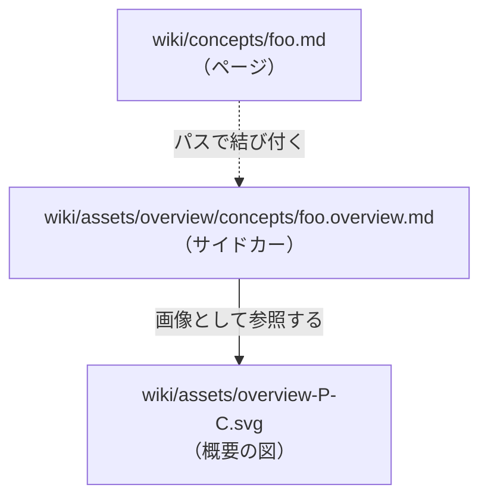

# ページの概要を作り、サイドカーに置く（2026年11月17日）

| 項目 | 内容 |
| --- | --- |
| 状態 | 1 版目。Sol のレビューの前。出す版はリリースのときに決める |
| 対象 | `info-hive-wiki` の新しいコマンド `/wiki:overview`、新しいスクリプト `wiki_overview.py`、lint、`SCHEMA.md` のひな形 |
| きっかけ | 作者の依頼「`/wiki:browse` で開く記事のページのタイトルのすぐ後に、概要を表示する」 |
| 関連 | ADR-0005（図は mermaid と svg）、ADR-0017（browse は wiki に書かない）、ADR-0020（raw はスクリプトが書く）、ADR-0023（書く段）、ADR-0029（リンクを置かない。I6）、ADR-0030（browse は図を画像として見せる。提案）、[図の描画の設計](wiki-browse-figures-2026-11-17.md)（別のブランチ `feat/wiki-browse-figures`） |
| 基準にした版 | 親 `b842236`、`info-hive-wiki` 0.25.2（`e8886d6`） |
| 記録 | `docs/agent-runs/2026-11-17-wiki-overview/`、試作 `poc/wiki-overview/` |

この設計が扱うのは、概要を**作って wiki に置く側**（段 1）である。browse が概要を**読んで表示する側**（段 2）は、図の表示（ADR-0030）が `info-hive-wiki` の main に入ってから、別の設計として書く。段 2 がこの設計に求めることは 12 節に書く。

## 1. 背景

browse の記事のページは、メタ欄と本文だけを出す。初めて読む人が全体をつかむための、図を中心にした説明がない。作者は、題名のすぐ後に概要を表示することと、概要を作るプロンプトを決めた。

- browse のサーバーは LLM を持たず、wiki のルートの下に何も書かない（ADR-0017）。概要は Claude Code のセッションが前もって作り、browse は読むだけになる。
- 概要は、ページから作り直せる表示用の派生物である。ページの本文、大きさの上限、検索、グラフには混ぜない。
- ADR-0030 は、`wiki/assets/` の**直下**の svg だけを browse の入力にし、`` で見せる。下位のディレクトリの svg は読まない。Mermaid はサーバーの方式でだけ描く。
- 試作（`poc/wiki-overview/`）で、ページ「エージェントのメモリの階層」の概要を 1 つ作り、browse の本物のページの h1 の直後に差し込んで確かめた。分かったことは 3 節に書く。

## 2. 作者が決めたこと

| 日付 | 決定 |
| --- | --- |
| 2026年11月17日 | 概要は、新しいコマンド `/wiki:overview <ページ>` で、求めたページだけ作る。取り込み（ingest）には入れない |
| 同 | 概要は、短い文、mermaid のコードブロック、大きな SVG のファイルで書く。CSP は今のまま保つ |
| 同 | 概要は、ページとは別のファイル（サイドカー）に置く。元のページのハッシュを記録し、ページが変わったら「古い」と示せるようにする |
| 同 | 写真は使わない。SVG の図とアイコンだけにする |
| 同 | 描画系のスキルは、名前を手順に書かない。「一覧にあって合うものだけ使う」と書く（ADR-0005 と同じ） |
| 同（承認した計画の既定） | サイドカーは `wiki/assets/overview/` の下に置き、git に入れる。書くのは `wiki_overview.py` だけ。ハッシュは、BOM を除き改行を LF にそろえたページの全文の SHA-256。概要の入力はそのページだけで、wikilink は書かない。`log.md` には記録しない |

| 同 | 試作の概要（`poc/wiki-overview/`）の出来を認めた。図の質、言い換えの程度、ダークでの明るい背景、長さは、この形でよい |
| 同 | 図は、サイドカーと同じ場所ではなく、`wiki/assets/` の直下に置く（5 節）。ADR-0030 が直下の svg だけを読むため、計画の既定から変えた |

## 3. 試作で分かったこと

| 分かったこと | 設計への反映 |
| --- | --- |
| 記事の本文の幅は 48em（約 700px）。幅 980 で描いた図は縮んで、図の中の文字が読みにくくなった | 手引きに、図は幅 720 を基準にし、文字は 13 以上にすると書く（8 節） |
| Mermaid の横の流れ（`flowchart LR`）は幅 1276 になり、半分に縮んだ | 手引きに、Mermaid は縦に流すと書く |
| markdown-it は、画像の行き先をパーセント符号化して持つ | 下書きの画像の行き先を、ASCII の決まった形に限る（7 節） |
| SVG は、`<style>` も `<foreignObject>` も使わずに描けた | 手引きに、どちらも使わない書き方を勧める。検査では止めない |
| 手書きの SVG は明るい紙のまま、Mermaid は配色に従う | そのままにする（ADR-0030 の限界と同じ） |
| アプリ内のブラウザーは iframe を止めるので、Mermaid はコードのまま見える | 画面の確かめは Playwright で行う |

## 4. 守ること

1. **wiki に書くのはスクリプトだけ。** サイドカーと図は `wiki_overview.py` だけが書く。モデルは、wiki の外の作業用のフォルダーに下書きを置く。
2. **状態を推さない。** 概要が新しいか古いかは、スクリプトが書いたハッシュと、今のページのハッシュを比べて決める。ページとの結び付きは、サイドカーのパスだけで決める。
3. **ページの集合は、実物に尋ねる。** ページの指定の解決と、元のページがあるかの確かめは、lint と同じ走査（`wiki_pages.walk_pages`）の結果で行う。名前の規則の写しを持たない。
4. **検査は、字句と同じパーサーで決まるものだけ。** 下書きの検査は、browse と同じ markdown-it の結果と、決まった字句の形で行う。「ページにない事実を足さない」のような中身の良し悪しは、検査しない。手引きで目的を伝える。
5. **途中で止まっても、壊れた概要を残さない。** 書き込みの順を、どこで止まっても「前の概要のまま」か「新しい概要」のどちらかになり、参照先のない図の参照ができない順にする。
6. **既存の読み手を変えない。** 検索、グラフ、統計、browse（今の版）は、`assets/` を名前で除いている。サイドカーを置いても、ページとして数える者、索引に入れる者はいない（0.25.2 の全スクリプトの走査を調べた）。
7. **開発用の PC にだけあるものを仕様にしない。** スキルの名前、フォントの名前、絶対パスを、手順と検査に書かない。

## 5. 置き場所と形



> 置き場所 補足: サイドカーは、ページのパスを `assets/overview/` の下に写した場所に置く。図は `assets/` の直下に置き、サイドカーから `` の相対パスで参照する。図の名前の P はページのパスから、C は図の中身から作る 16 進の文字である（5.3 の `<P>` と `<C>`）。

### 5.1 ページの識別子

ページの識別子は、wiki のルートからの相対パス（`/` 区切り）から末尾の `.md` を除き、NFC にそろえたものである（browse の `_page_id` と同じ）。`concepts/foo.md` の識別子は `concepts/foo` になる。

### 5.2 サイドカー

- パスは `assets/overview/<ページのディスク上の相対パスから .md を除いたもの>.overview.md`。
- 中身は、frontmatter と本文（Markdown）である。

```markdown
---
format: 1
page_sha256: "8aefb2ee4772ba2359180880c2ea68d191b2fc27ffccf22bdd115e1332d57b66"
generated: 2026-11-17
generator: "Claude Fable 5.2"
---

（概要の本文）
```

| 欄 | 中身 | 書く者 |
| --- | --- | --- |
| `format` | サイドカーの形の版。今は 1 | スクリプト |
| `page_sha256` | 概要を作るときに読んだページのハッシュ（5.4） | スクリプト（`prepare` が取り、`write` が書く） |
| `generated` | 書いた日（スクリプトの時計。`YYYY-MM-DD`） | スクリプト |
| `generator` | 作ったモデルの表示名。なければ欄を書かない | モデルが引数で渡し、スクリプトが字句を確かめて書く |

欄の名前は `_` でつなぐ。`wiki_text.parse_frontmatter_text` は、`-` を含むキーを読まないからである。frontmatter は `wiki_text.format_frontmatter` で書き、`wiki_lint.parse_frontmatter_raw` で読む。PyYAML は使わない。

### 5.3 図

- パスは `assets/overview-<P>-<C>.svg`。`<P>` は、ページの識別子の UTF-8 の SHA-256 の先頭 16 桁、`<C>` は、svg のバイト列の SHA-256 の先頭 12 桁である。
- サイドカーの本文は、図を `` で参照する。`assets/overview/concepts/foo.overview.md` からは `../../overview-<P>-<C>.svg` になる。エディターや GitHub でも、そのまま図が見える。
- `<P>` を入れるのは、どの図がどのページの概要のものかを、ファイル名だけで決めるためである。片付けるとき、ほかのページの概要の図に触れない。
- `<C>` を入れるのは、作り直すときに、前の図を上書きしないためである（6.4 の順）。

ADR-0005 の図（`assets/<ページのスラッグ>-NN.svg`。モデルが書く、ページの本文の図）とは別のものである。名前が `overview-<16 桁の 16 進>-<12 桁の 16 進>.svg` の形のファイルを、概要の図として扱う。

### 5.4 ページのハッシュ

ページのファイルのバイト列を `utf-8-sig` で読み、改行を LF にそろえた文字（lint と browse の読み方と同じ）を UTF-8 にして、SHA-256 を取る。関数 `wiki_pages.page_text_sha256(data: bytes) -> str` を足し、スクリプト、lint、browse（段 2）が同じ関数を呼ぶ。UTF-8 として読めないページは、概要を作れない（lint もそのページを読めない）。

Windows の checkout で改行が CRLF に変わっても、ハッシュは変わらない。frontmatter も含むので、タグだけを変えても「古い」になる。

### 5.5 概要の状態

関数 `wiki_overview.classify(sidecar: bytes, page_sha256: str | None) -> State` が、次の表を上から順に見て、最初に当たった行で決める。lint と browse（段 2）が同じ関数を呼ぶ。

| 順 | 条件 | 状態 |
| --- | --- | --- |
| 1 | 元のページがない（`page_sha256` が None） | `orphan` |
| 2 | サイドカーを UTF-8 として読めない、frontmatter がない、閉じていない | `broken`（`unreadable`） |
| 3 | `format` が `1` でない | `broken`（`format`） |
| 4 | `page_sha256` が 64 桁の 16 進の小文字でない | `broken`（`hash_field`） |
| 5 | `page_sha256` が、今のページのハッシュと違う | `stale` |
| 6 | どれにも当たらない | `fresh` |

## 6. スクリプト `wiki_overview.py`

PyYAML の要らないスクリプトで、`python "${CLAUDE_PLUGIN_ROOT}/skills/info-hive/scripts/wiki_overview.py" <サブコマンド> "<WIKI_ROOT>" …` で呼ぶ。サブコマンドの振り分けの前に、`wiki_initialized.require_or_exit()` で wiki を確かめる。出力は、いつも標準出力の UTF-8 の JSON 1 つである。

| 終了コード | 意味 |
| --- | --- |
| 0 | 成功。`exists`（新しい概要がすでにある）も含む |
| 1 | 引数の誤り、読めないファイル、書き込みの守りで止めた |
| 2 | 下書きが検査を通らない（モデルが直してやり直せる） |
| 3 | 利用者の決定が要る（ページが決まらない、ページがなくなった） |

エラーは `{"status": "error", "code": "<字句>", "message": "<日本語の文>"}` で返す。パスは、wiki のルートからの相対パスで返す。作業用のフォルダーのパスだけは、モデルが Read と Write に使うので、絶対パスで返す。

### 6.1 `prepare`

`prepare "<WIKI_ROOT>" --page="<ページの指定>" [--refresh]`

1. `walk_pages` の結果から、`build_page_index` と `link_candidates` でページを決める（`[[slug]]` と同じ規則）。NFC にそろえると同じ識別子になるページが 2 つあるときも、曖昧として扱う。
   - 0 件: `{"status": "not_found"}`、終了コード 3。
   - 2 件以上: `{"status": "ambiguous", "candidates": [識別子…]}`、終了コード 3。
2. ページのバイト列を 1 回読み、ハッシュを取る。
3. 今の概要の状態を `classify` で決める。`fresh` で `--refresh` がなければ、`{"status": "exists", "page", "sidecar"}` を返して終わる。作業用のフォルダーは作らない。
4. 作業用のフォルダー `K = <data_dir>/overview/work/<wiki_key>/<16 桁の乱数>/` を作り、次を置く。
   - `plan.json`: `{"format": 1, "wiki_root": <解決したルート>, "page_rel": <ディスク上の相対パス>, "page_sha256": <手順 2 の値>, "prepared": <時刻>}`。スクリプトだけが書く。
   - `page.md`: 手順 2 で読んだバイト列の写し。モデルは、wiki のページではなく、この写しを読む。記録するハッシュと、モデルが読んだ中身が、必ず一致する。
   - `draft/`: 空のディレクトリ。モデルが下書きを置く。
5. `{"status": "ready", "work_id": <16 桁>, "page": <識別子>, "page_copy": <K/page.md>, "draft_dir": <K/draft>, "existing": "none" | "stale" | "broken" | "fresh"}` を返す。

同じ wiki の作業用のフォルダーのうち、名前が 16 桁の 16 進で、`plan.json` を持ち、7 日より古いものは、`prepare` が消す。`<data_dir>` は `wiki_mcp_common.data_dir()` で決める。

### 6.2 `check`

`check "<WIKI_ROOT>" --work=<16 桁>`

下書きを 7 節の規則で調べる。`{"status": "ok"}`（終了コード 0）か、`{"status": "rejected", "problems": [{"code", "file", "line", "message"}…]}`（終了コード 2）を返す。wiki には書かない。

### 6.3 `write`

`write "<WIKI_ROOT>" --work=<16 桁> [--generator="<表示名>"]`

1. `plan.json` を読む。`wiki_root` が今の解決したルートと違えば、エラー `plan_mismatch`。
2. `page_rel` が、今の `walk_pages` の結果にあることを確かめる。なければ `{"status": "page_gone"}`、終了コード 3。
3. 7 節の検査をもう一度行う。通らなければ `rejected`。
4. 6.4 の順で書く。
5. 作業用のフォルダーを消す。
6. `{"status": "written", "page", "sidecar", "figures": […], "removed_figures": […], "page_changed": <真偽>}` を返す。`page_changed` は、今のページのハッシュが `plan.json` の値と違うときに真になる（作っている間にページが変わった。書いた概要は、すぐに「古い」になる）。

`--generator` の値は、`^[A-Za-z0-9][A-Za-z0-9 ._-]{0,59}$` に合うときだけ書く。合わなければエラー `generator`。

### 6.4 書き込みの順と守り

書く前に、行き先までの道を確かめる（ADR-0029 の I6。共有の部品 `wiki_fsguard` がまだないので、このスクリプトが持つ）。

- wiki のルートの直下の項目を一覧し、名前を `casefold` すると `assets` になるものを探す。`assets` という綴りのディレクトリが 1 つだけならそれを使う。なければ作る。綴りの違うもの（`Assets` など）があれば、エラー `assets_spelling` で止まる。走査は名前を大文字と小文字を区別して除くので、`Assets/` の下に書くと、サイドカーがページとして数えられるからである。`assets/overview` も同じに確かめる。
- ルートから行き先のディレクトリまでの各要素が、シンボリックリンクでも再解析点（ジャンクションを含む）でもない、ふつうのディレクトリであること。判定は `lstat` で行う（`wiki_browse_fs.kind` と同じ判定）。足りないディレクトリは 1 つずつ作り、作ったあとにもう一度確かめる。
- 行き先のファイルがすでにあるなら、リンクでない、ふつうのファイルで、ハードリンクの数が 1 であること。
- 通らなければ、書かずにエラー `unsafe_path` を返す。

書く順は次のとおりである。

| 順 | すること | ここで止まったとき |
| --- | --- | --- |
| 1 | 新しい図を `assets/overview-<P>-<C>.svg` に置く。一時の名前（`.overview-<乱数>.tmp`）に `xb` で書き、`fsync` し、重ねて書かない形で置く。同じ名前がすでにあるなら、バイト列が同じときは何もしない。違うときはエラー `figure_conflict` | 前の概要のまま。使われていない図が残る（lint が知らせ、次の `write` が消す） |
| 2 | サイドカーを、一時の名前に書いて `fsync` し、`os.replace` で置き換える。本文の画像の行き先は、手順 1 の名前への相対パスに書き換えてある | 手順 1 と同じ |
| 3 | 名前が `overview-<P>-` で始まり、決まった形に合う svg のうち、新しいサイドカーが参照しないものを消す | 新しい概要。使われていない図が残る |

一時ファイルは、`finally` で消す。Windows の `PermissionError` は、`wiki_fetch.replace_with_retry` と同じに、短く待って試し直す。

サイドカーと図は、LF と UTF-8（BOM なし）で、`write_bytes` に当たる形で書く。svg は、下書きのバイト列をそのまま置く。

### 6.5 `status` と `remove`

- `status "<WIKI_ROOT>" [--page="<ページの指定>"]`: 概要の一覧と状態を返す。`{"overviews": [{"page", "sidecar", "state", "detail"}…], "problems": […]}`。中身は lint の結果（9 節）と同じ関数で作る。
- `remove "<WIKI_ROOT>" --page="<ページの指定>"`: そのページのサイドカーと、名前が `overview-<P>-` で始まる図を消す。ページは、`prepare` と同じに解決する。
- `remove "<WIKI_ROOT>" --orphan=<P>`: 元のページがない概要を消す。`<P>` は、`status` と lint が返す 16 桁である。日本語のパスをシェルに渡さずに済む。

## 7. 下書きの規則

モデルは、`draft/overview.md`（frontmatter なしの本文）と、`draft/<名前>.svg` を置く。スクリプトは、次を上から調べ、当たったものをすべて返す。

| code | 条件 |
| --- | --- |
| `draft_missing` | `draft/overview.md` がない |
| `not_utf8` | `overview.md` を UTF-8 として読めない |
| `empty` / `too_large` | 空白だけ / 64 KiB を超える |
| `frontmatter` | 先頭の行が `---` |
| `heading_level` | markdown-it の結果に h1 か h2 がある。概要はページの h1 の下、最初の h2 の前に入るので、見出しは `###` 以下にする |
| `wikilink` | `wiki_pages.extract_wikilinks` が 1 つ以上返す |
| `image_form` | markdown-it が見つけた画像の並びと、フェンスの外で行の全体が `` の形の行の並びが、数か行き先で食い違う。`<名前>` は `^[a-z0-9][a-z0-9-]{0,39}$`、`<説明>` は `]` と改行を含まない 1 文字以上 |
| `figure_missing` | 参照された `<名前>.svg` が `draft/` にない |
| `figure_unused` | `draft/` の svg が、どの画像からも参照されていない |
| `extra_file` | `draft/` に、`overview.md` と svg のほかの項目がある。リンクと下位のディレクトリを含む |
| `too_many_figures` | svg が 12 個を超える |
| `figure_unreadable` | svg が、browse の読む口の条件（ADR-0030: UTF-8 の XML、2 MiB 以下）を満たさない |
| `figure_no_size` | svg の根の `width` と `height`、または `viewBox` から大きさが決まらない。DTD がある |

- `image_form` は、画像を「行の全体」の形に限る。行き先の書き換え（6.4 の手順 2）を、その行を作り直すだけで済ませるためである。段落の中の画像、参照形式の画像、表の中の画像は、markdown-it の数と合わなくなるので拒まれる。
- `figure_unreadable` と `figure_no_size` は、図の表示の実装が持つ関数（`is_utf8_svg`、`svg_size`、上限の定数）を呼ぶ。条件の写しを持たない。図の表示が main に入る前に段 1 を実装することになったら、その関数を先に `wiki_pages` に置く形を、図の表示のセッションと合わせる（13 節）。
- svg の中身（`<style>`、`<script>`、外部の参照）は検査しない。browse は svg を `` と専用の CSP で見せるので、スクリプトは動かず、外への要求は出ない（ADR-0030 の PoC）。

## 8. コマンドと手引き

### 8.1 `commands/overview.md`

- frontmatter は `description`、`argument-hint`（`<page> [--refresh] | --status | --remove <page>`）、`argument-description`。
- 手順 0 で `<WIKI_ROOT>` を決める（ほかのコマンドと同じ順）。
- 引数の渡し方（wiki の [[コマンドの引数の渡し方]] の決まり）:
  1. 引数の前後の空白を除く。全体が `[[` と `]]` で囲まれていれば外す。`\` を `/` に替える。
  2. 残りに `"`、`$`、`` ` ``、`!`、改行のどれかがあれば、スクリプトを呼ばずに、その名前は渡せないと伝える。
  3. なければ、`--page="<残り>"` の形で渡す。値は `=` でつなぐ。
- 流れ: `prepare` → 手引きを Read する → `page_copy` を Read する → `draft_dir` に下書きを Write する → `check` → `write`。
- `exists` のときは、すでに新しい概要があると伝えて終わる。`ambiguous` のときは、候補を示して選んでもらう。`rejected` のときは、`problems` を直してやり直す。
- 終わったら、サイドカーのパスと、`page_changed` が真ならその旨を伝える。

### 8.2 `references/overview-workflow.md`（手引き）

コマンドがパスを書いて Read させる小さなファイルにする。規則が届くかは置き場所と指し方で決まるからである（wiki の [[エージェントに守らせる決まりの書き方]]）。中身は 3 つである。

1. **目的とプロンプト。** 作者の文面を、次の読み替えで置く。「私たちが議論している内容」は「このページの内容」、「実物の写真」は外す、スキルは名前を挙げない。

   > SVG と Mermaid を使って、このページの内容を理解しやすいようにしてください。重要な詳細を省くことなく、大きな画像と簡潔な文章で説明してください。独自のセンスを活かし、手抜きなデザインは避け、必要に応じてアイコンとビジュアルを組み込んでください。写真は使いません。利用できるスキルの一覧に、図を作るスキルがあって用途に合うものだけを、厳選して使ってください。文章や詳細を記述する際は、明確かつ簡潔・端的にし、専門用語は避けてください。閲覧者がこの分野の初心者であるかのように説明してください。

2. **入力。** 読むのは `page_copy` だけ。ページにない事実を足さない。リンク先のページを読んで足さない。
3. **形の決まり。** 7 節の検査に当たる決まり（見出しは `###` 以下、wikilink を書かない、画像は 1 行に 1 つ、説明を付ける）と、検査しない勧め（図は幅 720 を基準にし、文字は 13 以上。図は自分の明るい背景を持つ。Mermaid は縦に流す。`<foreignObject>` と外部の参照は使わない。スキルの出力は、この形に直す）。

何を図にするか、どう言い換えるかは、決まりで縛らない。

### 8.3 そのほかの文書

`wiki_help.py` の `PREFERRED_ORDER`（`browse` の次）、`docs/commands.md`（数、表、`` ## `/wiki:overview <page>` `` の節）、`README.md` の表、`SKILL.md`、`references/lint-workflow.md`、`commands/lint.md` の種類の列挙。

## 9. lint

`wiki_lint.lint()` に、wiki 全体の検査を 1 つ足す（`caption_corrections` と同じ形で、`wiki_overview` の関数を呼ぶ）。`assets/overview` がなければ、どちらも空になる。

| キー | 中身 |
| --- | --- |
| `overview_stale` | `[{"page", "sidecar"}…]`。5.5 の `stale` |
| `overview_problems` | `[{"path", "code", "message", ("orphan_id")}…]` |

`overview_problems` の code は次のとおり。パスは wiki のルートからの相対パスで返す（MCP と CLI の結果を一致させる）。

| code | 条件 |
| --- | --- |
| `orphan` | 5.5 の `orphan`。`orphan_id`（`<P>`）と、ハッシュが一致する今のページがあれば、移す先の候補を添える |
| `broken` | 5.5 の `broken`。理由を添える |
| `figure_missing` | サイドカーの画像の行き先が、`overview-<そのページの P>-<12 桁>.svg` の形でない、またはファイルがない |
| `figure_unused` | `assets/` の直下の、概要の図の形の名前の svg を、対応するサイドカーが参照していない |
| `unknown_entry` | `assets/overview/` の下に、`.overview.md` で終わるふつうのファイルと、ふつうのディレクトリのほかの項目がある（残った一時ファイル、リンクを含む）。リンクはたどらない |

- `assets/overview/` の走査は、`wiki_pages` の OS の口（`read_os`）を使う小さな走査を `wiki_overview` に置く。ページの走査とは規則が違う（`.overview.md` だけを拾い、リンクをたどらない）。
- 人が読む出力に 2 つの節を足す。`summary` に数を足す。
- MCP の `lint` は、`lint()` の結果をそのまま返すので、直さない。`wiki_mcp_common.SERVER_FILES` に `wiki_overview.py` を足す（足さないと、古いサーバーが残る）。
- lint は直さない。`lint-workflow.md` に、`orphan` は `remove --orphan`、`stale` は `/wiki:overview <ページ> --refresh` を案内すると書く。

## 10. `SCHEMA.md` と既存の wiki

- `SCHEMA.md.template` の「置き場所」に 1 行、新しい節 `## Page overviews` を足す。節には、`assets/overview/` と `assets/overview-*.svg` はスクリプトが書く派生物で、手で編集しない、検索とグラフの対象でない、git で管理する、と書く。見出しは、アップグレードの検出に使うので英語にする。
- `init_wiki.SCHEMA_SECTION_MARKERS` に `## Page overviews` を足す。既存の wiki は、`/wiki:upgrade` が欠けた節として示す。
- `init_wiki.SUBDIRS` は変えない。`assets/overview/` は、`write` が要るときに作る。
- `commands/upgrade.md` の手順 4 に、この版の変更を 1 項目足す。

## 11. 失敗の形と、保証しないこと

直しで足した仕組みが生む失敗の形を、先に書いておく。

| 仕組み | 生む失敗の形 | 扱い |
| --- | --- | --- |
| 作業用のフォルダーにページの写しを置く | 捨てた作業の写しが `<data_dir>` に残る | 7 日で `prepare` が消す。場所は利用者のデータの場所で、browse の書き出しと同じ扱い |
| 図の名前に中身のハッシュを入れる | 作り直すたびに名前が変わり、git の差分が増える | 受け入れる。中身が同じ図は、名前も同じになる |
| ページの識別子のハッシュ `<P>` | ページを改名すると、概要が `orphan` になる | lint が知らせ、移す先の候補を示す。自動では移さない |
| `assets` の綴りの確かめ | `Assets/` のある wiki では、概要を書けない | エラーで理由を伝える。綴りを直すのは利用者 |
| 引数の字句の制限 | 名前に `"`、`$`、`` ` ``、`!` を含むページは、コマンドから指定できない | 受け入れる。Windows では `"` をファイル名に使えない |
| `write` のあとの片付け | 手順 3 の前で止まると、使われていない図が残る | lint が知らせ、次の `write` が消す |

**保証しないこと**

- 同じページの概要を、2 つのセッションが同時に書くこと。あとから置いたほうが残る。ロックは持たない。
- 道を確かめたあとで、ほかのプロセスがディレクトリをリンクに替えること（確かめと書き込みの間の差し替え）。wiki に書ける者とスクリプトを実行する者が同じ利用者であることを前提にする（ADR-0030 の 6.1 と同じ前提）。
- 概要の中身が、ページの内容と合っていること。検査するのは形だけである。
- 利用者がサイドカーや図を手で書き換えること。`fresh` は、ページが変わっていないことだけを表す。
- `overview-<16 桁>-<12 桁>.svg` の形の名前を、利用者が別の用途に使うこと。

## 12. browse の表示（段 2）がこの設計に求めること

段 2 の設計は別に書く。ここでは、段 1 が用意するものだけを決める。

| 段 2 が使うもの | 段 1 が用意する形 |
| --- | --- |
| サイドカーの一覧 | `wiki_overview` の走査の関数。browse の `walk_inputs` が、入力の種類 `overview` として載せる |
| 状態の判定 | `wiki_overview.classify`（5.5）と `wiki_pages.page_text_sha256`（5.4） |
| 本文 | browse と同じ markdown-it で読める Markdown。見出しは h3 以下、wikilink なし、画像は 1 行に 1 つ |
| 図 | `wiki/assets/` の直下の svg。ADR-0030 の入力（`asset`）にそのまま載る。参照は、サイドカーの場所からの相対パスで、ADR-0030 の `figure_target` に、ページの代わりにサイドカーのパスを渡せば解ける |
| Mermaid | 本文の ```` ```mermaid ```` のフェンス。ADR-0030 の `figures.js` が、`#_body` の中のフェンスをそのまま描く |

段 2 で決めること: h1 の直後への差し込み方、h1 のないページ、`stale` と `broken` の見せ方、折りたたみ、`_body_cache`、世代、2 方式の一致、CSS。

## 13. 段取り

1. この設計と ADR-0031 を Sol にレビューしてもらい、直す。
2. 作者の判断（2 節の 2 点）を受ける。
3. 図の表示の PR 1（svg）が `info-hive-wiki` の main に入ったら、その上に段 1 を実装する。7 節の `figure_unreadable` と `figure_no_size` が、その実装の関数を呼ぶからである。先に実装することになったら、関数の置き場所を図の表示のセッションと合わせる。
4. 段 2 の設計を書き、レビューを受け、実装する。
5. リリースは、browse に概要が出る段 2 と合わせて 1 回にする。段 1 だけを出すと、概要を作れるが見えない版になる。版の番号は、リリースの直前に origin を見て決める（0.26.0 は to884/info-hive-wiki#71 が使っている）。

## 14. 試験

| ファイル | 試験 |
| --- | --- |
| `tests/wiki/test_wiki_overview.py`（新規） | `prepare` の解決（決まる、ない、曖昧、NFC で重なる）。`exists` と `--refresh`。`page.md` の写しとハッシュ。CRLF と BOM のページで、ハッシュが LF のページと同じ。`check` の code ごとの下書き。`write` の出力（LF、UTF-8、frontmatter の欄、画像の行き先の書き換え）。作り直しで前の図が消え、同じ図は残る。書く順の途中で止めたとき（図を置いたあと、サイドカーを置いたあと）に、`classify` と lint が壊れた概要を報告しない。`page_gone`、`page_changed`、`plan_mismatch`。`assets_spelling`。道の途中のシンボリックリンクとジャンクション、ハードリンクのサイドカーで `unsafe_path`。`remove` と `--orphan`。古い作業用のフォルダーの片付け。引数の字句（`--work`、`--generator`、`--orphan`） |
| `tests/wiki/test_wiki_lint.py` | `overview_stale` と `overview_problems` の code ごと。`assets/overview` がない wiki で空。サイドカーがページの数、孤立ページ、大きさの検査に入らない。パスが相対である |
| `tests/wiki/test_mcp_server.py` | 既存の `test_lint_matches_cli` が、概要のある wiki でも通る |
| `tests/wiki/test_page_set.py` | 検索、グラフ、統計が、サイドカーをページとして数えない |
| `tests/wiki/test_uninitialized_wiki.py` | `EntranceInventoryTests.TAKES_WIKI` と `ReaderEntryTests.cases` に足す |
| `tests/wiki/test_help_command.py` | `EXPECTED` に `overview` を足す |
| `tests/wiki/test_template_script_paths.py`、`test_source_claims.py` | marker の並びと、ひな形の節 |

- CI（`.github/workflows/wiki-mcp.yml`）は試験のファイルを名前で流すので、`test_wiki_overview.py` の手順を足す。`tests/wiki/README.md` の表にも足す。
- `eval/check_encoding.py`（`encoding` のない文字の入出力を禁じる）と、`tests/wiki/test_python_version.py`（PEP 723 の宣言のない入口は、`wiki_text` を最初に読み込む）を通す。
- コマンドの手順がモデルに届くかは、試験では分からない。実装のあと、Sonnet 5.5 で `/wiki:overview` を数回流し、手引きを開いたか、`check` を通ったかを数える。

## 15. 実装で触る範囲

| 場所 | 変更 |
| --- | --- |
| `skills/info-hive/scripts/wiki_overview.py` | 新規 |
| `skills/info-hive/scripts/wiki_pages.py` | `page_text_sha256` |
| `skills/info-hive/scripts/wiki_lint.py` | 2 つのキー、`summary`、人が読む節 |
| `skills/info-hive/scripts/wiki_mcp_common.py` | `SERVER_FILES` |
| `skills/info-hive/scripts/init_wiki.py` | `SCHEMA_SECTION_MARKERS` |
| `skills/info-hive/scripts/wiki_help.py` | `PREFERRED_ORDER` |
| `commands/overview.md`、`references/overview-workflow.md` | 新規 |
| `commands/lint.md`、`commands/upgrade.md`、`references/lint-workflow.md`、`SKILL.md`、`assets/SCHEMA.md.template`、`docs/commands.md`、`README.md`、`CHANGELOG.md`、`.claude-plugin/plugin.json` | 追記 |

## 16. まだ確かめていないこと

- ADR-0030 は「提案」で、図の表示の実装はまだ main にない。svg の読む口の条件と関数の名前は、その実装で変わりうる。
- `info-hive-rag` が wiki の `assets/` を読むかは、サブモジュールを初期化していないので調べていない。
- コマンドの手順と手引きが、Sonnet 5.5 に届くか。
- 試作の概要は、Chromium のサーバーの方式でだけ確かめた。

## レビューの指摘と対応

（レビューのあとに書く）
