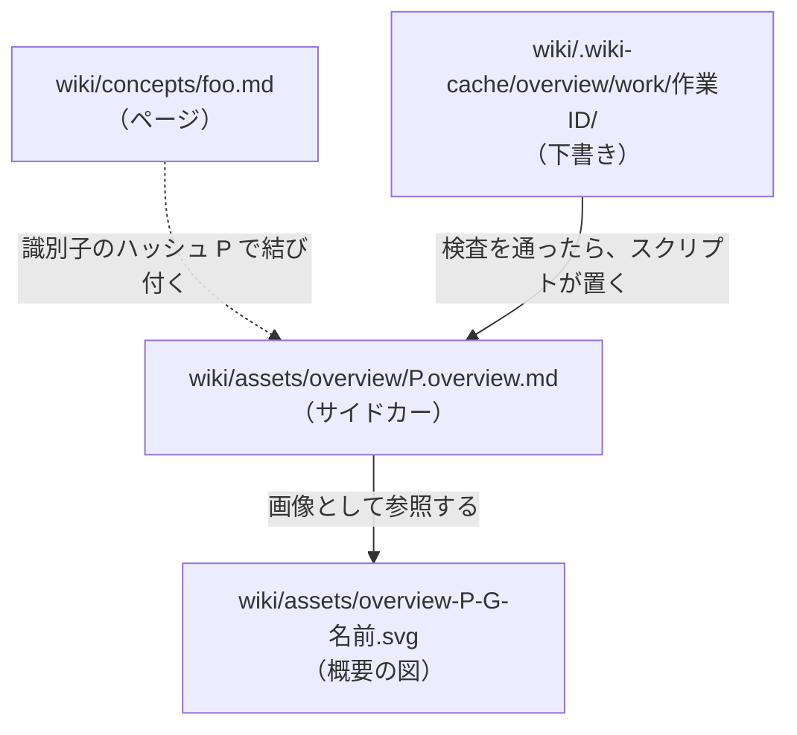

# ページの概要を作り、サイドカーに置く（2026年11月17日）

| 項目 | 内容 |
| --- | --- |
| 状態 | 2 版目。1 回目のレビュー（却下）の指摘を、崩れた前提ごとに直した。出す版はリリースのときに決める |
| 対象 | `info-hive-wiki` の新しいコマンド `/wiki:overview`、新しいスクリプト `wiki_overview.py`、lint、`SCHEMA.md` のひな形 |
| きっかけ | 作者の依頼「`/wiki:browse` で開く記事のページのタイトルのすぐ後に、概要を表示する」 |
| 関連 | ADR-0005（図は mermaid と svg）、ADR-0017（browse は wiki に書かない）、ADR-0020（raw はスクリプトが書く）、ADR-0023（書く段）、ADR-0029（リンクを置かない。I6）、ADR-0030（browse は図を画像として見せる。提案）、[図の描画の設計](wiki-browse-figures-2026-11-17.md)（別のブランチ `feat/wiki-browse-figures`） |
| 基準にした版 | 親 `b842236`、`info-hive-wiki` 0.25.2（`e8886d6`） |
| 記録 | `docs/agent-runs/2026-11-17-wiki-overview/`（1 版目は `design-v1.md`）、試作 `poc/wiki-overview/` |

この設計が扱うのは、概要を**作って wiki に置く側**（段 1）である。browse が概要を**読んで表示する側**（段 2）は、図の表示（ADR-0030）が `info-hive-wiki` の main に入ってから、別の設計として書く。段 2 がこの設計に求めることは 13 節に書く。

## 1. 背景

browse の記事のページは、メタ欄と本文だけを出す。初めて読む人が全体をつかむための、図を中心にした説明がない。作者は、題名のすぐ後に概要を表示することと、概要を作るプロンプトを決めた。

- browse のサーバーは LLM を持たず、wiki のルートの下に何も書かない（ADR-0017）。概要は Claude Code のセッションが前もって作り、browse は読むだけになる。
- 概要は、ページから作り直せる表示用の派生物である。ページの本文、大きさの上限、検索、グラフには混ぜない。
- ADR-0030 は、`wiki/assets/` の**直下**の svg だけを browse の入力にし、`` で見せる。下位のディレクトリの svg は読まない。Mermaid はサーバーの方式でだけ描く。
- 試作（`poc/wiki-overview/`）で、ページ「エージェントのメモリの階層」の概要を 1 つ作り、browse の本物のページの h1 の直後に差し込んで確かめた。分かったことは 3 節に書く。

## 2. 作者が決めたこと

| 日付 | 決定 |
| --- | --- |
| 2026年11月17日 | 概要は、新しいコマンド `/wiki:overview <ページ>` で、求めたページだけ作る。取り込み（ingest）には入れない |
| 同 | 概要は、短い文、mermaid のコードブロック、大きな SVG のファイルで書く。CSP は今のまま保つ |
| 同 | 概要は、ページとは別のファイル（サイドカー）に置く。元のページのハッシュを記録し、ページが変わったら「古い」と示せるようにする |
| 同 | 写真は使わない。SVG の図とアイコンだけにする |
| 同 | 描画系のスキルは、名前を手順に書かない。「一覧にあって合うものだけ使う」と書く（ADR-0005 と同じ） |
| 同（承認した計画の既定） | サイドカーは `wiki/assets/overview/` の下に置き、git に入れる。書くのは `wiki_overview.py` だけ。ハッシュは、BOM を除き改行を LF にそろえたページの全文の SHA-256。概要の入力はそのページだけで、wikilink は書かない。`log.md` には記録しない |
| 同 | 試作の概要（`poc/wiki-overview/`）の出来を認めた。図の質、言い換えの程度、ダークでの明るい背景、長さは、この形でよい |
| 同 | 図は、サイドカーと同じ場所ではなく、`wiki/assets/` の直下に置く（5 節）。ADR-0030 が直下の svg だけを読むため、計画の既定から変えた |

## 3. 試作で分かったこと

| 分かったこと | 設計への反映 |
| --- | --- |
| 記事の本文の幅は 48em（約 700px）。幅 980 で描いた図は縮んで、図の中の文字が読みにくくなった | 手引きに、図は幅 720 を基準にし、文字は 13 以上にすると書く（8 節） |
| Mermaid の横の流れ（`flowchart LR`）は幅 1276 になり、半分に縮んだ | 手引きに、Mermaid は縦に流すと書く |
| SVG は、`<style>` も `<foreignObject>` も使わずに描けた | 手引きに、どちらも使わない書き方を勧める。検査では止めない |
| 手書きの SVG は明るい紙のまま、Mermaid は配色に従う | そのままにする（ADR-0030 の限界と同じ） |
| アプリ内のブラウザーは iframe を止めるので、Mermaid はコードのまま見える | 画面の確かめは Playwright で行う |

## 4. 1 回目のレビューで崩れた前提

1 回目のレビュー（`design-review-1.md`、却下）の指摘を、1 版目が暗に置いていた前提に対応づけた。指摘を 1 つずつ塞がず、前提を変えた。

| 崩れた前提 | 指摘 | 2 版目の形 |
| --- | --- | --- |
| 利用者の文字列は、禁じた文字を除けば、引用符の中でシェルに渡せる | 致命 1（PowerShell は U+201D を引用符の終わりと読む） | **利用者の文字列をシェルに通さない。** モデルが Write ツールで要求のファイルに書き、スクリプトはそのファイルを読む（8.1） |
| 下書きの画像を、本文の行を書き換えて最終の名前に向けられる | 重大 2（コードスパンの中の行を書き換え、本物の画像が古い名前のまま残る） | **スクリプトは本文を書き換えない。** `prepare` が最終の名前の接頭辞を返し、モデルがその名前で参照を書く。検査は markdown-it の画像のトークンだけで行う（7 節） |
| 依存先の文字コードと大きさの確かめが通れば、表示できる svg である | 重大 3（閉じタグのない svg が通る） | **svg を XML として最後まで解析する**検査を、スクリプトが持つ。文字コードと上限は依存先の関数を使う（7 節） |
| 利用者のデータの場所は、wiki の外にある | 重大 4（`INFO_HIVE_DATA_DIR` を wiki の中にすると、下書きがページになる） | **作業用のフォルダーを、wiki の `.wiki-cache/overview/` に置く。** 走査がすでに名前で除く場所で、Web の取り込みとセッションの取り込みの前例と同じ（6.1） |
| 候補の識別子を渡せば、その候補を選べる | 重大 5（`foo.md` と `concepts/foo.md` で、ルートの直下を選べない） | 要求のファイルに、**識別子の完全一致**で選ぶ形を足す（8.1） |
| ページのパスを写せば、サイドカーの階層も共存できる | 重大 6（`foo.md` と `foo.overview.md/bar.md` が衝突する） | **サイドカーの名前を、ページの識別子のハッシュにする。** ページのパスの形に依らない（5.2） |

軽微の指摘（元のページを読めない、`remove` の範囲と順、同時の書き手、svg のバイト列、未初期化の出力、`assets/overview` がないときの図の検査）は、5.5、6、9、12 節で直した。

## 5. 守ること

1. **wiki に書くのはスクリプトだけ。** サイドカーと図は `wiki_overview.py` だけが書く。モデルが書くのは、作業用のフォルダーの下書きと要求のファイルだけである。
2. **状態を推さない。** 概要が新しいか古いかは、スクリプトが書いたハッシュと、今のページのハッシュを比べて決める。
3. **ページの集合は、実物に尋ねる。** ページの指定の解決と、元のページがあるかの確かめは、lint と同じ走査（`wiki_pages.walk_pages`）の結果で行う。名前の規則の写しを持たない。
4. **検査は、browse と同じパーサーと、字句で決まるものだけ。** 本文の検査は、browse と同じ markdown-it のトークンだけで行う。行の形を別に数えて突き合わせない。「ページにない事実を足さない」のような中身の良し悪しは、検査しない。手引きで目的を伝える。
5. **スクリプトは、モデルが書いた本文を書き換えない。** 検査を通った本文に、frontmatter を付けて置くだけにする。
6. **途中で止まっても、壊れた概要を残さない。** 書き込みと削除の順を、どこで止まっても「前の概要のまま」か「新しい概要」か「概要なし」のどれかになり、参照先のない図の参照ができない順にする。
7. **既存の読み手を変えない。** 検索、グラフ、統計、browse（今の版）は、`assets/` と `.wiki-cache/` を名前で除いている。サイドカーと作業用のフォルダーを置いても、ページとして数える者、索引に入れる者はいない（0.25.2 の全スクリプトの走査を調べた。レビューでも確かめられた）。
8. **利用者の文字列をシェルに通さない。** ページの指定は、ファイルで渡す。
9. **開発用の PC にだけあるものを仕様にしない。** スキルの名前、フォントの名前、絶対パスを、手順と検査に書かない。

## 6. 置き場所と形



> 置き場所 補足: サイドカーと図の名前は、ページの識別子のハッシュ（P）で決まる。図の名前の G は、概要を作るたびに変わる世代の文字である。下書きは、wiki の中の、走査が除く `.wiki-cache/` に置く。

### 6.1 ページの識別子

ページの識別子は、wiki のルートからのディスク上の相対パス（`/` 区切り）から末尾の `.md` を除き、NFC にそろえたものである（browse の `_page_id` と同じ）。`concepts/foo.md` の識別子は `concepts/foo` になる。

`<P>` は、識別子の UTF-8 の SHA-256 の先頭 16 桁（小文字の 16 進）である。

### 6.2 サイドカー

- パスは `assets/overview/<P>.overview.md`。下位のディレクトリを作らない。ページのパスの形（大文字と小文字、長さ、予約名、`.overview.md` で終わるディレクトリ）に依らない。
- 中身は、frontmatter と本文（Markdown）である。

```markdown
---
format: 1
page: "concepts/foo"
page_sha256: "8aefb2ee4772ba2359180880c2ea68d191b2fc27ffccf22bdd115e1332d57b66"
generation: "3f9c2a7d"
generated: 2026-11-17
generator: "Claude Fable 5.2"
---

（概要の本文。モデルが書いたものをそのまま置く）
```

| 欄 | 中身 | 書く者 |
| --- | --- | --- |
| `format` | サイドカーの形の版。今は 1 | スクリプト |
| `page` | ページの識別子。人が読むためと、`<P>` との食い違いを見つけるため | スクリプト |
| `page_sha256` | 概要を作るときに読んだページのハッシュ（6.4） | スクリプト（`prepare` が取り、`write` が書く） |
| `generation` | 図の名前の `<G>`（8 桁の小文字の 16 進）。`prepare` が乱数で決める | スクリプト |
| `generated` | 書いた日（スクリプトの時計。`YYYY-MM-DD`） | スクリプト |
| `generator` | 作ったモデルの表示名。なければ欄を書かない | 要求のファイルからスクリプトが字句を確かめて書く |

欄の名前は `_` でつなぐ。`wiki_text.parse_frontmatter_text` は、`-` を含むキーを読まないからである。frontmatter は `wiki_text.format_frontmatter` で書き、`wiki_lint.parse_frontmatter_raw` で読む。PyYAML は使わない。サイドカーは LF と UTF-8（BOM なし）で書く。本文の改行は、モデルの下書きの CRLF を LF にそろえる（中身は変えない）。

### 6.3 図

- パスは `assets/overview-<P>-<G>-<名前>.svg`。`<名前>` は `^[a-z0-9][a-z0-9-]{0,39}$`。下書きの `draft/<名前>.svg` から来る。
- サイドカーの本文は、図を `` で参照する。サイドカーはいつも `assets/overview/` の直下にあるので、`../` は 1 つに決まる。エディターや GitHub でも、そのまま図が見える。
- `<P>` を入れるのは、どの図がどのページの概要のものかを、ファイル名だけで決めるためである。`<G>` を入れるのは、作り直すときに、前の図を上書きしないためである（7.4 の順）。
- 概要の図は、名前が `^overview-[0-9a-f]{16}-[0-9a-f]{8}-[a-z0-9][a-z0-9-]{0,39}\.svg$` の形のファイルである。この形をスクリプトと lint が予約する。ADR-0005 の図（`assets/<ページのスラッグ>-NN.svg`）とは、この形で分かれる。
- svg は、下書きのバイト列をそのまま置く（BOM と改行も変えない）。

### 6.4 ページのハッシュ

ページのファイルのバイト列を `utf-8-sig` で読み、改行を LF にそろえた文字（lint と browse の読み方と同じ）を UTF-8 にして、SHA-256 を取る。関数 `wiki_pages.page_text_sha256(data: bytes) -> str` を足し、スクリプト、lint、browse（段 2）が同じ関数を呼ぶ。UTF-8 として読めないときは `UnicodeDecodeError` を送出する。

Windows の checkout で改行が CRLF に変わっても、ハッシュは変わらない。frontmatter も含むので、タグだけを変えても「古い」になる。

### 6.5 概要の状態

関数 `wiki_overview.classify(sidecar_name: str, sidecar: bytes | None, page: PageState) -> State` が、次の表を上から順に見て、最初に当たった行で決める。`PageState` は、`<P>` に当たるページについて、呼ぶ側が走査の結果から作る（`absent`、`unreadable`、`ok(sha256)` のどれか）。lint、`status`、browse（段 2）が同じ関数を呼ぶ。

| 順 | 条件 | 状態 |
| --- | --- | --- |
| 1 | サイドカーを読めない、UTF-8 として読めない、frontmatter がない、閉じていない | `broken`（`unreadable`） |
| 2 | `format` が `1` でない | `broken`（`format`） |
| 3 | `page` がない、または `page` の `<P>` がファイル名の `<P>` と違う | `broken`（`page_field`） |
| 4 | `page_sha256` が 64 桁、`generation` が 8 桁の、小文字の 16 進でない | `broken`（`hash_field`） |
| 5 | `<P>` に当たるページがない（`absent`） | `orphan` |
| 6 | `<P>` に当たるページを読めない（`unreadable`） | `page_unreadable` |
| 7 | `page_sha256` が、今のページのハッシュと違う | `stale` |
| 8 | どれにも当たらない | `fresh` |

`<P>` に当たるページは、走査で得たページの識別子のハッシュの表で引く。2 つのページの識別子が同じ `<P>` になる場合（16 桁のハッシュの衝突）は、どちらのページの概要も作らず、エラー `id_collision` にする。

## 7. スクリプト `wiki_overview.py`

PyYAML の要らないスクリプトで、`python "${CLAUDE_PLUGIN_ROOT}/skills/info-hive/scripts/wiki_overview.py" <サブコマンド> "<WIKI_ROOT>" …` で呼ぶ。出力は、いつも標準出力の UTF-8 の JSON 1 つである。wiki の判定は `wiki_initialized.problem()` で行い、未初期化なら `{"status": "error", "code": "not_initialized", "message": …}` を出して終了コード 1 にする（`require_or_exit` は標準エラーに書くので使わない）。

| 終了コード | 意味 |
| --- | --- |
| 0 | 成功。`exists`（新しい概要がすでにある）も含む |
| 1 | 引数の誤り、読めないファイル、書き込みの守りで止めた |
| 2 | 下書きが検査を通らない（モデルが直してやり直せる） |
| 3 | 利用者の決定が要る（ページが決まらない、ページがなくなった） |

エラーは `{"status": "error", "code": "<字句>", "message": "<日本語の文>"}` で返す。wiki の中のパスは、wiki のルートからの相対パスで返す。作業用のフォルダーと要求のファイルのパスだけは、モデルが Read と Write に使うので、絶対パスで返す。

### 7.1 作業用のフォルダー

- 置き場所は `<WIKI_ROOT>/.wiki-cache/overview/`。`.wiki-cache` は走査が名前で除き、ひな形の `.gitignore` が中身を無視させる（`wiki-cache_gitignore.template`）。
- 使う前に、ルートから `.wiki-cache/overview/` までの各要素が、リンクでも再解析点でもないふつうのディレクトリであることを確かめる（7.4 の道の確かめと同じ関数）。`.wiki-cache` がなければ作る。
- `.wiki-cache/overview/request.json`: 要求のファイル。モデルが Write で書く（8.1）。
- `.wiki-cache/overview/work/<作業ID>/`: 作業ごとのフォルダー。作業ID は 16 桁の 16 進の乱数。
  - `plan.json`: スクリプトだけが書く。
  - `page.md`: 読んだページのバイト列の写し。
  - `draft/`: モデルが下書きを置く。

### 7.2 `prepare`

`prepare "<WIKI_ROOT>"`

1. `.wiki-cache/overview/request.json` を読み、消す（読めても読めなくても消す）。形は 8.1。なければエラー `no_request`。
2. ページを決める。
   - `"page"` のとき: `walk_pages` の結果から、`build_page_index` と `link_candidates` で決める（`[[slug]]` と同じ規則）。NFC にそろえると同じ識別子になるページが 2 つあるときも、曖昧として扱う。
   - `"id"` のとき: 識別子（6.1）が完全に一致するページだけを選ぶ。
   - 0 件: `{"status": "not_found"}`、終了コード 3。
   - 2 件以上: `{"status": "ambiguous", "candidates": [識別子…]}`、終了コード 3。
3. ページのバイト列を 1 回読み、ハッシュを取る。UTF-8 として読めなければエラー `page_unreadable`。
4. 今の概要の状態を `classify` で決める。`fresh` で、要求に `"refresh": true` がなければ、`{"status": "exists", "page", "sidecar"}` を返して終わる。
5. 作業用のフォルダーを作り、`plan.json`（`{"format": 1, "page": <識別子>, "page_rel": <ディスク上の相対パス>, "page_sha256", "generation": <8 桁の乱数>, "generator": <要求の値か null>, "prepared": <時刻>}`）と `page.md` を置き、`draft/` を作る。
6. `{"status": "ready", "work_id", "page": <識別子>, "page_copy": <絶対パス>, "draft_dir": <絶対パス>, "figure_ref_prefix": "../overview-<P>-<G>-", "existing": "none" | "stale" | "broken" | "page_unreadable" | "fresh"}` を返す。

`work/` の下の、名前が 16 桁の 16 進で、`plan.json` を持ち、7 日より古いフォルダーは、`prepare` が消す。消す前に、そのフォルダーがリンクでないことを確かめる（`wiki_rawcheck.remove_work_dir` と同じ作り）。

### 7.3 `check`

`check "<WIKI_ROOT>" --work=<作業ID>`

`--work` は `^[0-9a-f]{16}$` に合うときだけ受ける。下書きを 8 節の規則で調べる。`{"status": "ok"}`（終了コード 0）か、`{"status": "rejected", "problems": [{"code", "file", "line", "message"}…]}`（終了コード 2）を返す。wiki には書かない。

### 7.4 `write`

`write "<WIKI_ROOT>" --work=<作業ID>`

1. `plan.json` を読む。
2. `page_rel` が今の `walk_pages` の結果にあり、識別子が `plan.json` の値と同じことを確かめる。なければ `{"status": "page_gone"}`、終了コード 3。
3. 8 節の検査をもう一度行う。通らなければ `rejected`。
4. 下の順で書く。
5. 作業用のフォルダーを消す。
6. `{"status": "written", "page", "sidecar", "figures": […], "removed_figures": […], "page_changed": <真偽>}` を返す。`page_changed` は、今のページのハッシュが `plan.json` の値と違うときに真になる（作っている間にページが変わった。書いた概要は、すぐに「古い」になる）。

**道の確かめ**（ADR-0029 の I6。共有の部品 `wiki_fsguard` がまだないので、このスクリプトが持つ）:

- wiki のルートの直下の項目を一覧し、名前を `casefold` すると `assets` になるものを探す。`assets` という綴りのディレクトリが 1 つだけならそれを使う。なければ作る。綴りの違うもの（`Assets` など）があれば、エラー `assets_spelling` で止まる。走査は名前を大文字と小文字を区別して除くので、`Assets/` の下に書くと、サイドカーがページとして数えられるからである。`assets/overview` と `.wiki-cache` も同じに確かめる。
- ルートから行き先のディレクトリまでの各要素が、シンボリックリンクでも再解析点（ジャンクションを含む）でもない、ふつうのディレクトリであること。判定は `lstat` で行う（`wiki_browse_fs.kind` と同じ判定）。足りないディレクトリは 1 つずつ作り、作ったあとにもう一度確かめる。
- 行き先のファイルがすでにあるなら、リンクでない、ふつうのファイルで、ハードリンクの数が 1 であること。
- 通らなければ、書かずにエラー `unsafe_path` を返す。

**書く順**

| 順 | すること | ここで止まったとき |
| --- | --- | --- |
| 1 | 新しい図を `assets/overview-<P>-<G>-<名前>.svg` に置く。一時の名前（`.overview-<乱数>.tmp`）に `xb` で書き、`fsync` し、重ねて書かない形で置く（`wiki_session.publish_exclusive` と同じ作り）。同じ名前がすでにあれば、エラー `figure_conflict`（`<G>` は作業ごとの乱数なので、ふつうは起きない） | 前の概要のまま。使われていない図が残る（lint が知らせ、次の `write` が消す） |
| 2 | サイドカーを、一時の名前に書いて `fsync` し、`os.replace` で置き換える | 手順 1 と同じ |
| 3 | 名前が予約した形（6.3）で `<P>` が同じ svg のうち、`<G>` が新しいサイドカーの `generation` と違うものを消す | 新しい概要。使われていない図が残る |

一時ファイルは、`finally` で消す。Windows の `PermissionError` は、`wiki_fetch.replace_with_retry` と同じに、短く待って試し直す。

### 7.5 `status` と `remove`

- `status "<WIKI_ROOT>"`: すべての概要の一覧と状態を返す。`{"overviews": [{"page", "sidecar", "state", "detail"}…], "problems": […]}`。中身は lint の結果（10 節）と同じ関数で作る。
- `remove "<WIKI_ROOT>"`: 要求のファイル（8.1。`"action": "remove"`）でページを決め、そのページの概要を消す。
- `remove "<WIKI_ROOT>" --orphan=<P>`: 元のページがない概要を消す。`<P>` は `^[0-9a-f]{16}$` に合うときだけ受ける。`status` と lint が返す値である。

消す順は、**サイドカーを先に、図をあとに**する。サイドカーを消したところで止まっても、参照のない図が残るだけになる。消す図は、予約した形（6.3）に合い、`<P>` が同じものだけである。

## 8. 下書きの規則

モデルは、`draft/overview.md`（frontmatter なしの本文）と、`draft/<名前>.svg` を置く。スクリプトは、次を上から調べ、当たったものをすべて返す。本文の検査は、browse と同じ `wiki_pages.new_parser()` のトークンだけで行う。

| code | 条件 |
| --- | --- |
| `draft_missing` | `draft/overview.md` がない |
| `not_utf8` | `overview.md` を UTF-8 として読めない |
| `empty` / `too_large` | 空白だけ / 64 KiB を超える |
| `frontmatter` | 先頭の行が `---` |
| `heading_level` | トークンに h1 か h2 がある。概要はページの h1 の下、最初の h2 の前に入るので、見出しは `###` 以下にする |
| `wikilink` | `wiki_pages.extract_wikilinks` が 1 つ以上返す |
| `image_ref` | 画像のトークンの `src` が、`../overview-<P>-<G>-<名前>.svg`（`<P>` と `<G>` は `plan.json` の値）と字句で一致しない。markdown-it が `src` をパーセント符号化しても変わらない文字（ASCII の英小文字、数字、`-`、`.`、`/`）だけの形なので、字句で比べられる |
| `figure_missing` | 画像のトークンが参照する `<名前>` の `draft/<名前>.svg` がない |
| `figure_unused` | `draft/` の svg が、どの画像のトークンからも参照されていない |
| `extra_file` | `draft/` に、`overview.md` と、名前が `<名前>.svg` の形のふつうのファイルのほかの項目がある。リンクと下位のディレクトリを含む |
| `too_many_figures` | svg が 12 個を超える |
| `figure_encoding` | svg が、browse の読む口の条件（ADR-0030 の `is_utf8_svg` と上限 2 MiB）を満たさない |
| `figure_xml` | svg を、標準ライブラリの `xml.parsers.expat` で最後まで解析できない。DTD（`<!DOCTYPE`）か実体の宣言がある。根の要素が、名前空間 `http://www.w3.org/2000/svg` の `svg` でない |
| `figure_no_size` | 根の `width` と `height`、または `viewBox` から大きさが決まらない（ADR-0030 の `svg_size`） |

- スクリプトは本文を書き換えないので、検査が見るのは browse が描くものと同じトークンだけである。コードスパンの中の文字や、行の形は、検査にも書き込みにも関わらない。
- `figure_xml` の解析は、DTD と実体の宣言のハンドラーを置いて、現れたら止める（外部の実体を読まない）。
- `figure_encoding` と `figure_no_size` は、図の表示の実装が持つ関数を呼ぶ。条件の写しを持たない。関数の置き場所は、図の表示のセッションと合わせる（14 節）。
- svg の中の `<style>`、`<script>`、外部の参照は検査しない。browse は svg を `` と専用の CSP で見せるので、スクリプトは動かず、外への要求は出ない（ADR-0030 の PoC）。

## 9. コマンドと手引き

### 9.1 `commands/overview.md` と要求のファイル

- frontmatter は `description`、`argument-hint`（`<page> [--refresh] | --status | --remove <page>`）、`argument-description`。
- 手順 0 で `<WIKI_ROOT>` を決める（ほかのコマンドと同じ順）。
- **利用者の引数は、シェルのコマンドの行に入れない。** モデルは、引数を解釈して、Write ツールで `<WIKI_ROOT>/.wiki-cache/overview/request.json` を書く。

```json
{"format": 1, "action": "create", "page": "エージェントのメモリの階層", "refresh": false, "generator": "Claude Fable 5.2"}
```

| キー | 中身 |
| --- | --- |
| `action` | `create` か `remove` |
| `page` / `id` | どちらか 1 つ。`page` は `[[slug]]` と同じ規則で探す名前、`id` は識別子の完全一致。候補から選び直すときは `id` を使う |
| `refresh` | 真なら、新しい概要があっても作り直す |
| `generator` | モデルの表示名。`^[A-Za-z0-9][A-Za-z0-9 ._-]{0,59}$` に合わなければ、スクリプトは欄を書かない |

- `request.json` はスクリプトが読んで消す。2 つのセッションが同時に書くと、あとから書いたほうが読まれる（12 節）。
- スクリプトの呼び出しの行に入るのは、`<WIKI_ROOT>`、サブコマンド、`--work=<16 桁>`、`--orphan=<16 桁>` だけである。`<WIKI_ROOT>` はほかのコマンドと同じ扱いで、利用者の引数ではない。
- 流れ: 要求のファイルを書く → `prepare` → 手引きを Read する → `page_copy` を Read する → `draft_dir` に下書きを Write する → `check` → `write`。
- `exists` のときは、すでに新しい概要があると伝えて終わる。`ambiguous` のときは、候補を示して選んでもらい、`id` で要求を書き直す。`rejected` のときは、`problems` を直して `check` をやり直す。
- 終わったら、サイドカーのパスと、`page_changed` が真ならその旨を伝える。
- `--status` は `status` を呼び、`--remove <page>` は `"action": "remove"` の要求を書いて `remove` を呼ぶ。

### 9.2 `references/overview-workflow.md`（手引き）

コマンドがパスを書いて Read させる小さなファイルにする。規則が届くかは置き場所と指し方で決まるからである（wiki の [[エージェントに守らせる決まりの書き方]]）。中身は 3 つである。

1. **目的とプロンプト。** 作者の文面を、次の読み替えで置く。「私たちが議論している内容」は「このページの内容」、「実物の写真」は外す、スキルは名前を挙げない。

   > SVG と Mermaid を使って、このページの内容を理解しやすいようにしてください。重要な詳細を省くことなく、大きな画像と簡潔な文章で説明してください。独自のセンスを活かし、手抜きなデザインは避け、必要に応じてアイコンとビジュアルを組み込んでください。写真は使いません。利用できるスキルの一覧に、図を作るスキルがあって用途に合うものだけを、厳選して使ってください。文章や詳細を記述する際は、明確かつ簡潔・端的にし、専門用語は避けてください。閲覧者がこの分野の初心者であるかのように説明してください。

2. **入力。** 読むのは `page_copy` だけ。ページにない事実を足さない。リンク先のページを読んで足さない。
3. **形の決まり。** 8 節の検査に当たる決まり（見出しは `###` 以下、wikilink を書かない、図は `<figure_ref_prefix><名前>.svg` で参照し、`draft/<名前>.svg` に置く、説明を付ける）と、検査しない勧め（図は幅 720 を基準にし、文字は 13 以上。図は自分の明るい背景を持つ。Mermaid は縦に流す。`<foreignObject>` と外部の参照は使わない。スキルの出力は、この形に直す）。決まりは、従った書き方の例で示す。

何を図にするか、どう言い換えるかは、決まりで縛らない。

### 9.3 そのほかの文書

`wiki_help.py` の `PREFERRED_ORDER`（`browse` の次）、`docs/commands.md`（数、表、`` ## `/wiki:overview <page>` `` の節）、`README.md` の表、`SKILL.md`、`references/lint-workflow.md`、`commands/lint.md` の種類の列挙。

## 10. lint

`wiki_lint.lint()` に、wiki 全体の検査を 1 つ足す（`caption_corrections` と同じ形で、`wiki_overview` の関数を呼ぶ）。

| キー | 中身 |
| --- | --- |
| `overview_stale` | `[{"page", "sidecar"}…]`。6.5 の `stale` |
| `overview_problems` | `[{"path", "code", "message", ("orphan_id"), ("page")}…]` |

`overview_problems` の code は次のとおり。パスは wiki のルートからの相対パスで返す（MCP と CLI の結果を一致させる）。

| code | 条件 |
| --- | --- |
| `orphan` | 6.5 の `orphan`。`orphan_id`（`<P>`）と、サイドカーの `page` を添える。`page_sha256` が一致する今のページがあれば、移す先の候補を添える |
| `broken` | 6.5 の `broken`。理由を添える |
| `page_unreadable` | 6.5 の `page_unreadable` |
| `figure_missing` | サイドカーの画像のトークンの `src` が、`../overview-<そのサイドカーの P>-<その generation>-<名前>.svg` の形でない、またはファイルがない |
| `figure_unused` | `assets/` の直下の、予約した形の名前の svg で、`<P>` のサイドカーがない、またはサイドカーの `generation` と `<G>` が違う |
| `unknown_entry` | `assets/overview/` の直下に、名前が `<16 桁>.overview.md` の形のふつうのファイルのほかの項目がある（残った一時ファイル、リンク、ディレクトリを含む）。リンクはたどらない |

- `figure_unused` は、`assets/overview` がなくても、`assets/` の直下を調べる。
- サイドカーの本文の画像は、browse と同じパーサーのトークンで読む。
- `assets/` の直下と `assets/overview/` の一覧は、`wiki_pages` の OS の口（`read_os`）を使う小さな走査を `wiki_overview` に置く。ページの走査とは規則が違う（決まった形の名前だけを拾い、リンクをたどらない）。一覧を作れなければ、`overview_problems` を `None`（検査していない）にする（`unknown_tags` の前例）。
- 人が読む出力に 2 つの節を足す。`summary` に数を足す。
- MCP の `lint` は、`lint()` の結果をそのまま返すので、直さない。`wiki_mcp_common.SERVER_FILES` に `wiki_overview.py` を足す（足さないと、古いサーバーが残る）。
- lint は直さない。`lint-workflow.md` に、`orphan` は `remove --orphan`、`stale` は `/wiki:overview <ページ> --refresh` を案内すると書く。

## 11. `SCHEMA.md` と既存の wiki

- `SCHEMA.md.template` の「置き場所」に 1 行、新しい節 `## Page overviews` を足す。節には、`assets/overview/` と `assets/overview-*.svg` はスクリプトが書く派生物で、手で編集しない、検索とグラフの対象でない、git で管理する、と書く。見出しは、アップグレードの検出に使うので英語にする。
- `init_wiki.SCHEMA_SECTION_MARKERS` に `## Page overviews` を足す。既存の wiki は、`/wiki:upgrade` が欠けた節として示す。
- `init_wiki.SUBDIRS` は変えない。`assets/overview/` は、`write` が要るときに作る。
- `commands/upgrade.md` の手順 4 に、この版の変更を 1 項目足す。

## 12. 失敗の形と、保証しないこと

直しで足した仕組みが生む失敗の形を、先に書いておく。

| 仕組み | 生む失敗の形 | 扱い |
| --- | --- | --- |
| 作業用のフォルダーを `.wiki-cache/overview/work/` に置く | 捨てた作業の写しが wiki の中に残る | 7 日で `prepare` が消す。`.wiki-cache` は gitignore の対象で、走査が除く。ひな形の `.gitignore` のない古い wiki では、git に見える（`/wiki:upgrade` の案内に書く） |
| 要求のファイル `request.json` | 2 つのセッションが同時に書くと、片方の要求が失われる。読んだあとに消えなかった要求が残る | `prepare` が読んで必ず消す。同時の書き手は保証しない |
| サイドカーの名前を `<P>` にする | ファイル名からページが分からない | `page` の欄と、`status` と lint の出力で示す |
| `<P>` を 16 桁に切る | 2 つのページが同じ `<P>` になると、どちらの概要も作れない | エラー `id_collision`。2^64 の空間なので、ふつうは起きない |
| 図の名前に世代 `<G>` を入れる | 作り直すたびに名前が変わり、git の差分が増える | 受け入れる |
| ページの識別子のハッシュ `<P>` | ページを改名すると、概要が `orphan` になる | lint が知らせ、`page_sha256` で移す先の候補を示す。自動では移さない |
| `assets` の綴りの確かめ | `Assets/` のある wiki では、概要を書けない | エラーで理由を伝える。綴りを直すのは利用者 |
| svg の XML の解析 | DTD を持つ svg は、正しくても拒まれる | 手引きで、DTD を書かないと伝える |
| `write` のあとの片付け | 手順 3 の前で止まると、使われていない図が残る | lint が知らせ、次の `write` が消す |

**保証しないこと**

- 同じページの概要を、2 つのセッションが同時に作ること。片方の `write` の手順 3 が、もう片方の図を消し、もう片方のサイドカーが参照先のない図を指すことがある。lint の `figure_missing` が知らせ、作り直せば直る。ロックは持たない。
- 道を確かめたあとで、ほかのプロセスがディレクトリをリンクに替えること（確かめと書き込みの間の差し替え）。wiki に書ける者とスクリプトを実行する者が同じ利用者であることを前提にする（ADR-0030 の 6.1 と同じ前提）。
- 概要の中身が、ページの内容と合っていること。検査するのは形だけである。
- 利用者がサイドカーや図を手で書き換えること。`fresh` は、ページが変わっていないことだけを表す。
- 予約した形の名前（6.3）の svg を、利用者が別の用途に使うこと。
- `<WIKI_ROOT>` そのものの文字列をシェルに渡すこと。ほかのコマンドと同じ扱いで、この設計では変えない。

## 13. browse の表示（段 2）がこの設計に求めること

段 2 の設計は別に書く。ここでは、段 1 が用意するものだけを決める。

| 段 2 が使うもの | 段 1 が用意する形 |
| --- | --- |
| サイドカーの一覧 | `wiki_overview` の走査の関数。browse の `walk_inputs` が、入力の種類 `overview` として載せる |
| 状態の判定 | `wiki_overview.classify`（6.5）と `wiki_pages.page_text_sha256`（6.4） |
| 本文 | browse と同じ markdown-it で読める Markdown。見出しは h3 以下、wikilink なし |
| 図 | `wiki/assets/` の直下の svg。ADR-0030 の入力（`asset`）にそのまま載る。参照は `../overview-…svg` の 1 形だけで、ADR-0030 の `figure_target` に、ページの代わりにサイドカーのパス（`assets/overview/<P>.overview.md`）を渡せば `assets/overview-…svg` に解ける（レビューで確かめられた） |
| Mermaid | 本文の ```` ```mermaid ```` のフェンス。ADR-0030 の `figures.js` が、`#_body` の中のフェンスをそのまま描く |

段 2 で決めること: h1 の直後への差し込み方、h1 のないページ、`stale`、`broken`、`page_unreadable` の見せ方、折りたたみ、`_body_cache`、世代、2 方式の一致、CSS。

## 14. 段取り

1. この設計と ADR-0031 を Sol にもう一度レビューしてもらい、直す。
2. 図の表示の PR 1（svg）が `info-hive-wiki` の main に入ったら、その上に段 1 を実装する。8 節の `figure_encoding` と `figure_no_size` が、その実装の関数を呼ぶからである。先に実装することになったら、関数の置き場所を図の表示のセッションと合わせる。
3. 段 2 の設計を書き、レビューを受け、実装する。
4. リリースは、browse に概要が出る段 2 と合わせて 1 回にする。段 1 だけを出すと、概要を作れるが見えない版になる。版の番号は、リリースの直前に origin を見て決める（0.26.0 は to884/info-hive-wiki#71 が使っている）。

## 15. 試験

| ファイル | 試験 |
| --- | --- |
| `tests/wiki/test_wiki_overview.py`（新規） | 要求のファイル（`page`、`id`、ない、壊れている、読んだら消える）。`prepare` の解決（決まる、ない、曖昧、NFC で重なる、`foo.md` と `concepts/foo.md` を `id` で選べる）。`exists` と `refresh`。`page.md` の写しとハッシュ。CRLF と BOM のページで、ハッシュが LF のページと同じ。`check` の code ごとの下書き（コードスパンの中の画像の字句は数えない、段落の中の画像も受ける、閉じタグのない svg、DTD のある svg）。`write` の出力（LF、UTF-8、frontmatter の欄、本文がモデルの下書きと同じ）。作り直しで前の世代の図が消える。書く順と消す順の途中で止めたとき、`classify` と lint が参照先のない図を報告しない。`page_gone`、`page_changed`。`assets_spelling`。道の途中のシンボリックリンクとジャンクション、ハードリンクのサイドカー、`.wiki-cache` がリンクのときに `unsafe_path`。`remove` と `--orphan`。古い作業用のフォルダーの片付け。引数の字句（`--work`、`--orphan`）。未初期化の wiki で JSON のエラー |
| `tests/wiki/test_wiki_lint.py` | `overview_stale` と `overview_problems` の code ごと。`assets/overview` がない wiki で、残った図だけを `figure_unused` にする。サイドカーがページの数、孤立ページ、大きさの検査に入らない。パスが相対である |
| `tests/wiki/test_mcp_server.py` | 既存の `test_lint_matches_cli` が、概要のある wiki でも通る |
| `tests/wiki/test_page_set.py` | 検索、グラフ、統計が、サイドカーと作業用のフォルダーをページとして数えない |
| `tests/wiki/test_uninitialized_wiki.py` | `EntranceInventoryTests.TAKES_WIKI` と `ReaderEntryTests.cases` に足す |
| `tests/wiki/test_help_command.py` | `EXPECTED` に `overview` を足す |
| `tests/wiki/test_template_script_paths.py`、`test_source_claims.py` | marker の並びと、ひな形の節 |

- CI（`.github/workflows/wiki-mcp.yml`）は試験のファイルを名前で流すので、`test_wiki_overview.py` の手順を足す。`tests/wiki/README.md` の表にも足す。
- `eval/check_encoding.py`（`encoding` のない文字の入出力を禁じる）と、`tests/wiki/test_python_version.py`（PEP 723 の宣言のない入口は、`wiki_text` を最初に読み込む）を通す。
- コマンドの手順がモデルに届くかは、試験では分からない。実装のあと、Sonnet 5.5 で `/wiki:overview` を数回流し、手引きを開いたか、要求のファイルを Write で書いたか（シェルに引数を入れなかったか）、`check` を通ったかを数える。

## 16. 実装で触る範囲

| 場所 | 変更 |
| --- | --- |
| `skills/info-hive/scripts/wiki_overview.py` | 新規 |
| `skills/info-hive/scripts/wiki_pages.py` | `page_text_sha256` |
| `skills/info-hive/scripts/wiki_lint.py` | 2 つのキー、`summary`、人が読む節 |
| `skills/info-hive/scripts/wiki_mcp_common.py` | `SERVER_FILES` |
| `skills/info-hive/scripts/init_wiki.py` | `SCHEMA_SECTION_MARKERS` |
| `skills/info-hive/scripts/wiki_help.py` | `PREFERRED_ORDER` |
| `commands/overview.md`、`references/overview-workflow.md` | 新規 |
| `commands/lint.md`、`commands/upgrade.md`、`references/lint-workflow.md`、`SKILL.md`、`assets/SCHEMA.md.template`、`docs/commands.md`、`README.md`、`CHANGELOG.md`、`.claude-plugin/plugin.json` | 追記 |

## 17. まだ確かめていないこと

- ADR-0030 は「提案」で、図の表示の実装はまだ main にない。svg の読む口の条件と関数の名前は、その実装で変わりうる。
- `info-hive-rag` が wiki の `assets/` を読むかは、サブモジュールを初期化していないので調べていない。
- コマンドの手順と手引きが、Sonnet 5.5 に届くか。特に、引数をシェルに入れずに要求のファイルに書くか。
- 試作の概要は、Chromium のサーバーの方式でだけ確かめた。

## レビューの指摘と対応

| 回 | 判定 | 重大（発生の度合い） | 対応 |
| --- | --- | --- | --- |
| 1 | 却下（確信度：高） | 致命 1（D）、重大 5（B 2、C 2、D 1） | 4 節の 6 つの前提を変えた。軽微 7 件も直した |
