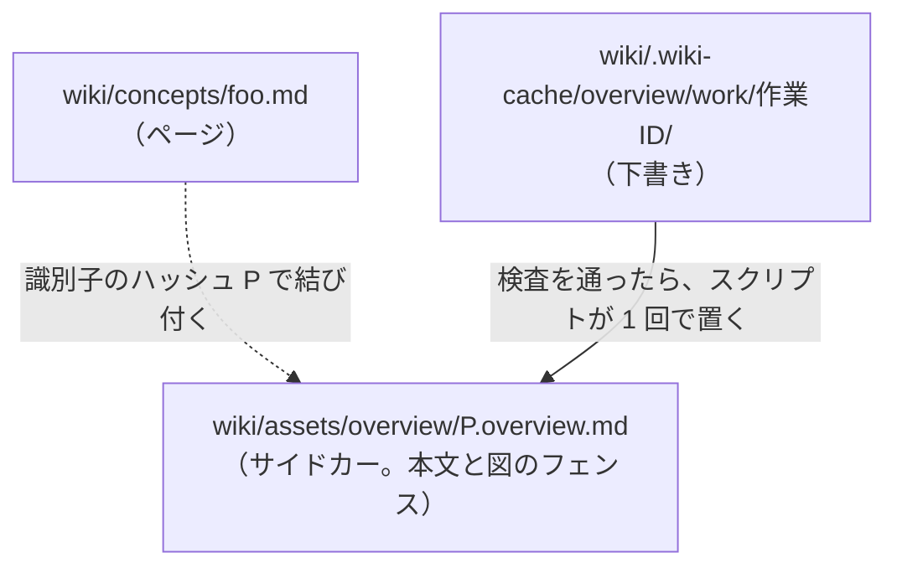

# ページの概要を作り、サイドカーに置く（2026年11月17日）

| 項目 | 内容 |
| --- | --- |
| 状態 | 6 版目。2026年11月17日に作者が設計と ADR-0033 を承認した。段階 1 の実装・試験・Astra のレビューと Sonnet 5.5 の実測3回が完了した。出す版は段階 2 と合わせたリリースのときに決める |
| 対象 | `info-hive-wiki` の新しいコマンド `/wiki:overview`、新しいスクリプト `wiki_overview.py`、lint、`SCHEMA.md` のひな形 |
| きっかけ | 作者の依頼「`/wiki:browse` で開く記事のページのタイトルのすぐ後に、概要を表示する」 |
| 関連 | ADR-0005（図は mermaid と svg）、ADR-0017（browse は wiki に書かない）、ADR-0020（raw はスクリプトが書く）、ADR-0023（書く段）、ADR-0029（リンクを置かない）、ADR-0030（browse は図を画像として見せる。提案）、[図の描画の設計](wiki-browse-figures-2026-11-17.md)（別のブランチ `feat/wiki-browse-figures`） |
| 基準にした版 | 親 `b842236`、`info-hive-wiki` 0.25.2（`e8886d6`） |
| 実装の基準 | 図の表示の変更が main に入ったことを確認し、段階 1 は `info-hive-wiki` 0.27.0（`485e530`）上に実装した。設計の承認時点からの確認結果は、[実装記録](../agent-runs/2026-11-17-wiki-overview/stage1-implementation.md)に記す |
| 段階 2 | [browse の表示設計](wiki-browse-overview-2026-11-17.md) 第3版。Astra のレビューは採用可。2026年11月18日に作者の「続けて」を受けて実装へ進んだ |
| 記録 | `docs/agent-runs/2026-11-17-wiki-overview/`（前の版は `design-v1.md`〜`design-v5.md`。6 回目の結果は `design-review-6-astra-native.md`）、試作 `poc/wiki-overview/` |

この設計が扱うのは、概要を**作って wiki に置く側**（段 1）である。browse が概要を**読んで表示する側**（段 2）は、図の表示（ADR-0030）が `info-hive-wiki` の main に入ってから、別の設計として書く。段 2 がこの設計に求めることは 12 節に書く。

## 1. 背景

browse の記事のページは、メタ欄と本文だけを出す。初めて読む人が全体をつかむための、図を中心にした説明がない。作者は、題名のすぐ後に概要を表示することと、概要を作るプロンプトを決めた。

- browse のサーバーは LLM を持たず、wiki のルートの下に何も書かない（ADR-0017）。概要は Claude Code のセッションが前もって作り、browse は読むだけになる。
- 概要は、ページから作り直せる表示用の派生物である。ページの本文、大きさの上限、検索、グラフには混ぜない。
- 試作（`poc/wiki-overview/`）で、ページ「エージェントのメモリの階層」の概要を 1 つ作り、browse の本物のページの h1 の直後に差し込んで確かめた。作者が出来を認めた。

## 2. 作者が決めたこと

| 日付 | 決定 |
| --- | --- |
| 2026年11月17日 | 概要は、新しいコマンド `/wiki:overview <ページ>` で、求めたページだけ作る。取り込み（ingest）には入れない |
| 同 | 概要は、短い文、mermaid のコードブロック、大きな SVG で書く。CSP は今のまま保つ |
| 同 | 概要は、ページとは別のファイル（サイドカー）に置く。元のページのハッシュを記録し、ページが変わったら「古い」と示せるようにする |
| 同 | 写真は使わない。SVG の図とアイコンだけにする |
| 同 | 描画系のスキルは、名前を手順に書かない。「一覧にあって合うものだけ使う」と書く（ADR-0005 と同じ） |
| 同（承認した計画の既定） | サイドカーは `wiki/assets/overview/` の下に置き、git に入れる。書くのは `wiki_overview.py` だけ。ハッシュは、BOM を除き改行を LF にそろえたページの全文の SHA-256。概要の入力はそのページだけで、wikilink は書かない。`log.md` には記録しない |
| 同 | 試作の概要の出来を認めた。図の質、言い換えの程度、ダークでの明るい背景、長さは、この形でよい |
| 同（4 回目のレビューのあと） | **概要は 1 つのファイルにする（案 B）。** svg はサイドカーの中に埋め込み、別のファイルにしない。エディターや GitHub でサイドカーを開いたときに図が見えないことは受け入れる |

## 3. 試作で分かったこと

| 分かったこと | 設計への反映 |
| --- | --- |
| 記事の本文の幅は 48em（約 700px）。幅 980 で描いた図は縮んで、図の中の文字が読みにくくなった | 手引きに、図は幅 720 を基準にし、文字は 13 以上にすると書く（9.2） |
| Mermaid の横の流れ（`flowchart LR`）は幅 1276 になり、半分に縮んだ | 手引きに、Mermaid は縦に流すと書く |
| SVG は、`<style>` も `<foreignObject>` も使わずに描けた | 手引きに、どちらも使わない書き方を勧める。検査では止めない |
| 手書きの SVG は明るい紙のまま、Mermaid は配色に従う | そのままにする（ADR-0030 の限界と同じ） |
| アプリ内のブラウザーは iframe を止めるので、Mermaid はコードのまま見える | 画面の確かめは Playwright で行う |

## 4. レビューで崩れた前提と、5 版目で変えた前提

### 4.1 1 版目から 4 版目で崩れた前提

| 回 | 崩れた前提 | 直し方 | 5 版目での扱い |
| --- | --- | --- | --- |
| 1 | 禁じた文字を除けば、引用符の中でシェルに渡せる（PowerShell は U+201D を引用符の終わりと読む） | 利用者の文字列をシェルに通さず、要求のファイルで渡す | 残す（9.1）。4 回目の指摘で、経路の確かめを要求のファイルを書く前に置いた |
| 1 | スクリプトが本文の行を書き換えて、画像を最終の名前に向けられる | 本文を書き換えず、検査は markdown-it のトークンだけで行う | 残す（8 節） |
| 1 | 依存先の文字コードと大きさの確かめが通れば、表示できる svg である | svg を XML として最後まで解析する | 残す（8 節） |
| 1 | 利用者のデータの場所は wiki の外にある | 下書きを `.wiki-cache/overview/` に置く | 残す（7.1） |
| 1 | 候補の識別子を渡せば、その候補を選べる | 識別子の完全一致で選ぶ | 残す（9.1） |
| 1 | ページのパスを写せば、サイドカーの階層は衝突しない | サイドカーの名前をページの識別子のハッシュにする | 残す（6.2） |
| 2〜4 | どのファイルなら消してよいかを、名前の形、作る前の記録、作るのに成功した記録で決められる | 記録の仕組みを 3 度作り直した。4 回目で、記録が git で運べない（`.wiki-cache` は無視される）ことが分かった | **前提ごと捨てた**（4.2） |
| 2〜4 | 複数のファイルを順に置き、ディレクトリを同期すれば、止まっても参照の関係が保たれる | 書く順、片付け、ディレクトリの `fsync` を足した | **前提ごと捨てた**（4.2） |
| 3 | 走査の結果にないページは、ない | 走査が不完全なら `page_unknown` にし、消す操作を止める | 残す（6.5） |

### 4.2 5 版目で変えた前提

2 回目から 4 回目の重大な指摘は、どれも次の 2 つの前提から出た。

1. **概要が複数のファイルからなる。** サイドカー 1 つと svg が数個あるので、置く順、止まったときの状態、電源断のあとの状態が、毎回の論点になった。
2. **svg を、ADR-0005 の図と同じ `assets/` の直下に置く。** スクリプトと利用者（モデル）が同じ名前空間に書くので、「どのファイルなら消してよいか」に、記録でしか答えられなかった。

5 版目は、概要を**サイドカー 1 つのファイル**にし、svg をその中に埋め込む。

- 書き込みは、サイドカー 1 つの `os.replace` だけになる。OS が稼働し続ける間のプロセス停止では、置き換え前の状態（初回は未作成）か、検査済みの新しいサイドカーが残る。電源断や OS の停止後の永続化は保証しない（7.5、11 節）。
- スクリプトが wiki の `assets/` に作るファイルは、`assets/overview/<P>.overview.md` だけになる。消すのも、そのファイルだけである。ほかのファイルの持ち主を決める必要がない。
- 次の仕組みは、すべて要らなくなった: 持ち物の記録、書く順の表、片付け、複数のファイルの順序を保証するディレクトリの `fsync`、世代 `<G>`、図の名前の予約、`figure_conflict`、`figure_unused`（wiki の側）、`figure_ref_prefix`。電源断後の永続化に必要な同期まで不要になった、という意味ではない。
- 失うもの: エディターや GitHub でサイドカーを開いても、図は見えず、svg のソースになる。browse（段 2）に、埋め込まれた svg を取り出して見せる経路が 1 つ要る（12 節）。

### 4.3 4 回目のレビューの指摘で、この設計の外に回すもの

- **別名のジャンクションを経由すると、除外したディレクトリの `.md` がページになる**（4 回目の重大 1）。`assets/` を指す `mirror/` を置くと、サイドカーが `mirror/overview/…` としてページに数えられる。これは共有の走査（`wiki_pages.walk_markdown`）の今の性質で、今でも `raw/` を指す別名を置けば raw の `.md` がページになる。リンクを読まないことは ADR-0029 が決めており、その実装の側で、すべての読み手に一度に効く形で直す。この設計では保証しないこと（11 節）に書く。

### 4.4 6 回目のレビューで明確にしたこと

- 単一ファイルの原子的な置き換えと、電源断後にも名前と内容が残ることを区別した。保証は、OS が稼働し続ける間のプロセス停止に限定する（7.5）。概要は元のページから再生成できる派生物として扱い、電源断後の永続化は保証しない（11 節）。
- 現在のページの読み取りと `page_changed` の確定を、サイドカーの置き換え前に置いた。読めなければ保存せずにエラーを返し、下書きを残す。保存後にはページを読み直さず、確定済みの値で応答する（7.5）。

## 5. 守ること

1. **wiki に書くのはスクリプトだけ。** サイドカーは `wiki_overview.py` だけが書く。モデルが書くのは、作業用のフォルダーの下書きと要求のファイルだけである。
2. **概要は 1 つのファイル。** wiki に置く書き込みは、サイドカー 1 つの置き換えか削除だけにする。
3. **状態を推さない。** 概要が新しいか古いかは、スクリプトが書いたハッシュと、今のページのハッシュを比べて決める。
4. **ページの集合は、実物に尋ねる。** ページの指定の解決と、元のページがあるかの確かめは、lint と同じ走査（`wiki_pages.walk_pages`）の結果で行う。走査が不完全なら、ページがないとは決めない。
5. **検査は、browse と同じパーサーと、字句で決まるものだけ。** 本文の検査は、browse と同じ markdown-it のトークンだけで行う。中身の良し悪しは検査しない。手引きで目的を伝える。
6. **スクリプトは、モデルが書いた本文を書き換えない。** 本文の後ろに、図のフェンスを足すだけにする。
7. **既存の読み手を変えない。** 検索、グラフ、統計、browse（今の版）は、`assets/` と `.wiki-cache/` を名前で除いている。サイドカーと作業用のフォルダーを置いても、正しい配置の wiki では、ページとして数える者、索引に入れる者はいない（レビューで確かめられた）。
8. **利用者の文字列をシェルに通さない。** ページの指定は、ファイルで渡す。
9. **開発用の PC にだけあるものを仕様にしない。** スキルの名前、フォントの名前、絶対パスを、手順と検査に書かない。

## 6. 置き場所と形



> 置き場所 補足: サイドカーの名前は、ページの識別子のハッシュ（P）で決まる。図はサイドカーの中に埋め込まれるので、`assets/` にほかのファイルは増えない。下書きは、走査が除く `.wiki-cache/` に置く。

### 6.1 ページの識別子

ページの識別子は、wiki のルートからのディスク上の相対パス（`/` 区切り）から末尾の `.md` を除き、NFC にそろえたものである（browse の `_page_id` と同じ）。`concepts/foo.md` の識別子は `concepts/foo` になる。

`<P>` は、識別子の UTF-8 の SHA-256 の先頭 16 桁（小文字の 16 進）である。

### 6.2 サイドカー

パスは `assets/overview/<P>.overview.md`。下位のディレクトリを作らない。ページのパスの形（大文字と小文字、長さ、予約名、`.overview.md` で終わるディレクトリ）に依らない。

中身は、frontmatter、本文、図のフェンスの順に並ぶ。

````markdown
---
format: 2
page: "concepts/foo"
page_sha256: "8aefb2ee4772ba2359180880c2ea68d191b2fc27ffccf22bdd115e1332d57b66"
figures: ["layers"]
generated: 2026-11-17
generator: "Claude Fable 5.2"
---

（概要の本文。モデルが書いたものをそのまま置く。図は  で参照する）

```svg-figure layers
<svg xmlns="http://www.w3.org/2000/svg" width="720" height="500" viewBox="0 0 720 500">…</svg>
```
````

| 欄 | 中身 |
| --- | --- |
| `format` | サイドカーの形の版。図を埋め込む形を `2` にする（1 版目から 4 版目の形と区別する） |
| `page` | ページの識別子。人が読むためと、`<P>` との食い違いを見つけるため |
| `page_sha256` | 概要を作るときに読んだページのハッシュ（6.4） |
| `figures` | 図の名前の一覧（本文の参照の順）。図がなければ空の一覧 `[]` |
| `generated` | 書いた日（スクリプトの時計。`YYYY-MM-DD`） |
| `generator` | 作ったモデルの表示名。なければ欄を書かない |

- 欄はすべてスクリプトが書く。欄の名前は `_` でつなぐ（`wiki_text.parse_frontmatter_text` は `-` を含むキーを読まない）。frontmatter は `wiki_text.format_frontmatter` で書き、`wiki_lint.parse_frontmatter_raw` で読む。PyYAML は使わない。frontmatter の値は文字列で読まれるので、`format` は文字列の `2` と比べる。
- サイドカーは LF と UTF-8（BOM なし）で書く。本文の CRLF は LF にそろえる（中身は変えない）。

### 6.3 図のフェンス

- 図は、本文の後ろに、図ごとに 1 つのフェンスで置く。フェンスの情報文字列は `svg-figure <名前>`、`<名前>` は `^[a-z0-9][a-z0-9-]{0,39}$`。
- 中身は、下書きの svg を UTF-8 として読み、改行を LF にそろえたもの（BOM を除く）である。svg は XML なので、改行の違いは表示を変えない。
- フェンスの区切りは、バッククォートを、svg の中で続く最も長いバッククォートより 1 つ多く、3 つ以上並べる（CommonMark の規則。svg の中身でフェンスが閉じない）。
- 本文は、図を `` で参照する。`#` で始まる行き先は、markdown-it でパーセント符号化されず、lint の `missing_assets` も見ない（`#` で始まる参照を飛ばす）。
- 読むときは、frontmatter のあと、markdown-it のトークンのうち、階層 0 の `fence` で、情報文字列の最初の語が `svg-figure` のものを図とする。browse（段 2）は、このフェンスをコードとして描かない。

### 6.4 ページのハッシュ

ページのファイルのバイト列を `utf-8-sig` で読み、改行を LF にそろえた文字（lint と browse の読み方と同じ）を UTF-8 にして、SHA-256 を取る。関数 `wiki_pages.page_text_sha256(data: bytes) -> str` を足し、スクリプト、lint、browse（段 2）が同じ関数を呼ぶ。UTF-8 として読めないときは `UnicodeDecodeError` を送出する。

Windows の checkout で改行が CRLF に変わっても、ハッシュは変わらない。frontmatter も含むので、タグだけを変えても「古い」になる。

### 6.5 概要の状態

関数 `wiki_overview.classify(name: str, sidecar: Sidecar, page: PageState) -> State` が、次の表を上から順に見て、最初に当たった行で決める。lint、`status`、`prepare`、browse（段 2）が同じ関数を呼ぶ。

- `Sidecar` は、呼ぶ側がサイドカーのファイルを読んで作る。`absent`（ファイルがない）、`unreadable(reason)`（あるが読めない。`reason` は `os_error` か `not_utf8`）、`ok(bytes)` のどれか。
- `PageState` は、`<P>` に当たるページについて、呼ぶ側が走査の結果から作る。`absent`、`unknown`、`unreadable`、`ok(sha256)` のどれか。`unknown` は、`walk_pages` が `unlistable` か `unknown` を返したとき（走査が不完全なとき）に、走査の結果に載っていないすべての `<P>` に使う。

| 順 | 条件 | 状態 |
| --- | --- | --- |
| 1 | `Sidecar` が `absent` | `none` |
| 2 | `Sidecar` が `unreadable`、または frontmatter がない、閉じていない | `broken`（`unreadable`） |
| 3 | `format` が `2` でない | `broken`（`format`） |
| 4 | `page` がない、または `page` の `<P>` がファイル名の `<P>` と違う | `broken`（`page_field`） |
| 5 | `page_sha256` が 64 桁の小文字の 16 進でない、または `figures` がない | `broken`（`fields`） |
| 6 | 8 節の図の規則（参照と図のフェンスの対応、svg の XML、大きさ）、本文の保存規約（64 KiB、h3 以下、wikilink なし）、ヘッダーと本文の区切りに合わない | `broken`（`figures`） |
| 7 | `PageState` が `unknown` | `page_unknown` |
| 8 | `PageState` が `absent` | `orphan` |
| 9 | `PageState` が `unreadable` | `page_unreadable` |
| 10 | `page_sha256` が、今のページのハッシュと違う | `stale` |
| 11 | どれにも当たらない | `fresh` |

`<P>` に当たるページは、走査で得たページの識別子のハッシュの表で引く。2 つのページの識別子が同じ `<P>` になる場合（16 桁のハッシュの衝突）は、どちらのページの概要も作らず、エラー `id_collision` にする。

## 7. スクリプト `wiki_overview.py`

PyYAML の要らないスクリプトで、`python "${CLAUDE_PLUGIN_ROOT}/skills/info-hive/scripts/wiki_overview.py" <サブコマンド> "<WIKI_ROOT>" …` で呼ぶ。出力は、いつも標準出力の UTF-8 の JSON 1 つである。wiki の判定は `wiki_initialized.problem()` で行い、未初期化なら `{"status": "error", "code": "not_initialized", "message": …}` を出して終了コード 1 にする（`require_or_exit` は標準エラーに書くので使わない）。

| 終了コード | 意味 |
| --- | --- |
| 0 | 成功。`exists`（新しい概要がすでにある）も含む |
| 1 | 引数の誤り、読めないファイル、経路の確かめで止めた、走査が不完全 |
| 2 | 下書きが検査を通らない（モデルが直してやり直せる） |
| 3 | 利用者の決定が要る（ページが決まらない、ページがなくなった） |

エラーは `{"status": "error", "code": "<字句>", "message": "<日本語の文>"}` で返す。wiki の中のパスは、wiki のルートからの相対パスで返す。作業用のフォルダーと要求のファイルのパスだけは、モデルが Read と Write に使うので、絶対パスで返す。

### 7.1 作業用のフォルダーと経路の確かめ

- 置き場所は `<WIKI_ROOT>/.wiki-cache/overview/`。`.wiki-cache` は走査が名前で除き、ひな形の `.gitignore` が中身を無視させる。ここに置くものは、どれも作り直せる（`.wiki-cache` の性質に合う）。
  - `request.json`: 要求のファイル（9.1）。
  - `work/<作業ID>/`: 作業ごとのフォルダー。作業ID は 16 桁の 16 進の乱数。中身は `plan.json`（スクリプトだけが書く）、`page.md`（読んだページのバイト列の写し）、`draft/`（モデルが下書きを置く）。
  - `tmp/`: サイドカーの一時ファイル。
- **経路の確かめ**（ADR-0029 の I6。共有の部品 `wiki_fsguard` がまだないので、このスクリプトが持つ）。wiki に書く前と、作業用のフォルダーを使う前に、毎回行う。
  - wiki のルートの直下の項目を一覧し、名前を `casefold` すると `assets` か `.wiki-cache` になるものを探す。その綴りのディレクトリが 1 つだけならそれを使い、なければ作る。綴りの違うもの（`Assets` など）があれば、エラー `spelling` で止まる（走査は名前を大文字と小文字を区別して除くので、`Assets/` の下の `.md` はページになる）。`assets/overview` と `.wiki-cache/overview` も同じに確かめる。
  - ルートから行き先のディレクトリまでの各要素が、シンボリックリンクでも再解析点（ジャンクションを含む）でもない、ふつうのディレクトリであること。判定は `lstat` で行う（`wiki_browse_fs.kind` と同じ判定）。足りないディレクトリは 1 つずつ作り、作ったあとにもう一度確かめる。
  - 行き先のファイルがすでにあるなら、リンクでない、ふつうのファイルで、ハードリンクの数が 1 であること。
  - 通らなければ、書かずにエラー `unsafe_path` を返す。
- 古いものの片付け: `work/` の下の、名前が 16 桁の 16 進で、`plan.json` を持ち、7 日より古いフォルダーと、`tmp/` の 1 日より古いファイルを、`begin` が消す。消す前に、それがリンクでないことを確かめる（`wiki_rawcheck.remove_work_dir` と同じ作り）。

### 7.2 `begin`

`begin "<WIKI_ROOT>"`

モデルが要求のファイルを書く**前に**呼ぶ（4 回目のレビューの重大 2。モデルの Write を、経路の確かめより先にしない）。

1. 7.1 の経路の確かめを、`.wiki-cache/overview/` まで行う。
2. 古いものを片付け、残っている `request.json` を消す。
3. `{"status": "ready", "request_path": <絶対パス>}` を返す。

### 7.3 `prepare`

`prepare "<WIKI_ROOT>"`

1. 7.1 の経路の確かめを行い、`request.json` を読んで消す（読めても読めなくても消す）。なければエラー `no_request`。形は 9.1。`"action"` が `create` でなければエラー `wrong_action`。
2. 走査が不完全なら、エラー `walk_incomplete`。
3. ページを決める。
   - `"page"` のとき: `walk_pages` の結果から、`build_page_index` と `link_candidates` で決める（`[[slug]]` と同じ規則）。NFC にそろえると同じ識別子になるページが 2 つあるときも、曖昧として扱う。
   - `"id"` のとき: 識別子（6.1）が完全に一致するページだけを選ぶ。
   - 0 件: `{"status": "not_found"}`、終了コード 3。
   - 2 件以上: `{"status": "ambiguous", "candidates": [識別子…]}`、終了コード 3。
4. ページのバイト列を 1 回読み、ハッシュを取る。UTF-8 として読めなければエラー `page_unreadable`。
5. 今の概要の状態を `classify` で決める。`fresh` で、要求に `"refresh": true` がなければ、`{"status": "exists", "page", "sidecar"}` を返して終わる。
6. 作業用のフォルダーを作り、`plan.json`（`{"format": 2, "page": <識別子>, "page_rel": <ディスク上の相対パス>, "page_sha256", "generator": <要求の値か null>, "prepared": <時刻>}`）と `page.md` を置き、`draft/` を作る。
7. `{"status": "ready", "work_id", "page": <識別子>, "page_copy": <絶対パス>, "draft_dir": <絶対パス>, "existing": <6.5 の状態>}` を返す。

### 7.4 `check`

`check "<WIKI_ROOT>" --work=<作業ID>`

`--work` は `^[0-9a-f]{16}$` に合うときだけ受ける。下書きを 8 節の規則で調べ、通ったら、`write` の手順 4 と同じにサイドカーを組み立てて読み直す（6.5 の行 3〜6）。読み直しで合わなければ `assembly` の code で拒む。`check` を通った同じ下書きと `plan.json` は、`write` の下書きと組み立ての検査も通る。ページ、経路、入出力の確認は `write` で別に行う。`{"status": "ok"}`（終了コード 0）か、`{"status": "rejected", "problems": [{"code", "file", "line", "message"}…]}`（終了コード 2）を返す。wiki には書かない。

### 7.5 `write`

`write "<WIKI_ROOT>" --work=<作業ID>`

1. `plan.json` を読む。
2. 走査が不完全なら、エラー `walk_incomplete`。`page_rel` が今の `walk_pages` の結果にあり、識別子が `plan.json` の値と同じことを確かめる。なければ `{"status": "page_gone"}`、終了コード 3。
3. 8 節の検査をもう一度行う。通らなければ `rejected`。
4. サイドカーを組み立てる。frontmatter（6.2）、下書きの本文（改行だけを LF にそろえる）、空行、図のフェンス（`figures` の順）の順に並べる。組み立てたサイドカーを、もう一度 6.5 の行 3〜6 の規則で確かめる（自分が書いたものが読めることを確かめる）。
5. 7.1 の経路の確かめを、`assets/overview/` まで行う。
6. 現在のページのバイト列を 1 回読み、6.4 のハッシュを取る。読み取り時にページがなくなっていれば `{"status": "page_gone"}`（終了コード 3）、そのほかの `OSError` か `UnicodeDecodeError` なら `{"status": "error", "code": "page_unreadable", "message": <日本語の文>}`（終了コード 1）で止まる。どちらもサイドカーを置き換えず、作業用のフォルダーと下書きを残す。読めたら、`plan.json` のハッシュと比べ、異なるときに真となる `page_changed` をここで確定する。
7. サイドカーを `tmp/` に `xb` で書いて `fsync` し、`os.replace` で `assets/overview/<P>.overview.md` に置く。Windows の `PermissionError` は、`wiki_fetch.replace_with_retry` と同じに、短く待って試し直す。`.wiki-cache` と `assets` が同じボリュームでなく置き換えられないときは、エラー `cross_device`。一時ファイルは `finally` で消す（強制終了で残ったものは、`begin` が片付ける）。
8. 作業用のフォルダーを消す。
9. `{"status": "written", "page", "sidecar", "figures": [名前…], "page_changed": <真偽>}` を返す。`page_changed` は手順 6 で確定した値を使い、応答のためにページを読み直さない。

`page_changed` は、手順 6 の読み取り時点と `prepare` 時点の違いだけを表す。
読み取り後にページが書き換わる、消える、読めなくなる場合も、保存後の応答は変えない。
書いた概要の現在の状態は、`status` と lint が改めて判定する。

**プロセス停止への保証**は、OS とファイルシステムが稼働し続ける場合に限定する。
`os.replace` の原子性により、置き換え前に止まれば元の状態（初回は未作成）、置き換え後なら検査済みの新しいサイドカーが残る。
置き換えの実行中に止まった場合は、このどちらかである。

**電源断や OS の停止後の永続化は保証しない。**
一時ファイルの `fsync` と `os.replace` だけでは、ディレクトリエントリの永続化までは保証できない。
この設計ではディレクトリの同期を行わず、復旧後の概要の欠落、以前の内容への巻き戻り、破損を保証の範囲に含めない。
`written` を返したあとに電源断が起きた場合も同じである。
根拠は、[Python の `os.replace`](https://docs.python.org/3.12/library/os.html#os.replace) と [Linux の `fsync(2)`](https://man7.org/linux/man-pages/man2/fsync.2.html) の契約である。

### 7.6 `status` と `remove`

- `status "<WIKI_ROOT>"`: すべての概要の一覧と状態を返す。`{"overviews": [{"page", "sidecar", "orphan_id", "state", "detail"}…], "problems": […], "complete": <走査が完全か>}`。中身は lint の結果（10 節）と同じ関数で作る。
- `remove "<WIKI_ROOT>"`: 要求のファイル（`"action": "remove"`）でページを決め、そのページのサイドカーを消す。ページの決め方は `prepare` と同じ。
- `remove "<WIKI_ROOT>" --orphan=<P>`: 元のページがない概要のサイドカーを消す。`<P>` は `^[0-9a-f]{16}$` に合うときだけ受ける。走査が不完全なら、消さずにエラー `walk_incomplete`。`<P>` に当たるページが今あれば、消さずにエラー `not_orphan`。記事のリンクを拒んだ道がなければ、サイドカーの中身を読まず、壊れていても消せる（5 回目のレビューの重大 1）。ADR-0029 の導入後は、拒んだ道がある場合だけサイドカーの識別子と照合し、その道の裏にある記事を不在にしない。識別子を読めず不在を確かめられない場合も `not_orphan` で拒む。サイドカー自体がなければ `absent` を返す。
- 元のページがあって概要が壊れているときは、`--refresh` で作り直すか、ページを指定する `remove` で消す。`prepare` は `broken` を `fresh` と扱わないので、`refresh` がなくても作り直せる。

消すのはサイドカー 1 つだけである。消す前に 7.1 の経路の確かめを行う。出力は、消したら `{"status": "removed", "sidecar"}`、もともとなければ `{"status": "absent", "sidecar"}`（どちらも終了コード 0）。

## 8. 下書きの規則

モデルは、`draft/overview.md`（frontmatter なしの本文）と、`draft/<名前>.svg` を置く。スクリプトは、次を上から調べ、当たったものをすべて返す。本文の検査は、browse と同じ `wiki_pages.new_parser()` のトークンだけで行う。同じ図の規則を、サイドカーを読むとき（6.5 の行 6）にも使う。

| code | 条件 |
| --- | --- |
| `draft_missing` | `draft/overview.md` がない |
| `not_utf8` | `overview.md` を UTF-8 として読めない |
| `empty` / `too_large` | 空白だけ / 64 KiB を超える |
| `frontmatter` | 先頭の行が `---` |
| `heading_level` | トークンに h1 か h2 がある。概要はページの h1 の下、最初の h2 の前に入るので、見出しは `###` 以下にする |
| `wikilink` | `wiki_pages.extract_wikilinks` が 1 つ以上返す |
| `figure_fence` | 本文に、情報文字列の最初の語が `svg-figure` のフェンスがある（図のフェンスはスクリプトだけが足す） |
| `assembly` | 組み立てたサイドカーを読み直すと、図のフェンスと参照が対応しない。本文が閉じていないフェンスで終わると、後ろに足した図のフェンスがその中身になる（5 回目のレビューの軽微）。手引きで、フェンスを閉じるよう伝える |
| `image_ref` | 画像のトークンの `src` が、`#fig-<名前>` の形でない |
| `figure_missing` | 画像のトークンが参照する `<名前>` の `draft/<名前>.svg` がない |
| `figure_unused` | `draft/` の svg が、どの画像のトークンからも参照されていない |
| `extra_file` | `draft/` に、`overview.md` と、名前が `<名前>.svg` の形のふつうのファイルのほかの項目がある。リンクと下位のディレクトリを含む |
| `too_many_figures` | svg が 12 個を超える |
| `figure_encoding` | svg が、browse の読む口の条件（ADR-0030 の `is_utf8_svg`）を満たさない。1 つが 2 MiB を超える。サイドカー全体が 8 MiB を超える |
| `figure_xml` | svg を、標準ライブラリの `xml.parsers.expat` で最後まで解析できない。DTD（`<!DOCTYPE`）か実体の宣言がある。根の要素が、名前空間 `http://www.w3.org/2000/svg` の `svg` でない |
| `figure_no_size` | 根の `width` と `height`、または `viewBox` から大きさが決まらない（ADR-0030 の `svg_size`） |

- `figure_xml` の解析は、DTD と実体の宣言のハンドラーを置いて、現れたら止める（外部の実体を読まない）。
- `figure_encoding` と `figure_no_size` は、図の表示の実装が持つ関数を呼ぶ。条件の写しを持たない。関数の置き場所は、図の表示のセッションと合わせる（13 節）。
- svg の中の `<style>`、`<script>`、外部の参照は検査しない。browse（段 2）は svg を `` と専用の CSP で見せるので、スクリプトは動かず、外への要求は出ない（ADR-0030 の PoC）。

## 9. コマンドと手引き

### 9.1 `commands/overview.md` と要求のファイル

- frontmatter は `description`、`argument-hint`（`<page> [--refresh] | --status | --remove <page>`）、`argument-description`。
- 手順 0 で `<WIKI_ROOT>` を決める（ほかのコマンドと同じ順）。
- **利用者の引数は、シェルのコマンドの行に入れない。** 流れは次のとおり。
  1. `begin` を呼び、`request_path` を受け取る。
  2. 引数を解釈して、Write ツールで `request_path` に要求を書く。
  3. `prepare` を呼ぶ。

```json
{"format": 2, "action": "create", "page": "エージェントのメモリの階層", "refresh": false, "generator": "Claude Fable 5.2"}
```

| キー | 中身 |
| --- | --- |
| `action` | `create` か `remove` |
| `page` / `id` | どちらか 1 つ。`page` は `[[slug]]` と同じ規則で探す名前、`id` は識別子の完全一致。候補から選び直すときは `id` を使う |
| `refresh` | 真なら、新しい概要があっても作り直す |
| `generator` | モデルの表示名。`^[A-Za-z0-9][A-Za-z0-9 ._-]{0,59}$` に合わなければ、スクリプトは欄を書かない |

- スクリプトの呼び出しの行に入るのは、`<WIKI_ROOT>`、サブコマンド、`--work=<16 桁>`、`--orphan=<16 桁>` だけである。`<WIKI_ROOT>` はほかのコマンドと同じ扱いで、利用者の引数ではない。
- 作る流れ: `begin` → 要求を書く → `prepare` → 手引きを Read する → `page_copy` を Read する → `draft_dir` に下書きを Write する → `check` → `write`。
- `exists` のときは、すでに新しい概要があると伝えて終わる。`ambiguous` のときは、候補を示して選んでもらい、`begin` から `id` でやり直す。`rejected` のときは、`problems` を直して `check` をやり直す。
- `write` が `page_unreadable` を返したら、保存していないことと下書きが残っていることを伝える。ページを再び読めるようにしたら、同じ `work_id` で `write` をやり直せる（通常の検査はもう一度行う）。`page_gone` は、保存していないことを伝え、利用者にページの扱いを確認する。
- 終わったら、サイドカーのパスと、`page_changed` が真なら保存前の読み取り時点でページが変わっていたことを伝える。
- `--status` は `status` を呼ぶ。`--remove <page>` は、`begin` → `"action": "remove"` の要求を書く → `remove` の順に呼ぶ。

### 9.2 `references/overview-workflow.md`（手引き）

コマンドがパスを書いて Read させる小さなファイルにする。規則が届くかは置き場所と指し方で決まるからである（wiki の [[エージェントに守らせる決まりの書き方]]）。中身は 3 つである。

1. **目的とプロンプト。** 作者の文面を、次の読み替えで置く。「私たちが議論している内容」は「このページの内容」、「実物の写真」は外す、スキルは名前を挙げない。

   > SVG と Mermaid を使って、このページの内容を理解しやすいようにしてください。重要な詳細を省くことなく、大きな画像と簡潔な文章で説明してください。独自のセンスを活かし、手抜きなデザインは避け、必要に応じてアイコンとビジュアルを組み込んでください。写真は使いません。利用できるスキルの一覧に、図を作るスキルがあって用途に合うものだけを、厳選して使ってください。文章や詳細を記述する際は、明確かつ簡潔・端的にし、専門用語は避けてください。閲覧者がこの分野の初心者であるかのように説明してください。

2. **入力。** 読むのは `page_copy` だけ。ページにない事実を足さない。リンク先のページを読んで足さない。
3. **形の決まり。** 8 節の検査に当たる決まり（見出しは `###` 以下、wikilink を書かない、図は `draft/<名前>.svg` に置いて `` で参照する、説明を付ける）と、検査しない勧め（図は幅 720 を基準にし、文字は 13 以上。図は自分の明るい背景を持つ。Mermaid は縦に流す。`<foreignObject>`、外部の参照、DTD は使わない。スキルの出力は、この形に直す）。決まりは、従った書き方の例で示す。

何を図にするか、どう言い換えるかは、決まりで縛らない。

### 9.3 そのほかの文書

`wiki_help.py` の `PREFERRED_ORDER`（`browse` の次）、`docs/commands.md`（数、表、`` ## `/wiki:overview <page>` `` の節）、`README.md` の表、`SKILL.md`、`references/lint-workflow.md`、`commands/lint.md` の種類の列挙。

## 10. lint

`wiki_lint.lint()` に、wiki 全体の検査を 1 つ足す（`caption_corrections` と同じ形で、`wiki_overview` の関数を呼ぶ）。

| キー | 中身 |
| --- | --- |
| `overview_stale` | `[{"page", "sidecar"}…]`。6.5 の `stale` |
| `overview_problems` | `[{"path", "code", "message", ("orphan_id"), ("page"), ("reason")}…]`。一覧を作れないときは `None`（検査していない。`unknown_tags` の前例） |

`overview_problems` の code は次のとおり。パスは wiki のルートからの相対パスで返す（MCP と CLI の結果を一致させる）。

| code | 条件 |
| --- | --- |
| `orphan` | 6.5 の `orphan`。`orphan_id`（`<P>`）とサイドカーの `page` を添える。`page_sha256` が一致する今のページがあれば、移す先の候補を添える |
| `broken` | 6.5 の `broken`。`reason` に理由を添える。`<P>` に当たるページがなく、リンクに隠れた記事でもないと確かめられれば、`orphan_id` と `"page_absent": true` も添え、`remove --orphan` を案内する |
| `page_unknown` | 6.5 の `page_unknown` |
| `page_unreadable` | 6.5 の `page_unreadable` |
| `unknown_entry` | `assets/overview/` の直下に、名前が `<16 桁>.overview.md` の形のふつうのファイルのほかの項目がある（リンク、ディレクトリを含む）。リンクはたどらない |

- `assets/overview/` の一覧は、`wiki_pages` の OS の口（`read_os`）を使う小さな走査を `wiki_overview` に置く。ページの走査とは規則が違う（決まった形の名前だけを拾い、リンクをたどらない）。
- 人が読む出力に 2 つの節を足す。`summary` に数を足す。
- MCP の `lint` は、`lint()` の結果をそのまま返すので、直さない。`wiki_mcp_common.SERVER_FILES` に `wiki_overview.py` を足す（足さないと、古いサーバーが残る）。
- lint は直さない。`lint-workflow.md` に、`orphan` は `remove --orphan`、`stale` は `/wiki:overview <ページ> --refresh`、`broken` は `--refresh` か `--remove` を案内すると書く。

## 11. 失敗の形と、保証しないこと

| 仕組み | 生む失敗の形 | 扱い |
| --- | --- | --- |
| 図をサイドカーに埋め込む | エディターや GitHub でサイドカーを開いても、図が見えない。サイドカーが大きくなる（上限 8 MiB） | 受け入れる（作者の判断）。browse で見る |
| 作業用のフォルダーを `.wiki-cache/overview/` に置く | 捨てた作業の写しが wiki の中に残る | 7 日で `begin` が消す。`.wiki-cache` は gitignore の対象で、走査が除く。ひな形の `.gitignore` のない古い wiki では、git に見える（`/wiki:upgrade` の案内に書く） |
| 要求のファイル `request.json` | 2 つのセッションが同時に使うと、片方の要求が失われるか、取り違えられる | `prepare` が読んで必ず消す。同時の書き手は保証しない |
| サイドカーの名前を `<P>` にする | ファイル名からページが分からない | `page` の欄と、`status` と lint の出力で示す |
| `<P>` を 16 桁に切る | 2 つのページが同じ `<P>` になると、どちらの概要も作れない | エラー `id_collision`。2^64 の空間なので、ふつうは起きない |
| ページの識別子のハッシュ `<P>` | ページを改名すると、概要が `orphan` になる | lint が知らせ、`page_sha256` で移す先の候補を示す。自動では移さない |
| 綴りの確かめ | `Assets/` か `.Wiki-Cache/` のある wiki では、概要を作れない | エラーで理由を伝える。綴りを直すのは利用者 |
| svg の XML の解析 | DTD を持つ svg は、正しくても拒まれる | 手引きで、DTD を書かないと伝える |

**保証しないこと**

- 同じページの概要を、2 つのセッションが同時に作ること。あとから置いたほうが残る。どちらが残っても、それだけで完結した概要である。
- 電源断と OS の停止後の、概要の存続と内容の完全性。欠落、以前の内容への巻き戻り、破損を排除しない（7.5）。概要は元のページから再生成できる派生物として扱う。復旧後は `status` と lint で残った概要を確かめ、欠落したものは新たに作り、古いものや壊れたものは `--refresh` で作り直す。
- `write` の保存前の読み取り後に、元のページが変わらないこと。`page_changed` はその読み取り時点の比較結果であり、保存や応答と同時の状態は表さない。
- 道を確かめたあとで、ほかのプロセスがディレクトリをリンクに替えること（確かめと書き込みの間の差し替え）。`begin` と `prepare` の間に `.wiki-cache` をリンクに替えることも含む。wiki に書ける者とスクリプトを実行する者が同じ利用者であることを前提にする（ADR-0030 の 6.1 と同じ前提）。
- 除外したディレクトリ（`assets`、`.wiki-cache`）を指す別名のリンクを、wiki の中に利用者が置くこと。走査がその別名をたどると、サイドカーや下書きがページとして数えられる。これは共有の走査の今の性質で、ADR-0029 の実装で直す（4.3）。
- 概要の中身が、ページの内容と合っていること。検査するのは形だけである。
- 利用者がサイドカーを手で書き換えること。`fresh` は、ページが変わっていないことだけを表す。
- `<WIKI_ROOT>` そのものの文字列をシェルに渡すこと。ほかのコマンドと同じ扱いで、この設計では変えない。

## 12. browse の表示（段 2）がこの設計に求めること

段 2 の設計は別に書く。ここでは、段 1 が用意するものだけを決める。

| 段 2 が使うもの | 段 1 が用意する形 |
| --- | --- |
| サイドカーの一覧 | `wiki_overview` の走査の関数。browse の `walk_inputs` が、入力の種類 `overview` として載せる |
| 状態の判定 | `wiki_overview.classify`（6.5）と `wiki_pages.page_text_sha256`（6.4） |
| 本文 | browse と同じ markdown-it で読める Markdown。見出しは h3 以下、wikilink なし |
| 図 | サイドカーの `svg-figure` のフェンス（6.3）。`wiki_overview` が、名前と svg のバイト列の組を返す関数を持つ。browse は、svg を自分の書き出し先に写して（ADR-0030 が wiki の svg を `assets/wiki/<ハッシュ>.svg` に写すのと同じ作り）、`` を `` に替える。svg を返す応答には、ADR-0030 の svg と同じ CSP を付ける |
| Mermaid | 本文の ```` ```mermaid ```` のフェンス。ADR-0030 の `figures.js` が、`#_body` の中のフェンスをそのまま描く |

段 2 で決めること: h1 の直後への差し込み方、h1 のないページ、`stale`、`broken`、`page_unknown`、`page_unreadable` の見せ方、折りたたみ、`_body_cache`、世代、2 方式の一致、CSS、図の出力の名前。

## 13. 段取り

1. この設計と ADR-0033 を、`AGENTS.md` の規則に従ってもう一度敵対的レビューに出し、直す。
2. 図の表示の PR 1（svg）が `info-hive-wiki` の main に入ったら、その上に段 1 を実装する。8 節の `figure_encoding` と `figure_no_size` が、その実装の関数を呼ぶからである。先に実装することになったら、関数の置き場所を図の表示のセッションと合わせる。
3. 段 2 の設計を書き、レビューを受け、実装する。
4. リリースは、browse に概要が出る段 2 と合わせて 1 回にする。段 1 だけを出すと、概要を作れるが見えない版になる。版の番号は、リリースの直前に origin を見て決める（0.26.0 は to884/info-hive-wiki#71 が使っている）。

## 14. 試験

| ファイル | 試験 |
| --- | --- |
| `tests/wiki/test_wiki_overview.py`（新規） | `begin`（経路の確かめ、`.wiki-cache` がリンクのときに `unsafe_path`、古いものの片付け、残った要求を消す）。要求のファイル（`page`、`id`、ない、壊れている、読んだら消える、`action` の違い）。`prepare` の解決（決まる、ない、曖昧、NFC で重なる、`foo.md` と `concepts/foo.md` を `id` で選べる）。`exists` と `refresh`。`page.md` の写しとハッシュ。CRLF と BOM のページで、ハッシュが LF のページと同じ。`check` の code ごとの下書き（コードスパンの中の画像の字句は数えない、段落の中の画像も受ける、閉じタグのない svg、DTD のある svg、本文の `svg-figure` のフェンス）。`write` の出力（LF、UTF-8、frontmatter の欄、本文がモデルの下書きと同じ、図のフェンスの区切りが svg の中のバッククォートより長い、組み立てたサイドカーを `classify` が `fresh` にする）。`write` を置き換えの前で止めたとき、古いサイドカーがそのまま残る。`page_gone`、`page_changed`、`walk_incomplete`。綴りの確かめ。道の途中のシンボリックリンクとジャンクション、ハードリンクのサイドカーで `unsafe_path`。`remove`、`--orphan`、`not_orphan`、走査が不完全なときに消さない、元のページがなく壊れたサイドカーを `--orphan` で消せる、`removed` と `absent`。閉じていないフェンスで終わる下書きを `check` が `assembly` で拒む。引数の字句（`--work`、`--orphan`）。未初期化の wiki で JSON のエラー |
| `tests/wiki/test_wiki_lint.py` | `overview_stale` と `overview_problems` の code ごと。サイドカーがページの数、孤立ページ、大きさの検査に入らない。`missing_assets` が `#fig-…` を見ない。パスが相対である |
| `tests/wiki/test_mcp_server.py` | 既存の `test_lint_matches_cli` が、概要のある wiki でも通る |
| `tests/wiki/test_page_set.py` | 検索、グラフ、統計が、サイドカーと作業用のフォルダーをページとして数えない |
| `tests/wiki/test_uninitialized_wiki.py` | `EntranceInventoryTests.TAKES_WIKI` と `ReaderEntryTests.cases` に足す |
| `tests/wiki/test_help_command.py` | `EXPECTED` に `overview` を足す |
| `tests/wiki/test_template_script_paths.py`、`test_source_claims.py` | marker の並びと、ひな形の節 |

- CI（`.github/workflows/wiki-mcp.yml`）は試験のファイルを名前で流すので、`test_wiki_overview.py` の手順を足す。`tests/wiki/README.md` の表にも足す。
- 6 回目の指摘の回帰の試験を `test_wiki_overview.py` に足す。`prepare` 後の非 UTF-8 化、読み取りの `OSError`、読み取り前の削除では、7.5 の JSON と終了コードになり、既存のサイドカーと作業用のフォルダーが残ること。初回の失敗ではサイドカーが未作成のままであること。読み取りの回復後に同じ `work_id` で保存できること。保存前の読み取り後にページを変えても、応答が確定済みの `page_changed` を使い、ページを再読しないことを確かめる。
- 停止の試験では、OS を稼働させたまま、一時ファイルへの書き込み中、`fsync` 後、`os.replace` の前後で子プロセスを止める。置き換え前の状態（初回は未作成）か、本文と図がそろった検査済みの新しいサイドカーが残ることを確かめる。電源断後の永続化は、この試験の合格から主張しない。
- `eval/check_encoding.py`（`encoding` のない文字の入出力を禁じる）と、`tests/wiki/test_python_version.py`（PEP 723 の宣言のない入口は、`wiki_text` を最初に読み込む）を通す。
- コマンドの手順がモデルに届くかは、試験では分からない。実装のあと、Sonnet 5.5 で `/wiki:overview` を数回流し、手引きを開いたか、`begin` のあとに要求のファイルを Write で書いたか（シェルに引数を入れなかったか）、`check` を通ったかを数える。

## 15. `SCHEMA.md` と既存の wiki

- `SCHEMA.md.template` の「置き場所」に 1 行、新しい節 `## Page overviews` を足す。節には、`assets/overview/` はスクリプトが書く派生物で、手で編集しない、検索とグラフの対象でない、git で管理する、と書く。見出しは、アップグレードの検出に使うので英語にする。
- `init_wiki.SCHEMA_SECTION_MARKERS` に `## Page overviews` を足す。既存の wiki は、`/wiki:upgrade` が欠けた節として示す。
- `init_wiki.SUBDIRS` は変えない。`assets/overview/` は、`write` が要るときに作る。
- `commands/upgrade.md` の手順 4 に、この版の変更を 1 項目足す。

## 16. 実装で触る範囲

| 場所 | 変更 |
| --- | --- |
| `skills/info-hive/scripts/wiki_overview.py` | 新規 |
| `skills/info-hive/scripts/wiki_pages.py` | `page_text_sha256` |
| `skills/info-hive/scripts/wiki_lint.py` | 2 つのキー、`summary`、人が読む節 |
| `skills/info-hive/scripts/wiki_mcp_common.py` | `SERVER_FILES` |
| `skills/info-hive/scripts/init_wiki.py` | `SCHEMA_SECTION_MARKERS` |
| `skills/info-hive/scripts/wiki_help.py` | `PREFERRED_ORDER` |
| `commands/overview.md`、`references/overview-workflow.md` | 新規 |
| `commands/lint.md`、`commands/upgrade.md`、`references/lint-workflow.md`、`SKILL.md`、`assets/SCHEMA.md.template`、`docs/commands.md`、`README.md`、`CHANGELOG.md`、`.claude-plugin/plugin.json` | 追記 |

## 17. まだ確かめていないこと

- 設計時には、図の表示の実装が main に入っていなかった。段階 1 の実装時には 0.27.0 へ入り、`wiki_browse_core.is_utf8_svg` と `svg_size` を再利用できることを確認した。
- `info-hive-rag` が wiki の `assets/` を読むかは、サブモジュールを初期化していないので調べていない。
- Sonnet 5.5 の実測3回で、手引きとページの写しの Read、`begin` の成功後の要求 Write、`check` と保存を確認した。ページ名はシェルに渡されず、元ページも変わらなかった（[測定結果](../agent-runs/2026-11-17-wiki-overview/sonnet-overview-measurement-final.json)）。これは3回の観測であり、すべての入力で手順が守られるという保証ではない。
- 試作の概要は、図を別のファイルにした形で、Chromium のサーバーの方式でだけ確かめた。埋め込む形の表示は段 2 で確かめる。

## レビューの指摘と対応

| 回 | 判定 | 重大（発生の度合い） | 対応 |
| --- | --- | --- | --- |
| 1 | 却下（確信度：高） | 致命 1（D）、重大 5（B 2、C 2、D 1） | 1 回目の 6 つの前提を変えた（4.1）。軽微 7 件も直した |
| 2 | 条件付きで採用可（確信度：高） | 重大 2（C 1、D 1） | 図の持ち主を記録で決め、保証する停止を書いた。軽微 4 件も直した |
| 3 | 条件付きで採用可（確信度：高） | 重大 3（B 1、C 1、D 1） | 記録を「作るのに成功したもの」だけにし、`remove` の同期と、不完全な走査の扱いを足した。軽微 4 件も直した |
| 4 | 条件付きで採用可（確信度：高） | 重大 2（D 2） | 2〜4 回目の指摘が同じ 2 つの前提から出ていたので、作者の判断で、概要を 1 つのファイルにした（4.2）。要求のファイルの前に `begin` を置いた。別名のジャンクションは ADR-0029 に回した（4.3）。軽微 3 件も直した |
| 5 | 条件付きで採用可（確信度：高） | 重大 1（B） | `remove --orphan` を、サイドカーの中身でなくページの有無だけで決めるようにした。`check` が組み立てと読み直しまで行うようにした。`remove` の出力を決めた。新しい仕組みは足していない |
| 6（Astra） | 条件付きで採用可（確信度：高） | 重大 1（C） | 電源断後の永続化を保証の範囲から外し、通常稼働中のプロセス停止への保証を明記した。軽微 1 件は、保存前にページの読み取りと `page_changed` の確定を行い、読めなければ保存せず下書きを残す契約にして直した |
