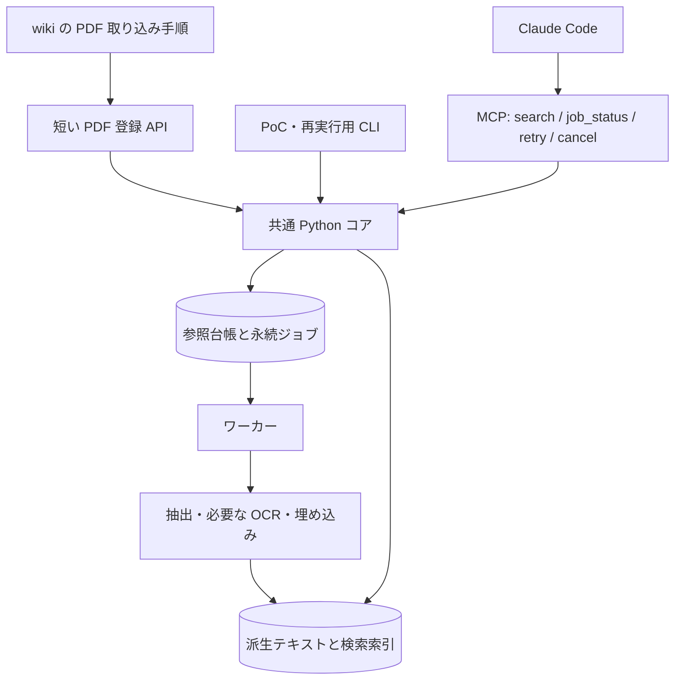

# info-hive-rag の実行方式の検討

作成日：2026年11月3日（日本時間）

状態：全体構成は採用済み（2026年11月3日、ユーザー決定）。
決定は [ADR-0007](../../adr/0007-rag-uses-mcp-core-and-persistent-jobs.md) に記録した。
性能 PoC と障害復旧 PoC は未実施で、実行プロセスなどの詳細は未決である。
今回の指示は記録のみであり、実装と PoC は再開しない。
手法：brainstorm-diverge-converge。

## 1. 採用した全体構成

**MCP を検索とジョブ操作の窓口に使い、RAG の処理本体は独立した Python コア、永続ジョブ、ワーカーとして実装する構成（案 14）を採用する。**
同じコアを呼ぶ CLI を用意し、PoC、再実行、診断に使う。
ユーザーは「Claude Code を閉じたら処理を止め、次回起動時に再開する」方式を選んだため、OS の常駐サービスは初期構成に含めない。

wiki の PDF 取り込み手順から、短時間で返る登録処理を明示的に呼ぶ。
登録処理は、PDF の参照情報と索引化ジョブを同じトランザクションで記録する。
ワーカーが抽出、OCR、チャンク化、埋め込み、索引更新を進め、Claude Code は MCP を通じて状態と検索結果を受け取る。

既存の試作にある同期的な `ingest_pdf` は、比較用の素材として扱う。
この検討中に製品コードの追加や公開は行っていない。
LanceDB、埋め込みモデル、OCR の採用判断は、実行方式とは別の PoC で確かめる。

## 2. 問題と制約

判断する対象は、Claude Code からの呼び出し方、長時間処理を実行する場所、PDF の取り込みを検知する場所である。
この 3 つを分けると、MCP、CLI、フックを同じ役割の選択肢として混同せずに比較できる。

| 項目 | 内容 | 区分 |
| --- | --- | --- |
| プラグインの関係 | `rag@info-hive` は `wiki@info-hive` に依存する | ユーザーの決定 |
| 処理の起点 | wiki が PDF を取り込むと、埋め込みなどの処理を実行する | ユーザーの決定 |
| セッション終了 | 処理の進捗を保存し、次回起動時に再開する | 今回のユーザーの回答 |
| 原資料 | PDF は名前付き参照ルートに置いたままにし、移動も複製もしない | 既存の調査レポートの確定事項 |
| 実行 | GPU がなくても動く。回答生成は Claude Code が行う | 同上 |
| 性能目標 | 検索 1 秒以内、検索関連のメモリ 16 GB 以下、約 100 GB の PDF に対する索引 10〜30 GB | 同上。実測未了 |
| 配置 | 派生データと PC 固有の設定は原資料から分ける | 同上 |
| 推奨と検証 | 現在のレポートは構成 B を推奨するが、比較 PoC はまだ行っていない | 作業の現状 |

性能目標の「検索 1 秒以内」は、既存レポートでは質問の受付からリランク後の上位結果までを指す。
今回も、MCP の通信時間だけでなく、クエリの埋め込み、検索、リランクを含めて判定する。
索引化にかかる時間は別に測る。

根拠となる要件は [日本語 PDF 向け大規模ローカル RAG の調査](../japanese-pdf-local-rag-options.md) の第 2、6.8、6.9、7.2 節にある。

## 3. 現行の wiki と公式仕様

### wiki の取り込みはエージェントの手順である

現在の [取り込みコマンド](../../../info-hive-wiki/commands/ingest.md) と [取り込みワークフロー](../../../info-hive-wiki/skills/info-hive/references/ingest-workflow.md) は、Claude Code に実行させる手順である。
PDF の登録完了を通知する機械的なイベントや、一元化された登録 API はない。
したがって、MCP サーバーを追加するだけでは、PDF の取り込みを起点とする処理はつながらない。

**PDF の登録を、参照情報とジョブを記録する単一の処理にすること**を設計に加える。
この処理を呼ぶことを、`/wiki:ingest` と自然言語による取り込みの両方の手順に含める。
通常のファイル参照や、検索結果の PDF を開く操作は登録と区別する。

### MCP の長時間処理とプロセスの寿命

Claude Code には長い MCP 呼び出しの自動バックグラウンド化と、サーバー側の MCP Tasks がある。
ただし stdio サーバーはセッション終了時に停止し、Windows ではプロセスツリーも終了対象になる。
MCP Tasks は CLI で公開ベータであり、クライアント、プロトコル、セッションの条件がある。
そのため、子プロセスを起動しただけでセッション終了後も動く設計にはしない。[Claude Code の MCP 仕様](https://code.claude.com/docs/en/mcp)

MCP Tasks は処理の識別子、状態の取得、結果の受け取りを標準化する。
クライアントとサーバーの対応を確認して使う機能であり、アプリケーション側で処理と進捗を保存する設計は依然として必要である。[MCP Tasks](https://modelcontextprotocol.io/extensions/tasks/overview)

### フックは業務上の完了イベントと異なる

`PostToolUse` はツールの成功後に発火し、引数と戻り値を受け取る。
`Bash` やファイルの読み込みの成功だけから、PDF の wiki 登録が完了したとは判断できない。
フックを使うなら、PDF 登録処理が返した構造化結果だけを受け取る用途に絞る。[フック仕様](https://code.claude.com/docs/en/hooks#posttooluse)

### ジョブ保存の候補

SQLite を、PC 内のジョブと参照台帳を保存する候補にする。
WAL を使う場合も、書き込みの競合やロック待ちへの対処は実装する。
同一 PC のローカルディスクに置き、ネットワークファイルシステムに配置しない。[SQLite WAL](https://sqlite.org/wal.html)

## 4. 発散：24 案

この節では、実装量による除外を行わずに案を並べた。
各案には PDF の受付、索引化の実行、検索の経路を含めた。

1. **Python ライブラリ直接呼び出し**：wiki の登録用 Python スクリプトに RAG ライブラリを読み込み、同じプロセスで索引化と検索を行う。
2. **同期 CLI**：wiki から索引化 CLI を呼び、検索のたびにも CLI を起動する。
3. **JSON Lines CLI**：CLI が段階ごとの進捗と結果を JSON Lines で返し、呼び出したプロセスが最後まで待つ。
4. **再開できるバッチ CLI**：PDF ごとのチェックポイントを保存し、再実行で索引化を再開する。検索は別の CLI で行う。
5. **同期 MCP サーバー**：1 回の MCP 呼び出しで抽出から索引化まで行い、同じサーバーが検索モデルも保持する。
6. **MCP とプロセス内ジョブ**：MCP はジョブ ID を返し、同じプロセスのワーカーが保存済みジョブを実行する。
7. **MCP と子ワーカー**：MCP はジョブ ID を返し、子プロセスが保存済みジョブを実行する。検索と状態取得の窓口は MCP に置く。
8. **MCP Tasks**：永続ジョブを MCP Tasks と対応付け、標準の状態取得とキャンセルを使う。
9. **MCP と独立デーモン**：MCP を薄い変換層にし、別に起動したデーモンがモデル、ジョブ、検索を受け持つ。
10. **ローカル HTTP API**：HTTP サーバーがジョブとモデルを保持し、wiki と Claude Code が CLI 経由で HTTP を呼ぶ。
11. **名前付きパイプなどのローカル RPC**：モデルを保持するプロセスに、CLI が OS ごとの IPC で要求を送る。
12. **gRPC サーバー**：ローカル gRPC サーバーが受付、進捗、検索を提供し、CLI が接続する。
13. **wiki の汎用 outbox**：wiki が PDF 登録イベントを永続化し、RAG のワーカーが購読する。検索は MCP で提供する。
14. **共通コアと短い登録 API**：wiki が RAG の登録 API を明示的に呼び、参照台帳とジョブを同時に保存する。Python コアを CLI、ワーカー、MCP から使い、検索と状態取得は MCP で提供する。
15. **JSON ファイルによる受け渡し**：wiki がジョブ記述ファイルを派生データ領域に原子的に配置し、ワーカーが処理する。検索は MCP に置く。
16. **登録用フォルダの監視**：PDF のパスを書いた参照ファイルを専用フォルダに置き、監視プロセスがジョブ化する。原本は置かない。
17. **一般的な PostToolUse 検知**：PDF を扱ったツールの引数をフックが調べ、ジョブを登録する。
18. **登録処理専用の PostToolUse**：明示的な PDF 登録処理の成功結果だけをフックが受け取り、ジョブ化する。
19. **SessionEnd で一括索引化**：セッション中の登録を保存し、終了時のフックで未処理分を実行する。
20. **SessionStart で一括再開**：登録を台帳に保存し、次のセッション開始時のフックで索引化する。検索は MCP に置く。
21. **OS のタスクスケジューラ**：wiki が保存したジョブを、OS の定期実行機能が処理する。検索は MCP に置く。
22. **利用者用の常駐サービス**：OS の起動時に RAG サービスを起動し、wiki と MCP から要求を送る。
23. **デスクトップアプリ**：トレイアプリなどがジョブとモデルを保持し、wiki と MCP が接続する。
24. **ローカルのメッセージ基盤**：専用ブローカーが PDF 登録を配信し、ワーカーと検索サーバーを別に運用する。

## 5. クラスタ：6 系統

| 系統 | 案 | 分類した理由 |
| --- | --- | --- |
| 呼び出すたびに実行 | 1〜4 | wiki 側の呼び出しが処理の寿命を決める |
| MCP が実行を管理 | 5〜8 | MCP 接続とジョブ操作を中心に組み立てる |
| 独立した通信サーバー | 9〜12 | モデルを保持するプロセスへ別の呼び出し口から接続する |
| PDF 登録の永続的な受け渡し | 13〜16 | 登録と処理の間に、保存された要求を置く |
| Claude Code のフック | 17〜20 | ツールやセッションのイベントから処理を始める |
| OS や別アプリの運用 | 21〜24 | Claude Code の外に運用上の主体を置く |

案 7 と案 14 は組み合わせられる。
案 7 は処理を実行する場所を決め、案 14 は PDF の登録とジョブ作成を一体化して、CLI と MCP が使う共通処理を決める。
以下の採点は各案に記した構成全体を比較するもので、技術要素の排他的な選択を意味しない。

## 6. 収束：評価基準

各項目を 1〜10 点で採点する。
合計は「各点数 × 重み」の和を 100 で割った値である。
点数は仕様と構造にもとづく設計上の評価で、性能の測定値ではない。

| 記号 | 評価基準 | 重み | 高く評価する条件 |
| --- | --- | --- | --- |
| I | wiki との接続 | 25 | PDF の登録を明示し、読み込みと取り込みを区別できる。別プラグインの内部パスに依存しない |
| R | 中断と再開 | 25 | 受付と進捗を保存し、失敗、再実行、セッション終了を区別できる |
| S | 検索性能の実現しやすさ | 20 | モデルを保持でき、索引化中の検索も制御できる |
| D | 導入と運用 | 15 | 利用者に OS サービス、ポート、追加アプリの管理を求める範囲が小さい |
| T | 試験と差し替え | 15 | Claude Code を起動せずに試せ、索引やモデルを入れ替えられる |

原本の無変更、ローカル処理、CPU 動作、wiki 間の分離は、どの案でも満たす前提とした。
これらに反する実装は点数にかかわらず採用しない。

## 7. 全案の採点

| 案 | I | R | S | D | T | 合計 | 主な理由・留保 |
| --- | --- | --- | --- | --- | --- | --- | --- |
| 1 ライブラリ直接 | 8 | 3 | 8 | 9 | 8 | 6.90 | 配布は単純だが、wiki と RAG の依存環境を共有し、再開の仕組みを持たない |
| 2 同期 CLI | 7 | 4 | 3 | 10 | 9 | 6.20 | 導入と試験が容易。検索ごとのモデル読み込みを含めて計測する必要がある |
| 3 JSON Lines CLI | 7 | 5 | 3 | 9 | 8 | 6.15 | 進捗は見えるが、プロセス終了後の復旧は別に要る |
| 4 再開できるバッチ | 7 | 8 | 3 | 9 | 9 | 7.05 | 索引化 PoC に向く。常駐しない検索は比較基準にする |
| 5 同期 MCP | 9 | 3 | 9 | 9 | 7 | 7.20 | プラグインとの接続とモデル保持は容易。長い呼び出しだけでは再開を保証できない |
| 6 MCP 内ジョブ | 9 | 8 | 8 | 8 | 8 | 8.25 | 導入が軽い。重い処理と検索の競合、ライブラリのスレッド制約を検証する |
| 7 MCP と子ワーカー | 8 | 9 | 9 | 8 | 8 | 8.45 | プロセスを分けて復旧できる。モデルの重複と終了時の処理を検証する |
| 8 MCP Tasks | 8 | 8 | 9 | 6 | 6 | 7.60 | 標準 UI を使える。対応するクライアントと SDK の条件が増える |
| 9 MCP とデーモン | 9 | 9 | 9 | 4 | 7 | 7.95 | 複数セッションでモデルを共有できる。独立プロセスの管理が必要 |
| 10 HTTP API | 6 | 9 | 9 | 5 | 7 | 7.35 | 言語を選びやすい。接続先とローカルのアクセス制御を管理する |
| 11 ローカル RPC | 6 | 9 | 9 | 4 | 5 | 6.90 | ポートを使わず接続できる。OS ごとの実装と試験が増える |
| 12 gRPC | 6 | 9 | 9 | 3 | 5 | 6.75 | 型付き API を作れる。個人向けプラグインには導入する部品が多い |
| 13 wiki outbox | 8 | 9 | 9 | 7 | 7 | 8.15 | 複数の拡張へ配信できる。イベント形式、購読、確認応答の設計が増える |
| 14 共通コアと登録 API | 9 | 9 | 9 | 8 | 8 | **8.70** | 登録とジョブを同時に保存でき、CLI と MCP で同じ処理を試せる |
| 15 JSON 受け渡し | 8 | 8 | 9 | 8 | 7 | 8.05 | ファイルとして調査しやすい。複数ワーカーの取得と重複防止を自作する |
| 16 フォルダ監視 | 6 | 8 | 9 | 7 | 6 | 7.25 | 手動運用にも使える。監視と台帳の照合が別に要る |
| 17 一般ツール検知 | 3 | 6 | 8 | 7 | 4 | 5.50 | ツール引数だけでは PDF の登録を特定できず、誤検知を抑えにくい |
| 18 登録専用フック | 7 | 8 | 9 | 7 | 6 | 7.50 | 意味のある入力を得られるが、登録成功とフックのジョブ保存に隙間が残る |
| 19 終了時に実行 | 5 | 6 | 7 | 8 | 6 | 6.25 | 終了時に長い処理を始めることが、今回の再開方針と合わない |
| 20 開始時に実行 | 6 | 8 | 8 | 8 | 7 | 7.35 | 再開の補助に使えるが、登録直後の処理開始は別途必要 |
| 21 OS 定期実行 | 7 | 9 | 7 | 4 | 6 | 6.90 | 時刻で分けて処理できる。今回不要な OS 固有の設定が加わる |
| 22 OS 常駐サービス | 8 | 9 | 9 | 3 | 6 | 7.40 | セッション外でも動くが、今回選ばれなかった継続実行のために運用が増える |
| 23 デスクトップアプリ | 6 | 8 | 9 | 2 | 5 | 6.35 | 専用 UI を作れる。アプリ配布と更新が別の開発になる |
| 24 メッセージ基盤 | 6 | 9 | 9 | 2 | 5 | 6.60 | ワーカーを増やせる。単一 PC の初期構成には管理する部品が多い |

S が 9 の案は、モデルを保持し、検索と索引化の優先順位を制御できる構造を評価した。
1 秒以内を実測したという意味ではない。
R が 9 の案も、保存、リース、再実行、索引の切り替えを実装する前提の評価である。
D が 10 の案 2 は、追加の常駐プロセスを必要としない点を評価した。

## 8. 選んだ案と条件

上位の案 14、7、6、13 と、独立したプロセスを持つ案 9 を比較対象として残す。
上位 4 案は近い要素を組み合わせられるので、すべてを別々に製品化する必要はない。

| 候補 | 今回の扱い | 採る条件・弱点 |
| --- | --- | --- |
| 14 共通コアと登録 API | 採用した全体構成 | 登録処理が参照台帳とジョブを同時に保存できることを、実装時の PoC で確認する |
| 7 MCP と子ワーカー | 推奨構成の実行方式の第一候補 | Windows で停止と再開ができ、モデルの重複と CPU 競合が許容範囲に収まる場合 |
| 6 MCP 内ジョブ | 実装を減らす代替 | 重い処理中でも状態取得と検索を妨げず、安全に同時実行できる場合 |
| 13 wiki outbox | 次点 | RAG 以外にも PDF 登録を購読するプラグインが増えた場合 |
| 9 MCP とデーモン | 将来の候補 | 複数セッションでのモデル共有、またはセッション終了後も処理を続ける要件が生じた場合 |

案 15 の JSON 受け渡しは 8.05 点で、案 9 より高い。
ジョブを保存する実装の次点として残すが、複数ワーカーの取得と再投入の制御を自作するため、初期案では SQLite を優先する。
案 9 は、実行プロセスの寿命が異なる構成を比較するために残した。

MCP Tasks は、案 14 のジョブ ID と対応付ける追加の窓口として再検討できる。
最初の受付と状態取得を通常の MCP ツールとして提供すれば、Tasks を使わないクライアントでも同じジョブを扱える。
一般的な `PostToolUse` の文字列検査を、PDF インジェストの起点には使わない。

### 重みを変えた確認

| 重み I / R / S / D / T | 1 位 | 2 位 | 3 位 |
| --- | --- | --- | --- |
| 基準 25 / 25 / 20 / 15 / 15 | 14：8.70 | 7：8.45 | 6：8.25 |
| 導入重視 20 / 20 / 15 / 30 / 15 | 14：8.55 | 7：8.35 | 6：8.20 |
| 再開重視 20 / 40 / 20 / 10 / 10 | 14：8.80 | 7：8.60 | 13：8.40 |

重みを変えても推奨する全体構成は変わらなかった。
ただし、案 14 の I と R をそれぞれ 1 点下げると 8.20 点になり、案 7 を下回る。
本表は設計上の比較であり、性能や復旧の目標達成を示すものではない。
登録とジョブ保存の一体化は、実装時の PoC で検証する。

## 9. 採用した全体構成の接続

この図は責務の分担を示す。
MCP と検索モデルを同じプロセスに置くか、子ワーカーと共有するかは、案 6 と案 7 の PoC で決める。
検索と索引化のそれぞれでモデルを読み込む場合は、合計のメモリと CPU 競合を計測する。

### PDF の登録

1. wiki の手順が対象 wiki と PDF の絶対パス、source ページの予定パスを決める。
2. `rag` が有効な場合、手順から短い MCP 登録ツールを明示的に呼ぶ。`wiki` の `${CLAUDE_PLUGIN_ROOT}` から別プラグインの内部パスを組み立てない。
3. 共通コアが参照ルートからの相対パス、ファイルの属性、暫定ジョブ ID を保存する。PDF の読み込みと内容ハッシュの確定はワーカーで行い、同じ内容の処理済み資料と照合する。受付時には大きい PDF を読み込まない。
4. ジョブを保存した時点では「受付済み」と返す。索引化が終わるまで「取り込み完了」とは返さない。
5. wiki は抽出結果を分割して読み、要約ページを作る。PDF を `RAW_ROOT` にコピーする現行の説明を、この分岐に合わせて改める。

`rag` がない場合、wiki の通常機能は使えるようにする。
RAG 連携を求められた PDF 取り込みでは、必要なツールがないことを示し、索引化済みとは報告しない。
wiki の必須依存に rag を足して、相互依存にはしない。

### 中断と再開

ジョブは `queued → running → completed / failed / cancelled` を基本とする。
文書 ID、参照パス、処理設定の指紋、ページと埋め込みバッチのチェックポイント、実行者のリースを保存する。
受付の一時的なパスと、内容ハッシュで確定した文書 ID を区別する。

`rag` の MCP 接続が成功したときに、期限の切れたリースと未完了のジョブを確認して再開する。
MCP の起動応答は、モデルの取得や PDF の処理が終わるまで待たせない。
プラグインが無効なセッションでは再開しない。
ジョブは少なくとも 1 回実行されうるものとし、文書 ID と処理設定で重複を抑え、処理済みのチャンクを再利用する。

新しい版の索引が揃ってから検索対象を切り替える。
参照台帳とベクトル索引は別の保存先なので、単一トランザクションで切り替わると仮定せず、公開する索引世代を台帳で管理する。
失敗途中のチャンクを検索結果に混ぜず、旧版を消す前に wiki の影響するページを要再確認にする。

キャンセルしたジョブは、自動再開するジョブと区別する。
PDF の内容や埋め込み設定が変わった場合も、古いチェックポイントをそのまま使わない。

## 10. 実装に向けて残る PoC（未実施）

この節はこれから行う試験であり、実施結果ではない。
まず通信方式と再開の仕組みを、軽い疑似処理で比較する。
次に同じ PDF、チャンク、モデルで性能を比較する。
疑似処理の結果を検索精度や実データの性能の証拠には使わない。

| 段階 | 比べるもの | 確認する内容 | 判定 |
| --- | --- | --- | --- |
| P0 | 共通コアの CLI、同期 MCP、ジョブ ID を返す MCP | 同じ入力と結果形式、受付と完了の区別 | 全経路で同じ文書とジョブを追跡できる |
| P1 | MCP 内ワーカーと子ワーカー | 強制終了、同時投入、再投入、明示キャンセル、次回起動 | 受付済みジョブの消失なし。未完了チャンクの公開なし。キャンセルを勝手に再開しない |
| P2 | 実際の wiki 取り込み | コマンドと自然言語の両経路、参照だけの PDF、別 wiki | PDF 登録ごとにジョブが作られ、閲覧では作られない。wiki 間で混ざらない |
| P3 | CLI と常駐モデルの検索 | コールドとウォーム、索引化の同時実行、複数セッション | 通信時間とモデルの処理時間を分けて測る。ウォーム検索の p95 が 1 秒以内、合計メモリ 16 GB 以下 |
| P4 | 索引とモデルの候補 | LanceDB / Qdrant、Ruri 130m / 70m / 30m、抽出と OCR | 既存レポート第 7.2 節の同一評価セットで Recall、nDCG、容量、速度を比較する |

P3 は、実際に対応対象とする OS と Claude Code の版を記録して行う。
Windows での stdio 終了、子プロセスの停止、チェックポイントからの再開は省略しない。
ほかの OS の対応を決める場合は、その OS でも確認する。
100〜300 問の評価セットに対する精度や、1〜5 GB のサンプルからの容量換算は P4 の対象で、今回の方式比較では測っていない。

実装を再開する際は、開発担当が P0 と P1 の再現手順と結果を開発リポジトリに残す。
P2 の取り込み手順と P3 の測定結果が揃った時点で、採用するプロセス構成を ADR に記録する。
全体構成の採用は ADR-0007 で確定しているが、プロセス構成などの詳細と性能・復旧動作の検証は残っている。
今回の指示では、これらの実装や PoC を行わず、決定の記録にとどめる。

## 11. 自己点検

スキルの [評価ルーブリック](../../../.agents/skills/brainstorm-diverge-converge/resources/evaluators/rubric_brainstorm_diverge_converge.json) に従って点検した。
これは検討手順の自己評価であり、製品や性能の検証結果ではない。

| 観点 | 点数 / 5 | 根拠 |
| --- | --- | --- |
| 発散の件数 | 3 | 24 案を記録した |
| 発散の多様性 | 4 | ライブラリ、CLI、MCP、RPC、イベント、フック、OS 運用を含む |
| 発散の創造性 | 4 | 最小の同期実行から、ファイル受け渡し、OS 運用まで比較した |
| 分類の質 | 4 | 主な接続と実行管理の方式で 6 系統に分け、組み合わせも説明した |
| 分類の網羅 | 4 | 各系統に 4 案を置いた |
| 評価基準 | 4 | ユーザーの再開方針を含む 5 軸と重みを定義した |
| 採点 | 4 | 全案を同じ軸で採点し、重みと点数を変えた場合も確認した |
| 選定 | 4 | 推奨、代替、将来の条件を分けた |
| 次の行動 | 4 | P0〜P4 の入力、試験内容、判定を定義した |
| 手順 | 4 | 要件、発散、分類、採点、検証計画を記録した |

平均は 3.9 / 5 で、スキルの最低基準 3.5 を満たす。
PoC が未実施であるため、採点の根拠は構造上の比較までに限られる。
