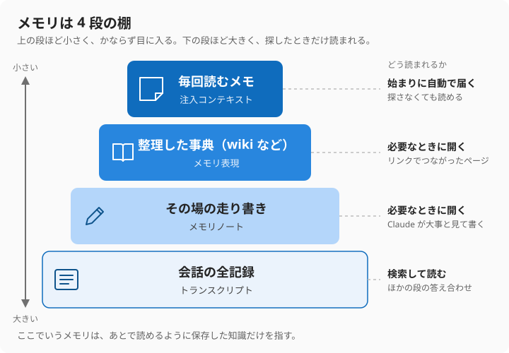
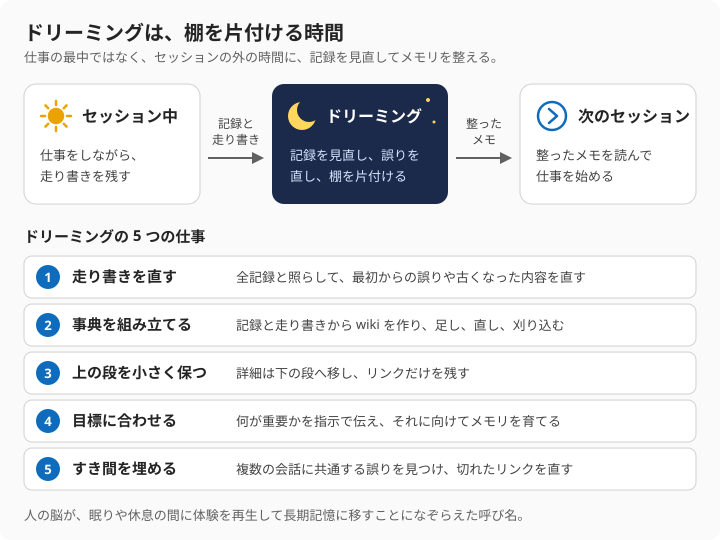
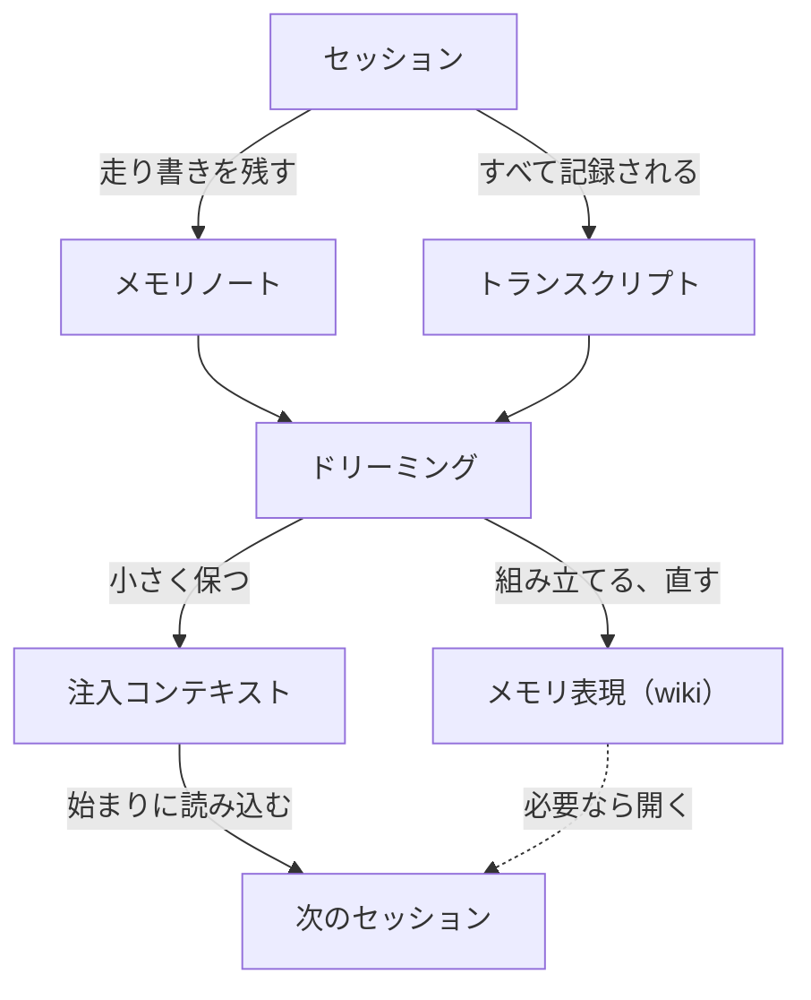
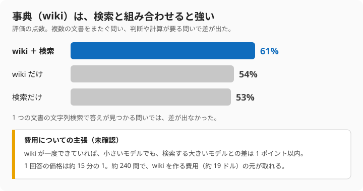

AI のエージェントは、会話（セッション）が終わると、その中身を覚えていません。次の会話に持ち越したいことは、**どこかに書き残す**必要があります。このページは、その書き残す場所を 4 つの段に分け、段の間を片付ける作業「ドリーミング」と合わせて説明しています。

### 片付けの時間「ドリーミング」

走り書きは、書いたときから間違っていることも、あとで古くなることもあります。そこで、仕事をしていない時間に記録を見直し、4 つの段を整えます。これがドリーミングです。

1 回の流れを追うと、次のようになります。

実際の組み方の例では、役割を 3 つに分けています。

- **リード**（Sonnet 5.5）: 段取りを書いて始めるだけ。会話の記録は読まない。
- **アナライザー**（Haiku 5.5）: 記録 1 件につき 1 体。関係するメモを確かめ、補い、整える。
- **オーガナイザー**（Haiku 5.5）: 最後に 1 回だけ、重複をまとめて入口のファイル `_index.md` を仕上げる。

### 段ごとに気をつけること

- **走り書きは「予測」**。何を書くかは、将来なにが要るかの見込みで決まります。賢いモデルには、何に使うかだけを伝え、書き方は縛らないほうがうまくいきます。「失敗だけを記録する」という決まりは、かえって効果を減らしました。画面を見れば毎回わかることは、書き残しません。
- **事典は、検索と一緒に使う**。上の図のとおりです。ただし、まとめ直さないまま元の文書より大きくなった事典もありました。
- **同じページを書くのは 1 人だけ**。複数のエージェントが同時に書くと、互いの行を消して事実が欠けました。
- **毎回読むメモは小さく**。読み込むたびに費用がかかり、誤ったメモがすべての会話に入り込みます。長いほど、書いてあることに従わなくなります。Claude Code は `MEMORY.md` の先頭の 200 行か 25 KB だけを読み込みます。Managed Agents では、毎回読み込む部分は 4,096 文字までです。

### まだ決まっていないこと

メモを**その場で書く**か、**ドリーミングに回す**かは、どちらにも弱みがあります。

| | その場で書く | ドリーミングに回す |
| --- | --- | --- |
| 良い点 | すぐ使える | 本来の仕事に集中できる |
| 弱い点 | 仕事から注意がそれる | すぐには使えない |

メモを最新に保つには計算の費用もかかります。記事は、変わりそうな情報に絞ることと、よく使われるものほど頻繁に片付けることを挙げています。
