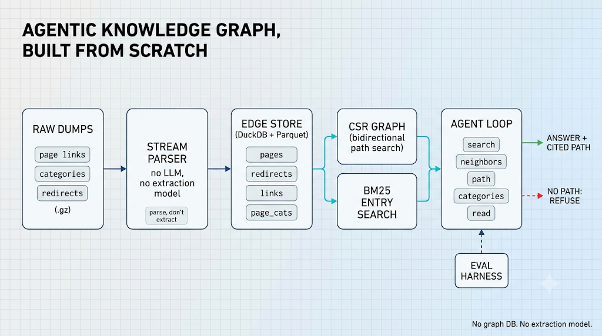
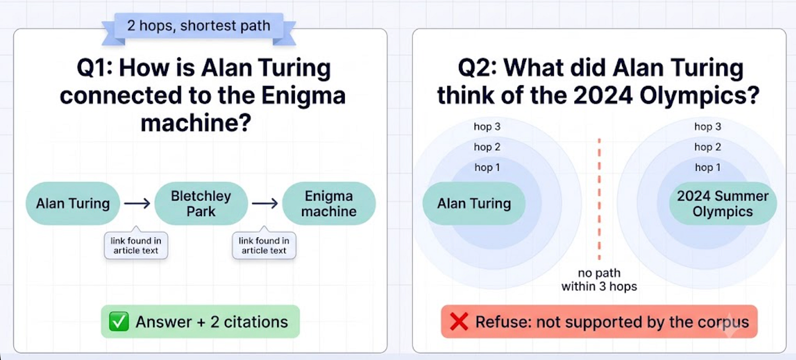
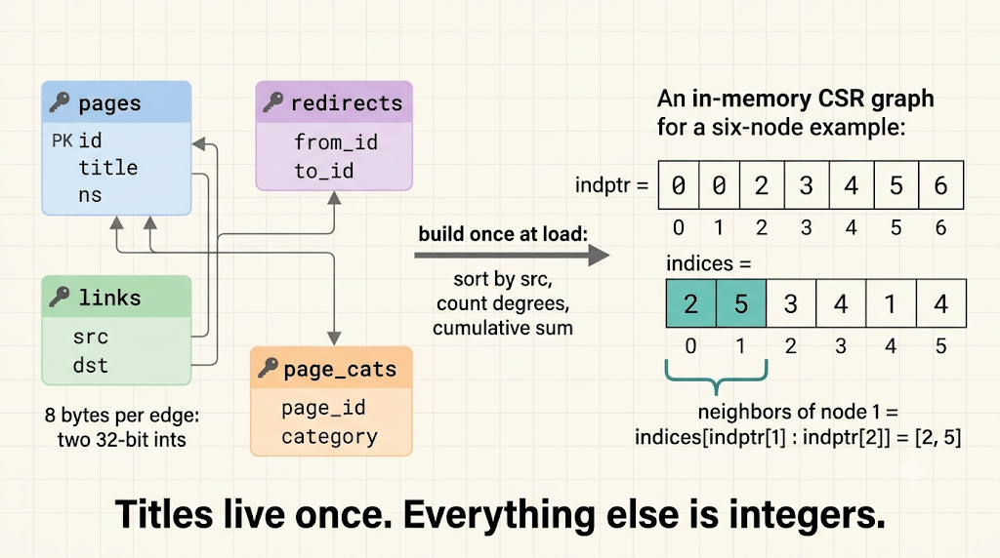
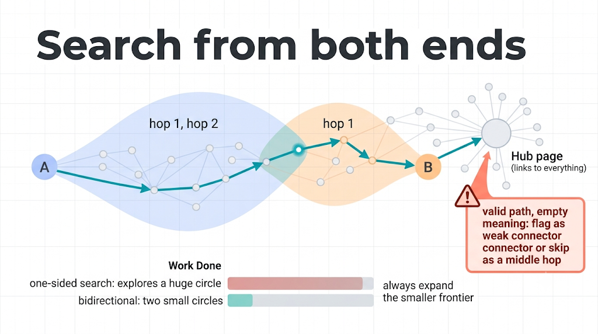
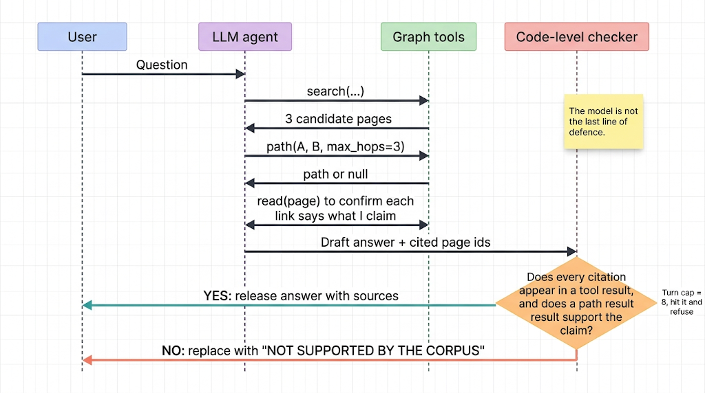
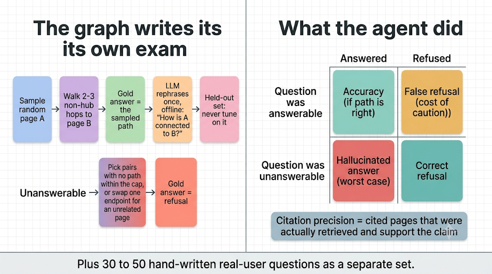

# エージェントが使うナレッジグラフをゼロから作る：グラフ DB も抽出モデルも使わない

[Saurabh](https://medium.com/@saurabhraj042?source=post_page---byline--074d944a68b3------------------------------------------)

読了まで 16 分　2026 年 10 月 31 日

--



> GPT-6 補足: 原本のリンクを保存・探索する段と、回答を作る段の分担図である。末尾には回答と見送りの分岐がある。


大量の文書にまたがる複数段階の質問に AI エージェントで答えようとするチームの多くは、同じことをする。LLM に費用を払ってすべてのページを読ませ、エンティティを抽出し、ナレッジグラフを構築する。公表されたある見積もりでは、この索引作成だけで、大規模な文書群 1 つにつき約 33,000 ドルかかる。しかし、文書にすでにリンク、引用、カテゴリが含まれているなら、その出費は必須ではない。グラフはすでに存在する。必要なのは解析することだけだ。

この記事は、そのようなシステムをゼロから作るための設計図である。ノート PC に収まるグラフエンジンと、グラフをたどって各段階の出典を示し、経路がなければ回答を見送るエージェントを作る。以下の内容はすべて Python と DuckDB で実行できる。実測値として報告する数値はすべて、2 コア、メモリ 7 GB のサンドボックスで測定した。

## この記事で得られるもの

1. この方式を安価にする **1 つの発想**と、それが使えない場合の具体的な判定基準。
2. 再現できる**通しの例**。Wikipedia の一部と実際の質問 1 つを使い、最初から最後まで処理をたどる。
3. **全体の設計**。構成要素は 6 つで、グラフデータベースも抽出モデルも使わない。
4. **構築の手順**。ダンプを解析して Parquet にし、リダイレクトを解決し、経路探索エンジンを作り、検索を加えてエージェントにつなぐ。
5. 複数段階の質問を自動で生成し、正答率、引用の精度、回答の見送りを採点する**評価の仕組み**。
6. 文書、論文、wiki、コードなど、**手元の資料に適用する方法**。
7. 限界を隠さずに示す、**費用、規模の拡張、失敗のパターン**。
8. 適切なものから作り始めるための**優先順位**。

## 中心となる発想：抽出せずに解析する

文書群にすでに辺が含まれていれば、グラフの構築は抽出ではなく解析になる。

一般的な GraphRAG の処理では、テキストの各チャンクを LLM に送り、エンティティと関係を見つける。Microsoft 自身の説明でも、構築の段階では「LLM を使ってエンティティとその関係を抽出し、記述する」とされ、さらに 2 回目の LLM の処理で各コミュニティを要約する。Microsoft の安価な派生方式 LazyGraphRAG はその両方を避け、同社の表現では、索引作成の費用を「完全な GraphRAG の費用の 0.1%」に抑える。

しかし、すでにグラフの構造を持つ文書群もある。

- **Wikipedia** は、ページ間のリンク、カテゴリ、リダイレクトを、通常のデータベースのダンプとして配布している。
- **PubMed** は、各レコードに引用と統制語彙のタグ（MeSH）を含む。
- **文書サイトや wiki** は、ハイパーリンクと目次を含む。
- **コード**は、インポートと呼び出し箇所を含む。

このような資料に LLM を使うと、人間の著者がすでに書いた関係を、誤りも混ぜながら再発見することになる。解析なら、決定的で、費用がかからず、再現できる。

**この方式が使えない場合の判定基準：** 文書群に明示的なリンク、引用、タグがなければ、解析できる辺もない。未加工の会議メモ、サポートのチケット、契約書の PDF などが該当する。その場合は抽出が必要であり、妥当なのは両者を組み合わせる方法だ。既存の辺はすべて解析し、辺のない部分にだけ LLM を使う。

**引き換えに失うもの。** 解析した辺には型がない。Wikipedia のリンクが示すのは「A が B に言及する」ことで、「A が B を創業した」ことではない。これでも、「この 2 つはどうつながるか」という問いには、出典を示せる経路で答えられる。しかし、関係の種類に依存する問いには不十分だ。この点には、エージェントの段階で引用元の本文を読むことで対応する。限界の節でも改めて触れる。

## 通しの例：Wikipedia と 2 つの質問

英語版 Wikipedia（English Wikipedia）を使う。誰でもダウンロードでき、アカウントが不要で、求めている 3 種類の辺、すなわちページ間のリンク、カテゴリ、リダイレクトが含まれるためだ。ライセンスは CC BY-SA なので、派生した文章を再公開する場合は、出典を表示し、同じ条件で共有しなければならない。

この記事では、次の 2 つの質問を一貫して使う。

- **Q1（回答できる）：**「Alan Turing は Enigma machine とどうつながっているか？」
- **Q2（回答を見送るべき）：**「Alan Turing は 2024 Olympics をどう考えていたか？」質問に含まれるエンティティから、その答えを裏づけるページへ至る経路はない。

Q1 に対してエージェントが返す内容は、次のような形になる。これは実行記録ではなく書式の例であり、実際の経路は使うページの範囲とダンプの日付によって変わる。

```
Q: How is Alan Turing connected to the Enigma machine?
PATH (2 hops): Alan Turing -> Bletchley Park -> Enigma machine
CITE: [1] Alan Turing, link to "Bletchley Park"
      [2] Bletchley Park, link to "Enigma machine"
ANSWER: Turing worked at Bletchley Park, which is linked to the Enigma machine page. (sentence checked against the cited text)
```

Q2 に対する正しい出力は、回答の見送りである。

```
Q: What did Alan Turing think of the 2024 Olympics?
PATH: none within 3 hops
ANSWER: Not supported by the corpus. No cited path.
```

価値を持つのは、この 2 つ目の出力だ。Q1 にはどんなチャットボットでも答えられる。信頼できるシステムは、Q2 に答えないことを明示できる。



> GPT-6 補足: 左右に回答と見送りの例を並べた図である。本文は実行記録ではなく例示だと明記している。


## 全体の設計

構成要素は 6 つで、データは一方向に流れる。エージェントを動かすモデル以外に、外部のサービスは使わない。

1. **取り込み。** gzip 圧縮された SQL または XML の raw ダンプを、ディスクに展開せずにストリームとして処理する。出力は Parquet ファイルで、それ以外は保存しない。
2. **辺の保存。** 4 つの Parquet の表を、DuckDB でその場で問い合わせる。表は `pages(id, title, ns)`、`redirects(from_id, to_id)`、`links(src, dst)`、`page_cats(page_id, category)` である。
3. **グラフエンジン。** リダイレクトを一度だけ `links` に織り込み、その `links` をメモリ上の CSR の隣接表現、すなわち 2 つの整数配列に変換する。経路の問い合わせには、ホップ数の上限を設けた双方向の幅優先探索を使う。
4. **入口の検索。** 題名と冒頭の本文に対する BM25 の全文検索である。その役割は、自然言語の質問を開始ノードに変えることだけであり、回答は一切しない。
5. **エージェントのループ。** LLM が使うツールは `search`、`neighbors`、`path`、`categories`、引用する本文を返す `read` の 5 つである。ループには上限を設け、経路を引用するか、回答を見送ることを必須にする。
6. **評価の仕組み。** グラフ自体から、調整に使わない複数段階の質問を生成する。エージェントを実行し、正答率、引用の精度、見送りの正しさを採点する。

**グラフデータベースを使わない理由。** グラフ DB を使えば問い合わせ言語とトランザクションが得られる。しかし、この処理は読み取り専用で、一括して読み込み、隣接先の取得と最短経路の探索しか必要としない。Parquet とメモリ上の CSR なら、より少ない構成要素で実現できる。これについては実測したので、後で示す。将来、随時の更新や大規模なグラフのアルゴリズムが必要になれば、その時点でデータベースを加えればよい。この判断は後に回せる。

**DuckDB を使う理由。** Parquet を直接問い合わせられ、ノート PC で動き、再帰の問い合わせで SQL 側の経路の検査も十分に行える。DuckDB 2.0.0 では、循環を防ぎ、深さを制限する再帰の経路の問い合わせを検証した。ただし、手順 3 の最終的な経路エンジンでは、繰り返しの問い合わせで高速になるため、メモリ上の配列を使う。

**重要なデータモデルの判断：**

- 整数の識別子（IDs）だけを保存する。題名は `pages` に一度だけ保存し、辺は 8 バイトとする。
- `ns`（名前空間）を残す。記事だけに絞り、ノート、利用者のページ、ファイルを除外できるようにするためだ。
- カテゴリへのリンクは、別の種類の辺として残す。直接のリンクでつながらない場合に、2 つのページがカテゴリを共有するという、もう 1 つの粗い経路を使える。



> GPT-6 補足: 左側は保存する表、右側は隣接先を配列で引く形を示す。表を読む段と経路を探索する段の境界を説明する図である。


## 手順 1 と 2：ダンプを取り込み、まず辺の残存率を測る

**ファイルを入手する。** 英語版 Wikipedia（English Wikipedia）のダンプは dumps.wikimedia.org にある。20260201 のダンプでは、関係する gzip 圧縮済み SQL ファイルのサイズは、`page` が 2.2 GB、`pagelinks` が 6.4 GB、`linktarget` が 1.3 GB、`categorylinks` が 2.2 GB、`redirect` が 173 MB と記載されている。大きなダンプを扱う前に、より小さな wiki から始めてパーサーを正しく作る。Simple English Wikipedia も同じ形式だ。

**ストリームとして解析する。** SQL ダンプは、巨大な `INSERT INTO ... VALUES (...),(...);` 文である。MySQL に読み込んではいけない。gzip のストリームを読み、引用符とエスケープを扱う小さな状態機械で各 INSERT の行をタプルに分割し、PyArrow でバッチごとに Parquet へ追記する。一度に保持するのは 1 バッチだけなので、メモリ使用量は増え続けない。

**スキーマの変更に注意する。** 現在の MediaWiki は、リンク先の題名を `pagelinks` の中には保存しない。リンクの行には数値の `pl_target_id` があり、`linktarget` の表の `lt_id`、`lt_namespace`、`lt_title` と結合して解決し、さらに題名で `page` と結合する。パーサーを書く前に、自分が使うダンプの先頭の `CREATE TABLE` を確認すること。カテゴリはより単純で、`categorylinks` は今もカテゴリ名を `cl_to` に、ページの ID を `cl_from` に保存し、`cl_type` は page、subcat、file のいずれかである。

**リダイレクトは一度だけ解決する。** 多くのリンクは実際の記事ではなく、「USA」のようなリダイレクトのページを指す。リダイレクトの ID から最終的なページの ID への対応表を作り、それを使って `links.dst` を書き換える。問い合わせのたびではなく、構築の時点で行う。上限のあるループでリダイレクトの連鎖をまとめる。3 回の処理で十分だ。自分自身へのリンクも除く。

**グラフを信頼する前に、辺の残存率を測る。** ほとんどのチュートリアルで抜けている段階だ。解決後に次の数を報告する。

- 読み取った raw のリンクの行数。
- 記事以外の名前空間を除いたあとに残る行数。
- 起点か終点が `pages` に存在しないリンクを除いたあとに残る行数。

ページの一部を切り出して構築する場合、範囲外へ向かう辺は失われる。範囲が狭ければ、大半の辺を失うこともある。この構築の着想を得た参考記事では、最近の 1,000 万ページ（10M ページ）の切り出しで、引用の辺が 28.1% しか残らなかったと報告されている。手元の値は異なるだろうが、必ず測ること。大半の辺を気づかないうちに落としたグラフは、実際にはつながっている対象にも「経路なし」と答える。その結果、誤った理由で見送り率が良く見えてしまう。

**想定する規模。** 2 コア、メモリ 7 GB のマシンで、合成データを使って保存形式を測った。5,000 万本のランダムな辺を zstd 圧縮の Parquet に書くと、2.6 秒で 319 MB のファイルができ、DuckDB への読み込みは 0.7 秒だった。実際のリンクデータでは圧縮のされ方が違うので、これは実現可能性を示す目安であり、性能を約束する値ではない。ボトルネックは保存ではなく解析であり、全体の処理時間の大半を占めると考える。

## 手順 3 と 4：経路エンジンと入口の検索

**手順 3：CSR の隣接表現。** Parquet の `links` を、各ノードの隣接先の開始位置を表す `indptr` と、隣接先を並べた `indices` の 2 つの整数配列に読み込む。順方向と逆方向のリンクについて、それぞれ 1 組ずつ作り、両端から探索できるようにする。この配列が「グラフデータベース」のすべてだ。

```
def build_csr(src, dst, n):
    order = np.argsort(src, kind="stable")
    indices = dst[order].astype(np.int32)
    indptr = np.zeros(n + 1, dtype=np.int64)
    indptr[1:] = np.cumsum(np.bincount(src, minlength=n))
    return indptr, indicesdef nbrs(g, u):
    return g[1][g[0][u]:g[0][u + 1]]
```

続いて、ホップ数の上限を設けた双方向の幅優先探索を使う。常に小さいほうの探索の先端を展開するので、ハブとなるノードのあるグラフでも速く動く。

```
def shortest_path(fwd, rev, a, b, max_hops=3):
    if a == b:
        return [a]
    pf, pb = {a: None}, {b: None}
    ff, fb = [a], [b]
    for _ in range(max_hops):
        side_f = len(ff) <= len(fb)
        front, seen, other, g = (ff, pf, pb, fwd) if side_f else (fb, pb, pf, rev)
        nxt = []
        for u in front:
            for v in nbrs(g, u).tolist():
                if v in seen:
                    continue
                seen[v] = u
                nxt.append(v)
                if v in other:                      # frontiers met
                    left, x = [], v
                    while x is not None:
                        left.append(x); x = pf[x]
                    right, x = [], pb[v]
                    while x is not None:
                        right.append(x); x = pb[x]
                    return left[::-1] + right
        if side_f: ff = nxt
        else:      fb = nxt
        if not nxt:
            return None
    return None
```

この試作は実行した。辺が 6 本の小さなグラフでは、正しい最短経路（1 -> 5 -> 4）を返し、上限内に経路がなければ正しく `None` を返した。2 コアのマシンで、1,000 万本のランダムな辺から両方の配列を作るのに約 4 秒かかった。ランダムなグラフと Wikipedia のグラフは形が違うので、実際のリンクのグラフで経路の応答時間は測っていない。手元で測定してほしい。`max_hops` は 3 か 4 に抑えること。実際のリンクのグラフでそれより長い経路を探すと、ハブのページを通り、意味を持たなくなる。

**品質の最大のリスクはハブのページ。**「United States」のようなページは、あらゆるものからリンクされ、あらゆるものへリンクする。そのページを経由する経路は、形式的には正しくても意味がない。対策として、構築の時点で各ノードの次数を計算し、閾値を超えるノードを途中の経由点から外すか、「弱い接続」としてエージェントへ伝える。そのような経路を使う頻度も記録する。

**手順 4：BM25 による入口の検索。** DuckDB の全文検索の拡張か SQLite FTS5 を使い、ページの題名と冒頭の段落の全文索引を作る。「Turing は Enigma とどうつながるか」という質問を入れると、候補となるページの ID が 2、3 件返る。エージェントはそこから適切なものを選ぶ。検索は意図的に単純なものにし、答えを返さず、グラフへの入口を見つけるだけにする。題名と冒頭の検索で言い換えた質問を拾えなければ、後から埋め込みを加える。最初から使い始める必要はない。



> GPT-6 補足: 両端から探索する様子と、多数の先につながるハブへの注意を示す。下の棒は考え方の比較であり、測定値は付いていない。


## 手順 5：エージェントのループと、経路がなければ見送る規則

エージェントは単純なツール使用のループである。モデルが呼ぶツールを選び、コードがグラフに対して実行し、その結果を戻す。ツールは 5 つで足りる。

- `search(query)` は、候補のページを最大 5 件、ID、題名、最初の文とともに返す。
- `neighbors(page_id, limit)` は、リンク先のページを、情報価値が高いものから返す。ハブより次数の低いページを優先する。
- `path(a, b, max_hops)` は、最短経路をページのリストとして返す。経路がなければ `null` を返す。
- `categories(page_id)` は、ページのカテゴリを返す。「共通のカテゴリ」を経由する代替の経路に使う。
- `read(page_id, max_chars)` は、冒頭の本文を返す。エージェントは、リンクが実際に何を述べているかを確認できる。

標準の Messages API のツール使用のパターンによるループを示す。これは概略で、実行には自分の API キーが必要であり、この記事では最初から最後まで動かしていない。

```
import anthropic
client = anthropic.Anthropic()
```

```
SYSTEM = """You answer only from the knowledge graph.
Rules:
1. Every claim must cite a page you read with the read tool.
2. A connection claim must cite a path returned by the path tool.
3. If path returns null within the hop cap, reply exactly: NOT SUPPORTED BY THE CORPUS.
4. Never use outside knowledge to fill a gap."""def run(question, tools, execute, max_turns=8):
    msgs = [{"role": "user", "content": question}]
    for _ in range(max_turns):
        r = client.messages.create(model=MODEL, max_tokens=1024,
                                   system=SYSTEM, tools=tools, messages=msgs)
        msgs.append({"role": "assistant", "content": r.content})
        if r.stop_reason != "tool_use":
            return r, msgs
        results = [{"type": "tool_result", "tool_use_id": b.id,
                    "content": execute(b.name, b.input)}
                   for b in r.content if b.type == "tool_use"]
        msgs.append({"role": "user", "content": results})
    return None, msgs   # turn cap hit: treat as a refusal
```

もっともらしいだけでなく、信頼できるものにする細部が 3 つある。

1. **見送りは、プロンプトだけでなくコードで強制する。** ループの終了後、検査器が最終回答を解析する。回答がつながりを主張しているのに、記録内にそれを裏づける `path` の結果がなければ、回答を見送りの文に差し替える。最後の守りをモデルに任せない。
2. **引用は機械で検査できる。** 各引用はページの ID であり、記録内のツールの結果に含まれていなければならない。エージェントが一度も取得していないページを引用すると、自動で指摘する。
3. **型のない辺は本文を読んで確認する。** リンクが示すのは「言及する」ということだけなので、エージェントは経路上のページに `read` を呼び、書こうとする文が実際に裏づけられているかを確かめる。関係の抽出を省く代わりに必要になる処理だが、質問ごとに短い本文を数回読むだけなので、費用は小さい。



> GPT-6 補足: 回答案を検査へ渡す設計のシーケンス図である。図に検査の分岐があることと、その実装が提示されていることは区別する必要がある。


## 手順 6：グラフ自身が作る質問で評価する

試験していないグラフのエージェントは信頼できない。一方、何百もの試験の質問を手作業で書く方法は、規模が大きくなると続けられない。グラフに質問を作らせればよい。

**回答できる質問。** ランダムにページ A を選び、ハブ以外の辺を 2、3 ホップたどってページ B に至る。この組を保存する。正解は、サンプリングした経路である。オフラインで LLM に一度だけ頼み、「A は B とどうつながるか」のような自然な質問に言い換えてもらう。これらは評価用に取り分け、プロンプトの調整には決して使わない。

**回答できない質問。** ホップ数の上限内に経路がない組を選ぶか、片方の端点を無関係な分野の実在するページに置き換える。正解は、回答の見送りである。これによって、システムが誠実に振る舞うことを確かめる。

**1 つではなく 4 つの数値で採点する：**

- **正答率：** 回答できる質問で、エージェントは正しい端点どうしを結ぶ有効な経路を返したか。
- **引用の精度：** 引用したページのうち、実際にツールの結果に含まれ、主張を裏づけるものはどの割合か。
- **回答できない質問での見送り率：** 100% に近いことが望ましい。
- **回答できる質問を誤って見送る割合：** 慎重さの代償である。両者の兼ね合いが分かるよう、追跡する。

参考記事では、その著者が構築した PubMed のグラフについて、調整に使わない 600 問で 83.2% という値を報告している。しかし、それは別の文書群と質問群に関する、その著者の主張なので、自分の基準にしてはいけない。数百問ほどの独立した評価用の問題から始めるのが適切であり、自分の数値を測定方法とともに公表すべきだと考えるための目安にする。

**この方法の注意点。** グラフから生成した質問で試せるのは、エージェントがグラフをたどれるかどうかである。実際の利用者がそのような質問をするかどうかは分からない。実際の利用から手作業で書いた質問を 30〜50 問、別の集合として加える。



> GPT-6 補足: 左側は評価問題の作り方、右側は答えられる問いかどうかと応答を組み合わせた表である。実測結果の表ではない。


## ほかの資料で使うには：自分の文書群を持ち込む

エンジンに必要なのは 4 つの表だけである。それを作れる資料なら使える。ソースごとに小さな変換処理を 1 つ書き、`pages`、`links`、タグに当たる `page_cats`、任意の別名に当たる `redirects` を出力させる。

- **学術論文（PubMed のような形式）。** 論文をページ、引用をリンク、MeSH のような統制語彙のタグをカテゴリ、タグの同義語をリダイレクトとして扱う。参考記事はこの構成を使っている。NLM は 2026 年の年次ベースラインを、gzip 圧縮された 1,334 個の XML ファイルとして公開している。ファイルは pubmed26n0001 から pubmed26n1334 で、公開日は 2026 年 1 月 30 日だ。MD5 チェックサムもあるので、ダウンロードを検証できる。
- **社内の文書や wiki。** 文書をページ、ハイパーリンクと「関連項目」の欄をリンク、フォルダーとラベルをカテゴリにする。アクセス権は保つこと。アクセス権のグループごとにグラフを作り、全員共通のグラフを 1 つだけ作ってはならない。
- **コードベース。** ファイルやシンボルをページ、インポートや呼び出し箇所をリンク、ディレクトリをカテゴリにする。エージェントは、出典つきの経路を示して「このモジュールに依存するのは何か」といった質問に答えられる。
- **法令や方針の文書。** 節をページとし、「4.2 節を参照」のような相互参照をリンクにする。

**文書群の辺が少ない、または辺がない場合。** 必要な箇所だけに抽出の段を加える。リンクのないページを LLM に読ませ、関連するエンティティを短いリストとして求め、`source = 'llm'` というフラグの列を付けて同じ `links` の表に書く。解析と抽出の辺が共存し、評価の仕組みで、それぞれの精度を分けて報告できる。この分離によって、自分のデータで抽出が費用に見合うかを判断できる。

**一次資料に基づく費用の目安。** Microsoft によれば、完全な GraphRAG では、エンティティと関係の抽出、および各コミュニティの要約に LLM の呼び出しが必要である。同社の遅延方式は、索引作成時に LLM を使わず、その 0.1% の費用で索引を作る。1 つの文書群で 33,000 ドルという値は、参考記事独自の見積もりであり、一次資料では確認できなかった。したがって、これは桁の目安として扱い、判断する前に、自分が使うプロバイダーの現在の料金表で、手元の文書群の費用を計算する。

**法的な注意点。** 文書群ごとのライセンスを確認する。Wikipedia の文章は CC BY-SA であり、派生した文章には出典の表示と同じ条件での共有が必要になる。社内文書には自分たちの機密保持の規則が適用される。そのデータの利用を承認していないモデルには送らない。

## 規模を拡張する計画、失敗のパターン、率直な限界

**規模を拡張する計画。**

1. **ノート PC（辺が数千万本まで）。** ここまでの構成をそのまま使う。小さな wiki か、100 万ページ（1M ページ）を切り出したものを最初の対象にするのがよい。
2. **大きなマシン 1 台（辺が数億本から 10 億本ほど）。** 設計は同じだ。10 億本（1B）の辺の CSR の配列では、隣接先の配列が 1 辺あたり 4 バイトなので、片方向で約 4 GB になる。両方向とページを合わせて 8〜10 GB の RAM を見込む。Parquet ファイルは分割単位ごとに並列で構築する。
3. **それより大きい場合。** つながっている領域ごとに分割するか、隣接表現をメモリにマップするファイルへ移す。この規模になって初めて、グラフデータベースや分散エンジンの導入に見合う理由が生まれる。

参考記事は、929,824,202 本の辺を 10.8 分で構築したと主張している。私は再現していないが、上の計算とは整合し、10 億本の辺を持つグラフが大きなマシン 1 台に収まることは説明できる。

**想定される失敗のパターン：**

- **気づかないうちに辺が失われる。** ページの切り出しや、未解決のリダイレクトが原因になる。対策は、手順 2 の残存率の報告を、構築のたびに確認すること。
- **正しいが意味のない、ハブ経由の経路。** 対策は、次数を考慮した経路探索と「弱い接続」のフラグである。
- **ダンプのスキーマの変化。** MediaWiki はリンク先を別の表へ移した。今後も変更は起こる。対策は、`CREATE TABLE` を解析し、列が想定と違えば明示的なエラーで停止すること。
- **古いデータ。** ダンプはある時点の写しである。すべての回答にダンプの日付を付ける。
- **エージェントの過信。** プロンプトだけに頼らず、コードによる見送りの検査を行う。
- **入口の取りこぼし。** BM25 が適切なページを見つけられなければ、グラフに到達できない。評価では検索の再現率も追跡する。

**率直な限界。**

- 辺には型がない。システムが示すのはつながりの存在であり、その意味ではない。
- つながりや文書のたどり方に関する質問には向く。一方、「いくつあるか」のような集計、数値による推論、本文に書かれていない事実を必要とする問いには向かない。
- Wikipedia のリンクは、真実ではなく編集者の習慣を反映する。リンクがないことは、関係が存在しない証拠にはならない。
- 保存形式、CSR の構築、経路のロジックは、合成データや小さな試験用データで検証した。この記事では、実際の Wikipedia のダンプを使って全工程を最初から最後まで実行していない。サンドボックスからダンプの配布先に接続できなかったためだ。このコードは、部品の検証を済ませた設計として扱い、まず小さな wiki で自分の構築を実行してほしい。

## 優先順位：何から作るか

1. 小さな wiki を使う**パーサーと残存率の報告**。辺を信頼できなければ、ほかのものに意味はない。
2. **リダイレクトの解決**と、名前空間による絞り込み。
3. **CSR のグラフと経路の関数**。答えの分かっている組で試験する。
4. **BM25 による入口の検索。**
5. **コードによる見送りの検査を備えたエージェント。**
6. 回答できる質問と回答できない質問を使う**評価の仕組み**。
7. **ここまでできてから：** 埋め込み、ハブの扱いの改良、辺の乏しいソースへの LLM による抽出。

## 率直なまとめ

文書群にすでにリンクが含まれていれば、GraphRAG の最も費用のかかる部分を省き、ノート PC で動く解析に置き換えられる。エージェントの価値は、答えることそのものではなく、経路を示し、経路がなければ答えを見送ることにある。ここで確認できたのは、保存形式が規模に対応できること、小さな試験用グラフでは経路のロジックが正しいこと、設計に一貫性があることだ。実際の Wikipedia のダンプで全工程を通した精度は、まだ確認できていない。小さな wiki で 6 つの手順を実行し、4 つの数値を公表してほしい。そうすれば、この記事のどんなベンチマークの主張よりも、多くのことが分かるはずだ。
