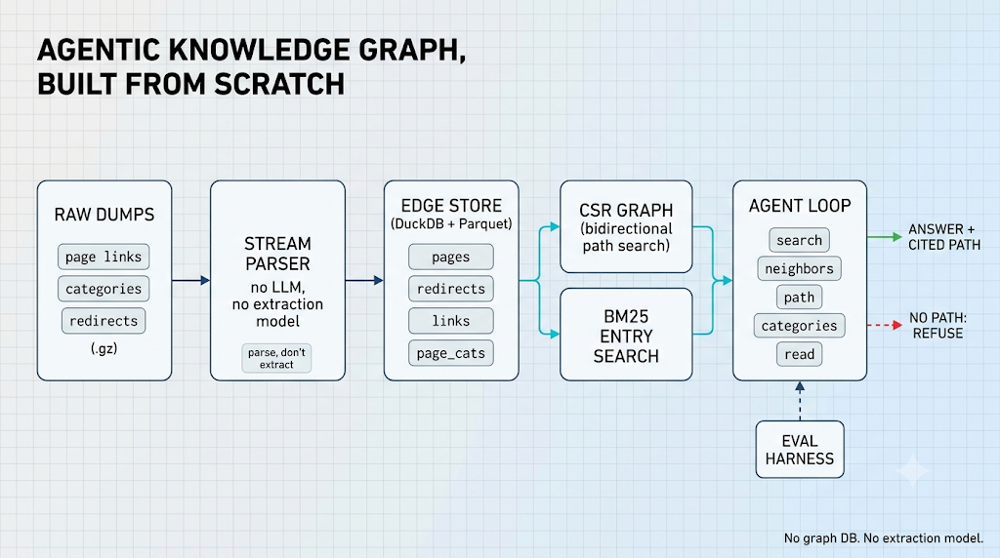
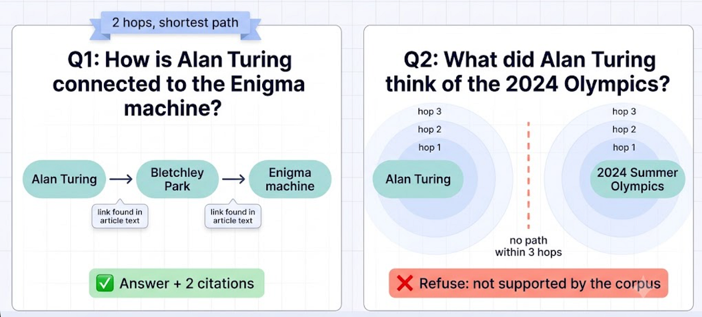
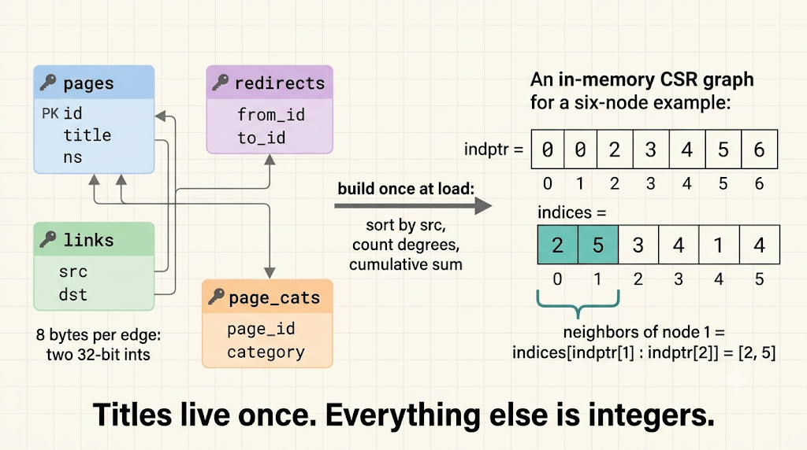
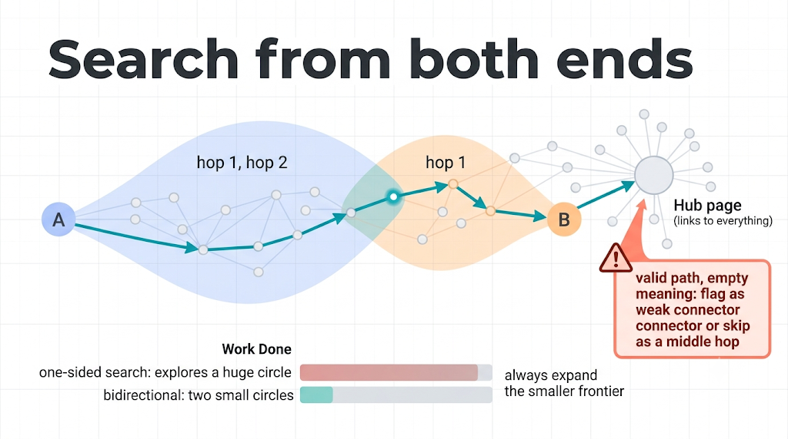
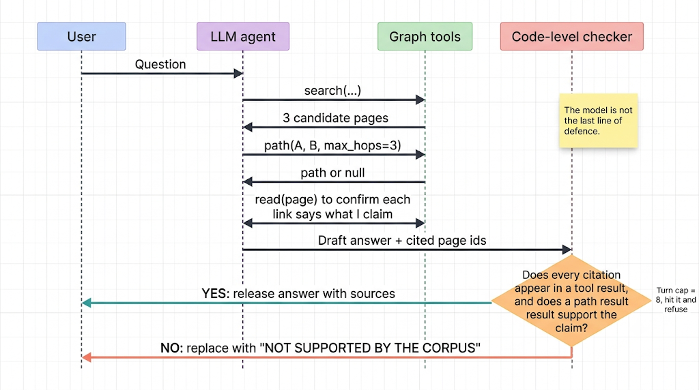
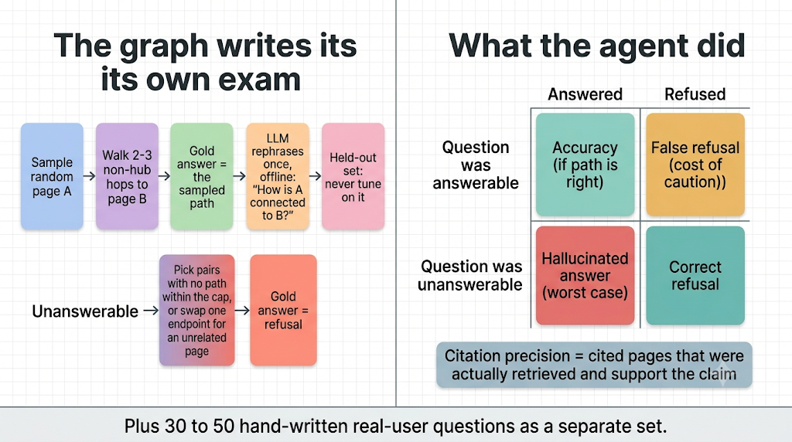

# Build an Agentic Knowledge Graph From Scratch: No Graph DB, No Extraction Model

[Saurabh](https://medium.com/@saurabhraj042?source=post_page---byline--074d944a68b3------------------------------------------)

16 min readOct 31, 2026

--



> GPT-6 補足: 原本のリンクを保存・探索する段と、回答を作る段の分担図である。末尾には回答と見送りの分岐がある。

Most teams that want an AI agent to answer multi-hop questions over a big pile of documents do the same thing: pay an LLM to read every page, extract entities, and build a knowledge graph. One published estimate puts that indexing step at roughly $33,000 for a single large corpus. But if your documents already contain their own links, citations or categories, that bill is optional. The graph is already there. You only have to parse it.

This article is the blueprint for building that system from scratch: a laptop-sized graph engine, an agent that walks it, cites every step, and refuses to answer when no path exists. Everything below is runnable with Python and DuckDB, and every number I report as measured was measured on a 2-core, 7 GB sandbox.

## What You’ll Walk Away With

1. **The one idea** that makes this cheap, and the exact test for when it does not apply.
2. **A running example** you can reproduce: a Wikipedia slice, one real question, traced end to end.
3. **The high-level design**: six components, no graph database, no extraction model.
4. **The build, step by step**: parse dumps to Parquet, resolve redirects, build the path engine, add search, wire the agent.
5. **The evaluation harness** that generates its own multi-hop questions and scores accuracy, citation precision and refusals.
6. **How to point it at your own corpus**: docs, papers, wikis, code.
7. **Cost, scale and failure modes**, with the honest limits.
8. **A priority order** so you build the right thing first.

## The One Idea: Parse, Don’t Extract

When a corpus already ships its edges, building the graph is a parse, not an extraction.

The usual GraphRAG pipeline sends every chunk of text to an LLM to find entities and relations. Microsoft’s own description says the build step “uses an LLM to extract and describe entities and their relationships” and a second LLM pass summarizes each community. Microsoft’s cheaper LazyGraphRAG variant avoids both and, in their words, costs “0.1% of the costs of full GraphRAG” to index.

But some corpora are already graphs in disguise:

- **Wikipedia** ships page links, categories and redirects as plain database dumps.
- **PubMed** ships citations and controlled vocabulary tags (MeSH) in every record.
- **Docs sites and wikis** ship hyperlinks and tables of contents.
- **Code** ships imports and call sites.

For those, an LLM would be re-discovering relationships a human author already wrote down, with errors. Parsing them is deterministic, free and reproducible.

**The test for when this does NOT work:** if your corpus has no explicit links, citations or tags (raw meeting notes, support tickets, PDFs of contracts), there are no edges to parse. Then you need extraction, and the honest answer is a hybrid: parse whatever edges exist, and run an LLM only on the slice that has none.

**What you give up.** Parsed edges are untyped. A Wikipedia link says “A mentions B”, not “A founded B”. That is enough to answer “how are these two things connected?” with a citable path. It is not enough for questions that depend on the relation type. We handle that in the agent step by reading the cited text, and I flag it again in the limits section.

## The Running Example: Wikipedia, Two Questions

We use English Wikipedia because anyone can download it, it needs no account, and it ships exactly the three edge types we want: page links, categories and redirects. It is licensed CC BY-SA, so you must attribute and share-alike if you republish derived text.

Two questions follow us through the whole article:

- **Q1 (answerable):** “How is Alan Turing connected to the Enigma machine?”
- **Q2 (should be refused):** “What did Alan Turing think of the 2024 Olympics?” There is no path from the question’s entities to any page that supports it.

The shape of what the agent returns for Q1 (illustrative format, not a captured run; your real path depends on your slice and dump date):

```
Q: How is Alan Turing connected to the Enigma machine?
PATH (2 hops): Alan Turing -> Bletchley Park -> Enigma machine
CITE: [1] Alan Turing, link to "Bletchley Park"
      [2] Bletchley Park, link to "Enigma machine"
ANSWER: Turing worked at Bletchley Park, which is linked to the Enigma machine page. (sentence checked against the cited text)
```

And for Q2 the correct output is a refusal:

```
Q: What did Alan Turing think of the 2024 Olympics?
PATH: none within 3 hops
ANSWER: Not supported by the corpus. No cited path.
```

That second output is the product. Any chatbot can answer Q1. A trustworthy system is one that visibly declines Q2.



> GPT-6 補足: 左右に回答と見送りの例を並べた図である。本文は実行記録ではなく例示だと明記している。

## The High-Level Design

Six components, one direction of data flow, zero external services except the model that drives the agent.

1. **Ingest.** Stream the raw dumps (SQL or XML, gzipped) without unpacking them to disk. Output: Parquet files. Nothing else is stored.
2. **Edge store.** Four Parquet tables queried in place by DuckDB: `pages(id, title, ns)`, `redirects(from_id, to_id)`, `links(src, dst)`, `page_cats(page_id, category)`.
3. **Graph engine.** Redirects are folded into `links` once, then `links` is turned into a CSR adjacency (two integer arrays) in memory. Path queries are a bidirectional breadth-first search with a hop cap.
4. **Entry-point search.** BM25 full-text search over titles and lead text. Its only job is to turn a natural-language question into start nodes. It never answers anything.
5. **Agent loop.** An LLM with five tools: `search`, `neighbors`, `path`, `categories`, `read` (returns the cited text). The loop is capped, and it must cite a path or refuse.
6. **Eval harness.** Generates held-out multi-hop questions from the graph itself, runs the agent, and scores accuracy, citation precision and refusal correctness.

**Why no graph database.** A graph DB buys you a query language and transactions. This workload is read-only, bulk-loaded and needs only neighbour lookup and shortest path. Parquet plus an in-memory CSR does that with fewer moving parts. I measured it (below). If you later need live updates or graph algorithms at scale, add a database then. That is a decision you can defer.

**Why DuckDB.** It queries Parquet directly, runs on a laptop, and its recursive queries are enough for SQL-side path checks. I verified a depth-limited recursive path query with cycle protection on DuckDB 2.0.0. The final path engine in step 3 uses arrays in memory instead, because it is faster for repeated queries.

**Data model decisions that matter:**

- Store integer IDs only. Titles live once in `pages`. Edges are 8 bytes.
- Keep `ns` (namespace) so you can restrict to articles and drop talk pages, user pages and files.
- Keep category links as a separate edge type. They give you a second, coarser path (two pages sharing a category) when direct links do not connect.



> GPT-6 補足: 左側は保存する表、右側は隣接先を配列で引く形を示す。表を読む段と経路を探索する段の境界を説明する図である。

## Steps 1 and 2: Ingest the Dumps, Measure Retention First

**Get the files.** The English Wikipedia dumps live at dumps.wikimedia.org. For the 20260201 dump the relevant gzipped SQL files are listed at these sizes: `page` 2.2 GB, `pagelinks` 6.4 GB, `linktarget` 1.3 GB, `categorylinks` 2.2 GB, `redirect` 173 MB. Start with a smaller wiki (Simple English Wikipedia is the same format) to get your parser right before touching the big one.

**Parse by streaming.** The SQL dumps are giant `INSERT INTO ... VALUES (...),(...);` statements. Do not load them into MySQL. Read the gzip stream, split each INSERT line into tuples with a small state machine that respects quotes and escapes, and append batches to Parquet with PyArrow. Memory stays flat because you never hold more than one batch.

**Mind the schema change.** Modern MediaWiki no longer stores the target title inside `pagelinks`. A link row carries a numeric `pl_target_id` that you resolve by joining to the `linktarget` table (`lt_id`, `lt_namespace`, `lt_title`), then joining the title to `page`. Check the `CREATE TABLE` header at the top of your own dump file before you write the parser. Categories are simpler: `categorylinks` still stores the category name in `cl_to` with `cl_from` as the page ID and a `cl_type` of page, subcat or file.

**Resolve redirects once.** Many links point at a redirect page (“USA”), not the real article. Build a map from redirect ID to final page ID, then rewrite `links.dst` through it. Do this at build time, not at query time. Collapse redirect chains with a bounded loop (three passes is plenty), and drop self-links.

**Measure retention before you trust the graph.** This is the step most tutorials skip. After resolution, report:

- how many raw link rows you read
- how many survive after dropping non-article namespaces
- how many survive after dropping links whose source or target is missing from `pages`

If you build from a slice (a subset of pages), edges that point outside the slice are lost, and a thin slice can lose most of them. The reference article that inspired this build reports that a recent 10M-page slice keeps only 28.1% of its citation edges. Your number will differ, but measure it. A graph that silently dropped most of its edges will answer “no path” for things that are in fact connected, and your refusal rate will look good for the wrong reason.

**Scale to expect.** I benchmarked the storage format on synthetic data on a 2-core, 7 GB machine: writing 50 million random edges to zstd Parquet took 2.6 s and produced a 319 MB file, and loading it into DuckDB took 0.7 s. Real link data compresses differently, so treat these as a floor on feasibility, not a promise. The parse step, not storage, is the bottleneck: expect it to dominate your wall-clock time.

## Steps 3 and 4: The Path Engine and the Entry-Point Search

**Step 3: CSR adjacency.** Load `links` from Parquet into two integer arrays: `indptr` (where each node's neighbours start) and `indices` (the neighbours). Build one for forward links and one for reversed links, so you can search from both ends. This is the whole "graph database".

```
def build_csr(src, dst, n):
    order = np.argsort(src, kind="stable")
    indices = dst[order].astype(np.int32)
    indptr = np.zeros(n + 1, dtype=np.int64)
    indptr[1:] = np.cumsum(np.bincount(src, minlength=n))
    return indptr, indicesdef nbrs(g, u):
    return g[1][g[0][u]:g[0][u + 1]]
```

Then a bidirectional breadth-first search with a hop cap. It always expands the smaller frontier, which is what keeps it fast on graphs with hub nodes:

```
def shortest_path(fwd, rev, a, b, max_hops=3):
    if a == b:
        return [a]
    pf, pb = {a: None}, {b: None}
    ff, fb = [a], [b]
    for _ in range(max_hops):
        side_f = len(ff) <= len(fb)
        front, seen, other, g = (ff, pf, pb, fwd) if side_f else (fb, pb, pf, rev)
        nxt = []
        for u in front:
            for v in nbrs(g, u).tolist():
                if v in seen:
                    continue
                seen[v] = u
                nxt.append(v)
                if v in other:                      # frontiers met
                    left, x = [], v
                    while x is not None:
                        left.append(x); x = pf[x]
                    right, x = [], pb[v]
                    while x is not None:
                        right.append(x); x = pb[x]
                    return left[::-1] + right
        if side_f: ff = nxt
        else:      fb = nxt
        if not nxt:
            return None
    return None
```

I ran this prototype. On a toy six-edge graph it returned the correct shortest path (1 -> 5 -> 4) and correctly returned `None` when no path existed within the cap. Building both arrays for 10 million random edges took about 4 seconds on a 2-core machine. I did not benchmark path latency on a real link graph, because random graphs are not shaped like Wikipedia; measure yours. Keep `max_hops` at 3 or 4: on a real link graph, longer paths run through hub pages and stop meaning anything.

**Hub pages are your main quality risk.** A page like “United States” links to and from everything. A path that goes through it is technically valid and semantically empty. Mitigation: compute each node’s degree at build time, and either skip nodes above a degree threshold as intermediate hops or report them to the agent as “weak connector”. Log how often paths use them.

**Step 4: entry points with BM25.** Build a full-text index over page titles plus the lead paragraph, using DuckDB’s full-text search extension or the SQLite FTS5 engine. The question “how is Turing connected to Enigma” goes in, two or three candidate page IDs come out. The agent then picks the right ones. The search is deliberately dumb: it does not answer, it only finds doors into the graph. Add embeddings later if title and lead search misses paraphrased questions. Do not start with them.



> GPT-6 補足: 両端から探索する様子と、多数の先につながるハブへの注意を示す。下の棒は考え方の比較であり、測定値は付いていない。

## Step 5: The Agent Loop and the Refuse-When-No-Path Rule

The agent is a plain tool-use loop. The model decides which tool to call, your code runs it against the graph, and the result goes back. Five tools are enough:

- `search(query)` returns up to 5 candidate pages (id, title, first sentence).
- `neighbors(page_id, limit)` returns linked pages, highest-signal first (low-degree before hubs).
- `path(a, b, max_hops)` returns the shortest path as a list of pages, or `null`.
- `categories(page_id)` returns the page's categories, for the fallback "shared category" route.
- `read(page_id, max_chars)` returns the lead text, so the agent can check what a link actually says.

The loop, using the standard Messages API tool-use pattern (this is a sketch; it needs your API key and was not run end to end for this article):

```
import anthropic
client = anthropic.Anthropic()
```

```
SYSTEM = """You answer only from the knowledge graph.
Rules:
1. Every claim must cite a page you read with the read tool.
2. A connection claim must cite a path returned by the path tool.
3. If path returns null within the hop cap, reply exactly: NOT SUPPORTED BY THE CORPUS.
4. Never use outside knowledge to fill a gap."""def run(question, tools, execute, max_turns=8):
    msgs = [{"role": "user", "content": question}]
    for _ in range(max_turns):
        r = client.messages.create(model=MODEL, max_tokens=1024,
                                   system=SYSTEM, tools=tools, messages=msgs)
        msgs.append({"role": "assistant", "content": r.content})
        if r.stop_reason != "tool_use":
            return r, msgs
        results = [{"type": "tool_result", "tool_use_id": b.id,
                    "content": execute(b.name, b.input)}
                   for b in r.content if b.type == "tool_use"]
        msgs.append({"role": "user", "content": results})
    return None, msgs   # turn cap hit: treat as a refusal
```

Three details make this trustworthy instead of just plausible:

1. **The refusal is enforced in code, not only in the prompt.** After the loop ends, a checker parses the final answer. If it asserts a connection and no `path` result in the transcript supports it, the answer is replaced with the refusal. The model is not the last line of defence.
2. **Citations are machine-checkable.** Each citation is a page ID that must appear in a tool result in the transcript. Citing a page the agent never retrieved is flagged automatically.
3. **Untyped edges are checked by reading.** Because a link only says “mentions”, the agent calls `read` on the pages along the path and confirms the sentence it wants to write is actually supported. This is the cost of skipping relation extraction, and it is cheap: a few short reads per question.



> GPT-6 補足: 回答案を検査へ渡す設計のシーケンス図である。図に検査の分岐があることと、その実装が提示されていることは区別する必要がある。

## Step 6: Evaluate It With Questions the Graph Writes Itself

You cannot trust a graph agent you have not tested, and writing hundreds of test questions by hand does not scale. The graph can generate them.

**Answerable questions.** Sample a random page A, walk 2 or 3 hops along non-hub edges to page B, and keep the pair. The gold answer is the path you sampled. Ask an LLM once, offline, to phrase it as a natural question (“How is A connected to B?”). Hold these out: never tune your prompts on them.

**Unanswerable questions.** Take pairs with no path within your hop cap, or swap one endpoint for a real page from an unrelated area. The gold answer is the refusal. These are what prove the system is honest.

**Score four numbers, not one:**

- **Accuracy:** on answerable questions, did the agent return a valid path between the right endpoints?
- **Citation precision:** of all pages cited, what fraction actually appeared in tool results and support the claim?
- **Refusal rate on unanswerable questions:** should be near 100%.
- **False refusal rate on answerable questions:** the price of being careful. Track it so you can see the trade-off.

The reference article reports 83.2% on 600 held-out questions for its own PubMed build. That is a claim by its author about a different corpus and question set, so do not use it as your bar. Use it as a reminder that a held-out set of a few hundred questions is the right size to start, and that you should publish your own number with its method.

**Caveat on this method.** Questions generated from the graph test whether the agent can navigate the graph. They do not test whether real users ask such questions. Add 30 to 50 hand-written questions from real use as a separate set.



> GPT-6 補足: 左側は評価問題の作り方、右側は答えられる問いかどうかと応答を組み合わせた表である。実測結果の表ではない。

## How Others Can Use It: Bring Your Own Corpus

The engine only needs four tables. Anything that can produce them works. Write one small adapter per source that outputs `pages`, `links`, `page_cats` (tags) and `redirects` (aliases, optional).

- **Scientific papers (PubMed-style).** Papers are pages, citations are links, controlled-vocabulary tags (MeSH) are categories, and synonyms of those tags are redirects. This is the setup the reference article uses. NLM publishes the annual baseline as 1,334 gzipped XML files for 2026 (pubmed26n0001 to pubmed26n1334, released January 30, 2026) with MD5 checksums, so you can verify your download.
- **Your company docs or wiki.** Pages are docs, hyperlinks and “see also” blocks are links, folders and labels are categories. Keep the permissions: build one graph per access group, never one graph for everyone.
- **A codebase.** Files or symbols are pages, imports and call sites are links, directories are categories. The agent can then answer “what depends on this module?” with a cited path.
- **Legal or policy text.** Sections are pages, cross-references (“see section 4.2”) are links.

**When your corpus has few or no edges.** Add an extraction step, but only where you need it: run an LLM over the pages that lack links, ask it for a short list of linked entities, and write those into the same `links` table with a flag column `source = 'llm'`. Now parsed and extracted edges live together, and your eval harness can report accuracy separately for each. That separation is how you learn whether extraction is worth its price for your data.

**Cost orientation, from primary sources.** Microsoft states that full GraphRAG needs LLM calls to extract entities and relations and to summarize each community, and that its lazy variant indexes at 0.1% of that cost with no LLM at index time. The $33,000 figure for one corpus is the reference article’s own estimate; I could not verify it from a primary source, so treat it as an order-of-magnitude claim and price your own corpus from your provider’s current rate card before deciding.

**Legal notes.** Check the licence of every corpus. Wikipedia text is CC BY-SA, which requires attribution and share-alike for derived text. Internal documents carry your own confidentiality rules: do not send them to any model you have not approved for that data.

## Scale Plan, Failure Modes, and Honest Limits

**Scale plan.**

1. **Laptop (up to tens of millions of edges).** Everything above, as is. A smaller wiki or a 1M-page slice is the right first target.
2. **Single big machine (hundreds of millions to about a billion edges).** Same design. The CSR arrays for 1B edges are about 4 GB for the neighbour array at 4 bytes per edge, per direction, so plan 8 to 10 GB of RAM for both directions plus pages. Build the Parquet files in parallel by shard.
3. **Beyond that.** Partition by connected region, or move adjacency to a memory-mapped file. Only here does a graph database or distributed engine start to earn its place.

The reference article claims 929,824,202 edges built in 10.8 minutes. I did not reproduce that, but the arithmetic above is consistent with a billion-edge graph fitting on one large machine.

**Failure modes to expect:**

- **Silent edge loss** from slicing or unresolved redirects. Fix: the retention report from step 2, checked in every build.
- **Hub paths** that are valid but meaningless. Fix: degree-aware path search and a “weak connector” flag.
- **Dump schema drift.** MediaWiki moved link targets into a separate table; another change will come. Fix: parse the `CREATE TABLE` header and fail loudly when columns differ from what you expect.
- **Stale data.** Dumps are snapshots. Stamp every answer with the dump date.
- **Agent over-confidence.** Fix: the code-level refusal check, not just the prompt.
- **Entry-point misses.** If BM25 never surfaces the right page, the graph is never reached. Track search recall in your eval.

**Honest limits.**

- Edges are untyped. The system proves a connection exists, not what the connection means.
- It answers connection and navigation questions well. It is a poor fit for aggregation (“how many”), numeric reasoning and anything that needs facts not stated in the text.
- Wikipedia links reflect editor habits, not truth. A missing link is not evidence that no relationship exists.
- I validated the storage format, the CSR build and the path logic on synthetic or toy data. I did not run the full pipeline end to end on a real Wikipedia dump for this article, because the sandbox could not reach the dump host. Treat the code as a design with verified parts, then run your own build on a small wiki first.

## Priority Order: What to Build First

1. **Parser plus retention report** on a small wiki. If you cannot trust the edges, nothing else matters.
2. **Redirect resolution** and namespace filtering.
3. **CSR graph and the path function**, tested on pairs you know.
4. **BM25 entry search.**
5. **The agent with the code-level refusal check.**
6. **The eval harness** with answerable and unanswerable questions.
7. **Only then:** embeddings, hub handling refinements, and LLM extraction for edge-poor sources.

## The Honest Summary

If your corpus already contains its links, you can skip the most expensive part of GraphRAG and replace it with a parse that runs on a laptop. The agent’s value is not that it answers; it is that it shows a path and refuses when there is none. What is proven here: the storage format scales, the path logic is correct on a toy graph, and the design hangs together. What is not proven here: end-to-end accuracy on a real Wikipedia dump. Run the six steps on a small wiki, publish your four numbers, and you will know more than any benchmark claim in this article can tell you.
