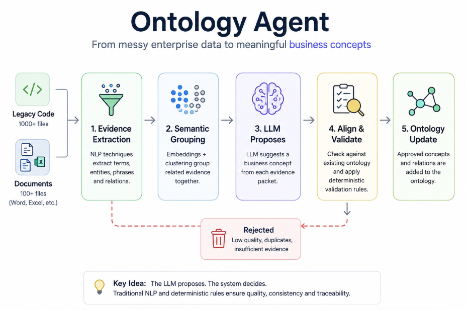

# オントロジーエージェントを作る――本当に LLM が必要なのはどの部分か

[Srikrishnan Shankar](https://medium.com/@srikrishnan.tech?source=post_page---byline--51b4494a8745------------------------------------------)

読了時間 7 分、2026 年 8 月 20 日

> GPT-6 補足: 「Ontology Agent」の全体像を示す図である。左側の入力は 1,000 件以上のレガシーコードのファイルと、Word や Excel などの文書 100 件以上で、証拠の抽出、意味によるグループ化、LLM による提案、照合と検証、オントロジーの更新という 5 段階へ進む。証拠の抽出と照合・検証からは、低品質、重複、証拠不足のものを棄却する経路も描かれている。下部の要旨は、LLM が提案し、システムが決定することで、従来の NLP と決定的な規則が品質、一貫性、追跡可能性を支えるというものである。

LLM を使ってナレッジグラフやオントロジーを作ると聞くと、分かりやすい方法は単純に思える。企業のデータをまとめてモデルに渡し、重要な概念と関係を見つけるよう頼めばよい。現在の LLM の推論能力なら、確かにその多くをこなせる。

しかし、オントロジーを発見するエージェントを試すうちに、私は少し違う問いを持つようになった。

***このパイプラインのうち、本当に LLM が必要なのはどれだけだろうか。***

試したかったのは、レガシーなソースコード、製品の文書、スプレッドシートなど、整理されていない企業の技術資料に隠れている業務の概念を自動で見つけることだった。

当初は、LLM がアーキテクチャの中心になると思っていた。ところが、実際にできたのは、次のような構成に近いものだった。

**生データ（Raw Data）→ 証拠（Evidence）→ NLP → 意味によるグループ化（Semantic Grouping）→ LLM → 照合（Alignment）→ 検証（Validation）→ オントロジー（Ontology）**

LLM は依然として重要だった。ただし、担当するのは、もっと狭い問題である**意味についての推論**になった。

この記事では、この構成に至った経緯、そこで使った NLP の手法、そして途中で見つかった予想外の問題について述べる。

## 問題――企業の知識はあちこちにある

ある実験では、**1,000 を超えるソースファイル**を持つレガシーなアプリケーションを使った。クラス名、インターフェース、依存関係、コメントの中に、価値のあるドメインの知識が隠れていた。

たとえば、次の名前である。

AuditTrailView

これだけでも、*Audit Trail* という機能について何かが分かる。

同様に、次の名前がある。

BackupRestoreService

これはおそらく、*Backup and Restore* に関する何かを表している。

しかし、オントロジーにコードベースのすべてのクラスとインターフェースを入れればよいわけではない。目標は、技術的な実装の細部から、より上位の業務の概念へ移ることである。

次に、まったく違うソースでも同じ考え方を試した。主に Word と Excel のファイルからなる、**およそ 100 件以上の製品関連の文書**である。今度は、段落、仕様、要件、表、標準、製品の用語の中に知識が隠れていた。LLM にこれらを直接処理させることもできる。しかし、モデルに推論を頼む前に、生の情報を絞り、より強い証拠にできないかを確かめたかった。

## 知能より先に証拠を

最初に導入したのは、**証拠レコード（Evidence Record）**と呼ぶ中間表現だった。後続の処理がいつまでも生のファイルを扱う構成にせず、各ソースをまず構造化された証拠へ変換する。

ソースコードなら、証拠は次のものから得られる。

*クラス + インターフェース + 依存関係 + コメント*

文書なら、次のものである。

*重要な用語 + エンティティ + 名詞句 + 関係*

抽出の方法はソースによって変わるが、最終的にはすべてが共通の構造を持つ証拠になる。ここで、従来の NLP の手法が役に立った。

**CamelCase の分割**は、次のような名前を変換する。

AuditTrailView

変換後は、こうなる。

audit trail view

**TF-IDF** は、特定の文書や節に特徴的な用語を見つけるのに役立つ。

**固有表現認識（Named Entity Recognition）と名詞句の抽出**は、製品、標準、意味のある複数語の用語を見つけるのに役立つ。

**Hearst patterns** は、単純な *is-a* 関係を抽出できる。

ボルト（Bolts）とねじは部品である

これは、次の関係になる。

Bolt → is-a → Component

**依存構造解析（Dependency parsing）**は、ほかの関係も抽出できる。

Assembly Process → requires → Machine Specification

これらの手法は、どれも業務のドメインを完全には理解しない。理解する必要もない。役割は、大量の生の情報を有用な手がかりに変えることだからである。軽量な NLP ですでに確実に抽出できる手がかりは、LLM を関与させる前に取り出すことにした。

## すべてを LLM に送らない

次の問題は量だった。抽出したあとも、数千件の証拠レコード（Evidence Records）が残る。レコードを 1 件ずつ LLM に送ることはできるが、それでは、どの証拠どうしがまとまるかを見つける仕事までモデルに任せることになる。

そこで、証拠を**密な埋め込み（dense embeddings）**に変換し、**HDBSCAN** で意味の上で自然にまとまるグループを探した。

たとえば、次の名前である。

AuditTrailService  
AuditTrailView  
AuditTrailRepository

これらは自然に 1 つのグループを作りうる。

一方で、次の名前がある。

BackupRestoreService  
RestoreManager  
BackupConfiguration

こちらは別のグループを作りうる。

HDBSCAN が役に立ったのは、グループの数をあらかじめ知らなかったからである。また、強いクラスターに属さない証拠を、無理にどこかの分類へ入れず、外れ値のまま残すこともできた。

これらのグループから、代表的な情報を収めた小さな**証拠パケット（Evidence Packets）**を作った。LLM がパイプラインに入るのは、ここまで進んでからである。

それまでは、次の仕事を頼もうとしていた。

**数千件のレコードを読み、オントロジーを作る。**

それが、次の仕事になった。

**関連する証拠を小さなパケットにまとめた。これはどのような業務の概念を表しているだろうか。**

たとえば、Audit Trail に関する証拠のパケットからは、次のような結果が得られる。

優先ラベル（Preferred Label）: Audit Trail Management Service  
種類（Type）: Service  
定義（Definition）: 監査証跡の情報を管理するサービス。  
証拠（Evidence）: ev:123, ev:456

ここで LLM は、それまでの段階では簡単に得られなかったものを加えた。技術的な手がかりの集まりを、意味のある上位の概念へ変換したのである。

## LLM が提案し、システムが決める

実験を進めるうちに、あるアーキテクチャの規則が重要になった。

**LLM はオントロジーへ直接書き込まない。**

提案をするだけである。提案をオントロジーの一部にする前に、システムは別の問いを立てる。

***この概念は、すでに存在しているだろうか。***

ラベルの完全一致は簡単に調べられる。分かりにくい場合には、**BM25** による語彙検索と、**埋め込みの類似度（embedding similarity）**による意味の比較を使い、オントロジーにすでにある概念と照らした。

こうして、提案された概念を、たとえば次のように分類できる。

EXACT_OR_EQUIVALENT

ALTERNATIVE_LABEL

NARROWER_THAN

BROADER_THAN

RELATED_TO

NOVEL

INSUFFICIENT_EVIDENCE

照合のあとには、決定的な検証を置いた。

- 提案には証拠があるか。
- ラベルは妥当か。
- 意味のある定義があるか。
- 許可された概念の種類か。
- ラベルは、表のフィールドや UI の要素ではなく、実際のドメインの概念らしいか。

これらの検査に意味を創造する力は要らない。そのため、LLM の外に置いた。モデルは**意味についての推論（semantic reasoning）**を担当し、周囲のシステムは**制御とガバナンス（control and governance）**を担当する。

## 次に文書で試した

レガシーコードでの実験は期待の持てるものだった。そこで、同じアーキテクチャを、およそ 100 件以上の製品関連の文書に適用した。文書からは数千件の証拠が得られ、最終的には千件を超える証拠パケット（Evidence Packets）ができた。

ここで、実験の中で最も興味深い問題が現れた。

**LLM は、ほとんどすべてを概念にしたがった。**

使っていたのは小さなローカルモデルで、判断を見送ることも明示的に認めていた。パケットに意味のある証拠が足りなければ、そう言えばよい。それでも、モデルはめったにそうしなかった。技術的な段落を LLM に渡すと、専門的に聞こえる概念名と定義を、驚くほど上手に作る。

そして、まさにそこが、この問題の興味深い点だった。

## 概念の生成は難しい部分ではなかった

当初、オントロジーの自動発見は、主に**生成の問題（generation problem）**だと考えていた。しかし、実験を重ねるにつれて、むしろ**選択の問題（selection problem）**に見えてきた。

問うべきなのは、次のことではない。

***モデルは、この証拠から概念を生成できるだろうか。***

多くの場合、生成はできる。より適切なのは、次の問いである。

***そもそも、これを概念にすべきだろうか。***

ここで、決定的な処理の層が、当初の予想以上に重要になった。

- 重複検出が、すでに存在している概念を除いた。
- ラベルのフィルターが、明らかなデータのフィールドや UI の用語を退けた。
- 検証の規則が、形式の崩れた提案や、裏づけのない提案を除いた。
- 照合が、少し表現の違う句を、そのつど新しいオントロジーの概念にすることを防いだ。

オントロジーはかなり整理された。しかし、この実験からは、この種のエージェントにとって、**見送り（abstention）**の能力を高めることがおそらく最も重要な課題の 1 つだとも分かった。

よいオントロジーエージェントは、ただ多くの概念を見つけるだけであってはならない。***ここには追加する価値のあるものがない。***そう言うことにも長けているべきである。

## 決定的な処理が今も重要である理由

誰かが、次のように尋ねたとする。

*このオントロジーに「Audit Trail Management Service」があるのは、なぜだろうか。*

私は、次の経路を逆にたどって答えられる。

**オントロジーの概念（Ontology Concept）→ 提案（Proposal）→ 証拠パケット（Evidence Packet）→ 証拠レコード（Evidence Record）→ 元のソース（Original Source）**

同様に、証拠がない、あるいは既存の概念と完全に一致するという理由で提案が退けられた場合も、理由は明示される。自動生成した知識を企業のシステムへ組み込むとき、これは役に立つ。目標は LLM の推論をなくすことではない。振る舞いを調べ、制御しやすい部品で、その周囲を固めることである。

この構成は、不要なモデルの呼び出しを減らす可能性もある。ただし、意味のある費用の優位性につながるかどうかは、処理の規模と使うモデルに全面的に依存する。

## 従来の NLP にも役割はある

この実験で改めて分かったことの 1 つは、LLM が登場しても、従来の NLP が不要になるわけではないということだった。

たとえば、次の手法がある。

· TF-IDF

· 固有表現認識（Named Entity Recognition）

· 依存構造解析（Dependency parsing）

· Hearst patterns

· BM25

· MinHash

· 密な埋め込み（Dense embeddings）

· HDBSCAN

これらは、現代の AI システムの中でも、有用な役割を果たせる。

これらの手法は LLM と競合しない。LLM が見る前に、問題を絞って整理する。そうすれば、LLM は、意味についての推論が実際に価値を加える部分へ集中できる。

これは、ログの異常検知と Drain3 に取り組んだときに気づいたことにも似ている。高度なモデルに注目が集まりがちだが、最終的な AI システムの品質は、**モデルの周囲**で起きることに、同じくらい左右される場合がある。

## 結論

この実験を始めたとき、頭にあった問いは次のものだった。

***LLM は企業のデータからオントロジーを作れるだろうか。***

ソースコードと文書を扱ってみて、それはもう最も興味深い問いではないと思うようになった。LLM がオントロジーの発見の相当な部分をこなせるのは確かである。

今、もっと有用だと感じる問いは、次のものである。

***オントロジーの発見で、本当に LLM が必要なのはどの部分だろうか。***

私の実験では、従来の NLP が手がかりの抽出に役立った。埋め込みとクラスタリングが証拠を整理した。LLM は、その証拠が何を意味するかを推論した。照合と決定的な検証が、最終的にオントロジーへ入れられるものを制御した。

そして、最も大きな教訓は、失敗した例から得られた。

**LLM は、もっともらしい概念を生成することに非常に長けていた。難しかったのは、そのうちどの概念を知識にする価値があるかを決めることだった。**

私にとって、オントロジーエージェントの興味深さは、そこにある。従来の NLP の手法をすべて LLM に置き換えることではない。両方の方法を組み合わせ、意味についての推論が実際に価値を加える部分でだけ、それを使えるようにすることである。
