# 推論（Thinking）

Claude の推論を有効にする方法、推論の出力を読む方法、effort で深さを調整する方法、ツール、キャッシュ、ストリーミングとの併用方法を説明します。

**API の対応状況**。使い方は製品によって異なります。

- **Messages API** では既定で有効です。対応モデルでは `thinking: {"type": "disabled"}` で無効にできます。既定で無効なモデルでは、`thinking` を設定して有効にします。
- **Managed Agents** では常に有効です。Managed Agents が推論の設定を決めます。エージェント定義に `thinking` フィールドはありません。

一度で回答を出すモデルは、下調べや検算、途中での方針変更ができず、最初の試行で正解を出す必要があります。証明、難しい不具合の調査、長時間のエージェント作業では、最初に選んだ方法が最善とは限りません。

推論を有効にすると、Claude は回答を出す前に、自分の言葉で問題を解いていきます。依頼を言い換え、解き方を試し、途中の結果を確かめ、うまくいかない方法を取り下げます。回答前の推論は応答内の先行する `thinking` コンテンツブロックで届き、Claude はそれを踏まえて最終回答を作ります。数学、コーディング、分析、長時間のエージェント作業では、途中の検討の質が最終回答の質を左右します。推論を使うと、そうした検討を回答に詰め込んだり省いたりせずに済むため、性能が向上します。

Claude が推論で消費したトークンには費用がかかります。推論のテキストが返らなくても出力トークンとして課金され、回答のテキストとともに `max_tokens` に算入されます。このページでは、API における推論の有効化、出力の読み方、ツール、ストリーミング、キャッシュ、コンテキストウィンドウとの関係を扱います。

## 推論の仕組み



> GPT-6 補足: API リクエストを受けた Claude が、回答前に推論するかどうかを判断する流れを示します。ツールを使う場合は、同じアシスタントターンの中で呼び出しと結果の評価を繰り返し、途中で推論ブロックを追加する場合があります。最後のテキストブロックは推論ブロックの後に返ります。

リクエストごとに Claude が推論を行うか、どの程度深く推論するかは、推論の設定とリクエストの複雑さによって決まります。

回答前に推論した応答では、`text` ブロックより前に 1 つ以上の `thinking` コンテンツブロックが届きます。推論ブロックも後続の `text` ブロックと同様にモデルが生成した内容ですが、正式な回答とは別に格納されます。各推論ブロックの `signature` には推論の全文が暗号化されており、複数ターンの会話やツール利用ではそのまま送り返します。[推論の暗号化](https://platform.claude.com/docs/en/build-with-claude/thinking#thinking-encryption)を参照してください。

```json
{
  "content": [
    {
      "type": "thinking",
      "thinking": "Let me break this down. The question has two parts, so I'll start with the simpler one and use its result to constrain the second...",
      "signature": "WaUjzkypQ2mUEVM36O2Txu...."
    },
    {
      "type": "text",
      "text": "Based on my analysis..."
    }
  ]
}
```

このテキストは返らない場合があります。返る場合も、推論ブロックのテキストに入るのは [Claude の推論の要約](https://platform.claude.com/docs/en/build-with-claude/thinking#summarized-thinking)です。推論設定の `display` は、要約を返すかどうかを制御します。`"summarized"` では要約を返し、多くのモデルで既定の `"omitted"` では、`thinking` フィールドを空にした推論ブロックを返します。どちらでも課金と複数ターンの会話での送り返し方は同じです。モデルごとの既定値と詳細は[推論の表示を設定する](https://platform.claude.com/docs/en/build-with-claude/thinking#controlling-thinking-display)を参照してください。

Claude がツールを使う場合は、ツール呼び出しの間にも推論が現れることがあります。[ツール利用時の推論](https://platform.claude.com/docs/en/build-with-claude/thinking#thinking-with-tool-use)を参照してください。応答形式の全体は [Messages API リファレンス](https://platform.claude.com/docs/en/api/messages/create)にあります。

## 推論を設定する

ほとんどのモデルは、既定で推論が有効か、パラメーター 1 つで有効になります。下の表は、リクエストで指定できる `thinking` の値ごとの各モデルの挙動です。400 エラーは API がリクエストを拒否したことを示します。[推論のトラブルシューティング](https://platform.claude.com/docs/en/build-with-claude/thinking-troubleshooting)では、各エラーと対処法を説明しています。

| モデル | `thinking` フィールド省略時 | `"adaptive"` | `budget_tokens` 付きの `"enabled"` | `"between_tools"` | `"disabled"` |
|---|---|---|---|---|---|
| Claude Opus 5.5 | 適応型で推論する | 適応型で推論する | 400 エラー | 400 エラー | 400 エラー |
| Claude Sonnet 5.5 | 適応型で推論する | 適応型で推論する | 400 エラー | 回答前の推論を省きます。effort は `high` 以下 | 400 エラー |
| Claude Haiku 5.5 | 適応型で推論する | 適応型で推論する | 400 エラー | 400 エラー | 推論しません。effort は `high` 以下 |
| Claude Fable 5.2 | 適応型で推論する | 適応型で推論する | 400 エラー | 400 エラー | 400 エラー |
| Claude Mythos 5.2 | 適応型で推論する | 適応型で推論する | 400 エラー | 400 エラー | 400 エラー |
| Claude Fable 5.1 | 適応型で推論する | 適応型で推論する | 400 エラー | 400 エラー | 400 エラー |
| Claude Mythos 5.1 | 適応型で推論する | 適応型で推論する | 400 エラー | 400 エラー | 400 エラー |
| Claude Fable 5 | 適応型で推論する | 適応型で推論する | 400 エラー | 400 エラー | 400 エラー |
| Claude Mythos 5 | 適応型で推論する | 適応型で推論する | 400 エラー | 400 エラー | 400 エラー |
| Claude Opus 5 | 適応型で推論する | 適応型で推論する | 400 エラー | 400 エラー | 推論しません。effort は `high` 以下 |
| Claude Sonnet 5 | 適応型で推論する | 適応型で推論する | 400 エラー | 400 エラー | 推論しない |
| Claude Opus 4.8 | 推論しない | 適応型で推論する | 400 エラー | 400 エラー | 推論しない |
| Claude Opus 4.7 | 推論しない | 適応型で推論する | 400 エラー | 400 エラー | 推論しない |
| Claude Mythos Preview | 適応型で推論する | 適応型で推論する | 拡張推論を使う | 400 エラー | 400 エラー |
| Claude Opus 4.6 | 推論しない | 適応型で推論する | 拡張推論を使う（推奨されない設定） | 400 エラー | 推論しない |
| Claude Sonnet 4.6 | 推論しない | 適応型で推論する | 拡張推論を使う（推奨されない設定） | 400 エラー | 推論しない |
| Claude Opus 4.5 | 推論しない | 400 エラー | 拡張推論を使う | 400 エラー | 推論しない |
| Claude Sonnet 4.5 | 推論しない | 400 エラー | 拡張推論を使う | 400 エラー | 推論しない |
| Claude Haiku 4.5 | 推論しない | 400 エラー | 拡張推論を使う | 400 エラー | 推論しない |

表の「effort が `high` 以下」とは、`low`、`medium`、`high` ではリクエストが通り、`xhigh`、`max` では 400 エラーになるという意味です。

Claude 5 以降のモデルと Claude Mythos Preview では、設定を省略しても推論が有効です。これらのモデルでは `display` の既定が `"omitted"` で、明示的に指定するまで推論テキストは非表示です。以下の例のように `thinking: {"type": "adaptive", "display": "summarized"}` を指定すると表示できます。

Claude Opus 4.8、Claude Opus 4.7、Claude Opus 4.6、Claude Sonnet 4.6 では `thinking: {type: "adaptive"}` を指定すると推論が有効になり、Claude がリクエストに応じて推論の有無と深さを決めます。[モデル識別子（model string）](https://platform.claude.com/docs/en/models/overview)を差し替えれば、同じリクエストで有効にできます。以下の例では、推論テキストが見えるように `display: "summarized"` を指定し、`max_tokens` に余裕を持たせています。

```bash
curl https://api.anthropic.com/v1/messages \
  -H "x-api-key: $ANTHROPIC_API_KEY" \
  -H "anthropic-version: 2026-10-21" \
  -H "content-type: application/json" \
  -d '{
    "model": "claude-opus-5-5",
    "max_tokens": 16000,
    "thinking": {
      "type": "adaptive",
      "display": "summarized"
    },
    "messages": [
      {
        "role": "user",
        "content": "What is the greatest common divisor of 1071 and 462?"
      }
    ]
  }'
```

```bash
ant messages create \
  --model claude-opus-5-5 \
  --max-tokens 16000 \
  --thinking '{type: adaptive, display: summarized}' \
  --message '{role: user, content: "What is the greatest common divisor of 1071 and 462?"}'
```

```python
client = anthropic.Anthropic()

response = client.messages.create(
    model="claude-opus-5-5",
    max_tokens=16000,
    thinking={"type": "adaptive", "display": "summarized"},
    messages=[
        {
            "role": "user",
            "content": "What is the greatest common divisor of 1071 and 462?",
        }
    ],
)

for block in response.content:
    match block.type:
        case "thinking":
            print(f"\nThinking: {block.thinking}")
        case "text":
            print(f"\nResponse: {block.text}")
```

```typescript
const client = new Anthropic();

const response = await client.messages.create({
  model: "claude-opus-5-5",
  max_tokens: 16000,
  thinking: {
    type: "adaptive",
    display: "summarized"
  },
  messages: [
    {
      role: "user",
      content: "What is the greatest common divisor of 1071 and 462?"
    }
  ]
});

for (const block of response.content) {
  switch (block.type) {
    case "thinking":
      console.log(`\nThinking: ${block.thinking}`);
      break;
    case "text":
      console.log(`\nResponse: ${block.text}`);
      break;
  }
}
```

```csharp
AnthropicClient client = new();

var parameters = new MessageCreateParams
{
    Model = Model.ClaudeOpus5_5,
    MaxTokens = 16000,
    Thinking = new ThinkingConfigAdaptive { Display = Display.Summarized },
    Messages = [
        new UserMessageParam { Content = "What is the greatest common divisor of 1071 and 462?" }
    ]
};

var message = await client.Messages.Create(parameters);

foreach (var block in message.Content)
{
    if (block.TryPickThinking(out ThinkingBlock? thinking))
    {
        Console.WriteLine($"\nThinking: {thinking.Thinking}");
    }
    else if (block.TryPickText(out TextBlock? text))
    {
        Console.WriteLine($"\nResponse: {text.Text}");
    }
}
```

```go
client := anthropic.NewClient()

response, err := client.Messages.New(context.TODO(), anthropic.MessageNewParams{
	Model:     anthropic.ModelClaudeOpus5_5,
	MaxTokens: 16000,
	Thinking: anthropic.ThinkingConfigParamUnion{
		OfAdaptive: &anthropic.ThinkingConfigAdaptiveParam{
			Display: anthropic.ThinkingConfigAdaptiveDisplaySummarized,
		},
	},
	Messages: []anthropic.MessageParam{
		anthropic.NewUserMessage(anthropic.NewTextBlock("What is the greatest common divisor of 1071 and 462?")),
	},
})
if err != nil {
	log.Fatal(err)
}

for _, block := range response.Content {
	switch v := block.AsAny().(type) {
	case anthropic.ThinkingBlock:
		fmt.Printf("\nThinking: %s", v.Thinking)
	case anthropic.TextBlock:
		fmt.Printf("\nResponse: %s", v.Text)
	}
}
```

```java
import com.anthropic.models.messages.ThinkingConfigAdaptive;

void main() {
    AnthropicClient client = AnthropicOkHttpClient.fromEnv();

    MessageCreateParams params = MessageCreateParams.builder()
        .model(Model.CLAUDE_OPUS_5_5)
        .maxTokens(16000L)
        .thinking(ThinkingConfigAdaptive.builder()
            .display(ThinkingConfigAdaptive.Display.SUMMARIZED)
            .build())
        .addUserMessage("What is the greatest common divisor of 1071 and 462?")
        .build();

    Message response = client.messages().create(params);

    response.content().forEach(block -> {
        block.thinking().ifPresent(thinkingBlock ->
            IO.println("\nThinking: " + thinkingBlock.thinking())
        );
        block.text().ifPresent(textBlock ->
            IO.println("\nResponse: " + textBlock.text())
        );
    });
}
```

```php
use Anthropic\Messages\Model;
use Anthropic\Messages\TextBlock;
use Anthropic\Messages\ThinkingBlock;

$client = new Client();

$message = $client->messages->create(
    maxTokens: 16000,
    messages: [
        [
            'role' => 'user',
            'content' => 'What is the greatest common divisor of 1071 and 462?'
        ]
    ],
    model: Model::CLAUDE_OPUS_5_5,
    thinking: ['type' => 'adaptive', 'display' => 'summarized'],
);

foreach ($message->content as $block) {
    switch (true) {
        case $block instanceof ThinkingBlock:
            echo "\nThinking: " . $block->thinking;
            break;
        case $block instanceof TextBlock:
            echo "\nResponse: " . $block->text;
            break;
    }
}
```

```ruby
client = Anthropic::Client.new

message = client.messages.create(
  model: Anthropic::Model::CLAUDE_OPUS_5_5,
  max_tokens: 16000,
  thinking: {
    type: "adaptive",
    # A plain hash like this one takes display:. The typed ThinkingConfigAdaptive class
    # spells it display_ (trailing underscore) to avoid shadowing Ruby's Kernel#display.
    # The request still sends display.
    display: "summarized"
  },
  messages: [
    {
      role: "user",
      content: "What is the greatest common divisor of 1071 and 462?"
    }
  ]
)

message.content.each do |block|
  case block
  when Anthropic::Models::ThinkingBlock
    puts "\nThinking: #{block.thinking}"
  when Anthropic::Models::TextBlock
    puts "\nResponse: #{block.text}"
  end
end
```

応答には推論の要約、その後に回答が含まれます。

```text
Thinking: Use Euclidean algorithm.
1071 = 2*462 + 147
462 = 3*147 + 21
147 = 7*21 + 0
GCD = 21

Response: ## Finding GCD of 1071 and 462

I'll use the **Euclidean algorithm**, repeatedly dividing and taking remainders...
```

推論トークンは `max_tokens` に算入されます。推論と回答テキストの両方に十分な値を指定してください。推論の調整ガイドの[費用の調整](https://platform.claude.com/docs/en/build-with-claude/thinking-steering-and-cost#cost-control)、およびこのページの[推論とコンテキストウィンドウ](https://platform.claude.com/docs/en/build-with-claude/thinking#thinking-and-the-context-window)を参照してください。

### 推論を無効にする

Claude Sonnet 5 では、既定で有効な推論を無効にできます。

```bash
curl https://api.anthropic.com/v1/messages \
  -H "x-api-key: $ANTHROPIC_API_KEY" \
  -H "anthropic-version: 2026-10-21" \
  -H "content-type: application/json" \
  -d '{
    "model": "claude-sonnet-5",
    "max_tokens": 4096,
    "thinking": {"type": "disabled"},
    "messages": [
      {
        "role": "user",
        "content": "Summarize this article in one sentence."
      }
    ]
  }'
```

```bash
ant messages create \
  --model claude-sonnet-5 \
  --max-tokens 4096 \
  --thinking '{type: disabled}' \
  --message '{role: user, content: "Summarize this article in one sentence."}'
```

```python
client = anthropic.Anthropic()

response = client.messages.create(
    model="claude-sonnet-5",
    max_tokens=4096,
    thinking={"type": "disabled"},
    messages=[{"role": "user", "content": "Summarize this article in one sentence."}],
)
```

```typescript
const client = new Anthropic();

const response = await client.messages.create({
  model: "claude-sonnet-5",
  max_tokens: 4096,
  thinking: { type: "disabled" },
  messages: [{ role: "user", content: "Summarize this article in one sentence." }]
});
```

```csharp
AnthropicClient client = new();

var parameters = new MessageCreateParams
{
    Model = Model.ClaudeSonnet5,
    MaxTokens = 4096,
    Thinking = new ThinkingConfigDisabled(),
    Messages = [new UserMessageParam { Content = "Summarize this article in one sentence." }]
};

var message = await client.Messages.Create(parameters);
```

```go
client := anthropic.NewClient()

response, err := client.Messages.New(context.TODO(), anthropic.MessageNewParams{
	Model:     anthropic.ModelClaudeSonnet5,
	MaxTokens: 4096,
	Thinking: anthropic.ThinkingConfigParamUnion{
		OfDisabled: &anthropic.ThinkingConfigDisabledParam{},
	},
	Messages: []anthropic.MessageParam{
		anthropic.NewUserMessage(anthropic.NewTextBlock("Summarize this article in one sentence.")),
	},
})
if err != nil {
	log.Fatal(err)
}
```

```java
import com.anthropic.models.messages.ThinkingConfigDisabled;

void main() {
    AnthropicClient client = AnthropicOkHttpClient.fromEnv();

    MessageCreateParams params = MessageCreateParams.builder()
        .model(Model.CLAUDE_SONNET_5)
        .maxTokens(4096L)
        .thinking(ThinkingConfigDisabled.builder().build())
        .addUserMessage("Summarize this article in one sentence.")
        .build();

    Message response = client.messages().create(params);
}
```

```php
$client = new Client();

$message = $client->messages->create(
    maxTokens: 4096,
    messages: [
        [
            'role' => 'user',
            'content' => 'Summarize this article in one sentence.'
        ]
    ],
    model: Model::CLAUDE_SONNET_5,
    thinking: ['type' => 'disabled'],
);
```

```ruby
client = Anthropic::Client.new

message = client.messages.create(
  model: Anthropic::Model::CLAUDE_SONNET_5,
  max_tokens: 4096,
  thinking: { type: "disabled" },
  messages: [
    {
      role: "user",
      content: "Summarize this article in one sentence."
    }
  ]
)
```

Claude Opus 5 も既定で推論が有効で、[effort](https://platform.claude.com/docs/en/build-with-claude/effort) が `high` 以下なら `thinking: {type: "disabled"}` を受理します。`xhigh`、`max` では推論が必須で、これらの段階と `thinking: {type: "disabled"}` を指定したリクエストは 400 エラーになります。この制約はリクエストごとに適用されます。推論を無効にすると、Claude Opus 5 はツール呼び出しを平文で出力したり、内部用の XML タグを利用者に見える出力に含めたりすることがあります。プロンプトでの対処は[推論を無効にして実行する](https://platform.claude.com/docs/en/build-with-claude/prompt-engineering/prompting-claude-opus-5#running-with-thinking-disabled)を参照してください。

Claude Sonnet 5.5 も既定で推論が有効で、`thinking: {type: "disabled"}` を指定すると 400 エラーになります。回答前の推論を省くには `thinking: {type: "between_tools"}` を送ります。Claude Sonnet 5.5 で推論を最も抑える設定で、[effort](https://platform.claude.com/docs/en/build-with-claude/effort) が `high` 以下で使えます。[ツール呼び出し間の進捗報告](https://platform.claude.com/docs/en/build-with-claude/thinking#progress-updates)は引き続き返されます。ツールを使わない場合は、Claude Sonnet 5 で `disabled` を指定した場合と同様、テキストだけが返ります。[回答前の推論を省いて実行する](https://platform.claude.com/docs/en/build-with-claude/prompt-engineering/prompting-claude-sonnet-5-5#running-without-up-front-thinking)にプロンプトの指針があります。

Claude Haiku 5.5 も既定で推論が有効で、[effort](https://platform.claude.com/docs/en/build-with-claude/effort) が `high` 以下なら `thinking: {type: "disabled"}` を受理します。`xhigh`、`max` との組み合わせでは 400 エラーになります。推論を減らすには、まず effort を下げます。推論を無効にした状態で JSON 出力も指定すると、モデルは必要なツール呼び出しを省くことがあります。推論が無効な間は、適用中の段階と異なる[メッセージ単位の `output_config.effort`](https://platform.claude.com/docs/en/build-with-claude/effort-per-message)も 400 エラーになります。[effort で推論を調整する](https://platform.claude.com/docs/en/build-with-claude/prompt-engineering/prompting-claude-haiku-5-5#use-effort-to-control-thinking)と[JSON 出力と独自ツールで適応型推論を使う](https://platform.claude.com/docs/en/build-with-claude/prompt-engineering/prompting-claude-haiku-5-5#json-output-with-your-own-tools)を参照してください。

Claude Fable 5.2、Claude Mythos 5.2、Claude Fable 5.1、Claude Mythos 5.1、Claude Fable 5、Claude Mythos 5、Claude Opus 5.5、Claude Mythos Preview では推論が常に有効で、`thinking: {type: "disabled"}` は拒否されます。

リクエストを送る前に、モデルが `"disabled"` または `"between_tools"` に対応するかを確かめるには、Models API で `capabilities.thinking.types.disabled.supported` または `capabilities.thinking.types.between_tools.supported` の値を読みます。両方のフィールドは [Models API の利用](https://platform.claude.com/docs/en/models/overview#using-the-models-api)で説明しています。

拡張推論のみに対応するモデルでは、`type: "enabled"` と `budget_tokens` の値を指定します。対象モデルは[モデル別の設定表](https://platform.claude.com/docs/en/build-with-claude/thinking-troubleshooting#supported-models)で確認できます。設定方法は[拡張推論](https://platform.claude.com/docs/en/build-with-claude/extended-thinking)を参照してください。推論設定が 400 エラーになった場合は、[推論のトラブルシューティング](https://platform.claude.com/docs/en/build-with-claude/thinking-troubleshooting)でエラーメッセージごとの対処法を確認できます。

## 推論の出力を読む

### 推論の表示を設定する

推論設定の `display` フィールドは、推論内容を API 応答にどう含めるかを制御します。両方のモードで `display` を利用でき、`type: "adaptive"` または `type: "enabled"` と一緒に指定します。使用できる値は次のとおりです。

- `"summarized"`。推論ブロックに、Claude の推論を読める形にまとめた[推論の要約](https://platform.claude.com/docs/en/build-with-claude/thinking#summarized-thinking)が入ります。Claude Opus 4.6、Claude Sonnet 4.6、それ以前のモデルではこれが既定です。
- `"omitted"`。`thinking` フィールドが空の推論ブロックが返ります。複数ターンにわたって推論を維持するため、`signature` には引き続き暗号化された推論の全文が入ります。[推論の暗号化](https://platform.claude.com/docs/en/build-with-claude/thinking#thinking-encryption)を参照してください。Claude Fable 5.2、Claude Mythos 5.2、Claude Fable 5.1、Claude Mythos 5.1、Claude Fable 5、Claude Mythos 5、Claude Opus 5.5、Claude Opus 5、Claude Sonnet 5.5、Claude Sonnet 5、Claude Opus 4.8、Claude Opus 4.7、[Claude Mythos Preview](https://anthropic.com/glasswing)、Claude Haiku 5.5 ではこれが既定です。
- `"updates"`（ベータ）。`"omitted"` と同様に、推論ブロックは `thinking` フィールドが空で返ります。一部モデルがツール呼び出しの間に書く短い[進捗報告](https://platform.claude.com/docs/en/build-with-claude/thinking#progress-updates)は、読めるテキストで返ります。ベータヘッダー `thinking-display-updates-2026-08-18` が必要です。

アプリケーションで推論内容を利用者に表示しない場合は、`display: "omitted"` を指定します。主な利点は、ストリーミングで最初のテキストトークンが届くまでの時間が短くなることです。サーバーは推論トークンの配信を省いて署名だけを送るため、最終回答のテキストがより早く流れ始めます。

`display: "omitted"` では、応答には `thinking` フィールドが空の `thinking` ブロックが含まれます。

```json
{
  "content": [
    {
      "type": "thinking",
      "thinking": "",
      "signature": "EosnCkYICxIMMb3LzNrMu..."
    },
    {
      "type": "text",
      "text": "The answer is 12,231."
    }
  ]
}
```

推論テキストを省略するときは、次の点に注意してください。

- 推論に使われた全トークンは引き続き課金されます。省略によって短縮されるのは応答時間です。
- 複数ターンの会話で推論ブロックを送り返す場合は、そのまま返してください。サーバーが `signature` を復号し、元の推論を復元してプロンプトを組み立てます。[推論ブロックを保持する](https://platform.claude.com/docs/en/build-with-claude/thinking#preserving-thinking-blocks)を参照してください。送り返す省略済みブロックの `thinking` フィールドにテキストを入れても無視されます。
- `display` は `thinking.type: "disabled"` では表示する内容がないため無効で、Claude Sonnet 5.5 専用の `thinking.type: "between_tools"` でも無効です。このモードは他のフィールドを受け付けません。`between_tools` でも、`display: "updates"` と同じように、進捗報告の要約テキストが返ります。[進捗報告](https://platform.claude.com/docs/en/build-with-claude/thinking#progress-updates)を参照してください。
- `thinking.type: "adaptive"` で、モデルが単純なリクエストの推論を省いたときは、`display` の値にかかわらず推論ブロックは生成されません。
- `display: "omitted"` でストリーミングする場合は、推論テキストが流れません。それぞれの推論ブロックでは、`thinking` 文字列が空の `thinking_delta` が送られ、続いて `signature_delta` が送られます。`display: "updates"` では[進捗報告ブロック](https://platform.claude.com/docs/en/build-with-claude/thinking#progress-updates)だけがテキスト入りの `thinking_delta` イベントを送ります。イベントの順序は[推論のストリーミング](https://platform.claude.com/docs/en/build-with-claude/thinking#streaming-thinking)を参照してください。

`signature` の内容は `display` の値にかかわらず同じです。会話のターン間で `display` を変えることもできます。

### 推論の要約

`display` が `"summarized"` の場合は、Claude の推論過程を要約したテキストが返ります。要約は、誤用を防ぎながら推論の性能上の利点を保ちます。いずれの `display` の値でも、生の思考の連鎖は返りません。

推論の要約を使うときは、次の点に注意してください。

- 課金の対象は、元のリクエストで生成した推論の全トークンです。そのため、課金される出力トークン数と応答で確認できるトークン数は一致しません。
- Claude Opus 4.6、Claude Sonnet 4.6、それ以前のモデルでは、推論出力の最初の数行が詳しく、プロンプトの設計に役立ちます。[Claude Mythos Preview](https://anthropic.com/glasswing) は最初のトークンから要約するため、こうした詳しい書き出しは推論ブロックに出ません。
- 要約は Claude の推論過程の要点を保ち、追加の遅延が少ないため、生成され次第ストリームで受け取れます。
- 要約は、リクエスト先とは別のモデルが作ります。推論を行うモデルには要約結果は渡りません。

推論の全文へのアクセスが必要な例外的な場合は、Anthropic の営業窓口に問い合わせてください。

モデルの推論を確認するには、回答テキストに推論を書くよう求める代わりに、`thinking` ブロックを読みます。Claude Fable 5.2、Claude Fable 5.1、Claude Opus 5.5、Claude Opus 5、Claude Sonnet 5.5、Claude Fable 5 では、回答テキストに内部推論を書かせようとすると `stop_details.category: "reasoning_extraction"` でリクエストを拒否する場合があります。フィールドの説明は[拒否時の応答](https://platform.claude.com/docs/en/build-with-claude/refusals-and-fallback#refusal-response)、適切な指示の例は[推論を推論ブロックに収める](https://platform.claude.com/docs/en/build-with-claude/refusals-and-fallback#keep-reasoning-in-thinking-blocks)を参照してください。

### 推論のストリーミング

推論は[ストリーミング](https://platform.claude.com/docs/en/build-with-claude/streaming)と併用できます。推論ブロックは `content_block_delta` イベント内の `thinking_delta` として届き、最後に 1 つの `signature_delta` が届いてから、そのブロックの `content_block_stop` が発生します。その後、テキストブロックが通常どおり流れます。



> GPT-6 補足: 推論のストリームでは、開始イベントの後、表示設定が要約なら要約付きの差分、省略なら空の差分が届きます。署名の差分が 1 件届くと推論ブロックが閉じ、テキストブロックと終了イベントが続きます。

以下の例では、適応型推論を使う応答をストリーミングし、推論とテキストの差分が届くたびに表示します。

```bash
curl https://api.anthropic.com/v1/messages \
  -H "x-api-key: $ANTHROPIC_API_KEY" \
  -H "anthropic-version: 2026-10-21" \
  -H "content-type: application/json" \
  -d '{
    "model": "claude-opus-5-5",
    "max_tokens": 16000,
    "stream": true,
    "thinking": {
      "type": "adaptive",
      "display": "summarized"
    },
    "messages": [
      {
        "role": "user",
        "content": "What is the greatest common divisor of 1071 and 462?"
      }
    ]
  }'
```

```bash
ant messages create \
  --model claude-opus-5-5 \
  --max-tokens 16000 \
  --thinking '{type: adaptive, display: summarized}' \
  --message '{role: user, content: "What is the greatest common divisor of 1071 and 462?"}' \
  --stream \
  --format jsonl
```

```python
client = anthropic.Anthropic()

with client.messages.stream(
    model="claude-opus-5-5",
    max_tokens=16000,
    thinking={"type": "adaptive", "display": "summarized"},
    messages=[
        {
            "role": "user",
            "content": "What is the greatest common divisor of 1071 and 462?",
        }
    ],
) as stream:
    for event in stream:
        match event.type:
            case "content_block_start":
                print(f"\nStarting {event.content_block.type} block...")
            case "content_block_delta":
                delta = event.delta
                match delta.type:
                    case "thinking_delta":
                        print(delta.thinking, end="", flush=True)
                    case "text_delta":
                        print(delta.text, end="", flush=True)
```

```typescript
const client = new Anthropic();

const stream = client.messages.stream({
  model: "claude-opus-5-5",
  max_tokens: 16000,
  thinking: { type: "adaptive", display: "summarized" },
  messages: [{ role: "user", content: "What is the greatest common divisor of 1071 and 462?" }]
});

for await (const event of stream) {
  switch (event.type) {
    case "content_block_start":
      console.log(`\nStarting ${event.content_block.type} block...`);
      break;
    case "content_block_delta":
      switch (event.delta.type) {
        case "thinking_delta":
          process.stdout.write(event.delta.thinking);
          break;
        case "text_delta":
          process.stdout.write(event.delta.text);
          break;
      }
      break;
  }
}
```

```csharp
AnthropicClient client = new();

var parameters = new MessageCreateParams
{
    Model = Model.ClaudeOpus5_5,
    MaxTokens = 16000,
    Thinking = new ThinkingConfigAdaptive { Display = Display.Summarized },
    Messages = [new UserMessageParam { Content = "What is the greatest common divisor of 1071 and 462?" }]
};

await foreach (var rawEvent in client.Messages.CreateStreaming(parameters))
{
    if (rawEvent.TryPickContentBlockStart(out var start))
    {
        Console.WriteLine($"\nStarting {start.ContentBlock.Type.Raw()} block...");
    }
    else if (rawEvent.TryPickContentBlockDelta(out var delta))
    {
        if (delta.Delta.TryPickThinking(out var thinkingDelta))
        {
            Console.Write(thinkingDelta.Thinking);
        }
        else if (delta.Delta.TryPickText(out var textDelta))
        {
            Console.Write(textDelta.Text);
        }
    }
}
```

```go
client := anthropic.NewClient()

stream := client.Messages.NewStreaming(context.TODO(), anthropic.MessageNewParams{
	Model:     anthropic.ModelClaudeOpus5_5,
	MaxTokens: 16000,
	Thinking: anthropic.ThinkingConfigParamUnion{
		OfAdaptive: &anthropic.ThinkingConfigAdaptiveParam{
			Display: anthropic.ThinkingConfigAdaptiveDisplaySummarized,
		},
	},
	Messages: []anthropic.MessageParam{
		anthropic.NewUserMessage(anthropic.NewTextBlock("What is the greatest common divisor of 1071 and 462?")),
	},
})

for stream.Next() {
	event := stream.Current()
	switch eventVariant := event.AsAny().(type) {
	case anthropic.ContentBlockStartEvent:
		fmt.Printf("\nStarting %s block...\n", eventVariant.ContentBlock.Type)
	case anthropic.ContentBlockDeltaEvent:
		switch deltaVariant := eventVariant.Delta.AsAny().(type) {
		case anthropic.ThinkingDelta:
			fmt.Print(deltaVariant.Thinking)
		case anthropic.TextDelta:
			fmt.Print(deltaVariant.Text)
		}
	}
}
if err := stream.Err(); err != nil {
	log.Fatal(err)
}
```

```java
import com.anthropic.models.messages.ThinkingConfigAdaptive;

void main() {
    AnthropicClient client = AnthropicOkHttpClient.fromEnv();

    MessageCreateParams params = MessageCreateParams.builder()
        .model(Model.CLAUDE_OPUS_5_5)
        .maxTokens(16000L)
        .thinking(ThinkingConfigAdaptive.builder()
            .display(ThinkingConfigAdaptive.Display.SUMMARIZED)
            .build())
        .addUserMessage("What is the greatest common divisor of 1071 and 462?")
        .build();

    try (var streamResponse = client.messages().createStreaming(params)) {
        streamResponse.stream().forEach(event -> {
            switch (event.type().value()) {
                case CONTENT_BLOCK_START -> {
                    var startEvent = event.asContentBlockStart();
                    var block = startEvent.contentBlock();
                    switch (block.type().value()) {
                        case THINKING -> IO.println("\nStarting thinking block...");
                        case TEXT -> IO.println("\nStarting text block...");
                    }
                }
                case CONTENT_BLOCK_DELTA -> {
                    var deltaEvent = event.asContentBlockDelta();
                    deltaEvent.delta().thinking().ifPresent(thinkingDelta ->
                        IO.print(thinkingDelta.thinking())
                    );
                    deltaEvent.delta().text().ifPresent(textDelta ->
                        IO.print(textDelta.text())
                    );
                }
            }
        });
    }
}
```

```php
use Anthropic\Messages\Model;
use Anthropic\Messages\RawContentBlockDeltaEvent;
use Anthropic\Messages\RawContentBlockStartEvent;
use Anthropic\Messages\TextDelta;
use Anthropic\Messages\ThinkingDelta;

$client = new Client();

$stream = $client->messages->createStream(
    maxTokens: 16000,
    messages: [
        ['role' => 'user', 'content' => 'What is the greatest common divisor of 1071 and 462?']
    ],
    model: Model::CLAUDE_OPUS_5_5,
    thinking: ['type' => 'adaptive', 'display' => 'summarized'],
);

foreach ($stream as $event) {
    switch (true) {
        case $event instanceof RawContentBlockStartEvent:
            echo "\nStarting {$event->contentBlock->type} block...\n";
            break;
        case $event instanceof RawContentBlockDeltaEvent:
            switch (true) {
                case $event->delta instanceof ThinkingDelta:
                    echo $event->delta->thinking;
                    break;
                case $event->delta instanceof TextDelta:
                    echo $event->delta->text;
                    break;
            }
            break;
    }
}
```

```ruby
client = Anthropic::Client.new

stream = client.messages.stream(
  model: Anthropic::Model::CLAUDE_OPUS_5_5,
  max_tokens: 16000,
  # A plain hash like this one takes display:. The typed ThinkingConfigAdaptive class
  # spells it display_ (trailing underscore) to avoid shadowing Ruby's Kernel#display.
  # The request still sends display.
  thinking: { type: "adaptive", display: "summarized" },
  messages: [
    { role: "user", content: "What is the greatest common divisor of 1071 and 462?" }
  ]
)

stream.each do |event|
  case event
  when Anthropic::Streaming::ThinkingEvent
    print event.thinking
  when Anthropic::Streaming::TextEvent
    print event.text
  end
end
```

ストリーミング後に署名付きの完全な推論ブロックを組み立てるには、差分を手作業で連結する代わりに、SDK のメッセージ集約機能 `stream.get_final_message()`（TypeScript は `stream.finalMessage()`、Ruby は `stream.accumulated_message`、C# は `.Aggregate()`、Go は `message.Accumulate(event)`、Java と PHP は `MessageAccumulator`）を使います。

#### ストリーミングイベントの全記録

```sse
event: message_start
data: {"type": "message_start", "message": {"id": "msg_01...", "type": "message", "role": "assistant", "content": [], "model": "claude-opus-5-5", "stop_reason": null, "stop_sequence": null}}

event: content_block_start
data: {"type": "content_block_start", "index": 0, "content_block": {"type": "thinking", "thinking": "", "signature": ""}}

event: content_block_delta
data: {"type": "content_block_delta", "index": 0, "delta": {"type": "thinking_delta", "thinking": "I need to find the GCD of 1071 and 462 using the Euclidean algorithm.\n\n1071 = 2 × 462 + 147"}}

event: content_block_delta
data: {"type": "content_block_delta", "index": 0, "delta": {"type": "thinking_delta", "thinking": "\n462 = 3 × 147 + 21\n147 = 7 × 21 + 0\n\nSo GCD(1071, 462) = 21"}}

// Additional thinking deltas...

event: content_block_delta
data: {"type": "content_block_delta", "index": 0, "delta": {"type": "signature_delta", "signature": "EqQBCgIYAhIM1gbcDa9GJwZA2b..."}}

event: content_block_stop
data: {"type": "content_block_stop", "index": 0}

event: content_block_start
data: {"type": "content_block_start", "index": 1, "content_block": {"type": "text", "text": ""}}

event: content_block_delta
data: {"type": "content_block_delta", "index": 1, "delta": {"type": "text_delta", "text": "The greatest common divisor of 1071 and 462 is **21**."}}

// Additional text deltas...

event: content_block_stop
data: {"type": "content_block_stop", "index": 1}

event: message_delta
data: {"type": "message_delta", "delta": {"stop_reason": "end_turn", "stop_sequence": null}}

event: message_stop
data: {"type": "message_stop"}
```

`display: "omitted"` を指定すると、推論ブロックが開き、空の `thinking` 文字列を持つ `thinking_delta` が届きます。続いて `signature_delta` が 1 つ届き、ブロックが閉じます。その直後にテキストのストリーミングが始まります。

```sse
event: content_block_start
data: {"type":"content_block_start","index":0,"content_block":{"type":"thinking","thinking":"","signature":""}}

event: content_block_delta
data: {"type":"content_block_delta","index":0,"delta":{"type":"thinking_delta","thinking":""}}

event: content_block_delta
data: {"type":"content_block_delta","index":0,"delta":{"type":"signature_delta","signature":"EosnCkYICxIMMb3LzNrMu..."}}

event: content_block_stop
data: {"type":"content_block_stop","index":0}

event: content_block_start
data: {"type":"content_block_start","index":1,"content_block":{"type":"text","text":""}}
```

`display: "updates"`（ベータ）では、推論ブロックは `"omitted"` と同様に流れます。各[進捗報告ブロック](https://platform.claude.com/docs/en/build-with-claude/thinking#progress-updates)のテキストは、それが予告する `tool_use` ブロックより前に `thinking_delta` イベントで流れます。進捗報告ブロックが始まるまで数秒空くのは正常です。

```sse
event: content_block_start
data: {"type":"content_block_start","index":1,"content_block":{"type":"thinking","thinking":"","signature":""}}

event: content_block_delta
data: {"type":"content_block_delta","index":1,"delta":{"type":"thinking_delta","thinking":"Confirmed the retry path never refreshes the expired token. Editing auth.py to add the refresh call."}}

event: content_block_delta
data: {"type":"content_block_delta","index":1,"delta":{"type":"signature_delta","signature":"Es8CCkYICxIM..."}}

event: content_block_stop
data: {"type":"content_block_stop","index":1}

event: content_block_start
data: {"type":"content_block_start","index":2,"content_block":{"type":"tool_use","id":"toolu_01D7FLrfh4GYq7yT1ULFeyMV","name":"edit_file","input":{}}}
```

`"updates"` では、ブロックの `thinking_delta` イベントのいずれかに空でないテキストが届いた時点で、そのブロックを進捗報告と判断します。

推論を有効にしてストリーミングすると、テキストが大きなかたまりで届くときと、トークン単位で細かく届くときがあります。特に推論の内容で起こる、想定どおりの挙動です。

ストリーミングシステムは内容をまとめて処理します。そのため、ストリーミングイベントの配信が遅れ、複数のイベントがまとまって届くことがあります。

ストリーミング全体の仕組みは[メッセージのストリーミング](https://platform.claude.com/docs/en/build-with-claude/streaming)を参照してください。

## 推論と effort

`thinking` は Claude が回答前に[推論ブロック](https://platform.claude.com/docs/en/build-with-claude/thinking)で推論するかどうかを制御します。`effort` は応答全体に費やす作業量を調整します。適応型推論では、推論する頻度と深さもこれに含まれます。`adaptive` は `effort` の値には使えません。推論モードとして `adaptive` を指定します。

段階ごとの推論の挙動は、[段階別の推論の挙動を示す表](https://platform.claude.com/docs/en/build-with-claude/thinking-steering-and-cost#effort-levels)を[推論の調整](https://platform.claude.com/docs/en/build-with-claude/thinking-steering-and-cost)のページで確認できます。[Effort](https://platform.claude.com/docs/en/build-with-claude/effort) のページでは、パラメーター自体とモデルごとの対応段階を説明しています。effort に対応し、拡張推論のみを使う Claude Opus 4.5 では、effort と `budget_tokens` を組み合わせて使います。[予算の規則と調整](https://platform.claude.com/docs/en/build-with-claude/extended-thinking#budget-rules-and-tuning)を参照してください。

目的に応じて、次の設定を使い分けます。

- **推論を使う処理の費用や応答時間を抑える**。まず `effort` を下げます。推論を含む応答全体に費やすトークンが減ります。
- **Claude が推論する頻度や深さを増やす**。`effort` を上げるか、推論の調整ガイドの[推論の頻度を調整する](https://platform.claude.com/docs/en/build-with-claude/thinking-steering-and-cost#tuning-thinking-behavior)を参照します。
- **推論を完全に止める**。対応するモデルでは `thinking: {type: "disabled"}` を使います。[モデル別の設定表](https://platform.claude.com/docs/en/build-with-claude/thinking-troubleshooting#supported-models)を参照してください。Claude Sonnet 5.5 は `"disabled"` を拒否します。最も推論を抑える設定は `thinking: {type: "between_tools"}` で、回答前の推論を省きます。
- **消費量の厳密な上限を設ける**。`max_tokens` を使います。effort はモデルの挙動を調整する目安で、`max_tokens` は厳密な上限です。

## ツール利用時の推論

推論は[ツール利用](https://platform.claude.com/docs/en/agents-and-tools/tool-use/overview)と併用でき、Claude がツールの選択肢を検討し、結果を処理できるようになります。次の 2 つの制約があります。

1. **ツール選択の制約（手動モード）**。手動の拡張推論（`thinking: {type: "enabled"}`）でツールを使うときは、既定の `tool_choice: {"type": "auto"}` と `tool_choice: {"type": "none"}` が使えます。`tool_choice: {"type": "any"}` や `tool_choice: {"type": "tool", "name": "..."}` はツール利用を強制するため、手動の拡張推論との組み合わせではエラーになります。適応型推論では、推論が既定で有効なモデルも含め、強制ツール利用を使えます。例外は Claude Opus 5.5、Claude Sonnet 5.5、Claude Fable 5.2、Claude Mythos 5.2、Claude Fable 5.1、Claude Mythos 5.1 です。[応答の事前入力とツール利用の強制](https://platform.claude.com/docs/en/build-with-claude/thinking#response-prefill-and-forced-tool-use)を参照してください。強制ツール利用が受理される場合、応答はツール呼び出しから始まり、`thinking` ブロックは生成されません。
2. **推論ブロックを保持する**。ツールの結果を返すときは、アシスタントメッセージの推論ブロックをすべて、そのまま API に送り返します。[推論ブロックを保持する](https://platform.claude.com/docs/en/build-with-claude/thinking#preserving-thinking-blocks)を参照してください。

**ツール利用のループは 1 つのアシスタントターンです。** モデルから見ると、アシスタントターンが終わるのは、Claude が応答全体を完了したときです。複数のツール呼び出しとその結果が含まれていても、この一連の流れは 1 ターンです。

```text
User: "What's the weather in Paris?"
Assistant: [thinking] + [tool_use: get_weather]
User: [tool_result: "20°C, sunny"]
Assistant: [text: "The weather in Paris is 20°C and sunny"]
```

ターン全体は 1 つの推論モードで実行されるため、ツール利用のループを含め、ターンの途中で推論の有効・無効を切り替えることはできません。拡張推論（手動モード）ではさらに、推論を有効にしたリクエストの最後のアシスタントターンが推論ブロックで始まることを API が要求します。適応型推論ではこの制約が緩和され、アシスタントターンを推論ブロックで始める必要はありません。

**ターン途中の設定の衝突は、推論を無効にして処理します。** たとえばツールを呼び出してから結果を返すまでの間に推論を切り替えると、API はエラーを返さず、そのリクエストでは推論を無効にします。品質を保つため、ターンの構造を無効にする推論ブロックを取り除いたり、会話履歴と推論の有効化に互換性がない場合に推論を無効にしたりすることがあります。推論が有効だったかは、応答に `thinking` ブロックがあるかで確認します。

**推論設定はターンの区切りで切り替えます。** 各ターンの最初に推論の方針を決めます。アシスタントターンを完了してから、次のターンの推論設定を変えます。

```text
User: "What's the weather?"
Assistant: [tool_use] (thinking disabled)
User: [tool_result]
Assistant: [text: "It's sunny"]
User: "What about tomorrow?"
Assistant: [thinking] + [text: "..."] (thinking enabled - new turn)
```

推論モードを切り替えると、プロンプトキャッシュも無効になります。[推論とプロンプトキャッシュ](https://platform.claude.com/docs/en/build-with-claude/thinking#thinking-and-prompt-caching)を参照してください。

### 推論ブロックを保持する

Claude がツールを呼び出すと、外部の情報を待つ間は応答の生成が止まります。ツールの結果を返すと同じ応答の生成を続けるため、そこまでの推論が必要です。各 `thinking` ブロックを完全な形で、対応する `tool_use` ブロックと一緒に、手を加えず API に送り返します。理由は次の 2 つです。

1. **推論を続けるため**。推論ブロックには、ツールへのリクエストに至った段階ごとの推論が含まれます。送り返すと、Claude は中断したところから推論を再開できます。
2. **コンテキストを維持するため**。API の構造では、ツールの結果はユーザーメッセージとして扱われます。同じ推論の流れの一部なので、推論ブロックを保持することで API 呼び出しをまたいでも流れが続きます。

まとめると、次のとおりです。

- **必須**。ツール利用中のターンでは推論ブロックを送り返します。
- **推奨**。ターンをまたぐときも、すべて送り返します。
- **省略できる場合**。ツール利用中でなければ、過去のターンの推論を省略できます。ただし、保持した 2 つのブロックの間にあるブロックは省略できません。

古い推論をクライアント側で取り除く必要はありません。複数ターンの会話でも推論ブロックをすべて送り返すと、API が自動で選別し、モデルの推論を継続するために必要なものを保持します。入力トークンとして課金されるのは、Claude に渡るブロックだけです。過去のターンからどのブロックを保持するかはモデルによって異なります。[モデル別の推論ブロックの保持](https://platform.claude.com/docs/en/build-with-claude/thinking#thinking-block-preservation-by-model)を参照してください。既定の挙動は [`clear_thinking_20251015` のコンテキスト編集方式](https://platform.claude.com/docs/en/build-with-claude/context-editing#thinking-block-clearing)で上書きできます。

最新のアシスタントメッセージでは、連続する `thinking` ブロックの並びを元のリクエストでモデルが生成したとおりに保ちます。並べ替え、編集、一部の削除はできません。[ `redacted_thinking` ブロック](https://platform.claude.com/docs/en/build-with-claude/thinking#redacted-thinking-blocks)も対象です。

変更された推論ブロックは 400 エラーで拒否されます。具体的な文言と対処法は[推論ブロックを変更できないことを示す 400 エラー](https://platform.claude.com/docs/en/build-with-claude/thinking-troubleshooting#error-thinking-blocks-modified)を参照してください。例外として、[テキストを省略したブロック](https://platform.claude.com/docs/en/build-with-claude/thinking#controlling-thinking-display)の空の `thinking` フィールドに書き込んだテキストは無視されます。

すべての SDK のコード付き実例は、[ツール利用を 2 ターンで往復する例](https://platform.claude.com/docs/en/build-with-claude/thinking-tool-workflows#two-turn-tool-use-round-trip)を参照してください。ツールを定義し、推論とツール利用を含む応答を受け取り、アシスタントターンとツールの結果を送り返します。

### ツール呼び出しの間に行う推論

呼び出し間の推論（interleaved thinking）では、Claude がツール呼び出しの間で推論し、得られた結果を検討してから次の行動を決めます。これにより次のことができます。

- 次に何をするかを決める前に、ツール呼び出しの結果を検討する
- ツール呼び出しの間に推論を挟みながら、複数の呼び出しをつなげる
- 途中の結果を踏まえて、細かい違いを考慮した判断をする

ツール呼び出しを連続して行える点は、呼び出し間の推論の有無にかかわらず同じです。呼び出し間の推論は、ツールを続けて呼べるかどうかではなく、呼び出しの間のどこに推論ブロックが出るかを変えます。

適応型推論に対応するモデルでは、呼び出し間の推論も自動で有効です。Claude Fable 5.2、Claude Mythos 5.2、Claude Fable 5.1、Claude Mythos 5.1、Claude Fable 5、Claude Mythos 5、Claude Mythos Preview、Claude Opus 5.5、Claude Opus 5、Claude Sonnet 5.5、Claude Opus 4.8、Claude Opus 4.7 では、ツール呼び出しの間の推論は常に推論ブロックに現れます。Claude Haiku 4.5 は呼び出し間の推論に対応しません。手動の拡張推論を利用するモデルでは、呼び出し間の推論にベータヘッダーが必要で、推論トークンの予算の数え方も変わります。モデルごとの規則とプラットフォームによるヘッダーの違いは、[手動モードでの呼び出し間の推論](https://platform.claude.com/docs/en/build-with-claude/extended-thinking#interleaved-thinking)を参照してください。

呼び出し間の推論が有効なら、推論の割り当ては 1 回の応答を超えてアシスタントターン全体に及ぶ場合があります。[Messages API 経由のツール](https://platform.claude.com/docs/en/agents-and-tools/tool-use/overview)で利用できます。

ツールを 2 つ使う処理の比較例は、[呼び出し間の推論による流れの変化](https://platform.claude.com/docs/en/build-with-claude/thinking-tool-workflows#how-interleaved-thinking-changes-the-flow)を参照してください。

### ツール呼び出し間の進捗報告

Claude Fable 5.2、Claude Mythos 5.2、Claude Fable 5.1、Claude Mythos 5.1、Claude Opus 5.5、Claude Sonnet 5.5、Claude Fable 5 は、ツール呼び出しの間に進捗を報告できます。進捗報告は、直前に分かったことと次に行うことを、エージェントを見守る人向けに記したメモです。それぞれが独自の `signature` を持つ `thinking` ブロックとして返り、同じ位置の推論ブロックからは独立しています。対応する `tool_use` または `server_tool_use` ブロックの直前に置かれます。ツール呼び出し一つにつき最多で 1 件で、省略されることもあります。[呼び出し間の推論](https://platform.claude.com/docs/en/build-with-claude/thinking#interleaved-thinking)の有無にかかわらず進捗報告は現れ、同じ応答に両方が含まれる場合があります。

進捗報告ブロックの内容は [`display`](https://platform.claude.com/docs/en/build-with-claude/thinking#controlling-thinking-display) の値で決まります。

| `display` | 推論ブロック | 進捗報告ブロック |
|---|---|---|
| `"omitted"`（これらのモデルでの既定値） | 空の `thinking` フィールド | 空の `thinking` フィールド |
| `"updates"`（ベータ） | 空の `thinking` フィールド | 要約テキスト |
| `"summarized"` | 要約テキスト | 要約テキスト。推論ブロックの要約と区別できない |

Claude Sonnet 5.5 の推論を最も抑える設定は `thinking: {type: "between_tools"}` です。回答前の推論を省き、進捗報告は `display: "updates"` と同じように要約テキストで返ります。`between_tools` が使えるのは [effort](https://platform.claude.com/docs/en/build-with-claude/effort) が `high` 以下の場合です。`xhigh` または `max` で指定すると 400 エラーになります。`between_tools` では他のフィールドは指定できず、`display`、`budget_tokens`、`block_binding` のいずれかを指定すると 400 エラーになります。Claude Sonnet 5.5 を提供するすべてのプラットフォームで使えます。ブロックは変更せずに送り返してください。進捗報告ブロックを送り返すと、モデルが書いたメモの全文がモデルに渡ります。

各段階の進捗を利用者に表示し、推論を非表示にするエージェントの画面では、`display: "updates"` を使います。この設定で空でないテキストを持つ `thinking` ブロックは進捗報告なので、そのブロックだけを表示します。ベータ機能で、ベータヘッダー `thinking-display-updates-2026-08-18` が必要です。Amazon Bedrock、Claude Models on Google Cloud（Google 運用）、Microsoft Foundry での指定方法は[他のプラットフォームでのベータ機能](https://platform.claude.com/docs/en/api/beta-headers#beta-features-on-other-platforms)を参照してください。指定がない場合は、未知の `display` 値と同じ 400 の `invalid_request_error` が返ります。

```json
{
  "model": "claude-fable-5-1",
  "max_tokens": 16000,
  "thinking": { "type": "adaptive", "display": "updates" },
  "tools": [
    {
      "name": "edit_file",
      "description": "Replace the contents of a file in the repository.",
      "input_schema": {
        "type": "object",
        "properties": {
          "path": { "type": "string" },
          "content": { "type": "string" }
        },
        "required": ["path", "content"]
      }
    }
  ],
  "messages": [
    {
      "role": "user",
      "content": "The login test fails after an hour of uptime. Find out why and fix it."
    }
  ]
}
```

`"updates"` での `tool_result` に続く応答の先頭は、次のようになります。最初は推論ブロックで、`"omitted"` と同じように空のままです。2 つ目はテキスト入りの進捗報告です。`"summarized"` では両方がテキスト入りになり、`"omitted"` では両方とも空になります。

```json
{
  "content": [
    {
      "type": "thinking",
      "thinking": "",
      "signature": "EqMBCkYICxIM..."
    },
    {
      "type": "thinking",
      "thinking": "Confirmed the retry path never refreshes the expired token. Editing auth.py to add the refresh call.",
      "signature": "Es8CCkYICxIM..."
    },
    {
      "type": "tool_use",
      "id": "toolu_01D7FLrfh4GYq7yT1ULFeyMV",
      "name": "edit_file",
      "input": { "path": "auth.py", "content": "..." }
    }
  ]
}
```

進捗報告を利用するときは、次の点に注意してください。

- 他の `thinking` ブロックと同様に、進捗報告ブロックもアシスタントターンの残りとともに、変更せず送り返します。
- 受け取るテキストは進捗報告の要約で、通常は 1、2 文ですが、長さは一定ではありません。`usage.output_tokens` には要約ではなく報告全文のトークン数が算入されます。
- どの `display` の値でも、進捗報告ブロックの `thinking` フィールドが空の場合があります。空のブロックは表示しません。`"updates"` では空の推論ブロックと同じ扱いで、個別に処理する必要はありません。
- ツール呼び出しや結果の直後に `max_tokens`、`model_context_window_exceeded`、または `stop_sequence` で応答が停止した場合、最後のブロックが未完了の処理を示す進捗報告になることがあります。`"updates"` と `"summarized"` では、テキストは `This part of the response was interrupted before it finished.` に固定され、他の進捗報告と同様に表示できます。`"omitted"` では空です。処理を再開するには、アシスタントターンをそのまま送り返し、そのターンにある各 `tool_use` ブロックに対応する `tool_result` を含んだ新しい `user` メッセージを追加します。
- ストリーミング中、進捗報告ブロックが始まるまで数秒空くことがあります。[推論のストリーミング](https://platform.claude.com/docs/en/build-with-claude/thinking#streaming-thinking)にある `"updates"` の記録を参照してください。
- これらのモデルは [effort](https://platform.claude.com/docs/en/build-with-claude/effort) が高い場合や、ツール呼び出しが長く続く場合に、進捗報告が少なくなります。画面で進捗報告を必要とする場合は、[利用者向けの進捗報告を求める](https://platform.claude.com/docs/en/build-with-claude/prompt-engineering/prompting-claude-fable-5-1#ask-for-user-facing-progress-updates)を参照してください。Claude Opus 5.5 と Claude Sonnet 5.5 は、[Claude Opus 5.5 のプロンプトの書き方](https://platform.claude.com/docs/en/build-with-claude/prompt-engineering/prompting-claude-opus-5-5#user-facing-progress-updates)または [Claude Sonnet 5.5 のプロンプトの書き方](https://platform.claude.com/docs/en/build-with-claude/prompt-engineering/prompting-claude-sonnet-5-5#user-facing-progress-updates)にある利用者向けの進捗報告の節を参照してください。Claude Fable 5.2 については、[長いターンでも利用者に経過を知らせる](https://platform.claude.com/docs/en/build-with-claude/prompt-engineering/prompting-claude-fable-5-2#keep-users-informed-during-long-turns)を参照してください。

### モデル別の推論ブロックの保持

過去のアシスタントターンの推論ブロックが既定でコンテキストに残るかどうかは、モデルによって異なります。

- **過去の全ターンを保持するモデル**。Claude Opus 4.5 以降の Opus、Claude Sonnet 4.6 以降の Sonnet、Claude Haiku 5.5、Claude Fable 5.2、Claude Mythos 5.2、Claude Fable 5.1、Claude Mythos 5.1、Claude Fable 5、Claude Mythos 5、Claude Mythos Preview が対象です。
- **処理中のターンだけを保持するモデル**。それ以前の Opus と Sonnet、Claude Haiku 4.5 までのすべての Haiku が対象です。古い推論ブロックを送り返すと API が取り除くので、クライアント側で削除する必要はありません。

推論ブロックを保持する利点は 2 つあります。

- **キャッシュの効率化**。ツール結果とともに送り返す推論ブロックが、アシスタントターンの進行に合わせてキャッシュされ、ツール利用時にキャッシュヒットが得られます。複数段階の処理でトークンを節約できます。
- **モデルの性能を維持できる**。推論ブロックを保持しても、モデルの性能は低下しません。

一方、全ターンを保持するモデルでは、残った推論ブロックが他の会話履歴と同様に入力として数えられるため、会話が長くなるほどコンテキストを消費します。[推論とコンテキストウィンドウ](https://platform.claude.com/docs/en/build-with-claude/thinking#thinking-and-the-context-window)を参照してください。いずれのモデルでも保持の処理は自動です。[推論ブロックを保持する](https://platform.claude.com/docs/en/build-with-claude/thinking#preserving-thinking-blocks)のとおり、完全なブロックをそのまま送り返します。既定の挙動は[推論ブロックの消去](https://platform.claude.com/docs/en/build-with-claude/context-editing#thinking-block-clearing)で変更できます。

**会話途中でモデルを切り替える**。[分類器による拒否後のフォールバック](https://platform.claude.com/docs/en/build-with-claude/refusals-and-fallback)などでモデルを切り替える場合も、推論ブロックは変更せずに送り返します。推論ブロックを読めるのは、生成したモデルと一部の他のモデルです。切り替え先のモデルが読めないブロックは、API が無視するか取り除きます。[モデルを切り替えて元に戻す](https://platform.claude.com/docs/en/build-with-claude/preserved-thinking#switching-models)を参照してください。以下では、各モデルが読めるブロックと、そのモデルが生成したブロックを読めるモデルを示します。

- **Claude Fable 5.2 と Claude Mythos 5.2**。Claude API と Claude Models on Google Cloud（Google 運用）では、互いの推論ブロックを読めます。同じ環境で Claude Opus 5.5、Claude Sonnet 5.5、Claude Haiku 5.5 など他モデルのブロックも読めます。Claude Fable 5.2 と Claude Mythos 5.2 が生成したブロックを読めるのはこの 2 モデルだけなので、別のモデルに切り替えると以前のターンの推論は取り除かれます。
- **Claude Fable 5.1 と Claude Mythos 5.1**。互いの推論ブロックと[以前のモデル](https://platform.claude.com/docs/en/build-with-claude/preserved-thinking#which-model-switches-keep-reasoning)のブロックを読めます。ただし Claude Mythos Preview のブロックは読めません。Claude API と Claude Models on Google Cloud（Google 運用）では、Claude Fable 5.2 と Claude Mythos 5.2 もこれらのブロックを読めます。読める他のモデルはありません。切り替え元のブロックを Claude Fable 5.1 や Claude Mythos 5.1 が読める場合は、それまでの推論が残ります。これらのモデルからブロックを読めないモデルに切り替えると、推論は取り除かれます。
- **Claude Opus 5.5**。Claude Opus 5 と[以前の Claude Opus、Claude Sonnet、Claude Haiku モデル](https://platform.claude.com/docs/en/build-with-claude/preserved-thinking#earlier-models)の推論ブロックを読めます。Claude API と Claude Models on Google Cloud（Google 運用）では、Claude Sonnet 5.5 と Claude Haiku 5.5 のブロックも読めます。Claude Fable と Claude Mythos のブロックは読めません。Claude API では、Claude Fable 5.1 と Claude Mythos 5.1 が Claude Opus 5.5 のブロックを読めます。Claude API と Claude Models on Google Cloud（Google 運用）では、Claude Fable 5.2 と Claude Mythos 5.2 も読めます。Claude API で Claude Opus 5.5 から Claude Fable 5.1 に切り替えると以前のターンの推論が残り、Claude Fable 5.1 から Claude Opus 5.5 に切り替えると取り除かれます。
- **Claude Sonnet 5.5**。Claude Sonnet 5、Claude Opus 4.8、Claude Haiku 4.5 と[以前の Claude Opus、Claude Sonnet、Claude Haiku モデル](https://platform.claude.com/docs/en/build-with-claude/preserved-thinking#earlier-models)の推論ブロックを読めます。Claude API と Claude Models on Google Cloud（Google 運用）では Claude Haiku 5.5 のブロックも読めます。Claude Opus 5、Claude Opus 5.5、Claude Fable と Claude Mythos の各モデルのブロックは読めません。この 2 つのプラットフォームでは、Claude Opus 5.5、Claude Fable 5.2、Claude Mythos 5.2 だけが Claude Sonnet 5.5 のブロックを読めます。同じ環境で Claude Sonnet 5.5 からこれら 3 モデルのいずれかに切り替えると、それまでの推論が残ります。それ以外の切り替えでは推論が取り除かれます。
- **Claude Haiku 5.5**。Claude Sonnet 5、Claude Opus 4.8、Claude Haiku 4.5 と[以前の Claude Opus、Claude Sonnet、Claude Haiku モデル](https://platform.claude.com/docs/en/build-with-claude/preserved-thinking#earlier-models)の推論ブロックを読めます。Claude Opus 5、Claude Opus 5.5、Claude Sonnet 5.5、Claude Fable と Claude Mythos の各モデルのブロックは読めません。Claude Haiku 5.5 のブロックを読めるのは、Claude API と Claude Models on Google Cloud（Google 運用）での Claude Opus 5.5、Claude Sonnet 5.5、Claude Fable 5.2、Claude Mythos 5.2 の 4 モデルだけです。

モデルを切り替える場合も推論ブロックを送り返します。読めないブロックは API が課金せずに取り除き、読めるブロックはモデルに届きます。クライアント側で取り除くと、リクエスト本体をそのまま使うことが条件の[フォールバックのクレジット](https://platform.claude.com/docs/en/build-with-claude/fallback-credit)も失われます。

## 保持された推論

[推論の保持に対応したモデル](https://platform.claude.com/docs/en/build-with-claude/preserved-thinking/prefix-checks#outcomes)では、推論ブロックを送り返すリクエストのたびに[先頭部分の照合](https://platform.claude.com/docs/en/build-with-claude/preserved-thinking/prefix-checks#prefix-check)が行われます。クライアントが `system`、`tools`、または前のメッセージを変更すると、その変更より後の既存の推論ブロックはすべて照合に失敗します。リクエストが 400 エラーになる場合があります。

エラーを返さずにブロックを取り除く規則も 2 つあります。モデルが読めるのは、一部の他モデルの推論ブロックに限られます。[モデルを切り替えて元に戻す](https://platform.claude.com/docs/en/build-with-claude/preserved-thinking#switching-models)を参照してください。また、一部モデルのブロックを使えるのは、そのブロックを生成したアカウントか、それにひも付いたアカウントです。[アカウントとクラウドプラットフォーム](https://platform.claude.com/docs/en/build-with-claude/preserved-thinking#account-bound-thinking)を参照してください。

推論の保持に対応するのは、Claude Fable 5.2、Claude Mythos 5.2、Claude Fable 5.1、Claude Mythos 5.1、Claude Opus 5.5、Claude Sonnet 5.5、Claude Haiku 5.5 です。

何が変更と見なされ、何を送ればよいかは、[推論ブロックの先頭部分の照合](https://platform.claude.com/docs/en/build-with-claude/preserved-thinking/prefix-checks)を参照してください。「The block is bound to a different conversation」でリクエストが失敗した場合は、[別の会話にひも付いた推論ブロックの修正](https://platform.claude.com/docs/en/build-with-claude/preserved-thinking/fix-bound-to-a-different-conversation)を参照してください。

## 推論とプロンプトキャッシュ

[プロンプトキャッシュ](https://platform.claude.com/docs/en/build-with-claude/prompt-caching)には、推論を扱うときの規則がいくつかあります。以下の規則は両方の推論モードに当てはまります。

**設定を変えるとキャッシュが無効になる場合があります。** 推論の設定と、適用が決まった [`effort`](https://platform.claude.com/docs/en/build-with-claude/effort) の段階は、プロンプトそのものに反映されるためです。

`adaptive`、`enabled`、`disabled` の切り替えや `budget_tokens` の変更は、キャッシュの区切りを無効にします。メッセージ位置の区切りでは必ずキャッシュミスが起きます。ツールやシステムプロンプトの位置の区切りでも、モデルが設定をどこに反映するかによってミスが起きることがあります。effort の値を変えると、どのモデルでもメッセージ位置の区切りが無効になる場合があります。Claude Opus 5、Claude Sonnet 5、Claude Fable 5、Claude Mythos 5 と、effort に対応するそれ以前のモデルでは、ツールやシステムプロンプトの位置の区切りも無効になることがあります。推論の設定やトップレベルの effort を変更したら、キャッシュ全体が無効になるものとして扱います。

[メッセージ単位の effort](https://platform.claude.com/docs/en/build-with-claude/effort-per-message)に対応するモデルでは、`messages` 内の `role: "system"` メッセージで effort を変えても、キャッシュ済みの先頭部分は維持されます。連続するリクエストで同じ設定を維持すればキャッシュは保持され、パラメーターに既定値を明示しても省略しても同じ扱いです。

[推論の保持に関する条件](https://platform.claude.com/docs/en/build-with-claude/thinking#preserved-thinking)により API が推論ブロックを取り除くと、そのブロックの位置から先のキャッシュ済みの先頭部分が変わります。ブロックを変更せず送り返すとキャッシュが維持されます。

**推論ブロックはツール結果とともにキャッシュされます。** ツール利用のループでは、ツール結果を含む後続リクエストを送った時点でキャッシュが行われます。その時点までの会話履歴は推論ブロックを含めてキャッシュでき、後からキャッシュから読み出された推論ブロックは使用量の入力トークンとして数えられます。明示的な `cache_control` がなくても自動で行われ、通常の推論とツール呼び出し間の推論で同じ挙動になります。応答では再び見えない推論ブロックでも、キャッシュから読み出すと入力トークン数に加わります。

**過去のブロックがコンテキストに残るかはモデルによって異なります。** [モデルの既定の保持範囲](https://platform.claude.com/docs/en/build-with-claude/thinking#thinking-block-preservation-by-model)に従います。全ターンを保持するモデルでは、過去の推論ブロックはキャッシュとコンテキストに残ります。処理中のターンだけを保持するモデルでは、ツールの結果以外のユーザーメッセージを送ると、過去の推論ブロックはすべてコンテキストから取り除かれます。そのモデルでは、たとえば次の会話は、

```text
User: ["What's the weather in Paris?"],
Assistant: [thinking_block_1] + [tool_use block 1],
User: [tool_result_1, cache=True],
Assistant: [thinking_block_2] + [text block 2],
User: [Text response, cache=True]
```

推論ブロックがなかった場合と同じように処理されます。

```text
User: ["What's the weather in Paris?"],
Assistant: [tool_use block 1],
User: [tool_result_1, cache=True],
Assistant: [text block 2],
User: [Text response, cache=True]
```

全ターンを保持するモデルでは、同じリクエストの `thinking_block_1` と `thinking_block_2` がコンテキストとキャッシュに残ります。

**推論を無効にして処理する場合は、キャッシュ対象の履歴から推論を取り除きます。** ターンの途中で推論が無効になり、現在のツール利用ターンの推論内容を送ると、その内容が取り除かれ、そのリクエストでは推論が無効のままになります。[推論を無効にして処理する場合](https://platform.claude.com/docs/en/build-with-claude/thinking#thinking-with-tool-use)を参照してください。[ツール呼び出し間の推論](https://platform.claude.com/docs/en/build-with-claude/thinking#interleaved-thinking)では複数のツール呼び出しの間に推論ブロックが現れるため、キャッシュ無効化の影響が大きくなります。

推論量の多いタスクでは、既定のキャッシュ有効期間である 5 分を超えることがよくあります。長い推論セッションや複数ステップの処理でキャッシュヒットを維持するには、[1 時間のキャッシュ有効期間](https://platform.claude.com/docs/en/build-with-claude/prompt-caching#1-hour-cache-duration)を検討してください。

## 推論とコンテキストウィンドウ

`max_tokens` は、現在のターンで Claude が生成するすべての推論を含め、厳密な上限として適用されます。Claude 4.5 以降では、入力トークン数と `max_tokens` の合計がコンテキストウィンドウの大きさを超えても、API がリクエストを受け付けます。生成中にウィンドウの上限に達した場合は、エラーを返さず `stop_reason: "model_context_window_exceeded"` で停止します。それ以前のモデルでは API が検証エラーを返します。[停止理由とフォールバック](https://platform.claude.com/docs/en/build-with-claude/handling-stop-reasons)を参照してください。

推論がウィンドウにどう算入されるかは、生成した時点によって異なります。

- **現在のターンの推論**は常に `max_tokens` に算入され、出力トークンとして課金され、そのターンのコンテキストウィンドウを使います。
- **過去のターンの推論**は[既定の保持範囲](https://platform.claude.com/docs/en/build-with-claude/thinking#thinking-block-preservation-by-model)によります。[過去の全ターンを保持するモデル](https://platform.claude.com/docs/en/build-with-claude/thinking#thinking-block-preservation-by-model)では、以前の推論ブロックもコンテキストに残り、ウィンドウを使い、他の会話履歴と同じく入力トークンとして課金されます。処理中のターンだけを保持するモデルでは、古い推論ブロックを送り返すと API が自動で取り除くため、コンテキストウィンドウも入力トークンも消費しません。

実際の運用では次のように扱います。

- 全ターンを保持するモデルでは、通常の会話履歴と同じように、推論をコンテキストの予算に入れます。長いエージェントセッションでは推論がコンテキストに蓄積します。容量を空けるには[推論ブロックの消去](https://platform.claude.com/docs/en/build-with-claude/context-editing#thinking-block-clearing)を使います。
- 処理中のターンだけを保持するモデルでは、推論の費用はターンごとに発生します。各ターンの推論はそのターンの `max_tokens` に算入され、その後ウィンドウから取り除かれます。

以下の図は、処理中のターンだけの推論を保持し、古い推論を取り除く方式を示します。1 枚目は複数ターンの会話で、ターンごとに推論ブロックが出力されても、後続ターンの入力には引き継がれません。



> GPT-6 補足: 過去の推論を取り除くモデルで、3 ターン分の入力と出力を積み上げた図です。次のターンへの入力には過去のテキスト応答が残り、推論は各ターンの出力だけに現れます。横の破線はコンテキストウィンドウの境界で、この図には 100 万または 20 万トークンと記載されています。

2 枚目は同じ方式でツールを使う場合です。アシスタントターンが続く間、推論はツール結果とともにコンテキストに残り、次のユーザーターンに移ると取り除かれます。



> GPT-6 補足: 過去の推論を取り除くモデルのツール利用を、3 本の入力・出力列で示します。ツール結果を返す 2 本目の入力には前の推論が残ります。新しい利用者メッセージを送る 3 本目では以前の推論が取り除かれ、図の例では新しい推論でコンテキストの境界に達してテキスト応答が切り詰められています。

用途に応じた正確なトークン数を得るには、[トークン数を数える API](https://platform.claude.com/docs/en/build-with-claude/token-counting)を使います。推論を含む複数ターンの会話では特に有用です。

## 推論の暗号化

推論の全文は暗号化され、各推論ブロックの `signature` フィールドに返ります。推論ブロックを送り返すと、API は署名を使って Claude が生成したブロックかどうかを検証します。

署名を扱う際は、次の点に注意してください。

- 推論ブロックの送り返しが必須なのは、[推論とツールを併用する](https://platform.claude.com/docs/en/build-with-claude/thinking#thinking-with-tool-use)場合です。それ以外では過去ターンの推論ブロックを省略できます。ただし、保持した 2 つのブロックの間は省略できません。送り返したブロックを API が残すか取り除くかはモデルによります。[モデル別の推論ブロックの保持](https://platform.claude.com/docs/en/build-with-claude/thinking#thinking-block-preservation-by-model)を参照してください。この挙動は[コンテキストの編集](https://platform.claude.com/docs/en/build-with-claude/context-editing)で設定できます。
- 推論ブロックを送り返す際は、一貫性を保ち問題を避けるため、受け取った内容をすべてそのまま送ります。
- [応答のストリーミング](https://platform.claude.com/docs/en/build-with-claude/thinking#streaming-thinking)では、署名は `content_block_stop` の直前に、`content_block_delta` イベント内の `signature_delta` として届きます。
- Claude 4 以降のモデルでは、それ以前に比べて `signature` の値が大幅に長くなっています。
- `signature` フィールドの中身は不透明なので、解釈や解析は行いません。
- `signature` の値は Claude API、[Amazon Bedrock（`bedrock-mantle`）](https://platform.claude.com/docs/en/build-with-claude/claude-in-amazon-bedrock)、[Claude Models on Google Cloud（Google 運用）](https://platform.claude.com/docs/en/build-with-claude/claude-models-on-google-cloud/google-managed)など、プラットフォーム間で互換性があります。一方で、Claude Sonnet 5.5、Claude Haiku 5.5、Claude Fable 5.2、Claude Mythos 5.2 の推論ブロックが使えるのは、生成したアカウントか、それにひも付いたアカウントに限られます。[アカウントとクラウドプラットフォーム](https://platform.claude.com/docs/en/build-with-claude/preserved-thinking#account-bound-thinking)を参照してください。

## 伏せられた推論ブロック

通常の `thinking` ブロックに加えて、Claude の推論の一部が安全性のために伏せられた場合、API は `redacted_thinking` ブロックを返すことがあります。`redacted_thinking` ブロックには暗号化された推論内容が `data` フィールドに入っており、読めるテキストはありません。

```json
{
  "type": "redacted_thinking",
  "data": "..."
}
```

`data` フィールドの内容は暗号化されており不透明です。通常の推論ブロックの `signature` と同様に、[ツール](https://platform.claude.com/docs/en/build-with-claude/thinking#thinking-with-tool-use)を伴う複数ターンの会話を続けるときは、`redacted_thinking` ブロックを変更せずに API に送り返します。

ツール利用を含む応答を送り返すとき、コンテンツブロックを種類で絞り込む場合（例として `block.type == "thinking"`）は、`redacted_thinking` ブロックも含めます。`block.type == "thinking"` だけで絞り込むと、`redacted_thinking` ブロックを黙って落とし、[推論ブロックを保持する](https://platform.claude.com/docs/en/build-with-claude/thinking#preserving-thinking-blocks)で説明している複数ターンのやり取りを壊します。

`redacted_thinking` ブロックは、安全性のために推論が伏せられたときに返る独自のブロック型です。別の指定である [`display: "omitted"`](https://platform.claude.com/docs/en/build-with-claude/thinking#controlling-thinking-display) では、`thinking` フィールドが空の通常の `thinking` ブロックが返ります。

## 制限と機能の互換性

### サンプリングのパラメーター

Claude Fable 5.2、Claude Mythos 5.2、Claude Fable 5.1、Claude Mythos 5.1、Claude Fable 5、Claude Mythos 5、Claude Mythos Preview、Claude Opus 5.5、Claude Opus 5、Claude Opus 4.8、Claude Opus 4.7、Claude Sonnet 5.5、Claude Sonnet 5、Claude Haiku 5.5 では、推論の有無にかかわらず、`temperature`、`top_p`、`top_k` に既定値以外を指定すると、どのリクエストも 400 エラーになります。これらのモデルの `top_p` の既定値は `0.99` なので、`top_p` に `1` を指定すると 400 エラーになります。`temperature` と `top_p` の両方を指定した場合も、既定値であっても同じエラーになります。[サンプリングパラメーターを取り除く](https://platform.claude.com/docs/en/models/haiku-5-5/migration-guide#remove-sampling-parameters)を参照してください。[API のバージョン `2026-10-21`](https://platform.claude.com/docs/en/api/migration-2026-10-21#sampling-parameters) 以降では、どのモデルでも `temperature`、`top_p`、`top_k` のいずれかを値にかかわらず指定したリクエストは 400 エラーになります。`2026-10-21` より前の API バージョンで古いモデルを使う場合、制約は推論が有効な間だけ適用されます。`temperature` と `top_k` は推論と併用できず、`top_p` は 0.95 から 1 まで指定できます。

### 応答の事前入力とツール利用の強制

Claude 4.6 以降のモデルと Claude Mythos Preview は、推論の有無にかかわらず、最後のアシスタントターンを事前入力したリクエストを 400 エラーで拒否します。[事前入力の対応状況](https://platform.claude.com/docs/en/api/errors#prefill-not-supported)を参照してください。それ以前のモデルでは、推論が有効な間はアシスタント応答を事前入力できません。強制ツール利用（`tool_choice: {"type": "any"}` または `{"type": "tool", ...}`）は手動の拡張推論と併用できませんが、適応型推論とは併用できます。例外は Claude Opus 5.5、Claude Sonnet 5.5、Claude Fable 5.2、Claude Mythos 5.2、Claude Fable 5.1、Claude Mythos 5.1 で、どのリクエストでも強制ツール利用を 400 エラーで拒否します。これらのモデルでは、`tool_choice: {"type": "auto"}` を[厳密なツール利用](https://platform.claude.com/docs/en/agents-and-tools/tool-use/strict-tool-use)または[構造化出力](https://platform.claude.com/docs/en/build-with-claude/structured-outputs)と併用します。強制ツール利用が受理される場合、応答はツール呼び出しから始まり、`thinking` ブロックは生成されません。ツールを呼ぶ前に推論させるには、`tool_choice: {"type": "auto"}` を使い、いつツールを使うかをプロンプトに書きます。[ツール利用時の推論](https://platform.claude.com/docs/en/build-with-claude/thinking#thinking-with-tool-use)を参照してください。

### 出力の上限

モデルごとに、ここに掲載した上限まで `max_tokens` を指定できます。[Message Batches API](https://platform.claude.com/docs/en/build-with-claude/batch-processing#extended-output-beta) では、バッチ用の上限が掲載されているモデルについて、`output-300k-2026-03-24` の[ベータヘッダー](https://platform.claude.com/docs/en/api/beta-headers)で上限を引き上げられます。

| モデル | 最大出力トークン数 | バッチ処理のベータ上限 |
|---|---|---|
| Claude Fable 5.2 | 128K | — |
| Claude Mythos 5.2 | 128K | — |
| Claude Fable 5.1 | 128K | — |
| Claude Mythos 5.1 | 128K | — |
| Claude Fable 5 | 128K | — |
| Claude Mythos 5 | 128K | — |
| Claude Mythos Preview | 128K | 利用できない |
| Claude Opus 5.5 | 128K | 300K |
| Claude Opus 5 | 128K | 300K |
| Claude Opus 4.8 | 128K | 300K |
| Claude Opus 4.7 | 128K | 300K |
| Claude Opus 4.6 | 128K | 300K |
| Claude Opus 4.5 | 64K | 利用できない |
| Claude Sonnet 5.5 | 128K | 300K |
| Claude Sonnet 5 | 128K | 300K |
| Claude Sonnet 4.6 | 128K | 300K |
| Claude Sonnet 4.5 | 64K | 利用できない |
| Claude Haiku 5.5 | 128K | 300K |
| Claude Haiku 4.5 | 64K | 利用できない |

モデルの上限をプログラムから取得するには、[Models API の利用](https://platform.claude.com/docs/en/models/overview#using-the-models-api)を参照してください。

### 長時間のリクエスト

長時間のリクエストで HTTP タイムアウトを避けるため、`max_tokens` が 21,333 を超える場合、SDK はストリーミングを必須にします。検証はクライアント側で行われます。イベントを逐次処理する必要がなければ、`.stream()`（Java は `.createStreaming()`、C# は `.CreateStreaming()`、Go は `.NewStreaming()`、PHP は `->createStream()`）と `.get_final_message()`（TypeScript は `.finalMessage()`、Ruby は `.accumulated_message`、C# は `.Aggregate()`、Go は `message.Accumulate(event)`、Java と PHP は `MessageAccumulator`）を使うと、個々のイベントから組み立てずに完全な `Message` オブジェクトを受け取れます。[イベントを処理せずに最終メッセージを取得する](https://platform.claude.com/docs/en/build-with-claude/streaming#get-the-final-message-without-handling-events)を参照してください。推論を有効にすると、ブロックの生成に時間が加わり、応答までが長くなります。1 リクエストの推論が約 32,000 トークンを超える処理は、システムのタイムアウトや同時接続数の上限に達する場合があるため、ネットワークの問題を避けるには[バッチ処理](https://platform.claude.com/docs/en/build-with-claude/batch-processing)を使います。

## 関連資料

[推論の調整](https://platform.claude.com/docs/en/build-with-claude/thinking-steering-and-cost)

effort の段階、システムプロンプトでの指示、メッセージ単位の調整によって Claude の推論の頻度と深さを調整する方法と、推論の費用や料金を説明します。

[ツールと複数ターンの処理における推論](https://platform.claude.com/docs/en/build-with-claude/thinking-tool-workflows)

推論ブロックを正しく保持する、2 ターンのツール利用の往復を順に確認し、呼び出し間の推論によって処理の流れがどう変わるかを見ます。

[保持された推論](https://platform.claude.com/docs/en/build-with-claude/preserved-thinking)

Messages API との連携で会話履歴を編集している箇所を調べ、それぞれを、以前の推論ブロックを有効に保てる API の機能に置き換えます。

[推論のトラブルシューティング](https://platform.claude.com/docs/en/build-with-claude/thinking-troubleshooting)

設定に関する 400 エラー、空または欠落した推論ブロック、`max_tokens` による停止、キャッシュミスなど、よくある問題を診断して修正します。

[Effort](https://platform.claude.com/docs/en/build-with-claude/effort)

effort パラメーターで Claude が応答に使うトークン量を調整し、回答の詳しさとトークン効率のバランスを取ります。

## 提供状況

推論はすべてのモデルで利用でき、データ保持なし（Zero Data Retention）と HIPAA 対応の対象です。

### 対応する API

#### [Messages API の利用](https://platform.claude.com/docs/en/build-with-claude/working-with-messages)

- 既定で有効です。
- 対応モデルでは `thinking: {"type": "disabled"}` で無効にできます。既定で無効なモデルでは、`thinking` を設定して有効にします。

| 提供状況 | クラウドプラットフォーム |
|---|---|
| 利用できます | 対応するすべてのプラットフォーム |

#### [Managed Agents の概要](https://platform.claude.com/docs/en/managed-agents/overview)

- 常に有効です。
- Managed Agents が推論の設定を決めます。エージェント定義に `thinking` フィールドはありません。

| 提供状況 | クラウドプラットフォーム |
|---|---|
| 利用できます | 対応するすべてのプラットフォーム |

### データの取り扱い

[データの取り扱いの概要](https://platform.claude.com/docs/en/manage-claude/api-and-data-retention#feature-eligibility)

| 項目 | データ保持なし | HIPAA |
|---|---|---|
| 状態 | 対象（[保持要件が個別に定められたモデル（Covered Models）](https://platform.claude.com/docs/en/manage-claude/api-and-data-retention#model-specific-data-retention-requirements)を除く） | 対象 |

対象となるエンドポイント

- `thinking` を指定した `/v1/messages`
