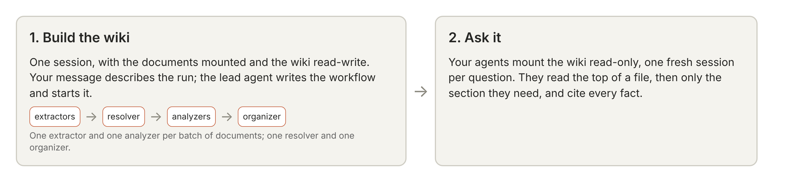

# Knowledge wiki with a dynamic workflow

*出典と矛盾を保ったままにする、エージェントによる検索（agentic retrieval）のためのナレッジ wiki である。変化の遅い文書群に対する同じ種類の質問に、エージェントで答える開発者向けである。チュートリアルであり、worked example を最初から最後まで一度実行してから、自分のコーパスに向ける。*



> Claude Sonnet 5.5 補足: 「How it works: build the wiki, then ask it read-only.」（仕組み: wiki を作り、読み取り専用で問い合わせる）という図で、左右に 2 つの枠が並び、間に右向きの矢印がある。左の枠「1. Build the wiki」は、文書をマウントし wiki を読み書き可能にした 1 つのセッションで、メッセージが実行を説明し、lead agent がワークフローを書いて開始する、と述べる。その下に extractors、resolver、analyzers、organizer の 4 つが矢印でつながり、「バッチごとに extractor と analyzer が 1 つずつ、resolver と organizer は 1 つずつ」と添えてある。右の枠「2. Ask it」は、エージェントが wiki を読み取り専用でマウントし、質問ごとに新しいセッションを使い、ファイルの先頭を読んでから必要なセクションだけを読み、すべての事実を引用する、と述べる。

このクイックスタートは、コーパスを**一度だけ**ナレッジ wiki に読み込み、その wiki から答える。ナレッジ wiki は、Claude Managed Agents のメモリストアに置いた平文の Markdown である。すべての事実に出所が付き、文書どうしの矛盾は矛盾のまま残り、置き換えられた数値は置き換えられたものとして残る。

エージェントが文書を検索するとき、質問のたびに最初からやり直しになり、文書の間にまたがる事実はどの 1 つの段落にも書かれていない。wiki があれば、小さいモデルが、wiki なしで生の文書を検索する大きいモデルとの差を 1 ポイント以内に抑えて答えられる。1 回の回答あたりの価格はその約 15 分の 1 で、小さいモデルが自分で文書を検索するときより約 3 ポイント良い。wiki の構築には、ベンチマークの平均で約 19 ドルが一度かかり（ノートブックに記録した実行は約 16 ドルだった）、ベンチマークの数値では、約 240 問でその大きいモデルに対する元が取れる。ノートブックは、これらの費用をあなた自身の実行で測る。

構築は、1 つの Managed Agents のセッションが 1 つの**動的ワークフロー（dynamic workflow）**を実行するもので、それを 1 通のメッセージで記述する。

このパターンは、エージェントが繰り返し問い合わせる、変化の遅いコーパスならどれにも合う。M&A のデューデリジェンス（worked example）、訴訟の証拠開示、製品文書に対するサポートなどである。

**読むだけなら。** ノートブックのすべてのセルには、記録した実行の実際の出力が付いている。何も実行せずに、worked case study として最初から最後まで読める。

## The corpus

worked example は、実際に完了した非公開化の案件で、EDGAR からその場で取得した公開の SEC 提出書類を使う。提出書類そのものは同梱していない。合成と明記した 2 つの小さなファイルが社内文書の代わりを務める。1 つは、会社の報告した数値とは別の基準による EBITDA の推定値を示すので、wiki が両者を分けて保つ様子を見られる。

自分の文書から構築するには、`COOKBOOK_DOCS` を、出所を記した `.txt` ファイルのフォルダーに設定する。`kw.normalize_any` は、PDF、Word、Excel、PowerPoint、メールをテキストに変換する。取引相手からの Office ファイルは信頼できない入力である。コンテナーの中か、壊れたファイルにさらしてもかまわないマシンで変換するか、信頼できるツールで先にテキストに変換する。

## What's inside

file what it is `distill_documents_into_knowledge_wiki.ipynb` the notebook: run top to bottom `prompts/` the consolidation method (`analyzer_system.md`, `organizer_system.md`, each ending in an instructions block the notebook fills when it creates the agents), the lead agent's prompt (`lead_system.md`, with the run's standing rules and the report's shape) and the baseline analyst's prompt (`baseline_system.md`) `utilities.py` the notebook's functions: uploads, session exports, following and stopping a workflow run, checks on what ran, memory-store copies and exports, pricing `build_manifest.py` queries SEC EDGAR, writes the size-tiered document manifests (`manifest_core.json`, the default tier, is a fixed list that ships here) `fetch_data_room.py` downloads the filings for a tier and converts to provenance-stamped text `fetch_real_deck.py` downloads a real board deck (scanned slides from 13E-3 exhibits) into a PDF `make_analyst_docx.py` generates the marked-synthetic Word analyst note `example_data/` the synthetic companions (analyst note, vendor CSV) `requirements.txt` the Python packages the notebook and scripts need

## How it works

1. **Build the wiki.** ワークフローの実行は、文書のバッチごとに 1 つの extractor に渡す。次に resolver が、extractor の挙げた上位の不足点に取り組み、そのあと consolidation（統合）が続く。analyzer が、登録された内容を文書と照らして確かめ、organizer が wiki 全体を整える。
2. **Ask it.** エージェントは wiki を読み取り専用でマウントし、質問ごとに 1 つのセッションを使い、すべての事実を引用する。

ノートブックはさらに、実行されたことをプラットフォームの記録と照らして確かめ、wiki を使うときと使わないときの 1 問あたりの費用を測り、エージェントのトランスクリプトから wiki を最新に保つための dreaming cookbook を案内する。

## Access

すべては **Managed Agents**（ベータ）の上で動く。Managed Agents は、メモリストア、エージェント、セッション、動的ワークフローを提供し、API の組織では既定で有効である。SDK がベータヘッダーを送る。`client.beta.agents.create` が権限の誤りを返したら、組織の管理者に尋ねる。ノートブックには Python 3.11 以降と、公開の `anthropic` Python SDK のバージョン 2.0 以降が要り、`requirements.txt` がそれをインストールする。

## Quickstart

いちばん速いのは、Claude にセットアップを進めさせる方法である。

```
cd managed-agents/knowledge-wiki
claude "walk me through setting up the knowledge-wiki quickstart"
```

または、手順を手で追う。

```
pip install -r requirements.txt

export EDGAR_USER_AGENT="your-name your-email"   # SEC asks for a contact

python3 fetch_data_room.py --tier=core   # 8 filings, 2.8 MB text: the recorded run (or --tier=quickstart)
python3 fetch_real_deck.py               # optional: 6 slides of a real board deck (~1 MB) for the normalize step
python3 make_analyst_docx.py             # optional: regenerates example_data/analyst_note.docx, which ships here
# All five manifests ship with the folder. build_manifest.py is an optional refresh from EDGAR that
# rewrites the quickstart, mini, standard and full manifests (never core); run it before fetching, not after.

jupyter lab distill_documents_into_knowledge_wiki.ipynb
```

認証は、標準の Anthropic の認証情報の連鎖に従う。認証情報の引数を何も渡さずにクライアントを作ると、`ANTHROPIC_API_KEY`（環境変数か、ここの `.env` ファイル）、`ant auth login` のプロファイル（[`ant` CLI](https://platform.claude.com/docs/en/cli-sdks-libraries/cli/authentication)、バージョン 2.0 以降）、Workload Identity Federation のうち、あなたに当てはまるものが使われる。

実行の記録は、システムの一時ディレクトリの下の新しいフォルダー（Linux では `/tmp/knowledge_wiki-<uid>/runs/`）に書かれ、あなただけが読める。多くのシステムは、マシンの再起動のときにこれを消す。長く残すには、`COOKBOOK_RECORDS_DIR` を別の場所に設定する。

## Cost and tier expectations

- 既定の `core` ティア（8 件の提出書類、2.8 MB のテキスト）での記録した実行は、23 分かかり、定価で約 16 ドルだった。
- 既定のモデルを使った。読むエージェントには Claude Haiku 5.5、lead agent と生文書のベースラインには Claude Sonnet 5.5 である。
- 記録したのは `core` だけである。ほかのティアや自分のフォルダーでは、ノートブックが構築の前に定価での見積もりを表示し、それが予算を超えていれば止まる。実際の費用は、モデル、コーパス、そのときの価格によって変わる。

ほかのティア:

- `quickstart`: 案件の周辺の短い提出書類 8 件。
- `mini`: 26 件の提出書類で、`core` よりテキストが少ない。
- `standard`: 37 件の提出書類。
- `full`: 案件の期間の 42 件すべてで、`core` にある FY2022 の年次報告書は含まない。

別のティアを取得する前に、`data_room/docs` を空にする。構築はフォルダーにあるものをすべて読み、別のティアのファイルがあると、取得スクリプトは止まる。

- **ファイルの大きさ:** ストアの中のファイルは 100 KB が上限である。大きなコーパスでは、主な会社のエンティティページと赤旗のファイル（`escalations.md`）がより早くそこに達し、リンクした複数のファイルに分けなければならない。
- **共有ページ:** エージェントは共有ページに直接書き込むので、ときどき互いに上書きする。いちばん混み合うエンティティページに登録した行のうち、約 5% で内容が失われる。共有ページには、異なる文書の数値が集まり、エージェントがその食い違いに旗を立てられるので、この損失は受け入れている。
