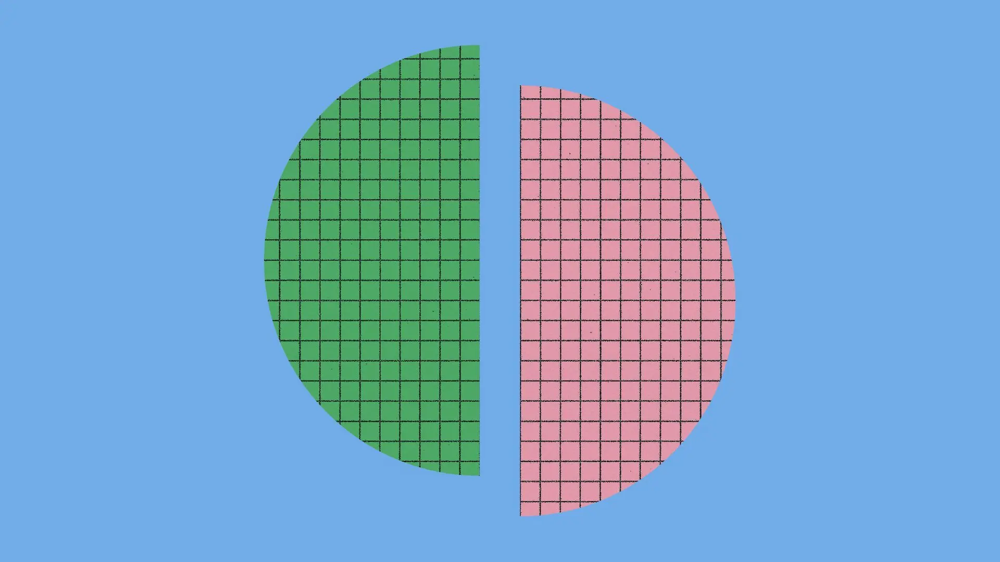
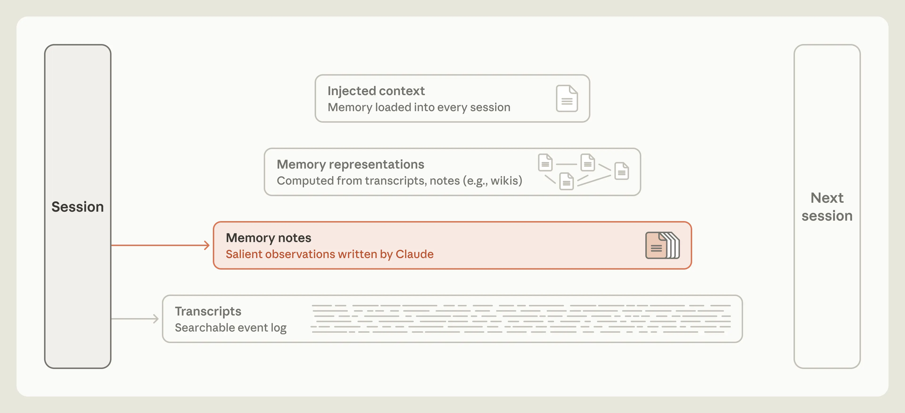
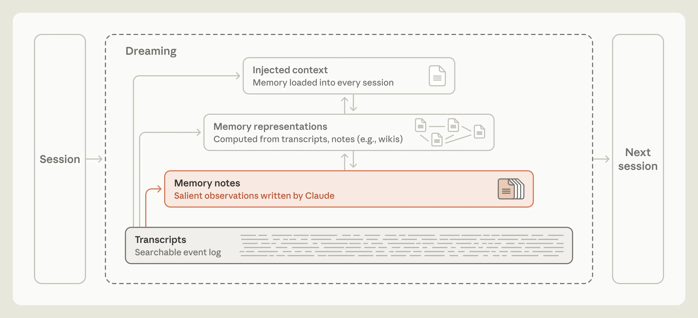
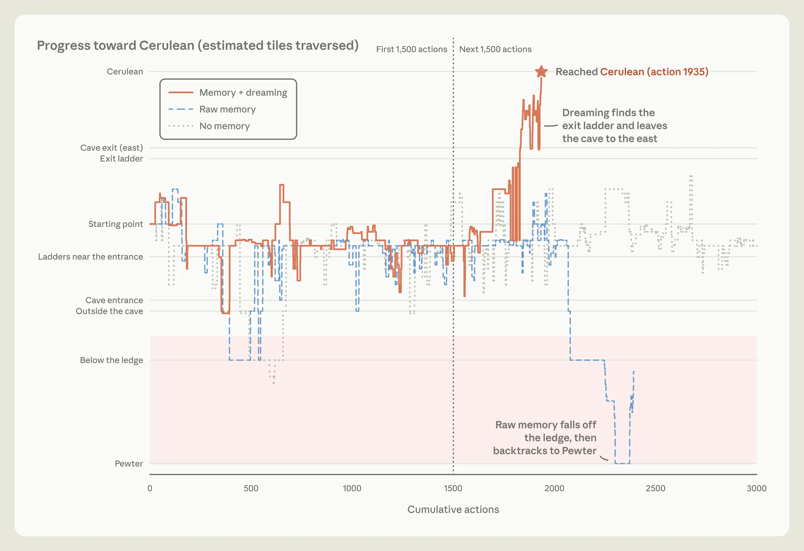
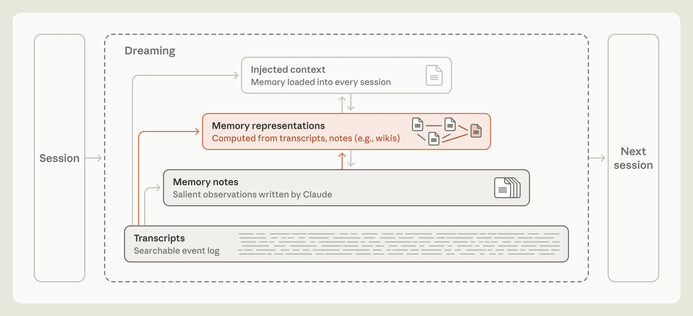
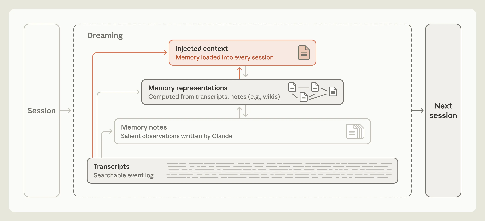

# エージェントのメモリの構成要素

> Claude Sonnet 5.5 補足: 薄い青の背景の上で、グリッド模様のある緑とピンクの半円が、少しずらして隙間を挟んで向かい合っている抽象的なイラスト。元の alt は「グリッド模様のある、ずれた 2 つの半円のイラスト。1 つは緑、もう 1 つはピンクで、薄い青の背景の上で隙間を挟んで向かい合っている」。記事の内容を直接示す図ではなく、冒頭の飾りの画像である。

**Published**

Nov 6, 2026

**Team**

[Engineering](https://www.anthropic.com/engineering)

Søren Kierkegaard は、人生は*後ろ向きに*しか理解できないが、*前向きに*生きなければならない、と書いた。AI エージェントのメモリを設計するときにも、これと似た板挟みに突き当たってきた。

人間は、生活のなかで絶えず記憶を符号化している。その中心を担うのが[海馬](https://stanford.edu/~jlmcc/papers/McCMcNaughtonOReilly95.pdf)で、体験をその場で捉えるので、記憶はすばやく形成され、すぐに使える。しかし、長期的な知識として定着するのは、[一部の体験](https://www.science.org/doi/10.1126/science.adk8261?referrer=https%3A%2F%2Fwww.google.com%2F)だけである。

その定着の多くは、脳がオフラインのときに起こるらしい。眠っているときや、静かな[休息](https://www.nature.com/articles/s41467-018-06213-1)の間に、海馬は最近の体験を再生する。これによって、[体験が少しずつ抽出され、新皮質に統合される](https://www.nature.com/articles/s41593-019-0467-3)と考えられている。新皮質は、私たちが知識と呼ぶものの大半を蓄えている脳の部位である。

エージェントのメモリも、同じような分業を使える。エージェントは、作業の多くをログやトランスクリプトに残す。Letta と UC Berkeley の研究者は、モデルがやり取りの合間の空き時間を使って既存のコンテキストを整理し直す方法として、[sleep-time compute](https://arxiv.org/abs/2504.13171) を提案した。同じ考え方は、ログを振り返って誤りを直したり、新しいノートや表現を作ったりすることで、エージェントがメモリを整理するのにも役立つ。この過程は、しばしば[*ドリーミング*（dreaming）](https://platform.claude.com/docs/en/managed-agents/dreams)と[呼ばれる](https://research.google/blog/the-sleep-framework-a-new-way-for-llms-to-retain-knowledge-in-continual-learning/)（図 1）。

ドリーミングは、Claude に効果的なメモリを持たせるのに役立つ道具だと分かってきた。この記事では、エージェントのメモリをどう考えるようになったかを共有し、ドリーミングの利用を含めて、エージェントのメモリを調べるのに使ってきた評価をいくつか順にたどり、それぞれの構成要素がメモリの整理に何をもたらすかを述べる。

> Claude Sonnet 5.5 補足: 1 回のセッションから次のセッションまでのメモリの階層を示す図。下から上へ、トランスクリプト（検索できるイベントログ）、Claude が書いたメモリノート、wiki などのメモリ表現、そしてすべてのセッションに読み込まれる注入コンテキストが積み重なっている。「Dreaming」と書かれた箱の中では、トランスクリプトから各層へ矢印が伸び、上の隣り合う層どうしの間は両方向の矢印でつながっている。本文の図 1 にあたり、以降の図はこの階層の一部を強調して示す。

Claude は、ドリーミングを使ってメモリを整理できる。これによって、誤りを直し、ノートを作り、新しいメモリ表現を組み立て、今後のセッションに前もって読み込まれるものを形づくれる。

### メモリノート

ここで「エージェントのメモリ」と言うのは、Claude が経験（ユーザーとのやり取りや、与えられたタスクを含む）から得て、セッションをまたいで保持する知識のことで、あとで読めるコンテキストとして保存されたものである。モデルが学んだりコンテキストを管理したりするほかの方法は含まない。たとえば、*重み*（訓練で設定される内部のパラメーター）の変更、[*文脈内学習*](https://www.anthropic.com/research/in-context-learning-and-induction-heads)（1 つの会話の中で得られる知識）、[*コンパクション*](https://platform.claude.com/docs/en/build-with-claude/compaction)（Claude が書いた要約で古いターンを置き換え、新しいコンテキストウィンドウで作業を続けられるようにするもの）である。

人間の脳では、体験の前、最中、後に放出される化学信号が、その記憶が重要だと[印を付ける](https://www.nature.com/articles/385533a0)ことがある。印の付いた記憶は、オフラインの間に、印のない記憶より頻繁に再生される傾向がある。*リプレイ*と呼ばれるこの過程は、記憶を安定させ、長期記憶に統合するのを助ける。

同様に、Claude は、セッションのログの中の目立つ出来事に、起きたその場で印を付けておき、あとで見つけやすくすることもできるし、メモリノートのフォルダーのようなメモリストアにそれらを[書く](https://platform.claude.com/docs/en/agents-and-tools/tool-use/memory-tool)こともできる（図 2）。しかし、次に何が来るかをまだ知らない、その場で、何が目立つかを Claude はどうやって判断できるのだろうか。

> Claude Sonnet 5.5 補足: 図 1 と同じメモリの階層で、メモリノートの層を強調した図。セッションからメモリノートへ直接矢印が伸びており、これは Claude が書く目立った観察であると説明されている。本文の、Claude が実行中にノートをメモリへ書くという説明に対応する。

Claude は、メモリにノートを書ける。

### メモリは、将来に何が必要になるかについての予測でありうる

メモリは、ときに予測である。規則を書き留めることで、エージェントは、その規則が述べるパターンがまた関係してくると予測している。たとえば、確認済みの事実を書き留めるのは、将来のセッションのエージェントが、その事実を再確認せずに頼りたがるだろうという予測である。時間がたつにつれて、Claude は、この種の予測がはるかにうまくなった。

[Continual Learning Bench (CL-Bench) 1.0](https://continual-learning-bench.com/news/cl-bench-1-0/) のタスクを考えてみよう。これは、長い時間にわたるタスクに取り組むために、エージェントがメモリを使う能力を測るベンチマークである。あるタスクでは、Claude がデータベースで情報を調べて、一連の質問に答える。Claude が答えを出すと、正しい解が知らされ、今後の質問に答えるのを助けるメモリを書ける。

ここでは、メモリが学習のループを支えられる。Claude が質問を間違えたら、その失敗を記録し、何が悪かったかの仮説を立て、仮説を検証し、分かったことを今後の答え方の規則にできる。

私たちは、[Claude Managed Agents](https://platform.claude.com/docs/en/managed-agents/overview) を使って CL-Bench 1.0 のタスクを実行した。Claude は、質問ごとに新しいセッションで始めた。例外は 1 つで、セッションからセッションへ残る[メモリディレクトリ](https://platform.claude.com/docs/en/managed-agents/memory)からファイルを取り出せた。

モデルによって、自分で学習のループを作る成功の度合いは違った。Claude Sonnet 4.6 は、答えが間違っていた理由の仮説を作るところまで進んだ。そのメモリディレクトリには、まだ検証していない推測をいくつも並べたファイルが散らばっていた。

> Claude Sonnet 5.5 補足: CL-Bench のデータベースタスクで、メモリなしのベースラインとメモリストアありを、モデルごとに比べた図。左の棒グラフは平均報酬を示し、ベースラインからメモリありの順に、Opus 5.5 は 0.655 から 0.838、Sonnet 5.5 は 0.644 から 0.833、Opus 5 は 0.564 から 0.828、Opus 4.7 は 0.383 から 0.700、Sonnet 5 は 0.306 から 0.610、Sonnet 4.6 は 0.330 から 0.364 である。右の折れ線グラフは、30 問にわたる累積の平均報酬を、メモリありを実線、ベースラインを破線で示す。新しいモデルほどメモリによる上積みが大きく、Sonnet 4.6 だけは上積みが小さい。

CL-Bench のデータベースタスクで、メモリありと、状態を持たないベースラインをモデルごとに比べた。

Claude Opus 4.7 は、ノートを 1 つの参照文書にまとめ、確認した事実と、まだ確認していない事実を区別して印を付けるようになった。Claude Sonnet 5 は、採点者が確認したあとに、それぞれの答えを確認済みと印付けし、間違えたときは訂正を書いた。

Claude Opus 5 は、これらのモデルのなかで、初めてループを閉じた。エントリーの多くには、規則（とその規則が正しいとどう分かったか）、以前の質問への答え、途中で見つけた落とし穴についてのはっきりした警告が含まれていた（図 3）。

Opus 5 と同様に、Claude Opus 5.5 と Claude Sonnet 5.5 も、どちらもループを閉じ、今後の質問に最もよく答える方法についての検証済みの規則を、メモリに記録した。メモリありのときの点数は、どちらも Opus 5 とほぼ同じだったが、メモリなしのときの性能は、わずかに高かった。

### Claude は、何が目立つかを判断することを学んだ

私たちは、*Pokémon Red* を遊ぶ Claude の能力も評価した。このゲームは、複雑で長い時間にわたるタスクを、Claude が[切り抜けるという課題](https://www.youtube.com/watch?v=CXhYDOvgpuU)を与えるもので、*何を*メモリに保存するかについての Claude の判断を試すものである。各回の最初に、各モデルに、遊びながら読み書きできるメモリファイルのフォルダーを渡した（図 4）。

Claude Sonnet 3.7 と Claude Fable 5 について、それぞれ 1 回の実行のメモリフォルダーを、ゲームの約 10,000 ステップ目の時点で比べた。気づいた大きな違いは、それぞれのモデルが何を覚えておく価値があると考えたかだった。Sonnet 3.7 は、すべてが重要かもしれないと考え、区別せずにメモリへ書いた。そのメモリフォルダーには、遭遇の記録が蓄えられており、戦った戦闘、見つけたアイテム、出会ったノンプレイヤーキャラクターのそれぞれに、別々のファイルがあることも多かった。最終的に、Sonnet 3.7 は 225 のフォルダーにわたって 413 個のメモリファイルを書き、バッジを 1 つ獲得した（バッジは、プレイヤーがゲームをどこまで進めたかの印である）。

これに対して Fable 5 は、2 つのフォルダーに 9 個のファイルと、最上位の `global.md` という 1 個のファイルを書き、バッジを 4 つ獲得した。

> Claude Sonnet 5.5 補足: Pokémon のメモリディレクトリを、同じ縮尺の 2 つのツリーマップで比べた図。面積がメモリの文字数を表す。Claude Sonnet 3.7 のものは大きく混み合っており、locations、main、battles と、いくつかの「consolidated」のフォルダーにわたって、413 ファイル、977,930 文字がある。Claude Fable 5 のものは小さく、locations、gameplay、global.md に 10 ファイル、43,406 文字がある。本文の、書きすぎるメモリと絞ったメモリの対比に対応する。

Pokémon を遊んだときの、Claude の Sonnet 3.7 と Fable 5 のメモリディレクトリ。

Sonnet 3.7 のやり方が問題だったのは、主に、Pokémon のゲームの状態が絶えず変わるので、Sonnet 3.7 の詳細な記録が、次々に古くなっていったからである。その結果、Claude は進むにつれて、ゲームを遊ぶよりも、自分のメモリを調べ回すことに、より多くの時間と資源を使わなければならなかった。たとえば 10,000 ステップのあたりで、Sonnet 3.7 は 4 つ目の「master」メモリファイルのフォルダーを始めた。その後の 17 ステップの間に、6 個のファイルを作り、ほかの 9 個を削除し、ゲームの中では何の行動も取らなかった。

Fable 5 のやり方は、ゲームが明示的には教えてくれないことのために、メモリを使った。Sonnet 3.7 がメモリへ書いた種類の情報のなかには、プレイヤーがいくらお金を持っているか、プレイヤーが地図のどこにいるかのように、毎ターン画面から読み取れるものがあり、それを保存するのは冗長である。これに対して、戦略、計画、検証済みの規則についてのメモリファイルは、Claude が自分で見つけ出したときにだけ存在し、Claude が書き留めなければ消えてしまう。

Fable 5 は、それに合わせてメモリを整理した。`global.md` ファイルはダッシュボードの役目を果たし、現在の目標、ジムを攻略するための事前に書いた計画（ジムはバッジを獲得する挑戦の場である）、そしてメモリを使うための、このモデル自身の規則を保持していた。`locations` フォルダーには、特定のルートを進むための計画があり、`gameplay` フォルダーには、ゲームの仕組みについて学んだことに基づく戦略があった。たとえば、モンスターボール（Poké Balls）を 7 回続けて使っても Magikarp（最も捕まえやすい Pokémon の 1 つ）を捕まえられなかったあと、Claude は「If 3+ balls fail in a row, VARY the timing (insert extra ‘wait’ presses between menu steps) - the catch landed right after doing this.」と書いた（3 回以上続けてボールが外れたら、タイミングを変える、という意味）。

はるかに小さなメモリフォルダーで、Fable 5 は Sonnet 3.7 よりずっと先までゲームを進めた。Opus 5.5 も似たやり方を取った。現在の目標と次の手順を記録する小さなメモリノートのフォルダーを保ち、遊びながらそれを書き直し、ゲームをクリアした。

### Claude にメモリを書くよう促す

メモリが何のためのものかは Claude に伝えるが、*どう*使うかは伝えないほうがよいと分かった。CL-Bench では、メモリのフォルダーが使えることを伝えただけである。この一般的な指針で、Opus 4.7 と Opus 5 はメモリを効果的に使うのに足り、どちらも性能がはっきり上がった（図 3）。

メモリへ何を書くべきかについての具体的な規則をモデルに与える試験も行い、1 回の試験につき規則を 1 つにした。各規則を与えたときにそれぞれのモデルがメモリから得た上積みを、規則を与えなかったときの上積みと比べた。規則を「失敗だけを記録する」にすると、Opus 5 と Opus 4.7 の両方が、メモリがもたらした性能の上積みの多くを失った（図 5、右）。より強いモデルでは、何が目立つかを判断する自由を与えるほうが、規則をあらかじめ決めるより効果的であり、そうした規則は性能を弱めることがありえた。

> Claude Sonnet 5.5 補足: 左は、CL-Bench のデータベースタスクでの Sonnet 4.6 の平均報酬の棒グラフで、ベースラインが 0.330、メモリありが 0.364、メモリありに改良した指示を加えると 0.641 になる。基準線として、メモリありの Opus 4.7 が 0.700、メモリありの Opus 5 が 0.828 に引かれている。右は、「失敗だけを記録する」よう言われたときのメモリの上積みの変化で、Opus 5 は −0.234、Opus 4.7 は −0.150、Sonnet 4.6 は −0.020 である。左は指示で古いモデルが伸びること、右は強いモデルほど固定の規則で損をすることを示している。

左: メモリの使い方を導く促しがある場合とない場合の、CL-Bench のデータベースタスクでの Sonnet 4.6。右: 失敗だけを記録するよう言われたとき、各モデルのメモリによる上積みがどれだけ変わったか。

また、促しは古いモデルに最も役立つことにも気づいた。たとえば Sonnet 4.6 は、メモリディレクトリのファイルをよく読まず、答えが間違っていた理由についての仮説も検証しなかった。

この場合、答える前にメモリファイルを読み、そのうえで仮説を明示的に検証するよう Claude に促すと、ベンチマークの点数はほぼ 2 倍になった（図 5、左）。Sonnet 5 は、これを自分でやる。促されなくても、答える前にメモリを読んだのは 10 回中 9 回だった。比べると、Sonnet 4.6 がこうしたのは半分に満たなかった。

最先端の Claude モデルには、人に頼まれたとき、またはいかにも覚えておく価値があるときにメモリノートを作る、という簡単な指針を与えるのがふつうで、その判断は Claude に任せている。

### ドリーミングは、メモリを訂正できる

Claude は、セッションの中で目立つと判断したものに基づいてメモリへ書くので、最初から間違っているノートや、環境が変わるにつれてずれていくノートは、のちのセッションで Claude に読まれ、信頼されうる。

ドリーミングは、Claude がノートを元のトランスクリプトと照らして検証する方法を与える（図 6）。Managed Agents で、メモリ用のディレクトリをマウントして Claude に Pokémon を遊ばせたときに、その好例を見た。

> Claude Sonnet 5.5 補足: ドリーミングを含むメモリの階層で、トランスクリプトの層からメモリノートの層へ伸びる矢印を強調した図。ドリーミングが、ノートをトランスクリプトと照らして訂正する様子を示している。本文の、ノートの誤りをトランスクリプトで検証する説明に対応する。

ドリーミングは、メモリの誤りを訂正できる。

ゲームのある場面で、プレイヤーは Mt. Moon を抜けなければならない。これは洞窟の連なりで、入り口が地図の西側、出口が東側にある。入り口の近くには罠がある。一方通行の崖で、そこからプレイヤーは、来たルートへ落とされ、登り戻る明確な方法がない。Claude は、山の入り口にある建物の PokéCenter を目印にしていたので、崖から落ちるかどうかは、PokéCenter が山のどちら側にあると考えているかに左右された。

あるとき、Claude は PokéCenter が東側にあると（誤って）書き留めた。PokéCenter から外に出たとき、Claude は「Mt Moon is behind me」と宣言し、ノートを「Mt Moon DONE」に更新した。しかし、Mt. Moon は背後にはなかった。数手あとで、Claude は崖を越えて、来たルートに降り立った（図 7）。ナビゲーションのツールには落下が表示されなかったので、Claude は「I overshot far west」と結論し、ずっと正しい側にいたのだと考えた。そうではなかった。

> Claude Sonnet 5.5 補足: 崖のそばにエージェントがいる Pokémon の地図の 2 つのパネル。左の「Raw memory」では、保存されたノートが誤っており、矢印はエージェントが次の街へ向かうことを示す。右の「Memory + dreaming」では、オフラインの処理がノートを訂正しており、矢印はエージェントが洞窟の入り口へ戻ることを示す。本文の、訂正前と訂正後のノートで行動が分かれた例に対応する。

訂正されたメモリノートは、Pokémon での結果を変えた。訂正されていないノートでは、Claude は「Mt Moon is behind me」と言い、次の街へ向かい、来たルートに戻ってしまう。ドリーミングで訂正されたノートでは、「Now I need to find the Mt Moon cave entrance to re-enter」と言い、洞窟に戻る。

次に、ドリーミングが、Claude がこの罠を避けるのを助けられるかを試した。PokéCenter の誤った位置を含むメモリフォルダーに対して、ドリーミングを実行した。Claude は、ノートをセッションのトランスクリプトと照らし、自分の誤りを見つけ、書き直した。トランスクリプトは、メモリを検証するための正解を Claude に与えた。訂正されたメモリノートによって、Claude はまっすぐ Mt. Moon に戻り、やがて Cerulean City に着いた。

訂正されていないノートでの実行では、Claude は 3 回、先ほどのルートに落ちた。3 回目の失敗のあと、Claude は諦めたように見え、「I’m going to stop rather than keep looping.」と書いた。私たちの設定の自動返信は、続けるよう指示した。そこで Claude は続け、山の手前の街である Pewter City まで戻った。そこで回復と補給をしたかったのである。この実行は、Claude が Cerulean City に着かないまま終わった。

> Claude Sonnet 5.5 補足: 累積 3,000 回の行動にわたる、Cerulean への進み具合の折れ線グラフ。メモリにドリーミングを加えた実行は、行動 1,935 回目で Cerulean に着く。生のメモリの実行は崖から落ち、Pewter まで引き返す。メモリなしの実行は Cerulean に着かない。本文の、3 つの実行の結果の違いに対応する。

ドリーミングがメモリを訂正し、Claude は洞窟に戻って次の街に着く。訂正されていないノートでの実行（「Raw memory」）は山を越えられず、メモリなしの実行も越えられない。

### ドリーミングは、新しいメモリ表現を組み立てられる

ドリーミングで、Claude は、メモリの中を進むのを助ける表現を作れる（図 9）。Claude が使うメモリ表現の 1 つの種類が、[*wiki*](https://gist.github.com/karpathy/442a6bf555914893e9891c11519de94f) と呼ばれるものである。これは、Claude が書いて維持するページの集まりで、ある 1 つの主題について Claude が知っていることを集め、ほかのノートにリンクする。これらのリンクは、Claude がメモリをふるいにかけ、必要なときに記憶を効率よく見つけるのに使える地図を、実質的に与える。

> Claude Sonnet 5.5 補足: ドリーミングを含むメモリの階層で、トランスクリプトの層と、メモリノートの層から、wiki などのメモリ表現の層へ伸びる矢印を強調した図。ドリーミングが、トランスクリプトとノートの両方から表現を組み立てることを示している。

ドリーミングは、メモリ表現を組み立てられる。

wiki のような表現は、増え続ける Claude の知識ベースをたどるのに役立つ。メモリ表現としての wiki の利点を、社内文書のコーパスを使って調べた。これは、5 月に買収したソフトウェア企業の Stainless の、約 350,000 ファイル、およそ 4.2 億トークンの文書である。このコーパスについて 25 問の評価セットを作り、探索のための検索ツールを Claude に与えた。また、ドリーミングを使って、これらのファイルに基づく wiki を組み立てるよう Claude に指示した。128 回のセッションにわたって、Opus 5 のエージェントに、ファイルを探索し、リンクされた wiki ページを書くか訂正し、重複を統合し、主張をソースと照らして確かめるよう促した。

各セッションは、前のセッションでエージェントが進めたことの上に積み重なり、共有のログを使って作業を調整した。ドリーミングを 2 セッションから 128 セッションに拡大すると、25 問での性能は、採点基準の 13% から 48% に伸びた（図 10）。

Claude は、wiki を少しずつ組み立てる。最初の wiki を作ったあと、続くドリーミングの回で、それに加え、編集し、刈り込む。ドリーミングの初期の回では、Claude の知識は新入社員のようなもので、wiki だけに基づいて質問に答える能力は限られている。ドリーミングを重ねるほど、知識の地図は豊かになり、経験を積んだ社員のようになる。私たちの試験では、検索ツールも使えるようにしたときに、wiki が Claude に最も役立つと分かった。検索と wiki の両方を使うと、その wiki が育つにつれて、Claude の総合点は 54% から 61% に上がった。検索ツールだけを使ったときは 53% だった。Claude の最高点は、wiki だけで質問に答えたときの 48% だった。検索と wiki を使うと、1 問あたり約 20,000 トークンの節約にもなった。

> Claude Sonnet 5.5 補足: wiki の生成が 2M から 128M のドリーミングトークンに増えるにつれて満たされた採点基準を示す、3 つの部分からなる図。中央の折れ線グラフ（Opus 5 が作った wiki）では、wiki と検索ツールの併用は 54% から 61% に上がり、wiki だけは 13% から 48% に上がり、wiki なしで検索ツールだけの場合は 53% で横ばいである。横軸は対数目盛りで、1 セッションあたり 1M トークンの予算である。左は 2 セッション後の wiki のネットワーク図で 103 ページ、766 リンク、右は 128 セッション後で 222 ページ、12,893 リンクであり、後から追加されたページが色で示されている。

中央: Claude が連続するセッションで wiki を組み立てるにつれての、ある会社の文書のコーパスについての 25 問の点数。左と右: 2 セッション後と 128 セッション後の wiki の例。点が 1 ページで、線がリンクされたページを結ぶ。

どの種類のタスクが、Claude が wiki を持つことで利益を得るかを試したかった。そのために、[Harvey LAB](https://github.com/harveyai/harvey-labs) ベンチマークと、合併についての文書の集まりを使った。このベンチマークは、文書の集まりを Claude に与え、その内容に基づいて法律の準備書面を作るよう求める。そして、準備書面を採点基準の一覧に照らして採点する。Pokémon の実行に比べると、おそらく少し面白みに欠けるが、これらの評価は、wiki を組み立てるための多様な文書の集まりを与えてくれる。

文書から wiki を組み立てるよう Claude に指示した。そのうえで、（合併についての）質問に答えるか、（LAB ベンチマークの）法律の準備書面を作るかを、wiki からと、ファイルを直接検索するのとの両方で行わせた。ある試験では、合併についての 24 問を出し（図 11、左）、その半分以上は、Claude が複数の文書をまたいで情報を見つける必要があり、多くは判断や計算も必要だった。それらの項目（赤とオレンジの線）では、wiki を参照したときの Claude の点数は 87% で、検索だけを使ったときの 73% を上回った。

> Claude Sonnet 5.5 補足: 採点基準と、それを満たすのに必要な元の文書を結んだ 2 つの図。左は wiki の利点が大きかったタスクで、24 の基準の大半が 10 の文書のうち 2 つ以上につながり、9 つは判断か計算を要する。右は wiki の利点が小さかったタスクで、57 の基準の大半は、1 つの文書（多くは取引の概要メモ）の中の文字列検索で見つかる。

各パネルは、採点された項目（左）と、それぞれを満たすのに必要な元の文書（右）を並べている。左: 合併についての 24 問で、主に公開されている提出書類を見れば答えられる。基準の半分以上が、複数の文書の情報を組み合わせる必要があった。右: wiki にはっきりした利点が見られなかった LAB のタスク。基準の大半は、1 つの文書から満たせた。

wiki があまり役に立たなかった場合もある。ある LAB タスク（図 11、右）では、準備書面の基準が、1 つの文書の中の文字列検索で見つかることが多く、wiki は、検索に比べて性能のはっきりした向上を示さなかった。別の LAB タスクでは、wiki が文書そのものより大きくなった（図 12）。Borges の 1 段落の短編「学問の厳密さについて」（“On Exactitude in Science”）の地図職人たちが、表す帝国と同じ大きさになるほど詳細な地図を作ったように、Claude は極めて詳細な wiki を作ってしまい、実質的には何も抽象化していなかった。

> Claude Sonnet 5.5 補足: wiki の構築と 2 回目の処理を示す図。左の円はコーパスで、10 文書、115 KB のテキストである。矢印はそこから組み立てた wiki を入れた、より大きな円につながり、68 ページ、255 リンク、203 KB で、コーパスの 1.77 倍である。wiki のページの一部には、リンクがない。本文の、wiki が元の文書より大きくなった例に対応する。

wiki は、元のファイルより大きくなった。

### ドリーミングは、メモリの階層の上へノートを引き上げられる

ドリーミングは、ノートをメモリの階層の最上位に浮かび上がらせることもでき、エージェントのハーネスは、それらを、すべてのセッションの始まりに、Claude のコンテキストへ前もって読み込める（図 13）。これは、Claude がそれらを検索する必要がなく、検索すべきものがあることを知っている必要さえない、ということである。

メモリを新しいセッションに引き上げること（*コンテキスト注入*の一種）は、慎重に行わなければならない。注入されたメモリは貴重なトークンを使い、誤ったノートはすべてのセッションに持ち込まれうる。ノートを読み込んでも、Claude がそれに従うとは限らない。[Claude Code](https://code.claude.com/docs/en/memory) のドキュメントは、指示ファイルが長いほど従う度合いが下がると警告している。そのため、メモリの階層の最上位の層は、比較的小さく保たなければならず、ここでのドリーミングの仕事の多くは、一部の詳細を階層の下へ移し、リンクを残すことで、それを保つことである。

[Claude Code の auto memory](https://code.claude.com/docs/en/memory) も、同じやり方で注入する層を小さく保ち、Claude がセッションの間にそれを維持する。Claude は、auto memory のすべてを、各セッションのコンテキストウィンドウに読み込むわけではない。読み込むのは、`MEMORY.md` の最初の 200 行か 25 KB だけである。この先頭部分は索引の役目を果たし、Claude に、何を知っていて、どこで見つけられるかを示す。

> Claude Sonnet 5.5 補足: ドリーミングを含むメモリの階層で、トランスクリプトの層と、メモリ表現の層から、最上位の注入コンテキストの層へ伸びる矢印を強調した図。注入コンテキストは、次のセッションへ入っていく。本文の、ドリーミングが最上位の層を書くという説明に対応する。

ドリーミングは、メモリの階層の最上位に書ける。注入コンテキストはすべてのセッションに読み込まれ、その下の層は、Claude が必要なときに読まれるか検索される。

### ドリーミングは、特定の目標にメモリを集中させられる

ドリーミングは、メモリがどう育つかを形づくることもできる。たとえば、[Claude Duet](https://support.claude.com/en/articles/17631495-get-started-with-claude-duet) のようなアシスタントは、助ける相手の人を中心に整理されたメモリを持つことでよく利益を得、ドリーミングは、特定の目標のためにメモリを組み立てるよう調整できる。

メモリがどう育つかを導く指示は、タスクによって違い、実際にどの情報が重要かを Claude に伝える。たとえば、LAB ベンチマークのあるタスクは、会社の買収を模し、契約の集まりを与える。準備書面は、契約の条件を正しく述べているかで採点される。

最初は、wiki を作るための基本的な指示から始め、wiki を*どう*使うかは Claude に伝えなかった。このタスクは、契約の条件に大きく依存していた。wiki が組み立てられている間に、複数のエージェントが、契約条件の共有の表に同時に書き込んだ（図 14、左）。

> Claude Sonnet 5.5 補足: 2 つの図の組。左の「前」では、4 つのエージェントが同じ共有ページ provisions.md に書き込み、1 つのエージェントの保存が別のエージェントの行を消してしまい、採点された 57 の事実のうち 41 が残った。右の「後」では、4 つのエージェントがそれぞれ自分の契約のページを書き、条件を一語一句そのまま写し、57 の事実のすべてが残った。本文の、指示の変更前後での wiki の違いに対応する。

指示を変える前と後で、採点された契約の事実が、いくつ wiki に入ったか。左: 複数のエージェントが 1 つの共有ページに書き、57 の事実のうち 41 が残った。右: 契約ごとに 1 つのエージェントが、それぞれ自分のページに、条件を一語一句そのまま引用して書き、57 の事実のうち 57 が残った。

その結果、重要な事実が欠けた wiki になった。wiki から生成した準備書面を採点したとき、Claude が含めていたのは 57 の事実のうち 41（72%）だけだった。何がまずかったかを調べると、エージェントがお互いの作業を上書きしたために、共有の表が契約の条件を不十分にまとめていて、一部が完全に欠けていた。

契約の条件は wiki の最も重要な部分だったが、指示はそう言っていなかった。より良い指示を見つけるために、Claude が自分の失敗を振り返り、指示の変更を提案し、wiki を作り直すループを回した。このループで、Claude は契約の条件を押さえることがどれほど重要かを見つけ、それに合わせて wiki を作るための指示を書き直した。

各契約は、wiki の中でそれぞれ自分のページを持ち、1 つのエージェントが書き、条件を共有の表に要約するのではなく、一語一句そのまま引用した。この改良した wiki から生成した準備書面を採点すると、基準の 100% を満たせ、72% から上がった。

### ドリーミングは、セッションが残す隙間を埋められる

Claude がメモリノートを書くとき、見えているのは*その*セッションのコンテキストだけである。ドリーミングは、多くのセッションにわたって検索し、共通のパターンを見つけたり、共通の誤りを訂正したりできる。

LAB ベンチマークの wiki を組み立てているとき（例として図 14 を参照）、Claude が、まだ作られていないページへリンクすることがあった。2 回目のドリーミングの処理で、こうした隙間の多くが埋まった。あるタスク（図 15）では、ドリーミングが、wiki の中の存在しないページへの 9 本のリンクを見つけ、同じ文書の既存のページに向け直した。また、wiki を改善するために、索引を含む 3 つの新しいページを加えた。

> Claude Sonnet 5.5 補足: wiki の 2 つのネットワーク図。2 回目の処理の前は、38 エントリーと 225 リンクで、6 ページからの 9 本のリンクが、存在しないページ「escrow-agreement」を指している。処理の後は、41 エントリーと 278 リンクで、9 本のリンクのすべてが「buyer-form-escrow-agreement」を指し、index、instructions email、escalations の 3 つの新しいページが加わっている。本文の、切れたリンクの修復の例に対応する。

2 回目のドリーミングの処理の前と後の wiki。

### 後ろを向いて考え、前を見る

エージェントのメモリシステムをどう設計するかには、未解決の問いが多い。1 つは、Claude がいつメモリを作るべきかである。Claude がタスクに取り組んでいるとき、メモリストア（フォルダー、ファイル、データベースなど）へ書けるので、目立つことを源で捉え、重要な詳細を今後のターンやセッションですぐ使えるようにできる。しかし、その場でノートを記録することは、避けがたく、Claude の注意を本来のタスクからそらす。対照的に、ドリーミングは、メモリの作成を背景に押しやれるが、ドリーミングの出力は、Claude がすぐには使えないかもしれない。

もう 1 つの問いは、メモリを確実に最新に保つ方法である。Claude は、誤った予測をしたり、最初から間違っている規則をメモリに書いたりしうる。また、環境が変わるにつれて、メモリはずれ、無関係になりうる。ドリーミングは、こうした誤りを直す 1 つの方法である（図 8）が、計算資源を必要とする。*すべての*メモリを絶えず確認するよう Claude に指示するのは、現実的でないかもしれない。代わりに、ドリーミングを、変わりそうな情報に集中させたり、ドリーミングの頻度を（たとえば、メモリが使われる頻度に基づいて）慎重に調整したりすることが重要かもしれない。

トランスクリプトの検索を、Claude のメモリの土台と考えるのも、理にかなっている。表現（wiki など）と検索を組み合わせること（図 10）は、ときに効果的でありうる。しかし Claude は、メモリ表現を維持し、誤りや幻覚が蓄積しないようにするために、計算資源を使う必要がある。

何が目立つかについての Claude の判断は向上したが、今後のターンで何が起こるかを本当に知りうるモデルはない。ドリーミングは、Claude に、*後ろ*を振り返り、計算資源を使ってメモリを整理し、誤りを直し、今後のセッションがメモリにもっと簡単にアクセスできる表現を維持する機会を与える。Claude がより高性能になるにつれて、メモリシステムは進化するだろう。Claude のメモリシステムの設計について、学ぶべきことはまだ多い。

ドリーミングの[入門](https://platform.claude.com/cookbook/managed-agents-cma-dreaming-with-a-dynamic-workflow)と、[ナレッジ wiki](https://github.com/anthropics/claude-quickstarts/tree/main/managed-agents/knowledge-wiki) のクックブックを参照してほしい。

## 著者と謝辞

### 謝辞

執筆は Lance Martin。編集上の助言は Caitlin Love、Tom Chivers、Rebecca Hiscott、Jake Eaton、Blake Wilson による。有益な議論と貢献について Barry Zhang、Theodora Chu、Daliang Li、Mahesh Murag、Jake Noble、Ravi Trivedi、Tina Vachovsky、Brad Abrams、Henry de Valence、Jeremy Fox、Matt Bell、Allen Li、Chris Gorgolewski、Eugene Yan、Artur Renault、Wei Zhang、Kevin Chen に、また Claude Plays Pokémon について David Hershey に感謝する。図は Monika Tuchowska による。
