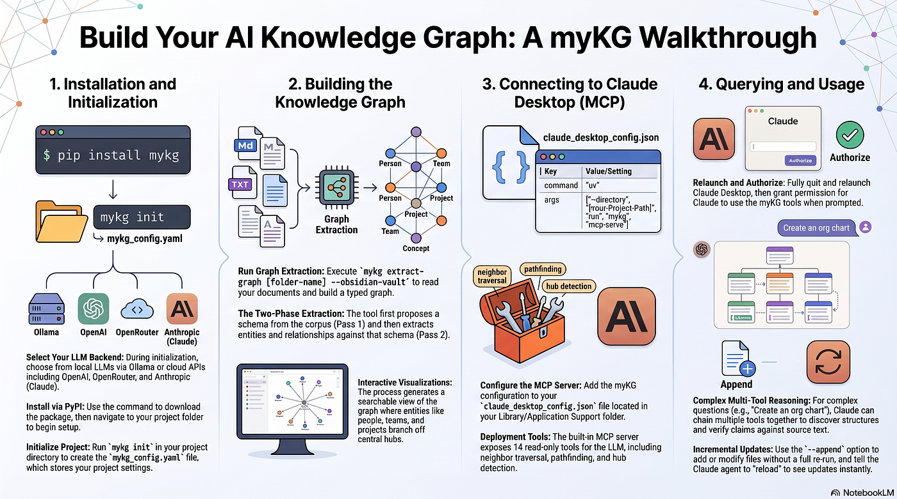
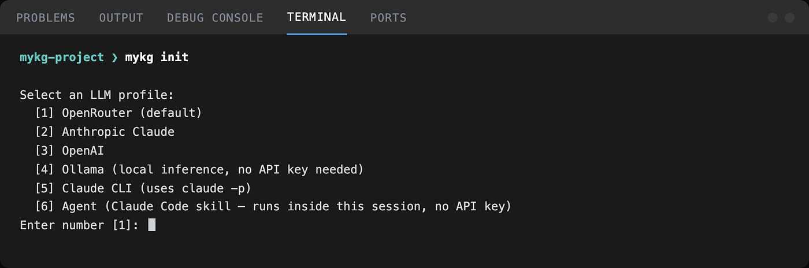
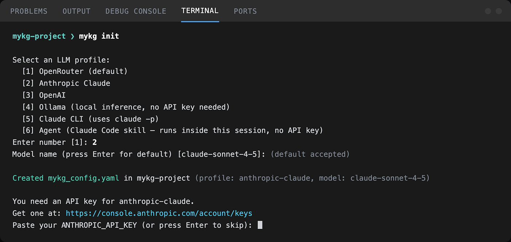
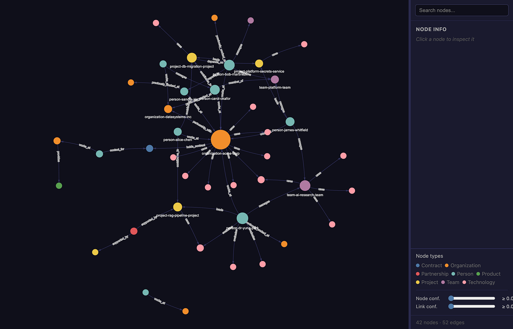
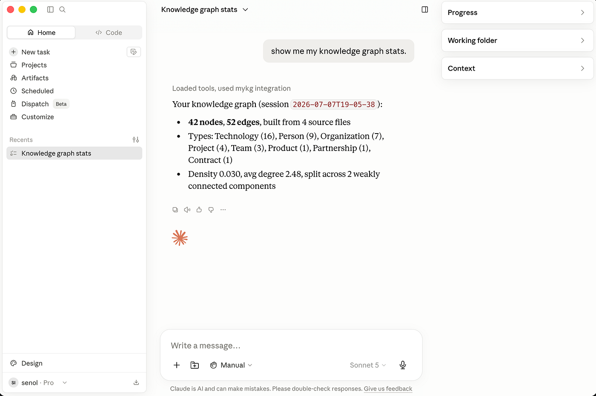
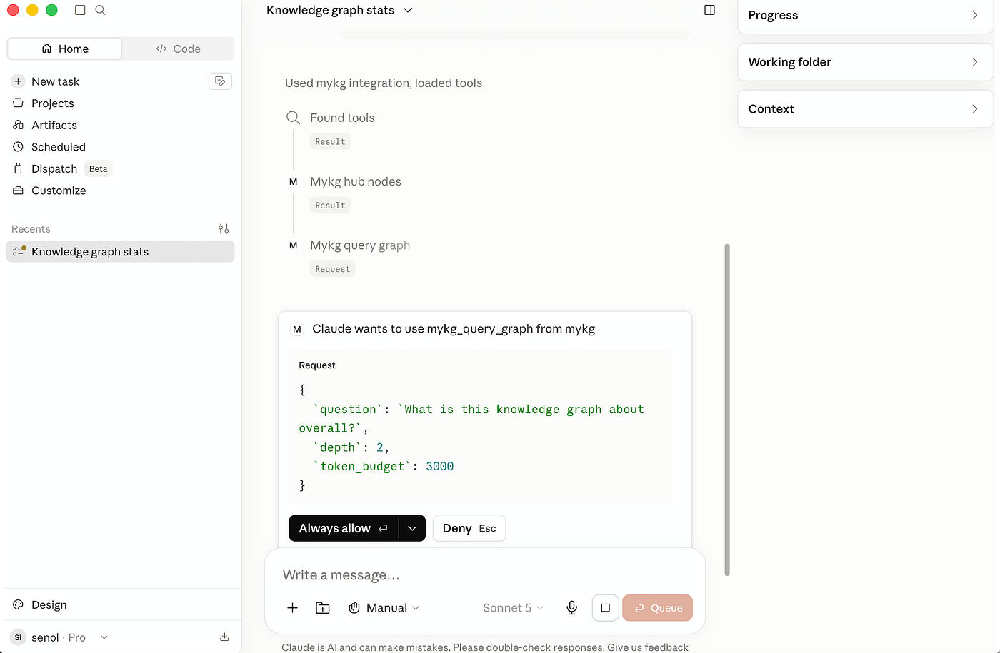
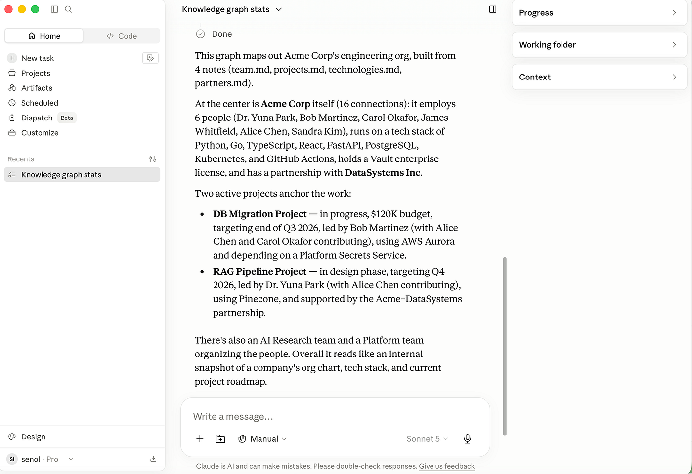
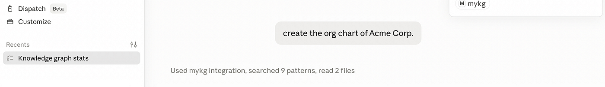
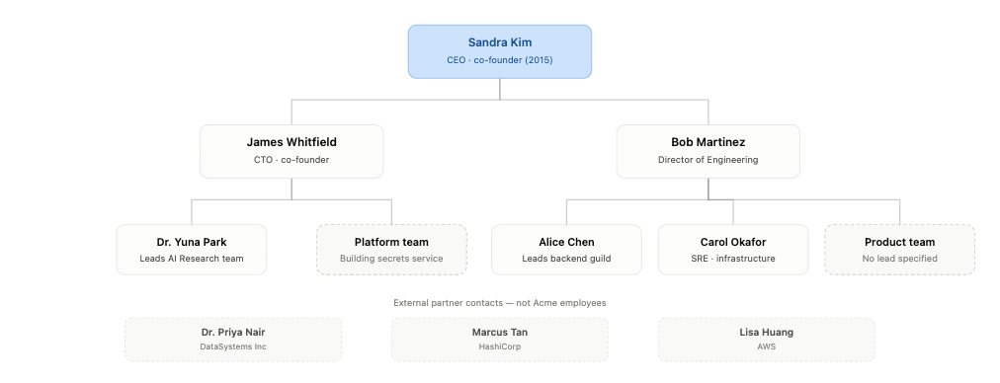

# myKG でナレッジグラフを作り、Claude Desktop に接続する

[Senol Isci, Ph.D.](https://medium.com/@senol.isci?source=post_page---byline--2e68e24838a9------------------------------------------)

読了時間 6 分、2026 年 7 月 7 日

最近、[**myKG**](https://github.com/SenolIsci/mykg)**――ナレッジグラフのエンジン（The Knowledge Graph Engine）**を開発し、公開した。文書のディレクトリからナレッジグラフを構築し、そこから導いたスキーマで構造を与え、Model Context Protocol（[MCP](https://www.anthropic.com/news/model-context-protocol)）を通じて提供するオープンソースのツールだ。その結果、AI アシスタントが知識ベースをたどり、文書群を横断するつながりを追い、より踏み込んだ質問に答え、それぞれの回答の根拠を示せるようになる。

**myKG** は複数のプラットフォームで動き、MCP に対応するどの AI アプリケーションにも接続できる。この実践ガイドでは、MacOS の Claude Desktop を使い、小規模なデモの文書群から構築したグラフに問い合わせる手順を示す。



> GPT-6 補足: myKG の利用を、インストールと初期化、グラフの構築、MCP による Claude Desktop への接続、問い合わせと利用の 4 段階に分けた概観図。文書からスキーマを提案してエンティティを抽出し、MCP の探索ツールを使って組織図などを作る流れを示す。右下には、ファイルの追加後にグラフを再読み込みする流れも描かれている。

## インストールと初期化

**myKG** は PyPI からインストールする。

```
pip install mykg
```

まずプロジェクトのフォルダーに移動し、そこで `init` を実行する。この例では Desktop 上のフォルダーを使い、その中の `notes/` サブフォルダーに元の Markdown ファイルを置いている（[こちら](https://github.com/SenolIsci/mykg/tree/main/docs/examples/blog_demo_run/blog_demo_input)）。myKG はプロジェクトを準備し、作業ディレクトリに `mykg_config.yaml` を書き出す。

```
cd ~/Desktop/mykg-project/
mykg init
```

**myKG** には LLM のバックエンドが必要だ。現在は Ollama を通じたローカルの LLM と、OpenAI、Google Gemini、OpenRouter、Anthropic のクラウド API に対応している。初期化の際に対話形式で設定するか、初期化の後にプロジェクトのフォルダーにある設定ファイル（mykg_config.yaml）を編集して設定できる。`init` のウィザードでは、使用する LLM のプロファイルを尋ねる。



> GPT-6 補足: mykg init の LLM プロファイルを選ぶ端末画面。OpenRouter、Anthropic Claude、OpenAI、Ollama、Claude CLI、Claude Code のスキルを使う Agent の 6 項目が並び、既定の選択肢は 1 の OpenRouter になっている。本文で使う Anthropic Claude は 2 である。

プロファイル（Profile）2 は、この実践ガイドで使う Anthropic Claude だ。続いてモデル名を指定する。適切な既定値があらかじめ入力されている。

その次に API キーを求められる。この入力欄では、入力した文字が伏せられないことに注意してほしい。



> GPT-6 補足: プロファイル 2 を選び、既定のモデル名 claude-sonnet-4-5 を受け入れた後の端末画面。mykg_config.yaml を作ったことが表示され、ANTHROPIC_API_KEY の入力または Enter による省略を求めている。画面には実際の API キーは表示されていない。

## グラフの抽出

この実践ガイドの `notes/` フォルダーには、架空の会社 Acme Corp について、チームのメンバー、進行中のプロジェクト、関係するパートナー、使用中の技術を説明した 4 つのファイルがある（デモ（Demo）のファイルは[こちら](https://github.com/SenolIsci/mykg/tree/main/docs/examples/blog_demo_run/blog_demo_input)）。**myKG** はこれらすべてを読み、型のあるグラフを構築する。

```
mykg extract-graph notes/ --obsidian-vault
```

`--obsidian-vault` は、リンクでつながった Wiki ノートとしてグラフを書き出す。*これは Obsidian に準拠する保管庫であり、myKG で使うために Obsidian アプリケーションをインストールする必要はない。*

処理は 2 段階に分かれる。*Pass 1* では文書群からスキーマを提案し、*Pass 2* ではそのスキーマに従ってエンティティと関係を抽出する。また、検索できる対話的なナレッジグラフの表示も生成する。Acme Corp をハブとして、名前の付いた人物、チーム、プロジェクトが枝分かれしている。



> GPT-6 補足: Acme Corp を中心に人物、チーム、プロジェクト、技術などを結んだグラフの表示。右側にはノードの検索、ノード情報、種類別の色の凡例、ノードとリンクの確信度のしきい値を調整する欄がある。凡例には Contract、Organization、Partnership、Person、Product、Project、Team、Technology が並び、下部には 42 ノード、52 エッジと表示されている。

**デモのファイルの処理は 1 分未満で終わったが、処理時間と費用はファイルの大きさ、種類、LLM の提供者、バッチの目標トークン数、同時実行数に応じて増える。有料 API のプランで大規模に実行すると、費用が急速に増える場合がある。**[**README**](https://github.com/SenolIsci/mykg)**の設定項目を読み、文書群全体を myKG に渡す前に、少数のファイルで試してほしい。**

新しいファイルを追加したり既存のファイルを変更したりした後は、`--append` オプションにより、文書群全体を処理し直さずにグラフを差分更新できる。新しいファイルによってエンティティや関係の種類が増える可能性がある場合は、`--append --grow-schema` を使うと、既存の種類を保ったままスキーマを拡張できる。詳しくは [README](https://github.com/SenolIsci/mykg) を参照してほしい。

## MCP を通じたグラフの提供

**myKG** には stdio で動く MCP サーバーが組み込まれている。stdio は、Claude Desktop がローカルのツールと通信する際にも使う伝送方式だ。グラフへの問い合わせ、検索、ノードの参照、隣接ノードと経路の探索、スキーマと統計の参照、グラフの再読み込み、ハブや孤立ノードの検出、Obsidian の保管庫のノートの読み取りを行う 14 個の読み取り専用ツールを公開する。これにより、LLM クライアントはグラフ全体のダンプを受け取るだけでなく、グラフを探索できる。ナレッジグラフを更新した場合は、チャットで Claude エージェントに伝えるだけで、会話を離れずにグラフを再読み込みする。

*myKG MCP Server は、標準に準拠する*[*FastMCP*](https://gofastmcp.com/getting-started/welcome)*の実装である。そのため、MCP に対応するどの AI チャットボットのアプリケーションにも接続できる。*

## Claude Desktop への接続

Claude Desktop は、`~/Library/Application Support/Claude/claude_desktop_config.json` にある設定ファイルから MCP サーバーの一覧を読み取る。この設定ファイルに次の内容を追加する。

```
{
  "mcpServers": {
    "mykg": {
      "command": "uv",
      "args": [
        "--directory",
        "/Users/YourName/Desktop/mykg-project",
        "run",
        "mykg",
        "mcp-serve"
      ]
    }
  }
}
```

**自分のプロジェクトのフォルダーを指すように**`--directory`**のパスを変更する。**

**変更を反映するには、Claude Desktop を完全に終了し、起動し直す必要がある。ウィンドウを閉じるだけでは足りない。**

## グラフへの問い合わせ

接続すると、どの Claude Desktop のチャットでも myKG の MCP ツールを使えるようになる。「自分のナレッジグラフの統計」といった質問に、セッションから得たグラフの専門的な指標を使って答えられる。



> GPT-6 補足: Claude Desktop でナレッジグラフの統計を求めた結果。4 つのソースファイルから 42 ノード、52 エッジを構築し、密度は 0.030、平均次数は 2.48、弱連結成分は 2 個と回答している。種類別のノード数は Technology 16、Person 9、Organization 7、Project 4、Team 3、Product、Partnership、Contract が各 1 である。

ツールを初めて実行する前に、Claude Desktop は許可を求める。



> GPT-6 補足: Claude Desktop が mykg_query_graph を実行する許可を求める画面。要求にはグラフ全体の内容を尋ねる質問、depth 2、token_budget 3000 があり、Always allow と Deny のボタンが表示されている。ツールを使う前に内容を確認する場面に対応する。

**「Always allow」（常に許可）**を選ぶと、同じツールを以後呼び出す際の確認を省略できる。より広く、答え方を限定しない質問では、複数のツールが一度に呼び出される。


> GPT-6 補足: ナレッジグラフ全体の要約を求めたチャットの画面。mykg の連携を使ってツールを読み込み、ツールを見つけたことが表示されている。この画像だけでは後続のすべての呼び出しは見えない。

この質問では、Claude が自分で複数のツールを連続して呼び出す。最もつながりの多いエンティティを見つけ、グラフ全体について問い合わせ、その後に Obsidian の wiki ノートを何度か読む。

結果は、概要報告のように読める。



> GPT-6 補足: 4 つのノートから得た Acme Corp のエンジニアリング組織の概要を、Claude が文章で報告した画面。人物や技術構成に続き、DB Migration Project と RAG Pipeline Project の担当者、時期、関連技術を説明している。これは記事のデモに対する回答であり、実在する会社の調査結果ではない。

さらに難しく複雑な「Acme Corp の組織図を作って」という質問を Claude にすると、11 回の呼び出しが行われる。



> GPT-6 補足: Acme Corp の組織図を作る依頼と、その処理の要約。画面には mykg の連携を使用し、9 つのパターンを検索して 2 ファイルを読んだと表示されている。本文の 11 回という呼び出し数と、画面の検索と読み取りの内訳を対応させて読める。

出来上がった図と、それについて Claude が述べている内容は、注意深く読む価値がある。



> GPT-6 補足: 生成された組織図。Sandra Kim の下に James Whitfield と Bob Martinez を置き、さらに人物とチームを配置している。Product team には責任者の指定がないことを示し、最下段には Acme の従業員ではない外部パートナーの連絡先を分けて置いている。


> GPT-6 補足: 組織図について Claude が付けた確信度の説明。グラフの Platform team ノードが、Bob が管理するインフラのチームと James が監督するプラットフォームのチームを混同しており、グラフの統合されたエンティティではなく元の文書を使って分け直した、と述べている。また、元のノートに Product team の責任者が指定されていないので、その欄は担当者なしで表示したと説明している。

グラフを使って回答の構造を素早く見つけ、主張を一つずつ元の文書と照らし合わせる。この組み合わせによって、結果は速いだけでなく、信頼できるものになる。

## おわりに

[**myKG**](https://github.com/SenolIsci/mykg) は、文書のフォルダーを、構造化して問い合わせられるナレッジグラフに変える。この実践ガイドでは、最初のインストールから Claude Desktop への接続、グラフに対して複数のツールを連続して呼び出せるようになるまで、一連の手順を説明した。

数個のファイルならコンテキストウィンドウに収まるが、数百の文書を検索すると、1 回の処理では一緒に取り出せない、ファイルをまたぐつながりを見落とすことがある。グラフには、そのような盲点はない。つながりが元の文書とは独立して存在するため、AI エージェントは知識の構造をたどり、文書群を横断する関係を発見し、散在したままでは扱えない情報について推論できる。

[GitHub - SenolIsci/mykg: ナレッジグラフの抽出器（Knowledge graph extractor）。Markdown（または任意の形式）から、RDFS/OWL オントロジーを備えるナレッジグラフへ - SenolIsci/mykg github.com](https://github.com/SenolIsci/mykg?source=post_page-----2e68e24838a9------------------------------------------)
