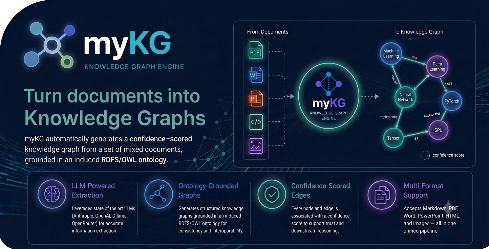
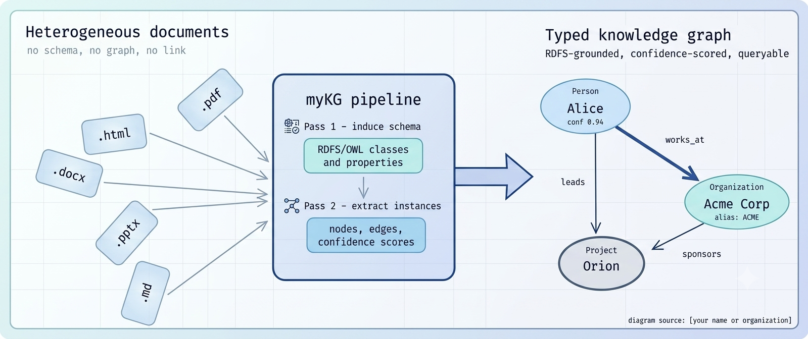

# myKG — ナレッジグラフのエンジン（The Knowledge Graph Engine）

**myKG** は、Markdown、プレーンテキスト、PDF、Word、PowerPoint、Excel、HTML、画像の混在した文書群から、導出した RDFS/OWL オントロジーに基づいて、確信度付きのナレッジグラフを自動生成する。



> GPT-6 補足: 左に文書から知識グラフを作る製品の説明、右に PDF・Word・PowerPoint・HTML・画像から myKG を通してグラフへ変換する模式図がある。下段は LLM による抽出、RDFS/OWL のオントロジー、確信度、複数形式への対応を示す。右のノードと関係は説明用で、抽出精度の測定結果ではない。

## 更新情報

- **v0.4.10** — スキーマの変化の検出と整理（Schema Drift & Pruning）: `mykg detect-schema-drift` はグラフで使われなくなった概念とプロパティを報告し、`mykg prune-schema` はそれらを除去する（`--preview`、編集可能な計画ファイル、バックアップを備える）。「スキーマの変化の検出と整理」を参照。
- **v0.4.9** — `nodes.jsonl`、`edges.jsonl`、`knowledge_graph.ttl` の書き出しは、ファイル全体を先にメモリに作る代わりに、レコードごとにディスクへストリーム出力するようになった。グラフが増えてもメモリ使用量のピークを一定に保つ。
- **v0.4.8** — `mykg_search_nodes` と `mykg_query_graph` の起点の選択は、部分文字列の線形走査から BM25 に変わった。10 万ノードで約 2,800 倍速く（問い合わせごとに 0.5 ms 対 1.4 秒）、グラフが増えても問い合わせが数分になる劣化を避ける。

## 機能

MyKG は、継続的に適応し、一貫性を保ち、知識に確信度を付与する自己進化型のオントロジーを通じて、信頼できるナレッジグラフを構築する。情報が増えても根拠と信頼性を保つ。

### オントロジーに沿った抽出（Ontology-Guided Extraction）

- **スキーマに沿ったナレッジグラフの生成** — 抽出するグラフは正式な RDFS/OWL スキーマに基づく。概念の型、プロパティ名、domain/range の制約、is-a 階層は、エンティティを抽出する前に明示され、検査できる。
- **AI コーディング支援との連携** — [Claude Code](https://claude.ai/code) などの AI コーディング支援と併用しやすい設計である。Claude Code Skill を使えば、開発環境を離れずに抽出を実行し、出力を調べ、グラフを反復して改善できる。「Claude Code で mykg を使う（Using mykg with Claude Code）」を参照。
- **AI コーディング支援の第二の脳** — Obsidian vault の出力は、抽出したグラフを wikilink 付き Markdown ノートのディレクトリにする。Claude Code、Cursor、Copilot に `output/obsidian_vault/` を参照させ、質問、関係の追跡、元の文書を根拠とする回答を得られる。
- **デスクトップ AI アプリ向け MCP サーバー** — `mykg mcp-serve` で [Model Context Protocol](https://modelcontextprotocol.io/) を通じてグラフを公開する。[Claude Desktop](https://claude.ai/download)、[Cherry Studio](https://cherry-ai.com)、その他の MCP 対応クライアントと連携する。16 個の問い合わせツールで、エンティティの検索、関係の探索、経路の発見、グラフの巡回、抽出した知識の wiki ノートの参照を行える。「MCP サーバー（MCP Server）」を参照。
- **差分更新** — 既存セッションに新しいファイルを追加し、変化した部分だけを抽出する。既存の概念とプロパティを保ちながら、新しい文書からスキーマを拡張することもできる。
- **再開可能なパイプライン** — 各段階で中間状態を永続化し、クラッシュや編集のあとに任意の段階から再開できる。
- **セッションの分離** — 実行ごとに入力、中間状態、出力、ログを同じ場所に置き、それだけで完結する。
- **セッションをまたぐ統合** — 独立に生成した 2 つのグラフを、1 つのナレッジグラフへ統合する。
- **独自のオントロジーの使用** — `--base-schema` に RDFS または OWL の TTL ファイルを渡すと、既存の正式なオントロジーのクラスとプロパティを固定できる。LLM は分野固有の概念を追加するが、正本の語彙の改名、削除、矛盾する変更は行わない。ただし、この仕組みは LLM が制御するため、厳密には守られない場合がある。`--freeze-schema` を付けると LLM のスキーマ導出を完全に省き、指定したオントロジーをそのまま使って抽出し、予期しない型やプロパティを作らない。
- **SKOS シソーラスへの対応** — `--thesaurus` で SKOS の語彙を読み込む。`skos:exactMatch` の語は通知せず統合し、`skos:closeMatch` の語は警告する。文字列の一致だけより豊かな同義語の情報をスキーマの統合に使える。
- **検証可能な TTL オントロジー** — Pass 1 のあと、導出したスキーマを RDFS/OWL の有効な Turtle ファイル（`intermediate/schema.ttl`）として出力し、[Protégé](https://protege.stanford.edu/) などのエディターで直接開ける。抽出の開始前に rdflib で構文と意味を検査する（domain/range が宣言済みクラスを参照すること、range に矛盾がないこと）。
- **人によるオントロジーの確認** — `--review` でスキーマの導出後に停止し、編集してから抽出を再開する。`schema.json` を直接編集するか、Protégé で `schema.ttl` を調整し、`--freeze-schema` で渡し直せる。



> GPT-6 補足: 左の種類の異なる文書を、中央の Pass 1 で RDFS/OWL のクラスとプロパティへ、Pass 2 でノード・エッジ・確信度へ変換する。右には Person の Alice、Organization の Acme Corp、Project の Orion と、その間の works_at・leads・sponsors が描かれる。Alice の conf 0.94 は図の例示値である。

### 入力（Input）

- **複数形式の文書群** — `mykg extract-graph` にディレクトリを指定すると、対応する拡張子の文書を取り込み前に Markdown へ自動変換する。
  形式（Format） 拡張子（Extensions） バックエンド（Backend） Markdown `.md` はそのまま使用する。プレーンテキスト（Plain text） `.txt` は同じプロセス内で `.md` に改名する。PDF、Word、PowerPoint、Excel、画像 `.pdf .docx .doc .pptx .xlsx .png .jpg .jpeg` は、一時的な `uv` 管理の Python 3.12 仮想環境にある [MinerU](https://github.com/opendatalab/mineru) で処理し、使用中の環境には何も導入しない。HTML `.html .htm` は同じプロセス内の [`markdownify`](https://pypi.org/project/markdownify/) で処理し、アンカーと画像タグを除去する。Web サイトと GitHub リポジトリの任意の URL は、一時的な `uv` 仮想環境の [Crawlee](https://github.com/apify/crawlee) で処理し、`mykg_web_fetch/` フォルダーを生成する。
  許可した拡張子以外（HTML 一式に付属する `.svg`、`.css`、`.php` など）はログに記録してスキップし、黙って落とさない。許可リストは `mykg_config.yaml` の `preprocess.extensions` で設定できる。
  **差分の変換** — 再実行では未変更のソースを省く。PDF を 1 つ追加して再実行すると、その PDF だけを変換する。`mykg extract-graph --from-step preprocess` で全体を再変換できる。

### グラフと出力（Graph & Output）

- **提供者に依存しない** — Anthropic（Claude）、OpenAI（GPT）、Google Gemini、Ollama（ローカル）、OpenRouter、`claude` CLI に対応する。
- **5 系統の出力** — Neo4j/NetworkX/RAG 向けの JSONL、OWL ツール群向けの Turtle RDF、グラフ分析向けの NetworkX の複数形式、リンク付きの個人用知識管理向けの Obsidian vault、任意の Neo4j LOAD CSV 一式（通常のヘッダーの CSV と、Neo4j Browser / `cypher-shell` で貼り付けて実行する Cypher スクリプト）を出力する。
- **Obsidian vault — AI コーディング支援の第二の脳** — 抽出した各エンティティは `output/obsidian_vault/` の wikilink 付き Markdown ノートになる。[Obsidian](https://obsidian.md) の被リンクとグラフ表示（Graph View）で探索するか、Claude Code、Cursor、Copilot にフォルダーを参照させ、自然言語で質問し、関係を追跡し、知識に基づいて推論できる。
- **対話的な HTML グラフ** — ノードとエッジの絞り込み、検索、ホバーのポップアップを備え、ブラウザで直接開ける。
- **確信度の付与** — 抽出する属性、ノード、エッジのそれぞれに `0.0–1.0` の確信度を持たせる。

## クイックスタート（Quick Start）

Python 3.11 以上（macOS で開発し、自動 CI は Ubuntu と Windows でテストを実行）と、Anthropic/OpenAI/Gemini/OpenRouter の API キー、ローカルで動く Ollama、`claude` CLI のいずれかが必要である。

### PyPI からの導入

mykg を導入して対話式のセットアップを実行する。提供者、モデル、API キーを尋ね、`mykg_config.yaml` と `.env.mykg` を一度に書き出す。

```
pip install mykg
mykg init
```

続いて、ノートからナレッジグラフを抽出する。

```
mykg extract-graph my_notes/
```

ブラウザで `mykg_sessions/<timestamp>/output/knowledge_graph.html` を開き、結果を探索する。

### ソースからの導入

[uv](https://docs.astral.sh/uv/getting-started/installation/) を導入し、リポジトリを clone し、依存パッケージを同期してセットアップを実行してから抽出する。

```
git clone https://github.com/SenolIsci/mykg && cd mykg
uv sync && uv run mykg init --force
```

続いて、ノートからナレッジグラフを抽出する。

```
uv run mykg extract-graph my_notes/
```

Ollama（ローカル推論、API キー不要）では、モデルを取得し、`mykg init` の質問で `ollama-local` プロファイルを選ぶ。

```
ollama pull llama3.3
mykg init
mykg extract-graph my_notes/
```

## コマンドライン

### 全コマンド

コマンド（Command） 目的（Purpose） `mykg init` 対話式のセットアップで `mykg_config.yaml` と `.env.mykg` を書く。`mykg extract-graph` ディレクトリに対して二段階の抽出を実行する。`mykg query "<question>"` 質問に一致する起点ノードから BFS/DFS で探索し、端末からグラフに問い合わせる。MCP の問い合わせツールに対応する。`mykg walkthrough` 既存セッションの `walkthrough.md` を再生成する。`mykg detect-schema-drift` インスタンスのないスキーマの概念とプロパティを報告する（読み取り専用、LLM 不使用）。`mykg prune-schema` 未使用の概念とプロパティをセッションのスキーマから除去する。`--preview` は計画を表示し、`--plan <file>` は編集済みの計画を適用する（LLM 不使用）。`mykg merge-graphs` 独立した 2 セッションを 1 グラフへ統合する。`mykg parse-docs` MinerU/markdownify による文書の Markdown への単独の変換。`mykg fetch-web` Web サイトのクロールか GitHub リポジトリの clone で、`extract-graph` の入力になるフォルダーを作る。`mykg mcp-serve` 読み取り専用のグラフ問い合わせツールを公開する MCP サーバーを起動する。`mykg approve-schema` `schema.json` の編集後に `schema_approved.flag` を書き、`human_review` の関門を解除する（`--review` と併用。「人によるレビューの関門（Human Review Gate）」を参照）。

```
mykg extract-graph my_notes/        # any directory: .md, .txt, .pdf, .docx, .html, images
```

**二段階の LLM パイプライン**を使う。Pass 1 は文書群全体から RDFS/OWL スキーマを導出し、Pass 2 はそれに沿ってファイルごとの型付きエンティティと関係のインスタンスを抽出する。Markdown 以外の入力（`.txt .pdf .docx .doc .pptx .xlsx .png .jpg .jpeg .html .htm`）は抽出前に自動変換する。出力は、Neo4j などのプロパティグラフ向けの JSONL、OWL ツール群向けの Turtle RDF、分析と可視化向けの NetworkX の 7 形式、AI コーディング支援（Claude Code、Cursor、Copilot）が直接読んで推論できる wikilink 付き Markdown ノートの Obsidian vault、任意の Neo4j LOAD CSV 一式である。最後の形式には、Neo4j Browser または `cypher-shell` に一度で取り込むための、貼り付けて実行できる Cypher スクリプトを含む。

## 記事とチュートリアル（Articles & Tutorials）

[Medium](https://medium.com/@senol.isci) の解説と事例。

- [myKG で自分の Web サイトをナレッジグラフにした方法（How I Turned My Website Into a Knowledge Graph with myKG）](https://medium.com/@senol.isci/how-i-turned-my-website-into-a-knowledge-graph-with-mykg-7dc85ac894c3)
- [実際に信頼できる第二の脳を作る方法（How to Build a Second Brain You Can Actually Trust）](https://medium.com/@senol.isci/how-to-build-a-second-brain-you-can-actually-trust-52ac621188b7)
- [AI エージェント向けの LLM Wiki を作る（Build an LLM Wiki for Your AI Agents）](https://medium.com/@senol.isci/build-an-llm-wiki-for-your-ai-agents-b993af38d7c4)
- [文書から生きたナレッジグラフへ: myKG の紹介](https://medium.com/@senol.isci/from-documents-to-a-living-knowledge-graph-introducing-mykg-fab7cea22de5)

## 設定（Configuration）

すべての設定は、作業ディレクトリかその親から自動検出する 1 つの `mykg_config.yaml` に置く。コードに既定値を埋め込まず、この YAML だけを正本とする。

```
mykg init           # interactive: choose provider, model, paste API key
                    # writes mykg_config.yaml and .env.mykg in one step
mykg init --force   # overwrite an existing config
mykg init --profile openrouter-free --model google/llama-4-maverick --api-key sk-or-...  # non-interactive
```

セットアップでは 3 つの質問に答える。

1. **プロファイル（Profile）** — LLM の提供者を選ぶ（OpenRouter、Anthropic、OpenAI、Gemini、Ollama、Claude CLI、Agent / Claude Code skill）。
2. **モデル（Model）** — 既定のモデルか、提供者の任意のモデル名を指定する。*agent モードではホストの Claude Code セッションが LLM なので省く。*
3. **API キー** — キーを貼り付ける。Ollama、Claude CLI、agent モードでは省く。

### LLM の提供者（LLM Providers）

提供者（Provider） プロファイル名（Profile name） API キーの環境変数（API key env var） 備考（Notes） Anthropic（Claude） `anthropic-claude` `ANTHROPIC_API_KEY` 品質を重視する場合に推奨。OpenAI `openai` `OPENAI_API_KEY`。Google Gemini `gemini` `GEMINI_API_KEY` 暗黙のプロンプトキャッシュは自動である。プロファイルのトークン予算は `openai` と同じなので、Gemini の 100 万トークンのウィンドウ全体を使うには `llm.context_window` を増やす。Ollama `ollama-local` — ローカル推論でキー不要。OpenRouter `openrouter-free` `OPENROUTER_API_KEY` 1 つのキーで多数のモデルを利用できる。Claude CLI `claude-cli` — `claude -p` の子プロセスを使用し、逐次実行だけに対応する。Agent（Claude Code skill） `agent-claude-code` — ファイルシステムの inbox/outbox を通して Claude Code skill が LLM の回答を返す。[docs/agent-mode.md](https://github.com/SenolIsci/mykg/blob/main/docs/agent-mode.md) を参照。

[`mykg_config.yaml`](https://github.com/SenolIsci/mykg/blob/main/mykg_config.yaml) の先頭の `profile:` を設定して提供者を切り替える。

### API キー（API Keys）

myKG は環境変数から API キーを読む。シェルで直接設定するか、プロジェクトに `.env.mykg` を作る（起動時に自動読込）。

**方法 A — シェルで設定する。**

```
export ANTHROPIC_API_KEY=sk-ant-...
```

**方法 B — `.env.mykg` を作る。**

```
# .env.mykg
ANTHROPIC_API_KEY=sk-ant-...
```

ソースから導入する場合は、[`sample.env.mykg`](https://github.com/SenolIsci/mykg/blob/main/sample.env.mykg) を `.env.mykg` へコピーしてひな形にできる。

## 抽出パイプライン（Extract Pipeline）

複数形式のファイルのディレクトリを読み、型付きのナレッジグラフを 3 つの出力形式で生成する。12 段階を順に実行し、中間状態をすべて永続化するため、上流の処理を繰り返さず任意の段階から再開できる。

### 実行

```
mykg extract-graph <input_dir> [OPTIONS]
# source installs: uv run mykg extract-graph <input_dir> [OPTIONS]
```

`<input_dir>` はソースを含む任意のディレクトリで、サブディレクトリも再帰的に扱う。セッションへコピーするのは、設定した拡張子に一致するファイルだけである。

- `.md` — 常に含む（パイプラインの標準形式）。
- `mykg_config.yaml` の `preprocess.extensions` に列挙した拡張子すべて（既定は `.pdf`、`.docx`、`.doc`、`.pptx`、`.xlsx`、`.png`、`.jpg`、`.jpeg`、`.html`、`.htm`、`.txt`）。

それ以外（`.py`、`.json`、`.yaml`、ロックファイルなど）は無視する。隠しディレクトリ（`.venv`、`.git` など）とセッションのフォルダーも自動で除外するので、`extract-graph` にプロジェクトのルートや親ディレクトリを指定できる。

### オプション

オプション（Option） 説明（Description） `--session NAME` フォルダー名で既存セッションを再開する。`--from-step NAME` 指定段階の出力を削除してそこから再実行する。`--review` Pass 1 の後で人によるスキーマの確認のため停止する。`--append` Pass 1 を省き、新規ファイルだけ抽出する。変更・削除したファイルは検出して警告し、処理するには `--sync` を付ける。`--sync` `--append` と併用し、フォルダーとグラフを同期する。変更ファイルを再抽出し、削除したものを除去する。`--update` は `--append --sync` の略。`--append-with-grow-schema` `--append` と同様だが、変更ファイルに対して固定付きの Pass 1 を実行し、スキーマを拡張する。`--sync` と併用できる。`--pass1-schema-induction-only` Pass 2 の前（`schema_flatten` まで）を実行して停止し、抽出前にスキーマを確認・編集する。`--pass2-kg-extraction-only` スキーマの導出を省く（既存スキーマが必要）。全文書を `validate_graph` まで抽出する。`--from-step pass2` と異なり、最初に必ず `flattened_schema.json` を再生成するため、手動編集したスキーマが反映される。`--profile NAME` `mykg_config.yaml` を変えず、この実行だけ別の LLM プロファイルを使い、提供者・モデル・ワーカー数・タイムアウトを解決し直す。`--model NAME` この実行のモデルを上書きする。`--profile` が必要。`--workers N` Pass 2 の並列ワーカー数（既定は有効なプロファイルの `pass2.max_workers`）。`--confidence-agg mean|max` 重複統合時の確信度の集約方法。`--base-schema PATH` 固定する TBox の TTL ファイル（LLM は固定したクラスとプロパティを変えられない）。`--freeze-schema` `--base-schema` をそのまま使い、Pass 1 の LLM 導出を省く。`--thesaurus PATH` スキーマ統合の同義語解決に使う SKOS TTL シソーラス。`--obsidian-vault` この実行で Obsidian vault の出力を強制する。`--neo4j-csv` この実行で Neo4j LOAD CSV 一式の出力を強制する。どちらも設定を上書きする。`--log-file PATH` ログの出力先で、相対パスはセッション内になる。`--verbose / -v` DEBUG レベルのログを有効にする。

### 使用例

```
# New run — auto-creates a timestamped session
mykg extract-graph my_notes/

# Resume a session with 4 parallel Pass 2 workers
mykg extract-graph my_notes/ --session 2026-05-17T18-31-07 --workers 4

# Run once against a different profile/model without editing mykg_config.yaml
mykg extract-graph my_notes/ --profile openrouter-free --model google/llama-4-maverick

# Pause for schema review after Pass 1
mykg extract-graph my_notes/ --review
# → edit mykg_sessions/<name>/intermediate/schema.json
mykg approve-schema --session 2026-05-17T18-31-07
mykg extract-graph my_notes/ --session 2026-05-17T18-31-07 --review

# Re-run from assembly onward (reuses existing extractions)
mykg extract-graph my_notes/ --session 2026-05-17T18-31-07 --from-step assemble

# Lock a base ontology so the LLM won't rename its classes
mykg extract-graph my_notes/ --base-schema ontology/core.ttl

# Induce and inspect the schema first, extract in a second invocation
mykg extract-graph my_notes/ --pass1-schema-induction-only
# → review/edit mykg_sessions/<name>/intermediate/schema.json
mykg extract-graph my_notes/ --session <name> --pass2-kg-extraction-only

# Mix models across phases: a strong model for schema induction,
# a smaller/cheaper one for the laborious Pass 2 extraction
mykg extract-graph my_notes/ --profile openrouter-free --model google/gemma-4-26b-a4b-it:free --pass1-schema-induction-only
```

**段階別のモデル選択に実行ごとの `--profile` / `--model` を使う。** `--profile` と `--model` は `mykg_config.yaml` を変えずに実行を上書きするので、二段階の抽出で別々のモデルを選べる。スキーマ導出（Pass 1）は推論力の高いモデルの恩恵を受け、ファイルごとの手間のかかる Pass 2 は小さく安いモデルで実行できる。`--pass1-schema-induction-only` と `--pass2-kg-extraction-only` の実行の間で `--profile`/`--model` を切り替えればよい。

### セッション（Sessions）

各実行は、分離されたセッションのフォルダーを自動作成する。

```
mykg_sessions/
  2026-05-17T18-31-07/
    input/           ← archived copy of all input Markdown files
    intermediate/    ← all intermediate pipeline state
    output/          ← final outputs (JSONL, TTL, HTML, NetworkX)
    run.log          ← log file
    walkthrough.md   ← post-run report
```

セッションが再開の基本単位になる。`--session <name>` で最後に完了した段階から再開し、`--from-step <step>` で指定地点から強制的に再実行する。

セッションのルートは `pipeline.paths.sessions_dir` で設定する（既定は現在のディレクトリの `mykg_sessions/`）。

### パイプラインの段階（Pipeline Steps）

12 段階を順番に実行する。中間状態をすべてディスクに書くので、上流を繰り返さず任意の段階から再開できる。

# 段階（Step） LLM 主な出力（Key outputs） 1 `preprocess` — `preprocess.done`、`preprocess_manifest.json`、`input/_preprocessed/` 以下のファイル。*Markdown 以外を MinerU、markdownify、改名へ振り分け、Markdown だけなら何もしない。* 2 `ingest` — `file_manifest.json`。3 `pass1` ✓（3 回）`schema.json`、`schema.ttl`、`schema_history/`、`pass1_batch_selection.json`、`pass1_batch_proposals/`。4 `schema_validate` — `schema_validate.done`。5 `human_review` — `schema_approved.flag`（*`--review` のときだけ*）。6 `schema_flatten` — `flattened_schema.json`。7 `pass2` ✓ `raw_extractions.json`、`chunk_node_index.json`。8 `normalize_names` ✓ `name_normalization.json`。9 `assemble` — `edge_metadata.json`、`nodes.json`、`merge_log.json`。10 `orphan_score` — `orphan_candidates.json`。11 `orphan_connect` ✓ `orphan_connections.json`、`orphan_log.json`。12 `validate_graph` — `nodes.jsonl`、`edges.jsonl`、`knowledge_graph.ttl`、`knowledge_graph.html`、`networkx_output/`、`obsidian_vault/`、`neo4j_csv/`（*任意*）。

Pass 1 は内部で、並列バッチの導出、アルゴリズムによる統合、LLM による整合化、LLM による品質レビューの 4 段階を順に行う。`pass1.max_schema_proposals`（既定 50）は LLM へ渡すバッチ数の上限である。大きな文書群ですべてを処理するには `-1` にする。

## 出力（Outputs）

### プロパティグラフ（Property Graph、JSONL）

**`nodes.jsonl`** — エンティティごとに JSON を 1 行書く。

```
{
  "id": "person-alice",
  "type": "Person",
  "confidence": 0.94,
  "source_files": ["team.md"],
  "attributes": {
    "name":  {"value": "Alice",          "confidence": 1.0},
    "email": {"value": "alice@acme.com", "confidence": 0.88}
  },
  "aliases": ["Alice Smith", "A. Smith"]
}
```

**`edges.jsonl`** — 関係ごとに JSON を 1 行書く。

```
{
  "id": "works_at-abc123",
  "type": "works_at",
  "from": "person-alice",
  "to": "org-acme-corp",
  "confidence": 0.96,
  "method": "llm_extraction",
  "attributes": {
    "role":       {"value": "Engineer", "confidence": 0.91},
    "start_date": {"value": null,       "confidence": 0.0}
  }
}
```

欠けた属性も捨てず、`{"value": null, "confidence": 0.0}` として表現する。

`method` フィールドで、Pass 2 が抽出したエッジ（`llm_extraction`）と、孤立ノードの処理で推論したエッジ（`orphan_inferred`）を区別する。

### RDF / OWL（Turtle）

**`knowledge_graph.ttl`** — エッジのメタデータを含まない、純粋な RDFS/OWL のトリプル。

```
@prefix ex: <http://mykg.local/schema/> .
@prefix :   <http://mykg.local/data/> .

ex:Person  a rdfs:Class .
ex:works_at  rdfs:domain ex:Person ;  rdfs:range ex:Organization .

:person-alice  a ex:Person ;  rdfs:label "Alice" .
:person-alice  ex:works_at  :org-acme-corp .
```

Protégé に読み込み、SPARQL（Fuseki、GraphDB）で問い合わせるか、HermiT/Pellet で推論できる。

### 対話的な HTML（Interactive HTML）

**`knowledge_graph.html`** — 単体で動く D3.js の力学モデルによるグラフである。サーバーは不要で、任意のブラウザで開ける。次に対応する。

- 型によるノードとエッジの絞り込み
- 確信度の閾値による絞り込み
- 名前による検索
- 属性の値全体を示すホバーのポップアップ
- 幅を変えられるサイドバー

グラフが `export.html_max_nodes` ノードを超える場合は出力しない（既定 5000、`-1` で上限を無効化）。その規模の描画はブラウザの vis.js に負担が大きいためである。その他の形式は全件出力する。このキーは有効なプロファイルの `pipeline.export:` から読むが、同梱の設定にはない。上書きするにはそこへ追加する。

### NetworkX の形式（`networkx_output/`）

ファイル（File） 形式（Format） 主な用途（Best for） `knowledge_graph.graphml` GraphML: yEd、Gephi、Cytoscape。`knowledge_graph.gexf` GEXF: Gephi の標準形式で豊富なメタデータを持つ。`knowledge_graph.json` JSON node-link: D3.js、Sigma.js、Web アプリ。`knowledge_graph.gml` GML: 人が読んで調べる。`knowledge_graph.net` Pajek: ネットワーク分析。`edges_nx.txt` エッジリスト: テキスト処理。`adjacency.txt` 隣接リスト: トポロジーを扱うツール。

GML との互換性のため、ノードとエッジの属性は `attr_<name>_value` / `attr_<name>_confidence` のスカラーの組として出力する。

### Obsidian Vault（`obsidian_vault/`）

抽出したエンティティごとに `.md` のノートを作り、概念の型ごとにサブディレクトリへ分ける。各ノートは YAML frontmatter（id、type、confidence、sources）、属性、出る関係と入る関係の wikilink、ソースファイルの一覧を持つ。vault のルートの `index.md` は、型別のノード数と全エンティティへのリンクをまとめる。

[Obsidian](https://obsidian.md) で `output/obsidian_vault/` を vault として開けば、グラフ表示（Graph View）、被リンクによる移動、抽出したエンティティ全体の全文検索を使える。

### Neo4j LOAD CSV 一式（`neo4j_csv/`）

任意の機能で、既定では無効である。コマンドラインの `--neo4j-csv` か、`mykg_config.yaml` の `pipeline.export.neo4j_csv_enabled: true` で有効にする。

有効にすると `step_validate_graph` は他の出力と並べて、それだけで使える Neo4j への取り込み一式を書き出す。

```
output/neo4j_csv/
  nodes_<Label>.csv             ← one per concept type (Person, Organization, …)
  relationships_<TYPE>.csv      ← one per property (WORKS_AT, KNOWS, …)
  import_browser.cypher         ← paste-and-run for Neo4j Browser
  import_shell.cypher           ← for `cypher-shell -f`
  README.md                     ← bundle-local quick-reference
```

CSV のヘッダー（`id,name,name_confidence,_node_confidence,_parents,_source_files,...`）は通常の形で、`:ID` / `:LABEL` の装飾を付けない。同じファイルを Neo4j とその他の CSV 対応ツールで使える。

**一式を取り込む 2 つの方法。**

```
# Flow A — Neo4j Browser
# 1. Copy *.csv into your DBMS's import/ directory
# 2. Paste the contents of import_browser.cypher and press play

# Flow B — cypher-shell (set dbms.security.allow_csv_import_from_file_urls=true first)
cypher-shell -u neo4j -p <pw> -f output/neo4j_csv/import_shell.cypher
```

どちらのスクリプトも `_MykgNode` の一意性制約に対して冪等な `MERGE` を使い、再実行で既存グラフを更新する。Neo4j 5 以上が必要で、Python ドライバー、プラグイン、APOC は使わず、基本の Cypher だけを使う。

設定の詳細と単独の CLI は、後述の「Neo4j Load CSV への書き出し（Neo4j Load CSV Export）」を参照。

## モデルコンテキストプロトコル（MCP）のサーバー

完了した任意のセッションを MCP サーバーとして公開し、LLM による質問応答に使える。

```
# Serve the latest session (stdio transport — for Claude Desktop)
mykg mcp-serve

# Serve a specific session
mykg mcp-serve --session 2026-06-25T19-16-18

# Serve via streamable HTTP for web clients (Cherry Studio, etc.)
mykg mcp-serve --transport streamable_http --port 3100

# Serve a specific session via streamable HTTP
mykg mcp-serve --session 2026-06-25T19-16-18 --transport streamable_http --port 3100
```

**Claude Desktop（stdio）** — クライアントが mykg を子プロセスとして起動するので、手動のサーバー起動は不要である。`claude_desktop_config.json` に追加し、`/path/to/your/project` をプロジェクトの絶対パスへ置き換える。

```
{
  "mcpServers": {
    "mykg": {
      "command": "uv",
      "args": [
        "--directory",
        "/path/to/your/project",
        "run",
        "mykg",
        "mcp-serve"
      ]
    }
  }
}
```

特定のセッションを公開する場合。

```
{
  "mcpServers": {
    "mykg": {
      "command": "uv",
      "args": [
        "--directory",
        "/path/to/your/project",
        "run",
        "mykg",
        "mcp-serve",
        "--session",
        "2026-06-25T19-16-18"
      ]
    }
  }
}
```

**Claude Code（stdio）** — プロジェクトのルートに `.mcp.json` を置くと、Claude Code がセッションの開始時に MCP サーバーを自動起動する。

```
{
  "mcpServers": {
    "mykg": {
      "command": "uv",
      "args": [
        "--directory",
        "/path/to/your/project",
        "run",
        "mykg",
        "mcp-serve"
      ]
    }
  }
}
```

特定のセッションを公開する場合。

```
{
  "mcpServers": {
    "mykg": {
      "command": "uv",
      "args": [
        "--directory",
        "/path/to/your/project",
        "run",
        "mykg",
        "mcp-serve",
        "--session",
        "2026-06-25T19-16-18"
      ]
    }
  }
}
```

> **再起動が必要。** Claude Code はセッション開始時に `.mcp.json` を読む。作成・編集後は Claude Code のセッションを再起動して接続する。初回には `mykg` の MCP サーバーの承認を求められる。

パイプライン（`extract-graph`、`--append` など）の実行後、メモリ上のグラフは古くなる。`mykg_reload` ツールで再起動せず更新するか、Claude Code のセッションを再起動して最初から読み直す。

`/mykg` スキルも導入してあれば、接続中の読み取り専用の問い合わせでは MCP ツールを優先し、未接続ならファイルの直接読み取りへ戻る。

**Streamable HTTP**（Cherry Studio、MCP Inspector、その他の HTTP ベースの MCP クライアント） — `mykg mcp-serve --transport streamable_http --port 3100` でサーバーを先に起動してから接続する。

```
{
  "mcpServers": {
    "mykg": {
      "type": "streamableHttp",
      "url": "http://localhost:3100/mcp"
    }
  }
}
```

MCP サーバーは 16 ツールを公開する。`mykg_search_nodes`、`mykg_get_node`、`mykg_get_neighbors`、`mykg_find_path`、`mykg_get_schema`、`mykg_list_node_types`、`mykg_query_subgraph`、`mykg_get_stats`、`mykg_query_graph`（BFS/DFS の探索）、`mykg_hub_nodes`、`mykg_orphan_nodes`、`mykg_schema_drift`（読み取り専用のスキーマの変化の報告）、`mykg_get_source`（ノードの根拠となるソースのチャンク）、`mykg_read_note`（Obsidian vault の LLM wiki ノート）、`mykg_list_sessions`、`mykg_reload`（パイプライン実行後のメモリ上のグラフの更新）。

**設定（Configuration）** — 既定の通信方式、ホスト、ポートは `mykg_config.yaml` のプロファイルごとに設定する。

```
    mcp:
      host: localhost              # bind address for streamable HTTP (ignored for stdio)
      port: 3100                   # port for streamable HTTP (ignored for stdio)
      transport: stdio             # default transport: stdio | streamable_http
```

Streamable HTTP を既定にするには、有効なプロファイルの `transport: streamable_http` を変更する。CLI のフラグ（`--transport`、`--host`、`--port`）は設定を上書きする。

### 端末からの問い合わせ（Terminal query、`mykg query`）

```
mykg query "<question>" [--session NAME] [--mode bfs|dfs] [--depth N] [--token-budget N]
```

シェルから直接グラフに問い合わせる機能で、MCP サーバーは不要である。`mykg query` は名前、別名、属性値で質問に一致する起点ノードを最大 3 個見つけ、深さの上限まで外側へ探索し、訪れたノードとその間の関係をテキストのコンテキストとして出力する。MCP の `mykg_query_graph` と同等の端末から呼べる機能で、読み取り専用である。`--session` がなければ最後に完了したセッションを使う。

- `question`（位置引数、必須） — 自由文の質問。
- `--session NAME` — `mykg_sessions/` 内のセッション。既定は最後に完了したもの（`output/nodes.jsonl` を持つ最も新しいディレクトリ）。
- `--mode bfs|dfs` — 探索方式（既定は `bfs`）。
- `--depth N` — 探索の深さの上限（既定は `2`）。
- `--token-budget N` — 返すコンテキストを制限するトークン数の概算（既定は `2000`）。

```
mykg query "who is Alice" --depth 2
```

```
# Knowledge Graph Context: who is Alice
Seeds: <ids> | Mode: bfs | Depth: 2
Nodes visited: N | Edges found: M

## Nodes
- [Type] Name (node-id) conf=0.95 (attr=val, ...)

## Relationships
- from-id --[edge_type]--> to-id (conf=0.90)
```

一致がなければ `No nodes found matching '<question>'. Try mykg_search_nodes for more flexible search.` と表示し、終了コード 0 で終わる。

* * *

## Claude Code で mykg を使う

myKG は、[Claude Code](https://claude.ai/code) の中から抽出を行う、互いを補う 2 つの連携方式を同梱する。

- **Agent モード（`agent-claude-code` プロファイルと同梱スキル）** — パイプラインがセッション内の inbox フォルダーへ LLM タスクを書き、Claude Code のスキルが子エージェントに回答を任せる。既定で並列実行する。
- **`claude-cli` プロファイル** — 各 LLM 処理で `claude -p` 実行ファイルを呼ぶ。逐次実行だけに対応する。

`claude` をそのまま使うには `claude-cli` を、スキルと子エージェントの並列実行を使うには `agent-claude-code` を選ぶ。

### エージェントモード（Claude Code のスキル）

Agent モードは、Claude Code 内から myKG を実行する別の方法である。`claude -p` の子プロセスの代わりに、パイプラインがセッション内の inbox へ LLM タスクを書き、Claude Code の**スキル**が子エージェントに回答を任せる。起動中の Claude Code セッションから並列に処理するには、`claude-cli` より Agent モードを選ぶ。

#### Agent モードを選ぶ理由

- **API キー不要。** スキルの子エージェントを通して既存の Claude Pro/Max プランを使う。`claude-cli` と同様だが、`claude -p` 実行ファイルは起動しない。
- **LLM の入出力を検査できる。** 各プロンプトを `intermediate/agent_inbox/<id>.task.json`、回答を `intermediate/agent_outbox/<id>.answer.json` に置く。任意の段階を手動で再実行・編集できる。
- **既定で並列。** スキルは 1 メッセージで最大 `pass2.max_workers` 個の子エージェントをまとめて起動し、`claude-cli` のような逐次実行にはしない。Pass 2 のチャンクは並列の組ごとに完了する。

#### 導入と設定

```
pip install mykg          # or: uv tool install mykg
mykg init --profile agent-claude-code
# ...then restart Claude Code so the skill loader picks up the new entry.
```

`mykg init --profile agent-claude-code` は `mykg_config.yaml` を書き、同梱スキルを `~/.claude/skills/mykg` へコピーする（`$CLAUDE_CONFIG_DIR` の指定を尊重する）。さらに、プロジェクトの `CLAUDE.md` に管理対象の `<!-- BEGIN mykg-section --> ... <!-- END mykg-section -->` ブロックを加える。スキルの隣に `.mykg_skill_version` の印を置き、後で版のずれを検出できるようにする。CLAUDE.md のブロックは、Claude Code に wiki の場所、最新セッションの探し方、新しい文書でグラフを拡張する方法を伝える。別途の準備は不要である。

**`pip install -U mykg` の後の更新。**

```
mykg init --reinstall-skill --reinstall-claude-md
```

同梱スキルをアトミックに更新し（`.tmp` へコピーして `os.replace`）、`mykg_config.yaml` は変えない。CLAUDE.md の目印の間を現行パッケージの内容に置き換え、外側の利用者の文は保つ。各フラグは単独でも使える（`--reinstall-skill` だけ、または `--reinstall-claude-md` だけ）。コピーによる導入を選び、シンボリックリンクは使わない。Windows で開発者モード（Developer Mode）がないと失敗し、mykg の削除でリンクが切れ、OneDrive でも同期されないためである。編集が自動反映されない負担は、編集の間に `--reinstall-skill` を渡す mykg の開発者にだけ関係する。

生成する `mykg_config.yaml` の `agent:` ブロックで、inbox/outbox のパスとポーリングの間隔を設定する。

```
profile: agent-claude-code

profiles:
  agent-claude-code:
    provider: agent
    agent:
      inbox_dir: agent_inbox        # relative to <session>/intermediate/
      outbox_dir: agent_outbox
      poll_interval_seconds: 2
    pipeline:
      pass2:
        max_workers: 8              # how many subagents the skill dispatches per wave
```

#### Claude Code 内からの呼び出し

スキルは自由な意図を受け付けるスラッシュコマンド `/mykg` を 1 つ公開する。依頼から実行する `mykg` CLI を選び、実際の `--help` でフラグを確認し、費用のかかる操作を確認する。`extract-graph` では inbox の LLM タスクを並列の組で処理する。

使用例。

入力（You type） スキルの実行（The skill runs） `/mykg extract ./docs` `mykg extract-graph ./docs` `/mykg ./docs` `mykg extract-graph ./docs`（以前の位置引数の別名）`/mykg extract ./docs with human review` `mykg extract-graph ./docs --review` `/mykg extract ./docs with frozen schema from ontology.ttl` `mykg extract-graph ./docs --base-schema ontology.ttl --freeze-schema` `/mykg append the new notes in ./docs` `mykg extract-graph ./docs --append --session <latest>` `/mykg sync the graph with ./docs` `mykg extract-graph ./docs --update --session <latest>` `/mykg expand the schema with ./docs` `mykg extract-graph ./docs --append-with-grow-schema --session <latest>` `/mykg resume the last session` `mykg extract-graph --session <latest>` `/mykg approve the schema` `mykg approve-schema --session <latest>` `/mykg make a walkthrough` `mykg walkthrough --session <latest>` `/mykg convert pdfs in ./inbox to ./md` `mykg parse-docs --input ./inbox --output ./md` `/mykg fetch https://example.com and extract` `mykg fetch-web https://example.com`、続いて `mykg extract-graph <printed output dir>`（新規セッション）。

CLI が受け付けるフラグはここでも使える。スキル独自の一覧を持たず `--help` を読むため、`--from-step orphan_connect`、`--workers 8`、`--obsidian-vault` などをそのまま渡す。

`mykg init` と `mykg merge-graphs` は意図的に包んでいない。init は対話式なので各マシンで一度シェルから実行する。merge-graphs は追加の設計上の検討があり、後で対応する。

設計と取り決めの全体は [docs/agent-mode.md](https://github.com/SenolIsci/mykg/blob/main/docs/agent-mode.md)、スキルのソースは [src/mykg/data/skills/mykg/SKILL.md](https://github.com/SenolIsci/mykg/blob/main/src/mykg/data/skills/mykg/SKILL.md) を参照。

### claude-cli プロファイル

myKG はローカルの `claude` CLI を通じて抽出する `claude-cli` プロファイルを同梱する。

#### 準備

`claude` CLI を導入し、mykg を導入してセットアップを実行する。質問では **[5] Claude CLI** を選ぶ。

```
npm install -g @anthropic-ai/claude-code
pip install mykg && mykg init
mykg extract-graph my_notes/
```

#### 動作

`claude-cli` の提供者は、すべての LLM 処理（Pass 1 のスキーマ導出、Pass 2 の抽出、孤立ノードの接続、名前の正規化）で `claude -p` を子プロセスとして呼ぶ。セッションの分離、再開、孤立ノードの回復、セッションをまたぐ統合は、API の提供者と同じように動く。

**`claude-cli` プロファイルの主な制約。**

- `max_workers` は `1` にする。`claude` CLI は設計上逐次実行で、並列ワーカーは待ち行列に入る。
- `mykg_config.yaml` の `effort` と `model` は、`claude -p` に渡す `--effort` と `--model` に直接対応する。

#### Claude Code セッション内で myKG を使う

Claude Code セッションのツール呼び出しとして myKG の抽出を実行できる。作業中にノートや文書からナレッジグラフを作るときに使える。

```
# From any Claude Code session terminal:
mykg extract-graph ./docs/ --session my-docs-kg

# Then reference the output in your session:
# mykg_sessions/my-docs-kg/output/nodes.jsonl
# mykg_sessions/my-docs-kg/output/knowledge_graph.ttl
```

Claude Code は `nodes.jsonl`、`edges.jsonl`、Obsidian vault を直接読んでグラフへの質問に答えられる。`knowledge_graph.ttl` を SPARQL ツールに読み込んで構造化した問い合わせを行うこともできる。

* * *

## 詳細なオプション（Advanced Options）

### 指定した段階からの再実行

`--from-step` で、その段階と下流すべての出力を削除して再実行する。

```
SESSION=2026-05-17T18-31-07

# Re-run from Pass 2 (reuse the existing schema)
mykg extract-graph my_notes/ --session $SESSION --from-step pass2

# Re-run only assembly + export (reuse raw extractions)
mykg extract-graph my_notes/ --session $SESSION --from-step assemble

# Re-run both orphan stages
mykg extract-graph my_notes/ --session $SESSION --from-step orphan_score

# Orphan LLM pass only — full clean sweep
mykg extract-graph my_notes/ --session $SESSION --from-step orphan_connect_fullsweep

# Orphan LLM pass only — additive (preserves prior confirmed edges)
mykg extract-graph my_notes/ --session $SESSION --from-step orphan_connect_incremental

# Re-run only merge/harmonize/quality-review (reuse existing Pass 1 batch proposals)
mykg extract-graph my_notes/ --session $SESSION --from-step merge_proposals
```

**5 つの再開パターン。**

パターン（Pattern） 用途（When to use） コマンド（Command） **A — スキーマの変更（Schema changed）** 型の誤り、プロパティ不足: `schema.json` を編集 → `approve-schema` → `--from-step pass1`。**A（統合だけ、merge-only）** Pass 1 の導出の費用を再び払わず、別の `--thesaurus`/`--base-schema` で統合・整合化をやり直す: `--from-step merge_proposals`（前の実行の `pass1_batch_proposals/` が必要で、通常の `--from-step pass1` と違ってそれを削除しない）。**B — 抽出の誤り（Extraction errors）** LLM が対象を見逃したりエッジ型を作ったりした場合: `raw_extractions_shards/` の shard を編集 → `--from-step pass2`。**C — 組み立ての誤り（Assembly errors）** `merge_log.json` の重複統合の判断が誤った場合: `raw_extractions.json` を編集 → `--from-step assemble`。**D — 孤立ノードの処理（Orphan pass）** 候補や確認が誤った場合: `--from-step orphan_score` または `orphan_connect_fullsweep`。

### 孤立ノードを接続する処理（Orphan-Connection Pass）

組み立て後、エッジが 0 本のノードは「孤立ノード」であり、グラフにはあるが探索で到達できない。2 段階の処理で接続を補う。

**第 1 段階 — `orphan_score`（LLM 不使用）:** `chunk_node_index.json` で各孤立ノードと同じソースのチャンクにあるノードを見つける。共起の頻度で候補を採点し、スキーマの型の適合性で絞り、`orphan_candidates.json` に書く。

**第 2 段階 — `orphan_connect`（LLM 使用）:** ソースのチャンクごとに LLM を 1 回呼ぶ。プロンプトにはチャンクの全文、そこにある全孤立ノードの ID、共起する接続済みノード、スキーマの全プロパティを含める。確認したエッジは `"method": "orphan_inferred"` を持ち、`edge_metadata.json` へ直接統合する。

接続できない孤立ノード（対応するソースのチャンクがないもの）は、`orphan_log.json` に `orphan_unconnectable` の通知イベントとして記録する。

`mykg_config.yaml` の `pipeline.orphan_pass.*` で設定する。`pipeline.orphan_pass.enabled: false` で完全に無効にできる。

### 人によるレビューの関門（Human Review Gate、`--review`）

Pass 1 のあとで停止し、Pass 2 の前に導出したスキーマを確認・編集する。

```
mykg extract-graph my_notes/ --review
# → pipeline halts; edit mykg_sessions/<name>/intermediate/schema.json
mykg approve-schema --session <name>
mykg extract-graph my_notes/ --session <name> --review   # resumes from Pass 2
```

### 固定する基本スキーマ（Locked Base Schema、`--base-schema`）

LLM が改名、削除、構造変更をしないよう、特定のクラスとプロパティを固定する。

```
mykg extract-graph my_notes/ --base-schema ontology/base.ttl
```

RDFS と OWL の双方に対応し、`owl:Class`、`owl:ObjectProperty`、`owl:DatatypeProperty` を RDFS の相当するものと同様に認識する。Protégé が出力した OWL を変換せず使える。固定した項目にも LLM が提案する属性を追加できる。ほぼ重複する LLM の提案は、警告して固定した項目へ統合する。

### 凍結したスキーマ（Frozen Schema、`--freeze-schema`）

基本スキーマをそのまま使い、Pass 1 の LLM による導出を完全に省く。LLM は与えたクラスとプロパティだけに従ってインスタンスを抽出し、追加しない。

```
mykg extract-graph my_notes/ --base-schema ontology/base.ttl --freeze-schema
```

完全なオントロジーを持ち、LLM が型や予期しないプロパティを作らない厳密な抽出を求める場合に使える。出力に現れるのは TTL の概念と関係だけである。`--base-schema` が必須で、`--append` と `--append-with-grow-schema` とは排他的である。

**`--base-schema` だけを使う場合との比較。**

振る舞い（Behavior） `--base-schema` `--base-schema --freeze-schema` Pass 1 の LLM 呼び出し: 3 回（バッチ、整合化、品質レビュー）対 **0 回（省略）**。スキーマ（Schema）: 固定項目と LLM の追加対 **TTL そのもの**。新しい概念の型（New concept types）: LLM が追加可能対 **なし**。新しいプロパティ（New properties）: LLM が追加可能対 **なし**。

### SKOS シソーラス（SKOS Thesaurus、`--thesaurus`）

SKOS の語彙を使い、スキーマ統合でほぼ重複する概念名を解決する。

```
mykg extract-graph my_notes/ --thesaurus ontology/terms.skos.ttl
```

- `skos:exactMatch` → 通知せず統合する。
- `skos:closeMatch` → `merge_log.json` に警告して統合する。
- `skos:broader` → 2 つの提案で親が異なる場合の判断に使う。先に現れたものではなく、宣言した上位語を採る。
- `skos:narrower` → 参考情報としてだけ使う。

名前の一致だけでは、同じ名前の下の*構造*が違うか判断できないので、不一致を黙って捨てず記録する。2 提案が同じ名前へ統合され、親、domain/range、属性の綴りが異なると、`merge_log.json`（`merge-graphs` では `merge_manifest.json`）に `parent_conflict`、`parent_conflict_resolved`、`domain_range_conflict`、`attribute_synonym` の項目を追加する。先に現れた値を引き続き採用し、捨てた値をログで示す。

### Web サイトとリポジトリの取得（Website / Repo Fetching、`mykg fetch-web`）

Web サイトをクロールするか GitHub リポジトリを浅く複製し、`extract-graph` へそのまま渡せるフォルダーを作る。

```
# Crawl a website (same-domain, robots.txt-respecting)
mykg fetch-web https://example.com
mykg extract-graph ./mykg_web_fetch/example.com/

# Shallow-clone a GitHub repo (git clone --depth 1, no Crawlee/venv)
mykg fetch-web https://github.com/SenolIsci/mykg
mykg extract-graph ./mykg_web_fetch/github.com_SenolIsci_mykg/input/

# Fetch multiple seeds (one URL per line; mix of sites and GitHub repos)
mykg fetch-web --url-list urls.txt --output ./mykg_web_fetch/batch/
```

- **GitHub の URL**（`https://github.com/<owner>/<repo>`）は自動検出し、`git clone` へ振り分ける。Crawlee も仮想環境も使わない。
- **その他の URL** は一時的な `uv` 仮想環境で Crawlee を動かす（`preprocess` の MinerU と同じ方式）。`robots.txt`、`--max-pages`、`--max-depth`、設定可能なリクエストの間隔と同時実行数を尊重する。
- **再開可能** — `fetch_manifest.json` にページごとの SHA-256 を記録し、再実行では未変更のページを省く。`--force` は全件を再取得する。
- **出力先** の既定は `./<fetch.output_dir>/<seed-domain>/`（`mykg_config.yaml` の `fetch.output_dir` で設定でき、既定値は `mykg_web_fetch`）。`--output` で上書きし、`--url-list` では必須になる。
- **取得したアセット**（PDF、画像など）は、`extract-graph` と同じ `preprocess.extensions` の許可リストで絞る。Crawlee が保存するものは `preprocess` で変換できる種類になる。

すべての設定は `mykg_config.yaml` の `fetch:` に置く。クロールと clone のシーケンス図は [docs/architecture.md](https://github.com/SenolIsci/mykg/blob/main/docs/architecture.md#website-and-repo-fetching-mykg-fetch-web) を参照。フラグの全一覧は `mykg fetch-web --help` で表示する。

**Claude Code からは**、`/mykg` スキルへ英語（English）の自然文で取得を依頼でき、フラグを覚える必要はない。

```
/mykg fetch https://example.com and extract
/mykg download the repo: https://github.com/SenolIsci/mykg
/mykg fetch these urls: <url1> <url2> ... and extract
```

どの例も使える。スキルが `fetch-web` の適切な呼び方を選ぶ（単一ページ、GitHub の clone、または列挙した URL から一時ファイルを作る `--url-list` の一括処理）。「取得して抽出」の依頼では、LLM を使う抽出の前に確認し、取得した出力への `extract-graph` まで続ける。複数の起点なら、起点ごとに新規セッションを作る。

### 文書の単独の変換（Standalone Document Conversion、`mykg parse-docs`）

`extract-graph` は、初回と `--append` の双方で、Markdown 以外（PDF、DOCX、画像など）を `preprocess` で自動変換する。`parse-docs` が必要なのは、パイプラインやセッションを作らず**単独で**文書を変換したいときだけである。MinerU の出力の確認、コミットする Markdown 文書群の作成、他ツールへの受け渡しなどに使う。

```
# Convert a single file
mykg parse-docs --input report.pdf --output ./md/

# Convert every non-.md file under a directory (recursive; structure preserved)
mykg parse-docs --input raw_docs/ --output ./md/

# Convert only specific files (relative to --input; repeatable)
mykg parse-docs --input raw_docs/ --output ./md/ --file a.pdf --file sub/b.docx
```

- **一時的な仮想環境の MinerU** — 呼び出しごとに `uv` 管理の環境を作って MinerU を実行し、終了時に削除する。mykg 自身の処理系へは導入しない。数ギガバイトの導入は呼び出しごとに 1 回だけ行い、その呼び出しの全ファイルで使う。
- **拡張子の許可リスト** — `mykg_config.yaml` の `preprocess.extensions` で候補を絞る（`extract-graph` と同じ一覧）。`.html`/`.htm` は常に除外する。MinerU は HTML を変換できないので、`markdownify` に振り分ける `extract-graph` を使う。`--no-filter` を付けると、`.md` 以外を拡張子に関係なく MinerU へ渡す。
- **大きな文書群** — OS の引数長の上限を避けるため、`--file` を繰り返さず、1 行に 1 相対パスを書く `--file-list <path>` を使う。`--file` と `--file-list` は排他的である。
- **セッションなし** — `parse-docs` はファイル同士の変換だけを行い、セッションを作らず `mykg_sessions/` に触れない。ファイルごとの失敗はログに記録して続け、1 件でも失敗すれば最後に 0 以外で終わる。

全フラグは `mykg parse-docs --help` で表示する。**Claude Code からは** `/mykg convert pdfs in ./inbox to ./md` が適切な呼び出しに自動変換される。

### 追記モード（Append Mode）

Pass 1 を繰り返さず、新規・変更ファイルに対してパイプラインを再実行する。

```
mykg extract-graph my_notes/ --session <name> --append
```

入力には `.md` と一緒に PDF、DOCX、HTML、TXT、画像を置ける。新たに追加した non-Markdown のファイルは、追記時に自動変換する（初回と同じ差分の `preprocess` で、`preprocess.enabled` に従う）。別途 `mykg parse-docs` は不要である。新規・変更したソースだけを変換し、未変更は内容のハッシュで省く。

#### 編集と削除の同期（Reconciling Edits and Deletions、`--sync`）

**`--append` は追加し、`--sync` は同期する。** 単独の `--append` は*新規*だけを抽出する。変更・削除を検出して警告するが、グラフは変えない。それらにも対応するには `--sync` を加える。

```
mykg extract-graph my_notes/ --session <name> --append --sync
```

**4 つの組み合わせ**と、3 種類の変化への対応。

コマンド（Command） 新規ファイル（New files） 変更ファイル（Modified files） 削除ファイル（Deleted files） スキーマ（Schema） `--append`: 新規を抽出、変更は警告だけ、削除は警告だけ、スキーマ固定。`--append-with-grow-schema`: 新規を抽出、変更は警告だけ、削除は警告だけ、スキーマ拡張可能。`--append --sync`（*= `--update`*）: 新規を抽出、変更を**再抽出**、削除を**除去**、スキーマ固定。`--append-with-grow-schema --sync`: 新規を抽出、変更を**再抽出**、削除を**除去**、スキーマ拡張可能。

3 フラグは独立した軸である。**`--append`** は*どのファイルを処理するか*、**`--sync`** は*既存項目を同期するか*、**`-with-grow-schema`** は*スキーマの拡張を許すか*を決める。

`--sync` は `--append` が必要である。`--append-with-grow-schema` は `--append` を含むので、最後の行は示した 2 フラグだけでよい。**`--update` は `--append --sync` の略である。**

```
mykg extract-graph my_notes/ --session <name> --update
```

新しい語彙が追加した文書ではなく、**編集した**文書にあるときは 4 行目を使う。`--sync` がないと固定付きの Pass 1 は新規ファイルしか見ず、編集で追加した概念は LLM に届かない。

> **⚠️ 振る舞いの変更（Behaviour change）:** 0.4.3 より前は単独の `--append` で変更ファイルも再抽出した。現在はそうならず、`--sync` が必要である。編集がグラフに反映されなくなった場合の理由はこれで、該当ファイル名をログで警告する。

ファイルを削除すると、それだけに由来するノードとエッジを除去する。残ったファイルとも共有するノードは**再計算**し、確信度と属性値から削除した文書の影響を除く。同期対象がない `--sync` は、単独の `--append` とまったく同じになり、追加の費用はかからない。スクリプトに常に付けておける。

**正確な削除には `pass2.prep_mode: per_file`**、または `pass2.batch_per_file: true` を付けた `batch_chunks` が必要である。同梱の既定設定では、1 回の LLM 呼び出しが複数ファイルを扱うので、同じバッチの別ファイルに削除元のノードが残る場合がある。

**複数のソースフォルダー。** セッションへ追記する各フォルダーは `session/input/` 内の専用サブツリーに登録するため、同じ `index.md` を生成する 2 回の `fetch-web` が互いを上書きしない。`--sync` は指定したフォルダーだけを対象にする。あるフォルダーの同期で他のフォルダーを削除できないため、確認の質問や規模の上限は不要である。

#### スキーマの差分の拡張（Incremental Schema Growth、`--append-with-grow-schema`）

単独の `--append` はスキーマを固定する。Pass 1 を省くため、新しい型と関係は導出しない。現在のスキーマにない概念を含む文書を追加するには `--append-with-grow-schema` を使う。

```
mykg extract-graph my_notes/ --session <name> --append-with-grow-schema
```

変更ファイルだけに**固定付きの Pass 1** を実行する。LLM は概念とプロパティを追加できるが、既存項目の改名、削除、構造変更はできない。スキーマが増えた場合、新しい型のインスタンスがありそうな過去のチャンクを絞って再抽出する（`append.grow_schema_backfill_top_k_chunks_per_type` で設定、既定は 10、0 で無効）。新しい型がなければ追加費用なく単独の `--append` と同じ処理へ戻り、同期対象がまったくなければ固定付きの Pass 1 も省く（LLM 呼び出し 0 回）。`--sync` がなければ「変更ファイル」は*新規*だけを指す。

このフラグは `--append` を含み、両方は不要である。`--from-step` と `--base-schema` とは排他的で、セッションの既存の `schema.ttl` を固定する基本スキーマとして自動読込する。

> **複数形式の入力（Mixed-format inputs）:** `--append` と `--append-with-grow-schema` の双方は、新しく追加した Markdown 以外（PDF、DOCX、HTML、TXT、画像）を自動で前処理する。入力へ追加して追記すれば、`preprocess` が新規・変更だけを差分変換し、未変更はハッシュで省いて、変換した Markdown を直接抽出へ渡す。別途 `mykg parse-docs` は不要である。

### セッションの統合（Merging Sessions）

独立に作った 2 つのセッションを 1 つのナレッジグラフへ統合する。

```
mykg merge-graphs <session-A> <session-B> [OPTIONS]

# Example
mykg merge-graphs 2026-05-01T10-00-00 2026-05-15T14-30-00

# Resume a merge (last incomplete step auto-detected)
mykg merge-graphs A B --output-session <merged-name>
```

**オプション。**

オプション（Option） 説明（Description） `--output-session TEXT` 統合セッションの名前（既定は自動の時刻）。`--no-review` スキーマ統合後の人のレビューを省く。`--thesaurus PATH` 同義語照合用の SKOS シソーラス。`--base-schema PATH` 固定する TBox の TTL 基本スキーマ。`--from-step NAME` 指定した統合の段階から強制再実行する。

**実行すること。**

1. Pass 1 と同じ 3 段階（アルゴリズムで和集合、LLM による整合化、LLM による品質レビュー）で両スキーマを統合する。
2. ファイル名をキーとする全構造に、統合前に名前空間を付ける（`session_a/<filename>`、`session_b/<filename>`）。
3. 同じ型と正規名のノードは、元のセッションによらず 1 ノードに重複統合する。
4. 再抽出方式（`none` / `surgical` / `full`）で、一方のスキーマにないプロパティへ対応する。
5. `source_map.json` にファイルの出所全体、`merge_manifest.json` にスキーマの差分と採用した方式を記録する。
6. `walkthrough.md` に統合の出所（Merge Provenance）の節を設け、前後の数とノード・エッジの内訳を載せる。

再抽出方式の設定。

```
merge_graphs:
  reextraction_strategy: surgical   # none | surgical | full
```

### Obsidian Vault への出力（Obsidian Vault Export）

各実行は既定で `output/obsidian_vault/` にリンク付き Markdown の vault を書く。[Obsidian](https://obsidian.md) で開けば、グラフ表示（Graph View）と被リンクで探索できる。

**Vault の構造。**

```
output/obsidian_vault/
  index.md                  ← overview: node count per type, links to every entity
  Person/
    person-alice-smith.md   ← one note per entity
    person-bob-jones.md
  Organization/
    organization-acme-corp.md
  ...
```

**各エンティティのノートの内容。**

```
---
id: person-alice-smith
type: Person
confidence: 0.94
sources:
  - team.md
---

# Alice Smith

## Attributes
- **role**: Engineer (0.91)
- **email**: alice@acme.com (1.0)

## Relationships

### Outgoing
- [[Acme Corp]] — works_at (0.96)

### Incoming
- [[Bob Jones]] — manages (0.88)

## Source Files
- team.md
```

wikilink（`[[...]]`）は Obsidian 標準の記法で、クリックで関連ノートへ移動し、グラフ表示（Graph View）に関係全体を自動表示する。

**設定（Config）。**

```
pipeline:
  export:
    obsidian_enabled: true          # default — set false to skip vault export
    obsidian_vault_dir: obsidian_vault   # subfolder name inside output/
```

設定を編集せず 1 回だけ実行するには、コマンドラインで `--obsidian-vault` を使う。

### Neo4j Load CSV への出力（Neo4j Load CSV Export）

Neo4j 5 以上へ一度で取り込むための任意の一式で、既定では無効である。有効時は毎回 `output/neo4j_csv/` に他の出力と並べて書く。

**一式の内容**（全体の配置は前述の `neo4j_csv/` を参照）。

- 概念の型ごとの `nodes_<Label>.csv`。ヘッダーは通常のもの（`id,name,name_confidence,...`）。
- プロパティごとの `relationships_<TYPE>.csv`。関係型の名前は大文字の snake_case にそろえる。
- `import_browser.cypher` — Neo4j Browser に貼り付けて実行する（相対的な `file:/<name>.csv` URI）。
- `import_shell.cypher` — `cypher-shell -f` 向け（絶対的な `file:///` URI）。
- `README.md` — 貼り付けの手順を示す一式内の簡易説明。

**スクリプトが使うもの。**

1. `(_MykgNode {id})` の一意性制約。初回に作成し、以降は `IF NOT EXISTS`。
2. 全ノードとエッジに `MERGE`。冪等なので再実行できる。
3. `IN TRANSACTIONS OF 1000 ROWS` — 大きな一式でもメモリ不足（OOM）を避ける。
4. 型別のラベル（`:Person`、`:Organization`）と、制約を持つ共通の `:_MykgNode` ラベル。

**設定（Config）。**

```
pipeline:
  export:
    neo4j_csv_enabled: false        # default — set true to enable
    neo4j_csv_dir: neo4j_csv        # subfolder name inside output/
```

設定を編集せず 1 回だけ実行するには、コマンドラインで `--neo4j-csv` を使う。

### 実行の解説レポート（Walkthrough Report）

各実行のあとに、人が読める要約を `mykg_sessions/<name>/walkthrough.md` に書く。

```
# Regenerate the walkthrough for an existing session
mykg walkthrough --session 2026-05-17T18-31-07
```

`pipeline.report.enabled: false` で無効にする。

### スキーマの変化の検出と整理（Schema Drift & Pruning）

導出したスキーマは増える一方である。Pass 1 と `--append-with-grow-schema` が概念とプロパティを加え、何も削除しない。文書を削除して `--append --sync` を実行するとグラフは縮むが、`schema.json` は古い語彙を宣言したままになる。この差が*スキーマのずれ*である。LLM も API キーも使わない 2 コマンドで検出・修復する。ここでの「未使用」は、インスタンスのない概念かエッジのないプロパティを指し、エッジのない「孤立」ノードとは異なる。

```
# 1. Reconcile instances with the current documents
mykg extract-graph docs/ --session s1 --append --sync

# 2. Report unused concepts/properties (writes intermediate/schema_drift.json)
mykg detect-schema-drift --session s1

# 3. Preview the removal plan (writes intermediate/schema_prune_plan.json, changes nothing else)
mykg prune-schema --session s1 --preview

# 4. Apply: choose ONE
mykg prune-schema --session s1                      # A. remove every prunable entry (recomputed; ignores the saved plan file)
mykg prune-schema --session s1 --plan <plan file>   # B. remove only what your edited plan lists
```

未使用の各項目を分類する。`--base-schema` 由来の `locked` は削除しない。自身のインスタンスは 0 でも、インスタンスのある子孫、残る子、残るプロパティの domain/range になる `structural` は保ち、親の付け替えはしない。`prunable` だけを除去する。整理はノードとエッジに触れず、インスタンスが 0 の項目だけを対象にする。

**より安全な方法: セッションのコピーで整理する。** 手動で元に戻す手順は煩雑なので、迷う場合はコピーを整理し、元を保つ。セッションは単独で完結するため、フォルダーのコピーだけでよい。

```
cp -r mykg_sessions/s1 mykg_sessions/s1-pruned
mykg prune-schema --session s1-pruned --preview
mykg prune-schema --session s1-pruned
```

`s1` と `s1-pruned` を比べ、好ましい方を残して他方を削除する（`rm -r mykg_sessions/s1-pruned`）。これなら元に戻す手順は不要である。元のセッションを直接整理した場合だけ、下の手動の復元を使う。

**整理を元に戻す。** `flattened_schema.json` は復元時に自動再生成されない。

1. `intermediate/schema.pre_prune.json` を `intermediate/schema.json` へ上書きコピーする。
2. `mykg approve-schema --session s1`（`schema.ttl` を再生成）。
3. `intermediate/flattened_schema.json` を削除する。
4. `mykg extract-graph <dir> --session s1 --from-step validate_graph`。
5. `mykg detect-schema-drift --session s1` を再実行する。

この復元に `--from-step schema_flatten` は使わない。Pass 2 の出力まで削除するためである。復元は直近の整理の前のスキーマへ戻すので、その後の実行でスキーマが拡張・変更される前だけに適する。次の整理でバックアップは上書きされる。

**既知の制約（Known limitations）。** 適用時の書き込みは 1 トランザクションではない。クラッシュ後の再実行が冪等になる順序で書き、`mykg approve-schema` が古い `schema.ttl` を修復する。プロセス間のロックはなく、両コマンドは `pipeline_state.json` に `running` の段階があれば実行を拒む。バックアップは 1 世代だけで、`schema.pre_prune.json` は次回に上書きする。`validate_graph` は `nodes.json` と `edge_metadata.json` から `nodes.jsonl` と `edges.jsonl` を再生成する。

**整理したセッションを使い続ける場合**

次のコマンド（Next command） 振る舞い（What happens） `--append`: 整理後の語彙でスキーマを固定し、削除した型の文書を黙って落とすか誤った型にする。`--append-with-grow-schema`: 整理後を固定する基本スキーマにし、Pass 1 が削除した型を再追加して過去のチャンクを補完できる。該当する文書が戻りうる場合に使う。`--append --sync`: インスタンスだけを同期し、スキーマは変えない。その後に `detect-schema-drift` を再実行する。`--from-step pass2`: 整理後のスキーマで再抽出する。`--from-step pass1` / 新規実行: スキーマを導出し直し、整理の結果を置き換える。

注意: 固定の情報は新規実行で渡す `--base-schema` だけから得て、`intermediate/base_schema_parsed.json` に記録する。`--append-with-grow-schema` はそれを書かないため、このファイルのないセッションには固定がなく、`no locked schema recorded; treating all entries as unlocked` と表示する。

通常は同期、検出、整理の順で行う。`schema_drift.json` があると解説レポートに **Schema Health** の節を表示し、その後にグラフやスキーマが変われば古いと示す。MCP の読み取り専用の `mykg_schema_drift` は、メモリに読み込んだグラフからその場で報告を計算する。詳細は [docs/architecture.md](https://github.com/SenolIsci/mykg/blob/main/docs/architecture.md#schema-drift-and-pruning) を参照。

## 困ったとき（Troubleshooting）

### トークンの予算（Token Budgets）

各プロファイルの `llm:` と `pipeline:` は、モデルのコンテキスト長に合わせたトークン予算の連鎖を持つ。

- `llm.context_window` — モデルの総コンテキスト上限。
- `llm.max_output_tokens` — LLM の応答ごとに予約する出力上限。
- `pipeline.pass1.batch_token_target` と `pipeline.pass2.concat_batch_token_target` / `batch_token_target` — LLM の呼び出しごとの入力予算で、`(context_window − max_output_tokens) × 0.95` に合わせる。
- `pipeline.chunking.window_tokens` / `overlap_tokens` — 大きなファイルを分割する大きさと重複幅で、約 `batch_token_target / 4` と `window_tokens × 0.10` にする。

同梱の値はプロファイルごとに調整している（例: `claude-cli`/`anthropic-claude` は 20 万、`openrouter-free`/`ollama-local` は 6.4 万のコンテキスト長を想定）。**別モデルへ切り替えるとき、特に `ollama-local` や `openrouter-free` では、実際のコンテキスト長を調べて値を調整する。** そうしないと `window_tokens + max_output_tokens` が処理可能量を超え、応答の切断や失敗を起こす。

新しいモデルの予算の連鎖は、同梱の `context-calculator` で再計算する。

```
# Compute a full token-budget chain from context window + output cap:
context-calculator --context 64000 --max-output 32000

# Or measure your actual corpus and suggest values for the active profile:
context-calculator --from-config --input-dir my_notes/
```

`--from-config` は `mykg_config.yaml` から有効なプロファイルを読み、入力ファイルのトークン数を測り、提案値を `mykg_config_candidate.yaml` に書く。確認してから `mykg_config.yaml` へコピーする。

### LLM の呼び出しが途中で切断された場合や拒否された場合の診断

Pass 1/2 の JSON の解析・検証の失敗時には、`run.log` の失敗直前の `mykg.llm.retry` 警告を調べる。`logging.llm_log` に関係なく常に記録する。

- **`output truncated (finish_reason=...)`** — `max_output_tokens` に達した。`pipeline.chunking.window_tokens` を減らすか `llm.max_output_tokens` を増やし、`context-calculator` で再計算する（「トークンの予算（Token Budgets）」を参照）。
- **`context length exceeded, request rejected: ...`** — 入力がコンテキスト長に収まらない。`batch_token_target`（`pipeline.pass1`/`pipeline.pass2`）を減らす。

### Pass 2 の準備方式（Pass 2 Prep Mode、`pass2.prep_mode`）

ソースを Pass 2 の LLM 呼び出しへまとめる方法を制御する（`mykg_config.yaml` のプロファイルごとに設定）。

- **`batch_chunks`**（*既定*） — ファイルの境界を越えて、トークン上限のあるバッチへチャンクを詰める。処理量と抽出の密度に適する。
- **`concat`** — 小さなファイル全体をディレクトリごとのバッチへまとめ、ウィンドウごとに 1 回 LLM を呼び、ファイル間の文脈を与える。
- **`per_file`** — 1 ファイルを 1 抽出単位にし、全エンティティを 1 ソースへ追跡できるため、出所が最も明確である。`--append` では**変更済み**のファイルの古いノードを再抽出で完全に置き換える。`batch_per_file: true` を付けた `batch_chunks` も同じ保証がある。混合バッチ方式では古いコピーが残る場合がある。[docs/architecture.md](https://github.com/SenolIsci/mykg/blob/main/docs/architecture.md#--append-change-detection-limits) を参照。

比較の全体は [docs/architecture.md](https://github.com/SenolIsci/mykg/blob/main/docs/architecture.md#choosing-a-prep-mode) を参照。

### API の回数制限（HTTP 429）

`429` はログに次のような再試行の警告として現れる。

```
[WARNING] mykg.llm.retry — OpenAI 429 rate-limit (attempt 1/5) — retrying in 2.0s
```

`429` は「リクエスト過多（Too Many Requests）」のエラーである。`pass1`、`pass2`、孤立ノードの接続で `429` が繰り返される場合、アカウントの毎分の上限が mykg の同時呼び出しより少ない。各プロファイルの `pipeline:` 以下で個別に設定する。

- `pass1.max_workers` — スキーマ導出のバッチの同時呼び出し数。
- `pass2.max_workers` — ファイルごとの抽出の同時呼び出し数。
- `orphan_pass.max_workers` — 孤立ノードの接続の同時呼び出し数。

有効なプロファイルで値を下げ（例: `8` から `2`〜`4`）、同時リクエストを減らす。無料モデルの毎分の上限が低い `openrouter-free`、無料キーの `gemini`（1 モデルあたり毎分 5 回。`pass1`/`pass2`/`orphan_pass` を `1`〜`2` に下げる）、低い利用枠の `anthropic-claude`/`openai` で特に起きやすい。`llm.retry_429_max` / `llm.retry_429_base_delay` は 429 の自動待機を制御するが、継続する 429 では再試行を増やさず `max_workers` を減らす。`claude-cli` は設計上逐次実行（`max_workers: 1`）で API を呼ばず、影響を受けない。`agent-claude-code` も API キーを使わず API の回数制限を受けないが、逐次実行ではない。スキルが組ごとに複数の子エージェントを起動するため、既定の `pass1`/`pass2`/`orphan_pass` の `max_workers` は 1 より大きく、他のプロファイルと同様に変更できる。

**利用枠と残高も確認する。** 提供者によっては頻度の上限だけでなく、トークン枠や残高の消費でも `429` を返す。`max_workers` を減らしても最初から 429 が続くなら、**使用できるトークンと残高があるか確認する**（OpenAI/Anthropic の課金画面や OpenRouter の残高など）。残高不足では `max_workers` を変えても解消しない。補充するか、利用枠のあるプロファイルへ切り替える。例としてローカル推論の `ollama-local` や、API ではなく Claude Pro/Max プランを使う `claude-cli` がある。

### 実行ごとにグラフが変わる抽出（Non-Reproducible Extraction）

同じ文書群なのに毎回スキーマやノード・エッジが変わる場合、通常はサンプリングの temperature が原因である。

myKG はすべての LLM 呼び出しに `temperature: 0.0` を送り、抽出を反復可能にする。創作ではなく構造化出力の作業なので、提供者の既定値（通常は約 1.0）は妨げになる。例外が 2 つあり、どちらも提供者自身のサンプリングを使う。

- **明示的な temperature を拒否するモデル** — OpenAI の o 系列と gpt-5 推論系列では自動で省き、モデル自身の固定のサンプリングを使う。
- **`claude-cli` と `agent`** は temperature の制御がない。`claude -p` はそのフラグを公開せず、agent inbox に応答するホストの Claude Code セッションにも調整機構がない。両プロファイルは設定を受け付けても無視するため、上記の意味で抽出は**再現可能ではない**。

再現性が必要なら、temperature を公開する提供者のプロファイルへ切り替える（`anthropic-claude`、推論モデル以外の `openai`、`gemini`、`ollama-local`、`openrouter-free`）。

> 0.4.5 で変更 — 以前は temperature を送らず、各提供者の既定値を使っていた。それに依存していた場合、抽出の出力は変わる。以前へ戻すには、有効なプロファイルの `llm:` に空の `temperature:` を明示する。`null` は「何も送らない」の意味になる。

## 今後の計画（Roadmap）

- 準備中。

* * *

## 開発（Development）

### 導入（Installation）

```
git clone https://github.com/SenolIsci/mykg && cd mykg
uv sync
```

### テスト（Testing）

```
# All non-live tests (fast, no API key needed)
uv run pytest -m "not live" -v

# All tests including live API integration tests
# Requires OPENROUTER_API_KEY in environment or .env.mykg (see sample.env.mykg)
uv run pytest -m live -v

# Single file
uv run pytest tests/test_assembler.py -v

# With coverage (HTML report at htmlcov/index.html)
uv run pytest -m "not live"
open htmlcov/index.html
```

### 動作の健全性の確認（Healthiness check）

**全体が動いていて正しいか**を確認する、試行的なスモークテストである。設定済みの全 LLM 接続先を調べ、主要機能の `fetch-web`、`parse-docs`（MinerU）、`extract-graph`、`query`、`walkthrough` を実際の CLI で通して実行し、結果の表を出す。

```
# Just the endpoints — seconds
uv run pytest tests/test_healthiness.py -k endpoints -v --no-cov

# Everything except MinerU — the usual quick check
uv run pytest tests/test_healthiness.py -m "live and not mineru" -v --no-cov

# Full check including PDF/XLSX conversion via MinerU
uv run pytest tests/test_healthiness.py -m live -v --no-cov

# Point the capability stages at a specific provider
MYKG_E2E_PROFILE=gemini uv run pytest tests/test_healthiness.py -m live -v --no-cov
```

各接続先は、到達できることと、Pass 2 が必要とする JSON の取り決めを返せることの 2 回を検査する。ping に応答しても抽出がすべて失敗する提供者はある。キーが未設定の提供者は失敗とせず省き、失敗は単なる traceback ではなく対処可能な原因（`quota or balance exhausted`、`api key rejected`、`model not available` など）に分類する。

```
  ENDPOINTS         reach   contract
  openrouter-free   ok      ok        2 node(s), 1 edge(s)
  anthropic-claude  ok      ok        2 node(s), 1 edge(s)
  gemini            FAIL    —         quota or balance exhausted → top up, or switch profile
  ollama-local      ok      ok        2 node(s), 1 edge(s)
```

成果物は pytest の一時ディレクトリに置く。クロールした HTML、MinerU で変換した Markdown、`mykg_sessions/` の完全なセッションが含まれ、本来のセッションは変えない。ルートの gitignore 対象の `_healthiness_run` は最新実行を指すシンボリックリンクである。

注意する点は 2 つある。**失敗する**接続先の方が遅い。アダプターが 429 の待機を使い切って初めて原因が分かり、「制限されたが回復した」と「利用枠が尽きた」を区別できるからである。早く判定するには `llm.retry_429_max` を下げる。また無料枠（Gemini はモデルごとに毎分 5 回、OpenRouter の無料モデルも同程度）では抽出時に 429 の待機の警告が出る。アダプターは再試行で回復する。これは文書化した動作で、失敗ではない。

ファイル全体に `live` の印があり、CI と `pytest -m "not live"` からは除外する。設計メモと測定結果は [docs/healthiness-check.md](https://github.com/SenolIsci/mykg/blob/main/docs/healthiness-check.md) にある。

### lint と整形（Linting and Formatting）

```
uv run ruff check src/ tests/          # lint
uv run ruff check --fix src/ tests/    # auto-fix
uv run ruff format src/ tests/         # format
```

### トークン予算の計算（Token Budget Calculator）

コンテキスト長の異なるモデルへ切り替える場合。

```
context-calculator --context 128000 --max-output 16384
```

`pipeline:` へ貼り付けられる YAML の断片を出す。

### プロファイリング（Profiling）

```
python -m cProfile -o profile.out -m mykg.cli extract input_files/
uv run snakeviz profile.out
```

* * *

## 設計（Design）

**保存と実行時のモデル（Storage & runtime model）** — myKG は JSONL ファイル（`nodes.jsonl`、`edges.jsonl`）をグラフの永続ストレージに使い、すべてのグラフ処理（探索、検索、経路探索、ハブと孤立ノードの検出、MCP の問い合わせ）にメモリ上の NetworkX `DiGraph` を構築する。外部データベースに依存せず、起動時に通常のファイルから読み、同じプロセス内ですべて計算する。このため単体で動き、持ち運びやすく、セッションのフォルダーがあれば足りる。

アーキテクチャ、アルゴリズム、データモデル、設計の判断の詳しい説明は [docs/architecture.md](https://github.com/SenolIsci/mykg/blob/main/docs/architecture.md) を参照。

* * *

## ライセンス（License）

MIT。[LICENSE](https://github.com/SenolIsci/mykg/blob/main/LICENSE) を参照。
