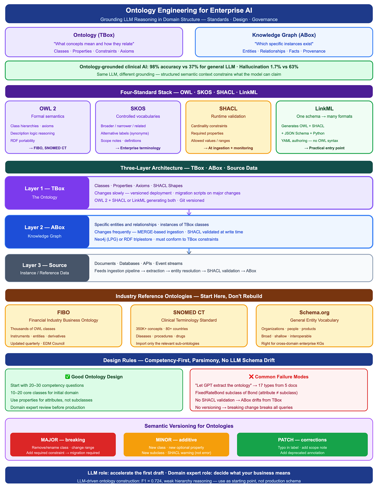

# Ontology Engineering for Enterprise AI: Grounding LLM Reasoning in Domain Structure

[Navaneethan L](https://medium.com/@navaneethanjuly1998?source=post_page---byline--012d3942ad48------------------------------------------)

16 min readNov 3, 2026

The previous article established that knowledge graphs are the right retrieval primitive for multi-hop, relationship-aware enterprise queries. This article addresses the layer that makes a knowledge graph semantically meaningful: the ontology.

An ontology is not the same as a knowledge graph, and the distinction matters for enterprise AI.

The ontology defines what concepts mean in your domain. The knowledge graph records which specific instances exist and what data connects them. A clinical ontology defines what “disease,” “treatment,” and “contraindication” mean and how they relate to each other. The clinical knowledge graph records that metformin is a treatment for type 2 diabetes and is contraindicated with contrast dye for patients with renal impairment — specific facts about specific entities, organized according to the ontology’s structure.

Without an ontology, a knowledge graph is a labeled property graph with no formal semantics: nodes and edges that mean whatever the team that built them intended, which may or may not be what other teams, other systems, or LLMs infer from the labels. With a well-designed ontology, every concept has a precise definition, every relationship has explicit semantics, and every inference the AI system makes can be traced to a formally defined concept hierarchy. The ontology is the semantic contract that makes AI reasoning auditable.

This matters more than most AI engineering teams realize. A recent neurosymbolic architecture study reported 98% accuracy (versus 37% for a general-purpose LLM) on clinical question answering, reducing hallucination from 63% to 1.7% through an RDF/OWL ontology-grounded knowledge graph.The improvement is not from a better model — it is from structured semantic grounding that constrains what the model can claim.

This article covers the theory and practice of ontology engineering for enterprise AI: the standards stack, the design methodology, the three-layer architecture that connects ontology to knowledge graph to instance data, the tooling, the versioning and governance discipline, and the integration patterns that connect ontologies to LLM reasoning.



> GPT-6 補足: 企業 AI 向けのオントロジー設計を俯瞰する図である。上部で TBox と ABox を対比し、中央で OWL・SKOS・SHACL・LinkML、下部で設計方針と変更管理をまとめている。臨床 QA の効果の数値も載っているが、この取り込みでは元の研究を確認していない。

## The Standards Stack: OWL, SKOS, SHACL, LinkML

Enterprise ontology work is built on four W3C and community standards that serve distinct but complementary purposes.

## OWL 2 — Web Ontology Language

OWL (Web Ontology Language) is the formal language for expressing ontologies with description logic semantics. It defines classes, properties, and axioms that enable automated reasoning — a reasoner can infer class membership, detect inconsistencies, and derive implicit relationships from the axioms defined in the ontology.

RDF with OWL 2 gives formal semantics and portability. The W3C’s OWL and RDF standards form the underlying technical substrate; Protégé, TopBraid EDG, and AllegroGraph represent the main tooling layer used in production environments.

OWL is the right choice when:

- The domain has complex hierarchical structure (subclass relationships, equivalence, disjointness)
- Automated reasoning over class membership is needed
- Formal validation of ontology consistency is required
- Interoperability with other OWL ontologies (FIBO, SNOMED CT) is needed

**OWL is not the right choice when:**

- The team lacks ontology engineering expertise (OWL axioms are easy to get wrong in subtle ways)
- The knowledge graph uses a labeled property graph model rather than RDF (most production Neo4j deployments)
- The overhead of formal reasoning is not justified by the use case requirements

## SKOS — Simple Knowledge Organization System

SKOS is a lighter-weight W3C standard for representing controlled vocabularies, taxonomies, and thesauri. Where OWL defines formal class hierarchies with description logic semantics, SKOS defines term hierarchies with broader/narrower relationships, synonyms (alternative labels), and scope notes.

Between RDF’s flexibility and OWL’s logical expressiveness sits SKOS, which provides a lighter-weight vocabulary for representing controlled vocabularies, thesauri, and taxonomies. These three standards — RDF, OWL, and SKOS — form the backbone of nearly all production ontology work.

SKOS is the right choice when:

- The primary need is a controlled vocabulary for consistent terminology across the organization
- Simpler hierarchical relationships (broader/narrower) are sufficient
- The team needs to align across business units using the same terminology without formal reasoning
- The vocabulary feeds semantic search, tagging systems, or entity linking

## SHACL — Shapes Constraint Language

SHACL defines constraints that instance data in a knowledge graph must satisfy — cardinality rules, allowed values, required properties, and relationship constraints. SHACL is validation, not reasoning: it checks that the knowledge graph conforms to the expected shape defined by the ontology.

```
# SHACL shape: every Contract must have exactly one governing jurisdiction
:ContractShape a sh:NodeShape ;
    sh:targetClass :Contract ;
    sh:property [
        sh:path :hasGoverningLaw ;
        sh:minCount 1 ;
        sh:maxCount 1 ;
        sh:class :Jurisdiction ;
        sh:message "Contract must have exactly one governing jurisdiction"
    ] ;
    sh:property [
        sh:path :contractValue ;
        sh:datatype xsd:decimal ;
        sh:minExclusive 0 ;
        sh:message "Contract value must be a positive decimal"
    ] .
```

SHACL runs at ingestion time (validate before adding to the graph) and at query time (validate the graph state before surfacing results to AI systems). It is the mechanism that keeps the knowledge graph consistent with the ontology as data changes.

## LinkML — Linked Data Modeling Language

LinkML is a community-developed schema language that bridges multiple representation formats. A single LinkML schema generates OWL, SHACL, JSON Schema, SQL DDL, and Python dataclasses simultaneously — making it the practical choice for teams that need to maintain a single authoritative schema that produces multiple downstream artifacts.

LinkML: one schema generates OWL, SHACL, SQL — a modeling language, not a store.

```
# LinkML schema excerpt: clinical domain
classes:
  Patient:
    description: "A person receiving medical care"
    attributes:
      patient_id:
        identifier: true
        range: string
      diagnoses:
        range: Diagnosis
        multivalued: true
        inlined: false

  Diagnosis:
    description: "A clinical finding associated with a patient"
    attributes:
      code:
        range: SNOMEDCode  # References SNOMED CT
        required: true
      diagnosed_at:
        range: datetime
      diagnosed_by:
        range: Clinician
```

LinkML is the practical choice for organizations that want schema-first development with multiple output formats, without committing to the full OWL/RDF stack from the start.

## The Three-Layer Architecture

The cleanest enterprise ontology architecture separates concerns into three layers that build on each other.

## Layer 1: TBox — Terminological (The Ontology)

The TBox defines the vocabulary and structure of the domain: what classes exist, what properties connect them, what constraints apply. This is the ontology proper — the formal model of the domain’s concepts and relationships.

The TBox changes slowly. Adding a new concept, refining a relationship definition, or deprecating an old class are events that require review, testing, and versioned deployment. TBox changes affect every instance in the ABox (Layer 2) and every query that uses the affected concepts.

## Layer 2: ABox — Assertional (The Knowledge Graph)

The ABox contains the instance data: the specific entities and relationships that populate the ontology’s structure. The ABox is the knowledge graph. Every node and edge in the knowledge graph is an assertion of the form “this specific entity is an instance of this class” or “this specific entity has this relationship to that specific entity.”

The ABox changes frequently — as new documents are ingested, new entities are extracted, and existing entities are updated. ABox changes must conform to the TBox’s constraints, enforced by SHACL validation at ingestion.

## Layer 3: Instance Data / Reference Data

Below the ABox sit the raw data sources: the documents, databases, APIs, and event streams from which ABox assertions are extracted. This layer feeds the ingestion pipeline that populates the knowledge graph.

Many teams leverage reference models — Schema.org for general entities, FIBO for finance, SNOMED for clinical — then tailor them to enterprise-specific semantics. This layer-on-reference-model approach is faster than building from scratch and produces better interoperability with industry-standard tools and vocabularies.

```
Layer 3: Source data
  Documents · Databases · APIs · Event streams

Layer 2: ABox (Knowledge Graph)
  Specific entities and relationships, conforming to TBox
  Validated by SHACL at ingestion
  Neo4j (LPG) or RDF triplestore

Layer 1: TBox (Ontology)
  Classes · Properties · Axioms · Constraints
  OWL + SHACL, or LinkML generating both
  Versioned, governed, slowly changing
```

## Industry Reference Ontologies: Start Here, Not from Scratch

Building an enterprise ontology from scratch is a multi-year project. For most regulated industries, the right approach is to adopt an industry reference ontology and extend it for organization-specific requirements.

## FIBO — Financial Industry Business Ontology

FIBO provides a common, semantically precise, and machine-readable way to describe financial concepts and their relationships across systems, business units, companies, and supply chains. FIBO is available in RDF/OWL and is reviewed and updated quarterly by a team of ontologists and financial sector subject matter experts.

FIBO models financial instruments, legal entities, markets, and regulatory relationships using OWL. As of the current production release, FIBO spans thousands of classes covering foundations, business entities, securities, derivatives, financial instruments, loans, and market data.

FIBO covers: legal entities, ownership structures, securities, derivatives, contracts, regulatory obligations, and market data. For financial services AI — compliance monitoring, counterparty risk, regulatory reporting, contract review — FIBO is the starting ontology. Extend it for organization-specific instrument types, internal classification schemes, and jurisdiction-specific regulatory mappings.

## SNOMED CT — Clinical Terminology

SNOMED CT is the international clinical terminology standard, used in healthcare systems in 80+ countries. It defines diseases, procedures, body structures, pharmaceuticals, and their clinical relationships using a formal description logic hierarchy with over 350,000 concepts and 1.5 million relationships.

For clinical AI — diagnosis coding, prior authorization, clinical documentation, drug interaction checking — SNOMED CT is the grounding ontology. Its size and complexity make it unsuitable to load in full for most enterprise deployments; the practical approach is to import the relevant concept hierarchies for the organization’s clinical scope.

## Schema.org — General Web Entities

Schema.org provides a broad but shallow vocabulary for common entity types: organizations, people, products, events, places, and their core properties. It is the right starting point for general enterprise knowledge graphs that need to model cross-domain relationships without domain-specific depth.

## Ontology Design: The Methodology

## Start with Competency Questions

Competency questions are the questions the ontology must enable the AI system to answer. They are the requirements specification for the ontology. Before designing any class or relationship, write 20–30 competency questions that represent the queries the system needs to handle:

- “Which regulatory obligations apply to a specific financial instrument in a specific jurisdiction?”
- “What clinical trials have studied this drug for this indication in patients with this comorbidity?”
- “Which supplier contracts expire within 90 days for components classified as critical in our bill of materials?”

Every class and relationship in the ontology should be justified by at least one competency question. Any class that no competency question requires is over-modeling — remove it.

## The Parsimony Principle

An LLM can draft an ontology quickly, but it cannot decide what your business means. A 2026 study of LLM-driven ontology construction for enterprise knowledge graphs reported a fuzzy match F1 of 0.724 in the Data domain and noted limits in scope definition and hierarchy.

LLM-drafted ontologies have a characteristic failure mode: they generate many concept types with ambiguous boundaries because the LLM is pattern-matching from general knowledge rather than modeling the specific business domain. The parsimony principle counters this: define only the concepts and relationships that are necessary to answer the competency questions. Ontologies that grow through LLM suggestion rather than domain expert review become unmaintainable.

Target 10–20 core classes for an initial domain ontology. An ontology that cannot be diagrammed on a single page is probably over-modeled.

## Naming Conventions That Scale

Naming conventions in ontologies are not aesthetic choices — they are functional requirements. LLMs, SPARQL queries, and downstream code all depend on predictable, interpretable names.

```
Classes:         PascalCase noun phrases         → LegalEntity, FinancialInstrument
Properties:      camelCase verb phrases          → hasIssuer, governedBy, expiresAt
Individuals:     prefix + identifier             → fibo:US_SEC, snomed:73211009
Namespaces:      domain-specific URI prefix      → :acme-fin: for org-specific extensions
```

Avoid abbreviations in class names — they make the ontology opaque to anyone who was not present when the abbreviation was coined. Avoid action verbs in class names — they belong in property names. Use natural language names that domain experts recognize: a `FinancialInstrument` class is more interpretable to both humans and LLMs than an `FI` class.

## Hierarchy Design: Depth and Width

Class hierarchies in OWL follow the is-a relationship: a `Bond` is-a `DebtInstrument`, which is-a `FinancialInstrument`. Good hierarchy design follows three rules:

**No more than 4–5 levels of depth** for most enterprise domains. Deeper hierarchies become difficult to maintain and query. If a hierarchy needs 7 levels, restructure it.

**Balanced width.** A class with 30 direct subclasses is a signal that the hierarchy is missing intermediate concepts. A class with 1 subclass is a signal that the subclass is redundant.

**Use properties, not subclasses, for attributes.** A common over-modeling mistake is creating subclasses for attributes that should be properties. `FixedRateBond` as a subclass of `Bond` is usually wrong — `hasInterestRateType: fixed` as a property on `Bond` is right. Reserve subclassing for genuinely distinct concept types with different relationships and constraints.

## LLM Integration: How Ontologies Ground AI Reasoning

The connection between ontologies and LLM systems operates through three patterns.

## Pattern 1: Ontology as Context Injection

The simplest integration: inject the relevant portion of the ontology into the LLM’s context window alongside retrieved content. When the query touches financial instruments, inject the FIBO classes and relationships relevant to the query; when the query touches clinical concepts, inject the relevant SNOMED CT hierarchy.

```
async def build_grounded_context(
    query: str,
    retrieved_passages: list[str],
    ontology_store: OntologyStore
) -> str:
    # Extract domain concepts from query
    concepts = await concept_extractor.extract(query)

    # Retrieve relevant ontology fragments
    ontology_fragments = []
    for concept in concepts:
        fragment = await ontology_store.get_concept_with_neighbors(
            concept_uri=concept.uri,
            hops=2,
            format="natural_language"  # Serialize as readable text, not Turtle
        )
        ontology_fragments.append(fragment)

    # Build grounded context: ontology first, then passages
    grounded_context = (
        "[ONTOLOGY CONTEXT — formal definitions for this domain]\n"
        + "\n".join(ontology_fragments)
        + "\n\n[RETRIEVED CONTENT]\n"
        + "\n\n".join(retrieved_passages)
    )
    return grounded_context
```

The ontology context label signals to the model that this information carries different epistemic weight than retrieved text — it is definitional, not evidential.

## Pattern 2: Ontology-Constrained Output

For structured output tasks — extracting entities and relationships from documents — the ontology defines the valid output space. The LLM is instructed to produce outputs that conform to the ontology’s class and relationship definitions.

```
EXTRACTION_PROMPT = """
Extract financial entities and relationships from the following contract excerpt.

Ontology constraints:
- Valid entity types: {entity_types}
- Valid relationship types: {relationship_types}
- Required properties per entity type: {required_properties}

Extract ONLY entities and relationships defined in the ontology.
For each entity, provide its type (from the ontology), its name, and its required properties.
For each relationship, provide its type (from the ontology), the source entity, and the target entity.

Contract excerpt:
{text}

Return as JSON conforming to the schema: {output_schema}
"""
```

Ontology-constrained extraction produces outputs that can be validated by SHACL before ingestion — the ontology closes the loop between extraction and validation.

## Pattern 3: Ontology as Agent Reasoning Scaffold

A three-layer ontological framework — Role, Domain, and Interaction ontologies — provides formal semantic grounding for LLM-based enterprise agents. A production ontology injection pipeline should estimate the LLM’s parametric confidence per concept and suppress injection for well-known domains, reserving context budget for enterprise-specific knowledge where the marginal value is highest.

For agentic systems, the ontology functions as the agent’s world model — the formal description of what entities exist in the domain, what actions the agent can take, what constraints govern those actions, and what the expected state of the world is before and after each action.

This is the most powerful and most complex integration pattern. It connects ontology engineering to agent design (Article #35) — the ontology defines the domain; the agent architecture defines how the agent reasons within it.

## Versioning and Governance

## Semantic Versioning for Ontologies

Ontologies must be versioned, but ontology versioning follows different rules from software versioning because breaking changes have different implications.

```
MAJOR version: backward-incompatible changes
  - Removing a class or property
  - Renaming a class or property
  - Changing a property's domain or range
  - Adding a required constraint that existing data violates

MINOR version: backward-compatible additions
  - Adding a new class
  - Adding a new optional property
  - Adding a new subclass relationship
  - Adding a new SHACL constraint with warning (not error) severity

PATCH version: corrections and annotations
  - Correcting a typo in a label or description
  - Adding or improving scope notes
  - Adding deprecated annotations
```

A major version change in the ontology requires a migration plan for the knowledge graph — the ABox must be updated to conform to the new TBox. This is the ontology equivalent of a database schema migration: it requires a tested migration script, a rollback plan, and a deployment window.

## The Ontology Review Process

Ontology changes should follow the same review process as code changes — pull request, review, evaluation, deployment:

```
Propose change:
  → Open an ontology change request (OCR) with:
       - What is changing and why
       - Which competency questions it addresses or affects
       - Impact assessment: which classes, properties, and SHACL shapes are affected
       - Which existing knowledge graph data will need migration

Review:
  → Domain expert review: does this accurately represent the domain?
  → AI system review: does this support or break the queries the system needs to answer?
  → Data owner review: is the migration of existing data feasible?

Test:
  → Run SHACL validation against the knowledge graph with the new ontology version
  → Run the competency question query set against the new ontology
  → Verify that all GraphRAG patterns produce correct results

Deploy:
  → Versioned release of the ontology artifact (OWL file or LinkML schema)
  → Migration script for the knowledge graph
  → Updated SHACL shapes
  → Changelog entry in the ontology documentation
```

## Ontology Drift

Ontology drift is a challenge for explainable data governance. Explainable AI work that maps onto standardized ontologies must heed the challenges of ontology drift and semantic changes.

Ontology drift occurs when the real-world domain evolves — new financial instruments are created, new clinical procedures are introduced, regulatory frameworks change — and the ontology does not keep pace. Drifted ontologies produce knowledge graphs that are structurally valid but semantically stale, and AI systems that reason from stale ontologies produce confident but wrong answers.

Prevention mechanisms:

- **Quarterly ontology review** aligned with industry reference ontology updates (FIBO updates quarterly; SNOMED CT updates twice yearly)
- **Concept usage monitoring** — track which ontology concepts appear in extracted entities and flag concepts that appear with decreasing frequency (the domain may be moving away from the concept)
- **Domain expert standing committee** — a small group of domain experts with authority to propose and approve ontology changes, meeting monthly

## Tooling

The production ontology engineering toolchain:

**Authoring:**

- **Protégé** (open source, Stanford) — the reference OWL editor; full DL reasoner integration; the standard choice for academic and enterprise ontology teams
- **TopBraid Composer / EDG** (commercial) — enterprise-grade ontology management with governance workflows, change tracking, and multi-user collaboration
- **LinkML Authoring** (YAML-based) — the practical choice for teams more comfortable in code than in graphical ontology editors; generates OWL + SHACL + JSON Schema from a single YAML schema

**Validation:**

- **SHACL validation libraries** — `pyshacl` for Python-based validation pipelines; Neo4j's neosemantics (n10s) plugin for SHACL validation within Neo4j
- **OWL reasoners** — HermiT or Pellet for OWL consistency checking and class inference; ELK for scalable reasoning on large OWL EL ontologies

**Storage:**

- **RDF triplestores** — GraphDB (Ontotext), StarDog, AllegroGraph for OWL+RDF workloads with SPARQL query support and reasoning integration
- **Neo4j with n10s** — for teams using Neo4j as the primary graph database; the neosemantics plugin imports RDF/OWL into Neo4j’s labeled property graph model

**Versioning:**

- Git for ontology file versioning (OWL Turtle files, LinkML YAML, SHACL shapes)
- OWL annotation properties (`owl:versionInfo`, `owl:priorVersion`) for in-ontology version metadata

## The Full-Stack Integration

## Backend: Ontology Service

A dedicated ontology service exposes the ontology as a queryable API for the rest of the AI stack:

```
@app.get("/v1/ontology/concept/{concept_uri}")
async def get_concept(concept_uri: str) -> ConceptResponse:
    """
    Returns a concept with its definition, superclasses, properties,
    and SHACL constraints — serialized as natural language for LLM injection.
    """
    return await ontology_store.get_concept(
        uri=concept_uri,
        include_superclasses=True,
        include_properties=True,
        include_constraints=True,
        format="natural_language"
    )

@app.post("/v1/ontology/validate")
async def validate_extraction(extraction: ExtractionResult) -> ValidationResult:
    """
    Validate an LLM extraction result against the ontology's SHACL shapes.
    Returns: valid (bool), violations (list[Violation])
    """
    return await shacl_validator.validate(
        data=extraction.to_rdf(),
        shapes=await ontology_store.get_shapes()
    )

@app.get("/v1/ontology/concepts")
async def list_concepts(domain: str = None) -> list[ConceptSummary]:
    """List all concepts, optionally filtered by domain."""
    return await ontology_store.list_concepts(domain=domain)
```

## Integration with the LLM Pipeline

The ontology service integrates into the retrieval pipeline at three points:

1. **Pre-retrieval**: extract concepts from the query and inject ontology context
2. **Post-extraction**: validate LLM-extracted entities against SHACL shapes before graph ingestion
3. **Pre-generation**: inject relevant ontology fragments alongside retrieved graph context

## Frontend: Ontology Explorer

For domain experts who need to validate and evolve the ontology, a lightweight ontology explorer in the admin interface:

- Concept browser: list all concepts, navigate superclass/subclass hierarchy
- Relationship viewer: for a selected concept, show all incoming and outgoing relationship types
- Validation dashboard: SHACL validation results across the knowledge graph — how many entities of each class, how many validation errors, trend over time
- Change log: history of ontology versions with diff view between versions

## Trade-offs Worth Naming

**Ontology engineering requires specialized expertise.** OWL description logic is not intuitive. SHACL shape design requires understanding of both the data model and the validation requirements. Most AI engineering teams do not have this expertise in-house. The practical options: bring in an ontology engineer for the initial design (the highest-ROI consulting investment for regulated AI), use a domain expert in combination with tooling that abstracts the OWL, or use LinkML to lower the entry barrier.

**Formal reasoning has a computational cost.** OWL DL reasoning — checking consistency, inferring class memberships — is computationally expensive for large ontologies. Most production enterprise AI systems use the ontology for schema governance and SHACL validation rather than live reasoning. Reserve reasoning for ontology validation at development time; use SHACL for runtime validation.

**Reference ontologies carry their own complexity.** FIBO has thousands of classes. SNOMED CT has 350,000+ concepts. Importing the full reference ontology is impractical for most deployments. The right approach: import only the sub-ontologies relevant to the use case, maintain the import as a versioned dependency, and track updates to the reference ontology quarterly.

**LLM-generated ontologies require domain expert validation.** The ontology captures how your business works, which is institutional knowledge. An LLM can draft one quickly, but it cannot decide what your business means. Use LLMs to accelerate the first draft — they are good at generating candidate concept hierarchies and relationship types. Require domain expert review and curation before any LLM-generated ontology element reaches production.

## Architect’s Takeaways

- Enterprise AI needs both: the ontology tells agents what concepts mean; the knowledge graph tells them what exists. They are not alternatives — they are layers.
- Three standards form the backbone of production ontology work: OWL 2 (formal semantics), SKOS (controlled vocabularies), SHACL (validation), with LinkML as the practical authoring layer that generates all three.
- Start from industry reference ontologies where they exist: FIBO for financial services, SNOMED CT for clinical, Schema.org for general entities. Extend for organization-specific requirements; do not rebuild from scratch.
- Design ontologies from competency questions, not from data. Every class and relationship must be justified by a question the system needs to answer.
- The parsimony principle: 10–20 core classes for an initial domain ontology. LLM-generated ontologies expand beyond useful scope without domain expert curation.
- SHACL is the runtime enforcement mechanism that keeps the knowledge graph consistent with the ontology as data changes. Run it at ingestion time and monitor validation results.
- Semantic versioning applies to ontologies: major version for breaking changes (removal, renaming, constraint tightening); minor for backward-compatible additions; patch for corrections.
- Ontology drift is the silent degradation risk. Quarterly review aligned with industry reference ontology update cycles is the minimum governance cadence.
- LLM integration through context injection is the pragmatic starting point; ontology-constrained output and agent reasoning scaffolding are the advanced patterns worth building toward.
