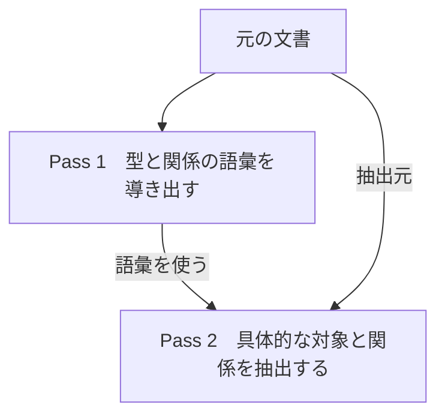

「どんな種類や関係を使うか」をオントロジーで定義し、「どの対象について何が分かっているか」を知識グラフの個別の事実として表します。事実と元データの対応を残すと、出所までたどれます。


### myKG が文書から定義と事実を取り出す手順



myKG では、語彙を作る処理と、語彙に沿って個々の事実を取り出す処理を、別々に確認・再実行できます。

### 形式と事実の確認

形式の検査では、記録が定義に合っているかを確かめます。その事実が業務上正しいかは、出所まで戻って判断します。myKG は基本的な OWL の語彙宣言を受け付けます。高度な OWL 推論は対象外で、スキーマの検証結果が警告として出ても処理が続く場合があります。


```svg-figure definition-facts-sources
<svg xmlns="http://www.w3.org/2000/svg" width="720" height="389" viewBox="0 0 720 389" role="img" aria-labelledby="figure-title figure-desc">
  <title id="figure-title">定義・事実・元データの分担</title>
  <desc id="figure-desc">TBox はクラスや関係、公理を定義する。ABox は個別の事実を表す。元データは事実を抽出する文書やデータベース。個々の事実を出所と結びつけると、その根拠をたどれる。</desc>
  <rect width="720" height="389" rx="18" fill="#F6F9FC"/>
  <g font-family="Yu Gothic UI, Meiryo, Segoe UI, sans-serif" fill="#19283F">
    <text x="360" y="48" text-anchor="middle" font-size="23" font-weight="700">定義・事実・元データの分担</text>

    <rect x="24" y="76" width="672" height="67" rx="11" fill="#E5F2EF" stroke="#B9D9D1"/>
    <path d="M174 90 V129" stroke="#B9D9D1"/>
    <text x="99" y="117" text-anchor="middle" font-size="20" font-weight="700" fill="#145D53">TBox</text>
    <text x="197" y="106" font-size="18" font-weight="700">意味の定義</text>
    <text x="197" y="127" font-size="15">クラス、関係、公理を定義する。</text>

    <rect x="24" y="170" width="672" height="67" rx="11" fill="#EAEFFB" stroke="#C9D5EE"/>
    <path d="M174 184 V223" stroke="#C9D5EE"/>
    <text x="99" y="211" text-anchor="middle" font-size="20" font-weight="700" fill="#304D87">ABox</text>
    <text x="197" y="200" font-size="18" font-weight="700">個別の事実</text>
    <text x="197" y="221" font-size="15">具体的な対象についての事実を表す。</text>

    <rect x="24" y="264" width="672" height="67" rx="11" fill="#FAF0E0" stroke="#E7D5B6"/>
    <path d="M174 278 V317" stroke="#E7D5B6"/>
    <text x="99" y="305" text-anchor="middle" font-size="20" font-weight="700" fill="#7A501C">元データ</text>
    <text x="197" y="294" font-size="18" font-weight="700">事実の出所</text>
    <text x="197" y="315" font-size="15">文書やデータベースから事実を取り出す。</text>

    <text x="360" y="362" text-anchor="middle" font-size="15" fill="#405573">ABox の事実を元データと結びつけると、根拠をたどれる。</text>
  </g>
</svg>

```

