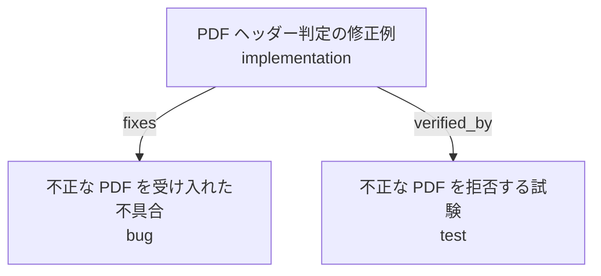

`ontology.yaml` はグラフで使う種類と関係を定義します。各ページの `graph.relationships` には、その定義に従って、出典付きの個別の関係を書きます。以下は PDF ヘッダー判定を題材にした**架空の例**です。


### 実装ページから関係をたどる



どちらの矢印も実装ページが起点です。試験を `fixes` の起点にすると、`subject_types` の指定に合わないため、グラフの lint が検出します。

### どこに何を書くか

| 場所 | 書く内容 |
| --- | --- |
| `ontology.yaml` の `node_types` | `bug`、`implementation`、`test` を定義。`explicit_only: true` にすると、ページ側で型を明示して使う。 |
| `ontology.yaml` の `predicates` | `fixes` と `verified_by` の主語・目的語に許す型を指定。`requires_evidence: true` で出典と引用を必須にする。`description` には関係の意味を書く。 |
| 実装ページの frontmatter | `type: "concept"` は wiki のページ種別。`graph.node_type: "implementation"` はグラフでの役割。`graph.node_id` でその実装を識別する。 |

### 1件の関係に付ける6項目

実装ページの `graph.relationships` に、関係ごとに次の項目を書きます。

```yaml
- predicate: "fixes"
  object: "bug:invalid-pdf-accepted"
  source: "検証記録の例"
  evidence: "ヘッダー判定を修正し、不正な PDF の受け入れを防いだ。"
  confidence: "high"
  status: "current"
```

実際に使う場合は、指定した ID と型を持つ不具合・試験のページと、引用元の `type: "source"` のページを用意します。コードフェンス内の YAML は表示用です。型付き関係として登録するには、引用を確認してページ冒頭の frontmatter に記述し、グラフの lint を確認してから `extract` で索引を作り直します。関係が事実かどうかは出典を読んで確かめます。


```svg-figure yaml-roles
<svg xmlns="http://www.w3.org/2000/svg" width="720" height="374" viewBox="0 0 720 374" role="img" aria-labelledby="diagram-title diagram-desc">
  <title id="diagram-title">fixes の定義と記録を見比べる</title>
  <desc id="diagram-desc">ontology.yaml の fixes は実装から不具合への関係を許し、証拠を要求する。実装ページでは、主語の型を implementation とし、predicate に fixes、object に bug:invalid-pdf-accepted を指定する。出典、引用、確信度、状態も記録する。</desc>
  <rect width="720" height="374" rx="18" fill="#F6F9FC"/>
  <g font-family="Yu Gothic UI, Meiryo, Segoe UI, sans-serif" fill="#19283F">
    <text x="360" y="45" text-anchor="middle" font-size="23" font-weight="700">fixes の定義と記録を見比べる</text>

    <rect x="24" y="72" width="323" height="238" rx="12" fill="#E6F3EF" stroke="#B8D8CE"/>
    <rect x="373" y="72" width="323" height="238" rx="12" fill="#EBEFFA" stroke="#CAD3EF"/>
    <text x="45" y="109" font-size="18" font-weight="700" fill="#114D43">ontology.yaml で定義する</text>
    <text x="394" y="109" font-size="18" font-weight="700" fill="#2D4278">実装ページに記録する</text>
    <text x="45" y="139" font-size="15">実装から不具合への関係を許す。</text>
    <text x="394" y="139" font-size="15">どの不具合を修正したかを示す。</text>

    <rect x="42" y="156" width="287" height="100" rx="8" fill="#FFFFFF"/>
    <rect x="391" y="156" width="287" height="100" rx="8" fill="#FFFFFF"/>
    <rect x="50" y="165" width="271" height="23" rx="4" fill="#DDF0E9"/>
    <rect x="399" y="189" width="271" height="23" rx="4" fill="#E1E7F9"/>
    <g font-family="Consolas, monospace" font-size="14">
      <text x="56" y="181" fill="#114D43" font-weight="700">fixes:</text>
      <text x="64" y="205">subject_types: [implementation]</text>
      <text x="64" y="229">object_types: [bug]</text>
      <text x="405" y="181">node_type: implementation</text>
      <text x="405" y="205" fill="#2D4278" font-weight="700">predicate: fixes</text>
      <text x="405" y="229">object: bug:invalid-pdf-accepted</text>
    </g>
    <text x="45" y="283" font-size="14" fill="#34594E">requires_evidence で出典と引用を必須にする。</text>
    <text x="394" y="283" font-size="14" fill="#455780">出典・引用・確信度・状態を添える。</text>

    <text x="360" y="347" text-anchor="middle" font-size="15" fill="#405573">主語は関係を書いた実装ページ自身。相手は object の ID で指定する。</text>
  </g>
</svg>

```

