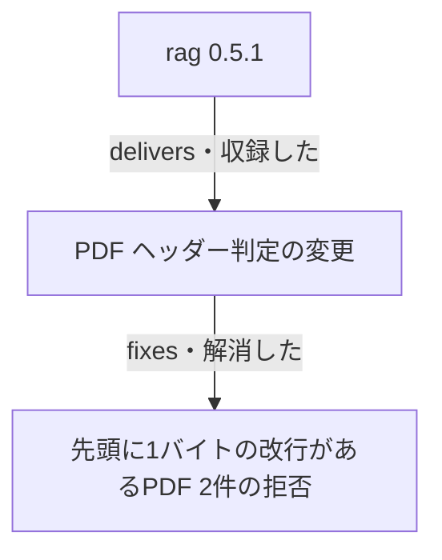

何を作り、なぜ選び、どの版で直し、どこまで確かめたかをたどるための設計です。**2026年11月18日時点の第2版は、本番のオントロジーに未適用です。**


### 何を記録するか

既存の `product`、`concept`、`source`、`decision` を使い、次の6種類を加える案です。既存の定義を含む候補全体は18種類・26述語です。

| 追加する種類 | 記録するもの |
| --- | --- |
| `component` | 製品内で役割を持つ構成要素 |
| `release` | 自前または外部の製品の特定バージョン |
| `change` | 範囲を特定したコード、文書、設定、プロンプトの変更 |
| `issue` | 条件と期待に照らして実際に観測した問題 |
| `evaluation` | 対象版、方法、結果、限界を記録した評価の実施 |
| `artifact` | リポジトリとパス・識別子・URLで特定する文書、設定、公開文面など |

### どの版に、どの修正が入ったか



この変更で受け付ける前置きは1024バイト以下です。直接抽出は確認し、MCP から索引化までの経路は未確認でした。この案では、次のように11種類の関係を追加します。

- **変更と判断をたどる。** `part_of`、`release_of`、`delivers`、`changes` で構成・版・変更を結び、`affects` と `fixes` で問題の影響と修正を結びます。`implements`、`motivated_by`、`selects`、`evaluates`、`applies_to` で、判断の根拠や評価、適用先を記録します。
- **版を特定して読む。** wiki 0.23.0 の依存先は `depends_on` で yt-dlp 2026.8.19 に結び、そこから `release_of` で製品の yt-dlp に結びます。`depends_on` の両側に構成要素と版を追加する案です。版を固定する判断と、実装で固定した版番号は別に記録します。
- **判断と評価の範囲を保つ。** Sonnet の継続判断と raw の分担は別々の判断として記録し、測定対象と運用範囲も区別します。手順と条件を説明する `concept` と、特定時点の選択を表す `decision` は別の対象です。`evaluates` が示すのは評価の実施です。毎回対象が変わった17回のレビューを最終出荷版の評価として扱わず、`current` から最新版・未解決・合格を判断しません。

### 採用と回答の手順

1. 人または LLM が候補を作り、既存の ID と照合し、根拠を読んで採用した関係を Markdown に記録します。種類と関係の定義は `ontology.yaml` に置き、JSONL と SQLite は作り直せる索引として扱います。
2. 回答するときは対象版を特定し、関係を記録したページ、評価ページ、出典の該当箇所を確認します。CLI のテキスト表示では `notes` が省かれ、引用も切り詰められます。種類別の全件一覧や承認状態は、インデックス・台帳・JSONL と本文で確認します。

隔離した試料では、対象33・出典7の計40ページと、型付きの関係38本について、型・参照・引用の実在を検査しました。関係の意味や事実の真偽は別途確認が必要です。Opus の初回レビューは条件付きで採用可とし、指摘を第2版に反映しました。独立した再レビューは未実施です。採用する場合は必要な事例から対象と関係を増やします。


```svg-figure objects-and-sources
<svg xmlns="http://www.w3.org/2000/svg" width="720" height="408" viewBox="0 0 720 408" role="img" aria-labelledby="title desc">
  <title id="title">追跡する対象と、関係を裏づける資料</title>
  <desc id="desc">製品の版・変更・問題・評価には必要なものだけに個別のページを設け、1ページを1ノードとして扱う。リリース報告書は出典に残し、関係には出典、引用、確信度、状態を記録する。版と条件は本文と notes に残す。</desc>
  <rect width="720" height="408" rx="18" fill="#F6F9FC"/>
  <g font-family="Segoe UI, Yu Gothic UI, Meiryo, sans-serif" fill="#19283F">
    <text x="360" y="47" text-anchor="middle" font-size="23" font-weight="700">追跡する対象と、関係を裏づける資料</text>

    <rect x="24" y="75" width="323" height="163" rx="12" fill="#E5F3EF" stroke="#B8D8CE"/>
    <circle cx="62" cy="112" r="17" fill="#D0E9E1"/>
    <g fill="none" stroke="#126759" stroke-width="1.6">
      <path d="M57 108 L67 108 L62 116 Z"/>
      <circle cx="57" cy="108" r="2.4" fill="#E5F3EF"/>
      <circle cx="67" cy="108" r="2.4" fill="#E5F3EF"/>
      <circle cx="62" cy="116" r="2.4" fill="#E5F3EF"/>
    </g>
    <text x="90" y="118" font-size="19" font-weight="700" fill="#114D43">追跡する対象</text>
    <text x="44" y="159" font-size="16">版・変更・問題・評価など</text>
    <text x="44" y="188" font-size="15">問いに必要な対象を個別のページにする。</text>
    <text x="44" y="212" font-size="15">1ページをグラフ上の1項目として扱う。</text>

    <rect x="373" y="75" width="323" height="163" rx="12" fill="#ECEFFA" stroke="#CAD3EF"/>
    <circle cx="410" cy="112" r="17" fill="#DFE5F7"/>
    <g fill="none" stroke="#364F8D" stroke-width="1.6" stroke-linecap="round" stroke-linejoin="round">
      <path d="M405 104 H412 L416 108 V120 H405 Z M412 104 V108 H416"/>
      <path d="M408 112 H413 M408 115 H413"/>
    </g>
    <text x="438" y="118" font-size="19" font-weight="700" fill="#2D4278">根拠となる出典</text>
    <text x="392" y="159" font-size="16">リリースの報告書など</text>
    <text x="392" y="188" font-size="15">報告書は出典のページに残す。</text>
    <text x="392" y="212" font-size="15">何が起きたかを該当箇所で確かめる。</text>

    <rect x="24" y="264" width="672" height="120" rx="12" fill="#FFFFFF" stroke="#D0DAE8"/>
    <text x="44" y="296" font-size="18" font-weight="700">関係ごとに残す情報</text>
    <g font-size="15" font-weight="600" text-anchor="middle">
      <rect x="44" y="308" width="140" height="30" rx="7" fill="#E9EEFA"/>
      <text x="114" y="328">出典</text>
      <rect x="208" y="308" width="140" height="30" rx="7" fill="#E9EEFA"/>
      <text x="278" y="328">引用</text>
      <rect x="372" y="308" width="140" height="30" rx="7" fill="#E9EEFA"/>
      <text x="442" y="328">確信度</text>
      <rect x="536" y="308" width="140" height="30" rx="7" fill="#E9EEFA"/>
      <text x="606" y="328">状態</text>
    </g>
    <text x="44" y="362" font-size="15" fill="#405573">対象の版と適用条件は、ページ本文と notes に残す。</text>
  </g>
</svg>

```

