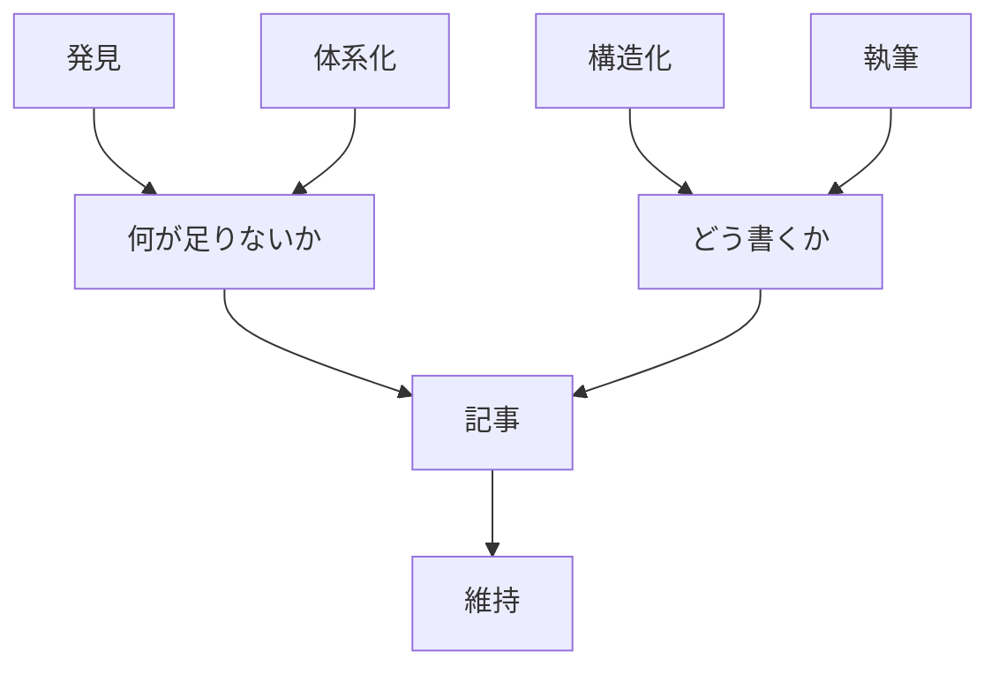

LLM Wiki の記事づくりを、発見・構造化・体系化・執筆・維持の 5 つの判断に分ける提案です。新しい資料を取り込むときと、既知の領域の抜けを埋めるときでは、使う手法の組み合わせが変わります。

### 5 区分が担う判断



| 区分 | 問い | 先に採る手法 | 後から検討する手法 |
| --- | --- | --- | --- |
| 発見 | 何について書くか | 資料の取り込みと質問への回答から記事を見つける | 領域が見えてから、wiki が答えるべき問い（Competency Questions）を設計する |
| 構造化 | どの単位に分けるか | Atomic Notes で 1 ページの話題を絞り、記事型を使い分ける | DITA |
| 体系化 | どう分類し、関連付けるか | 案内ページ（MOC、たとえば `index.md`）と SKOS 風の関係 | 分類体系の事前設計、OWL や完全なオントロジー |
| 執筆 | どう書くか | テンプレートと出典、設計判断を残す ADR | Diátaxis の 4 種すべての適用 |
| 維持 | 重複・矛盾・古い記述にどう対処するか | lint での点検、記事の状態（`status`）、Docs as Code | 利用が増えてから KCS |

### きっかけで手法を選ぶ


未知の領域では、資料から概念を拾うボトムアップで始め、分類や問いの設計は領域が見えてから行います。既知の領域を網羅する場合は、先に答えるべき問いを並べ、案内ページに未作成記事へのリンクを置き、調査で抜けを埋めます。

外部資料を取り込む場合は raw を保ち、出典付きの暫定記事から正典へ昇格させます。質問に答えた場合は回答を記事の下書きにし、未回答の問いも残します。日々の作業やアイデアは日誌に記録し、週ごとの統合で概念ページに移します。手順が中心なら Diátaxis の How-to と Reference を分け、概念が中心なら Explanation に絞る案です。

### Skill への落とし込み

提案では、発見のきっかけに応じて `ingest`、`plan`、`answer`、`journal` などの入口を用意します。構造化・体系化・執筆には共通のスキーマとテンプレートを使い、維持は `lint` と `consolidate` が担います。


```svg-figure article-triggers
<svg xmlns="http://www.w3.org/2000/svg" width="720" height="390" viewBox="0 0 720 390" role="img" aria-labelledby="triggers-title triggers-desc">
  <title id="triggers-title">きっかけごとの記事作成</title>
  <desc id="triggers-desc">未知の領域は資料から概念を育て、既知の領域は問いから抜けを埋める。継続的な取り込みは出典を残して暫定記事を昇格し、質問への回答は草稿にする。日々の作業は日誌でまとめ、手順中心なら手順と参照情報を分ける。</desc>
  <rect width="720" height="390" rx="16" fill="#f3f6fa"/>
  <g font-family="system-ui, 'Yu Gothic UI', Meiryo, sans-serif" fill="#192e44">
    <text x="24" y="40" font-size="22" font-weight="700">きっかけごとの記事作成</text>
    <text x="24" y="64" font-size="14" fill="#435d72">記事が必要になった場面から、最初に使う手法を選ぶ。</text>
    <g>
      <rect x="24" y="85" width="330" height="87" rx="9" fill="#ffffff" stroke="#d5dfe8"/>
      <rect x="32" y="92" width="314" height="26" rx="5" fill="#e7f0fa"/>
      <text x="41" y="110" font-size="15" font-weight="700" fill="#274e77">未知の領域を学び始めた</text>
      <text x="41" y="138" font-size="15">資料を取り込み、概念を</text>
      <text x="41" y="159" font-size="15">1 ページずつ育てる</text>
    </g>
    <g>
      <rect x="366" y="85" width="330" height="87" rx="9" fill="#ffffff" stroke="#d5dfe8"/>
      <rect x="374" y="92" width="314" height="26" rx="5" fill="#e7f0fa"/>
      <text x="383" y="110" font-size="15" font-weight="700" fill="#274e77">既知の領域を網羅したい</text>
      <text x="383" y="138" font-size="15">答えるべき問いを並べ、</text>
      <text x="383" y="159" font-size="15">索引の未作成ページから埋める</text>
    </g>
    <g>
      <rect x="24" y="182" width="330" height="87" rx="9" fill="#ffffff" stroke="#d5dfe8"/>
      <rect x="32" y="189" width="314" height="26" rx="5" fill="#e7f4ed"/>
      <text x="41" y="207" font-size="15" font-weight="700" fill="#245b4c">外部資料を取り込み続ける</text>
      <text x="41" y="235" font-size="15">原文と出典を残し、</text>
      <text x="41" y="256" font-size="15">暫定記事を正典へ昇格させる</text>
    </g>
    <g>
      <rect x="366" y="182" width="330" height="87" rx="9" fill="#ffffff" stroke="#d5dfe8"/>
      <rect x="374" y="189" width="314" height="26" rx="5" fill="#e7f4ed"/>
      <text x="383" y="207" font-size="15" font-weight="700" fill="#245b4c">質問に答えた</text>
      <text x="383" y="235" font-size="15">回答を下書きにし、</text>
      <text x="383" y="256" font-size="15">未回答の問いも記録する</text>
    </g>
    <g>
      <rect x="24" y="279" width="330" height="87" rx="9" fill="#ffffff" stroke="#d5dfe8"/>
      <rect x="32" y="286" width="314" height="26" rx="5" fill="#efeafa"/>
      <text x="41" y="304" font-size="15" font-weight="700" fill="#57447d">日々の作業やアイデア</text>
      <text x="41" y="332" font-size="15">日誌に記録し、週ごとに</text>
      <text x="41" y="353" font-size="15">概念ページへまとめる</text>
    </g>
    <g>
      <rect x="366" y="279" width="330" height="87" rx="9" fill="#ffffff" stroke="#d5dfe8"/>
      <rect x="374" y="286" width="314" height="26" rx="5" fill="#efeafa"/>
      <text x="383" y="304" font-size="15" font-weight="700" fill="#57447d">手順が中心の技術知識</text>
      <text x="383" y="332" font-size="15">How-to と Reference を</text>
      <text x="383" y="353" font-size="15">別のページにする</text>
    </g>
  </g>
</svg>

```

