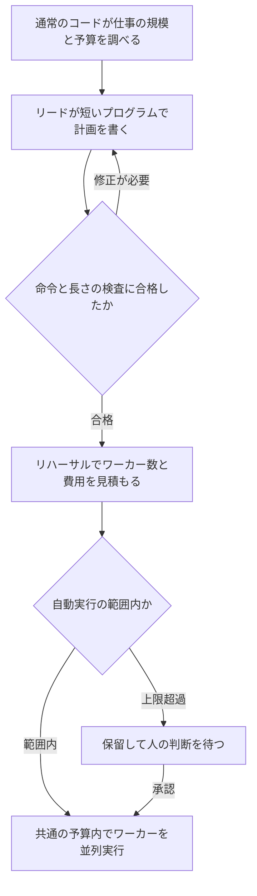

リードが仕事ごとに短いプログラムで計画を書き、通常のコードがその計画に沿ってワーカーを並列に動かします。リードには、仕事の規模、料金、上限、予算を約 500 トークンにまとめて渡します。記事の例では、約 135 万トークンの仕事に対し、計画を作る呼び出しが読んだのは 1,780 トークンでした。

### 実行までの流れ

記事では、計画に使える命令を許可リストで制限し、80 行・6,000 文字を上限としています。リハーサルでは費用のかからない代役で計画を 1 回動かします。自動実行は見積もりが 40 クレジット以下、かつ予算の 3 分の 1 以下の場合です。



### 2 つの実装例で見る役割と制限

- **実装と測定を扱う記事**では、質問ごとに回答を台帳へ記録し、再実行に備えます。消費量を測って予算の上限も管理します。計画の検査は、自分のリードが作った計画の暴走や費用の見積もり違いを実行前に止めるために使います。
- **Claude Managed Agents の cookbook** では、リードが仕事を振り分け、アナライザーが会話記録を 1 件ずつ調べ、最後にオーガナイザーが 1 回だけ結果をまとめます。段を分け、書き込み後に読み戻して競合を防ぎます。外から来る会話記録はデータとして読み、道具を 5 つに制限し、ネットワークの許可リストを空にして、必要なセッションに読み取り専用で渡します。

### 監査実験で何が変わったか


固定計画と比べると、動的ワークフローは再現率が 0.06〜0.25 高く（95% 区間）、費用は約 3.5 倍でした。報告した箇所に実際にバグがあった割合は下がりました。各設計の試行は 3 回以下で、対象は 1 つのライブラリ、モデルは Qwen 系です。事前の 11 個の予測のうち、実験結果が支持したのは 3 個でした。同じ回数だけスキャンさせた固定計画との比較がないため、見つかったバグが増えた理由を読み取り量と計画の質に分けて判断できません。

リハーサルには本番と同じ予算を渡します。記事では、同じ計画でも予算を 150 から 45 に変えると、見積もりは 23.9 から 8.3 クレジットに変わりました。固定計画でも、見積もりの 10.1 クレジットは実測の 13.8 を 27% 下回りました。info-hive のどの作業に採用するかや、取り込みにいくらかかるかを判断するには、その作業での測定が必要です。


```svg-figure audit-results
<svg xmlns="http://www.w3.org/2000/svg" viewBox="0 0 720 310" width="720" height="310" role="img" aria-labelledby="chart-title chart-desc">
  <title id="chart-title">監査実験の結果を設計別に比較</title>
  <desc id="chart-desc">単独エージェントの再現率は0.02、適合率は1.00、費用は23.7クレジット。人が書いた固定計画は0.30、0.82、13.8。動的ワークフローは0.45、0.71、48.4。いずれも平均値。</desc>
  <rect width="720" height="310" rx="14" fill="#f6f8fb"/>
  <g font-family="system-ui, 'Yu Gothic UI', 'Meiryo', sans-serif" fill="#162740">
    <text x="24" y="34" font-size="21" font-weight="700">監査実験の結果を設計別に比較</text>
    <text x="24" y="62" font-size="14" fill="#3d4e68">849 ファイルに埋め込んだ 72 個のバグを探索。値は試行の平均。</text>
    <g font-size="15" font-weight="700">
      <text x="212" y="98">再現率</text>
      <text x="378" y="98">適合率</text>
      <text x="544" y="98">費用</text>
    </g>
    <g font-size="13" fill="#3d4e68">
      <text x="212" y="119">バグを見つけた割合</text>
      <text x="378" y="119">報告が当たった割合</text>
      <text x="544" y="119">単位はクレジット</text>
    </g>
    <rect x="15" y="132" width="690" height="51" rx="7" fill="#fff"/>
    <rect x="15" y="186" width="690" height="51" rx="7" fill="#fff"/>
    <rect x="15" y="240" width="690" height="51" rx="7" fill="#e0f1ed"/>
    <g font-size="15" font-weight="600">
      <text x="24" y="163">単独エージェント</text>
      <text x="24" y="217">人が書いた固定計画</text>
      <text x="24" y="271">動的ワークフロー</text>
    </g>
    <g font-size="14" font-weight="650">
      <text x="212" y="154">0.02</text>
      <text x="378" y="154">1.00</text>
      <text x="544" y="154">23.7</text>
      <text x="212" y="208">0.30</text>
      <text x="378" y="208">0.82</text>
      <text x="544" y="208">13.8</text>
      <text x="212" y="262">0.45</text>
      <text x="378" y="262">0.71</text>
      <text x="544" y="262">48.4</text>
    </g>
  </g>
  <g fill="#d6e0ea">
    <rect x="212" y="162" width="126" height="7" rx="3.5"/>
    <rect x="378" y="162" width="126" height="7" rx="3.5"/>
    <rect x="544" y="162" width="126" height="7" rx="3.5"/>
    <rect x="212" y="216" width="126" height="7" rx="3.5"/>
    <rect x="378" y="216" width="126" height="7" rx="3.5"/>
    <rect x="544" y="216" width="126" height="7" rx="3.5"/>
    <rect x="212" y="270" width="126" height="7" rx="3.5"/>
    <rect x="378" y="270" width="126" height="7" rx="3.5"/>
    <rect x="544" y="270" width="126" height="7" rx="3.5"/>
  </g>
  <g fill="#49658b">
    <rect x="212" y="162" width="2.52" height="7" rx="1.26"/>
    <rect x="378" y="162" width="126" height="7" rx="3.5"/>
    <rect x="544" y="162" width="59.72" height="7" rx="3.5"/>
    <rect x="212" y="216" width="37.8" height="7" rx="3.5"/>
    <rect x="378" y="216" width="103.32" height="7" rx="3.5"/>
    <rect x="544" y="216" width="34.78" height="7" rx="3.5"/>
  </g>
  <g fill="#087666">
    <rect x="212" y="270" width="56.7" height="7" rx="3.5"/>
    <rect x="378" y="270" width="89.46" height="7" rx="3.5"/>
    <rect x="544" y="270" width="121.97" height="7" rx="3.5"/>
  </g>
</svg>

```

