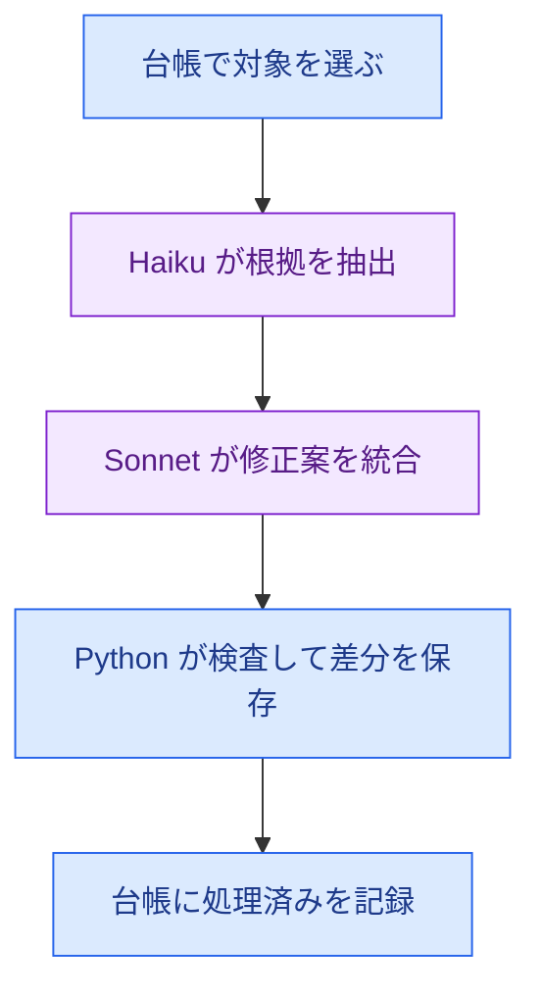

動的ワークフローでは、複数のエージェントへの仕事の割り当てや、結果を集めて確かめる順序をスクリプトに記します。対象に合わせてスクリプトを作る方法と、確認済みのスクリプトを繰り返し使う方法があります。


Managed Agents の **Dreams** は、過去の会話と既存のメモリを読み、新しいメモリストアを返します。Dreaming の Cookbook では、動的ワークフローを使って既存のストアを更新します。

### info-hive-wiki の /wiki-dream

Codex のローカル定期ジョブは現在、毎日正午（日本時間）に起動する設定です。登録時は毎日午前 3 時で、2026 年 11 月 22 日に正午へ変更しました。1 回につき最大 2 件の会話を対象に、Python から保存済みの Claude Code ワークフローを呼び出します。



Python は台帳で会話の ID と原本のハッシュを照合し、処理済みの組を除きます。失敗した会話は以後の回で 1 件ずつ再試行します。ジョブの出力はレビュー用の差分までです。利用者が承認した差分は `wiki_apply.py` で反映します。

### 手動試行で確認したこと

2026 年 11 月 21 日に、ジョブと同じ起動経路を手動で試しました。会話 2 件と関連記事 5 件から出典を補う差分を 1 件作り、`git apply --check` を通しました。同じ会話を指定した再実行では台帳で 2 件とも除外され、自動テスト 17 件も通りました。**試行時点では、スケジューラーによる定刻での初回起動は未確認でした。**

### 比較実験から分かる範囲

本文で紹介した Qwen 系モデルの監査実験では、固定計画に比べ、動的ワークフローが見つけた不具合の割合は **30% から 45%** に上がりました。指摘のうち正しかった割合は **82% から 71%** に下がり、費用は約 **3.5 倍**でした。より多く調べたことと、計画の違いがどれだけ効いたかは、実験からは分けられません。


```svg-figure runtime-comparison
<svg xmlns="http://www.w3.org/2000/svg" width="720" height="316" viewBox="0 0 720 316">
  <title>Claude Code と Managed Agents のワークフロー</title>
  <desc>Claude Code は保存済みの JavaScript をコマンドで起動し、ワークフロー一覧で進捗を確認する。Managed Agents ではセッション内のエージェントが書いた計画を管理環境で起動し、実行イベントで進捗を確認する。</desc>
  <style>
    text { font-family: "Yu Gothic UI", "Hiragino Sans", "Noto Sans CJK JP", "Microsoft YaHei", "Noto Sans CJK SC", system-ui, sans-serif; }
  </style>
  <rect width="720" height="316" rx="16" fill="#f1f5f9"/>
  <text x="360" y="45" text-anchor="middle" font-size="25" font-weight="700" fill="#1e293b">動的ワークフローの実行環境</text>

  <!-- 左カード x=24..346、右カード x=374..696。間隔は28。 -->
  <rect x="24" y="72" width="322" height="220" rx="14" fill="#ffffff" stroke="#bfdbfe"/>
  <rect x="374" y="72" width="322" height="220" rx="14" fill="#ffffff" stroke="#e9d5ff"/>
  <rect x="44" y="90" width="282" height="45" rx="8" fill="#dbeafe"/>
  <rect x="394" y="90" width="282" height="45" rx="8" fill="#f3e8ff"/>

  <g text-anchor="middle">
    <text x="185" y="120" font-size="22" font-weight="700" fill="#1e40af">Claude Code</text>
    <text x="535" y="120" font-size="22" font-weight="700" fill="#6b21a8">Claude Managed Agents</text>

    <g fill="#475569" font-size="15" font-weight="600">
      <text x="185" y="162">起動</text>
      <text x="535" y="162">起動</text>
      <text x="185" y="233">進捗の確認</text>
      <text x="535" y="233">進捗の確認</text>
    </g>

    <path d="M60 211 H310 M410 211 H660" fill="none" stroke="#e2e8f0"/>

    <g fill="#1e293b" font-size="18">
      <text x="185" y="188">保存済みのスクリプトを呼ぶ</text>
      <text x="535" y="188">エージェントが計画を書いて起動</text>
      <text x="185" y="260">/workflows で見る</text>
      <text x="535" y="260">セッションの実行イベントを見る</text>
    </g>
  </g>
</svg>

```

