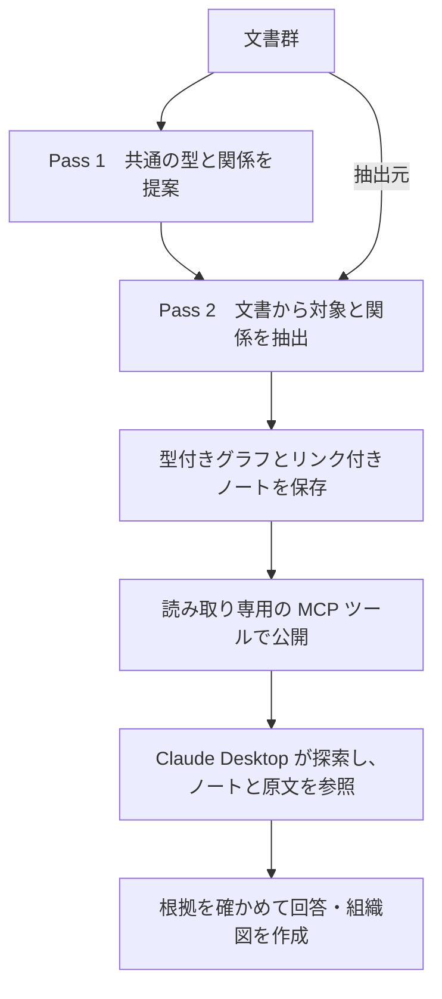

myKG の作者は、架空の Acme Corp の文書から作ったグラフを Claude Desktop に接続し、組織図を作るデモを示しました。Claude はグラフで関係を探し、元の文書で回答の根拠を確かめます。

### 文書の取り込みから回答まで



- **グラフを作る。** 記事では `mykg init` でモデルなどを設定し、`mykg extract-graph notes/ --obsidian-vault` で抽出しました。リンク付きノートは Obsidian 互換で、そのまま参照できます。モデルの選択肢には Ollama のローカルモデルと各社の API が挙がっています。
- **Claude Desktop につなぐ。** 記事の macOS 例では、設定に `uv --directory <プロジェクトのパス> run mykg mcp-serve` を指定し、Claude Desktop を完全に終了して起動し直します。MCP は標準入出力（stdio）と FastMCP を使い、検索、ノード・経路の探索、統計、ノートの参照、再読み込みなどを提供します。

### 組織図を原文で確かめる


記事の画面には、4ファイルから42ノード・52エッジ・弱連結成分2個が生成され、組織図の依頼で検索9回・ファイル参照2回が行われたと表示されています。修正の経緯は画面内の Claude の説明をもとにしており、元のデモファイルを使った再現確認は未実施です。

### 記事と後日の実装確認

| 確認した資料 | MCP ツール数と更新オプション |
| --- | --- |
| 2026年7月7日公開の記事 | 14ツール。差分更新は `--append`、語彙の拡張は `--append --grow-schema` と説明。 |
| 2026年11月18日のリポジトリ確認（`afb0a9c9`） | README と MCP 実装は16ツール。新規追加は `--append`、編集・削除の反映は `--sync` との併用、語彙の拡張は `--append-with-grow-schema`。 |

著者が報告した抽出時間は、小規模なデモで1分未満です。時間と費用は文書の大きさ・種類、モデル、バッチの大きさ、同時実行数に依存します。実際の API 費用、抽出精度、数百文書での比較評価は未確認です。


```svg-figure team-check
<svg xmlns="http://www.w3.org/2000/svg" width="720" height="350" viewBox="0 0 720 350" role="img" aria-labelledby="figure-title figure-desc">
  <title id="figure-title">原文に戻って二つのチームを区別する</title>
  <desc id="figure-desc">架空の会社 Acme Corp のデモ。画面内の Claude の説明によると、グラフの Platform team ノードは二つのチームを混同していた。元の文書を確認し、Bob が管理するインフラのチームと James が監督するプラットフォームのチームを区別した。</desc>
  <rect width="720" height="350" rx="18" fill="#F6F9FC"/>
  <g font-family="Yu Gothic UI, Meiryo, Segoe UI, sans-serif" fill="#19283F">
    <text x="360" y="47" text-anchor="middle" font-size="23" font-weight="700">原文に戻って二つのチームを区別する</text>
    <text x="360" y="72" text-anchor="middle" font-size="14" fill="#465773">架空の Acme Corp のデモで、Claude が画面内で述べた経緯</text>
    <rect x="24" y="101" width="286" height="180" rx="12" fill="#FAEFDF" stroke="#E5D3B2"/>
    <text x="44" y="136" font-size="18" font-weight="700" fill="#754E1D">グラフ上の記録</text>
    <rect x="44" y="153" width="246" height="61" rx="8" fill="#FFFFFF"/>
    <text x="167" y="190" text-anchor="middle" font-size="20" font-weight="700">Platform team</text>
    <text x="44" y="247" font-size="15">二つのチームが一つのノードに混在。</text>
    <text x="360" y="170" text-anchor="middle" font-size="14" fill="#465773">原文を確認</text>
    <path d="M329 192 H383 M377 186 L383 192 L377 198" fill="none" stroke="#526781" stroke-width="1.7" stroke-linecap="round" stroke-linejoin="round"/>
    <rect x="410" y="101" width="286" height="180" rx="12" fill="#E5F2EF" stroke="#B9D9D1"/>
    <text x="430" y="136" font-size="18" font-weight="700" fill="#195D50">組織図での区別</text>
    <rect x="430" y="152" width="246" height="48" rx="8" fill="#FFFFFF"/>
    <text x="442" y="181" font-size="15"><tspan font-weight="700">Bob</tspan><tspan> が管理するインフラのチーム</tspan></text>
    <rect x="430" y="211" width="246" height="48" rx="8" fill="#FFFFFF"/>
    <text x="442" y="231" font-size="15" font-weight="700">James が監督する</text>
    <text x="442" y="249" font-size="15">プラットフォームのチーム</text>
    <text x="360" y="318" text-anchor="middle" font-size="15" fill="#405573">Product team は、原文に指定のない責任者を付けずに示した。</text>
  </g>
</svg>

```

