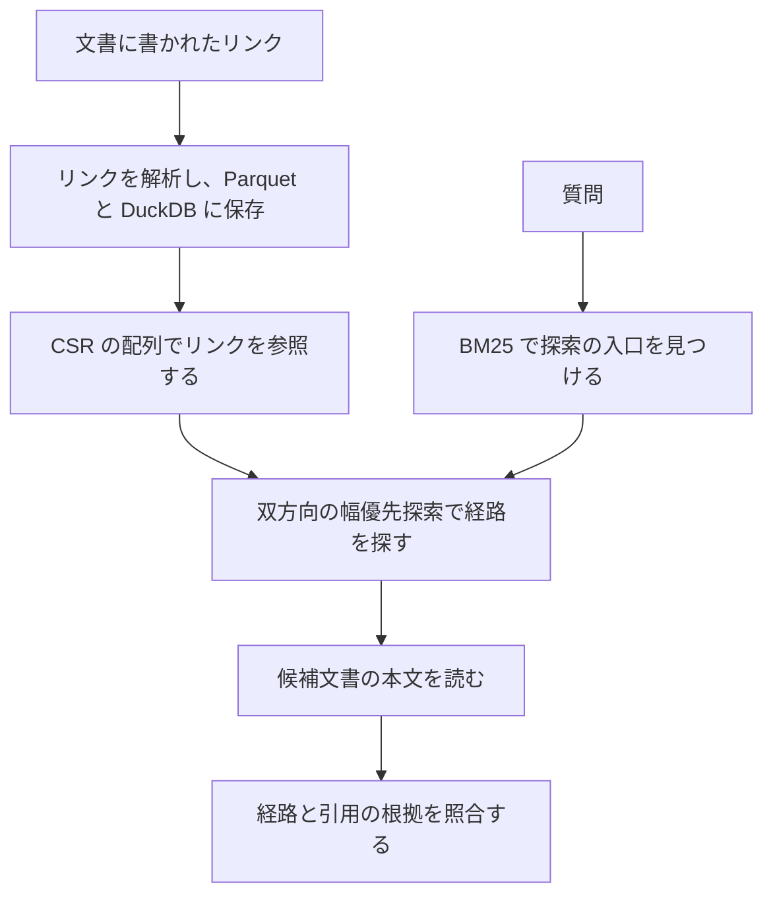

Saurabh が2026年10月31日に公開した設計です。文書に書かれたリンクをグラフにし、検索で見つけた入口から経路をたどります。回答は、たどった経路と本文の引用を照合して判定する構成です。

### 既存リンクから本文までたどる



BM25 は質問の語を手がかりに出発点を選びます。経路を探す処理は、リンクを配列で表した CSR を使い、両側から近い文書を順にたどります。関係の意味は、見つかった文書の本文で確かめます。


### 評価で見るものと、検証された範囲

- **評価の観点。** 正答か、引用が正確かに加えて、答えを見送るべき場面で見送ったか、答えられる場面で誤って見送ったかを分けて評価します。
- **検証した範囲。** 著者が確かめたのは、合成データや小さなグラフでの個別の処理です。実際の Wikipedia を使う全工程は未検証で、最終回答を検査するコードも記事では未掲載です。引用された性能・費用の数値は、他の記事の結果です。


```svg-figure evidence-check
<svg xmlns="http://www.w3.org/2000/svg" width="720" height="338" viewBox="0 0 720 338" role="img" aria-labelledby="figure-title figure-desc">
  <title id="figure-title">経路と引用を照合する設計</title>
  <desc id="figure-desc">経路の照合では、既存リンクをたどって根拠候補の文書を結ぶ。引用の照合では、本文を開いて関係の意味と回答の裏づけを確かめる。記事は両方の根拠をコードで照合する設計を提案している。</desc>
  <rect width="720" height="338" rx="18" fill="#F6F9FC"/>
  <g font-family="Yu Gothic UI, Meiryo, Segoe UI, sans-serif" fill="#19283F">
    <text x="360" y="47" text-anchor="middle" font-size="23" font-weight="700">経路と引用を照合する設計</text>

    <rect x="24" y="74" width="322" height="147" rx="12" fill="#E9EFFA" stroke="#C6D4ED"/>
    <text x="44" y="110" font-size="18" font-weight="700" fill="#304D87">経路の根拠</text>
    <text x="44" y="141" font-size="15">実際のリンクをたどって、</text>
    <text x="44" y="163" font-size="15">根拠候補の文書を見つける。</text>
    <g fill="none" stroke="#5877AC" stroke-width="1.6">
      <path d="M61 194 H153 M168 194 H261"/>
      <circle cx="54" cy="194" r="7" fill="#FFFFFF"/>
      <circle cx="161" cy="194" r="7" fill="#FFFFFF"/>
      <circle cx="268" cy="194" r="7" fill="#FFFFFF"/>
    </g>

    <rect x="374" y="74" width="322" height="147" rx="12" fill="#E5F2EF" stroke="#B8D9D0"/>
    <text x="394" y="110" font-size="18" font-weight="700" fill="#195D50">引用の根拠</text>
    <text x="394" y="141" font-size="15">文書の本文を開き、</text>
    <text x="394" y="163" font-size="15">関係の意味と回答の裏づけを読む。</text>
    <g stroke="#327567" stroke-width="1.6" stroke-linecap="round">
      <path d="M394 188 H477 M394 195 H512 M394 202 H459"/>
      <path d="M535 188 L540 193 L551 182" fill="none" stroke-linejoin="round"/>
    </g>

    <path d="M185 226 Q185 243 210 248 M535 226 Q535 243 510 248" fill="none" stroke="#6B7E98" stroke-width="1.6"/>
    <rect x="196" y="252" width="328" height="61" rx="10" fill="#FFFFFF" stroke="#C9D6E6"/>
    <text x="360" y="279" text-anchor="middle" font-size="17" font-weight="700">経路と引用をコードで照合</text>
    <text x="360" y="300" text-anchor="middle" font-size="14" fill="#405573">回答を採用するか、見送るかを判定</text>
  </g>
</svg>

```

