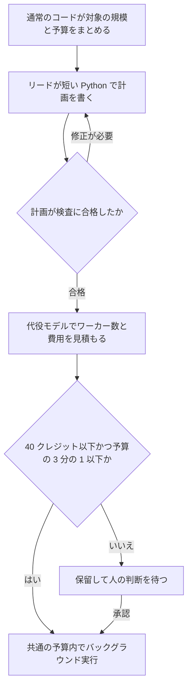

Fareed Khan は、リードが仕事の概要を読み、短い Python プログラムとして計画を 1 回書く仕組みを試作しました。通常の Python が計画に沿ってワーカーを並列に動かします。約 135 万トークンの監査対象に対して、リードの計画呼び出しが読んだのは 1,780 トークンでした。

### 計画の検査から実行まで

リードに渡す約 500 トークンの概要には、ファイル数、トークン数、料金、上限、予算を入れます。検査器は、許可した構文と名前、80 行・6,000 文字の上限、`result` への代入を確認します。著者はこの検査を、自分のリードが書く計画を対象とした実行前のチェックと位置づけています。実際に、リードの計画 10 本のうち 4 本が行数の上限にかかり、検査器の指摘を受けて修正されました。



回答は質問ごとに台帳へ記録し、再実行時に使い回します。メーターが共有予算を管理し、会話はワーカーごとに記録します。リハーサルでは本番と同じ予算を渡します。記事では、予算の違いで同じ計画の見積もりが 23.9 と 8.3 クレジットに分かれ、固定計画の見積もりは実績より 27% 低く出ました。

### 5 つの設計を同じ監査で比較

著者は 849 個の Python ファイルに 72 個のバグを埋め込みました。エージェントに渡すファイルからは doctest を取り除き、指摘が正しいファイル・関数を挙げ、バグから 5 行以内を指した場合に正解としました。再現率は仕込んだバグを発見できた割合、適合率は全指摘のうち採点で正解になった割合です。採点表にない箇所も誤検知に数えるため、適合率は下限です。


動的ワークフローは、人が書いた固定計画より再現率が **0.06〜0.25 高く**（ブートストラップの 95% 区間）、費用は **約 3.5 倍**でした。適合率の平均は 0.82 から 0.71 に下がりました。動的ワークフローと同じ 14 回のスキャンを行う固定計画は試していないため、読み取り量と計画の質がそれぞれどれだけ寄与したかは分かりません。

### 実測で見えた制約

- **並列実行の待ち時間。** 実時間が 41 分、呼び出し時間の合計が 120 分だった実行では、先に終わったワーカーの待ち時間が延べ 37 分ありました。時間を要したのは検証です。
- **分割サイズによる差。** 24 個のバグの試験では 10 万トークンの分割サイズを選びましたが、全体の試験では 2 万トークンの方が高い再現率でした（0.38 対 0.18）。
- **結果の適用範囲。** Qwen 系のモデルと 1 つのライブラリで、各設計の試行は最大 3 回です。事前に立てた 11 個の予測のうち、成立したのは 3 個でした。


```svg-figure audit-comparison
<svg xmlns="http://www.w3.org/2000/svg" width="720" height="373" viewBox="0 0 720 373" role="img" aria-labelledby="audit-title audit-desc">
  <title id="audit-title">5 つの設計の監査結果</title>
  <desc id="audit-desc">試行数、平均再現率、平均適合率、平均費用の順。単独は3、0.02、1.00、23.7。同じ予算の単独は2、0.04、0.78、46.4。ヘルパーありは1、0.17、0.67、10.3。固定計画は3、0.30、0.82、13.8。動的ワークフローは3、0.45、0.71、48.4。</desc>
  <rect width="720" height="373" rx="14" fill="#f3f6fa"/>
  <g font-family="system-ui, 'Yu Gothic UI', 'Meiryo', sans-serif" fill="#182a3d">
    <text x="25" y="36" font-size="22" font-weight="700">5 つの設計の監査結果</text>
    <text x="25" y="62" font-size="14" fill="#41566b">849 ファイル、72 個の埋め込みバグ。各条件の試行の平均。</text>
    <g font-size="14" font-weight="700">
      <text x="25" y="95">設計</text>
      <text x="227" y="95" text-anchor="middle">試行数</text>
      <text x="266" y="95">再現率（0〜1）</text>
      <text x="408" y="95">適合率（0〜1）</text>
      <text x="550" y="86">費用（0〜50）</text>
      <text x="550" y="103" font-size="13" font-weight="400" fill="#41566b">クレジット</text>
    </g>
    <g>
      <rect x="14" y="112" width="692" height="44" rx="7" fill="#ffffff"/>
      <text x="26" y="139" font-size="15" font-weight="600">単独エージェント</text>
      <text x="227" y="139" font-size="15" text-anchor="middle">3</text>
      <g font-size="15" font-weight="700" fill="#426681">
        <text x="266" y="133">0.02</text>
        <text x="408" y="133">1.00</text>
        <text x="550" y="133">23.7</text>
      </g>
      <rect x="266" y="140" width="110" height="6" rx="3" fill="#dbe3ec"/>
      <rect x="266" y="140" width="2.20" height="6" rx="3" fill="#426681"/>
      <rect x="408" y="140" width="110" height="6" rx="3" fill="#dbe3ec"/>
      <rect x="408" y="140" width="110.00" height="6" rx="3" fill="#426681"/>
      <rect x="550" y="140" width="110" height="6" rx="3" fill="#dbe3ec"/>
      <rect x="550" y="140" width="52.14" height="6" rx="3" fill="#426681"/>
    </g>
    <g>
      <rect x="14" y="161" width="692" height="44" rx="7" fill="#ffffff"/>
      <text x="26" y="188" font-size="15" font-weight="600">単独（動的と同じ予算）</text>
      <text x="227" y="188" font-size="15" text-anchor="middle">2</text>
      <g font-size="15" font-weight="700" fill="#426681">
        <text x="266" y="182">0.04</text>
        <text x="408" y="182">0.78</text>
        <text x="550" y="182">46.4</text>
      </g>
      <rect x="266" y="189" width="110" height="6" rx="3" fill="#dbe3ec"/>
      <rect x="266" y="189" width="4.40" height="6" rx="3" fill="#426681"/>
      <rect x="408" y="189" width="110" height="6" rx="3" fill="#dbe3ec"/>
      <rect x="408" y="189" width="85.80" height="6" rx="3" fill="#426681"/>
      <rect x="550" y="189" width="110" height="6" rx="3" fill="#dbe3ec"/>
      <rect x="550" y="189" width="102.08" height="6" rx="3" fill="#426681"/>
    </g>
    <g>
      <rect x="14" y="210" width="692" height="44" rx="7" fill="#ffffff"/>
      <text x="26" y="237" font-size="15" font-weight="600">ヘルパーを使うリード</text>
      <text x="227" y="237" font-size="15" text-anchor="middle">1</text>
      <g font-size="15" font-weight="700" fill="#426681">
        <text x="266" y="231">0.17</text>
        <text x="408" y="231">0.67</text>
        <text x="550" y="231">10.3</text>
      </g>
      <rect x="266" y="238" width="110" height="6" rx="3" fill="#dbe3ec"/>
      <rect x="266" y="238" width="18.70" height="6" rx="3" fill="#426681"/>
      <rect x="408" y="238" width="110" height="6" rx="3" fill="#dbe3ec"/>
      <rect x="408" y="238" width="73.70" height="6" rx="3" fill="#426681"/>
      <rect x="550" y="238" width="110" height="6" rx="3" fill="#dbe3ec"/>
      <rect x="550" y="238" width="22.66" height="6" rx="3" fill="#426681"/>
    </g>
    <g>
      <rect x="14" y="259" width="692" height="44" rx="7" fill="#ffffff"/>
      <text x="26" y="286" font-size="15" font-weight="600">人が書いた固定計画</text>
      <text x="227" y="286" font-size="15" text-anchor="middle">3</text>
      <g font-size="15" font-weight="700" fill="#6245a4">
        <text x="266" y="280">0.30</text>
        <text x="408" y="280">0.82</text>
        <text x="550" y="280">13.8</text>
      </g>
      <rect x="266" y="287" width="110" height="6" rx="3" fill="#dbe3ec"/>
      <rect x="266" y="287" width="33.00" height="6" rx="3" fill="#6245a4"/>
      <rect x="408" y="287" width="110" height="6" rx="3" fill="#dbe3ec"/>
      <rect x="408" y="287" width="90.20" height="6" rx="3" fill="#6245a4"/>
      <rect x="550" y="287" width="110" height="6" rx="3" fill="#dbe3ec"/>
      <rect x="550" y="287" width="30.36" height="6" rx="3" fill="#6245a4"/>
    </g>
    <g>
      <rect x="14" y="308" width="692" height="44" rx="7" fill="#e2f2ed"/>
      <text x="26" y="335" font-size="15" font-weight="700">動的ワークフロー</text>
      <text x="227" y="335" font-size="15" text-anchor="middle">3</text>
      <g font-size="15" font-weight="700" fill="#087569">
        <text x="266" y="329">0.45</text>
        <text x="408" y="329">0.71</text>
        <text x="550" y="329">48.4</text>
      </g>
      <rect x="266" y="336" width="110" height="6" rx="3" fill="#dbe3ec"/>
      <rect x="266" y="336" width="49.50" height="6" rx="3" fill="#087569"/>
      <rect x="408" y="336" width="110" height="6" rx="3" fill="#dbe3ec"/>
      <rect x="408" y="336" width="78.10" height="6" rx="3" fill="#087569"/>
      <rect x="550" y="336" width="110" height="6" rx="3" fill="#dbe3ec"/>
      <rect x="550" y="336" width="106.48" height="6" rx="3" fill="#087569"/>
    </g>
  </g>
</svg>

```

