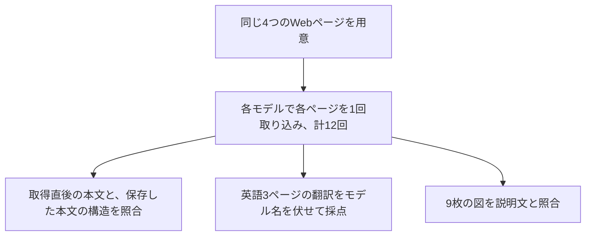

**この比較では Sonnet 5.5 の継続採用を決めました。** Opus 5.5 は図の説明と翻訳の評価で優れた結果を出し、Sonnet 5.5 は翻訳に重大な誤りがなく、全4ページで Opus 5.5 より短時間で処理しました。


Opus は Sonnet の約 1.8〜7 倍の時間がかかりました。Haiku と Sonnet はページによって速い方が異なります。報告トークン数には何もさせない実行でも約 66k の固定分が含まれ、費用比は算出できませんでした。

### 保存した本文・翻訳・図の説明

| 観点 | Haiku 5.5 | Sonnet 5.5 | Opus 5.5 |
| --- | --- | --- | --- |
| 保存した本文 | SQLite でコード 5 個中 3 個のコメントを翻訳。本文リンクは SQLite で 8 か所、Medium で 1 か所欠落。Medium の図の説明文 34 個を画像の代替テキストへ移動。 | コードを維持。SQLite でリンクが 2 か所欠落し、原文にない演算子 `<>` を補った。 | コードを維持し、原文にない内容の追加はなし。SQLite でリンクが 1 か所欠落。 |
| CQRS の翻訳 | **1 位**（8.8／8.4） | 3 位（8.2／7.7） | 2 位（8.6／8.0） |
| SQLite の翻訳 | 3 位（7.8／8.4） | 2 位（9.1／8.5） | **1 位**（9.5／7.8） |
| Medium の翻訳 | 3 位（6.5／7.5） | 2 位（9.5／7.5） | **1 位**（9.5／8.5） |
| 図の説明の誤り（9 枚中） | 2 枚 | 1 枚（散布図の中央値） | 0 枚 |

翻訳の点数は「原文への忠実さ／読みやすさ」の順で、各10点満点です。GPT-6.1 Sol がモデル名を伏せた状態で評価しました。

段落と見出しの階層は全モデルが維持しました。翻訳のない日本語ページでは Sonnet と Opus の保存内容はほぼ同じでした。

### 比較の方法と範囲



CQRS と SQLite は英語、ブルームフィルタは日本語です。英語の有料記事 Medium は、ログイン済みの Chrome から取得した同じ本文を3モデルに渡し、翻訳は5つの節を評価しました。Web ページではモデルが不要な部分を除き、翻訳し、図の説明を加えます。PDF とテキストは原本をそのまま保存します。


```svg-figure ingest-time
<svg xmlns="http://www.w3.org/2000/svg" width="720" height="483" viewBox="0 0 720 483" role="img" aria-labelledby="title description">
  <title id="title">取り込み全体の所要時間</title>
  <desc id="description">4ページごとにHaiku、Sonnet、Opusの順に秒数を比較。CQRSは162、88、626秒。SQLiteは158、198、493秒。ブルームフィルタは122、85、421秒。Mediumは342、499、920秒。</desc>
  <rect width="720" height="483" rx="18" fill="#F7FAFE"/>
  <g font-family="Segoe UI, Yu Gothic UI, Meiryo, sans-serif" fill="#19283F">
    <text x="360" y="46" text-anchor="middle" font-size="23" font-weight="700">取り込み全体の所要時間</text>
    <rect x="48" y="66" width="20" height="12" rx="3" fill="#526683"/>
    <text x="76" y="77" font-size="15">Haiku 5.5</text>
    <rect x="269" y="66" width="20" height="12" rx="3" fill="#126759"/>
    <text x="297" y="77" font-size="15">Sonnet 5.5</text>
    <rect x="490" y="66" width="20" height="12" rx="3" fill="#5D4E96"/>
    <text x="518" y="77" font-size="15">Opus 5.5</text>
    <line x1="166" y1="124" x2="166" y2="446" stroke="#A7B6CC"/>
    <text x="166" y="114" text-anchor="middle" font-size="14" fill="#47566C">0</text>
    <line x1="284.75" y1="124" x2="284.75" y2="446" stroke="#D9E1ED"/>
    <text x="284.75" y="114" text-anchor="middle" font-size="14" fill="#47566C">250</text>
    <line x1="403.5" y1="124" x2="403.5" y2="446" stroke="#D9E1ED"/>
    <text x="403.5" y="114" text-anchor="middle" font-size="14" fill="#47566C">500</text>
    <line x1="522.25" y1="124" x2="522.25" y2="446" stroke="#D9E1ED"/>
    <text x="522.25" y="114" text-anchor="middle" font-size="14" fill="#47566C">750</text>
    <line x1="641" y1="124" x2="641" y2="446" stroke="#D9E1ED"/>
    <text x="641" y="114" text-anchor="middle" font-size="14" fill="#47566C">1,000</text>
    <text x="666" y="114" font-size="14" fill="#47566C">秒</text>
    <g>
      <text x="26" y="168" font-size="15" font-weight="600">CQRS</text>
      <rect x="166" y="139" width="76.95" height="12" rx="3" fill="#526683"/>
      <text x="250.95" y="150" font-size="14" font-weight="600" fill="#526683">162</text>
      <rect x="166" y="157" width="41.8" height="12" rx="3" fill="#126759"/>
      <text x="215.8" y="168" font-size="14" font-weight="600" fill="#126759">88</text>
      <rect x="166" y="175" width="297.35" height="12" rx="3" fill="#5D4E96"/>
      <text x="471.35" y="186" font-size="14" font-weight="600" fill="#5D4E96">626</text>
    </g>
    <g>
      <text x="26" y="247" font-size="15" font-weight="600">SQLite</text>
      <rect x="166" y="218" width="75.05" height="12" rx="3" fill="#526683"/>
      <text x="249.05" y="229" font-size="14" font-weight="600" fill="#526683">158</text>
      <rect x="166" y="236" width="94.05" height="12" rx="3" fill="#126759"/>
      <text x="268.05" y="247" font-size="14" font-weight="600" fill="#126759">198</text>
      <rect x="166" y="254" width="234.17" height="12" rx="3" fill="#5D4E96"/>
      <text x="408.16999999999996" y="265" font-size="14" font-weight="600" fill="#5D4E96">493</text>
    </g>
    <g>
      <text x="26" y="326" font-size="15" font-weight="600">ブルームフィルタ</text>
      <rect x="166" y="297" width="57.95" height="12" rx="3" fill="#526683"/>
      <text x="231.95" y="308" font-size="14" font-weight="600" fill="#526683">122</text>
      <rect x="166" y="315" width="40.38" height="12" rx="3" fill="#126759"/>
      <text x="214.38" y="326" font-size="14" font-weight="600" fill="#126759">85</text>
      <rect x="166" y="333" width="199.97" height="12" rx="3" fill="#5D4E96"/>
      <text x="373.97" y="344" font-size="14" font-weight="600" fill="#5D4E96">421</text>
    </g>
    <g>
      <text x="26" y="405" font-size="15" font-weight="600">Medium</text>
      <rect x="166" y="376" width="162.45" height="12" rx="3" fill="#526683"/>
      <text x="336.45" y="387" font-size="14" font-weight="600" fill="#526683">342</text>
      <rect x="166" y="394" width="237.02" height="12" rx="3" fill="#126759"/>
      <text x="411.02" y="405" font-size="14" font-weight="600" fill="#126759">499</text>
      <rect x="166" y="412" width="437" height="12" rx="3" fill="#5D4E96"/>
      <text x="611" y="423" font-size="14" font-weight="600" fill="#5D4E96">920</text>
    </g>
  </g>
</svg>

```

