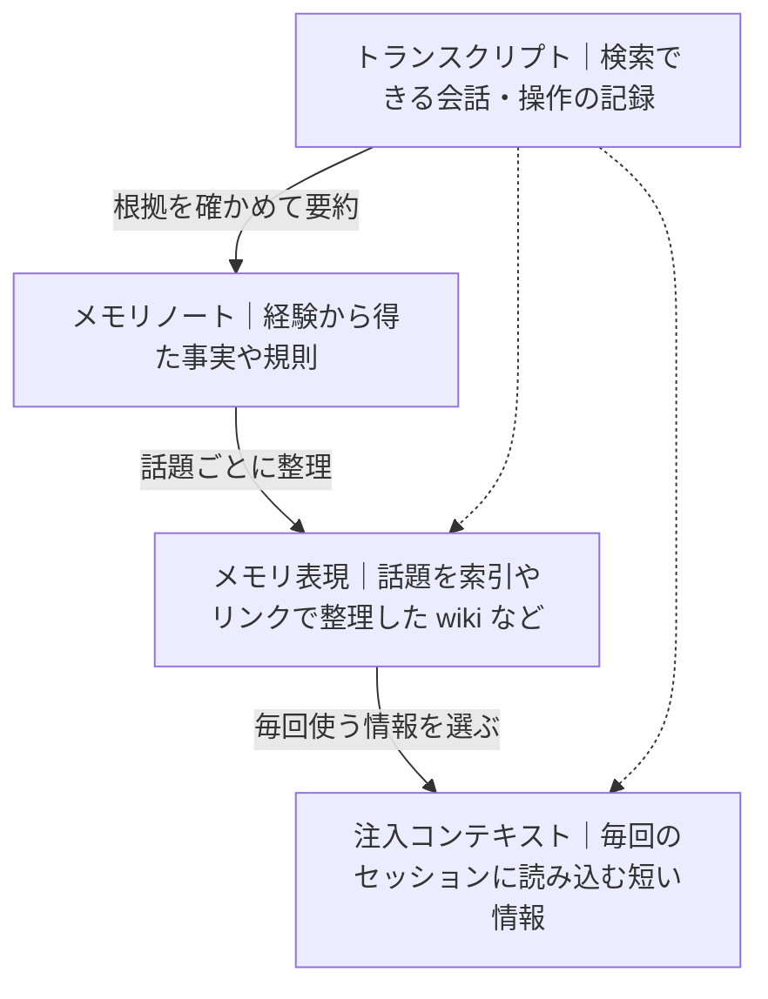

Lance Martin の記事では、エージェントが経験から得た知識を、次のセッションでも読める形で残す仕組みを「メモリ」と呼びます。将来の仕事で役立つ内容を選び、作業の合間に元の記録と照らしてメモリを整理する処理が「ドリーミング」です。

### メモリの 4 層



ドリーミングは隣り合う上位層を整理し、点線で示したように、元の記録から上位層へ直接反映することもあります。Pokémon Red の例では、元の記録と照らしてポケモンセンターの場所を訂正しました。訂正後の実行は 1,935 回目の行動で Cerulean City に着きました。毎回読み込む情報が増えるとトークンを使い、誤った記述も繰り返し持ち込まれるため、記事は注入する層を小さく保つよう勧めています。記事が挙げる Claude Code の例では、`MEMORY.md` の先頭から 200 行または 25 KB の範囲を読み込み、その部分を索引として使います。

### モデルは何を記憶に残すか

CL-Bench のデータベース課題では、Opus 5 は失敗を記録し、仮説を検証して規則にしました。Sonnet 4.6 は、最初は未検証の推測を並べるところで止まり、メモリを読んで仮説を確かめるよう促すとスコアが 0.364 から 0.641 に上がりました。一方、失敗だけを記録する指示は、Opus 5 と Opus 4.7 のメモリによる成績の上積みを縮めました。

Pokémon Red の約 10,000 ステップ時点では、Sonnet 3.7 が 413 ファイルでバッジ 1 個、Fable 5 が 10 ファイルで 4 個でした。記事は、画面で繰り返し確認できる情報を省き、見つけた戦略や確かめた規則を残す価値を指摘しています。

### wiki と検索が役立った問い


Stainless の評価では、wiki と検索の組み合わせで 1 問あたり約 20,000 トークンを節約しました。合併の評価でも、複数資料を照合する項目や判断・計算が要る項目では、wiki が 87%、検索だけが 73% でした。単一の文書を文字列検索すれば答えられる LAB の課題では差が出ず、別の課題では wiki が元の文書の 1.77 倍まで膨らみました。図と本文の数値は記事が報告した評価結果です。

### 事実の欠落と古さをどう扱うか

契約の例では、4 体が共有ページを同時に書いた際に 57 個中 41 個の事実が残りました。契約ごとに書き手を 1 体にし、条項をそのまま引用する指示を加えた条件では 57 個すべてが残りました。別の例では、2 回目のドリーミングで切れたリンク 9 本を直し、索引を含む 3 ページを加えました。

記事は、メモリを作る時期、変わりやすい事実を見直す頻度、誤りの蓄積を抑えながら整理に使う計算量を、設計上の未解決の問いとして挙げています。


```svg-figure stainless-results
<svg xmlns="http://www.w3.org/2000/svg" width="720" height="344" viewBox="0 0 720 344" role="img" aria-labelledby="bench-title bench-desc">
  <title id="bench-title">社内文書 25 問の正答率</title>
  <desc id="bench-desc">Stainless の社内文書で、検索のみは53%。wikiのみは開始時13%で128セッションの育成後48%。wikiと検索の併用は54%から61%になった。</desc>
  <rect width="720" height="344" rx="16" fill="#f2f6f9"/>
  <g font-family="system-ui, 'Yu Gothic UI', 'Meiryo', sans-serif" fill="#172f43">
    <text x="24" y="38" font-size="22" font-weight="700">社内文書 25 問の正答率</text>
    <text x="24" y="63" font-size="14" fill="#38546b">Stainless の約 35 万ファイル。Opus 5 が 128 セッションで wiki を育成。</text>
    <rect x="18" y="82" width="684" height="244" rx="11" fill="#ffffff"/>
    <path d="M241 117V309" stroke="#d7e2e9"/>
    <text x="241" y="106" text-anchor="middle" font-size="13" fill="#42586b">0%</text>
    <path d="M341.75 117V309" stroke="#d7e2e9"/>
    <text x="341.75" y="106" text-anchor="middle" font-size="13" fill="#42586b">25%</text>
    <path d="M442.5 117V309" stroke="#d7e2e9"/>
    <text x="442.5" y="106" text-anchor="middle" font-size="13" fill="#42586b">50%</text>
    <path d="M543.25 117V309" stroke="#d7e2e9"/>
    <text x="543.25" y="106" text-anchor="middle" font-size="13" fill="#42586b">75%</text>
    <path d="M644 117V309" stroke="#d7e2e9"/>
    <text x="644" y="106" text-anchor="middle" font-size="13" fill="#42586b">100%</text>
    <text x="33" y="149" font-size="15" font-weight="500">検索のみ</text>
    <rect x="241" y="136" width="213.59" height="16" rx="4" fill="#47647b"/>
    <text x="463.59000000000003" y="149" font-size="15" font-weight="700" fill="#47647b">53%</text>
    <text x="33" y="186" font-size="15" font-weight="500">wiki のみ（開始時）</text>
    <rect x="241" y="173" width="52.39" height="16" rx="4" fill="#658196"/>
    <text x="302.39" y="186" font-size="15" font-weight="700" fill="#658196">13%</text>
    <text x="33" y="221" font-size="15" font-weight="500">wiki のみ（育成後）</text>
    <rect x="241" y="208" width="193.44" height="16" rx="4" fill="#376b93"/>
    <text x="443.44" y="221" font-size="15" font-weight="700" fill="#376b93">48%</text>
    <text x="33" y="263" font-size="15" font-weight="500">wiki と検索（開始時）</text>
    <rect x="241" y="250" width="217.62" height="16" rx="4" fill="#658196"/>
    <text x="467.62" y="263" font-size="15" font-weight="700" fill="#658196">54%</text>
    <text x="33" y="298" font-size="15" font-weight="700">wiki と検索（育成後）</text>
    <rect x="241" y="285" width="245.83" height="16" rx="4" fill="#127467"/>
    <text x="495.83000000000004" y="298" font-size="15" font-weight="700" fill="#127467">61%</text>
  </g>
</svg>

```

