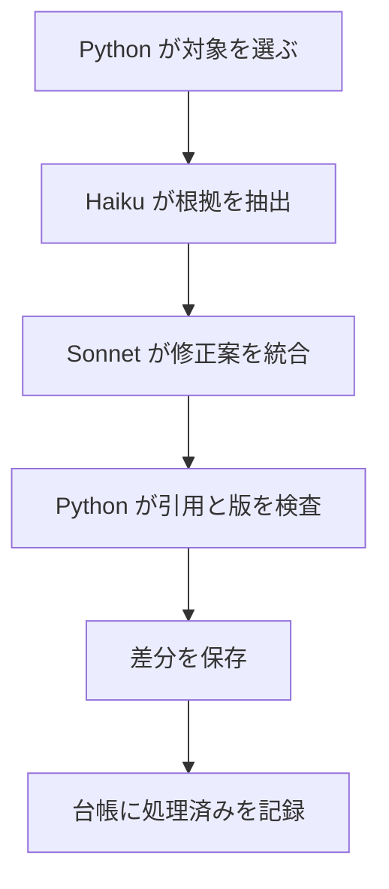

ドリーミングは、取り込み済みの会話をまとめて見直し、wiki の修正候補を見つける方法です。info-hive-wiki のプロジェクトでは、Claude Code の Dynamic Workflow `/wiki-dream` を使い、レビュー用の差分を保存します。

### 台帳を使って差分を作る



Python は会話の ID と原本の SHA-256 を台帳で照合します。処理済みの原本は除外し、ハッシュが変われば再び対象にします。長い原本は分割し、末尾の確認コードで Haiku が各ファイルを読んだことを確かめます。失敗した会話は次回以降に 1 件ずつ再試行します。差分の保存後、台帳を確定する前に強制終了すると、同じ会話から再提案する場合があります。

### ジョブの設定と手動試行

現在は毎日正午（日本時間）に起動し、最大 2 件の会話を処理する設定です。登録時は毎日午前 3 時で、2026 年 11 月 22 日に正午へ変更しました。


定期ジョブと同じ `--scheduled` の起動経路を、Claude Code 2.1.325 で手動で試しました。Haiku 5.5 が 2 回、Sonnet 5.5 が 1 回完了し、「図ごとの描画の隔離」の「同時実行と入口」に出典を補う差分が 1 件できました。差分は `git apply --check` を通り、再試行や読み込み不足の検出を含む自動テスト 17 件も成功しました。試行時点では、定刻での初回起動は未確認でした。

### 承認後の反映

適用案では、利用者が承認した差分を `wiki_apply.py` で正本に反映します。プラグインとして定期実行を配布する方法、定期実行の費用、整理前後の回答品質は検証対象として残っています。


```svg-figure dream-trial
<svg xmlns="http://www.w3.org/2000/svg" width="720" height="310" viewBox="0 0 720 310" role="img" aria-labelledby="trial-title trial-desc">
  <title id="trial-title">定期ジョブの設定と手動試行</title>
  <desc id="trial-desc">起動は毎日正午（日本時間）に設定。登録時は午前 3 時。会話 2 件と関連記事 5 件で手動試行し、差分を 1 件作った。同じ会話を指定して再実行すると 2 件とも台帳で除外された。</desc>
  <rect width="720" height="310" rx="16" fill="#f1f5f9"/>
  <g font-family="'Yu Gothic UI', 'Hiragino Sans', 'Noto Sans CJK JP', system-ui, sans-serif" fill="#172e40">
    <text x="360" y="42" text-anchor="middle" font-size="22" font-weight="700">定期ジョブの設定と手動試行</text>
    <rect x="24" y="68" width="322" height="116" rx="12" fill="#fff" stroke="#bdcddd"/>
    <rect x="374" y="68" width="322" height="116" rx="12" fill="#fff" stroke="#adc8c1"/>
    <g font-size="18" font-weight="700">
      <text x="44" y="101" fill="#274c70">現在のジョブ設定</text>
      <text x="394" y="101" fill="#235b50">手動試行の対象</text>
    </g>
    <g font-size="16">
      <text x="44" y="132">毎日 正午（日本時間）</text>
      <text x="44" y="157">登録時は午前 3 時</text>
      <text x="394" y="132">会話 2 件・関連記事 5 件</text>
      <text x="394" y="157">Haiku 2 回・Sonnet 1 回が完了</text>
    </g>
    <rect x="24" y="210" width="672" height="76" rx="12" fill="#e4f1ec" stroke="#adc8c1"/>
    <path d="M360 227v42" stroke="#adc8c1"/>
    <g font-size="19" font-weight="700" fill="#173e37">
      <text x="44" y="255">出典を補う差分 1 件</text>
      <text x="384" y="255">再実行では同じ 2 件を除外</text>
    </g>
  </g>
</svg>

```

