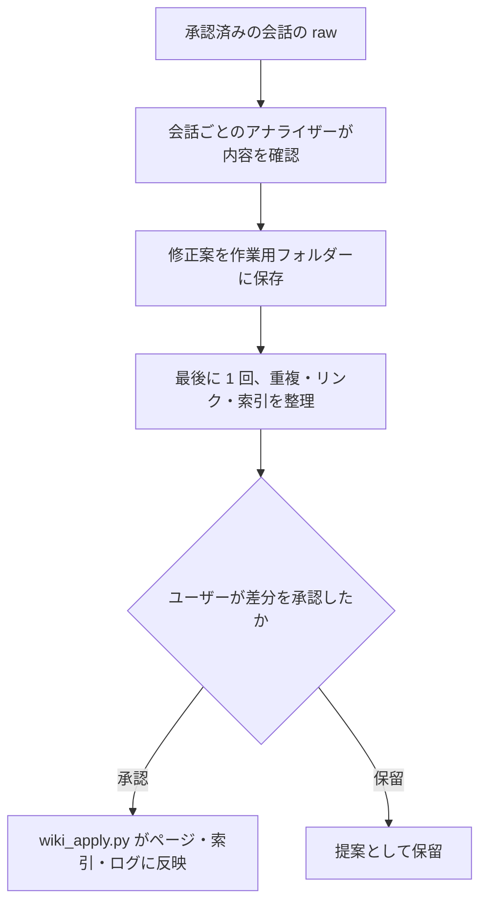

このページは、複数の会話をセッション外で見直すドリーミングを info-hive-wiki に取り入れる案です。会話から見つけた誤りや共通のパターンを修正案にまとめ、人が差分を承認してから、`wiki_apply.py` を通じて反映します。以下の流れは 2026 年 11 月 19 日の検討案です。

### 修正案を作り、承認してから反映する




### 既存の仕組みをどう使うか

- **会話の取り込み。** Claude Code と Codex に対応した取り込みは、保存する本文を絞り、伏せ字と承認済みハッシュを使って読み取り専用の raw を残します。提案するドリーミングは、この raw を複数まとめて読み、セッションをまたぐパターンを拾います。
- **提案の隔離。** `/wiki:evolve` が候補をレビュー・検証・承認まで隔離する考え方を使います。アナライザーの道具は読み取りと提案の書き込みに絞り、最後の担当が重複の統合、リンクの付け替え、索引の仕上げを行います。`/wiki:lint` が見つける問題も修正候補になります。
- **正本への反映。** ADR-0023 の方針に沿って書き手を `wiki_apply.py` に集めます。矛盾した記述は両方の根拠を残し、訂正が確かなら日付を添えて置き換えます。グラフには `superseded` と `contradicts` がすでにあります。

### 試して確かめること

cookbook では、並行するアナライザーが同じストアに書き、書く直前の再読と書いた後の読み戻しで競合に対処します。この適用案では、作業用フォルダーに提案を集め、承認後の書き込みにロックを使う方針です。元ページの検討時点では、適用案の試行と、読み戻しとロックの信頼性の比較はいずれも未実施でした。

元ページは、小さな会話の束で提案を出す試行と、同時書き込みの試験を挙げています。info-hive での定期実行方法と実費は未確認で、Managed Agents の上限や費用は製品固有の条件です。


```svg-figure dream-write-scope
<svg xmlns="http://www.w3.org/2000/svg" width="720" height="334" viewBox="0 0 720 334" role="img" aria-labelledby="scope-title scope-desc">
  <title id="scope-title">ドリーミング案で書き込む場所</title>
  <desc id="scope-desc">会話のrawは読み取り専用。アナライザーは作業用フォルダーに修正案を書き、最後の担当が整理する。ユーザーの承認後、wiki_apply.pyが正本のページ、索引、ログに反映する。</desc>
  <rect width="720" height="334" rx="16" fill="#f3f6fa"/>
  <g font-family="system-ui, 'Yu Gothic UI', 'Meiryo', sans-serif" fill="#182e42">
    <text x="24" y="38" font-size="22" font-weight="700">ドリーミング案で書き込む場所</text>
    <text x="24" y="64" font-size="14" fill="#405c70">元の記録を読み、作業用の提案を経て、承認された差分を反映する。</text>
    <g>
      <rect x="24" y="94" width="672" height="60" rx="9" fill="#ffffff" stroke="#d2dee8"/>
      <rect x="34" y="103" width="198" height="42" rx="7" fill="#e8eff7"/>
      <text x="48" y="130" font-size="16" font-weight="700" fill="#274f70">会話の raw</text>
      <text x="254" y="119" font-size="15" font-weight="700">アナライザーが承認済みの記録を読む</text>
      <text x="254" y="140" font-size="14" fill="#3e556b">記録は読み取り専用</text>
    </g>
    <g>
      <rect x="24" y="168" width="672" height="60" rx="9" fill="#ffffff" stroke="#d2dee8"/>
      <rect x="34" y="177" width="198" height="42" rx="7" fill="#eaeafa"/>
      <text x="48" y="204" font-size="16" font-weight="700" fill="#443d7a">作業用フォルダー</text>
      <text x="254" y="193" font-size="15" font-weight="700">アナライザーが修正案を書く</text>
      <text x="254" y="214" font-size="14" fill="#3e556b">最後の担当が重複・リンク・索引を整理</text>
    </g>
    <g>
      <rect x="24" y="242" width="672" height="60" rx="9" fill="#ffffff" stroke="#d2dee8"/>
      <rect x="34" y="251" width="198" height="42" rx="7" fill="#e3f3eb"/>
      <text x="48" y="278" font-size="16" font-weight="700" fill="#225746">wiki の正本</text>
      <text x="254" y="267" font-size="15" font-weight="700">承認後は wiki_apply.py が書き込む</text>
      <text x="254" y="288" font-size="14" fill="#3e556b">ページ・索引・ログをまとめて反映</text>
    </g>
  </g>
</svg>

```

