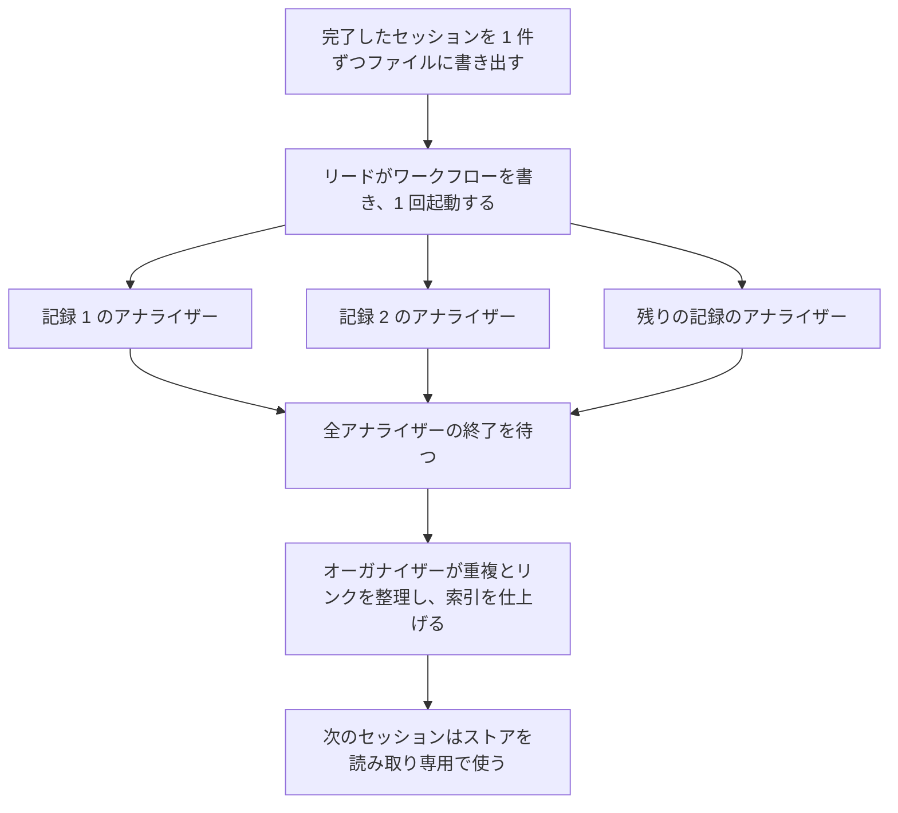

この Claude cookbook でいう「ドリーミング」は、完了したセッションの会話記録を読み直し、次のセッションで使える知識を Markdown のメモリストアにまとめる処理です。例では、架空の Python プロジェクトの会話記録 10 件とチャットのメモ 1 件から、既存のストアをその場で更新します。

### 3 種のエージェントが分担する



リードは既定で Claude Sonnet 5.5 を使い、会話の中身は各アナライザーが読みます。アナライザーとオーガナイザーは既定で Claude Haiku 5.5 です。アナライザーは会話 1 件につき 1 体が担当し、関係するメモリを検証・補強・整理します。約 20 件ずつのグループで並列に動きます。オーガナイザーは全件の処理後に 1 回動きます。ノートブックには、毎晩午前 1 時に前回以降の会話を処理する例もあります。

### 索引と話題別のメモリ


話題ごとに 100 KB までのファイルを作り、確認方法や日付、古くなる可能性を添えます。後から訂正された事実は新旧両方を日付つきで残し、どちらが正しいか決められない食い違いは `CONFLICT:` として両方の出典を並べます。例では、`make test` の成否の違いを、バージョンによって必要な環境変数が変わったためと整理しました。

### 同時に書いても事実を残す工夫

アナライザーは書く直前に対象を読み直し、書いた後は別のターンで読み戻します。ほかの書き手の内容に置き換わっていたら、両方の記述を合わせてから再度確認します。索引は必要な箇所だけを編集し、統合や改名は最後のオーガナイザーが担当します。統合元には移動先だけを残してリンクを付け替え、ノートブックが後でそのファイルを削除します。

### 会話記録に含まれる指示への対策

会話記録、メモリ、ツールの結果はデータとして扱い、アナライザーへの課題には記録のファイル名だけを渡します。アナライザーの道具をファイルの読み取り・書き込み・編集・検索用の 5 つに絞り、ネットワークの許可リストを空にします。秘密は項目名で記録します。ストアを書き込めるのはドリーミングのセッションだけで、普段のセッションには読み取り専用で渡します。既定では人のレビューを挟まずにメモリが更新されます。会話記録の誤りも引き継ぎうるため、大事な事実は利用時に確かめ直します。書き込みの版は 30 日間残り、確認や復元に使えます。

### 作例の費用と制限

| 入力 | cookbook の費用・時間 |
| --- | --- |
| 例の 11 件、283 KB | $0.36（見積もり $0.29）、約 2 分半 |
| 50 本超の長い会話、約 12 MB | 約 $8、約 10 分。費用を抑える設定を外すと約 $10、9 分 |

長い会話では見積もりが実費の数倍になることがあり、既定の `BUDGET_USD` は $40 の支出上限です。cookbook が挙げる制限は、1 セッションにマウントできるファイルが 500、同時実行スレッドが 64、すべてのセッションに読み込ませるマウントの `instructions` が 4,096 文字です。


```svg-figure memory-store
<svg xmlns="http://www.w3.org/2000/svg" width="720" height="336" viewBox="0 0 720 336" role="img" aria-labelledby="memory-title memory-desc">
  <title id="memory-title">索引と話題別のメモリ</title>
  <desc id="memory-desc">索引の領域別の項目から、話題ごとのファイルを開く。ファイルには名前、説明、メタデータがあり、テストの前提条件がバージョン0.4.0で変わったことと、関連する話題へのリンクを記録する。</desc>
  <rect width="720" height="336" rx="16" fill="#f2f6f8"/>
  <g font-family="system-ui, 'Yu Gothic UI', 'Meiryo', sans-serif" fill="#182b3c">
    <text x="24" y="38" font-size="22" font-weight="700">索引と話題別のメモリ</text>
    <text x="24" y="64" font-size="14" fill="#3e5565">領域を選んで話題のファイルを開き、確認済みの事実と変更履歴を読む。</text>
    <rect x="24" y="84" width="220" height="226" rx="12" fill="#ffffff" stroke="#c9d7e1"/>
    <rect x="288" y="84" width="408" height="226" rx="12" fill="#ffffff" stroke="#b8d3ce"/>
    <path d="M244 181H279M272 175L279 181L272 187" fill="none" stroke="#476779" stroke-width="2.5" stroke-linecap="round" stroke-linejoin="round"/>
    <text x="42" y="116" font-size="18" font-weight="700">_index.md</text>
    <text x="42" y="141" font-size="14" fill="#3e5565">領域ごとに話題を並べる</text>
    <rect x="40" y="159" width="188" height="53" rx="7" fill="#e7eff7"/>
    <text x="51" y="181" font-size="14" font-weight="700" fill="#224f73">テスト</text>
    <text x="51" y="201" font-size="13" fill="#263e54">項目名と 1 文の説明</text>
    <text x="42" y="249" font-size="14" fill="#3e5565">1 ファイルにつき 1 行</text>
    <text x="306" y="116" font-size="18" font-weight="700">話題の Markdown</text>
    <text x="306" y="141" font-size="13" fill="#3e5565">name、description、metadata</text>
    <rect x="304" y="157" width="376" height="49" rx="7" fill="#dff1ec"/>
    <text x="316" y="178" font-size="14" font-weight="700" fill="#1b514a">0.4.0 以降</text>
    <text x="316" y="198" font-size="14">make test に TIDEWICK_DATA_DIR は不要</text>
    <rect x="304" y="214" width="376" height="49" rx="7" fill="#edf1f6"/>
    <text x="316" y="235" font-size="14" font-weight="700" fill="#344c63">0.4.0 より前</text>
    <text x="316" y="255" font-size="14">make test に TIDEWICK_DATA_DIR が必要</text>
    <text x="306" y="289" font-size="14" fill="#3e5565">本文のリンクから関連する話題へ移動</text>
  </g>
</svg>

```

