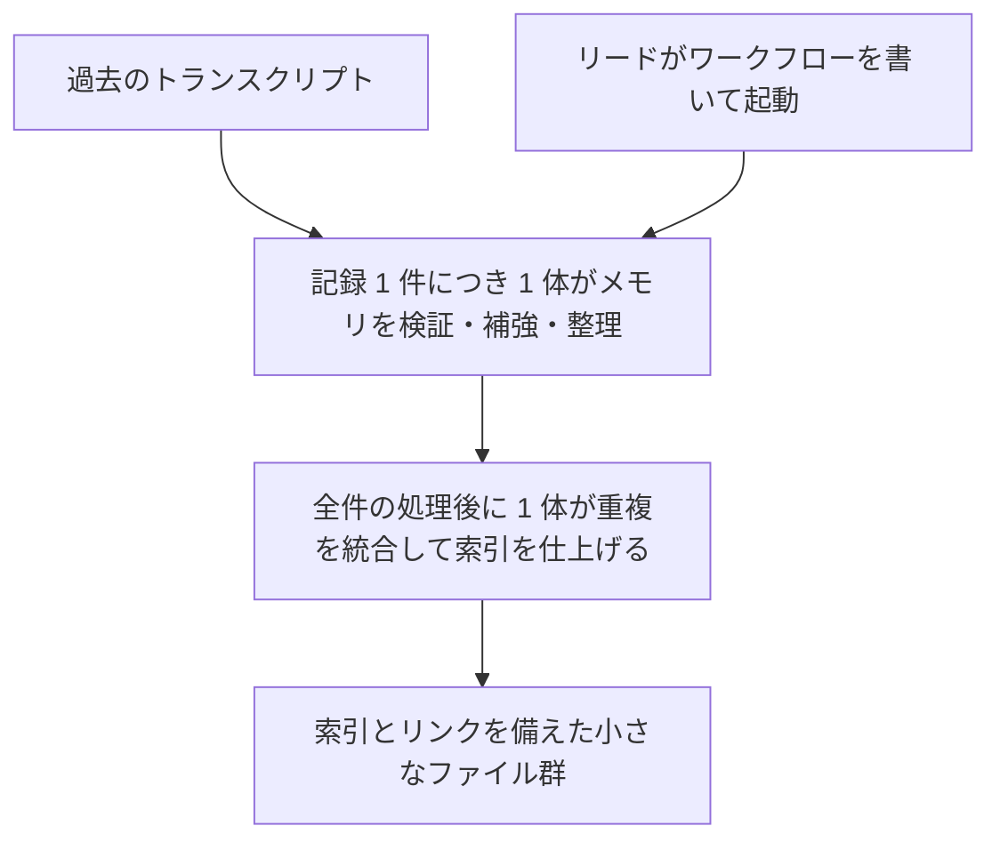

エージェントのメモリは、セッションをまたいで読み返せるように保存した知識です。Anthropic が示した枠組みでは、元の会話や操作の記録から、毎回読み込む短い情報までを 4 層に分けます。


セッション中にエージェントが直接書くのはメモリノートです。何を残すかは、次の仕事で何が必要になるかの判断にあたります。画面で毎回確認できる情報を繰り返し記録すると、古いノートを調べる手間が増えます。元ページが紹介する評価では、失敗だけを書くよう指示すると、Opus 5 のメモリによる成績の上積みが減りました。

### セッションの合間にメモリを整理する

ドリーミングでは、トランスクリプトに戻ってノートの誤りや古い記述を直し、複数のセッションから共通のパターンを拾います。ノートを話題ごとに wiki にまとめ、切れたリンクや足りない索引を直します。毎回読み込む情報は目的に合わせて絞り、詳しい記述を下の層へ移してリンクでたどれるようにします。トランスクリプトから各層へ直接反映する場合もあります。

Claude Managed Agents の作例は、過去のセッションの記録から、リンク付きのメモリを次のように作ります。



作例ではリードに Sonnet 5.5、アナライザーとオーガナイザーに Haiku 5.5 を使います。リードは起動を担当し、各アナライザーが記録を読みます。

### 保存した知識を使うときの注意

- **wiki と検索を併用する。** 元ページが参照する評価では、wiki を育てると検索との併用が 54% から 61% になり、検索のみは 53% でした。文書をまたぐ問いや判断・計算を要する問いで効果があり、単一文書の文字列検索で答えられる問いでは差が出ませんでした。抽象化が進まず、元の文書より大きくなった wiki もあります。
- **共有ページの書き手を 1 体にする。** 複数のエージェントが同時に保存した事例では、互いの行を上書きして事実が欠けました。
- **毎回読み込む情報を絞る。** 注入にはトークンを使い、誤ったノートもセッションごとに持ち込みます。元ページが挙げる例では、Claude Code は `MEMORY.md` の先頭の 200 行か 25 KB を索引として読み込みます。Managed Agents の作例は、利用側にストアを読み取り専用で渡し、毎回読む部分にはマウントの `instructions`（4,096 文字まで）を使います。

変化の遅い文書群を使ったクイックスタートは、wiki を使う Haiku 5.5 が、原文を検索する Sonnet 5.5 との差を 1 ポイント以内に抑え、1 回答あたりの費用は約 15 分の 1 だったと報告しています。wiki の作成費用は約 19 ドルで、約 240 問で回収する試算です。元ページではクイックスタートの報告値として扱っています。

その場で記録すればすぐ使えますが、本来の作業から注意がそれることがあります。ドリーミングは作業後にまとめて整理でき、反映まで間が空きます。古くなりやすい情報を優先する方法や、利用頻度に応じて見直しの回数を決める方法が挙げられています。


```svg-figure memory-layers
<svg xmlns="http://www.w3.org/2000/svg" width="720" height="366" viewBox="0 0 720 366" role="img" aria-labelledby="layers-title layers-desc">
  <title id="layers-title">メモリの 4 層と読まれ方</title>
  <desc id="layers-desc">注入コンテキストは毎回冒頭で読む。メモリ表現とメモリノートは必要に応じて読み、トランスクリプトは検索して記述の根拠を確かめる。</desc>
  <rect width="720" height="366" rx="16" fill="#f3f6fa"/>
  <g font-family="system-ui, 'Yu Gothic UI', 'Meiryo', sans-serif" fill="#1a3044">
    <text x="24" y="40" font-size="22" font-weight="700">メモリの 4 層と読まれ方</text>
    <text x="24" y="66" font-size="14" fill="#415b70">すべてのセッションで読む短いノートから、根拠となる元の記録まで。</text>
    <g>
      <rect x="24" y="94" width="672" height="55" rx="9" fill="#ffffff" stroke="#d2dce4"/>
      <rect x="33" y="102" width="212" height="39" rx="7" fill="#e6f4ed"/>
      <text x="46" y="127" font-size="16" font-weight="700" fill="#245548">注入コンテキスト</text>
      <text x="268" y="117" font-size="15" font-weight="700">すべてのセッションの冒頭で読む</text>
      <text x="268" y="137" font-size="14" fill="#42586b">共通して使う短いノート</text>
    </g>
    <g>
      <rect x="24" y="159" width="672" height="55" rx="9" fill="#ffffff" stroke="#d2dce4"/>
      <rect x="33" y="167" width="212" height="39" rx="7" fill="#e8f1fa"/>
      <text x="46" y="192" font-size="16" font-weight="700" fill="#2c4f77">メモリ表現</text>
      <text x="268" y="182" font-size="15" font-weight="700">必要になった話題を参照する</text>
      <text x="268" y="202" font-size="14" fill="#42586b">索引やリンクでつないだ wiki など</text>
    </g>
    <g>
      <rect x="24" y="224" width="672" height="55" rx="9" fill="#ffffff" stroke="#d2dce4"/>
      <rect x="33" y="232" width="212" height="39" rx="7" fill="#edf0fa"/>
      <text x="46" y="257" font-size="16" font-weight="700" fill="#3e4e81">メモリノート</text>
      <text x="268" y="247" font-size="15" font-weight="700">必要になった経験を参照する</text>
      <text x="268" y="267" font-size="14" fill="#42586b">セッション中に残した事実や気づき</text>
    </g>
    <g>
      <rect x="24" y="289" width="672" height="55" rx="9" fill="#ffffff" stroke="#d2dce4"/>
      <rect x="33" y="297" width="212" height="39" rx="7" fill="#eef1f3"/>
      <text x="46" y="322" font-size="16" font-weight="700" fill="#3a4a55">トランスクリプト</text>
      <text x="268" y="312" font-size="15" font-weight="700">検索し、記述の根拠を確かめる</text>
      <text x="268" y="332" font-size="14" fill="#42586b">会話や操作のイベントログ</text>
    </g>
  </g>
</svg>

```

