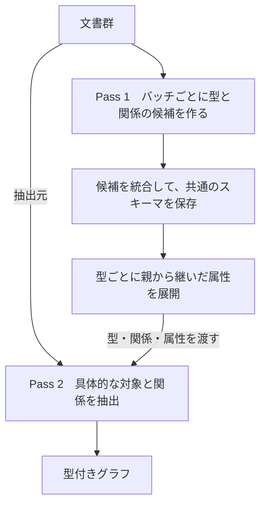

myKG は、文書群に共通する型と関係を先に決め、その語彙に沿って個々の対象や関係を取り出します。途中でスキーマを保存するため、定義の確認と抽出のやり直しを別々に行えます。

### 文書群から型付きグラフを作る



| 段階 | myKG が残すもの |
| --- | --- |
| Pass 1（スキーマの導出） | 概念の階層、属性、関係の両端に使える型（`domain/range`）。`schema.json` と `schema.ttl` に保存。 |
| Pass 2（事実の抽出） | 型付きのノードとエッジ、属性値、確信度、出所。 |

Pass 1 では、複数バッチの候補をまず機械的に統合し、次に LLM が意味の近い型や分類の細かさを見直します。Pass 2 に渡す前に、親の型から継いだ属性を子の型ごとの一覧に加えます。


### 語彙を追加した後の再抽出

既存の語彙を固定したまま新しい語彙を加える方法と、語彙全体を凍結して導出を省く方法があります。語彙を追加したときは、旧スキーマで抽出済みの文書から関係しそうな箇所を選んで再抽出します。候補の選択には上限があり、再抽出で拾えるのは選んだ箇所の事実です。

### そろうのは型と関係の語彙

事実が正しいかは個別に確かめます。同じ正規名を持つ別の対象や、誤って抽出された関係があり得ます。myKG のスキーマ検証は警告を記録して処理を続け、人によるレビューは任意です。高度な OWL の制約や推論は対象外です。


```svg-figure attribute-expansion
<svg xmlns="http://www.w3.org/2000/svg" width="720" height="350" viewBox="0 0 720 350" role="img" aria-labelledby="figure-title figure-desc">
  <title id="figure-title">各型に保存する属性と、抽出時に渡す属性</title>
  <desc id="figure-desc">保存時は親の型と子の型にそれぞれ自身の属性を記録する。抽出前に継承を展開し、子の型には自身の属性と親から継いだ属性をまとめて渡す。</desc>
  <rect width="720" height="350" rx="18" fill="#F6F9FC"/>
  <g font-family="Yu Gothic UI, Meiryo, Segoe UI, sans-serif" fill="#19283F">
    <text x="360" y="46" text-anchor="middle" font-size="23" font-weight="700">各型に保存する属性と、抽出時に渡す属性</text>

    <rect x="24" y="77" width="286" height="197" rx="12" fill="#E5F2EF" stroke="#B9D9D1"/>
    <text x="167" y="113" text-anchor="middle" font-size="19" font-weight="700" fill="#145D53">スキーマに保存</text>
    <text x="167" y="140" text-anchor="middle" font-size="15">型ごとに自身の属性を記録</text>
    <rect x="44" y="160" width="246" height="38" rx="7" fill="#FFFFFF"/>
    <text x="167" y="185" text-anchor="middle" font-size="16"><tspan font-weight="700">親の型</tspan><tspan>　親自身の属性</tspan></text>
    <rect x="44" y="214" width="246" height="38" rx="7" fill="#FFFFFF"/>
    <text x="167" y="239" text-anchor="middle" font-size="16"><tspan font-weight="700">子の型</tspan><tspan>　子自身の属性</tspan></text>

    <text x="360" y="156" text-anchor="middle" font-size="14" fill="#48566C">継承を展開</text>
    <path d="M329 177 H383 M377 171 L383 177 L377 183" fill="none" stroke="#526781" stroke-width="2" stroke-linecap="round" stroke-linejoin="round"/>

    <rect x="410" y="77" width="286" height="197" rx="12" fill="#E9EFFA" stroke="#C8D5EF"/>
    <text x="553" y="113" text-anchor="middle" font-size="19" font-weight="700" fill="#304D87">事実の抽出に渡す</text>
    <text x="553" y="140" text-anchor="middle" font-size="15">子の型に使う属性を一覧にする</text>
    <rect x="430" y="160" width="246" height="92" rx="7" fill="#FFFFFF"/>
    <text x="553" y="192" text-anchor="middle" font-size="16">子自身の属性</text>
    <text x="553" y="228" text-anchor="middle" font-size="16" fill="#304D87">＋ 親から継いだ属性</text>

    <text x="360" y="316" text-anchor="middle" font-size="15" fill="#405573">LLM には、展開した属性をそのまま渡す。</text>
  </g>
</svg>

```

