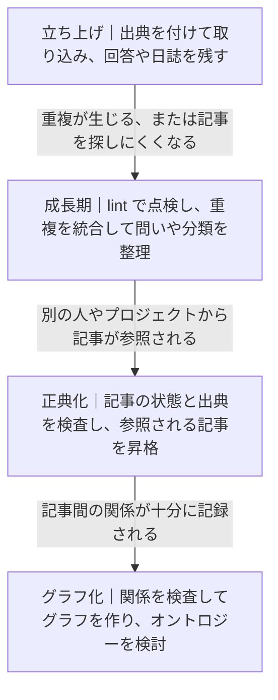

2026 年 11 月 8 日の設計メモです。記事が生まれたきっかけに応じて手法を選び、wiki の運用で課題が出たら、その課題に対応する仕組みを足すことを提案しています。対象は記事づくりを支援する Claude Code の Skill です。

### 記事作成を 5 つの区分で捉える


メモでは、各区分で使う手法を組み合わせます。たとえば、資料を取り込む段では個々の記事から知識を集め、分類は記事が増えて探しにくくなった段階で見直します。

### 運用で起きた問題を合図に進む



立ち上げ時のテンプレートは `source`、`concept`、`journal` の 3 種です。成長期に問いの一覧 `questions.md`、案内ページ `moc`、決定の記録 `decision` を加えます。導入の判断には、記事数よりも、その課題が実際に起きているかを使います。

### 手法がぶつかる場面での規則

| 場面 | メモが提案する扱い |
| --- | --- |
| 取り込みと分類 | 個々の資料から記事を育て、lint の段で LLM が分類を提案し、人が承認する。 |
| 記事の粒度 | `source` は資料 1 件につき 1 ページ。`concept` と `entity` は話題を 1 つに絞り、出典ページからリンクする。 |
| 手順と概念 | Diátaxis からは、手順と概念を別ページにする規則を採る。 |
| 草稿の出典 | `draft` は出典がなくても残せる。レビュー済みの `reviewed` に上げるときは出典を求める。 |

記事のメタデータには `id`、`type`、`scope`、`status`、`relations`、`sources` を置く案です。lint は、必要な節や出典、リンク先、上位関係 `broader` の循環、未回答の問いを調べます。主張が食い違ったら両方を矛盾の節に残します。Skill には `ingest`、`plan`、`answer`、`journal`、`consolidate`、`decide`、`promote`、`lint` の 8 コマンドを置き、グラフ生成はスクリプトに任せる案です。

### info-hive との比較は 2026 年 11 月 14 日時点

提案の `answer` のうち、出典付きの回答と有用な回答の保存は、当時の `/wiki:query` が担っていました。元ページが確認した info-hive のページ型は `source`、`entity`、`concept`、`synthesis` の 4 種です。利用者向けとプロジェクト向けの wiki は別のルートに置き、型付き関係には `graph.relationships` と `ontology.yaml` を使います。提案では、同じ wiki 内の範囲を `scope` で示し、関係を `relations` に記録します。矛盾を並べること、raw を保つこと、既存ページを先に探すこと、1 ページを 1 話題に絞ることは、当時の info-hive にも共通します。

記事型ごとの必須セクションと、lint のどこをスクリプトで機械的に検査し、どこを LLM に判断させるかは、検討課題です。原本のスキーマには `status` の値が 4 つあり、正典化の説明では「3 段階」と記されています。値と段階の対応は明示されていません。


```svg-figure article-methods
<svg xmlns="http://www.w3.org/2000/svg" width="720" height="366" viewBox="0 0 720 366" role="img" aria-labelledby="methods-title methods-desc">
  <title id="methods-title">記事作成の 5 区分</title>
  <desc id="methods-desc">発見、構造化、体系化、執筆、維持の各区分で手法を選んで組み合わせる。</desc>
  <rect width="720" height="366" rx="16" fill="#f3f6fa"/>
  <g font-family="system-ui, 'Yu Gothic UI', 'Meiryo', sans-serif" fill="#182f45">
    <text x="24" y="38" font-size="22" font-weight="700">記事作成の 5 区分</text>
    <text x="24" y="64" font-size="14" fill="#405b71">記事が生まれたきっかけに応じて、区分ごとに手法を選ぶ。</text>
    <g>
      <rect x="24" y="88" width="672" height="44" rx="8" fill="#ffffff" stroke="#d5dfe8"/>
      <rect x="34" y="94" width="174" height="32" rx="6" fill="#e9f2fb"/>
      <text x="49" y="116" font-size="16" font-weight="700" fill="#26547e">発見</text>
      <text x="228" y="116" font-size="16">記事にすべき話題を見つける</text>
    </g>
    <g>
      <rect x="24" y="139" width="672" height="44" rx="8" fill="#ffffff" stroke="#d5dfe8"/>
      <rect x="34" y="145" width="174" height="32" rx="6" fill="#eaf0f9"/>
      <text x="49" y="167" font-size="16" font-weight="700" fill="#334f76">構造化</text>
      <text x="228" y="167" font-size="16">ページを分け、関係する話題をつなぐ</text>
    </g>
    <g>
      <rect x="24" y="190" width="672" height="44" rx="8" fill="#ffffff" stroke="#d5dfe8"/>
      <rect x="34" y="196" width="174" height="32" rx="6" fill="#eeeafa"/>
      <text x="49" y="218" font-size="16" font-weight="700" fill="#584481">体系化</text>
      <text x="228" y="218" font-size="16">分類や問いを整理する</text>
    </g>
    <g>
      <rect x="24" y="241" width="672" height="44" rx="8" fill="#ffffff" stroke="#d5dfe8"/>
      <rect x="34" y="247" width="174" height="32" rx="6" fill="#e6f4ed"/>
      <text x="49" y="269" font-size="16" font-weight="700" fill="#275e4d">執筆</text>
      <text x="228" y="269" font-size="16">記事の種類や状態に合う形で書く</text>
    </g>
    <g>
      <rect x="24" y="292" width="672" height="44" rx="8" fill="#ffffff" stroke="#d5dfe8"/>
      <rect x="34" y="298" width="174" height="32" rx="6" fill="#f6efe3"/>
      <text x="49" y="320" font-size="16" font-weight="700" fill="#6f4b29">維持</text>
      <text x="228" y="320" font-size="16">重複・矛盾・リンクを点検する</text>
    </g>
  </g>
</svg>

```

