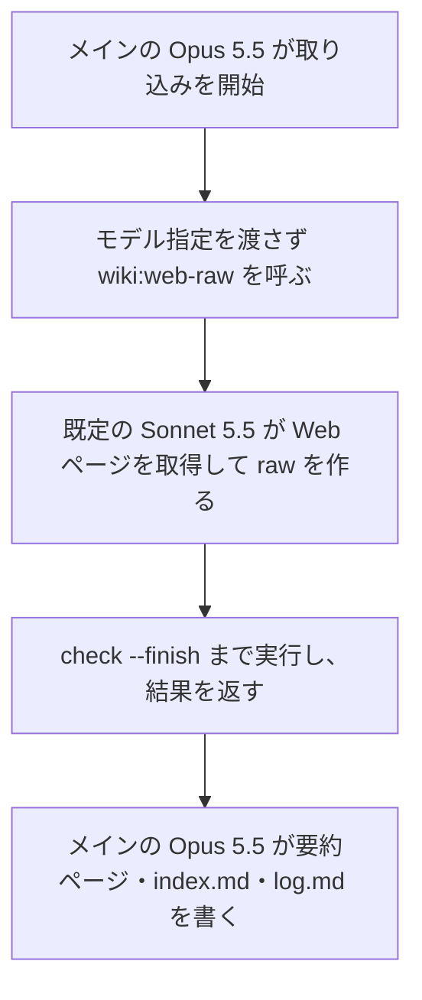

2026 年 11 月 14 日に、wiki プラグイン 0.15.0 で追加する `wiki:web-raw` の分担を検証しました。一時 wiki で、英語の CQRS と日本語のブルームフィルタを各 1 回取り込みました。実行記録と Claude Code のメタデータで調べた 14 項目は、両方の試行で通りました。

### raw の作成から wiki の更新まで



`tests/wiki/check_web_raw_agent.py` は、親子の実行記録と `agentType`、`launchedWithDefaults`、`prefix.json` のモデル情報を突き合わせました。応答のモデル、`Edit` と `Write` の書き込み先、子エージェントが検査スクリプトの出力を受け取ったことを確認しました。

### 費用の大半は後段の Opus


Sonnet 5.5 の raw 作成は、相談用の `advisor`（Fable 5.1）を除くと、どちらも全体の約 1 割でした。全体の実行時間は CQRS が 248 秒、ブルームフィルタが 197 秒でした。取り込み全体を Sonnet で行った試行 2 の 166 秒・145 秒より長く、元ページは後段を Opus で実行したためと説明しています。過去の回も含めると手順や計時の範囲が異なるため、時間の比較は目安です。過去の回の費用は記録されていません。

### 実行記録でどこまで確かめられるか

- **コマンドは人も読む。** 記録で確認できるのは、観察されたツール呼び出しや出力です。Bash の内部での書き込みや、別の担当がスクリプトを実行しなかったことは記録だけでは判定できないため、該当するコマンドを列挙して人が確認します。モデル情報が示すのは応答のモデルです。
- **完了は JSON で確認する。** ツールのテキスト出力にはページ本文も混ざります。W8 は `check --finish --json` の結果で確認し、raw 本文と検査結果の区別がつかない場合は不合格にします。
- **必要な記録がそろっているか確認する。** JSONL は LF で区切り、本文に現れる U+2028 で分割しないようにします。読めない行やメタデータ、結果の欠落、途中で切れた JSON があれば不合格にします。この判定は検証に必要な証拠が足りないことを示します。Agent の結果にある `agentId` と記録ファイルを結び、すべての `"stage": "check"` を説明できるかも確認します。


```svg-figure model-cost
<svg xmlns="http://www.w3.org/2000/svg" width="720" height="333" viewBox="0 0 720 333" role="img" aria-labelledby="cost-title cost-desc">
  <title id="cost-title">取り込み 2 件のモデル別費用</title>
  <desc id="cost-desc">advisorを除く。CQRSはSonnet 0.19ドルとOpus 1.73ドルで合計1.92ドル。ブルームフィルタはSonnet 0.15ドルとOpus 1.46ドルで合計1.61ドル。どちらもSonnetは費用の約1割。</desc>
  <rect width="720" height="333" rx="16" fill="#f2f6fa"/>
  <g font-family="system-ui, 'Yu Gothic UI', Meiryo, sans-serif" fill="#192e44">
    <text x="24" y="38" font-size="22" font-weight="700">取り込み 2 件のモデル別費用</text>
    <text x="24" y="64" font-size="14" fill="#40586f">advisor を除く実測値。棒の長さは合計費用を表す。</text>
    <rect x="24" y="81" width="13" height="13" rx="3" fill="#0d7869"/>
    <text x="45" y="92" font-size="14">Sonnet 5.5（raw）</text>
    <rect x="222" y="81" width="13" height="13" rx="3" fill="#3d5d8f"/>
    <text x="243" y="92" font-size="14">Opus 5.5（後段）</text>
    <g>
      <rect x="24" y="111" width="672" height="88" rx="9" fill="#ffffff" stroke="#d5dfe8"/>
      <text x="43" y="136" font-size="16" font-weight="700">CQRS</text>
      <text x="677" y="136" text-anchor="end" font-size="16" font-weight="700">合計 1.92 USD</text>
      <rect x="43" y="147" width="584" height="13" rx="6" fill="#3d5d8f"/>
      <path d="M101 147H49Q43 147 43 153.5Q43 160 49 160H101Z" fill="#0d7869"/>
      <text x="43" y="183" font-size="14" font-weight="700" fill="#126555">0.19 USD</text>
      <text x="150" y="183" font-size="14" font-weight="700" fill="#304e7b">1.73 USD</text>
    </g>
    <g>
      <rect x="24" y="210" width="672" height="88" rx="9" fill="#ffffff" stroke="#d5dfe8"/>
      <text x="43" y="235" font-size="16" font-weight="700">ブルームフィルタ</text>
      <text x="677" y="235" text-anchor="end" font-size="16" font-weight="700">合計 1.61 USD</text>
      <rect x="43" y="246" width="489" height="13" rx="6" fill="#3d5d8f"/>
      <path d="M89 246H49Q43 246 43 252.5Q43 259 49 259H89Z" fill="#0d7869"/>
      <text x="43" y="282" font-size="14" font-weight="700" fill="#126555">0.15 USD</text>
      <text x="150" y="282" font-size="14" font-weight="700" fill="#304e7b">1.46 USD</text>
    </g>
  </g>
</svg>

```
