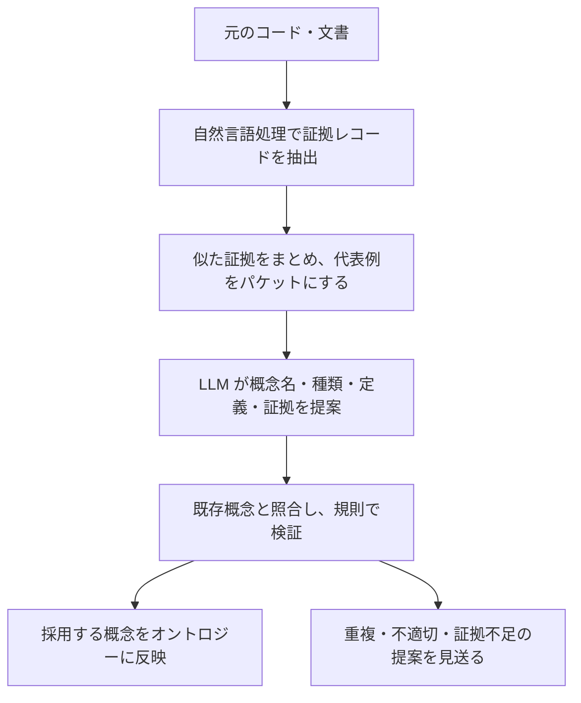

**LLM は、整理された証拠から概念名・種類・定義を提案します。** 採用の判断は後段で行い、既存の概念や証拠と照らし合わせたうえで、採用する概念をオントロジーに反映します。

### 証拠から提案、採用へ



コードのクラスや依存関係、文書の用語や関係を、共通の形式で記録します。埋め込みと HDBSCAN を使って似た証拠をまとめ、グループ数が未知でも外れ値を無理に振り分けず、代表的な証拠を LLM に渡します。採用した概念から提案、パケット、レコードを逆にたどると、元のコードや文書に戻れます。


記事が示すのは判定の観点です。規則や閾値の詳細、意味の妥当性をどこまで確かめられるかは、別途確認が必要です。

### 見送りの判断と、採用する範囲

製品文書約100件以上から作った千件超の証拠パケットを処理した事例では、小さなローカルモデルに見送りを許しても、モデルはほとんど見送りませんでした。記事に見送り率、採用精度、モデル名、他モデルとの比較の記載はなく、この事例の観察として扱います。

採用する範囲は、システムが答えるべき質問を先に定めて絞ります。質問に必要な概念を専門家が確かめたうえで採用する、という方針です。


```svg-figure adoption-checks
<svg xmlns="http://www.w3.org/2000/svg" width="720" height="352" viewBox="0 0 720 352" role="img" aria-labelledby="figure-title figure-desc">
  <title id="figure-title">採用前に確認する4つの観点</title>
  <desc id="figure-desc">既存の同じ概念を探し、同値や別名など関係を分類する。証拠と定義などの要件を確認し、実際に業務上の概念として扱えるかを見極める。</desc>
  <rect width="720" height="352" rx="18" fill="#F6F9FC"/>
  <g font-family="Yu Gothic UI, Meiryo, Segoe UI, sans-serif" fill="#19283F">
    <text x="360" y="46" text-anchor="middle" font-size="23" font-weight="700">採用前に確認する4つの観点</text>

    <rect x="24" y="77" width="323" height="112" rx="11" fill="#E5F2EF" stroke="#B8D9D0"/>
    <line x1="44" y1="125" x2="326" y2="125" stroke="#B8D9D0"/>
    <text x="44" y="110" font-size="18" font-weight="700" fill="#195D50">同じ概念があるか</text>
    <text x="44" y="149" font-size="15">ラベルの完全一致、BM25、</text>
    <text x="44" y="171" font-size="15">埋め込みの類似度で探す。</text>

    <rect x="373" y="77" width="323" height="112" rx="11" fill="#E9EFFA" stroke="#C6D4ED"/>
    <line x1="393" y1="125" x2="675" y2="125" stroke="#C6D4ED"/>
    <text x="393" y="110" font-size="18" font-weight="700" fill="#304C85">既存概念とどう違うか</text>
    <text x="393" y="149" font-size="15">同値・別名・狭義・広義・関連・新規・</text>
    <text x="393" y="171" font-size="15">証拠不足に分ける。</text>

    <rect x="24" y="216" width="323" height="112" rx="11" fill="#EEEAF8" stroke="#D6C9EA"/>
    <line x1="44" y1="264" x2="326" y2="264" stroke="#D6C9EA"/>
    <text x="44" y="249" font-size="18" font-weight="700" fill="#584178">提案の要件を満たすか</text>
    <text x="44" y="288" font-size="15">証拠、ラベル、意味のある定義、</text>
    <text x="44" y="310" font-size="15">許可された種類がそろっているか。</text>

    <rect x="373" y="216" width="323" height="112" rx="11" fill="#FAEFDF" stroke="#E6D3B0"/>
    <line x1="393" y1="264" x2="675" y2="264" stroke="#E6D3B0"/>
    <text x="393" y="249" font-size="18" font-weight="700" fill="#78501D">業務上の概念と言えるか</text>
    <text x="393" y="288" font-size="15">表のフィールドや画面の用語が</text>
    <text x="393" y="310" font-size="15">業務上の概念に当たるかを見極める。</text>
  </g>
</svg>

```

