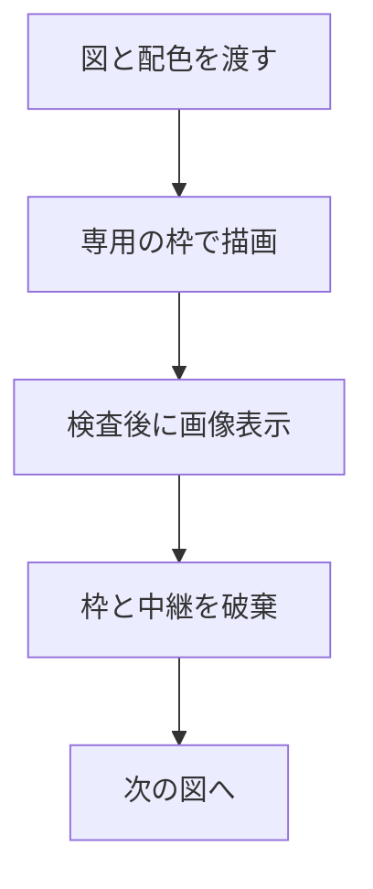

wiki の閲覧画面は、図ごとに中継と専用の描画枠を作り、その図の入力と許可された配色だけを渡します。記事のパス、検索データ、ほかの図の一覧は渡しません。

### 1 図ずつ描画する



同時に動く描画枠同士で直接通信できたため、同じページでは前の枠を破棄してから次を作ります。この判断の根拠は、本文が参照する 2026 年 11 月 18 日の検証の会話版（T129、T139、T156）です。図の入力に含まれる機密情報は、この仕組みの保護対象外です。

### サーバー版で確認したこと


サーバー版では、埋め込みや `opener`（ウィンドウを開いた元のページへの参照）でつながったページ間でも、描画枠同士の通信を確認しました。該当する入口では図の代わりにコードを表示し、修正後に 5 ブラウザーで 30 ケースが通りました。Astra の再レビューで重大な指摘はありませんでした。

### 隔離をどう確かめるか

描画側でも検査し、意図的に情報を漏らすケースや、枠を 2 組同時に動かすケースで検査が機能することを確かめます。描き直した後は、結果と入力を照合し、どの実行回の結果かを確認します。入力と生成物のハッシュも照合します。


```svg-figure entry-and-results
<svg xmlns="http://www.w3.org/2000/svg" width="720" height="344" viewBox="0 0 720 344" role="img" aria-labelledby="entry-title entry-desc">
  <title id="entry-title">静的試作とサーバー版の検証範囲</title>
  <desc id="entry-desc">静的試作は単独ページが前提。サーバー版は埋め込み・opener 経由でコードを表示し、同時描画を 1 枠に制限した。修正後は 5 ブラウザーで 30 ケースが成功した。</desc>
  <rect width="720" height="344" rx="16" fill="#f1f5f9"/>
  <g font-family="'Yu Gothic UI', 'Hiragino Sans', 'Noto Sans CJK JP', system-ui, sans-serif" fill="#172e40">
    <text x="360" y="43" text-anchor="middle" font-size="22" font-weight="700">静的試作とサーバー版の検証範囲</text>
    <rect x="24" y="70" width="304" height="156" rx="12" fill="#fff" stroke="#bdcddd"/>
    <rect x="354" y="70" width="342" height="156" rx="12" fill="#fff" stroke="#adc8c1"/>
    <g font-size="20" font-weight="700">
      <text x="44" y="105" fill="#274c70">静的試作</text>
      <text x="374" y="105" fill="#235b50">サーバー版</text>
    </g>
    <g font-size="16">
      <text x="44" y="140">単独ページを前提に検証</text>
      <text x="44" y="176">埋め込み・opener 経由の</text>
      <text x="44" y="200">描画を制限する変更は未適用</text>
      <text x="374" y="140">同時に描画する枠は 1 つ</text>
      <text x="374" y="176">埋め込み・opener 経由では</text>
      <text x="374" y="200">図の代わりにコードを表示</text>
    </g>
    <rect x="24" y="252" width="672" height="68" rx="12" fill="#e4f1ec" stroke="#adc8c1"/>
    <text x="44" y="292" font-size="16" font-weight="700" fill="#235b50">サーバー版の修正後</text>
    <text x="676" y="293" text-anchor="end" font-size="22" font-weight="700" fill="#173e37">5 ブラウザーで 30 ケース成功</text>
  </g>
</svg>

```

