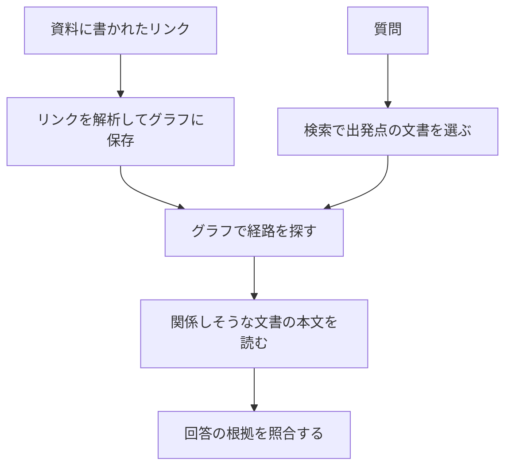

既存のリンクをグラフの辺として保存し、質問に関係しそうな文書をたどります。見つかった経路を手がかりに、本文を開いて関係の意味と回答の根拠を確かめます。

### 質問から根拠までたどる



元の記事の設計を整理した流れです。info-hive で型付きの関係を追加する場合は、wiki のスキーマとグラフ抽出の規約に従います。

### 経路から判断できる範囲


多くの文書が参照するハブを経由する場合は、本文から関連の強さを判断します。経路が見つからなければ、判断できるのは探索範囲内の記録についてです。リンクが乏しい資料では、必要に応じて関係の抽出を補います。

### グラフの作り方が違っても原文に戻る

myKG は文書からスキーマを提案し、その型に沿って関係を抽出します。組織図を作るデモでは、別々のチームがグラフ上で一つのノードにまとまっており、Claude が原文を読んで分け直したと画面内で説明しています。ここで確認できるのはデモの説明までで、抽出精度は未測定です。


```svg-figure reading-paths
<svg xmlns="http://www.w3.org/2000/svg" width="720" height="380" viewBox="0 0 720 380" role="img" aria-labelledby="title desc">
  <title id="title">グラフの経路をどう読むか</title>
  <desc id="desc">概念図。上段では文書 A と文書 B がハブを介してつながる。内容上の関係は本文で確かめる。下段では探索範囲内に A から B への経路が見つからない。リンクの欠落や探索の範囲を考慮して判断する。</desc>
  <rect width="720" height="380" rx="18" fill="#F6F9FC"/>
  <g font-family="Yu Gothic UI, Meiryo, Segoe UI, sans-serif" fill="#19283F">
    <text x="360" y="48" text-anchor="middle" font-size="23" font-weight="700">グラフの経路をどう読むか</text>
    <rect x="24" y="77" width="672" height="125" rx="12" fill="#E8F1FA" stroke="#C2D4EA"/>
    <text x="45" y="121" font-size="18" font-weight="700" fill="#2E4E83">ハブ経由でつながる</text>
    <text x="45" y="152" font-size="15">実際の関係を本文で読む。</text>
    <path d="M385 138 H429 M423 132 L429 138 L423 144 M536 138 H579 M573 132 L579 138 L573 144" fill="none" stroke="#526781" stroke-width="1.6" stroke-linecap="round" stroke-linejoin="round"/>
    <rect x="296" y="112" width="84" height="52" rx="8" fill="#FFFFFF" stroke="#C2D4EA"/>
    <rect x="435" y="112" width="95" height="52" rx="8" fill="#D9E7F7" stroke="#B8CBE5"/>
    <rect x="585" y="112" width="84" height="52" rx="8" fill="#FFFFFF" stroke="#C2D4EA"/>
    <g font-size="16" font-weight="600" text-anchor="middle">
      <text x="338" y="144">文書 A</text>
      <text x="482" y="144">ハブ</text>
      <text x="627" y="144">文書 B</text>
    </g>
    <rect x="24" y="229" width="672" height="125" rx="12" fill="#FAF0E0" stroke="#E7D5B6"/>
    <text x="45" y="273" font-size="18" font-weight="700" fill="#77501F">経路が見つからない</text>
    <text x="45" y="304" font-size="15">リンクの不足や探索範囲を確認。</text>
    <rect x="296" y="265" width="84" height="52" rx="8" fill="#FFFFFF" stroke="#E7D5B6"/>
    <rect x="585" y="265" width="84" height="52" rx="8" fill="#FFFFFF" stroke="#E7D5B6"/>
    <text x="338" y="297" text-anchor="middle" font-size="16" font-weight="600">文書 A</text>
    <text x="482" y="297" text-anchor="middle" font-size="15" fill="#674B2B">探索範囲内に経路なし</text>
    <text x="627" y="297" text-anchor="middle" font-size="16" font-weight="600">文書 B</text>
  </g>
</svg>

```

