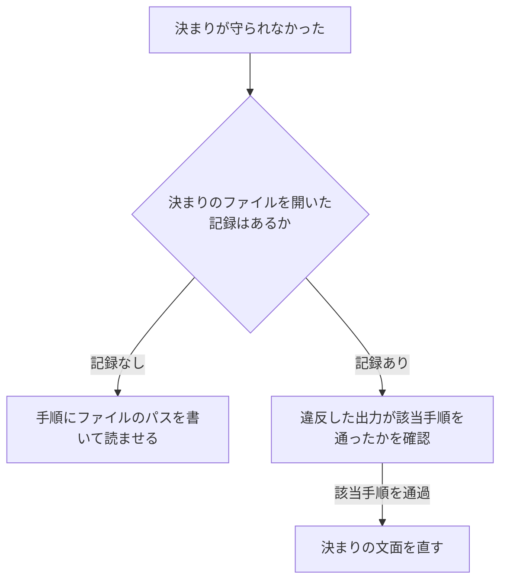

決まりが守られないときは、まず**実行記録を見て、決まりが届いていたかを調べます**。出力をそろえるには、許す文字列や観察できる条件を決め、検査できるものは機械で確認します。

### 直す場所を実行記録から決める



`/wiki:query` の確信度の測定では、決め方のファイルを開いた回が30回中0回でした。直接読ませる修正で判定がそろいました。検索語の漏れは読んだ回でも起きていたため、出力条件そのものを変えました。

### 出力と完了の条件を具体的に書く

- **許す文字列を決める。** 検索語として示すのは質問にそのままある語に限り、言い換えて探した場合は「言い換えた語でも探した」と種類だけを示します。例には、従ったときの書き方を載せます。
- **記録を判定に使う。** ページを初めて開く前のツール呼び出し順や、正常な `hybrid` の検索結果にそのページが含まれたかで判定します。既存の確信度の表を参照し、条件の重複を避けます。
- **完了を検査結果とは別に確認する。** Web raw の取り込みでは `ok` を検査の結果として扱い、実行結果の `completed: true` と翻訳の状態を確かめます。残す外国語は対象・全文・種類・理由を原文と raw のハッシュに結び、検査器で形式と結び付きを確認します。訳の意味と完全性は、訳文を読んで確かめます。


計画の行数を検査した結果は、1つのライブラリと Qwen 系モデルでの観察です。回答の経路と引用をコードで照合する別の設計例では、検査器のコードと実データでの全工程が未検証です。

### 将来の判断と候補の採否

何を覚えておくかは将来の用途を見越す判断です。Anthropic の CL-Bench では、Opus 5 と Opus 4.7 は目的を伝えて判断を任せる形が有利で、Sonnet 4.6 は回答前にメモリを読んで仮説を確かめる手順を促すと、スコアが0.364から0.641に上がりました。「失敗だけを記録する」と指定したときは、メモリによる上積みが Opus 5 で0.234、Opus 4.7 で0.150減りました。これらは同社の評価値です。

オントロジー候補を作った別の実験では、小さなローカルモデルは見送りを許されても、ほとんど見送りませんでした。そこで候補の提案と採用判定を分け、重複、ラベル、証拠、形式を別の処理で確認しました。

### 漏れの測り方

問いごとに漏れてほしくない特徴的な表記を登録し、回答全体を照合します。短い語や未登録の表記は機械で拾いにくいため、合否は回答を読んで決めます。過去の測定記録が答えを教えてしまうのを防ぐため、その記録を含まない時点の wiki で測ります。


```svg-figure line-check
<svg xmlns="http://www.w3.org/2000/svg" width="720" height="319" viewBox="0 0 720 319" role="img" aria-labelledby="figure-title figure-desc">
  <title id="figure-title">行数違反の理由を返して修正させた実験</title>
  <desc id="figure-desc">Qwen 系モデルが書いた計画プログラム10本のうち6本が初回で通過。4本は80行の上限を超え、拒否理由が返った後の1回の修正で通過した。予算を読む budget 関数を使った計画は1本だった。</desc>
  <rect width="720" height="319" rx="18" fill="#F6F9FC"/>
  <g font-family="Yu Gothic UI, Meiryo, Segoe UI, sans-serif" fill="#19283F">
    <text x="360" y="46" text-anchor="middle" font-size="23" font-weight="700">行数違反の理由を返して修正させた実験</text>
    <rect x="24" y="75" width="399" height="152" rx="12" fill="#FFFFFF" stroke="#CDD9E8"/>
    <text x="44" y="105" font-size="18" font-weight="700">行数の上限は80行、計画は10本</text>
    <rect x="44" y="126" width="28" height="26" rx="5" fill="#27776A"/>
    <rect x="80" y="126" width="28" height="26" rx="5" fill="#27776A"/>
    <rect x="116" y="126" width="28" height="26" rx="5" fill="#27776A"/>
    <rect x="152" y="126" width="28" height="26" rx="5" fill="#27776A"/>
    <rect x="188" y="126" width="28" height="26" rx="5" fill="#27776A"/>
    <rect x="224" y="126" width="28" height="26" rx="5" fill="#27776A"/>
    <rect x="260" y="126" width="28" height="26" rx="5" fill="#DDAA62"/>
    <rect x="296" y="126" width="28" height="26" rx="5" fill="#DDAA62"/>
    <rect x="332" y="126" width="28" height="26" rx="5" fill="#DDAA62"/>
    <rect x="368" y="126" width="28" height="26" rx="5" fill="#DDAA62"/>
    <circle cx="50" cy="178" r="5" fill="#27776A"/>
    <text x="63" y="183" font-size="15">6本が初回で通過</text>
    <circle cx="50" cy="205" r="5" fill="#DDAA62"/>
    <text x="63" y="210" font-size="15">4本が上限超過</text>
    <rect x="450" y="75" width="246" height="152" rx="12" fill="#FAF0E0" stroke="#E7D5B6"/>
    <text x="470" y="105" font-size="18" font-weight="700" fill="#754E1D">上限を超えた4本</text>
    <text x="470" y="139" font-size="16">103、176、141、159行</text>
    <text x="470" y="175" font-size="15">検査器が拒否の理由を返し、</text>
    <text x="470" y="200" font-size="15">全4本が1回の修正で通過。</text>
    <rect x="24" y="252" width="672" height="43" rx="8" fill="#E9EFFA"/>
    <text x="44" y="279" font-size="15" fill="#34517F">予算を読む budget() を使った計画は10本中1本。</text>
  </g>
</svg>

```

