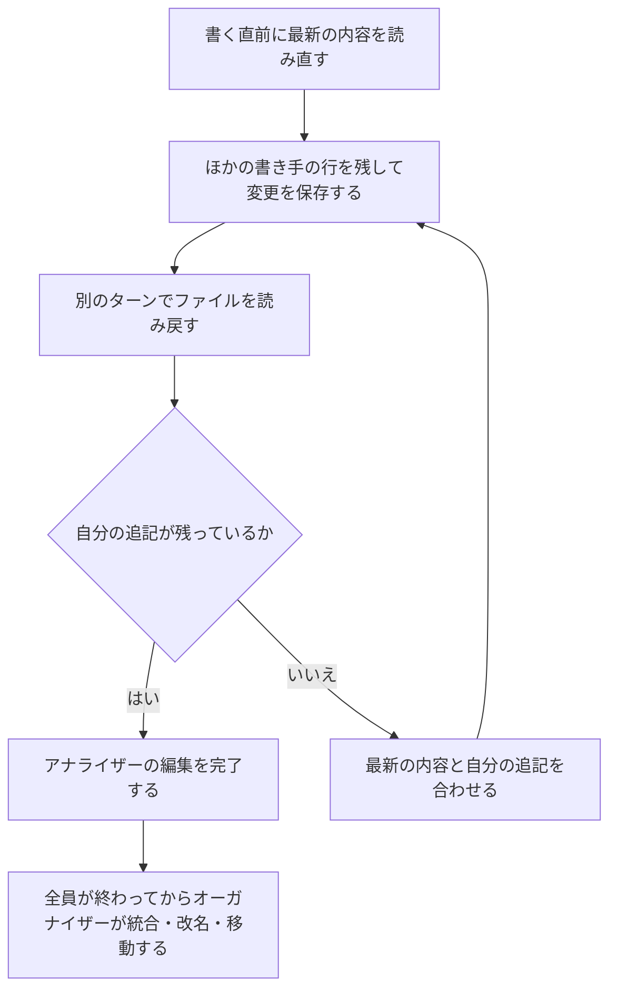

同じファイルを複数のセッションが更新すると、両方のツールが成功を報告しても、片方の変更が消えることがあります。このページは、2026 年 11 月 14 日に Windows 版の Claude Code 2.1.321 で行った試験を記録しています。

### どんなときに行が失われたか


別のプロセスが行を足し終えたあとに `Edit` で行を足した試験では、両方の変更が残り、ツールはディスク上の変更を知らせました。別プロセスの追記と同じ応答の中で操作した試験でも、古い内容で全体を書き直す `Write` は拒否され、行を足す `Edit` では両方の追記が残りました。一方、別プロセスが 10 ミリ秒ごとに読み取り・追記・保存を繰り返す間に `Edit` で 5 行を追加すると、エラーが出ずに双方の行が消えました。索引の項目やログの追記がこのように失われた場合、ページが扱う lint ではその抜けを検出できません。

### 書き戻しを確認する手順

Anthropic のドリーミングの作例では、複数のアナライザーが同じディレクトリを編集します。共有の索引は対象箇所だけを編集し、ファイルの統合・改名・移動は、アナライザーが全員終わったあとにオーガナイザーが行います。



### 共有ファイルへの書き込みを扱う設計

| 方法 | ページに記録された事例 |
| --- | --- |
| ロックで書き込みを直列化する | 2026 年 11 月 15 日に ADR-0023 で承認した設計。ページ・索引・ログの保存を `wiki_apply.py` に集め、wiki ごとのロックと変更前後を記録する日誌を使う方針です。 |
| 読み戻して修復する | ドリーミングの作例。失われた追記を合わせて書き戻し、統合は最後の担当に任せます。 |
| ページごとに書き手を 1 体にする | 契約を扱う例では、4 体が共有ページに書いたときは、準備書面に 57 個中 41 個の事実が入りました。契約別のページを 1 体ずつ担当させ、原文を引用する指示も加えた条件では 57 個すべてが残りました。 |
| 一部の損失を許容する | 文書から wiki を作るクイックスタートの README は、最も書き込みが集中するページで約 5% の行が失われると報告しています。 |

ADR-0023 は元ページが記録した時点で設計承認の段階でした。ロックと読み戻しの信頼性を直接比較した結果は、元ページでは未検証です。

### 読み取り専用の原本を守る

`Edit` と `Write` は、一時ファイルを書いてから名前を変更して置き換えます。Windows の試験では、読み取り専用ファイルをジャンクション経由で編集した場合も、名前を変える段階で双方が `EPERM` になりました。POSIX では、親ディレクトリに書き込めればファイルを置き換えられる可能性があり、元ページでは未検証です。


```svg-figure edit-write-results
<svg xmlns="http://www.w3.org/2000/svg" width="720" height="336" viewBox="0 0 720 336" role="img" aria-labelledby="race-title race-desc">
  <title id="race-title">追記の順番と書き込みの結果</title>
  <desc id="race-desc">Windows版のClaude Code 2.1.321では、別のプロセスによる変更の後に古い内容でWriteすると拒否され、続けてEditで行を足すと両方が残った。別のプロセスが10ミリ秒ごとに保存する間にEditで5行を追加した試験では、エラーがないままEditの1行と相手の7行が失われた。</desc>
  <rect width="720" height="336" rx="16" fill="#f1f5f9"/>
  <g font-family="system-ui, 'Yu Gothic UI', Meiryo, sans-serif" fill="#15293d">
    <text x="24" y="38" font-size="22" font-weight="700">追記の順番と書き込みの結果</text>
    <text x="24" y="64" font-size="14" fill="#40576e">Claude Code 2.1.321 の Windows での試験</text>
    <g>
      <rect x="24" y="92" width="672" height="62" rx="9" fill="#ffffff" stroke="#d7e1eb"/>
      <rect x="35" y="107" width="74" height="32" rx="7" fill="#edf1ff"/>
      <text x="72" y="128" text-anchor="middle" font-size="15" font-weight="700" fill="#2f477f">Write</text>
      <text x="124" y="118" font-size="14">古い内容でファイル全体を保存</text>
      <text x="124" y="139" font-size="14">その前に別プロセスが追記</text>
      <path d="M347 123H375M368 117L375 123L368 129" fill="none" stroke="#547083" stroke-width="2" stroke-linecap="round" stroke-linejoin="round"/>
      <text x="395" y="118" font-size="16" font-weight="700" fill="#2f477f">保存を拒否</text>
      <text x="395" y="139" font-size="13" fill="#304861">File has been modified since read</text>
    </g>
    <g>
      <rect x="24" y="166" width="672" height="62" rx="9" fill="#ffffff" stroke="#d7e1eb"/>
      <rect x="35" y="181" width="74" height="32" rx="7" fill="#e1f3eb"/>
      <text x="72" y="202" text-anchor="middle" font-size="15" font-weight="700" fill="#1f594a">Edit</text>
      <text x="124" y="192" font-size="14">別プロセスの追記後に</text>
      <text x="124" y="213" font-size="14">行を追加</text>
      <path d="M347 197H375M368 191L375 197L368 203" fill="none" stroke="#547083" stroke-width="2" stroke-linecap="round" stroke-linejoin="round"/>
      <text x="395" y="192" font-size="16" font-weight="700" fill="#1f594a">両方の追記が残った</text>
      <text x="395" y="213" font-size="13" fill="#304861">ディスク上の変更を通知</text>
    </g>
    <g>
      <rect x="24" y="240" width="672" height="62" rx="9" fill="#ffffff" stroke="#d7e1eb"/>
      <rect x="35" y="255" width="74" height="32" rx="7" fill="#fceadd"/>
      <text x="72" y="276" text-anchor="middle" font-size="15" font-weight="700" fill="#833d25">Edit</text>
      <text x="124" y="266" font-size="14">別プロセスが 10 ms ごとに</text>
      <text x="124" y="287" font-size="14">保存する間に 5 行を追加</text>
      <path d="M347 271H375M368 265L375 271L368 277" fill="none" stroke="#547083" stroke-width="2" stroke-linecap="round" stroke-linejoin="round"/>
      <text x="395" y="266" font-size="16" font-weight="700" fill="#833d25">双方の追記が消えた</text>
      <text x="395" y="287" font-size="13" fill="#304861">Edit は 1 行、相手は 1,500 行中 7 行</text>
    </g>
  </g>
</svg>

```

