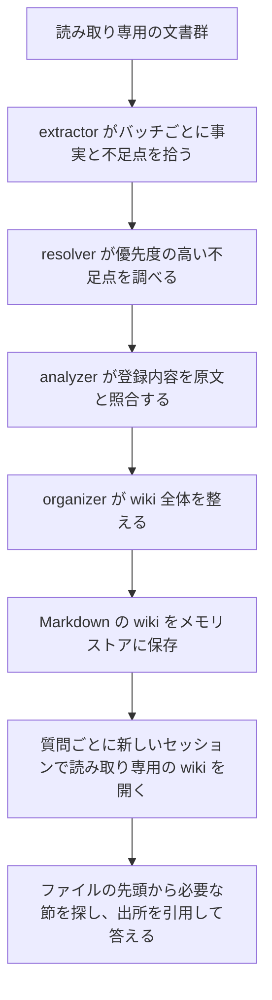

Anthropic のクイックスタートは、変化の遅い文書群を一度 wiki に整理し、繰り返しの質問に使う作例です。文書をまたぐ事実をあらかじめ整理し、回答に必要な箇所と出所をたどれるようにします。作例の題材は、完了した非公開化案件の SEC 提出書類と、合成と明記した 2 件の社内文書です。

### wiki を作り、質問に答える

構築時は、1 つの Managed Agents セッションで動的ワークフローを実行します。原文は読み取り専用で渡し、エージェントは wiki に書き込めます。



### 出所と食い違いを残す

すべての事実に出所を付け、文書間の矛盾や、後に置き換えられた数値も追えるようにします。作例では、合成した社内文書の EBITDA 推定値と会社の報告値を、算定基準の異なる数値として保持します。ファイルは 100 KB が上限で、大規模な文書群では、主要な会社のページや注意事項を集める `escalations.md` をリンク付きの複数ファイルに分けます。

エージェントは共有ページに直接書き込みます。README は、最も書き込みが集中したページで登録行の約 5% が上書きで失われたと報告しています。作例は、異なる文書の数値を 1 つのページで照合し、食い違いに印を付けられる利点を取っています。

### README が報告する費用と成績


Haiku 5.5 同士では、wiki を使う方が自分で原文を検索する場合より約 3 ポイント高い成績でした。別に記録された 8 件・2.8 MB の構築実行は、23 分で定価約 16 ドルでした。README によると、ノートブックはプラットフォームの記録でワークフローの実行を確認し、wiki の有無で 1 問あたりの費用を測ります。ここに挙げた数値は README の報告です。評価手順の細部は、元の wiki ページの確認範囲外です。

外部から受け取った Office ファイルについて、README はコンテナー内で変換する方法や、信頼できるツールで先にテキストにする方法を挙げています。


```svg-figure wiki-economics
<svg xmlns="http://www.w3.org/2000/svg" width="720" height="277" viewBox="0 0 720 277" role="img" aria-labelledby="eco-title eco-desc">
  <title id="eco-title">wiki の構築費用と回答費用</title>
  <desc id="eco-desc">READMEの報告では、wikiを使うHaiku 5.5と原文を検索するSonnet 5.5の評価差は1ポイント以内で、前者の回答費用は約15分の1。構築費用は平均約19ドルで、約240問で回収すると試算された。</desc>
  <rect width="720" height="277" rx="16" fill="#f4f6fa"/>
  <g font-family="system-ui, 'Yu Gothic UI', 'Meiryo', sans-serif" fill="#192e43">
    <text x="24" y="38" font-size="22" font-weight="700">wiki の構築費用と回答費用</text>
    <text x="24" y="66" font-size="14" fill="#405970">クイックスタートの README が示した結果と試算</text>
    <g>
      <rect x="24" y="86" width="212" height="126" rx="10" fill="#e7f4ec"/>
      <text x="39" y="110" font-size="14" font-weight="700" fill="#226052">回答あたりの費用</text>
      <text x="39" y="148" font-size="27" font-weight="750" fill="#226052">約 1/15</text>
      <text x="39" y="175" font-size="14">原文を検索する</text>
      <text x="39" y="195" font-size="14">Sonnet 5.5 が比較対象</text>
    </g>
    <g>
      <rect x="254" y="86" width="212" height="126" rx="10" fill="#eaf1fc"/>
      <text x="269" y="110" font-size="14" font-weight="700" fill="#284f80">wiki の構築費用</text>
      <text x="269" y="148" font-size="27" font-weight="750" fill="#284f80">約 $19</text>
      <text x="269" y="175" font-size="14">ベンチマークの平均</text>
      <text x="269" y="195" font-size="14">構築時に一度かかる</text>
    </g>
    <g>
      <rect x="484" y="86" width="212" height="126" rx="10" fill="#f2ebf8"/>
      <text x="499" y="110" font-size="14" font-weight="700" fill="#59437a">構築費用の回収</text>
      <text x="499" y="148" font-size="27" font-weight="750" fill="#59437a">約 240 問</text>
      <text x="499" y="175" font-size="14">回答の費用差で</text>
      <text x="499" y="195" font-size="14">構築費用を回収する目安</text>
    </g>
    <text x="24" y="244" font-size="14" fill="#405970">wiki を使う Haiku 5.5 と原文を検索する Sonnet 5.5 の成績差は 1 ポイント以内。</text>
  </g>
</svg>

```

