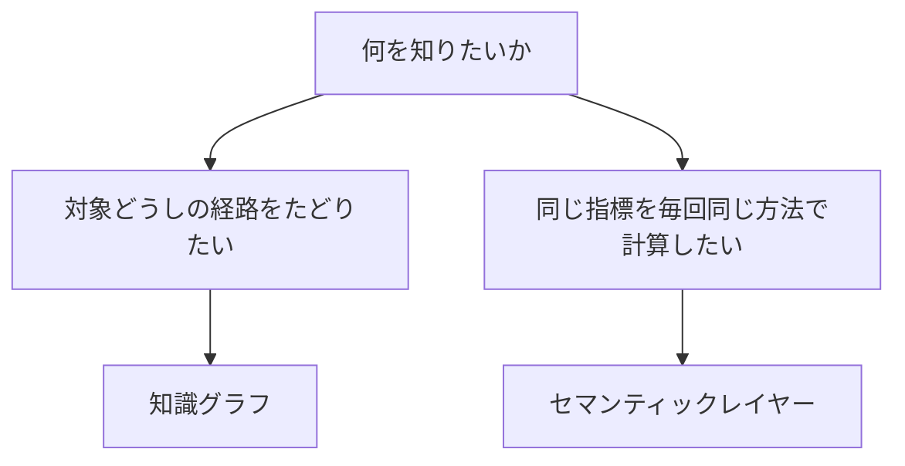

分類、関係の定義、個別の事実、指標の計算には、それぞれ役割があります。元の記事では、一つの事例を通して、分類の階層から順に型付きの関係、個別のデータ、指標の定義を加える形で説明しています。


### 質問による使い分け



グラフは、記録した関係をつないで経路をたどるのに向きます。セマンティックレイヤーでは、どの表を使ってどう結合し、指標をどう計算するかをそろえます。型についての推論と、業務指標の計算は別の役割です。

### info-hive での対応

- `graph/ontology.yaml` は、種類や関係を定める層です（TBox）。
- ページ冒頭の frontmatter に書く型付きの関係は、個別の事実の層です（ABox）。
- この wiki は開発知識を扱うため、事業指標の計算をまとめる層の追加は、必要になるまで保留です。

**業務概念の定義は1か所に置きます。** たとえば `active` を複数の層で独立に定義すると食い違う可能性があります。ほかの層では共通の定義を参照します。元の記事が引用する評価の数値は未検証です。


```svg-figure four-roles
<svg xmlns="http://www.w3.org/2000/svg" width="720" height="394" viewBox="0 0 720 394" role="img" aria-labelledby="figure-title figure-desc">
  <title id="figure-title">情報を扱う4つの役割</title>
  <desc id="figure-desc">タクソノミーは分類の階層、オントロジーは型付きの関係と制約、知識グラフは個別の事実、セマンティックレイヤーはテーブルの対応・結合と指標の定義を扱う。</desc>
  <rect width="720" height="394" rx="18" fill="#F6F9FC"/>
  <g font-family="Yu Gothic UI, Meiryo, Segoe UI, sans-serif" fill="#19283F">
    <text x="360" y="46" text-anchor="middle" font-size="23" font-weight="700">情報を扱う4つの役割</text>

    <rect x="24" y="77" width="323" height="133" rx="12" fill="#E8F3EE" stroke="#BAD8CB"/>
    <circle cx="60" cy="111" r="17" fill="#FFFFFF"/>
    <g transform="translate(60 111)" fill="none" stroke="#1B5A49" stroke-width="1.6" stroke-linecap="round" stroke-linejoin="round"><path d="M0 -6 H0 V1 M-8 1 H8 M-8 1 V8 M8 1 V8"/><circle cx="0" cy="-8" r="2"/><circle cx="-8" cy="9" r="2"/><circle cx="8" cy="9" r="2"/></g>
    <text x="87" y="118" font-size="19" font-weight="700" fill="#1B5A49">タクソノミー</text>
    <text x="44" y="159" font-size="18" font-weight="700">分類の階層を作る</text>
    <text x="44" y="185" font-size="15">上位・下位を is-a で結ぶ。</text>

    <rect x="373" y="77" width="323" height="133" rx="12" fill="#E9EFFA" stroke="#C6D4ED"/>
    <circle cx="409" cy="111" r="17" fill="#FFFFFF"/>
    <g transform="translate(409 111)" fill="none" stroke="#2E4E87" stroke-width="1.6" stroke-linecap="round" stroke-linejoin="round"><rect x="-10" y="-7" width="7" height="14" rx="2"/><rect x="3" y="-7" width="7" height="14" rx="2"/><path d="M-3 0 H3"/></g>
    <text x="436" y="118" font-size="19" font-weight="700" fill="#2E4E87">オントロジー</text>
    <text x="393" y="159" font-size="18" font-weight="700">概念どうしの関係を定義する</text>
    <text x="393" y="185" font-size="15">型、制約、業務ルールを記述する。</text>

    <rect x="24" y="237" width="323" height="133" rx="12" fill="#EEEAF8" stroke="#D6C9EA"/>
    <circle cx="60" cy="271" r="17" fill="#FFFFFF"/>
    <g transform="translate(60 271)" fill="none" stroke="#584078" stroke-width="1.6" stroke-linecap="round" stroke-linejoin="round"><path d="M-6 -6 L6 -3 L1 7 L-6 -6"/><circle cx="-7" cy="-7" r="3" fill="#EEEAF8"/><circle cx="7" cy="-3" r="3" fill="#EEEAF8"/><circle cx="1" cy="8" r="3" fill="#EEEAF8"/></g>
    <text x="87" y="278" font-size="19" font-weight="700" fill="#584078">知識グラフ</text>
    <text x="44" y="319" font-size="18" font-weight="700">具体的な対象と事実を結ぶ</text>
    <text x="44" y="345" font-size="15">定義に沿って個別の事実を記録する。</text>

    <rect x="373" y="237" width="323" height="133" rx="12" fill="#FAEFDF" stroke="#E6D3B0"/>
    <circle cx="409" cy="271" r="17" fill="#FFFFFF"/>
    <g transform="translate(409 271)" fill="none" stroke="#78501D" stroke-width="1.6" stroke-linecap="round" stroke-linejoin="round"><rect x="-10" y="-8" width="20" height="16" rx="2"/><path d="M-10 -3 H10 M-3 -3 V8 M4 -3 V8 M-10 2 H10"/></g>
    <text x="436" y="278" font-size="19" font-weight="700" fill="#78501D">セマンティックレイヤー</text>
    <text x="393" y="319" font-size="18" font-weight="700">指標の計算方法をそろえる</text>
    <text x="393" y="345" font-size="15">テーブルの対応、結合、指標を定義する。</text>
  </g>
</svg>

```

