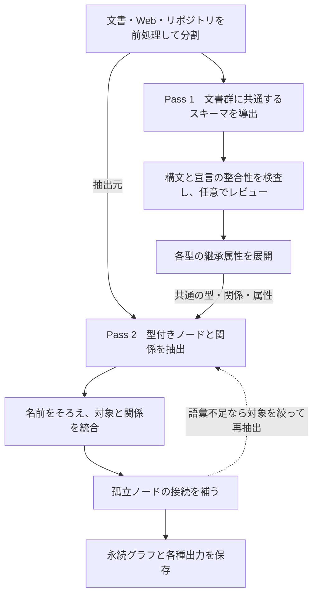

**myKG は、文書群に共通する型と関係を先に定め、その語彙で個別の事実を抽出します。** 構築結果をセッションに保存し、問い合わせ側は完成したグラフを読み込みます。


### 文書をグラフにする12段階



| 処理 | 段階と主な成果物 |
| --- | --- |
| 前処理と取り込み（2段階） | `preprocess` で Markdown に正規化し、`ingest` でハッシュ、重なりを持つチャンク、`file_manifest.json` を作る。Web の取得はセッション外で行い、PDF・Office・画像などの変換は MinerU に振り分ける。 |
| スキーマ導出と確認（4段階） | `pass1` でバッチ案を機械的に統合し、LLM で整合性と粒度を見直して `schema.json`・`schema.ttl` に保存。`schema_validate`、任意の `human_review` を経て、`schema_flatten` で親の属性を型ごとに展開する。 |
| 事実抽出と統合（3段階） | `pass2` がファイル単位の抽出結果（shard）とチャンクの対応を保存。`normalize_names` が表記揺れを正規名に寄せ、`assemble` が型と正規名から安定した ID を作り、重複を統合する。 |
| 孤立ノードの補正と出力（3段階） | `orphan_score` が接続候補を作り、`orphan_connect` が元のチャンクを使って関係を提案する。採用した関係は `orphan_inferred` として区別し、`validate_graph` が JSONL、Turtle、NetworkX、Obsidian vault などに出力する。 |

### 再開・更新・出所

- **途中から再開する。** `pipeline_state.json` と段階ごとの出力・完了印を使い、未完了部分を再実行します。`--from-step` は指定段階以降の出力を無効にします。孤立ノードの補正で語彙の不足が見つかった場合は、上限を設けて対象チャンクだけを再抽出します。
- **文書や語彙を更新する。** `--append` は新規追加、`--sync` は編集・削除の同期、`--append-with-grow-schema` は語彙の拡張です。`--base-schema` は既存語彙を固定したまま拡張を許し、`--freeze-schema` は与えられた語彙で抽出します。2セッションの統合は、ファイル名を名前空間で区別し、スキーマ統合と必要な再抽出を経て共通の組み立てに戻ります。
- **抽出と出所の対応を読む。** 既定の `batch_chunks` は、複数文書のチャンクをまとめて並列性を上げます。抽出結果を複数ファイルに配るため、出所が過剰に付き、変更・削除後も古いノードが別ファイルの shard に残る場合があります。`per_file` または `batch_per_file: true` はファイルを分けて処理します。
- **モデルの呼び出しを切り替える。** 共通アダプターで LLM の提供者を切り替えます。Agent 方式ではセッションの inbox にタスクを書き、outbox の応答と完了印を待ちます。同じ入力には保存した応答を再利用します。

### 探索と検証の範囲

MCP は完成したセッションを読み、型・隣接関係・BM25 の索引を保持します。`mykg_query_graph` は BM25 で起点を選び、無向化したグラフを幅優先または深さ優先で探索します。クライアントが探索結果と原文の抜粋、ノートを使って回答し、更新後は `mykg_reload` で読み直します。

- **形式と事実の確認。** スキーマ検証で無効と判定されても警告を残して処理を続けます。人のレビューは `--review` で有効にします。抽出結果の型・関係名・端点を確認できても、事実の真偽は根拠で確かめる必要があります。OWL の対応範囲はクラスやプロパティなどの基本宣言です。
- **保存と探索の表現。** 構築時は、ノードを型と正規名、関係を型と両端で統合します。属性値の採用や確信度の集約には規則があり、出所と統合の判断を残します。永続グラフの JSONL では関係一覧を確認できます。探索用の NetworkX `DiGraph` では、同じ方向の同じ2ノード間にある複数の関係型が上書きされ得ます。

調査の対象は **myKG v0.4.10（`afb0a9c9`）** の README・設計文書・主要実装です。この版の README と実装は MCP ツール16個を示します。調査はコードの確認に基づき、抽出の動作・精度・性能や、多重エッジの制約が実データに及ぼす影響は未測定です。


```svg-figure build-and-query
<svg xmlns="http://www.w3.org/2000/svg" width="720" height="353" viewBox="0 0 720 353" role="img" aria-labelledby="figure-title figure-desc">
  <title id="figure-title">保存ファイルが構築と問い合わせをつなぐ</title>
  <desc id="figure-desc">文書からスキーマを導出し事実を抽出・統合した後、セッションに永続グラフを保存する。問い合わせ側はファイルを読み込み、メモリ上のグラフと BM25 で探索する。</desc>
  <rect width="720" height="353" rx="18" fill="#F6F9FC"/>
  <g font-family="Yu Gothic UI, Meiryo, Segoe UI, sans-serif" fill="#19283F">
    <text x="360" y="48" text-anchor="middle" font-size="23" font-weight="700">保存ファイルが構築と問い合わせをつなぐ</text>
    <rect x="24" y="81" width="206" height="154" rx="11" fill="#E5F2EF" stroke="#B8D9D0"/>
    <text x="127" y="118" text-anchor="middle" font-size="19" font-weight="700" fill="#195D50">構築</text>
    <line x1="38" y1="132" x2="216" y2="132" stroke="#B8D9D0"/>
    <text x="127" y="156" text-anchor="middle" font-size="14">文書・Web・リポジトリ</text>
    <text x="127" y="182" text-anchor="middle" font-size="14">共通スキーマを導出</text>
    <text x="127" y="208" text-anchor="middle" font-size="14">事実を抽出・統合</text>

    <rect x="257" y="81" width="206" height="154" rx="11" fill="#E9EFFA" stroke="#C6D4ED"/>
    <text x="360" y="118" text-anchor="middle" font-size="19" font-weight="700" fill="#304C85">セッションに保存</text>
    <line x1="271" y1="132" x2="449" y2="132" stroke="#C6D4ED"/>
    <text x="360" y="156" text-anchor="middle" font-size="14">途中の状態を記録</text>
    <text x="360" y="182" text-anchor="middle" font-size="14">nodes.jsonl / edges.jsonl</text>
    <text x="360" y="208" text-anchor="middle" font-size="14">Turtle などへ出力</text>

    <rect x="490" y="81" width="206" height="154" rx="11" fill="#EEEAF8" stroke="#D6C9EA"/>
    <text x="593" y="118" text-anchor="middle" font-size="19" font-weight="700" fill="#584178">問い合わせ</text>
    <line x1="504" y1="132" x2="682" y2="132" stroke="#D6C9EA"/>
    <text x="593" y="156" text-anchor="middle" font-size="14">メモリ上のグラフ・BM25</text>
    <text x="593" y="182" text-anchor="middle" font-size="14">MCP・CLI から探索</text>
    <text x="593" y="208" text-anchor="middle" font-size="14">原文の抜粋などを参照</text>
    <path d="M235 157 H251 M246 152 L251 157 L246 162 M468 157 H484 M479 152 L484 157 L479 162" fill="none" stroke="#526781" stroke-width="1.6" stroke-linecap="round" stroke-linejoin="round"/>
    <rect x="24" y="263" width="672" height="66" rx="10" fill="#FFFFFF" stroke="#D1DCEB"/>
    <text x="44" y="289" font-size="16" font-weight="700">関係の確信度と属性は JSON 側に保存</text>
    <text x="44" y="312" font-size="15" fill="#405573">RDF ツール用の Turtle と合わせて、edge_metadata.json などを参照する。</text>
  </g>
</svg>

```

