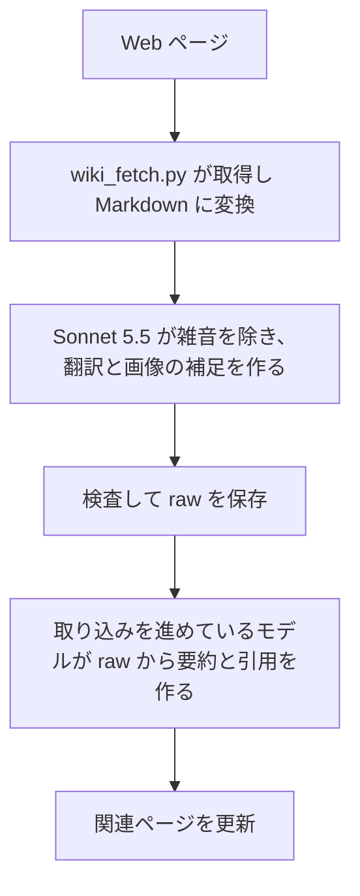

元ページは、2026 年 11 月 13 日の比較をもとに、Claude Code の `/wiki:ingest` で Web の raw を作る段に **Claude Sonnet 5.5** を選んだ記録です。要約ページの作成と関連ページの更新は、取り込みを進めているモデルが担当します。

### Web の取り込みでモデルが関わる場所



wiki プラグイン 0.15.0 から、Claude Code では `wiki:web-raw` が raw の段を受け持ちます。それ以前の版では、取り込みを進めているモデルが raw の段も担当しました。メインを Opus 5.5 にした分担の実行では、Sonnet の raw の段は費用の約 1 割でした。モデルを比べた試験の対象は Web の raw です。PDF とテキストでは原本をそのまま保存するため、raw の内容はモデル選択の影響を受けません。

### Sonnet 5.5 を選んだ理由


元ページによると、この比較で Sonnet 5.5 に重大な誤訳は見つかりませんでした。Haiku 5.5 はコードブロックの内容を変えたりリンクを落としたりし、所要時間は Sonnet 5.5 と同程度でした。

### raw の誤りと再評価の条件

Sonnet 5.5 でも、原文にない記号の補足、画像の数値の読み違い、タグリンクや重複した題名の残存がありました。画像の読み違いは、照合した 9 枚のうち 1 枚でした。raw は後続の引用の根拠になるため、誤りが分かったときは取り直して別版にします。

図の多い英語のページで読み違いが目立つなら、その種のページに Opus を使う案を再検討します。新モデルが出たときは同じ 4 ページで比較し、同一モデルの effort だけを変える場合は、用途に合う評価で比較します。


```svg-figure raw-models
<svg xmlns="http://www.w3.org/2000/svg" width="720" height="298" viewBox="0 0 720 298" role="img" aria-labelledby="raw-title raw-desc">
  <title id="raw-title">Web の raw を作るモデルの比較</title>
  <desc id="raw-desc">2026年11月13日の比較では、Sonnet 5.5 の忠実さは Opus 5.5 と0から0.4点の差で、所要時間は7分の1から2分の1だった。Haiku 5.5 は Sonnet 5.5 と同程度の時間で、コードの変更とリンクの欠落があった。</desc>
  <rect width="720" height="298" rx="16" fill="#f2f6fa"/>
  <g font-family="system-ui, 'Yu Gothic UI', Meiryo, sans-serif" fill="#192e44">
    <text x="24" y="38" font-size="22" font-weight="700">Web の raw を作るモデルの比較</text>
    <text x="24" y="64" font-size="14" fill="#435b71">2026 年 11 月 13 日の試験で Sonnet 5.5 の継続使用を決定</text>
    <rect x="24" y="87" width="330" height="108" rx="10" fill="#e6f4ee"/>
    <rect x="366" y="87" width="330" height="108" rx="10" fill="#e7eff9"/>
    <text x="42" y="115" font-size="15" font-weight="700" fill="#235a4c">目隠し評価での忠実さ</text>
    <text x="42" y="151" font-size="27" font-weight="750" fill="#235a4c">0〜0.4 点差</text>
    <text x="42" y="177" font-size="14">Sonnet 5.5 と Opus 5.5 の差</text>
    <text x="384" y="115" font-size="15" font-weight="700" fill="#294f79">Sonnet 5.5 の所要時間</text>
    <text x="384" y="151" font-size="27" font-weight="750" fill="#294f79">1/7〜1/2</text>
    <text x="384" y="177" font-size="14">Opus 5.5 の所要時間に対する比</text>
    <rect x="24" y="208" width="672" height="65" rx="10" fill="#ffffff" stroke="#d4dee7"/>
    <text x="42" y="234" font-size="15" font-weight="700">Haiku 5.5 で確認した問題</text>
    <text x="42" y="255" font-size="14" fill="#40576b">コードブロックの変更とリンクの欠落。所要時間は Sonnet 5.5 と同程度。</text>
  </g>
</svg>

```
