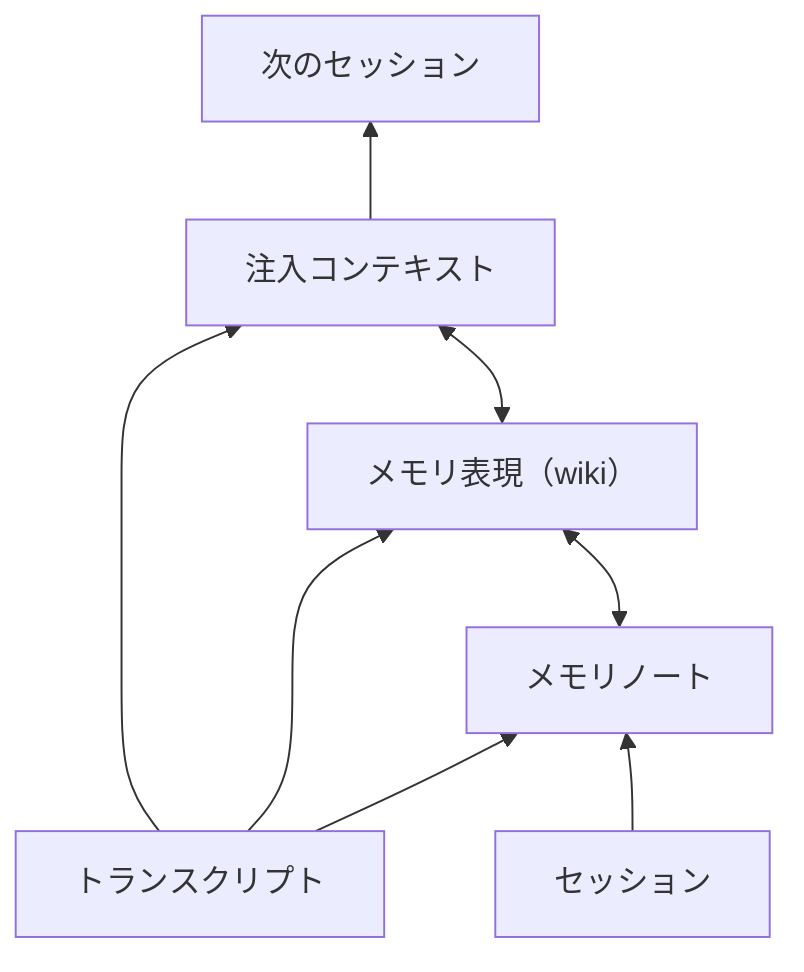

# エージェントのメモリの階層

エージェントがセッションをまたいで持つメモリを、4 つの層と、層の間を整理するドリーミング（dreaming）で捉える枠組みである。Anthropic の記事 [[components-of-agent-memory]]（2026-11-06）が、評価の結果とともに示した。ここでのメモリは、あとで読めるコンテキストとして保存した知識だけを指し、重みの変更、文脈内学習、コンパクションは含まない。

## 4 つの層

| 層 | 中身 | 読まれ方 |
| --- | --- | --- |
| 注入コンテキスト | すべてのセッションの始まりに読み込むノート | 検索しなくても、在ることを知らなくても届く |
| メモリ表現 | wiki など、ある主題について知っていることを集め、リンクでつないだページ | 必要なときに読むか検索する |
| メモリノート | セッションの中で Claude が目立つと判断して書いたノート | 同上 |
| トランスクリプト | セッションの記録。検索できるイベントログ | 検索する。ほかの層を確かめる正解になる |

> Claude Opus 5.5 補足: 記事の図 1 を描き直した。ドリーミングは、トランスクリプトから各層へ、また上の隣り合う層の間で働く。セッションの中でじかに書くのはメモリノートだけで、注入コンテキストは次のセッションの入口になる。

## ドリーミングの役目

ドリーミングは、セッションの外の時間に、ログとトランスクリプトを見直してメモリを整理することである。人の脳が眠りや休息の間に体験を再生して長期記憶に移すことになぞらえている。記事は次の役目を挙げる。

- **ノートを直す。** ノートをトランスクリプトと照らして、最初からの誤りや、環境が変わってずれたものを直す。
- **表現を組み立てる。** トランスクリプトとノートから wiki を作り、続く回で足し、直し、刈り込む。
- **最上位の層を小さく保つ。** 詳細を下の層へ移し、リンクを残す。
- **目標に合わせる。** 何が重要かを指示で伝え、その目標に向けてメモリを育てる。
- **セッションの隙間を埋める。** 1 つのセッションには見えない、複数のセッションに共通する誤りやパターンを見つける。切れたリンクを向け直し、索引を足す。

### 組み方の例

cookbook [[managed-agents-cma-dreaming-with-a-dynamic-workflow]] は、ドリーミングを Managed Agents の動的ワークフローで組む。リードエージェント（Sonnet 5.5）はワークフローを書いて始めるだけで、トランスクリプトを読まない。トランスクリプト 1 件に 1 体のアナライザー（Haiku 5.5）が、関係するメモリを検証、補強、整理し、最後にオーガナイザー（Haiku 5.5）が 1 回だけ重複を統合して `_index.md` を仕上げる。出来上がるのは、`_index.md` を入口にした小さな相互リンクのファイルで、トランスクリプトの層からメモリ表現の層を作る形である。

## 層ごとの注意

- **ノートは予測である。** 何を書くかは、将来に何が要るかの予測になる。強いモデルには、何に使うかだけを伝え、書き方の規則を決めないほうがよい。「失敗だけを記録する」という規則は、Opus 5 のメモリによる上積みを減らした（[[エージェントに守らせる決まりの書き方]]）。画面や環境から毎回読める情報を残すのは冗長で、古くなったノートを調べ回すことに時間を使うようになる。
- **wiki は、検索と組み合わせる。** wiki だけより、wiki と検索の組のほうが点数が高く（54% から 61%、検索だけは 53%）、トークンも減った。効くのは、複数の文書をまたぐ問いや、判断と計算が要る問いである。1 つの文書の文字列検索で答えが見つかる問いでは、差が出なかった。抽象化しないまま元の文書より大きくなった wiki もある。費用の面では、変化の遅い文書群から一度作った wiki があれば、小さいモデル（Haiku 5.5）が、生の文書を検索する大きいモデル（Sonnet 5.5）との差を 1 ポイント以内にし、1 回答あたりの価格は約 15 分の 1 で、約 240 問で wiki を作る費用（約 19 ドル）の元が取れる、という主張もある（[[claude-quickstarts-managed-agents-knowledge-wiki]]、確かめていない）。
- **共有のページの書き手は 1 つにする。** 複数のエージェントが 1 つのページを同時に書くと、互いの行を消して事実が欠けた（[[editとwriteの書き込みの競合]]）。
- **注入する層は小さく保つ。** 注入はトークンを使い、誤ったノートをすべてのセッションに持ち込む。読み込んでも従うとは限らず、指示のファイルが長いほど従う度合いが下がる。Claude Code の auto memory は、`MEMORY.md` の先頭の 200 行か 25 KB だけを読み込み、その部分を索引にしている。Managed Agents では、メモリストアを使うセッションに読み取り専用でマウントし、すべてのセッションに読み込む部分はマウントの `instructions`（4,096 文字まで）で渡す（[[managed-agents-cma-dreaming-with-a-dynamic-workflow]]）。

## 未解決の問い

メモリをその場で書くか、ドリーミングに回すかには引き換えがある。その場で書くと本来のタスクから注意がそれ、ドリーミングに回すとすぐには使えない。メモリを最新に保つには計算資源が要り、すべてを確かめ続けるのは現実的でないかもしれない。記事は、変わりそうな情報に絞ることと、使われる頻度でドリーミングの回数を決めることを挙げている。

## 関係するページ

- [[components-of-agent-memory]]
- [[managed-agents-cma-dreaming-with-a-dynamic-workflow]]
- [[claude-quickstarts-managed-agents-knowledge-wiki]]
- [[llm-wiki記事作成の方法論]]
- [[ドリーミングのinfo-hive-wikiへの適用]]: ドリーミングを、この wiki の会話の取り込みと書く段に照らした見立て
