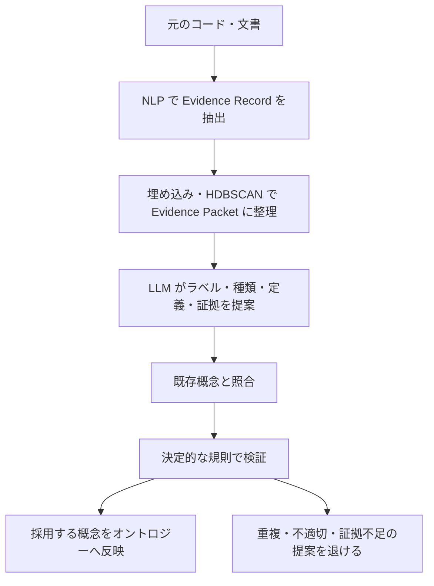

# オントロジー候補の生成と採用の分離

オントロジーを自動で作るとき、概念名と定義を生成できることと、その概念を知識として採用すべきことを分ける。[[building-an-ontology-agent]] では、LLM は整理された証拠から概念を提案し、周囲の処理が既存概念との照合と採用前の検証を行う。LLM はオントロジーへ直接書き込まない。

## 証拠から提案まで

> GPT-6 補足: 記事の処理の分担を整理した。意味を推論する LLM の前に証拠の抽出と集約を置き、後ろに照合と検証を置く。概念から提案、パケット、レコード、元のソースへ逆にたどれることも、この分担の目的である。

コードのクラス・インターフェース・依存関係・コメントと、文書の用語・エンティティ・名詞句・関係を、共通の証拠レコードに変換する。グループごとの代表的な証拠だけをパケットにすることで、LLM は大量のレコードの分類まで引き受けず、上位の業務の概念を推論できる。HDBSCAN を選んだ理由は、グループ数が未知で、外れ値を無理に分類したくなかったためである。

## 採用前に分けて調べること

| 判定 | 記事で使った方法・観点 |
| --- | --- |
| すでに同じ概念があるか | ラベルの完全一致、BM25、埋め込みの類似度 |
| 既存概念とどう違うか | 同値、別名、狭義、広義、関連、新規、証拠不足という分類 |
| 提案の要件を満たすか | 証拠、ラベル、意味のある定義、許可された種類 |
| 業務の概念として扱えるか | 表のフィールドや UI の用語を概念にしていないか |

> 採用前の判定 補足: 記事は、照合と検証の役割を説明しているが、個々の規則や閾値の実装は示していない。形式を検査できることと、意味の妥当性をどこまで判定できるかは、別に確かめる必要がある。後者はこの wiki からの留保である。

## 見送りは別に確かめる

記事の小さなローカルモデルは、約 100 件以上の製品文書から作った千件超のパケットに対し、見送ってよいと指示されても、ほとんど見送らなかった。もっともらしい説明を作る力があっても、追加する価値のある知識を選べるとは限らない、という観察である。

見送り率や採用精度の数値、モデル名、別のモデルとの比較は記載されていない。すべての LLM に一般化せず、見送りの指示と、採用の判定を分けた事例として扱う（[[エージェントに守らせる決まりの書き方]]）。

## 答えるべき質問による採用の判断

[[ontology-engineering-for-enterprise-ai]] は、システムが答えるべき質問を先に定め、必要な概念だけを専門家の確認を経て採用する方針を示す。証拠から候補を生成する処理に、用途から範囲を絞る観点を加える（[[オントロジーと知識グラフの役割]]）。

## 関係するページ

- [[building-an-ontology-agent]]: 設計と実験の出典
- [[エージェントに守らせる決まりの書き方]]: 指示だけで決める範囲と、判定を外へ出す範囲
- [[グラフの抽出の契約]]: この wiki で、記録済みのページと関係をグラフへコンパイルする段階の契約
