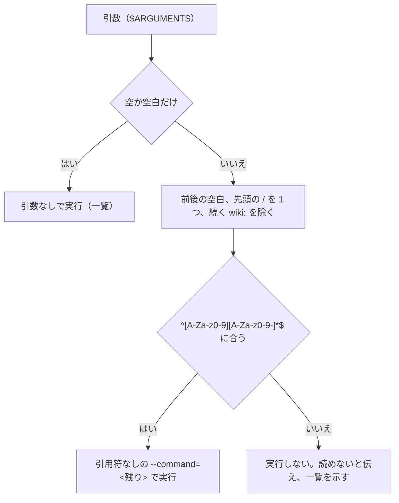

# スラッシュコマンドの引数をスクリプトに渡す

プラグインのコマンド（`commands/*.md`）が、利用者の書いた引数を同梱のスクリプトに渡すときの決まりである。`/wiki:help [command]`（wiki 0.14.0）を作ったときに、GPT-6.1 Sol の敵対的レビューで崩れた前提から決めた（[[helpの個別のヘルプとリリース-wiki-0.14.0]]）。

## `$ARGUMENTS` はシェルのための引用をしない

Claude Code は、コマンドの本文の `$ARGUMENTS` を、利用者が書いた文字列に置き換えるだけである。引用やエスケープはしない。本文に「`--command='<引数>'` で実行する」と書いても、引数の中の `'` で外に出られる。1 版目の設計のレビューで、`query'; echo HELP_ARG_EXECUTED; #` を渡すと、Git Bash と PowerShell のどちらでも、ヘルプのあとに別のコマンドが動くことが確かめられた。`query'` だけでも、Python に届く前にシェルの構文の誤りになる。

引用の規則はシェルごとに違い、エージェントが正しく引用する保証もない。そこで、引用に頼らず、シェルに届く文字を限る。

> 引数の扱いの図 補足: `commands/help.md` がエージェントに求める 4 段の処理である。シェルに届くのは英数字と `-` だけで、どのシェルでも特別な意味を持たない。名前の正規化と照合はスクリプトが決定的に行い、エージェントは名前を推し量って直さない（`qury` を `query` に直さない）。

- `--command=<名前>` と `=` でつなぐ。値が `-` で始まる形でも、argparse がオプションと読まない。
- 先頭の `/` を残すと、Git Bash が `--command=/wiki:query` を Windows のパスに書き換える（[[git-bashのパス変換]]）。シェルに届く値に `/` と `:` を残さない。
- 試験は、`commands/help.md` にこの正規表現と手順が書いてあることと、正規表現が `'`、`"`、`` ` ``、`$`、`;`、`&`、`|`、空白、`/`、`:` などを含む値を通さないことを確かめる（info-hive-dev の `tests/wiki/test_help_command.py`）。エージェントが手順どおりに動くかは試験にできないので、`claude -p --plugin-dir` で注入を試みる入力を渡し、スクリプトに引数が渡らないことを手で確かめた。

## 対話のセッションでは、先頭に並んだコマンドが別々に展開される

Claude Code の公式の文書（「Stack several skills in one message」）によると、対話のセッションでメッセージの先頭にスラッシュコマンドを並べると、それぞれが別のコマンドとして展開され、残りの文字列が各コマンドの引数になる。`claude -p` は最初のコマンドだけを読み、残りを引数にする。

- そのため、`/wiki:help /wiki:query` は、対話のセッションでは `/wiki:help` の引数が空になり、`/wiki:query` の手順も読み込まれる見込みが高い。`/wiki:help /wiki:init` なら、ヘルプを求めたのに初期化の手順が混ざる。
- この差は `claude -p` の試験では見つからない。`claude -p` では `/wiki:help /wiki:query` が `query` のヘルプを出した。
- 引数にコマンド名を受け取るコマンドは、`/wiki:` を付けない名前（`query`）で書くよう案内する。`wiki:query` は先頭が `/` でないので展開されない。
- この節は公式の文書からの推論で、対話のセッションでは確かめていない。

## 関係するページ

- [[helpの個別のヘルプとリリース-wiki-0.14.0]]
- [[コマンドの出力のリンク]]
- [[git-bashのパス変換]]
