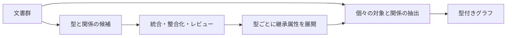

# スキーマの導出と事実の抽出の分離

文書をグラフへ変換するとき、共通の「型と関係の語彙」を決める段階と、「個々の対象と関係」を抽出する段階を分ける設計。[[mykgのアーキテクチャ]] は、文書ごとに別の型が生まれる不統一を避けるため、先に文書群全体で使うスキーマを導出する。

## 二段階の分担

> 二段階の分担 補足: [[mykg]] の Pass 1 と Pass 2 を整理した。スキーマが処理の途中に保存されるため、導出後の確認と、抽出のやり直しを分けられる。

| 段階 | 問う内容 | myKG で残すもの |
| --- | --- | --- |
| スキーマの導出 | どの種類の対象があり、どの関係で結ぶか | 概念の階層、属性、domain/range、schema.json と schema.ttl |
| 事実の抽出 | どの具体的な対象が、その型と関係に当てはまるか | 型付きノード・エッジ、属性値、確信度、出所 |

> 分担の補足: [[オントロジーと知識グラフの役割]] の定義と個別の事実を分ける考え方に対応する。ここでの出力は myKG の実装例であり、すべての方式で同じ形式を採る必要はない。

## 実装上の工夫

myKG の Pass 1 は、複数バッチの候補を機械的に統合したあと、LLM で意味の近い型と抽象度を見直す。独立した候補を作る処理と、全体で使う語彙を決める処理を分けている。

スキーマには各型自身の属性を保存し、Pass 2 の前に親の属性を展開する。LLM に継承を推測させず、必要な属性を一覧で渡すことで、保存形式と抽出時の扱いやすさを両立する。

既存の語彙を固定しながら拡張する方法と、語彙を完全に凍結して導出を省く方法を区別する。新しい語彙を追加した場合、過去の文書は旧スキーマで抽出したままなので、myKG は関係する過去のチャンクを選んで再抽出する。選択は上限のあるヒューリスティックであり、全件の取り直しと同じ網羅性を保証しない。

## 成り立つ範囲と留保

分離がそろえるのは、抽出で使う型と関係の語彙である。同じ正規名でも別の対象かもしれず、関係が誤って抽出されることもある。形式がそろうことと、事実が正しいことは別に確認する。

myKG のスキーマ検証は警告を残して継続する実装で、人のレビューも任意である。そのため、この製品について「型の検証に通ったものだけが抽出される」とは説明しない。高度な OWL の制約や推論も対象外である。根拠は [[mykgのアーキテクチャ]] の実装の確認と留保を参照。

## 関係するページ

- [[mykgのアーキテクチャ]]: 12 段階の処理と保存・探索の分担
- [[mykg]]: この設計を使う製品
- [[オントロジーと知識グラフの役割]]: スキーマと個別の事実の区別
- [[オントロジー候補の生成と採用の分離]]: 候補を作ることと採用を決めることを分ける別の実験
