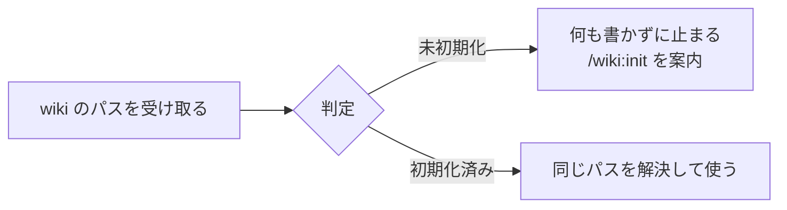

# 初期化された wiki の判定（SCHEMA.md）

wiki 0.13.0 から、プラグインのどの入口も、ルートに `SCHEMA.md` がある（初期化された）ディレクトリだけを wiki として扱う（ADR-0019）。判定は `info-hive-wiki/skills/info-hive/scripts/wiki_initialized.py` の 1 か所にある。入口や試験の素材を足すときは、ここに書いた決まりに従う（[[初期化していないディレクトリの扱い-wiki-0.13.0]]）。

## 判定

- ルートがディレクトリで、その直下の `SCHEMA.md` が通常のファイル（リンクなら、先が通常のファイル）であれば初期化済みである。中身は読まない。
- 調べ方は `os.stat()` の 1 回ずつである。`Path.is_file()` は、失敗の扱いが Python の版で違うので使わない。大文字と小文字はファイルシステムに任せる（Windows と macOS では `schema.md` も見つかる）。
- 結果（`check()`）は、理由の種類と、調べたうえで決まったか（`certain`）を持つ。ない、ディレクトリでない、`SCHEMA.md` がないか通常のファイルでないは「決まった」、アクセス権や循環するリンクで調べられないは「決まっていない」である。
- rag の `rag_config.py` も同じ規則を自分で持つ。規則を変えるときは両方をそろえる。

## 判定する場所

> 判定の流れ 補足: 判定は wiki を読み始める前、パスを解決する前に、渡されたとおりのパスで行う。パスを解決して使う入口は、自分で解決せず、判定と解決を一度に行う `resolve()` の戻り値を使う。

- 1 回で終わる CLI は、引数を読んだ直後に判定する。未初期化なら、理由と案内を標準エラーに書いて終了コード 1 で止まる。
- サブコマンドを持つ入口は、振り分けの前の 1 か所で判定し、判定しないサブコマンドを名前で除く（`wiki_evolve.py` の `WIKI_FREE_ACTIONS`）。新しいサブコマンドは、既定で判定を通る。
- 長く動く MCP のサーバーと閲覧のサーバーは、要求のたびに判定する。MCP は索引のキャッシュを引く前に判定し、エラーを返す。閲覧のサーバーは、決まった未初期化なら 503（パスを含まない理由の文）、決まっていなければ新しい内容を組み立てず、前の内容を古いと示して出す。閲覧の `core` は、要求ごとに `no_wiki` を返す。
- `wiki_fetch.py` は `--wiki` を必須で受け取り、ネットにつなぐ前に判定する。raw のルートは作らない。`capture` と評価ループも、raw のディレクトリを作らない。
- `init_wiki.py --upgrade` は、基準のディレクトリを解決する前に `<base>/<wiki-dir>` を判定する。`--upgrade` なしの初期化は判定しない。

## 判定しないもの

- ライブラリの関数（`wiki_lint.lint()`、`collect_pages()`、`WikiIndex` など）。MCP のサーバーと試験が、素のディレクトリに対して呼ぶ。
- 評価のランナー（`wiki_evolve_agent.py` など）が受け取る `wiki_root`。評価ループが事実情報のコーパスを一時ディレクトリに写したもので、利用者の wiki ではない。info-hive のスキルを評価するコーパスには、スキルが止まらないよう `SCHEMA.md` を置く。
- Python が入口を読み込むときにプラグインの置き場所に書くバイトコードのキャッシュ。初期化済みの wiki でも同じに起きるので、判定とは別の話である。

## 試験の素材

- CLI、MCP のツール、閲覧に渡す試験用の wiki には、`SCHEMA.md` を置く。`SCHEMA.md` はページに数えないので、lint、検索、グラフの結果は変わらない。0.13.0 では、親の `tests/` と子の `eval/` の素材に足した。0.12.2 で入った素材にも、マージのときに足した。
- 親の `tests/wiki/test_uninitialized_wiki.py` は、`scripts/` の `__main__` を持つスクリプトを構文木で見つけ、閉じた一覧（wiki を受け取る、評価のランナー、wiki を受け取らない）に分類させる。入口のスクリプトを足したら、この一覧に入れ、wiki を受け取るなら `wiki_initialized` の関数を呼び、`ReaderEntryTests` の表に呼び出し方を足す。
- `<wiki>/ない/..` を渡す試験は、Windows では `..` がファイルシステムを呼ぶ前に縮むので飛ばされる。Linux（CI か WSL）で確かめる。
